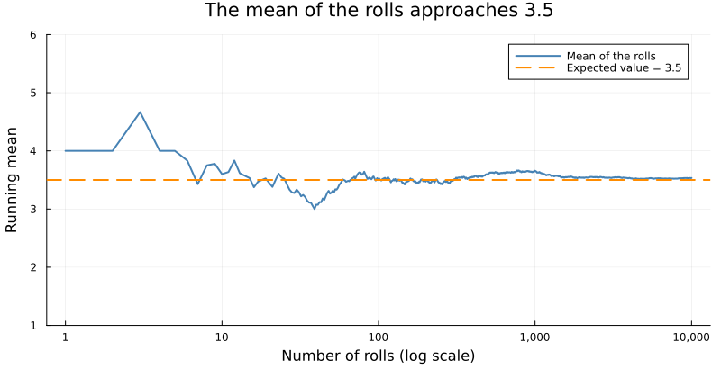
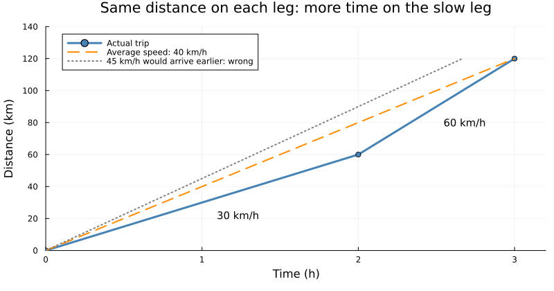

---
layout: post
image: /assets/images/media-arit.avif
title: "Understanding the Arithmetic Mean"
categories: [DESCRIPTIVE STATISTICS]
tags: [Statistics]
lang: en
ref: media-aritmetica
author: dante-bertuzzi
mathjax: true
description: "What the arithmetic mean is, how to compute it from raw data, tables and classes, its properties, when it misleads and the other means. With Julia and Python."
---

A student scored 7.5, 8.0, 6.5, 9.0 and 8.5 on the five exams of the semester. Their mean is 7.9, a grade they did not get on any exam. So what, exactly, does that 7.9 say?

In this post you will see the two readings that answer this question (the **fair share** and the **balance point**), how to compute the mean from raw data, tables and classes, the properties that make it the most used measure in statistics, why a single extreme value is enough to fool it, and when another mean (weighted, geometric, harmonic, quadratic or moving) is the right answer.

## What the arithmetic mean is

The **arithmetic mean** is the sum of the values divided by how many values there are. For $$n$$ observations $$x_1, x_2, \dots, x_n$$:

$$
\bar{x} = \frac{x_1 + x_2 + \dots + x_n}{n} = \frac{1}{n}\sum_{i=1}^{n} x_i
$$

where $$\bar{x}$$ (read "x bar") is the mean, $$x_i$$ is the $$i$$-th observation and $$n$$ is the number of observations. This is the definition in NIST's e-Handbook of Statistical Methods (section 1.3.5.1).

The word "arithmetic" comes from Latin *arithmetica*, from Greek *arithmêtiké*. The Portuguese word for mean, *média*, is the feminine of *médio*, from Latin *medius*, "in the middle" (Priberam dictionary, in Portuguese).

### Sample and population

The same computation gets different names and symbols depending on what the data represent:

- **Sample mean** $$\bar{x}$$: computed from a **sample** of $$n$$ observations. It is a **statistic**: it changes from sample to sample.
- **Population mean** $$\mu$$ (Greek letter "mu"): the mean of **all** $$N$$ elements of the population, $$\mu = \frac{1}{N}\sum_{i=1}^{N} x_i$$. It is a **parameter**, fixed and usually unknown.

In simple random samples, $$\bar{x}$$ is an **unbiased estimator** of $$\mu$$: on average, over all possible samples, it hits $$\mu$$. That does not mean a specific sample hits it; how far it usually misses is the subject of the [standard error](#standard-error-of-the-mean), further down.

## Worked example: the semester's grades

**Data** (illustrative): grades on the five exams, from 0 to 10: 7.5, 8.0, 6.5, 9.0, 8.5. $$n = 5$$.

**Formula:** $$\bar{x} = \frac{\sum x_i}{n}$$.

**Substitution:** $$\bar{x} = \frac{7.5 + 8.0 + 6.5 + 9.0 + 8.5}{5}$$.

**Calculation**, one sum at a time:

- 7.5 + 8.0 = 15.5
- 15.5 + 6.5 = 22.0
- 22.0 + 9.0 = 31.0
- 31.0 + 8.5 = 39.5

and $$\bar{x} = \frac{39.5}{5} = 7.9$$.

**Result:** the mean is 7.9 points.

**Interpretation:** it is the student's "typical" performance in the semester. Two grades were below 7.9 and three above; the mean does not have to be one of the grades, nor does it split the data in half (that is the job of the [median](/median/)).

  

  

    
Julia

    

    <button class="copy-button" onclick="copyCode(this)">
      <i class="bi bi-clipboard"></i>Copy
    </button>
  

  

    <pre><code>using Statistics

grades = [7.5, 8.0, 6.5, 9.0, 8.5]

total = sum(grades)
n = length(grades)
println("Sum = ", total, "   n = ", n)
println("Manual mean = ", total / n)
println("Mean with mean() = ", mean(grades))

deviations = grades .- mean(grades)
println("Deviations = ", round.(deviations, digits = 2))
println("Sum of deviations = ", sum(deviations))   # zero, up to rounding error</code></pre>
  

  
# Output

  <pre style="overflow-x: auto; font-size: 0.9em;">Sum = 39.5   n = 5
Manual mean = 7.9
Mean with mean() = 7.9
Deviations = [-0.4, 0.1, -1.4, 1.1, 0.6]
Sum of deviations = -1.7763568394002505e-15</pre>

  

  

  

    
Python

    

    <button class="copy-button" onclick="copyCode(this)">
      <i class="bi bi-clipboard"></i>Copy
    </button>
  

  

    <pre><code>import numpy as np

grades = np.array([7.5, 8.0, 6.5, 9.0, 8.5])

total = grades.sum()
n = len(grades)
print("Sum =", total, "  n =", n)
print("Manual mean =", total / n)
print("Mean with np.mean() =", np.mean(grades))

deviations = grades - grades.mean()
print("Deviations =", np.round(deviations, 2))
print("Sum of deviations =", deviations.sum())   # zero, up to rounding error</code></pre>
  

  
# Output

  <pre style="overflow-x: auto; font-size: 0.9em;">Sum = 39.5   n = 5
Manual mean = 7.9
Mean with np.mean() = 7.9
Deviations = [-0.4  0.1 -1.4  1.1  0.6]
Sum of deviations = -1.7763568394002505e-15</pre>

  

The sum of the deviations came out as $$-1.78 \times 10^{-15}$$, not zero, because of how the computer rounds decimal numbers: 0.1 and 0.4 have no exact binary representation. In exact arithmetic the sum is zero, as the next section shows.

### Missing values

Before computing, check how your tool handles missing values. Julia returns `missing` and NumPy returns `nan` if you do not handle them; pandas skips them by default. Skipping can be the right choice, but it is a choice: if values are missing for a reason related to them (the lowest grades were not recorded, for example), the mean of what is left is biased.

  

  

    
Julia

    

    <button class="copy-button" onclick="copyCode(this)">
      <i class="bi bi-clipboard"></i>Copy
    </button>
  

  

    <pre><code>using Statistics

data = [7.5, missing, 6.5, 9.0, missing, 8.5]

println("Untreated: ", mean(data))                  # missing contaminates the result
println("Skipping missing values: ", mean(skipmissing(data)))</code></pre>
  

  
# Output

  <pre style="overflow-x: auto; font-size: 0.9em;">Untreated: missing
Skipping missing values: 7.875</pre>

  

  

  

    
Python

    

    <button class="copy-button" onclick="copyCode(this)">
      <i class="bi bi-clipboard"></i>Copy
    </button>
  

  

    <pre><code>import numpy as np
import pandas as pd

data = pd.Series([7.5, None, 6.5, 9.0, None, 8.5])

print("NumPy untreated:", np.mean(data.to_numpy()))      # NaN contaminates the result
print("NumPy skipping missing values:", np.nanmean(data.to_numpy()))
print("pandas (skips by default):", data.mean())</code></pre>
  

  
# Output

  <pre style="overflow-x: auto; font-size: 0.9em;">NumPy untreated: nan
NumPy skipping missing values: 7.875
pandas (skips by default): 7.875</pre>

  

## Two ways of seeing the mean

### Fair share

If the semester's 39.5 points were redistributed equally among the five exams, each would get $$39.5 \div 5 = 7.9$$. The mean is the value that **keeps the total** when everyone becomes equal. That is why mean × $$n$$ gives back the total, a property the median does not have.

### Balance point

Subtract the mean from each grade. The results are the **deviations**:

| Grade $$x_i$$ | Deviation $$x_i - \bar{x}$$ |
|:---:|:---:|
| 7.5 | 7.5 − 7.9 = −0.4 |
| 8.0 | 8.0 − 7.9 = 0.1 |
| 6.5 | 6.5 − 7.9 = −1.4 |
| 9.0 | 9.0 − 7.9 = 1.1 |
| 8.5 | 8.5 − 7.9 = 0.6 |

The negative deviations add up to $$-0.4 - 1.4 = -1.8$$; the positive ones, $$0.1 + 1.1 + 0.6 = 1.8$$. They cancel out: if each grade were a weight on a ruler, the ruler would balance on the point 7.9.

This holds for any data set, not just this one. Since $$\sum x_i = n\bar{x}$$ (that is the definition of the mean, multiplied by $$n$$):

$$
\sum_{i=1}^{n} (x_i - \bar{x}) = \sum_{i=1}^{n} x_i - n\bar{x} = n\bar{x} - n\bar{x} = 0
$$

## Properties that make the mean so widely used

### 1. It minimizes the sum of squared deviations

Among all numbers $$c$$, the mean is the one that minimizes the sum $$S(c) = \sum (x_i - c)^2$$. To see why, write $$x_i - c = (x_i - \bar{x}) + (\bar{x} - c)$$, square it and add up:

$$
S(c) = \sum (x_i - \bar{x})^2 + 2(\bar{x} - c)\sum (x_i - \bar{x}) + n(\bar{x} - c)^2
$$

The middle term is zero (it is the sum of the deviations), which leaves

$$
S(c) = \sum (x_i - \bar{x})^2 + n(\bar{x} - c)^2
$$

The first term does not depend on $$c$$; the second is zero at $$c = \bar{x}$$ and positive anywhere else. For the grades: $$S(7.9) = 0.16 + 0.01 + 1.96 + 1.21 + 0.36 = 3.70$$, and $$S(8.0) = 3.70 + 5 \times (7.9 - 8.0)^2 = 3.70 + 0.05 = 3.75$$.

This property links the mean to the method of [least squares](/en/data-analysis/linear-regression) and to the variance. (The median minimizes the sum of **absolute** deviations; the [post on the median](/median/) shows why that makes it less sensitive to extremes.)

### 2. Changing the scale or origin changes the mean the same way

If each value becomes $$y_i = a x_i + b$$, then $$\bar{y} = a\bar{x} + b$$, because $$\frac{1}{n}\sum (a x_i + b) = a \cdot \frac{1}{n}\sum x_i + \frac{1}{n} \cdot n b$$.

**Example:** temperatures on five days, 18, 21, 24, 19 and 23 °C. The mean is $$\frac{18 + 21 + 24 + 19 + 23}{5} = \frac{105}{5} = 21$$ °C. In Fahrenheit ($$F = 1.8\,C + 32$$), there is no need to convert the five values: $$1.8 \times 21 + 32 = 37.8 + 32 = 69.8$$ °F.

### 3. Groups combine through the weighted mean of the means

Class A has 20 students with mean 7.0; class B, 30 students with mean 8.0. The overall mean is **not** $$\frac{7.0 + 8.0}{2} = 7.5$$, because B has more students:

$$
\bar{x}_{\text{overall}} = \frac{n_A \bar{x}_A + n_B \bar{x}_B}{n_A + n_B} = \frac{20 \times 7.0 + 30 \times 8.0}{20 + 30} = \frac{140 + 240}{50} = \frac{380}{50} = 7.6
$$

With the median this is impossible: group medians do not combine.

### 4. It lies between the smallest and the largest value

Since each $$x_i$$ is between the minimum and the maximum, the sum is between $$n \times \text{minimum}$$ and $$n \times \text{maximum}$$, and the mean is between the two.

  

  

    
Julia

    

    <button class="copy-button" onclick="copyCode(this)">
      <i class="bi bi-clipboard"></i>Copy
    </button>
  

  

    <pre><code>using Statistics, Printf

grades = [7.5, 8.0, 6.5, 9.0, 8.5]

# 1. The mean minimizes the sum of squared deviations
S(c) = sum((grades .- c) .^ 2)
@printf("S(7.9) = %.2f   S(8.0) = %.2f\n", S(7.9), S(8.0))

# 2. Change of scale and origin: °C -&gt; °F
celsius = [18, 21, 24, 19, 23]
fahrenheit = 1.8 .* celsius .+ 32
@printf("Mean in °C = %.1f   mean in °F = %.2f   1.8 × 21 + 32 = %.2f\n",
        mean(celsius), mean(fahrenheit), 1.8 * 21 + 32)

# 3. Combining groups of different sizes
nA, mA, nB, mB = 20, 7.0, 30, 8.0
println("Overall mean = ", (nA * mA + nB * mB) / (nA + nB), "   mean of the means = ", (mA + mB) / 2)</code></pre>
  

  
# Output

  <pre style="overflow-x: auto; font-size: 0.9em;">S(7.9) = 3.70   S(8.0) = 3.75
Mean in °C = 21.0   mean in °F = 69.80   1.8 × 21 + 32 = 69.80
Overall mean = 7.6   mean of the means = 7.5</pre>

  

  

  

    
Python

    

    <button class="copy-button" onclick="copyCode(this)">
      <i class="bi bi-clipboard"></i>Copy
    </button>
  

  

    <pre><code>import numpy as np

grades = np.array([7.5, 8.0, 6.5, 9.0, 8.5])

# 1. The mean minimizes the sum of squared deviations
S = lambda c: ((grades - c) ** 2).sum()
print(f"S(7.9) = {S(7.9):.2f}   S(8.0) = {S(8.0):.2f}")

# 2. Change of scale and origin: °C -&gt; °F
celsius = np.array([18, 21, 24, 19, 23])
fahrenheit = 1.8 * celsius + 32
print(f"Mean in °C = {celsius.mean():.1f}   mean in °F = {fahrenheit.mean():.2f}   1.8 × 21 + 32 = {1.8 * 21 + 32:.2f}")

# 3. Combining groups of different sizes
nA, mA, nB, mB = 20, 7.0, 30, 8.0
print("Overall mean =", (nA * mA + nB * mB) / (nA + nB), "  mean of the means =", (mA + mB) / 2)</code></pre>
  

  
# Output

  <pre style="overflow-x: auto; font-size: 0.9em;">S(7.9) = 3.70   S(8.0) = 3.75
Mean in °C = 21.0   mean in °F = 69.80   1.8 × 21 + 32 = 69.80
Overall mean = 7.6   mean of the means = 7.5</pre>

  

## Weighted mean

When the values do not matter equally, each one gets a **weight** $$w_i$$:

$$
\bar{x}_w = \frac{\sum w_i x_i}{\sum w_i}
$$

**Example:** exams with grades 7.0 (weight 2), 8.0 (weight 3) and 9.0 (weight 5).

- Numerator: $$7.0 \times 2 + 8.0 \times 3 + 9.0 \times 5 = 14 + 24 + 45 = 83$$
- Denominator: $$2 + 3 + 5 = 10$$
- $$\bar{x}_w = \frac{83}{10} = 8.3$$

The simple mean of the three grades would be 8.0; the weighted one is higher because the highest grade has the largest weight. The [weighted mean calculator](/en/formulas/weighted-mean.html) does this computation with your numbers.

## Mean of a frequency table and of classes

A frequency table is a weighted mean in disguise: each value weighs as many times as it appears.

**Frequency table** (illustrative, the same as in the [post on the median](/median/)): number of children in 40 families, with 7 families with no children, 12 with 1, 11 with 2, 6 with 3 and 4 with 4.

$$
\bar{x} = \frac{0 \times 7 + 1 \times 12 + 2 \times 11 + 3 \times 6 + 4 \times 4}{40} = \frac{0 + 12 + 22 + 18 + 16}{40} = \frac{68}{40} = 1.7 \text{ children}
$$

**Data grouped in classes** (illustrative): grades of 30 students. Without the individual values, the **midpoint** of each class stands in for it.

| Class (grade) | Midpoint $$x_i$$ | Students $$f_i$$ | $$f_i \cdot x_i$$ |
|:---:|:---:|:---:|:---:|
| [5.0, 6.0) | 5.5 | 4 | 22.0 |
| [6.0, 7.0) | 6.5 | 8 | 52.0 |
| [7.0, 8.0) | 7.5 | 12 | 90.0 |
| [8.0, 9.0) | 8.5 | 6 | 51.0 |
| **Total** | | **30** | **215.0** |

$$
\bar{x} \approx \frac{\sum f_i x_i}{\sum f_i} = \frac{215.0}{30} = 7.1666\ldots \approx 7.17
$$

**How wrong can this be?** Each grade is at most half a class width (0.5 points) from the midpoint of its class, so the true mean is at most 0.5 points from the approximation. Using the class limits instead of the midpoints: if everyone were at the lower limit, the mean would be $$\frac{4 \times 5 + 8 \times 6 + 12 \times 7 + 6 \times 8}{30} = \frac{200}{30} \approx 6.67$$; at the upper limit, $$\frac{230}{30} \approx 7.67$$. The true mean is in this interval. What controls the error is the **class width**, not the sample size.

  

  

    
Julia

    

    <button class="copy-button" onclick="copyCode(this)">
      <i class="bi bi-clipboard"></i>Copy
    </button>
  

  

    <pre><code>using Statistics, StatsBase

# Weighted mean: exam grades and weights
grades, weights = [7.0, 8.0, 9.0], [2, 3, 5]
println("Weighted = ", mean(grades, Weights(weights)), "   simple = ", mean(grades))

# Frequency table: number of children in 40 families
children, families = 0:4, [7, 12, 11, 6, 4]
println("Mean number of children = ", sum(children .* families) / sum(families))

# Grouped data: grades of 30 students in classes of width 1
lower = [5.0, 6.0, 7.0, 8.0]
freq = [4, 8, 12, 6]
midpoint = lower .+ 0.5
n = sum(freq)
println("Approximate mean = ", round(sum(midpoint .* freq) / n, digits = 4))
println("The true mean lies between ", round(sum(lower .* freq) / n, digits = 4),
        " and ", round(sum((lower .+ 1) .* freq) / n, digits = 4))</code></pre>
  

  
# Output

  <pre style="overflow-x: auto; font-size: 0.9em;">Weighted = 8.3   simple = 8.0
Mean number of children = 1.7
Approximate mean = 7.1667
The true mean lies between 6.6667 and 7.6667</pre>

  

  

  

    
Python

    

    <button class="copy-button" onclick="copyCode(this)">
      <i class="bi bi-clipboard"></i>Copy
    </button>
  

  

    <pre><code>import numpy as np

# Weighted mean: exam grades and weights
grades, weights = np.array([7.0, 8.0, 9.0]), np.array([2, 3, 5])
print("Weighted =", np.average(grades, weights=weights), "  simple =", grades.mean())

# Frequency table: number of children in 40 families
children, families = np.arange(5), np.array([7, 12, 11, 6, 4])
print("Mean number of children =", (children * families).sum() / families.sum())

# Grouped data: grades of 30 students in classes of width 1
lower = np.array([5.0, 6.0, 7.0, 8.0])
freq = np.array([4, 8, 12, 6])
midpoint = lower + 0.5
n = freq.sum()
print(f"Approximate mean = {(midpoint * freq).sum() / n:.4f}")
print(f"The true mean lies between {(lower * freq).sum() / n:.4f} and {((lower + 1) * freq).sum() / n:.4f}")</code></pre>
  

  
# Output

  <pre style="overflow-x: auto; font-size: 0.9em;">Weighted = 8.3   simple = 8.0
Mean number of children = 1.7
Approximate mean = 7.1667
The true mean lies between 6.6667 and 7.6667</pre>

  

## The weak spot: extreme values

The mean uses the value of every observation, and that has a price: **a single value** can take it anywhere. In the [post on the median](/median/), seven (illustrative) salaries from R\\$ 2,100 to R\\$ 3,400 plus one of R\\$ 25,000 give a mean of R\\$ 5,871.43, and six of the seven people earn less than that. If the largest salary were R\\$ 2,500,000, the mean would jump to R\\$ 359,442.86, without anyone else earning a cent more.

In robust statistics, the mean is said to have a [breakdown point](/en/glossary#breakdown-point) of zero: contaminating one value is enough. A middle ground is the **trimmed mean**, which drops a fraction of the smallest and largest values before averaging (NIST presents it as a robust alternative, in the same section 1.3.5.1). Dropping 1 salary from each end leaves 2,300; 2,500; 2,800; 3,000; 3,400, and the trimmed mean is $$\frac{14{,}000}{5} = $$ R\\$ 2,800 (in this example, it matches the median).

  

  

    
Julia

    

    <button class="copy-button" onclick="copyCode(this)">
      <i class="bi bi-clipboard"></i>Copy
    </button>
  

  

    <pre><code>using Statistics, StatsBase

salaries = [2100, 2300, 2500, 2800, 3000, 3400, 25000]   # R$, illustrative

println("Mean = ", round(mean(salaries), digits = 2))
println("Trimmed mean (drops 1 from each end) = ", mean(trim(salaries; count = 1)))
println("Median = ", median(salaries))

# A single value can take the mean anywhere
for largest in [25_000, 250_000, 2_500_000]
    x = [salaries[1:end-1]; largest]
    println("Largest salary = ", largest, " -&gt; mean = ", round(mean(x), digits = 2))
end</code></pre>
  

  
# Output

  <pre style="overflow-x: auto; font-size: 0.9em;">Mean = 5871.43
Trimmed mean (drops 1 from each end) = 2800.0
Median = 2800.0
Largest salary = 25000 -&gt; mean = 5871.43
Largest salary = 250000 -&gt; mean = 38014.29
Largest salary = 2500000 -&gt; mean = 359442.86</pre>

  

  

  

    
Python

    

    <button class="copy-button" onclick="copyCode(this)">
      <i class="bi bi-clipboard"></i>Copy
    </button>
  

  

    <pre><code>import numpy as np
from scipy import stats

salaries = np.array([2100, 2300, 2500, 2800, 3000, 3400, 25000])   # R$, illustrative

print(f"Mean = {salaries.mean():.2f}")
# trim_mean cuts int(0.15 × 7) = 1 value from each end
print("Trimmed mean (drops 1 from each end) =", stats.trim_mean(salaries, 0.15))
print("Median =", np.median(salaries))

# A single value can take the mean anywhere
for largest in [25_000, 250_000, 2_500_000]:
    x = np.append(salaries[:-1], largest)
    print(f"Largest salary = {largest} -&gt; mean = {x.mean():.2f}")</code></pre>
  

  
# Output

  <pre style="overflow-x: auto; font-size: 0.9em;">Mean = 5871.43
Trimmed mean (drops 1 from each end) = 2800.0
Median = 2800.0
Largest salary = 25000 -&gt; mean = 5871.43
Largest salary = 250000 -&gt; mean = 38014.29
Largest salary = 2500000 -&gt; mean = 359442.86</pre>

  

## The mean of a distribution and the law of large numbers

For a random variable, the long-run mean is the [expected value](/en/probability/random-variables). On a fair die, each face comes up with probability $$\frac{1}{6}$$:

$$
E[X] = 1 \cdot \tfrac{1}{6} + 2 \cdot \tfrac{1}{6} + \dots + 6 \cdot \tfrac{1}{6} = \frac{1 + 2 + 3 + 4 + 5 + 6}{6} = \frac{21}{6} = 3.5
$$

No roll gives 3.5. But the mean of many rolls approaches 3.5: this is the **law of large numbers**, the same as in the post [Heads or tails](/cara-ou-coroa/) (in Portuguese).

  

  

    
Julia

    

    <button class="copy-button" onclick="copyCode(this)">
      <i class="bi bi-clipboard"></i>Copy
    </button>
  

  

    <pre><code>using Random, Statistics, Plots, Printf

Random.seed!(123)
n = 10_000
rolls = rand(1:6, n)                         # a fair die
running_mean = cumsum(rolls) ./ (1:n)     # mean of the first k rolls

for k in [10, 100, 1_000, 10_000]
    @printf("After %d rolls: mean = %.4f\n", k, running_mean[k])
end

plot(1:n, running_mean, xscale = :log10, lw = 2, color = :steelblue, label = "Mean of the rolls",
     xlabel = "Number of rolls (log scale)", ylabel = "Running mean", ylims = (1, 6),
     xticks = ([1, 10, 100, 1000, 10000], ["1", "10", "100", "1,000", "10,000"]),
     title = "The mean of the rolls approaches 3.5", size = (800, 420), legend = :topright)
hline!([3.5], color = :darkorange, ls = :dash, lw = 2, label = "Expected value = 3.5")
savefig("mean-law-of-large-numbers.png")</code></pre>
  

  
# Output

  <pre style="overflow-x: auto; font-size: 0.9em;">After 10 rolls: mean = 3.6000
After 100 rolls: mean = 3.5200
After 1000 rolls: mean = 3.6560
After 10000 rolls: mean = 3.5342</pre>

  

  

  

    
Python

    

    <button class="copy-button" onclick="copyCode(this)">
      <i class="bi bi-clipboard"></i>Copy
    </button>
  

  

    <pre><code>import numpy as np
import matplotlib.pyplot as plt

rng = np.random.default_rng(123)
n = 10_000
rolls = rng.integers(1, 7, n)                        # a fair die
running_mean = np.cumsum(rolls) / np.arange(1, n + 1)   # mean of the first k rolls

for k in [10, 100, 1_000, 10_000]:
    print(f"After {k} rolls: mean = {running_mean[k - 1]:.4f}")

plt.figure(figsize=(8, 4.2))
plt.plot(np.arange(1, n + 1), running_mean, lw=2, color="steelblue", label="Mean of the rolls")
plt.axhline(3.5, color="darkorange", ls="--", lw=2, label="Expected value = 3.5")
plt.xscale("log"); plt.ylim(1, 6)
plt.xticks([1, 10, 100, 1000, 10000], ["1", "10", "100", "1,000", "10,000"])
plt.xlabel("Number of rolls (log scale)"); plt.ylabel("Running mean")
plt.title("The mean of the rolls approaches 3.5"); plt.legend()
plt.savefig("mean-law-of-large-numbers-py.png", dpi=120, bbox_inches="tight")</code></pre>
  

  
# Output

  <pre style="overflow-x: auto; font-size: 0.9em;">After 10 rolls: mean = 2.8000
After 100 rolls: mean = 3.4000
After 1000 rolls: mean = 3.4640
After 10000 rolls: mean = 3.4763</pre>

  

Figure 1 – Running mean of 10,000 simulated rolls of a die (Julia code above). In the first rolls it swings a lot; after a few thousand, it stays close to 3.5.

**Interpretation:** after 10,000 rolls, the mean was 3.5342 in the Julia simulation (Python draws different numbers and gives 3.4763). The law guarantees that the mean **converges**; it guarantees nothing about the next roll, and it does not "compensate" a run of high numbers with low ones.

## Standard error of the mean {#standard-error-of-the-mean}

The mean of a sample is rarely equal to $$\mu$$. How far it usually is from $$\mu$$ is measured by the **standard error of the mean**:

$$
\text{SE} = \frac{s}{\sqrt{n}}
$$

where $$s$$ is the sample standard deviation and $$n$$ is the sample size. **Example:** with $$n = 25$$ and $$s = 10$$, $$\text{SE} = \frac{10}{\sqrt{25}} = \frac{10}{5} = 2$$. This means that, from sample to sample, $$\bar{x}$$ varies around $$\mu$$ with a standard deviation of 2 units; to cut that error in half, you need to **quadruple** the sample.

The [standard deviation](/standard-deviation/) describes how the data vary; the standard error, how the mean varies. The post [Standard deviation vs. standard error](/desvio-padrao-x-erro-padrao-qual-a-diferenca/) (in Portuguese) covers the difference, and the standard error is the basis of [confidence intervals](/en/statistical-inference/confidence-intervals) for $$\mu$$ (with $$s$$ in place of $$\sigma$$, Student's t distribution is used).

## Other means, and when each one is right

### Geometric mean: for growth

$$
M_g = \sqrt[n]{x_1 \cdot x_2 \cdots x_n}
$$

It only makes sense for positive values. For 2, 8 and 32: $$\sqrt[3]{2 \times 8 \times 32} = \sqrt[3]{512} = 8$$.

**Where it is right:** growth rates that compound. An investment rises 50% one year and falls 50% the next. The arithmetic mean of the rates says 0%, but R\\$ 100 becomes R\\$ 150 and then R\\$ 75. The geometric mean of the **factors** ($$1.5$$ and $$0.5$$, not of the rates) gets it right:

$$
M_g = \sqrt{1.5 \times 0.5} = \sqrt{0.75} = 0.8660\ldots
$$

that is, an average drop of 13.40% per year: $$100 \times 0.8660^2 = 75$$. See the [geometric mean calculator](/en/formulas/geometric-mean.html).

### Harmonic mean: for rates with a fixed "denominator"

$$
M_h = \frac{n}{\sum_{i=1}^{n} \frac{1}{x_i}}
$$

**Example:** a car drives 60 km at 30 km/h and another 60 km at 60 km/h. The average speed is **not** 45 km/h. The total distance is $$60 + 60 = 120$$ km; the time, $$\frac{60}{30} + \frac{60}{60} = 2 + 1 = 3$$ h; the average speed, $$\frac{120}{3} = 40$$ km/h. The harmonic mean gives the same:

$$
M_h = \frac{2}{\frac{1}{30} + \frac{1}{60}} = \frac{2}{\frac{2}{60} + \frac{1}{60}} = \frac{2}{\frac{3}{60}} = \frac{2 \times 60}{3} = 40 \text{ km/h}
$$

  

  

    
Julia

    

    <button class="copy-button" onclick="copyCode(this)">
      <i class="bi bi-clipboard"></i>Copy
    </button>
  

  

    <pre><code>using Plots

# 60 km at 30 km/h (2 h), then 60 km at 60 km/h (1 h)
time = [0, 2, 3]
distance = [0, 60, 120]
plot(time, distance, lw = 3, marker = :circle, color = :steelblue, label = "Actual trip",
     xlabel = "Time (h)", ylabel = "Distance (km)", xlims = (0, 3.2), ylims = (0, 140),
     title = "Same distance on each leg: more time on the slow leg", size = (800, 420),
     legend = :topleft)
plot!([0, 3], [0, 120], lw = 2, ls = :dash, color = :darkorange, label = "Average speed: 40 km/h")
plot!([0, 120 / 45], [0, 120], lw = 2, ls = :dot, color = :gray, label = "45 km/h would arrive earlier: wrong")
annotate!([(1.1, 22, text("30 km/h", 10, :left)), (2.55, 80, text("60 km/h", 10, :left))])
savefig("harmonic-mean-trip.png")</code></pre>
  

  
# Output

  <pre style="overflow-x: auto; font-size: 0.9em;"></pre>

  

  

  

    
Python

    

    <button class="copy-button" onclick="copyCode(this)">
      <i class="bi bi-clipboard"></i>Copy
    </button>
  

  

    <pre><code>import matplotlib.pyplot as plt

# 60 km at 30 km/h (2 h), then 60 km at 60 km/h (1 h)
time = [0, 2, 3]
distance = [0, 60, 120]
plt.figure(figsize=(8, 4.2))
plt.plot(time, distance, lw=3, marker="o", color="steelblue", label="Actual trip")
plt.plot([0, 3], [0, 120], lw=2, ls="--", color="darkorange", label="Average speed: 40 km/h")
plt.plot([0, 120 / 45], [0, 120], lw=2, ls=":", color="gray", label="45 km/h would arrive earlier: wrong")
plt.text(1.1, 22, "30 km/h"); plt.text(2.55, 80, "60 km/h")
plt.xlim(0, 3.2); plt.ylim(0, 140)
plt.xlabel("Time (h)"); plt.ylabel("Distance (km)")
plt.title("Same distance on each leg: more time on the slow leg"); plt.legend(loc="upper left")
plt.savefig("harmonic-mean-trip-py.png", dpi=120, bbox_inches="tight")</code></pre>
  

  
# Output

  <pre style="overflow-x: auto; font-size: 0.9em;"></pre>

  

Figure 2 – Produced by the Julia code above. The car spends 2 hours on the slow leg and only 1 hour on the fast one. The average speed of 40 km/h (dashed) reaches 120 km together with the car; at 45 km/h (dotted) it would arrive earlier, which did not happen.

The harmonic mean is right **only when the distances are equal**. If it is the times that are equal (1 hour at 30 km/h and 1 hour at 60 km/h), the answer is the arithmetic mean, 45 km/h. If neither distances nor times are equal, use the definition, total distance over total time:

| Situation | Right mean |
|---|---|
| Same distance at each speed | Harmonic |
| Same time at each speed | Arithmetic |
| Different distances | $$\frac{\sum d_i}{\sum (d_i / v_i)}$$ (harmonic weighted by distance) |

**Example with different distances:** a cyclist rides 10 km at 20 km/h and 30 km at 15 km/h. The simple harmonic mean would give $$\frac{2}{\frac{1}{20} + \frac{1}{15}} \approx 17.14$$ km/h, but it assumes equal distances. The right value is $$\frac{10 + 30}{\frac{10}{20} + \frac{30}{15}} = \frac{40}{0.5 + 2} = \frac{40}{2.5} = 16$$ km/h. See the [harmonic mean calculator](/en/formulas/harmonic-mean.html).

### Quadratic mean (RMS): for the size of something that oscillates

$$
M_q = \sqrt{\frac{1}{n}\sum_{i=1}^{n} x_i^2}
$$

For 3, 4 and 5: $$\sqrt{\frac{9 + 16 + 25}{3}} = \sqrt{\frac{50}{3}} = \sqrt{16.67} \approx 4.08$$. It measures the **size** of the values, ignoring the sign: for −3, 3, −3, 3, the arithmetic mean is 0, but the quadratic mean is 3. That is why it shows up for signals that oscillate around zero, such as an alternating voltage, and in the root mean squared error (RMSE) of models.

### The inequality of means

For **positive** values, always

$$
M_h \le M_g \le \bar{x} \le M_q
$$

with equality only when all values are equal (the inequality is in chapter 2 of *Inequalities*, by Hardy, Littlewood and Pólya). For 1, 4 and 9:

$$
\begin{aligned}
M_h &= \frac{3}{\frac{1}{1} + \frac{1}{4} + \frac{1}{9}} = \frac{3}{\frac{36 + 9 + 4}{36}} = \frac{3}{\frac{49}{36}} = \frac{108}{49} \approx 2.20 \\
M_g &= \sqrt[3]{1 \times 4 \times 9} = \sqrt[3]{36} \approx 3.30 \\
\bar{x} &= \frac{1 + 4 + 9}{3} = \frac{14}{3} \approx 4.67 \\
M_q &= \sqrt{\frac{1 + 16 + 81}{3}} = \sqrt{\frac{98}{3}} \approx 5.72
\end{aligned}
$$

and indeed $$2.20 \le 3.30 \le 4.67 \le 5.72$$.

  

  

    
Julia

    

    <button class="copy-button" onclick="copyCode(this)">
      <i class="bi bi-clipboard"></i>Copy
    </button>
  

  

    <pre><code>using Statistics, StatsBase, Printf

x = [1, 4, 9]
@printf("Harmonic   = %.4f\n", harmmean(x))
@printf("Geometric  = %.4f\n", geomean(x))
@printf("Arithmetic = %.4f\n", mean(x))
@printf("Quadratic  = %.4f\n", sqrt(mean(x .^ 2)))

# Growth: +50% one year, -50% the next
factors = [1.5, 0.5]
g = geomean(factors)
@printf("Mean factor = %.4f -&gt; %.2f%% per year\n", g, 100 * (g - 1))
@printf("100 after two years = %.2f\n", 100 * prod(factors))

# Average speed: 60 km at 30 km/h and 60 km at 60 km/h
println("Average speed = ", harmmean([30, 60]), " km/h")</code></pre>
  

  
# Output

  <pre style="overflow-x: auto; font-size: 0.9em;">Harmonic   = 2.2041
Geometric  = 3.3019
Arithmetic = 4.6667
Quadratic  = 5.7155
Mean factor = 0.8660 -&gt; -13.40% per year
100 after two years = 75.00
Average speed = 40.0 km/h</pre>

  

  

  

    
Python

    

    <button class="copy-button" onclick="copyCode(this)">
      <i class="bi bi-clipboard"></i>Copy
    </button>
  

  

    <pre><code>import numpy as np
from scipy import stats

x = np.array([1, 4, 9])
print(f"Harmonic   = {stats.hmean(x):.4f}")
print(f"Geometric  = {stats.gmean(x):.4f}")
print(f"Arithmetic = {x.mean():.4f}")
print(f"Quadratic  = {np.sqrt((x ** 2).mean()):.4f}")

# Growth: +50% one year, -50% the next
factors = np.array([1.5, 0.5])
g = stats.gmean(factors)
print(f"Mean factor = {g:.4f} -&gt; {100 * (g - 1):.2f}% per year")
print(f"100 after two years = {100 * factors.prod():.2f}")

# Average speed: 60 km at 30 km/h and 60 km at 60 km/h
print("Average speed =", stats.hmean([30, 60]), "km/h")</code></pre>
  

  
# Output

  <pre style="overflow-x: auto; font-size: 0.9em;">Harmonic   = 2.2041
Geometric  = 3.3019
Arithmetic = 4.6667
Quadratic  = 5.7155
Mean factor = 0.8660 -&gt; -13.40% per year
100 after two years = 75.00
Average speed = 40.0 km/h</pre>

  

### Moving average: for series over time

In a [time series](/en/data-analysis/time-series), the **simple moving average** (SMA) of order $$k$$ is the mean of the last $$k$$ values, recomputed at each step:

$$
\text{SMA}_t = \frac{x_t + x_{t-1} + \dots + x_{t-k+1}}{k}
$$

For the series 10, 12, 14, 16, 18, 20 and $$k = 3$$: $$\frac{10 + 12 + 14}{3} = 12$$, then 14, 16 and 18. Larger windows smooth more but react more slowly to changes.

Two variations give more weight to the present:

- **Weighted (WMA)**: weights that grow up to the most recent value. With weights 1, 2 and 3, the first window gives $$\frac{1 \times 10 + 2 \times 12 + 3 \times 14}{1 + 2 + 3} = \frac{76}{6} \approx 12.67$$.
- **Exponential (EMA)**: $$\text{EMA}_t = \alpha x_t + (1 - \alpha)\,\text{EMA}_{t-1}$$, with $$0 < \alpha < 1$$. The weights of older values fall geometrically. A starting value is needed; here, the convention $$\text{EMA}_1 = x_1$$. With $$\alpha = 0.5$$: 10; $$0.5 \times 12 + 0.5 \times 10 = 11$$; $$0.5 \times 14 + 0.5 \times 11 = 12.5$$; and so on.

In this series, which rises by 2 at each step, all of them lag **behind** the latest value: the SMA ends at 18, the WMA at 18.67 and the EMA at 18.06, while the series is at 20. That lag is the price of smoothing. The [moving average calculator](/en/formulas/moving-average.html) shows the effect with your data.

  

  

    
Julia

    

    <button class="copy-button" onclick="copyCode(this)">
      <i class="bi bi-clipboard"></i>Copy
    </button>
  

  

    <pre><code>series = [10, 12, 14, 16, 18, 20]
k = 3

sma = [sum(series[t-k+1:t]) / k for t in k:length(series)]
weights = 1:k                                   # the most recent weighs k
wma = [sum(series[t-k+1:t] .* weights) / sum(weights) for t in k:length(series)]

α = 0.5
ema = [float(series[1])]                       # convention: EMA_1 = x_1
for x in series[2:end]
    push!(ema, α * x + (1 - α) * ema[end])
end

println("SMA: ", sma)
println("WMA: ", round.(wma, digits = 4))
println("EMA: ", ema)</code></pre>
  

  
# Output

  <pre style="overflow-x: auto; font-size: 0.9em;">SMA: [12.0, 14.0, 16.0, 18.0]
WMA: [12.6667, 14.6667, 16.6667, 18.6667]
EMA: [10.0, 11.0, 12.5, 14.25, 16.125, 18.0625]</pre>

  

  

  

    
Python

    

    <button class="copy-button" onclick="copyCode(this)">
      <i class="bi bi-clipboard"></i>Copy
    </button>
  

  

    <pre><code>import numpy as np
import pandas as pd

series = pd.Series([10, 12, 14, 16, 18, 20])
k = 3

sma = series.rolling(k).mean().dropna()
weights = np.arange(1, k + 1)                   # the most recent weighs k
wma = series.rolling(k).apply(lambda j: (j * weights).sum() / weights.sum()).dropna()
ema = series.ewm(alpha=0.5, adjust=False).mean()   # adjust=False: EMA_1 = x_1

print("SMA:", sma.tolist())
print("WMA:", wma.round(4).tolist())
print("EMA:", ema.tolist())</code></pre>
  

  
# Output

  <pre style="overflow-x: auto; font-size: 0.9em;">SMA: [12.0, 14.0, 16.0, 18.0]
WMA: [12.6667, 14.6667, 16.6667, 18.6667]
EMA: [10.0, 11.0, 12.5, 14.25, 16.125, 18.0625]</pre>

  

## When the mean misleads

- **Skewed data**, such as income and prices: the tail pulls the mean away from the typical value. Use the [median](/median/), or show both.
- **Extreme values or typos:** a single value changes everything. Look at the data (a [boxplot](/boxplot-anatomy-elements-calculation-reading/) helps) before summarizing.
- **Distributions with two peaks:** the mean can fall on a value that almost nobody has.
- **Means of groups of different sizes:** the mean of the means only works if the groups are the same size; otherwise, weight them.
- **Rates and ratios:** growth calls for the geometric mean of the factors; speeds over equal distances, for the harmonic mean.
- **Ordered categories** (poor, fair, good): coding them as 1, 2, 3 and averaging assumes the distance from "poor" to "fair" equals the distance from "fair" to "good". Sometimes that is reasonable, but it is an assumption, and it needs to be stated.

## Summary

- The mean is the sum divided by the count: $$\bar{x} = \frac{1}{n}\sum x_i$$ for a sample, $$\mu$$ for a population.
- It is the fair share (it keeps the total) and the balance point (the deviations add up to zero).
- It minimizes the sum of squared deviations, follows changes of scale and origin, and combines groups through a weighted mean.
- In tables, it is a mean weighted by the frequencies; in classes, an approximation whose error depends on the class width.
- A single extreme value can take it anywhere; the median and the trimmed mean resist.
- The mean of many repetitions converges to the expected value, and the standard error $$s/\sqrt{n}$$ measures how much it varies between samples.
- For growth, speeds and oscillations, the geometric, harmonic and quadratic means are the right ones.

## Mean calculator

  <label for="calc-media-entrada"><strong>Enter the values</strong>, separated by commas, semicolons, spaces or line breaks. Use a point for decimals (e.g. 7.5, 8, 6.5).</label>
  <textarea id="calc-media-entrada" rows="3" placeholder="7.5, 8.0, 6.5, 9.0, 8.5"></textarea>
  <button type="button" id="calc-media-botao">Calculate</button>
  

## References

1. NIST/SEMATECH. *e-Handbook of Statistical Methods*, section 1.3.5.1, "Measures of Location". Available at <https://www.itl.nist.gov/div898/handbook/eda/section3/eda351.htm>. Accessed November 25, 2026.
2. Dicionário Priberam da Língua Portuguesa, entries "média" and "aritmética". Available at <https://dicionario.priberam.org/>. Accessed November 25, 2026. (in Portuguese)
3. Hardy, G. H.; Littlewood, J. E.; Pólya, G. (1952). *Inequalities*. 2nd ed. Cambridge University Press. (Chapter 2, "Elementary mean values".)
