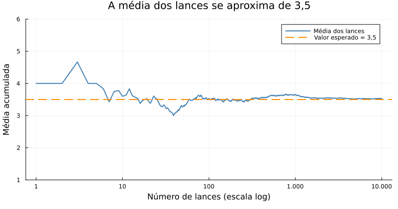
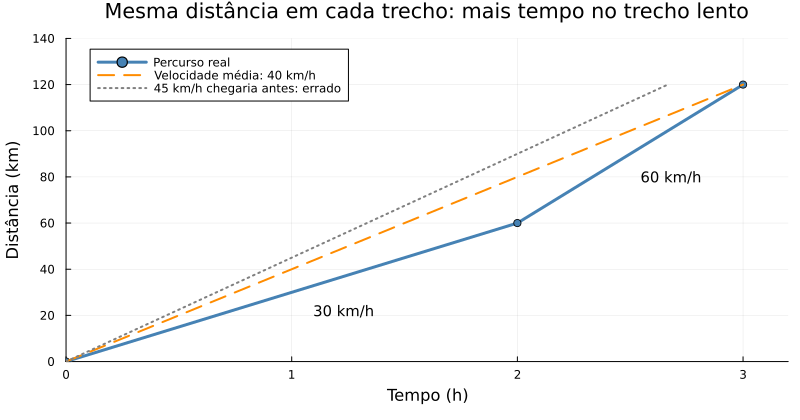

---
layout: post
image: /assets/images/media-arit.avif
title: "Entendendo a Média Aritmética"
categories: [ESTATÍSTICA DESCRITIVA]
tags: [Estatística]
lang: pt
ref: media-aritmetica
author: dante-bertuzzi
mathjax: true
description: "O que é a média aritmética, como calculá-la em dados brutos, tabelas e classes, suas propriedades, quando ela engana e as outras médias. Com Julia e Python."
---

Um aluno tirou 7,5; 8,0; 6,5; 9,0 e 8,5 nas cinco provas do semestre. A média dele é 7,9, uma nota que ele não tirou em prova nenhuma. Então o que, exatamente, esse 7,9 diz?

Neste post você vai ver as duas leituras que respondem a essa pergunta (a **partilha justa** e o **ponto de equilíbrio**), como calcular a média em dados brutos, em tabelas e em classes, as propriedades que fazem dela a medida mais usada em estatística, por que um único valor extremo basta para enganá-la e quando outra média (ponderada, geométrica, harmônica, quadrática ou móvel) é a resposta certa.

## O que é a média aritmética

A **média aritmética** é a soma dos valores dividida pela quantidade de valores. Para $$n$$ observações $$x_1, x_2, \dots, x_n$$:

$$
\bar{x} = \frac{x_1 + x_2 + \dots + x_n}{n} = \frac{1}{n}\sum_{i=1}^{n} x_i
$$

em que $$\bar{x}$$ (lê-se "x barra") é a média, $$x_i$$ é a $$i$$-ésima observação e $$n$$ é o número de observações. É a definição do e-Handbook de métodos estatísticos do NIST (seção 1.3.5.1).

O nome é antigo: segundo o Dicionário Priberam, "média" é o feminino de "médio", do latim *medius*, "que está no meio", e "aritmética" vem do latim *arithmetica*, do grego *arithmêtiké*.

### Amostra e população

A mesma conta recebe nomes e símbolos diferentes conforme o que os dados representam:

- **Média amostral** $$\bar{x}$$: calculada numa **amostra** de $$n$$ observações. É uma **estatística**: muda de amostra para amostra.
- **Média populacional** $$\mu$$ (letra grega "mi"): a média de **todos** os $$N$$ elementos da população, $$\mu = \frac{1}{N}\sum_{i=1}^{N} x_i$$. É um **parâmetro**, fixo e em geral desconhecido.

Em amostras aleatórias simples, $$\bar{x}$$ é um **estimador não viesado** de $$\mu$$: em média, sobre todas as amostras possíveis, ele acerta $$\mu$$. Isso não quer dizer que uma amostra específica acerte; quanto ela costuma errar é o assunto do [erro padrão](#erro-padrao-da-media), mais abaixo.

## Exemplo resolvido: as notas do semestre

**Dados** (ilustrativos): notas das cinco provas, de 0 a 10: 7,5; 8,0; 6,5; 9,0; 8,5. $$n = 5$$.

**Fórmula:** $$\bar{x} = \frac{\sum x_i}{n}$$.

**Substituição:** $$\bar{x} = \frac{7{,}5 + 8{,}0 + 6{,}5 + 9{,}0 + 8{,}5}{5}$$.

**Conta**, uma soma por vez:

- 7,5 + 8,0 = 15,5
- 15,5 + 6,5 = 22,0
- 22,0 + 9,0 = 31,0
- 31,0 + 8,5 = 39,5

e $$\bar{x} = \frac{39{,}5}{5} = 7{,}9$$.

**Resultado:** a média é 7,9 pontos.

**Interpretação:** é o desempenho "típico" do aluno no semestre. Duas notas ficaram abaixo de 7,9 e três acima; a média não precisa ser uma das notas, nem separar os dados ao meio (quem faz isso é a [mediana](/mediana/)).

  

  

    
Julia

    

    <button class="copy-button" onclick="copyCode(this)">
      <i class="bi bi-clipboard"></i>Copiar
    </button>
  

  

    <pre><code>using Statistics

notas = [7.5, 8.0, 6.5, 9.0, 8.5]

soma = sum(notas)
n = length(notas)
println("Soma = ", soma, "   n = ", n)
println("Média manual = ", soma / n)
println("Média com mean() = ", mean(notas))

desvios = notas .- mean(notas)
println("Desvios = ", round.(desvios, digits = 2))
println("Soma dos desvios = ", sum(desvios))   # zero, a menos do erro de arredondamento</code></pre>
  

  
# Saída

  <pre style="overflow-x: auto; font-size: 0.9em;">Soma = 39.5   n = 5
Média manual = 7.9
Média com mean() = 7.9
Desvios = [-0.4, 0.1, -1.4, 1.1, 0.6]
Soma dos desvios = -1.7763568394002505e-15</pre>

  

  

  

    
Python

    

    <button class="copy-button" onclick="copyCode(this)">
      <i class="bi bi-clipboard"></i>Copiar
    </button>
  

  

    <pre><code>import numpy as np

notas = np.array([7.5, 8.0, 6.5, 9.0, 8.5])

soma = notas.sum()
n = len(notas)
print("Soma =", soma, "  n =", n)
print("Média manual =", soma / n)
print("Média com np.mean() =", np.mean(notas))

desvios = notas - notas.mean()
print("Desvios =", np.round(desvios, 2))
print("Soma dos desvios =", desvios.sum())   # zero, a menos do erro de arredondamento</code></pre>
  

  
# Saída

  <pre style="overflow-x: auto; font-size: 0.9em;">Soma = 39.5   n = 5
Média manual = 7.9
Média com np.mean() = 7.9
Desvios = [-0.4  0.1 -1.4  1.1  0.6]
Soma dos desvios = -1.7763568394002505e-15</pre>

  

A soma dos desvios saiu $$-1{,}78 \times 10^{-15}$$, e não zero, por causa do arredondamento dos números com vírgula no computador: 0,1 e 0,4 não têm representação binária exata. Na conta exata, a soma é zero, como mostra a próxima seção.

### Valores faltantes

Antes de calcular, veja como a sua ferramenta trata valores faltantes. O Julia devolve `missing` e o NumPy devolve `nan` se você não tratá-los; o pandas os ignora por padrão. Ignorar pode ser a escolha certa, mas é uma escolha: se os valores faltam por algum motivo ligado a eles (as notas mais baixas não foram lançadas, por exemplo), a média dos que restaram fica enviesada.

  

  

    
Julia

    

    <button class="copy-button" onclick="copyCode(this)">
      <i class="bi bi-clipboard"></i>Copiar
    </button>
  

  

    <pre><code>using Statistics

dados = [7.5, missing, 6.5, 9.0, missing, 8.5]

println("Sem tratar: ", mean(dados))                  # missing contamina o resultado
println("Ignorando faltantes: ", mean(skipmissing(dados)))</code></pre>
  

  
# Saída

  <pre style="overflow-x: auto; font-size: 0.9em;">Sem tratar: missing
Ignorando faltantes: 7.875</pre>

  

  

  

    
Python

    

    <button class="copy-button" onclick="copyCode(this)">
      <i class="bi bi-clipboard"></i>Copiar
    </button>
  

  

    <pre><code>import numpy as np
import pandas as pd

dados = pd.Series([7.5, None, 6.5, 9.0, None, 8.5])

print("NumPy sem tratar:", np.mean(dados.to_numpy()))      # NaN contamina o resultado
print("NumPy ignorando faltantes:", np.nanmean(dados.to_numpy()))
print("pandas (ignora por padrão):", dados.mean())</code></pre>
  

  
# Saída

  <pre style="overflow-x: auto; font-size: 0.9em;">NumPy sem tratar: nan
NumPy ignorando faltantes: 7.875
pandas (ignora por padrão): 7.875</pre>

  

## Duas formas de enxergar a média

### Partilha justa

Se os 39,5 pontos do semestre fossem redistribuídos igualmente entre as cinco provas, cada uma ficaria com $$39{,}5 \div 5 = 7{,}9$$. A média é o valor que **mantém o total** quando todos passam a ser iguais. É por isso que média × $$n$$ devolve o total, propriedade que a mediana não tem.

### Ponto de equilíbrio

Subtraia a média de cada nota. Os resultados são os **desvios**:

| Nota $$x_i$$ | Desvio $$x_i - \bar{x}$$ |
|:---:|:---:|
| 7,5 | 7,5 − 7,9 = −0,4 |
| 8,0 | 8,0 − 7,9 = 0,1 |
| 6,5 | 6,5 − 7,9 = −1,4 |
| 9,0 | 9,0 − 7,9 = 1,1 |
| 8,5 | 8,5 − 7,9 = 0,6 |

Os desvios negativos somam $$-0{,}4 - 1{,}4 = -1{,}8$$; os positivos, $$0{,}1 + 1{,}1 + 0{,}6 = 1{,}8$$. Eles se cancelam: se cada nota fosse um peso numa régua, a régua ficaria equilibrada sobre o ponto 7,9.

Isso vale para qualquer conjunto de dados, não só para este. Como $$\sum x_i = n\bar{x}$$ (é a própria definição da média, multiplicada por $$n$$):

$$
\sum_{i=1}^{n} (x_i - \bar{x}) = \sum_{i=1}^{n} x_i - n\bar{x} = n\bar{x} - n\bar{x} = 0
$$

## Propriedades que fazem a média tão usada

### 1. Ela minimiza a soma dos desvios ao quadrado

Entre todos os números $$c$$, a média é o que torna mínima a soma $$S(c) = \sum (x_i - c)^2$$. Para ver por quê, escreva $$x_i - c = (x_i - \bar{x}) + (\bar{x} - c)$$, eleve ao quadrado e some:

$$
S(c) = \sum (x_i - \bar{x})^2 + 2(\bar{x} - c)\sum (x_i - \bar{x}) + n(\bar{x} - c)^2
$$

O termo do meio é zero (é a soma dos desvios), e sobra

$$
S(c) = \sum (x_i - \bar{x})^2 + n(\bar{x} - c)^2
$$

O primeiro termo não depende de $$c$$; o segundo é zero em $$c = \bar{x}$$ e positivo em qualquer outro ponto. Nas notas: $$S(7{,}9) = 0{,}16 + 0{,}01 + 1{,}96 + 1{,}21 + 0{,}36 = 3{,}70$$, e $$S(8{,}0) = 3{,}70 + 5 \times (7{,}9 - 8{,}0)^2 = 3{,}70 + 0{,}05 = 3{,}75$$.

É essa propriedade que liga a média ao método dos [mínimos quadrados](/pt/analise-de-dados/regressao-linear) e à variância. (A mediana minimiza a soma dos desvios **absolutos**; o [post sobre a mediana](/mediana/) mostra por que isso a deixa menos sensível a extremos.)

### 2. Mudar a escala ou a origem muda a média do mesmo jeito

Se cada valor vira $$y_i = a x_i + b$$, então $$\bar{y} = a\bar{x} + b$$, porque $$\frac{1}{n}\sum (a x_i + b) = a \cdot \frac{1}{n}\sum x_i + \frac{1}{n} \cdot n b$$.

**Exemplo:** temperaturas de cinco dias, 18, 21, 24, 19 e 23 °C. A média é $$\frac{18 + 21 + 24 + 19 + 23}{5} = \frac{105}{5} = 21$$ °C. Em Fahrenheit ($$F = 1{,}8\,C + 32$$), não é preciso converter os cinco valores: $$1{,}8 \times 21 + 32 = 37{,}8 + 32 = 69{,}8$$ °F.

### 3. Grupos se combinam pela média ponderada das médias

Uma turma A tem 20 alunos com média 7,0; a turma B, 30 alunos com média 8,0. A média geral **não** é $$\frac{7{,}0 + 8{,}0}{2} = 7{,}5$$, porque B tem mais alunos:

$$
\bar{x}_{\text{geral}} = \frac{n_A \bar{x}_A + n_B \bar{x}_B}{n_A + n_B} = \frac{20 \times 7{,}0 + 30 \times 8{,}0}{20 + 30} = \frac{140 + 240}{50} = \frac{380}{50} = 7{,}6
$$

Com a mediana isso é impossível: medianas de grupos não se combinam.

### 4. Ela fica entre o menor e o maior valor

Como cada $$x_i$$ está entre o mínimo e o máximo, a soma está entre $$n \times \text{mínimo}$$ e $$n \times \text{máximo}$$, e a média, entre os dois.

  

  

    
Julia

    

    <button class="copy-button" onclick="copyCode(this)">
      <i class="bi bi-clipboard"></i>Copiar
    </button>
  

  

    <pre><code>using Statistics, Printf

notas = [7.5, 8.0, 6.5, 9.0, 8.5]

# 1. A média minimiza a soma dos desvios ao quadrado
S(c) = sum((notas .- c) .^ 2)
@printf("S(7,9) = %.2f   S(8,0) = %.2f\n", S(7.9), S(8.0))

# 2. Mudança de escala e de origem: °C -&gt; °F
celsius = [18, 21, 24, 19, 23]
fahrenheit = 1.8 .* celsius .+ 32
@printf("Média em °C = %.1f   média em °F = %.2f   1,8 × 21 + 32 = %.2f\n",
        mean(celsius), mean(fahrenheit), 1.8 * 21 + 32)

# 3. Juntar grupos de tamanhos diferentes
nA, mA, nB, mB = 20, 7.0, 30, 8.0
println("Média geral = ", (nA * mA + nB * mB) / (nA + nB), "   média das médias = ", (mA + mB) / 2)</code></pre>
  

  
# Saída

  <pre style="overflow-x: auto; font-size: 0.9em;">S(7,9) = 3.70   S(8,0) = 3.75
Média em °C = 21.0   média em °F = 69.80   1,8 × 21 + 32 = 69.80
Média geral = 7.6   média das médias = 7.5</pre>

  

  

  

    
Python

    

    <button class="copy-button" onclick="copyCode(this)">
      <i class="bi bi-clipboard"></i>Copiar
    </button>
  

  

    <pre><code>import numpy as np

notas = np.array([7.5, 8.0, 6.5, 9.0, 8.5])

# 1. A média minimiza a soma dos desvios ao quadrado
S = lambda c: ((notas - c) ** 2).sum()
print(f"S(7,9) = {S(7.9):.2f}   S(8,0) = {S(8.0):.2f}")

# 2. Mudança de escala e de origem: °C -&gt; °F
celsius = np.array([18, 21, 24, 19, 23])
fahrenheit = 1.8 * celsius + 32
print(f"Média em °C = {celsius.mean():.1f}   média em °F = {fahrenheit.mean():.2f}   1,8 × 21 + 32 = {1.8 * 21 + 32:.2f}")

# 3. Juntar grupos de tamanhos diferentes
nA, mA, nB, mB = 20, 7.0, 30, 8.0
print("Média geral =", (nA * mA + nB * mB) / (nA + nB), "  média das médias =", (mA + mB) / 2)</code></pre>
  

  
# Saída

  <pre style="overflow-x: auto; font-size: 0.9em;">S(7,9) = 3.70   S(8,0) = 3.75
Média em °C = 21.0   média em °F = 69.80   1,8 × 21 + 32 = 69.80
Média geral = 7.6   média das médias = 7.5</pre>

  

## Média ponderada

Quando os valores não têm a mesma importância, cada um recebe um **peso** $$w_i$$:

$$
\bar{x}_w = \frac{\sum w_i x_i}{\sum w_i}
$$

**Exemplo:** provas com notas 7,0 (peso 2), 8,0 (peso 3) e 9,0 (peso 5).

- Numerador: $$7{,}0 \times 2 + 8{,}0 \times 3 + 9{,}0 \times 5 = 14 + 24 + 45 = 83$$
- Denominador: $$2 + 3 + 5 = 10$$
- $$\bar{x}_w = \frac{83}{10} = 8{,}3$$

A média simples das três notas seria 8,0; a ponderada é maior porque a nota mais alta tem o maior peso. A [calculadora de média ponderada](/formulas/media-ponderada.html) faz essa conta com os seus números.

## Média em tabela de frequência e em classes

Uma tabela de frequência é uma média ponderada disfarçada: cada valor pesa quantas vezes aparece.

**Tabela de frequência** (ilustrativa, a mesma do [post sobre a mediana](/mediana/)): número de filhos em 40 famílias, com 7 famílias sem filhos, 12 com 1, 11 com 2, 6 com 3 e 4 com 4.

$$
\bar{x} = \frac{0 \times 7 + 1 \times 12 + 2 \times 11 + 3 \times 6 + 4 \times 4}{40} = \frac{0 + 12 + 22 + 18 + 16}{40} = \frac{68}{40} = 1{,}7 \text{ filho}
$$

**Dados agrupados em classes** (ilustrativos): notas de 30 alunos. Sem os valores individuais, usa-se o **ponto médio** de cada classe como representante dela.

| Classe (nota) | Ponto médio $$x_i$$ | Alunos $$f_i$$ | $$f_i \cdot x_i$$ |
|:---:|:---:|:---:|:---:|
| [5,0; 6,0) | 5,5 | 4 | 22,0 |
| [6,0; 7,0) | 6,5 | 8 | 52,0 |
| [7,0; 8,0) | 7,5 | 12 | 90,0 |
| [8,0; 9,0) | 8,5 | 6 | 51,0 |
| **Total** | | **30** | **215,0** |

$$
\bar{x} \approx \frac{\sum f_i x_i}{\sum f_i} = \frac{215{,}0}{30} = 7{,}1666\ldots \approx 7{,}17
$$

**Quanto isso pode errar?** Cada nota está a no máximo meia largura de classe (0,5 ponto) do ponto médio da sua classe, e então a média verdadeira está a no máximo 0,5 ponto da aproximação. Usando os limites das classes no lugar dos pontos médios: se todos estivessem no limite inferior, a média seria $$\frac{4 \times 5 + 8 \times 6 + 12 \times 7 + 6 \times 8}{30} = \frac{200}{30} \approx 6{,}67$$; no limite superior, $$\frac{230}{30} \approx 7{,}67$$. A média real está nesse intervalo. Quem controla o erro é a **largura das classes**, não o tamanho da amostra.

  

  

    
Julia

    

    <button class="copy-button" onclick="copyCode(this)">
      <i class="bi bi-clipboard"></i>Copiar
    </button>
  

  

    <pre><code>using Statistics, StatsBase

# Média ponderada: notas e pesos das provas
notas, pesos = [7.0, 8.0, 9.0], [2, 3, 5]
println("Ponderada = ", mean(notas, Weights(pesos)), "   simples = ", mean(notas))

# Tabela de frequência: número de filhos em 40 famílias
filhos, familias = 0:4, [7, 12, 11, 6, 4]
println("Média de filhos = ", sum(filhos .* familias) / sum(familias))

# Dados agrupados: notas de 30 alunos em classes de largura 1
inferior = [5.0, 6.0, 7.0, 8.0]
freq = [4, 8, 12, 6]
ponto_medio = inferior .+ 0.5
n = sum(freq)
println("Média aproximada = ", round(sum(ponto_medio .* freq) / n, digits = 4))
println("A média real fica entre ", round(sum(inferior .* freq) / n, digits = 4),
        " e ", round(sum((inferior .+ 1) .* freq) / n, digits = 4))</code></pre>
  

  
# Saída

  <pre style="overflow-x: auto; font-size: 0.9em;">Ponderada = 8.3   simples = 8.0
Média de filhos = 1.7
Média aproximada = 7.1667
A média real fica entre 6.6667 e 7.6667</pre>

  

  

  

    
Python

    

    <button class="copy-button" onclick="copyCode(this)">
      <i class="bi bi-clipboard"></i>Copiar
    </button>
  

  

    <pre><code>import numpy as np

# Média ponderada: notas e pesos das provas
notas, pesos = np.array([7.0, 8.0, 9.0]), np.array([2, 3, 5])
print("Ponderada =", np.average(notas, weights=pesos), "  simples =", notas.mean())

# Tabela de frequência: número de filhos em 40 famílias
filhos, familias = np.arange(5), np.array([7, 12, 11, 6, 4])
print("Média de filhos =", (filhos * familias).sum() / familias.sum())

# Dados agrupados: notas de 30 alunos em classes de largura 1
inferior = np.array([5.0, 6.0, 7.0, 8.0])
freq = np.array([4, 8, 12, 6])
ponto_medio = inferior + 0.5
n = freq.sum()
print(f"Média aproximada = {(ponto_medio * freq).sum() / n:.4f}")
print(f"A média real fica entre {(inferior * freq).sum() / n:.4f} e {((inferior + 1) * freq).sum() / n:.4f}")</code></pre>
  

  
# Saída

  <pre style="overflow-x: auto; font-size: 0.9em;">Ponderada = 8.3   simples = 8.0
Média de filhos = 1.7
Média aproximada = 7.1667
A média real fica entre 6.6667 e 7.6667</pre>

  

## O ponto fraco: valores extremos

A média usa o valor de cada observação, e isso tem um preço: **um único valor** pode levá-la para qualquer lugar. No [post sobre a mediana](/mediana/), sete salários (ilustrativos) de R\\$ 2.100 a R\\$ 3.400 mais um de R\\$ 25.000 dão média de R\\$ 5.871,43, e seis das sete pessoas ganham menos que ela. Se o maior salário fosse R\\$ 2.500.000, a média iria para R\\$ 359.442,86, sem que mais ninguém ganhasse um centavo a mais.

Na estatística robusta se diz que a média tem [ponto de ruptura](/pt/glossario#ponto-de-ruptura) zero: basta contaminar um valor. Um meio-termo é a **média aparada**, que descarta uma fração dos menores e dos maiores valores antes de calcular a média (o NIST a apresenta como alternativa robusta, na mesma seção 1.3.5.1). Tirando 1 salário de cada ponta, sobram 2.300; 2.500; 2.800; 3.000; 3.400, e a média aparada é $$\frac{14.000}{5} = $$ R\\$ 2.800 (neste exemplo, coincide com a mediana).

  

  

    
Julia

    

    <button class="copy-button" onclick="copyCode(this)">
      <i class="bi bi-clipboard"></i>Copiar
    </button>
  

  

    <pre><code>using Statistics, StatsBase

salarios = [2100, 2300, 2500, 2800, 3000, 3400, 25000]   # R$, ilustrativo

println("Média = ", round(mean(salarios), digits = 2))
println("Média aparada (tira 1 de cada ponta) = ", mean(trim(salarios; count = 1)))
println("Mediana = ", median(salarios))

# Um único valor pode levar a média para qualquer lugar
for maior in [25_000, 250_000, 2_500_000]
    x = [salarios[1:end-1]; maior]
    println("Maior salário = ", maior, " -&gt; média = ", round(mean(x), digits = 2))
end</code></pre>
  

  
# Saída

  <pre style="overflow-x: auto; font-size: 0.9em;">Média = 5871.43
Média aparada (tira 1 de cada ponta) = 2800.0
Mediana = 2800.0
Maior salário = 25000 -&gt; média = 5871.43
Maior salário = 250000 -&gt; média = 38014.29
Maior salário = 2500000 -&gt; média = 359442.86</pre>

  

  

  

    
Python

    

    <button class="copy-button" onclick="copyCode(this)">
      <i class="bi bi-clipboard"></i>Copiar
    </button>
  

  

    <pre><code>import numpy as np
from scipy import stats

salarios = np.array([2100, 2300, 2500, 2800, 3000, 3400, 25000])   # R$, ilustrativo

print(f"Média = {salarios.mean():.2f}")
# trim_mean corta int(0,15 × 7) = 1 valor de cada ponta
print("Média aparada (tira 1 de cada ponta) =", stats.trim_mean(salarios, 0.15))
print("Mediana =", np.median(salarios))

# Um único valor pode levar a média para qualquer lugar
for maior in [25_000, 250_000, 2_500_000]:
    x = np.append(salarios[:-1], maior)
    print(f"Maior salário = {maior} -&gt; média = {x.mean():.2f}")</code></pre>
  

  
# Saída

  <pre style="overflow-x: auto; font-size: 0.9em;">Média = 5871.43
Média aparada (tira 1 de cada ponta) = 2800.0
Mediana = 2800.0
Maior salário = 25000 -&gt; média = 5871.43
Maior salário = 250000 -&gt; média = 38014.29
Maior salário = 2500000 -&gt; média = 359442.86</pre>

  

## A média de uma distribuição e a lei dos grandes números

Para uma variável aleatória, a média de longo prazo é o [valor esperado](/pt/probabilidade/variaveis-aleatorias). Num dado honesto, cada face sai com probabilidade $$\frac{1}{6}$$:

$$
E[X] = 1 \cdot \tfrac{1}{6} + 2 \cdot \tfrac{1}{6} + \dots + 6 \cdot \tfrac{1}{6} = \frac{1 + 2 + 3 + 4 + 5 + 6}{6} = \frac{21}{6} = 3{,}5
$$

Nenhum lance dá 3,5. Mas a média de muitos lances se aproxima de 3,5: é a **lei dos grandes números**, a mesma do post [Cara ou coroa](/cara-ou-coroa/).

  

  

    
Julia

    

    <button class="copy-button" onclick="copyCode(this)">
      <i class="bi bi-clipboard"></i>Copiar
    </button>
  

  

    <pre><code>using Random, Statistics, Plots, Printf

Random.seed!(123)
n = 10_000
lances = rand(1:6, n)                         # um dado honesto
media_acumulada = cumsum(lances) ./ (1:n)     # média dos k primeiros lances

for k in [10, 100, 1_000, 10_000]
    @printf("Após %d lances: média = %.4f\n", k, media_acumulada[k])
end

plot(1:n, media_acumulada, xscale = :log10, lw = 2, color = :steelblue, label = "Média dos lances",
     xlabel = "Número de lances (escala log)", ylabel = "Média acumulada", ylims = (1, 6),
     xticks = ([1, 10, 100, 1000, 10000], ["1", "10", "100", "1.000", "10.000"]),
     title = "A média dos lances se aproxima de 3,5", size = (800, 420), legend = :topright)
hline!([3.5], color = :darkorange, ls = :dash, lw = 2, label = "Valor esperado = 3,5")
savefig("media-lei-grandes-numeros.png")</code></pre>
  

  
# Saída

  <pre style="overflow-x: auto; font-size: 0.9em;">Após 10 lances: média = 3.6000
Após 100 lances: média = 3.5200
Após 1000 lances: média = 3.6560
Após 10000 lances: média = 3.5342</pre>

  

  

  

    
Python

    

    <button class="copy-button" onclick="copyCode(this)">
      <i class="bi bi-clipboard"></i>Copiar
    </button>
  

  

    <pre><code>import numpy as np
import matplotlib.pyplot as plt

rng = np.random.default_rng(123)
n = 10_000
lances = rng.integers(1, 7, n)                        # um dado honesto
media_acumulada = np.cumsum(lances) / np.arange(1, n + 1)   # média dos k primeiros lances

for k in [10, 100, 1_000, 10_000]:
    print(f"Após {k} lances: média = {media_acumulada[k - 1]:.4f}")

plt.figure(figsize=(8, 4.2))
plt.plot(np.arange(1, n + 1), media_acumulada, lw=2, color="steelblue", label="Média dos lances")
plt.axhline(3.5, color="darkorange", ls="--", lw=2, label="Valor esperado = 3,5")
plt.xscale("log"); plt.ylim(1, 6)
plt.xticks([1, 10, 100, 1000, 10000], ["1", "10", "100", "1.000", "10.000"])
plt.xlabel("Número de lances (escala log)"); plt.ylabel("Média acumulada")
plt.title("A média dos lances se aproxima de 3,5"); plt.legend()
plt.savefig("media-lei-grandes-numeros-py.png", dpi=120, bbox_inches="tight")</code></pre>
  

  
# Saída

  <pre style="overflow-x: auto; font-size: 0.9em;">Após 10 lances: média = 2.8000
Após 100 lances: média = 3.4000
Após 1000 lances: média = 3.4640
Após 10000 lances: média = 3.4763</pre>

  

Figura 1 – Média acumulada de 10.000 lances simulados de um dado (código em Julia acima). Nos primeiros lances ela oscila muito; depois de alguns milhares, fica perto de 3,5.

**Interpretação:** depois de 10.000 lances, a média ficou em 3,5342 na simulação em Julia (o Python sorteia outros números e dá 3,4763). A lei garante que a média **converge**; não garante nada sobre o próximo lance, e não "compensa" uma sequência de números altos com números baixos.

## Erro padrão da média {#erro-padrao-da-media}

A média de uma amostra raramente é igual a $$\mu$$. Quanto ela costuma se afastar é medido pelo **erro padrão da média**:

$$
\text{EP} = \frac{s}{\sqrt{n}}
$$

em que $$s$$ é o desvio padrão amostral e $$n$$, o tamanho da amostra. **Exemplo:** com $$n = 25$$ e $$s = 10$$, $$\text{EP} = \frac{10}{\sqrt{25}} = \frac{10}{5} = 2$$. Isso quer dizer que, de amostra para amostra, $$\bar{x}$$ varia em torno de $$\mu$$ com desvio padrão de 2 unidades; para reduzir esse erro pela metade, é preciso **quadruplicar** a amostra.

O [desvio padrão](/desvio-padrao/) descreve a variação dos dados; o erro padrão, a variação da média. O post [Desvio padrão × erro padrão](/desvio-padrao-x-erro-padrao-qual-a-diferenca/) trata da diferença, e o erro padrão é a base dos [intervalos de confiança](/pt/inferencia-estatistica/intervalos-confianca) para $$\mu$$ (com $$s$$ no lugar de $$\sigma$$, usa-se a distribuição t de Student).

## Outras médias, e quando cada uma é a certa

### Média geométrica: para crescimento

$$
M_g = \sqrt[n]{x_1 \cdot x_2 \cdots x_n}
$$

Ela só faz sentido para valores positivos. Para 2, 8 e 32: $$\sqrt[3]{2 \times 8 \times 32} = \sqrt[3]{512} = 8$$.

**Onde ela é a certa:** taxas de crescimento que se acumulam. Um investimento sobe 50% num ano e cai 50% no seguinte. A média aritmética das taxas diz 0%, mas R\\$ 100 viram R\\$ 150 e depois R\\$ 75. A média geométrica dos **fatores** ($$1{,}5$$ e $$0{,}5$$, e não das taxas) acerta:

$$
M_g = \sqrt{1{,}5 \times 0{,}5} = \sqrt{0{,}75} = 0{,}8660\ldots
$$

ou seja, uma queda média de 13,40% ao ano: $$100 \times 0{,}8660^2 = 75$$. Veja a [calculadora de média geométrica](/formulas/media-geometrica.html).

### Média harmônica: para taxas com o "denominador" fixo

$$
M_h = \frac{n}{\sum_{i=1}^{n} \frac{1}{x_i}}
$$

**Exemplo:** um carro percorre 60 km a 30 km/h e mais 60 km a 60 km/h. A velocidade média **não** é 45 km/h. A distância total é $$60 + 60 = 120$$ km; o tempo, $$\frac{60}{30} + \frac{60}{60} = 2 + 1 = 3$$ h; a velocidade média, $$\frac{120}{3} = 40$$ km/h. A média harmônica dá o mesmo:

$$
M_h = \frac{2}{\frac{1}{30} + \frac{1}{60}} = \frac{2}{\frac{2}{60} + \frac{1}{60}} = \frac{2}{\frac{3}{60}} = \frac{2 \times 60}{3} = 40 \text{ km/h}
$$

  

  

    
Julia

    

    <button class="copy-button" onclick="copyCode(this)">
      <i class="bi bi-clipboard"></i>Copiar
    </button>
  

  

    <pre><code>using Plots

# 60 km a 30 km/h (2 h) e depois 60 km a 60 km/h (1 h)
tempo = [0, 2, 3]
distancia = [0, 60, 120]
plot(tempo, distancia, lw = 3, marker = :circle, color = :steelblue, label = "Percurso real",
     xlabel = "Tempo (h)", ylabel = "Distância (km)", xlims = (0, 3.2), ylims = (0, 140),
     title = "Mesma distância em cada trecho: mais tempo no trecho lento", size = (800, 420),
     legend = :topleft)
plot!([0, 3], [0, 120], lw = 2, ls = :dash, color = :darkorange, label = "Velocidade média: 40 km/h")
plot!([0, 120 / 45], [0, 120], lw = 2, ls = :dot, color = :gray, label = "45 km/h chegaria antes: errado")
annotate!([(1.1, 22, text("30 km/h", 10, :left)), (2.55, 80, text("60 km/h", 10, :left))])
savefig("media-harmonica-percurso.png")</code></pre>
  

  
# Saída

  <pre style="overflow-x: auto; font-size: 0.9em;"></pre>

  

  

  

    
Python

    

    <button class="copy-button" onclick="copyCode(this)">
      <i class="bi bi-clipboard"></i>Copiar
    </button>
  

  

    <pre><code>import matplotlib.pyplot as plt

# 60 km a 30 km/h (2 h) e depois 60 km a 60 km/h (1 h)
tempo = [0, 2, 3]
distancia = [0, 60, 120]
plt.figure(figsize=(8, 4.2))
plt.plot(tempo, distancia, lw=3, marker="o", color="steelblue", label="Percurso real")
plt.plot([0, 3], [0, 120], lw=2, ls="--", color="darkorange", label="Velocidade média: 40 km/h")
plt.plot([0, 120 / 45], [0, 120], lw=2, ls=":", color="gray", label="45 km/h chegaria antes: errado")
plt.text(1.1, 22, "30 km/h"); plt.text(2.55, 80, "60 km/h")
plt.xlim(0, 3.2); plt.ylim(0, 140)
plt.xlabel("Tempo (h)"); plt.ylabel("Distância (km)")
plt.title("Mesma distância em cada trecho: mais tempo no trecho lento"); plt.legend(loc="upper left")
plt.savefig("media-harmonica-percurso-py.png", dpi=120, bbox_inches="tight")</code></pre>
  

  
# Saída

  <pre style="overflow-x: auto; font-size: 0.9em;"></pre>

  

Figura 2 – Gerada pelo código em Julia acima. O carro passa 2 horas no trecho lento e só 1 hora no rápido. A velocidade média de 40 km/h (tracejada) chega a 120 km junto com o carro; a 45 km/h (pontilhada) ele chegaria antes, o que não aconteceu.

A harmônica é a média certa **só quando as distâncias são iguais**. Se forem os tempos que são iguais (1 hora a 30 km/h e 1 hora a 60 km/h), a resposta é a média aritmética, 45 km/h. Se nem distâncias nem tempos forem iguais, use a definição, distância total sobre tempo total:

| Situação | Média certa |
|---|---|
| Mesma distância em cada velocidade | Harmônica |
| Mesmo tempo em cada velocidade | Aritmética |
| Distâncias diferentes | $$\frac{\sum d_i}{\sum (d_i / v_i)}$$ (harmônica ponderada pelas distâncias) |

**Exemplo com distâncias diferentes:** um ciclista faz 10 km a 20 km/h e 30 km a 15 km/h. A harmônica simples daria $$\frac{2}{\frac{1}{20} + \frac{1}{15}} \approx 17{,}14$$ km/h, mas ela supõe distâncias iguais. O certo é $$\frac{10 + 30}{\frac{10}{20} + \frac{30}{15}} = \frac{40}{0{,}5 + 2} = \frac{40}{2{,}5} = 16$$ km/h. Veja a [calculadora de média harmônica](/formulas/media-harmonica.html).

### Média quadrática (RMS): para o tamanho de algo que oscila

$$
M_q = \sqrt{\frac{1}{n}\sum_{i=1}^{n} x_i^2}
$$

Para 3, 4 e 5: $$\sqrt{\frac{9 + 16 + 25}{3}} = \sqrt{\frac{50}{3}} = \sqrt{16{,}67} \approx 4{,}08$$. Ela mede o **tamanho** dos valores, ignorando o sinal: para −3, 3, −3, 3, a média aritmética é 0, mas a quadrática é 3. Por isso aparece em sinais que oscilam em torno de zero, como uma tensão alternada, e na raiz do erro quadrático médio (RMSE) de modelos.

### A desigualdade das médias

Para valores **positivos**, sempre

$$
M_h \le M_g \le \bar{x} \le M_q
$$

com igualdade só quando todos os valores são iguais (a desigualdade está no capítulo 2 de *Inequalities*, de Hardy, Littlewood e Pólya). Para 1, 4 e 9:

$$
\begin{aligned}
M_h &= \frac{3}{\frac{1}{1} + \frac{1}{4} + \frac{1}{9}} = \frac{3}{\frac{36 + 9 + 4}{36}} = \frac{3}{\frac{49}{36}} = \frac{108}{49} \approx 2{,}20 \\
M_g &= \sqrt[3]{1 \times 4 \times 9} = \sqrt[3]{36} \approx 3{,}30 \\
\bar{x} &= \frac{1 + 4 + 9}{3} = \frac{14}{3} \approx 4{,}67 \\
M_q &= \sqrt{\frac{1 + 16 + 81}{3}} = \sqrt{\frac{98}{3}} \approx 5{,}72
\end{aligned}
$$

e de fato $$2{,}20 \le 3{,}30 \le 4{,}67 \le 5{,}72$$.

  

  

    
Julia

    

    <button class="copy-button" onclick="copyCode(this)">
      <i class="bi bi-clipboard"></i>Copiar
    </button>
  

  

    <pre><code>using Statistics, StatsBase, Printf

x = [1, 4, 9]
@printf("Harmônica  = %.4f\n", harmmean(x))
@printf("Geométrica = %.4f\n", geomean(x))
@printf("Aritmética = %.4f\n", mean(x))
@printf("Quadrática = %.4f\n", sqrt(mean(x .^ 2)))

# Crescimento: +50% num ano, -50% no seguinte
fatores = [1.5, 0.5]
g = geomean(fatores)
@printf("Fator médio = %.4f -&gt; %.2f%% ao ano\n", g, 100 * (g - 1))
@printf("100 depois de dois anos = %.2f\n", 100 * prod(fatores))

# Velocidade média: 60 km a 30 km/h e 60 km a 60 km/h
println("Velocidade média = ", harmmean([30, 60]), " km/h")</code></pre>
  

  
# Saída

  <pre style="overflow-x: auto; font-size: 0.9em;">Harmônica  = 2.2041
Geométrica = 3.3019
Aritmética = 4.6667
Quadrática = 5.7155
Fator médio = 0.8660 -&gt; -13.40% ao ano
100 depois de dois anos = 75.00
Velocidade média = 40.0 km/h</pre>

  

  

  

    
Python

    

    <button class="copy-button" onclick="copyCode(this)">
      <i class="bi bi-clipboard"></i>Copiar
    </button>
  

  

    <pre><code>import numpy as np
from scipy import stats

x = np.array([1, 4, 9])
print(f"Harmônica  = {stats.hmean(x):.4f}")
print(f"Geométrica = {stats.gmean(x):.4f}")
print(f"Aritmética = {x.mean():.4f}")
print(f"Quadrática = {np.sqrt((x ** 2).mean()):.4f}")

# Crescimento: +50% num ano, -50% no seguinte
fatores = np.array([1.5, 0.5])
g = stats.gmean(fatores)
print(f"Fator médio = {g:.4f} -&gt; {100 * (g - 1):.2f}% ao ano")
print(f"100 depois de dois anos = {100 * fatores.prod():.2f}")

# Velocidade média: 60 km a 30 km/h e 60 km a 60 km/h
print("Velocidade média =", stats.hmean([30, 60]), "km/h")</code></pre>
  

  
# Saída

  <pre style="overflow-x: auto; font-size: 0.9em;">Harmônica  = 2.2041
Geométrica = 3.3019
Aritmética = 4.6667
Quadrática = 5.7155
Fator médio = 0.8660 -&gt; -13.40% ao ano
100 depois de dois anos = 75.00
Velocidade média = 40.0 km/h</pre>

  

### Média móvel: para séries no tempo

Numa [série temporal](/pt/analise-de-dados/series-temporais), a **média móvel simples** (SMA) de ordem $$k$$ é a média dos últimos $$k$$ valores, recalculada a cada passo:

$$
\text{SMA}_t = \frac{x_t + x_{t-1} + \dots + x_{t-k+1}}{k}
$$

Para a série 10, 12, 14, 16, 18, 20 e $$k = 3$$: $$\frac{10 + 12 + 14}{3} = 12$$, depois 14, 16 e 18. Janelas maiores suavizam mais, mas reagem mais devagar a mudanças.

Duas variações dão mais peso ao presente:

- **Ponderada (WMA)**: pesos que crescem até o valor mais recente. Com pesos 1, 2 e 3, a primeira janela dá $$\frac{1 \times 10 + 2 \times 12 + 3 \times 14}{1 + 2 + 3} = \frac{76}{6} \approx 12{,}67$$.
- **Exponencial (EMA)**: $$\text{EMA}_t = \alpha x_t + (1 - \alpha)\,\text{EMA}_{t-1}$$, com $$0 < \alpha < 1$$. Os pesos dos valores antigos caem geometricamente. É preciso um valor inicial; aqui, a convenção $$\text{EMA}_1 = x_1$$. Com $$\alpha = 0{,}5$$: 10; $$0{,}5 \times 12 + 0{,}5 \times 10 = 11$$; $$0{,}5 \times 14 + 0{,}5 \times 11 = 12{,}5$$; e assim por diante.

Nesta série, que sobe 2 por passo, todas ficam **atrás** do último valor: a SMA termina em 18, a WMA em 18,67 e a EMA em 18,06, enquanto a série está em 20. Esse atraso é o preço da suavização. A [calculadora de média móvel](/formulas/media-movel.html) mostra o efeito com os seus dados.

  

  

    
Julia

    

    <button class="copy-button" onclick="copyCode(this)">
      <i class="bi bi-clipboard"></i>Copiar
    </button>
  

  

    <pre><code>serie = [10, 12, 14, 16, 18, 20]
k = 3

sma = [sum(serie[t-k+1:t]) / k for t in k:length(serie)]
pesos = 1:k                                   # o mais recente pesa k
wma = [sum(serie[t-k+1:t] .* pesos) / sum(pesos) for t in k:length(serie)]

α = 0.5
ema = [float(serie[1])]                       # convenção: EMA_1 = x_1
for x in serie[2:end]
    push!(ema, α * x + (1 - α) * ema[end])
end

println("SMA: ", sma)
println("WMA: ", round.(wma, digits = 4))
println("EMA: ", ema)</code></pre>
  

  
# Saída

  <pre style="overflow-x: auto; font-size: 0.9em;">SMA: [12.0, 14.0, 16.0, 18.0]
WMA: [12.6667, 14.6667, 16.6667, 18.6667]
EMA: [10.0, 11.0, 12.5, 14.25, 16.125, 18.0625]</pre>

  

  

  

    
Python

    

    <button class="copy-button" onclick="copyCode(this)">
      <i class="bi bi-clipboard"></i>Copiar
    </button>
  

  

    <pre><code>import numpy as np
import pandas as pd

serie = pd.Series([10, 12, 14, 16, 18, 20])
k = 3

sma = serie.rolling(k).mean().dropna()
pesos = np.arange(1, k + 1)                   # o mais recente pesa k
wma = serie.rolling(k).apply(lambda j: (j * pesos).sum() / pesos.sum()).dropna()
ema = serie.ewm(alpha=0.5, adjust=False).mean()   # adjust=False: EMA_1 = x_1

print("SMA:", sma.tolist())
print("WMA:", wma.round(4).tolist())
print("EMA:", ema.tolist())</code></pre>
  

  
# Saída

  <pre style="overflow-x: auto; font-size: 0.9em;">SMA: [12.0, 14.0, 16.0, 18.0]
WMA: [12.6667, 14.6667, 16.6667, 18.6667]
EMA: [10.0, 11.0, 12.5, 14.25, 16.125, 18.0625]</pre>

  

## Quando a média engana

- **Dados assimétricos**, como renda e preços: a cauda puxa a média para longe do valor típico. Use a [mediana](/mediana/), ou mostre as duas.
- **Valores extremos ou erros de digitação:** um só valor muda tudo. Olhe os dados (um [boxplot](/boxplot-o-que-e-cada-elemento-como-se-calcula-e-como-interpretar/) ajuda) antes de resumir.
- **Distribuições com dois picos:** a média pode cair num valor que quase ninguém tem.
- **Médias de grupos de tamanhos diferentes:** a média das médias só vale se os grupos tiverem o mesmo tamanho; senão, pondere.
- **Taxas e razões:** crescimento pede média geométrica dos fatores; velocidades em trechos iguais, média harmônica.
- **Categorias ordenadas** (ruim, regular, bom): codificá-las como 1, 2, 3 e tirar a média supõe que a distância entre "ruim" e "regular" é igual à distância entre "regular" e "bom". Às vezes isso é razoável, mas é uma suposição, e precisa ser dita.

## Resumo

- A média é a soma dividida pela quantidade: $$\bar{x} = \frac{1}{n}\sum x_i$$ na amostra, $$\mu$$ na população.
- Ela é a partilha justa (preserva o total) e o ponto de equilíbrio (os desvios somam zero).
- Minimiza a soma dos desvios ao quadrado, acompanha mudanças de escala e origem e combina grupos por média ponderada.
- Em tabelas, é uma média ponderada pelas frequências; em classes, uma aproximação cujo erro depende da largura das classes.
- Um único valor extremo pode levá-la para qualquer lugar; a mediana e a média aparada resistem.
- A média de muitas repetições converge para o valor esperado, e o erro padrão $$s/\sqrt{n}$$ mede quanto ela varia entre amostras.
- Para crescimento, velocidades e oscilações, as médias geométrica, harmônica e quadrática são as certas.

## Calculadora de média

  <label for="calc-media-entrada"><strong>Digite os valores</strong>, separados por ponto e vírgula, espaço ou quebra de linha. Use vírgula para decimais (ex.: 7,5; 8; 6,5).</label>
  <textarea id="calc-media-entrada" rows="3" placeholder="7,5; 8,0; 6,5; 9,0; 8,5"></textarea>
  <button type="button" id="calc-media-botao">Calcular</button>
  

## Referências

1. NIST/SEMATECH. *e-Handbook of Statistical Methods*, seção 1.3.5.1, "Measures of Location". Disponível em: <https://www.itl.nist.gov/div898/handbook/eda/section3/eda351.htm>. Acesso em: 25 nov. 2026.
2. Dicionário Priberam da Língua Portuguesa, verbetes "média" e "aritmética". Disponível em: <https://dicionario.priberam.org/>. Acesso em: 25 nov. 2026.
3. Hardy, G. H.; Littlewood, J. E.; Pólya, G. (1952). *Inequalities*. 2. ed. Cambridge University Press. (Capítulo 2, "Elementary mean values".)
