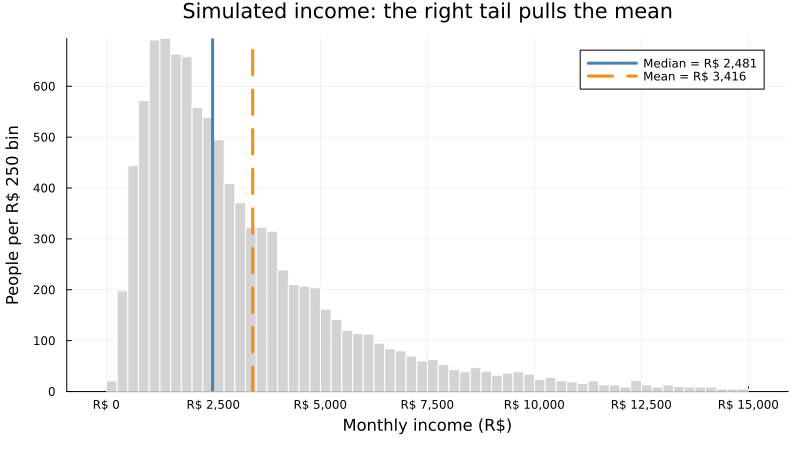

---
layout: post
image: /assets/images/mediana.avif
title: Understanding the Median
categories: [DESCRIPTIVE STATISTICS]
tags: [Statistics]
lang: en
ref: entendendo-a-mediana
author: dante-bertuzzi
date: 2025-05-16 23:55:00 -0300
mathjax: true
description: "What the median is, how to compute it from raw data, tables and classes, why it resists outliers, and when the mean is better. With Julia and Python code."
---

A small company has seven people on its payroll. Six earn between R\\$ 2,100 and R\\$ 3,400 a month; the seventh, a partner, earns R\\$ 25,000. The mean salary comes to R\\$ 5,871.43, and **six of the seven people earn less than that**. Anyone reading "average salary of almost R\\$ 6 thousand" pictures a different company. The median, R\\$ 2,800, describes much better what the people working there earn. (The numbers are illustrative.)

It took me a while to realize that the mean and the median do not compete: they answer different questions. In this post you will see what the median is, how to compute it from raw data, frequency tables and classes, why it resists extreme values and, just as important, when the mean is still the right choice.

## What the median is

The **median** is the value that splits the sorted data into two halves: at least half of the observations are less than or equal to it, and at least half are greater than or equal to it. It is the same as the 50th [percentile](/en/glossary#percentile) and the second [quartile](/en/glossary#quartile).

To write the rule, call $$x_{(1)} \le x_{(2)} \le \dots \le x_{(n)}$$ the data in increasing order: $$x_{(1)}$$ is the smallest value, $$x_{(n)}$$ the largest, and $$n$$ is the number of observations. The median (Md) is:

$$
\text{Md} =
\begin{cases}
x_{\left(\frac{n+1}{2}\right)}, & \text{if } n \text{ is odd} \\[2mm]
\dfrac{x_{\left(\frac{n}{2}\right)} + x_{\left(\frac{n}{2}+1\right)}}{2}, & \text{if } n \text{ is even}
\end{cases}
$$

This is the definition used by NIST's e-Handbook of Statistical Methods (section 1.3.5.1). A common mistake: $$\frac{n+1}{2}$$ is the **position** of the median in the sorted list, not its value.

## How to compute it, step by step

1. **Sort** the data in increasing order.
2. **Count** the observations: $$n$$.
3. If $$n$$ is **odd**, the median is the value in position $$\frac{n+1}{2}$$.
4. If $$n$$ is **even**, the median is the mean of the values in positions $$\frac{n}{2}$$ and $$\frac{n}{2} + 1$$.

### Example 1: odd number of observations

**Data** (given, illustrative): ages of five people, in years: 23, 45, 12, 34, 29.

1. Sorted: 12, 23, 29, 34, 45.
2. $$n = 5$$, odd.
3. Position formula: $$\frac{n+1}{2}$$.
4. Substituting: $$\frac{5+1}{2} = \frac{6}{2} = 3$$.
5. The 3rd value in the sorted list is $$x_{(3)} = 29$$.

**Result:** Md = 29 years. **Interpretation:** two people are younger than 29 and two are older; 29 is the point that splits the group in half.

### Example 2: even number of observations

**Data** (illustrative): grades of four students: 7.5, 6.0, 8.5, 5.5.

1. Sorted: 5.5, 6.0, 7.5, 8.5.
2. $$n = 4$$, even.
3. Middle positions: $$\frac{n}{2} = \frac{4}{2} = 2$$ and $$\frac{n}{2} + 1 = 3$$. The values are $$x_{(2)} = 6.0$$ and $$x_{(3)} = 7.5$$.
4. Substituting into the formula: $$\text{Md} = \frac{6.0 + 7.5}{2}$$.
5. Numerator: $$6.0 + 7.5 = 13.5$$. Division: $$\frac{13.5}{2} = 6.75$$.

**Result:** Md = 6.75. **Interpretation:** no student scored 6.75; it is the point that separates the two lowest grades from the two highest. Any value between 6.0 and 7.5 would split the group in half; the convention is to take the midpoint of that interval.

### Example 3: the salaries from the opening

**Data** (illustrative, in R\\$, already sorted): 2,100; 2,300; 2,500; 2,800; 3,000; 3,400; 25,000.

**Median.** $$n = 7$$, odd. Position: $$\frac{7+1}{2} = \frac{8}{2} = 4$$. The 4th value is **R\\$ 2,800**.

**Mean.** The arithmetic mean is $$\bar{x} = \frac{\sum x_i}{n}$$, the sum of the values divided by how many there are. The sum, one term at a time:

- 2,100 + 2,300 = 4,400
- 4,400 + 2,500 = 6,900
- 6,900 + 2,800 = 9,700
- 9,700 + 3,000 = 12,700
- 12,700 + 3,400 = 16,100
- 16,100 + 25,000 = 41,100

So $$\bar{x} = \frac{41{,}100}{7} = 5{,}871.428\ldots \approx$$ **R\\$ 5,871.43**.

**Interpretation:** a single high salary pulled the mean to a value that only one person in the company reaches. The mean is not "wrong": it answers a different question. The payroll costs 7 × R\\$ 5,871.43 = R\\$ 41,100 a month, and it is the mean that gives this total. The median, on the other hand, tells you what a typical person there earns.

## Median in a frequency table

When the data come in a frequency table, the sorted list is implicit in the **cumulative frequency**: the total number of observations up to each row.

**Data** (illustrative): number of children in 40 families.

| Children | Families | Cumulative frequency |
|:---:|:---:|:---:|
| 0 | 7 | 7 |
| 1 | 12 | 19 |
| 2 | 11 | 30 |
| 3 | 6 | 36 |
| 4 | 4 | 40 |

1. $$n = 40$$, even: the median is the mean of the values in positions $$\frac{40}{2} = 20$$ and $$21$$.
2. The cumulative frequency says that positions 1 to 7 have 0 children, positions 8 to 19 have 1 child and positions 20 to 30 have 2 children.
3. So $$x_{(20)} = 2$$ and $$x_{(21)} = 2$$, and $$\text{Md} = \frac{2 + 2}{2} = 2$$ children.

**Interpretation:** 30 of the 40 families have at most 2 children and 21 have 2 or more (11 + 6 + 4 = 21): the value 2 splits the group in half. For comparison, the mean is $$\frac{0 \cdot 7 + 1 \cdot 12 + 2 \cdot 11 + 3 \cdot 6 + 4 \cdot 4}{40} = \frac{0 + 12 + 22 + 18 + 16}{40} = \frac{68}{40} = 1.7$$ children.

## Median of data grouped in classes

Sometimes all that is left is the table by classes, and the individual values are lost. Then the exact median cannot be computed, but it can be approximated.

**Data** (illustrative): waiting time of 40 customers at a service desk, in minutes.

| Class (min) | Customers | Cumulative frequency |
|:---:|:---:|:---:|
| [0, 5) | 8 | 8 |
| [5, 10) | 10 | 18 |
| [10, 15) | 12 | 30 |
| [15, 20) | 6 | 36 |
| [20, 30) | 4 | 40 |

**The idea.** We look for the time that leaves $$\frac{n}{2} = 20$$ customers below it. Up to 10 min there are 18 customers; up to 15 min, 30. So the median is in the class [10, 15). We still need 2 of the 12 customers in that class. **Assuming the 12 are spread evenly within the class** (this assumption is what makes the result approximate), we move $$\frac{2}{12}$$ of the class width from its start.

**Formula:**

$$
\text{Md} \approx L + \frac{\frac{n}{2} - F_{\text{before}}}{f_{\text{Md}}} \cdot h
$$

where $$L$$ is the lower limit of the median class, $$F_{\text{before}}$$ is the cumulative frequency **before** it, $$f_{\text{Md}}$$ is the frequency of the class itself and $$h$$ is the class width.

**Substitution:** $$L = 10$$, $$F_{\text{before}} = 18$$, $$f_{\text{Md}} = 12$$, $$h = 15 - 10 = 5$$:

$$
\text{Md} \approx 10 + \frac{\frac{40}{2} - 18}{12} \cdot 5
$$

**Calculation:**

$$
\begin{aligned}
\tfrac{40}{2} &= 20 \\
20 - 18 &= 2 \\
\tfrac{2}{12} &= 0.1666\ldots \\
0.1666\ldots \times 5 &= 0.8333\ldots \\
10 + 0.8333\ldots &= 10.8333\ldots
\end{aligned}
$$

**Result:** Md ≈ 10.83 min (rounded only at the end).

**Interpretation:** about half of the customers waited less than 10.8 minutes. All the table guarantees is that the median of the original data lies somewhere in [10, 15); 10.83 is the best guess under the even-spread assumption. The mean approximated by the class midpoints is $$\frac{2.5 \cdot 8 + 7.5 \cdot 10 + 12.5 \cdot 12 + 17.5 \cdot 6 + 25 \cdot 4}{40} = \frac{20 + 75 + 150 + 105 + 100}{40} = \frac{450}{40} = 11.25$$ min, larger than the median because of the long class [20, 30) in the right tail.

  

  

    
Julia

    

    <button class="copy-button" onclick="copyCode(this)">
      <i class="bi bi-clipboard"></i>Copy
    </button>
  

  

    <pre><code># Approximate median for data grouped in classes (linear interpolation)
limits = [0, 5, 10, 15, 20, 30]     # minutes: [0, 5), [5, 10), ..., [20, 30)
freq = [8, 10, 12, 6, 4]

function grouped_median(limits, freq)
    n = sum(freq)
    cum = cumsum(freq)
    k = findfirst(&gt;=(n / 2), cum)            # median class
    F_before = k == 1 ? 0 : cum[k - 1]       # cumulative frequency before it
    L, h = limits[k], limits[k + 1] - limits[k]
    return L + (n / 2 - F_before) / freq[k] * h
end

println("Cumulative frequency: ", cumsum(freq))
println("Approximate median: ", round(grouped_median(limits, freq), digits = 4), " min")</code></pre>
  

  
# Output

  <pre style="overflow-x: auto; font-size: 0.9em;">Cumulative frequency: [8, 18, 30, 36, 40]
Approximate median: 10.8333 min</pre>

  

  

  

    
Python

    

    <button class="copy-button" onclick="copyCode(this)">
      <i class="bi bi-clipboard"></i>Copy
    </button>
  

  

    <pre><code>import numpy as np

# Approximate median for data grouped in classes (linear interpolation)
limits = np.array([0, 5, 10, 15, 20, 30])    # minutes: [0, 5), [5, 10), ..., [20, 30)
freq = np.array([8, 10, 12, 6, 4])

def grouped_median(limits, freq):
    n = freq.sum()
    cum = np.cumsum(freq)
    k = np.argmax(cum &gt;= n / 2)                # median class
    F_before = 0 if k == 0 else cum[k - 1]     # cumulative frequency before it
    L, h = limits[k], limits[k + 1] - limits[k]
    return L + (n / 2 - F_before) / freq[k] * h

print("Cumulative frequency:", np.cumsum(freq))
print(f"Approximate median: {grouped_median(limits, freq):.4f} min")</code></pre>
  

  
# Output

  <pre style="overflow-x: auto; font-size: 0.9em;">Cumulative frequency: [ 8 18 30 36 40]
Approximate median: 10.8333 min</pre>

  

## Why the median resists extreme values

The median depends only on **who is in the middle** of the sorted list. If the largest value doubles or becomes ten times larger, it is still the largest, and the middle does not change. NIST puts it this way: extreme values in the tails distort the mean but not the median, because the median is based on the order of the data.

But it is not immune. The test below takes the ages from Example 1 and replaces the $$k$$ largest values with 1000, as if they were typos:

  

  

    
Julia

    

    <button class="copy-button" onclick="copyCode(this)">
      <i class="bi bi-clipboard"></i>Copy
    </button>
  

  

    <pre><code>using Statistics

ages = [12, 23, 29, 34, 45]

# Replace the k largest values with 1000 (typos, for example)
for k in 0:3
    x = Float64.(ages)
    x[end-k+1:end] .= 1000
    println("k = $k: mean = ", round(mean(x), digits = 1), "   median = ", median(x))
end</code></pre>
  

  
# Output

  <pre style="overflow-x: auto; font-size: 0.9em;">k = 0: mean = 28.6   median = 29.0
k = 1: mean = 219.6   median = 29.0
k = 2: mean = 412.8   median = 29.0
k = 3: mean = 607.0   median = 1000.0</pre>

  

  

  

    
Python

    

    <button class="copy-button" onclick="copyCode(this)">
      <i class="bi bi-clipboard"></i>Copy
    </button>
  

  

    <pre><code>import numpy as np

ages = np.array([12, 23, 29, 34, 45])

# Replace the k largest values with 1000 (typos, for example)
for k in range(4):
    x = ages.astype(float)
    if k &gt; 0:
        x[-k:] = 1000
    print(f"k = {k}: mean = {x.mean():.1f}   median = {np.median(x)}")</code></pre>
  

  
# Output

  <pre style="overflow-x: auto; font-size: 0.9em;">k = 0: mean = 28.6   median = 29.0
k = 1: mean = 219.6   median = 29.0
k = 2: mean = 412.8   median = 29.0
k = 3: mean = 607.0   median = 1000.0</pre>

  

**Interpretation:** a single error takes the mean from 28.6 to 219.6 years, an absurd number. The median holds firm with 2 of the 5 values corrupted and only gives way when the **majority** (3 of 5) is wrong; from then on it goes wherever the errors take it. In robust statistics, the fraction of contaminated data an estimator withstands before it can be pushed arbitrarily far is called the **breakdown point** (a concept defined by Hampel in 1971). For the mean it is a single value; for the median, almost half of the data.

## The property behind it all: the median minimizes absolute deviations

The mean is the number $$m$$ that minimizes the sum of **squared** deviations, $$\sum (x_i - m)^2$$. The median is the number that minimizes the sum of **absolute** deviations, $$\sum \lvert x_i - m \rvert$$.

**Why it holds.** Suppose $$m$$ is below the median and nudge $$m$$ up a little, without crossing any data point. The distance to each point above $$m$$ decreases, and the distance to each point below increases, by the same amount. Since $$m$$ is below the median, there are **more** points above it than below, so the sum decreases. The same reasoning, mirrored, applies if $$m$$ is above the median. So the sum only stops decreasing at the median. With even $$n$$, any $$m$$ between the two middle values gives the same sum: for the grades in Example 2, the sum is 4.5 at 6.0, at 6.75 and at 7.5, and 5.5 at 5.5 and at 8.0.

**Checking with the ages** (12, 23, 29, 34, 45; mean 28.6):

- At $$m = 29$$: $$17 + 6 + 0 + 5 + 16 = 44$$.
- At $$m = 28.6$$: $$16.6 + 5.6 + 0.4 + 5.4 + 16.4 = 44.4$$.

  

  

    
Julia

    

    <button class="copy-button" onclick="copyCode(this)">
      <i class="bi bi-clipboard"></i>Copy
    </button>
  

  

    <pre><code>using Statistics

ages = [12, 23, 29, 34, 45]
sum_abs(m) = sum(abs.(ages .- m))     # sum of absolute deviations
sum_sq(m) = sum((ages .- m) .^ 2)     # sum of squared deviations

grid = 0:0.01:60
println("Minimizes the sum of |deviations|: ", grid[argmin(sum_abs.(grid))])
println("Minimizes the sum of deviations²:  ", grid[argmin(sum_sq.(grid))])
println("Median = ", median(ages), "   mean = ", mean(ages))
println("Sum of |deviations| at 29 and at 28.6: ", sum_abs(29), "  ", round(sum_abs(28.6), digits = 1))</code></pre>
  

  
# Output

  <pre style="overflow-x: auto; font-size: 0.9em;">Minimizes the sum of |deviations|: 29.0
Minimizes the sum of deviations²:  28.6
Median = 29.0   mean = 28.6
Sum of |deviations| at 29 and at 28.6: 44  44.4</pre>

  

  

  

    
Python

    

    <button class="copy-button" onclick="copyCode(this)">
      <i class="bi bi-clipboard"></i>Copy
    </button>
  

  

    <pre><code>import numpy as np

ages = np.array([12, 23, 29, 34, 45])
sum_abs = lambda m: np.abs(ages - m).sum()     # sum of absolute deviations
sum_sq = lambda m: ((ages - m) ** 2).sum()     # sum of squared deviations

grid = np.round(np.arange(0, 60.001, 0.01), 2)
print("Minimizes the sum of |deviations|:", grid[np.argmin([sum_abs(m) for m in grid])])
print("Minimizes the sum of deviations²: ", grid[np.argmin([sum_sq(m) for m in grid])])
print("Median =", np.median(ages), "  mean =", ages.mean())
print("Sum of |deviations| at 29 and at 28.6:", sum_abs(29), "", round(sum_abs(28.6), 1))</code></pre>
  

  
# Output

  <pre style="overflow-x: auto; font-size: 0.9em;">Minimizes the sum of |deviations|: 29.0
Minimizes the sum of deviations²:  28.6
Median = 29.0   mean = 28.6
Sum of |deviations| at 29 and at 28.6: 44  44.4</pre>

  

**Why this matters:** when you square, a point 10 times farther away weighs 100 times more. That is why the mean "chases" extreme values. With absolute deviations, the weight grows only in proportion to the distance, and the median stays where most of the data are.

## Mean, median and skewness

In a distribution with a long right tail (income, house prices, waiting times), the high values pull the mean up, and it usually ends up above the median. NIST says the mean is pulled in the direction of the skewness. This is a tendency, not a rule without exceptions, but it is the pattern seen in most data of this kind.

Figure 1 shows 10,000 **simulated** monthly incomes (not real data) drawn from a log-normal distribution with median R\\$ 2,500:

  

  

    
Julia

    

    <button class="copy-button" onclick="copyCode(this)">
      <i class="bi bi-clipboard"></i>Copy
    </button>
  

  

    <pre><code>using Distributions, Random, Statistics, Plots

Random.seed!(123)
# Simulated monthly income (R$): log-normal with median 2500, only to illustrate skewness
income = rand(LogNormal(log(2500), 0.8), 10_000)
md, me = median(income), mean(income)
println("Median = ", round(Int, md), "   mean = ", round(Int, me))
println("Below the mean: ", round(100 * mean(income .&lt; me), digits = 1), "%")

reais(v) = "R\$ " * replace(string(round(Int, v)), r"(?&lt;=\d)(?=(\d{3})+$)" =&gt; ",")   # R$ 2,481
histogram(income[income .&lt; 15000], bins = 0:250:15000, color = :lightgray, linecolor = :white,
          label = "", xlabel = "Monthly income (R\$)", ylabel = "People per R\$ 250 bin",
          xticks = (0:2500:15000, reais.(0:2500:15000)),
          title = "Simulated income: the right tail pulls the mean", size = (800, 450))
vline!([md], lw = 3, color = :steelblue, label = "Median = " * reais(md))
vline!([me], lw = 3, color = :darkorange, ls = :dash, label = "Mean = " * reais(me))
savefig("median-skewness.png")</code></pre>
  

  
# Output

  <pre style="overflow-x: auto; font-size: 0.9em;">Median = 2481   mean = 3416
Below the mean: 65.3%</pre>

  

  

  

    
Python

    

    <button class="copy-button" onclick="copyCode(this)">
      <i class="bi bi-clipboard"></i>Copy
    </button>
  

  

    <pre><code>import numpy as np
import matplotlib.pyplot as plt

rng = np.random.default_rng(123)
# Simulated monthly income (R$): log-normal with median 2500, only to illustrate skewness
income = rng.lognormal(mean=np.log(2500), sigma=0.8, size=10_000)
md, me = np.median(income), income.mean()
print(f"Median = {md:.0f}   mean = {me:.0f}")
print(f"Below the mean: {100 * (income &lt; me).mean():.1f}%")

reais = lambda v: f"R$ {v:,.0f}"   # R$ 2,542
plt.figure(figsize=(8, 4.5))
plt.hist(income[income &lt; 15000], bins=np.arange(0, 15001, 250), color="lightgray", edgecolor="white")
plt.axvline(md, lw=3, color="steelblue", label="Median = " + reais(md))
plt.axvline(me, lw=3, color="darkorange", ls="--", label="Mean = " + reais(me))
plt.xticks(np.arange(0, 15001, 2500), [reais(v) for v in np.arange(0, 15001, 2500)])
plt.xlabel("Monthly income (R$)"); plt.ylabel("People per R$ 250 bin")
plt.title("Simulated income: the right tail pulls the mean")
plt.legend(); plt.savefig("median-skewness-py.png", dpi=120, bbox_inches="tight")</code></pre>
  

  
# Output

  <pre style="overflow-x: auto; font-size: 0.9em;">Median = 2542   mean = 3443
Below the mean: 65.2%</pre>

  

Figure 1 – Simulated incomes (produced by the Julia code above). The right tail pulls the mean (R\$ 3,416) away from the median (R\$ 2,481): 65.3% of people earn less than the mean. The 127 incomes above R\$ 15,000 are left out of the chart but are included in the mean.

**Interpretation:** if a report said "the mean income is R\\$ 3,416", almost two thirds of the people would be below that number. The Python code draws different numbers and gives slightly different values (median R\\$ 2,542, mean R\\$ 3,443, 65.2% below the mean); the conclusion is the same.

**The median of a distribution.** For a continuous variable, the median is the value $$m$$ with $$P(X \le m) = \frac{1}{2}$$. Example: if the time between customer arrivals follows an exponential distribution with a mean of 10 minutes, $$P(X \le m) = 1 - e^{-m/10}$$. Setting it equal to $$\frac{1}{2}$$:

$$
\begin{aligned}
1 - e^{-m/10} &= \tfrac{1}{2} \\
e^{-m/10} &= \tfrac{1}{2} \\
-\tfrac{m}{10} &= \ln \tfrac{1}{2} = -\ln 2 \\
m &= 10 \ln 2 \approx 6.93 \text{ minutes}
\end{aligned}
$$

Half of the intervals are shorter than 6.93 min, even though the mean is 10. In Julia, `median(Exponential(10))` gives `6.931471805599453`; watch the parameterization: `Exponential(θ)` takes the **mean** θ, not the rate. In SciPy, `scipy.stats.expon(scale=10).median()` gives the same value.

## Mean or median: which one varies less from sample to sample?

You often read that the median is "more stable" than the mean. It depends on the data. The simulation below draws 100,000 samples of size 25 from three distributions symmetric around zero and measures how much the mean and the median vary across samples. The measure is the interquartile range (IQR) of the 100,000 results: the width of the band that holds the middle half of them. I used the IQR rather than the standard deviation because, for the Cauchy, the sample mean has no finite variance.

  

  

    
Julia

    

    <button class="copy-button" onclick="copyCode(this)">
      <i class="bi bi-clipboard"></i>Copy
    </button>
  

  

    <pre><code>using Statistics, Distributions, Random, Printf

Random.seed!(123)
n, R = 25, 100_000              # size of each sample, number of samples
iqr(v) = quantile(v, 0.75) - quantile(v, 0.25)

for (name, dist) in [("Normal", Normal(0, 1)), ("t with 2 df", TDist(2)), ("Cauchy", Cauchy(0, 1))]
    means = zeros(R); medians = zeros(R)
    for r in 1:R
        sample = rand(dist, n)
        means[r] = mean(sample); medians[r] = median(sample)
    end
    @printf("%-12sIQR of the means = %.3f   IQR of the medians = %.3f\n", name, iqr(means), iqr(medians))
end</code></pre>
  

  
# Output

  <pre style="overflow-x: auto; font-size: 0.9em;">Normal      IQR of the means = 0.270   IQR of the medians = 0.334
t with 2 df IQR of the means = 0.591   IQR of the medians = 0.378
Cauchy      IQR of the means = 2.007   IQR of the medians = 0.425</pre>

  

  

  

    
Python

    

    <button class="copy-button" onclick="copyCode(this)">
      <i class="bi bi-clipboard"></i>Copy
    </button>
  

  

    <pre><code>import numpy as np

rng = np.random.default_rng(123)
n, R = 25, 100_000              # size of each sample, number of samples
iqr = lambda v: np.quantile(v, 0.75) - np.quantile(v, 0.25)

for name, draw in [("Normal", lambda: rng.standard_normal((R, n))),
                   ("t with 2 df", lambda: rng.standard_t(2, (R, n))),
                   ("Cauchy", lambda: rng.standard_cauchy((R, n)))]:
    samples = draw()                           # R samples of size n
    means = samples.mean(axis=1)
    medians = np.median(samples, axis=1)
    print(f"{name:&lt;12}IQR of the means = {iqr(means):.3f}   IQR of the medians = {iqr(medians):.3f}")</code></pre>
  

  
# Output

  <pre style="overflow-x: auto; font-size: 0.9em;">Normal      IQR of the means = 0.268   IQR of the medians = 0.334
t with 2 df IQR of the means = 0.585   IQR of the medians = 0.379
Cauchy      IQR of the means = 2.004   IQR of the medians = 0.421</pre>

  

**Interpretation:**

- **Normal:** the mean varies **less** (IQR 0.270 versus 0.334; the median's is about 24% larger). With normal data, the mean makes better use of the information, and NIST calls it the optimal estimator in this case.
- **t with 2 degrees of freedom** (heavy tails): the median varies less (0.378 versus 0.591).
- **Cauchy** (very heavy tails): the mean is useless. The mean of 25 observations has the same distribution as a single observation, so collecting more data does not improve the estimate (NIST, section 1.3.5.1). The median keeps working.

Python draws different numbers and gives slightly different values, with the same conclusions. The lesson: the median buys robustness by paying a little precision when the data are well behaved.

## Median in Julia and Python

The `Statistics` package ships with Julia; `DataFrames` is installed once with `using Pkg; Pkg.add("DataFrames")`. In Python, `pip install numpy pandas scipy matplotlib`. (With no library at all, Python's `statistics` module also has `statistics.median`.)

### Basic example

The three examples solved by hand:

  

  

    
Julia

    

    <button class="copy-button" onclick="copyCode(this)">
      <i class="bi bi-clipboard"></i>Copy
    </button>
  

  

    <pre><code>using Statistics

ages = [23, 45, 12, 34, 29]             # n = 5 (odd)
grades = [7.5, 6.0, 8.5, 5.5]           # n = 4 (even)
salaries = [2100, 2300, 2500, 2800, 3000, 3400, 25000]   # R$, illustrative numbers

println("Median age: ", median(ages))
println("Median grade: ", median(grades))
println("Salaries: mean = ", round(mean(salaries), digits = 2),
        ", median = ", median(salaries))
println("Earn less than the mean: ", count(&lt;(mean(salaries)), salaries), " of ", length(salaries))</code></pre>
  

  
# Output

  <pre style="overflow-x: auto; font-size: 0.9em;">Median age: 29.0
Median grade: 6.75
Salaries: mean = 5871.43, median = 2800.0
Earn less than the mean: 6 of 7</pre>

  

  

  

    
Python

    

    <button class="copy-button" onclick="copyCode(this)">
      <i class="bi bi-clipboard"></i>Copy
    </button>
  

  

    <pre><code>import numpy as np

ages = np.array([23, 45, 12, 34, 29])            # n = 5 (odd)
grades = np.array([7.5, 6.0, 8.5, 5.5])          # n = 4 (even)
salaries = np.array([2100, 2300, 2500, 2800, 3000, 3400, 25000])  # R$, illustrative numbers

print("Median age:", np.median(ages))
print("Median grade:", np.median(grades))
print(f"Salaries: mean = {salaries.mean():.2f}, median = {np.median(salaries)}")
print("Earn less than the mean:", (salaries &lt; salaries.mean()).sum(), "of", len(salaries))</code></pre>
  

  
# Output

  <pre style="overflow-x: auto; font-size: 0.9em;">Median age: 29.0
Median grade: 6.75
Salaries: mean = 5871.43, median = 2800.0
Earn less than the mean: 6 of 7</pre>

  

### Missing data

Each tool handles missing values its own way, and it is worth knowing which before trusting the result:

  

  

    
Julia

    

    <button class="copy-button" onclick="copyCode(this)">
      <i class="bi bi-clipboard"></i>Copy
    </button>
  

  

    <pre><code>using Statistics

data = [12.5, 15.8, missing, 14.2, 13.7, missing, 16.1]

println("Untreated: ", median(data))                   # missing contaminates the result
println("Skipping missing values: ", median(skipmissing(data)))
println("Values used: ", sort(collect(skipmissing(data))))</code></pre>
  

  
# Output

  <pre style="overflow-x: auto; font-size: 0.9em;">Untreated: missing
Skipping missing values: 14.2
Values used: [12.5, 13.7, 14.2, 15.8, 16.1]</pre>

  

  

  

    
Python

    

    <button class="copy-button" onclick="copyCode(this)">
      <i class="bi bi-clipboard"></i>Copy
    </button>
  

  

    <pre><code>import numpy as np
import pandas as pd

data = pd.Series([12.5, 15.8, None, 14.2, 13.7, None, 16.1])

print("NumPy untreated:", np.median(data.to_numpy()))     # NaN contaminates the result
print("NumPy skipping missing values:", np.nanmedian(data.to_numpy()))
print("pandas (skips by default):", data.median())
print("Values used:", sorted(data.dropna().tolist()))</code></pre>
  

  
# Output

  <pre style="overflow-x: auto; font-size: 0.9em;">NumPy untreated: nan
NumPy skipping missing values: 14.2
pandas (skips by default): 14.2
Values used: [12.5, 13.7, 14.2, 15.8, 16.1]</pre>

  

Without the missing values, five values remain; sorted, 12.5, 13.7, 14.2, 15.8, 16.1, and the 3rd is **14.2**. Julia returns `missing` and NumPy returns `nan` if you do not handle the missing values; pandas skips them by default.

### Median by group

  

  

    
Julia

    

    <button class="copy-button" onclick="copyCode(this)">
      <i class="bi bi-clipboard"></i>Copy
    </button>
  

  

    <pre><code>using DataFrames, Statistics

df = DataFrame(
    department = ["Sales", "IT", "HR", "Sales", "IT", "HR", "Sales"],
    salary = [4500, 6500, 3800, 5200, 7000, 4000, 4800]        # R$, illustrative
)

medians = combine(groupby(df, :department), :salary =&gt; median =&gt; :median_salary)
println(medians)</code></pre>
  

  
# Output

  <pre style="overflow-x: auto; font-size: 0.9em;">3×2 DataFrame
 Row │ department  median_salary
     │ String      Float64
─────┼───────────────────────────
   1 │ Sales              4800.0
   2 │ IT                 6750.0
   3 │ HR                 3900.0</pre>

  

  

  

    
Python

    

    <button class="copy-button" onclick="copyCode(this)">
      <i class="bi bi-clipboard"></i>Copy
    </button>
  

  

    <pre><code>import pandas as pd

df = pd.DataFrame({
    "department": ["Sales", "IT", "HR", "Sales", "IT", "HR", "Sales"],
    "salary": [4500, 6500, 3800, 5200, 7000, 4000, 4800],      # R$, illustrative
})

medians = df.groupby("department", sort=False)["salary"].median()
print(medians.rename("median_salary").reset_index())</code></pre>
  

  
# Output

  <pre style="overflow-x: auto; font-size: 0.9em;">  department  median_salary
0      Sales         4800.0
1         IT         6750.0
2         HR         3900.0</pre>

  

In Sales, the sorted salaries are 4,500; 4,800; 5,200, and the middle one is R\\$ 4,800. IT and HR have two salaries each, and the median is their mean: R\\$ 6,750 and R\\$ 3,900.

### Manual implementation

To see the rule at work, a hand-written version:

  

  

    
Julia

    

    <button class="copy-button" onclick="copyCode(this)">
      <i class="bi bi-clipboard"></i>Copy
    </button>
  

  

    <pre><code>function compute_median(vector)
    data = sort(vector)              # sort returns a copy: the original vector is unchanged
    n = length(data)
    if isodd(n)
        return data[(n + 1) ÷ 2]     # the middle element
    else
        mid = n ÷ 2
        return (data[mid] + data[mid + 1]) / 2   # mean of the two middle ones
    end
end

println("Manual median (odd): ", compute_median([1, 3, 3, 6, 7, 8, 9]))
println("Manual median (even): ", compute_median([1, 2, 3, 4, 5, 6, 8, 9]))</code></pre>
  

  
# Output

  <pre style="overflow-x: auto; font-size: 0.9em;">Manual median (odd): 6
Manual median (even): 4.5</pre>

  

  

  

    
Python

    

    <button class="copy-button" onclick="copyCode(this)">
      <i class="bi bi-clipboard"></i>Copy
    </button>
  

  

    <pre><code>def compute_median(values):
    data = sorted(values)            # sorted returns a copy: the original list is unchanged
    n = len(data)
    if n % 2 == 1:
        return data[(n + 1) // 2 - 1]    # the middle element (Python starts at index 0)
    mid = n // 2
    return (data[mid - 1] + data[mid]) / 2       # mean of the two middle ones

print("Manual median (odd):", compute_median([1, 3, 3, 6, 7, 8, 9]))
print("Manual median (even):", compute_median([1, 2, 3, 4, 5, 6, 8, 9]))</code></pre>
  

  
# Output

  <pre style="overflow-x: auto; font-size: 0.9em;">Manual median (odd): 6
Manual median (even): 4.5</pre>

  

In the first list, $$n = 7$$ and the 4th value is 6; in the second, $$n = 8$$ and the median is $$\frac{4 + 5}{2} = 4.5$$.

## Mean vs. median: when to use each

| Situation | Mean | Median |
|---|---|---|
| One extreme value in the data | Changes a lot | Barely changes |
| Approximately normal data, no outliers | More precise | Works, but varies more between samples |
| Skewed distribution (income, prices, times) | Pulled toward the tail | Better describes the typical value |
| Very heavy tails | Unstable | Stable |
| Ordinal data (poor, fair, good, excellent) | Does not apply | Applies (careful with even $$n$$, below) |
| You need the total (budget, payroll) | Total = mean × $$n$$ | Does not recover the total |
| Computation | Sum and division | Sorting |

## When the median misleads

- **When the total matters.** To budget a payroll, an inventory or a consumption, use the mean: mean × $$n$$ gives the total, and the median does not.
- **Discrete data with few values.** In the children example, if the 10 families with 3 or 4 children all had 2 instead, the median would still be 2, but the mean would drop from 1.7 to 1.35. The median does not see changes that do not cross the middle.
- **Median of medians.** Group medians do not combine. With groups A = {1, 2, 9} and B = {4, 5, 6, 7, 8}, the medians are 2 and 6. Their mean is 4, and the mean weighted by group size is 4.5. But the median of the 8 values together (1, 2, 4, 5, 6, 7, 8, 9) is $$\frac{5 + 6}{2} = 5.5$$. For the overall median you need the data, not just the medians.
- **Distributions with two peaks.** In 1, 1, 1, 2, 9, 9, 9, the median is 2: a value that only one observation has, in a group made of two very different kinds. No measure of center summarizes these data well; look at the histogram or the [boxplot](/boxplot-anatomy-elements-calculation-reading/).
- **Ordinal data with even $$n$$.** If the middle answers are "fair" and "good", there is no such thing as "the mean of fair and good". Say that the median lies between the two categories, or adopt and state a convention (for example, take the lower category).

## Summary

- The median is the middle value of the sorted data: with odd $$n$$, position $$\frac{n+1}{2}$$; with even $$n$$, the mean of positions $$\frac{n}{2}$$ and $$\frac{n}{2} + 1$$.
- In tables, use the cumulative frequency; in classes, interpolation gives an approximation.
- It resists extreme values: it withstands almost half of the data being contaminated, while the mean gives way with a single one.
- It minimizes the sum of absolute deviations; the mean minimizes the sum of squares.
- For skewed data, it better describes the typical value; for normal data, the mean is more precise.
- When the total matters, or when you combine groups, the mean is the right tool.

Further reading: [Understanding the Arithmetic Mean](/media/) (in Portuguese), [Measures of central tendency](/en/descriptive-statistics/central-tendency), [Standard deviation](/standard-deviation/) and the [anatomy of the boxplot](/boxplot-anatomy-elements-calculation-reading/), which is built around the median.

## References

1. NIST/SEMATECH. *e-Handbook of Statistical Methods*, section 1.3.5.1, "Measures of Location". Available at <https://www.itl.nist.gov/div898/handbook/eda/section3/eda351.htm>. Accessed November 25, 2026.
2. Hampel, F. R. (1971). A General Qualitative Definition of Robustness. *The Annals of Mathematical Statistics*, 42(6), 1887–1896. DOI: [10.1214/aoms/1177693054](https://doi.org/10.1214/aoms/1177693054).
