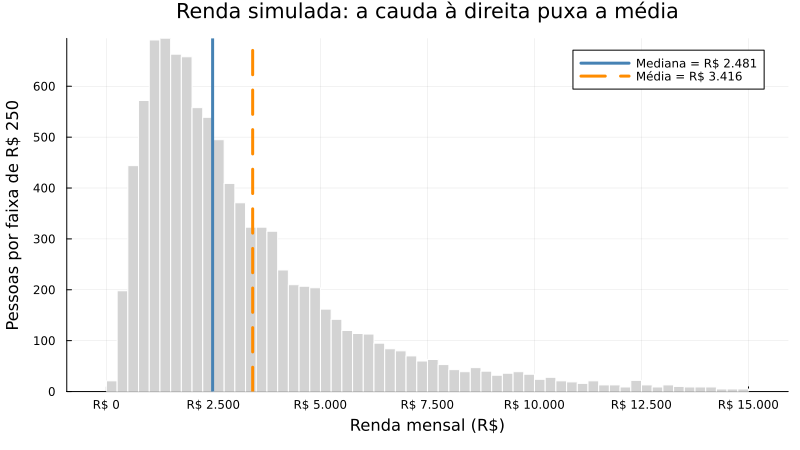

---
layout: post
image: /assets/images/mediana.avif
title: Entendendo a Mediana
categories: [ESTATÍSTICA DESCRITIVA]
tags: [Estatística]
lang: pt
ref: entendendo-a-mediana
author: dante-bertuzzi
date: 2025-05-16 23:55:00 -0300
mathjax: true
description: "O que é a mediana, como calculá-la em dados brutos, tabelas e classes, por que resiste a outliers e quando a média é melhor. Com código em Julia e Python."
---

Uma pequena empresa tem sete pessoas na folha. Seis ganham entre R\\$ 2.100 e R\\$ 3.400 por mês; a sétima, a sócia, ganha R\\$ 25.000. O salário médio dá R\\$ 5.871,43, e **seis das sete pessoas ganham menos que isso**. Quem lê "salário médio de quase R\\$ 6 mil" imagina outra empresa. A mediana, R\\$ 2.800, descreve muito melhor o que ganha quem trabalha ali. (Os números são ilustrativos.)

Eu demorei a perceber que média e mediana não competem: respondem a perguntas diferentes. Neste post você vai ver o que é a mediana, como calculá-la em dados brutos, em tabelas de frequência e em classes, por que ela resiste a valores extremos e, tão importante quanto, quando a média continua sendo a escolha certa.

## O que é a mediana

A **mediana** é o valor que divide os dados ordenados em duas metades: pelo menos metade das observações é menor ou igual a ela, e pelo menos metade é maior ou igual. É a mesma coisa que o [percentil](/pt/glossario#percentil) 50 e o segundo [quartil](/pt/glossario#quartil).

Para escrever a regra, chame de $$x_{(1)} \le x_{(2)} \le \dots \le x_{(n)}$$ os dados em ordem crescente: $$x_{(1)}$$ é o menor valor, $$x_{(n)}$$ o maior, e $$n$$ é o número de observações. A mediana (Md) é:

$$
\text{Md} =
\begin{cases}
x_{\left(\frac{n+1}{2}\right)}, & \text{se } n \text{ é ímpar} \\[2mm]
\dfrac{x_{\left(\frac{n}{2}\right)} + x_{\left(\frac{n}{2}+1\right)}}{2}, & \text{se } n \text{ é par}
\end{cases}
$$

É a definição usada pelo e-Handbook de métodos estatísticos do NIST (seção 1.3.5.1). Um erro comum: $$\frac{n+1}{2}$$ é a **posição** da mediana na lista ordenada, não o valor dela.

## Como calcular, passo a passo

1. **Ordene** os dados em ordem crescente.
2. **Conte** as observações: $$n$$.
3. Se $$n$$ for **ímpar**, a mediana é o valor na posição $$\frac{n+1}{2}$$.
4. Se $$n$$ for **par**, a mediana é a média dos valores nas posições $$\frac{n}{2}$$ e $$\frac{n}{2} + 1$$.

### Exemplo 1: número ímpar de observações

**Dados** (do enunciado, ilustrativos): idades de cinco pessoas, em anos: 23, 45, 12, 34, 29.

1. Ordenando: 12, 23, 29, 34, 45.
2. $$n = 5$$, ímpar.
3. Fórmula da posição: $$\frac{n+1}{2}$$.
4. Substituindo: $$\frac{5+1}{2} = \frac{6}{2} = 3$$.
5. O 3º valor da lista ordenada é $$x_{(3)} = 29$$.

**Resultado:** Md = 29 anos. **Interpretação:** duas pessoas têm menos de 29 anos e duas têm mais; 29 é o ponto que separa o grupo ao meio.

### Exemplo 2: número par de observações

**Dados** (ilustrativos): notas de quatro alunos: 7,5; 6,0; 8,5; 5,5.

1. Ordenando: 5,5; 6,0; 7,5; 8,5.
2. $$n = 4$$, par.
3. Posições centrais: $$\frac{n}{2} = \frac{4}{2} = 2$$ e $$\frac{n}{2} + 1 = 3$$. Os valores são $$x_{(2)} = 6{,}0$$ e $$x_{(3)} = 7{,}5$$.
4. Substituindo na fórmula: $$\text{Md} = \frac{6{,}0 + 7{,}5}{2}$$.
5. Numerador: $$6{,}0 + 7{,}5 = 13{,}5$$. Divisão: $$\frac{13{,}5}{2} = 6{,}75$$.

**Resultado:** Md = 6,75. **Interpretação:** nenhum aluno tirou 6,75; é o ponto que separa as duas notas mais baixas das duas mais altas. Qualquer valor entre 6,0 e 7,5 dividiria o grupo ao meio; a convenção é ficar com o ponto do meio desse intervalo.

### Exemplo 3: os salários da abertura

**Dados** (ilustrativos, em R\\$, já em ordem): 2.100; 2.300; 2.500; 2.800; 3.000; 3.400; 25.000.

**Mediana.** $$n = 7$$, ímpar. Posição: $$\frac{7+1}{2} = \frac{8}{2} = 4$$. O 4º valor é **R\\$ 2.800**.

**Média.** A média aritmética é $$\bar{x} = \frac{\sum x_i}{n}$$, a soma dos valores dividida por quantos são. A soma, um termo por vez:

- 2.100 + 2.300 = 4.400
- 4.400 + 2.500 = 6.900
- 6.900 + 2.800 = 9.700
- 9.700 + 3.000 = 12.700
- 12.700 + 3.400 = 16.100
- 16.100 + 25.000 = 41.100

Então $$\bar{x} = \frac{41.100}{7} = 5.871{,}428\ldots \approx$$ **R\\$ 5.871,43**.

**Interpretação:** um único salário alto puxou a média para um valor que só uma pessoa da empresa alcança. A média não está "errada": ela responde a outra pergunta. A folha custa 7 × R\\$ 5.871,43 = R\\$ 41.100 por mês, e é a média que dá esse total. Já a mediana diz quanto ganha uma pessoa típica dali.

## Mediana em tabela de frequência

Quando os dados vêm numa tabela de frequência, a lista ordenada está implícita na **frequência acumulada**: o total de observações até cada linha.

**Dados** (ilustrativos): número de filhos em 40 famílias.

| Filhos | Famílias | Frequência acumulada |
|:---:|:---:|:---:|
| 0 | 7 | 7 |
| 1 | 12 | 19 |
| 2 | 11 | 30 |
| 3 | 6 | 36 |
| 4 | 4 | 40 |

1. $$n = 40$$, par: a mediana é a média dos valores nas posições $$\frac{40}{2} = 20$$ e $$21$$.
2. A acumulada diz que as posições 1 a 7 têm 0 filho, as posições 8 a 19 têm 1 filho e as posições 20 a 30 têm 2 filhos.
3. Logo $$x_{(20)} = 2$$ e $$x_{(21)} = 2$$, e $$\text{Md} = \frac{2 + 2}{2} = 2$$ filhos.

**Interpretação:** 30 das 40 famílias têm até 2 filhos e 21 têm 2 ou mais (11 + 6 + 4 = 21): o valor 2 divide o grupo ao meio. Para comparar, a média é $$\frac{0 \cdot 7 + 1 \cdot 12 + 2 \cdot 11 + 3 \cdot 6 + 4 \cdot 4}{40} = \frac{0 + 12 + 22 + 18 + 16}{40} = \frac{68}{40} = 1{,}7$$ filho.

## Mediana em dados agrupados em classes

Às vezes só sobra a tabela por classes, e os valores individuais se perderam. Aí a mediana exata não pode ser calculada, mas dá para aproximá-la.

**Dados** (ilustrativos): tempo de espera de 40 clientes num atendimento, em minutos.

| Classe (min) | Clientes | Frequência acumulada |
|:---:|:---:|:---:|
| [0, 5) | 8 | 8 |
| [5, 10) | 10 | 18 |
| [10, 15) | 12 | 30 |
| [15, 20) | 6 | 36 |
| [20, 30) | 4 | 40 |

**A ideia.** Procuramos o tempo que deixa $$\frac{n}{2} = 20$$ clientes abaixo dele. Até 10 min há 18 clientes; até 15 min, 30. Então a mediana está na classe [10, 15). Faltam 2 clientes dos 12 dessa classe. **Supondo que os 12 se espalham por igual dentro da classe** (é essa hipótese que torna o resultado aproximado), andamos $$\frac{2}{12}$$ da largura da classe a partir do seu início.

**Fórmula:**

$$
\text{Md} \approx L + \frac{\frac{n}{2} - F_{\text{ant}}}{f_{\text{Md}}} \cdot h
$$

em que $$L$$ é o limite inferior da classe da mediana, $$F_{\text{ant}}$$ é a frequência acumulada **antes** dela, $$f_{\text{Md}}$$ é a frequência da própria classe e $$h$$ é a largura da classe.

**Substituição:** $$L = 10$$, $$F_{\text{ant}} = 18$$, $$f_{\text{Md}} = 12$$, $$h = 15 - 10 = 5$$:

$$
\text{Md} \approx 10 + \frac{\frac{40}{2} - 18}{12} \cdot 5
$$

**Conta:**

$$
\begin{aligned}
\tfrac{40}{2} &= 20 \\
20 - 18 &= 2 \\
\tfrac{2}{12} &= 0{,}1666\ldots \\
0{,}1666\ldots \times 5 &= 0{,}8333\ldots \\
10 + 0{,}8333\ldots &= 10{,}8333\ldots
\end{aligned}
$$

**Resultado:** Md ≈ 10,83 min (arredondado só no fim).

**Interpretação:** cerca de metade dos clientes esperou menos de 10,8 minutos. O que a tabela garante é só que a mediana dos dados originais está em algum ponto de [10, 15); o 10,83 é a melhor aposta sob a hipótese de espalhamento uniforme. A média aproximada pelos pontos médios das classes é $$\frac{2{,}5 \cdot 8 + 7{,}5 \cdot 10 + 12{,}5 \cdot 12 + 17{,}5 \cdot 6 + 25 \cdot 4}{40} = \frac{20 + 75 + 150 + 105 + 100}{40} = \frac{450}{40} = 11{,}25$$ min, maior que a mediana por causa da classe longa [20, 30) na cauda direita.

  

  

    
Julia

    

    <button class="copy-button" onclick="copyCode(this)">
      <i class="bi bi-clipboard"></i>Copiar
    </button>
  

  

    <pre><code># Mediana aproximada para dados agrupados em classes (interpolação linear)
limites = [0, 5, 10, 15, 20, 30]    # minutos: [0, 5), [5, 10), ..., [20, 30)
freq = [8, 10, 12, 6, 4]

function mediana_agrupada(limites, freq)
    n = sum(freq)
    acum = cumsum(freq)
    k = findfirst(&gt;=(n / 2), acum)           # classe da mediana
    F_ant = k == 1 ? 0 : acum[k - 1]         # frequência acumulada antes dela
    L, h = limites[k], limites[k + 1] - limites[k]
    return L + (n / 2 - F_ant) / freq[k] * h
end

println("Frequência acumulada: ", cumsum(freq))
println("Mediana aproximada: ", round(mediana_agrupada(limites, freq), digits = 4), " min")</code></pre>
  

  
# Saída

  <pre style="overflow-x: auto; font-size: 0.9em;">Frequência acumulada: [8, 18, 30, 36, 40]
Mediana aproximada: 10.8333 min</pre>

  

  

  

    
Python

    

    <button class="copy-button" onclick="copyCode(this)">
      <i class="bi bi-clipboard"></i>Copiar
    </button>
  

  

    <pre><code>import numpy as np

# Mediana aproximada para dados agrupados em classes (interpolação linear)
limites = np.array([0, 5, 10, 15, 20, 30])   # minutos: [0, 5), [5, 10), ..., [20, 30)
freq = np.array([8, 10, 12, 6, 4])

def mediana_agrupada(limites, freq):
    n = freq.sum()
    acum = np.cumsum(freq)
    k = np.argmax(acum &gt;= n / 2)               # classe da mediana
    F_ant = 0 if k == 0 else acum[k - 1]       # frequência acumulada antes dela
    L, h = limites[k], limites[k + 1] - limites[k]
    return L + (n / 2 - F_ant) / freq[k] * h

print("Frequência acumulada:", np.cumsum(freq))
print(f"Mediana aproximada: {mediana_agrupada(limites, freq):.4f} min")</code></pre>
  

  
# Saída

  <pre style="overflow-x: auto; font-size: 0.9em;">Frequência acumulada: [ 8 18 30 36 40]
Mediana aproximada: 10.8333 min</pre>

  

## Por que a mediana resiste a valores extremos

A mediana depende só de **quem está no meio** da lista ordenada. Se o maior valor dobra ou decuplica, ele continua sendo o maior, e o meio não muda. O NIST resume assim: valores extremos nas caudas distorcem a média, mas não a mediana, porque ela se baseia na ordem dos dados.

Mas ela não é imune. O teste abaixo pega as idades do Exemplo 1 e troca os $$k$$ maiores valores por 1000, como se fossem erros de digitação:

  

  

    
Julia

    

    <button class="copy-button" onclick="copyCode(this)">
      <i class="bi bi-clipboard"></i>Copiar
    </button>
  

  

    <pre><code>using Statistics

idades = [12, 23, 29, 34, 45]

# Troca os k maiores valores por 1000 (erros de digitação, por exemplo)
for k in 0:3
    x = Float64.(idades)
    x[end-k+1:end] .= 1000
    println("k = $k: média = ", round(mean(x), digits = 1), "   mediana = ", median(x))
end</code></pre>
  

  
# Saída

  <pre style="overflow-x: auto; font-size: 0.9em;">k = 0: média = 28.6   mediana = 29.0
k = 1: média = 219.6   mediana = 29.0
k = 2: média = 412.8   mediana = 29.0
k = 3: média = 607.0   mediana = 1000.0</pre>

  

  

  

    
Python

    

    <button class="copy-button" onclick="copyCode(this)">
      <i class="bi bi-clipboard"></i>Copiar
    </button>
  

  

    <pre><code>import numpy as np

idades = np.array([12, 23, 29, 34, 45])

# Troca os k maiores valores por 1000 (erros de digitação, por exemplo)
for k in range(4):
    x = idades.astype(float)
    if k &gt; 0:
        x[-k:] = 1000
    print(f"k = {k}: média = {x.mean():.1f}   mediana = {np.median(x)}")</code></pre>
  

  
# Saída

  <pre style="overflow-x: auto; font-size: 0.9em;">k = 0: média = 28.6   mediana = 29.0
k = 1: média = 219.6   mediana = 29.0
k = 2: média = 412.8   mediana = 29.0
k = 3: média = 607.0   mediana = 1000.0</pre>

  

**Interpretação:** um único erro leva a média de 28,6 para 219,6 anos, um número absurdo. A mediana aguenta firme com 2 dos 5 valores estragados e só cede quando a **maioria** (3 de 5) está errada; a partir daí ela vai para onde os erros a levarem. Na estatística robusta, a fração de dados contaminados que um estimador suporta antes de poder ser levado arbitrariamente longe chama-se **ponto de ruptura** (*breakdown point*, conceito definido por Hampel em 1971). O da média é um único valor; o da mediana, quase metade dos dados.

## A propriedade por trás de tudo: a mediana minimiza os desvios absolutos

A média é o número $$m$$ que torna mínima a soma dos desvios **ao quadrado**, $$\sum (x_i - m)^2$$. A mediana é o número que torna mínima a soma dos desvios **absolutos**, $$\sum \lvert x_i - m \rvert$$.

**Por que vale.** Suponha que $$m$$ esteja abaixo da mediana e empurre $$m$$ um pouquinho para cima, sem passar por nenhum dado. A distância até cada ponto acima de $$m$$ diminui, e a distância até cada ponto abaixo aumenta, na mesma quantidade. Como $$m$$ está abaixo da mediana, há **mais** pontos acima dele que abaixo, e a soma diminui. O raciocínio é o mesmo, espelhado, se $$m$$ estiver acima da mediana. Então a soma só para de diminuir na mediana. Com $$n$$ par, qualquer $$m$$ entre os dois valores centrais dá a mesma soma: nas notas do Exemplo 2, a soma vale 4,5 em 6,0, em 6,75 e em 7,5, e 5,5 em 5,5 e em 8,0.

**Conferindo nas idades** (12, 23, 29, 34, 45; média 28,6):

- Em $$m = 29$$: $$17 + 6 + 0 + 5 + 16 = 44$$.
- Em $$m = 28{,}6$$: $$16{,}6 + 5{,}6 + 0{,}4 + 5{,}4 + 16{,}4 = 44{,}4$$.

  

  

    
Julia

    

    <button class="copy-button" onclick="copyCode(this)">
      <i class="bi bi-clipboard"></i>Copiar
    </button>
  

  

    <pre><code>using Statistics

idades = [12, 23, 29, 34, 45]
soma_abs(m) = sum(abs.(idades .- m))     # soma dos desvios absolutos
soma_quad(m) = sum((idades .- m) .^ 2)   # soma dos desvios ao quadrado

grade = 0:0.01:60
println("Minimiza a soma dos |desvios|: ", grade[argmin(soma_abs.(grade))])
println("Minimiza a soma dos desvios²:  ", grade[argmin(soma_quad.(grade))])
println("Mediana = ", median(idades), "   média = ", mean(idades))
println("Soma dos |desvios| em 29 e em 28,6: ", soma_abs(29), "  ", round(soma_abs(28.6), digits = 1))</code></pre>
  

  
# Saída

  <pre style="overflow-x: auto; font-size: 0.9em;">Minimiza a soma dos |desvios|: 29.0
Minimiza a soma dos desvios²:  28.6
Mediana = 29.0   média = 28.6
Soma dos |desvios| em 29 e em 28,6: 44  44.4</pre>

  

  

  

    
Python

    

    <button class="copy-button" onclick="copyCode(this)">
      <i class="bi bi-clipboard"></i>Copiar
    </button>
  

  

    <pre><code>import numpy as np

idades = np.array([12, 23, 29, 34, 45])
soma_abs = lambda m: np.abs(idades - m).sum()     # soma dos desvios absolutos
soma_quad = lambda m: ((idades - m) ** 2).sum()   # soma dos desvios ao quadrado

grade = np.round(np.arange(0, 60.001, 0.01), 2)
print("Minimiza a soma dos |desvios|:", grade[np.argmin([soma_abs(m) for m in grade])])
print("Minimiza a soma dos desvios²: ", grade[np.argmin([soma_quad(m) for m in grade])])
print("Mediana =", np.median(idades), "  média =", idades.mean())
print("Soma dos |desvios| em 29 e em 28,6:", soma_abs(29), "", round(soma_abs(28.6), 1))</code></pre>
  

  
# Saída

  <pre style="overflow-x: auto; font-size: 0.9em;">Minimiza a soma dos |desvios|: 29.0
Minimiza a soma dos desvios²:  28.6
Mediana = 29.0   média = 28.6
Soma dos |desvios| em 29 e em 28,6: 44  44.4</pre>

  

**Por que isso importa:** ao elevar ao quadrado, um ponto 10 vezes mais distante pesa 100 vezes mais. É por isso que a média "persegue" os valores extremos. No desvio absoluto, o peso cresce só na proporção da distância, e a mediana fica onde está a maioria.

## Média, mediana e assimetria

Numa distribuição com cauda longa à direita (renda, preço de imóveis, tempos de espera), os valores altos puxam a média para cima, e ela costuma ficar acima da mediana. O NIST diz que a média é puxada na direção da assimetria. É uma tendência, não uma regra sem exceções, mas é o padrão que se vê na maioria dos dados desse tipo.

A Figura 1 mostra 10.000 rendas mensais **simuladas** (não são dados reais) a partir de uma distribuição log-normal com mediana R\\$ 2.500:

  

  

    
Julia

    

    <button class="copy-button" onclick="copyCode(this)">
      <i class="bi bi-clipboard"></i>Copiar
    </button>
  

  

    <pre><code>using Distributions, Random, Statistics, Plots

Random.seed!(123)
# Renda mensal simulada (R$): log-normal com mediana 2500, só para ilustrar a assimetria
renda = rand(LogNormal(log(2500), 0.8), 10_000)
md, me = median(renda), mean(renda)
println("Mediana = ", round(Int, md), "   média = ", round(Int, me))
println("Abaixo da média: ", round(100 * mean(renda .&lt; me), digits = 1), "%")

reais(v) = "R\$ " * replace(string(round(Int, v)), r"(?&lt;=\d)(?=(\d{3})+$)" =&gt; ".")   # R$ 2.481
histogram(renda[renda .&lt; 15000], bins = 0:250:15000, color = :lightgray, linecolor = :white,
          label = "", xlabel = "Renda mensal (R\$)", ylabel = "Pessoas por faixa de R\$ 250",
          xticks = (0:2500:15000, reais.(0:2500:15000)),
          title = "Renda simulada: a cauda à direita puxa a média", size = (800, 450))
vline!([md], lw = 3, color = :steelblue, label = "Mediana = " * reais(md))
vline!([me], lw = 3, color = :darkorange, ls = :dash, label = "Média = " * reais(me))
savefig("mediana-assimetria.png")</code></pre>
  

  
# Saída

  <pre style="overflow-x: auto; font-size: 0.9em;">Mediana = 2481   média = 3416
Abaixo da média: 65.3%</pre>

  

  

  

    
Python

    

    <button class="copy-button" onclick="copyCode(this)">
      <i class="bi bi-clipboard"></i>Copiar
    </button>
  

  

    <pre><code>import numpy as np
import matplotlib.pyplot as plt

rng = np.random.default_rng(123)
# Renda mensal simulada (R$): log-normal com mediana 2500, só para ilustrar a assimetria
renda = rng.lognormal(mean=np.log(2500), sigma=0.8, size=10_000)
md, me = np.median(renda), renda.mean()
print(f"Mediana = {md:.0f}   média = {me:.0f}")
print(f"Abaixo da média: {100 * (renda &lt; me).mean():.1f}%")

reais = lambda v: "R$ " + f"{v:,.0f}".replace(",", ".")   # R$ 2.542
plt.figure(figsize=(8, 4.5))
plt.hist(renda[renda &lt; 15000], bins=np.arange(0, 15001, 250), color="lightgray", edgecolor="white")
plt.axvline(md, lw=3, color="steelblue", label="Mediana = " + reais(md))
plt.axvline(me, lw=3, color="darkorange", ls="--", label="Média = " + reais(me))
plt.xticks(np.arange(0, 15001, 2500), [reais(v) for v in np.arange(0, 15001, 2500)])
plt.xlabel("Renda mensal (R$)"); plt.ylabel("Pessoas por faixa de R$ 250")
plt.title("Renda simulada: a cauda à direita puxa a média")
plt.legend(); plt.savefig("mediana-assimetria-py.png", dpi=120, bbox_inches="tight")</code></pre>
  

  
# Saída

  <pre style="overflow-x: auto; font-size: 0.9em;">Mediana = 2542   média = 3443
Abaixo da média: 65.2%</pre>

  

Figura 1 – Rendas simuladas (gerada pelo código em Julia acima). A cauda à direita puxa a média (R\$ 3.416) para longe da mediana (R\$ 2.481): 65,3% das pessoas ganham menos que a média. As 127 rendas acima de R\$ 15.000 ficam fora do gráfico, mas entram no cálculo da média.

**Interpretação:** se um relatório dissesse "a renda média é R\\$ 3.416", quase dois terços das pessoas estariam abaixo desse número. O código em Python sorteia outros números e dá valores um pouco diferentes (mediana R\\$ 2.542, média R\\$ 3.443, 65,2% abaixo da média); a conclusão é a mesma.

**A mediana de uma distribuição.** Para uma variável contínua, a mediana é o valor $$m$$ com $$P(X \le m) = \frac{1}{2}$$. Exemplo: se o tempo entre chegadas de clientes segue uma distribuição exponencial com média de 10 minutos, $$P(X \le m) = 1 - e^{-m/10}$$. Igualando a $$\frac{1}{2}$$:

$$
\begin{aligned}
1 - e^{-m/10} &= \tfrac{1}{2} \\
e^{-m/10} &= \tfrac{1}{2} \\
-\tfrac{m}{10} &= \ln \tfrac{1}{2} = -\ln 2 \\
m &= 10 \ln 2 \approx 6{,}93 \text{ minutos}
\end{aligned}
$$

Metade dos intervalos é menor que 6,93 min, embora a média seja 10. Em Julia, `median(Exponential(10))` dá `6.931471805599453`; atenção à parametrização: `Exponential(θ)` recebe a **média** θ, não a taxa. Em SciPy, `scipy.stats.expon(scale=10).median()` dá o mesmo valor.

## Média ou mediana: qual varia menos de amostra para amostra?

É comum ler que a mediana é "mais estável" que a média. Depende dos dados. A simulação abaixo sorteia 100.000 amostras de tamanho 25 de três distribuições simétricas em torno de zero e mede quanto a média e a mediana variam entre as amostras. A medida é o intervalo interquartil (IQR) dos 100.000 resultados: a largura da faixa que contém a metade central deles. Usei o IQR e não o desvio padrão porque, na Cauchy, a média amostral não tem variância finita.

  

  

    
Julia

    

    <button class="copy-button" onclick="copyCode(this)">
      <i class="bi bi-clipboard"></i>Copiar
    </button>
  

  

    <pre><code>using Statistics, Distributions, Random, Printf

Random.seed!(123)
n, R = 25, 100_000              # tamanho de cada amostra, número de amostras
iqr(v) = quantile(v, 0.75) - quantile(v, 0.25)

for (nome, dist) in [("Normal", Normal(0, 1)), ("t com 2 g.l.", TDist(2)), ("Cauchy", Cauchy(0, 1))]
    medias = zeros(R); medianas = zeros(R)
    for r in 1:R
        amostra = rand(dist, n)
        medias[r] = mean(amostra); medianas[r] = median(amostra)
    end
    @printf("%-13sIQR das médias = %.3f   IQR das medianas = %.3f
", nome, iqr(medias), iqr(medianas))
end</code></pre>
  

  
# Saída

  <pre style="overflow-x: auto; font-size: 0.9em;">Normal       IQR das médias = 0.270   IQR das medianas = 0.334
t com 2 g.l. IQR das médias = 0.591   IQR das medianas = 0.378
Cauchy       IQR das médias = 2.007   IQR das medianas = 0.425</pre>

  

  

  

    
Python

    

    <button class="copy-button" onclick="copyCode(this)">
      <i class="bi bi-clipboard"></i>Copiar
    </button>
  

  

    <pre><code>import numpy as np

rng = np.random.default_rng(123)
n, R = 25, 100_000              # tamanho de cada amostra, número de amostras
iqr = lambda v: np.quantile(v, 0.75) - np.quantile(v, 0.25)

for nome, sorteio in [("Normal", lambda: rng.standard_normal((R, n))),
                      ("t com 2 g.l.", lambda: rng.standard_t(2, (R, n))),
                      ("Cauchy", lambda: rng.standard_cauchy((R, n)))]:
    amostras = sorteio()                       # R amostras de tamanho n
    medias = amostras.mean(axis=1)
    medianas = np.median(amostras, axis=1)
    print(f"{nome:&lt;13}IQR das médias = {iqr(medias):.3f}   IQR das medianas = {iqr(medianas):.3f}")</code></pre>
  

  
# Saída

  <pre style="overflow-x: auto; font-size: 0.9em;">Normal       IQR das médias = 0.268   IQR das medianas = 0.334
t com 2 g.l. IQR das médias = 0.585   IQR das medianas = 0.379
Cauchy       IQR das médias = 2.004   IQR das medianas = 0.421</pre>

  

**Interpretação:**

- **Normal:** a média varia **menos** (IQR 0,270 contra 0,334; o da mediana é cerca de 24% maior). Com dados normais, a média aproveita melhor a informação, e o NIST a chama de estimador ótimo nesse caso.
- **t com 2 graus de liberdade** (caudas pesadas): a mediana varia menos (0,378 contra 0,591).
- **Cauchy** (caudas muito pesadas): a média é inútil. A média de 25 observações tem a mesma distribuição de uma observação só, de modo que juntar mais dados não melhora a estimativa (NIST, seção 1.3.5.1). A mediana continua funcionando.

O Python sorteia outros números e dá valores ligeiramente diferentes, com as mesmas conclusões. A lição: a mediana compra robustez pagando um pouco de precisão quando os dados são bem-comportados.

## Mediana em Julia e Python

O pacote `Statistics` já vem com o Julia; o `DataFrames` se instala uma vez com `using Pkg; Pkg.add("DataFrames")`. Em Python, `pip install numpy pandas scipy matplotlib`. (Sem nenhuma biblioteca, o módulo `statistics` do Python também tem `statistics.median`.)

### Exemplo básico

Os três exemplos resolvidos à mão:

  

  

    
Julia

    

    <button class="copy-button" onclick="copyCode(this)">
      <i class="bi bi-clipboard"></i>Copiar
    </button>
  

  

    <pre><code>using Statistics

idades = [23, 45, 12, 34, 29]           # n = 5 (ímpar)
notas = [7.5, 6.0, 8.5, 5.5]            # n = 4 (par)
salarios = [2100, 2300, 2500, 2800, 3000, 3400, 25000]   # R$, números ilustrativos

println("Mediana das idades: ", median(idades))
println("Mediana das notas: ", median(notas))
println("Salários: média = ", round(mean(salarios), digits = 2),
        ", mediana = ", median(salarios))
println("Ganham menos que a média: ", count(&lt;(mean(salarios)), salarios), " de ", length(salarios))</code></pre>
  

  
# Saída

  <pre style="overflow-x: auto; font-size: 0.9em;">Mediana das idades: 29.0
Mediana das notas: 6.75
Salários: média = 5871.43, mediana = 2800.0
Ganham menos que a média: 6 de 7</pre>

  

  

  

    
Python

    

    <button class="copy-button" onclick="copyCode(this)">
      <i class="bi bi-clipboard"></i>Copiar
    </button>
  

  

    <pre><code>import numpy as np

idades = np.array([23, 45, 12, 34, 29])          # n = 5 (ímpar)
notas = np.array([7.5, 6.0, 8.5, 5.5])           # n = 4 (par)
salarios = np.array([2100, 2300, 2500, 2800, 3000, 3400, 25000])  # R$, números ilustrativos

print("Mediana das idades:", np.median(idades))
print("Mediana das notas:", np.median(notas))
print(f"Salários: média = {salarios.mean():.2f}, mediana = {np.median(salarios)}")
print("Ganham menos que a média:", (salarios &lt; salarios.mean()).sum(), "de", len(salarios))</code></pre>
  

  
# Saída

  <pre style="overflow-x: auto; font-size: 0.9em;">Mediana das idades: 29.0
Mediana das notas: 6.75
Salários: média = 5871.43, mediana = 2800.0
Ganham menos que a média: 6 de 7</pre>

  

### Dados faltantes

Cada ferramenta trata valores faltantes de um jeito, e vale saber qual antes de confiar no resultado:

  

  

    
Julia

    

    <button class="copy-button" onclick="copyCode(this)">
      <i class="bi bi-clipboard"></i>Copiar
    </button>
  

  

    <pre><code>using Statistics

dados = [12.5, 15.8, missing, 14.2, 13.7, missing, 16.1]

println("Sem tratar: ", median(dados))                 # missing contamina o resultado
println("Ignorando faltantes: ", median(skipmissing(dados)))
println("Valores usados: ", sort(collect(skipmissing(dados))))</code></pre>
  

  
# Saída

  <pre style="overflow-x: auto; font-size: 0.9em;">Sem tratar: missing
Ignorando faltantes: 14.2
Valores usados: [12.5, 13.7, 14.2, 15.8, 16.1]</pre>

  

  

  

    
Python

    

    <button class="copy-button" onclick="copyCode(this)">
      <i class="bi bi-clipboard"></i>Copiar
    </button>
  

  

    <pre><code>import numpy as np
import pandas as pd

dados = pd.Series([12.5, 15.8, None, 14.2, 13.7, None, 16.1])

print("NumPy sem tratar:", np.median(dados.to_numpy()))   # NaN contamina o resultado
print("NumPy ignorando faltantes:", np.nanmedian(dados.to_numpy()))
print("pandas (ignora por padrão):", dados.median())
print("Valores usados:", sorted(dados.dropna().tolist()))</code></pre>
  

  
# Saída

  <pre style="overflow-x: auto; font-size: 0.9em;">NumPy sem tratar: nan
NumPy ignorando faltantes: 14.2
pandas (ignora por padrão): 14.2
Valores usados: [12.5, 13.7, 14.2, 15.8, 16.1]</pre>

  

Sem os faltantes sobram cinco valores; ordenados, 12,5; 13,7; 14,2; 15,8; 16,1, e o 3º é **14,2**. O Julia devolve `missing` e o NumPy devolve `nan` se você não tratar os faltantes; o pandas os ignora por padrão.

### Mediana por grupo

  

  

    
Julia

    

    <button class="copy-button" onclick="copyCode(this)">
      <i class="bi bi-clipboard"></i>Copiar
    </button>
  

  

    <pre><code>using DataFrames, Statistics

df = DataFrame(
    departamento = ["Vendas", "TI", "RH", "Vendas", "TI", "RH", "Vendas"],
    salario = [4500, 6500, 3800, 5200, 7000, 4000, 4800]      # R$, ilustrativo
)

medianas = combine(groupby(df, :departamento), :salario =&gt; median =&gt; :mediana_salarial)
println(medianas)</code></pre>
  

  
# Saída

  <pre style="overflow-x: auto; font-size: 0.9em;">3×2 DataFrame
 Row │ departamento  mediana_salarial
     │ String        Float64
─────┼────────────────────────────────
   1 │ Vendas                  4800.0
   2 │ TI                      6750.0
   3 │ RH                      3900.0</pre>

  

  

  

    
Python

    

    <button class="copy-button" onclick="copyCode(this)">
      <i class="bi bi-clipboard"></i>Copiar
    </button>
  

  

    <pre><code>import pandas as pd

df = pd.DataFrame({
    "departamento": ["Vendas", "TI", "RH", "Vendas", "TI", "RH", "Vendas"],
    "salario": [4500, 6500, 3800, 5200, 7000, 4000, 4800],    # R$, ilustrativo
})

medianas = df.groupby("departamento", sort=False)["salario"].median()
print(medianas.rename("mediana_salarial").reset_index())</code></pre>
  

  
# Saída

  <pre style="overflow-x: auto; font-size: 0.9em;">  departamento  mediana_salarial
0       Vendas            4800.0
1           TI            6750.0
2           RH            3900.0</pre>

  

Em Vendas, os salários ordenados são 4.500; 4.800; 5.200, e o do meio é R\\$ 4.800. Em TI e RH há dois salários, e a mediana é a média deles: R\\$ 6.750 e R\\$ 3.900.

### Implementação manual

Para ver a regra funcionando, uma versão escrita à mão:

  

  

    
Julia

    

    <button class="copy-button" onclick="copyCode(this)">
      <i class="bi bi-clipboard"></i>Copiar
    </button>
  

  

    <pre><code>function calcular_mediana(vetor)
    dados = sort(vetor)              # sort devolve uma cópia: o vetor original não muda
    n = length(dados)
    if isodd(n)
        return dados[(n + 1) ÷ 2]    # o elemento do meio
    else
        meio = n ÷ 2
        return (dados[meio] + dados[meio + 1]) / 2   # média dos dois do meio
    end
end

println("Mediana manual (ímpar): ", calcular_mediana([1, 3, 3, 6, 7, 8, 9]))
println("Mediana manual (par): ", calcular_mediana([1, 2, 3, 4, 5, 6, 8, 9]))</code></pre>
  

  
# Saída

  <pre style="overflow-x: auto; font-size: 0.9em;">Mediana manual (ímpar): 6
Mediana manual (par): 4.5</pre>

  

  

  

    
Python

    

    <button class="copy-button" onclick="copyCode(this)">
      <i class="bi bi-clipboard"></i>Copiar
    </button>
  

  

    <pre><code>def calcular_mediana(valores):
    dados = sorted(valores)          # sorted devolve uma cópia: a lista original não muda
    n = len(dados)
    if n % 2 == 1:
        return dados[(n + 1) // 2 - 1]   # o elemento do meio (Python começa no índice 0)
    meio = n // 2
    return (dados[meio - 1] + dados[meio]) / 2   # média dos dois do meio

print("Mediana manual (ímpar):", calcular_mediana([1, 3, 3, 6, 7, 8, 9]))
print("Mediana manual (par):", calcular_mediana([1, 2, 3, 4, 5, 6, 8, 9]))</code></pre>
  

  
# Saída

  <pre style="overflow-x: auto; font-size: 0.9em;">Mediana manual (ímpar): 6
Mediana manual (par): 4.5</pre>

  

Na primeira lista, $$n = 7$$ e o 4º valor é 6; na segunda, $$n = 8$$ e a mediana é $$\frac{4 + 5}{2} = 4{,}5$$.

## Média × mediana: quando usar cada uma

| Situação | Média | Mediana |
|---|---|---|
| Um valor extremo nos dados | Muda muito | Quase não muda |
| Dados aproximadamente normais, sem outliers | Mais precisa | Funciona, mas varia mais entre amostras |
| Distribuição assimétrica (renda, preços, tempos) | Puxada para a cauda | Descreve melhor o valor típico |
| Caudas muito pesadas | Instável | Estável |
| Dados ordinais (ruim, regular, bom, ótimo) | Não se aplica | Aplica-se (cuidado com $$n$$ par, abaixo) |
| Precisa do total (orçamento, folha) | Total = média × $$n$$ | Não recupera o total |
| Cálculo | Soma e divisão | Ordenação |

## Quando a mediana engana

- **Quando o total importa.** Para orçar uma folha de pagamento, um estoque ou um consumo, use a média: média × $$n$$ dá o total, e a mediana não dá.
- **Dados discretos com poucos valores.** No exemplo dos filhos, se as 10 famílias com 3 ou 4 filhos passassem a ter 2, a mediana continuaria 2, mas a média cairia de 1,7 para 1,35. A mediana não enxerga mudanças que não atravessam o meio.
- **Mediana de medianas.** Medianas de grupos não se combinam. Com os grupos A = {1, 2, 9} e B = {4, 5, 6, 7, 8}, as medianas são 2 e 6. A média delas é 4, e a média ponderada pelo tamanho dos grupos é 4,5. Mas a mediana dos 8 valores juntos (1, 2, 4, 5, 6, 7, 8, 9) é $$\frac{5 + 6}{2} = 5{,}5$$. Para a mediana geral, você precisa dos dados, não só das medianas.
- **Distribuições com dois picos.** Em 1, 1, 1, 2, 9, 9, 9, a mediana é 2: um valor que só uma observação tem, num grupo formado por dois tipos bem diferentes. Nenhuma medida de centro resume bem esses dados; olhe o histograma ou o [boxplot](/boxplot-o-que-e-cada-elemento-como-se-calcula-e-como-interpretar/).
- **Dados ordinais com $$n$$ par.** Se as respostas centrais forem "regular" e "bom", não existe "a média de regular e bom". Diga que a mediana fica entre as duas categorias, ou adote e declare uma convenção (por exemplo, ficar com a categoria mais baixa).

## Resumo

- A mediana é o valor do meio dos dados ordenados: com $$n$$ ímpar, a posição $$\frac{n+1}{2}$$; com $$n$$ par, a média das posições $$\frac{n}{2}$$ e $$\frac{n}{2} + 1$$.
- Em tabelas, use a frequência acumulada; em classes, a interpolação dá uma aproximação.
- Ela resiste a valores extremos: aguenta quase metade dos dados contaminados, enquanto a média cede com um só.
- Ela minimiza a soma dos desvios absolutos; a média minimiza a dos quadrados.
- Em dados assimétricos, descreve melhor o valor típico; em dados normais, a média é mais precisa.
- Quando o total importa, ou quando se combinam grupos, a média é a ferramenta certa.

Para continuar: [Entendendo a Média Aritmética](/media/), [Medidas de tendência central](/pt/estatistica-descritiva/tendencia-central), [Desvio padrão](/desvio-padrao/) e a [anatomia do boxplot](/boxplot-o-que-e-cada-elemento-como-se-calcula-e-como-interpretar/), que é construído em torno da mediana.

## Referências

1. NIST/SEMATECH. *e-Handbook of Statistical Methods*, seção 1.3.5.1, "Measures of Location". Disponível em: <https://www.itl.nist.gov/div898/handbook/eda/section3/eda351.htm>. Acesso em: 25 nov. 2026.
2. Hampel, F. R. (1971). A General Qualitative Definition of Robustness. *The Annals of Mathematical Statistics*, 42(6), 1887–1896. DOI: [10.1214/aoms/1177693054](https://doi.org/10.1214/aoms/1177693054).
