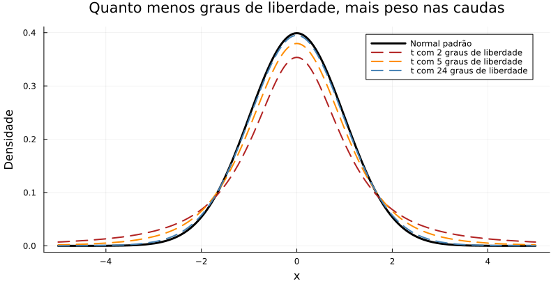
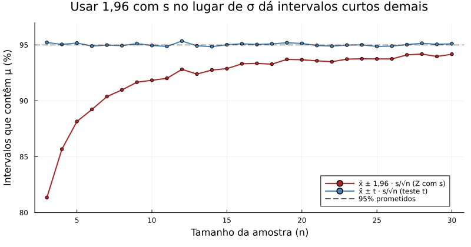
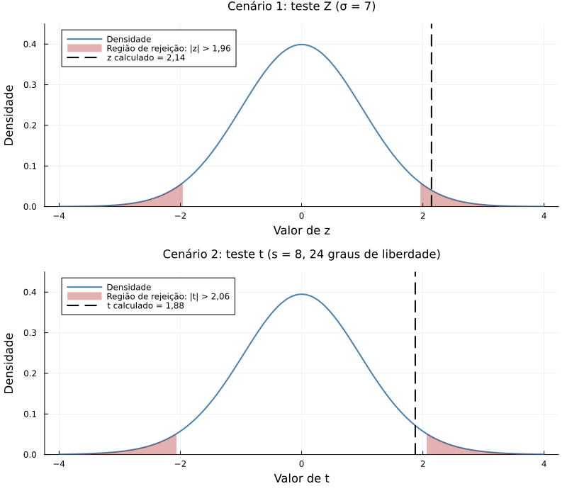

---
layout: post
image: /assets/images/zort.avif
title: "Teste Z ou Teste t de Student: Qual Usar?"
categories: [INFERÊNCIA ESTATÍSTICA, TESTE DE HIPÓTESES]
tags: [Estatística, Probabilidade]
lang: pt
ref: z-vs-t-test
author: dante-bertuzzi
mathjax: true
description: "Quando usar o teste Z e quando usar o teste t de Student para a média, o que a regra do n > 30 esconde e um exemplo resolvido à mão, em Julia e em Python."
---

Você quer testar se a média de uma população é igual a um valor de referência. Os livros oferecem dois caminhos, o **teste Z** e o **teste t de Student**, e a fórmula dos dois é quase a mesma. Qual usar?

A resposta curta: **se o desvio padrão da população ($$\sigma$$) é estimado a partir da própria amostra, use o teste t, com qualquer tamanho de amostra.** O teste Z é para quando $$\sigma$$ é conhecido de verdade, vindo de fora dos dados, o que é raro.

Neste post você vai ver de onde vem essa diferença, por que a velha regra "com mais de 30 observações, use Z" é só uma aproximação, um exemplo completo resolvido nos dois cenários (com uma surpresa sobre o que realmente muda a conclusão) e o que fazer com um valor de Z que não cabe na tabela.

## Um pouco de história: Gosset e a Guinness

O teste t nasceu numa cervejaria. **William Sealy Gosset**, químico e cervejeiro, passou a carreira na Guinness, em Dublin, e lidava com um problema prático: decidir sobre matéria-prima e qualidade com **amostras pequenas**, como nos experimentos com cevada.

Em 1908, ele publicou "The probable error of a mean" na revista *Biometrika* (volume 6, número 1, páginas 1–25) sob o pseudônimo **"Student"**. Segundo a Wikipédia, depois que um artigo de outro pesquisador da empresa revelou informações que a direção temia que ajudassem a concorrência, a Guinness decidiu que as publicações da sua equipe não poderiam mencionar cerveja, a Guinness nem o nome verdadeiro do autor.

Gosset chamava a sua estatística de "z". Foi pelo trabalho de Ronald Fisher que a distribuição ficou conhecida como "distribuição de Student" e o teste, como "teste t de Student".

## As duas estatísticas

Para testar $$H_0: \mu = \mu_0$$ com uma amostra de $$n$$ observações e média $$\bar{x}$$, as duas estatísticas medem a mesma coisa: quantos **erros padrão** a média da amostra está longe de $$\mu_0$$.

$$
Z = \frac{\bar{x} - \mu_0}{\sigma / \sqrt{n}}
\qquad\qquad
t = \frac{\bar{x} - \mu_0}{s / \sqrt{n}}
$$

A única diferença está no denominador. O Z usa $$\sigma$$, o desvio padrão da **população**, um número fixo. O t usa $$s$$, o desvio padrão da **amostra**, que muda de amostra para amostra.

Essa troca tem consequência. Se a população é normal e $$H_0$$ é verdadeira, $$Z$$ segue a [distribuição normal](/distribuicao-normal/) padrão. Já $$t$$ segue a **distribuição t de Student** com $$n - 1$$ [graus de liberdade](/pt/glossario#graus-de-liberdade). Às vezes a amostra dá um $$s$$ menor que $$\sigma$$, por acaso, e o denominador encolhe; por isso valores grandes de $$t$$ são mais frequentes que valores grandes de $$Z$$, e a distribuição t tem **caudas mais pesadas**. Quanto maior $$n$$, mais $$s$$ se aproxima de $$\sigma$$ e mais a t se parece com a normal.

  

  

    
Julia

    

    <button class="copy-button" onclick="copyCode(this)">
      <i class="bi bi-clipboard"></i>Copiar
    </button>
  

  

    <pre><code>using Distributions, Plots, Printf

z = quantile(Normal(), 0.975)
println("  n    gl   t crítico   diferença para 1,96")
for n in (5, 10, 20, 25, 30, 31, 50, 100, 1000)
    c = quantile(TDist(n - 1), 0.975)
    @printf("%4d %5d %10.4f %10.1f%%\n", n, n - 1, c, 100 * (c / z - 1))
end

plot(x -&gt; pdf(Normal(), x), -5, 5, lw = 3, color = :black, label = "Normal padrão",
     xlabel = "x", ylabel = "Densidade", title = "Quanto menos graus de liberdade, mais peso nas caudas",
     size = (800, 420), legend = :topright)
for (gl, cor) in ((2, :firebrick), (5, :darkorange), (24, :steelblue))
    plot!(x -&gt; pdf(TDist(gl), x), -5, 5, lw = 2, ls = :dash, color = cor, label = "t com $gl graus de liberdade")
end
savefig("distribuicao-t-caudas.png")</code></pre>
  

  
# Saída

  <pre style="overflow-x: auto; font-size: 0.9em;">  n    gl   t crítico   diferença para 1,96
   5     4     2.7764       41.7%
  10     9     2.2622       15.4%
  20    19     2.0930        6.8%
  25    24     2.0639        5.3%
  30    29     2.0452        4.4%
  31    30     2.0423        4.2%
  50    49     2.0096        2.5%
 100    99     1.9842        1.2%
1000   999     1.9623        0.1%</pre>

  

  

  

    
Python

    

    <button class="copy-button" onclick="copyCode(this)">
      <i class="bi bi-clipboard"></i>Copiar
    </button>
  

  

    <pre><code>import numpy as np
import matplotlib.pyplot as plt
from scipy import stats

z = stats.norm.ppf(0.975)
print("  n    gl   t crítico   diferença para 1,96")
for n in (5, 10, 20, 25, 30, 31, 50, 100, 1000):
    c = stats.t.ppf(0.975, n - 1)
    print(f"{n:4d} {n - 1:5d} {c:10.4f} {100 * (c / z - 1):10.1f}%")

x = np.linspace(-5, 5, 1001)
plt.figure(figsize=(8, 4.2))
plt.plot(x, stats.norm.pdf(x), lw=3, color="black", label="Normal padrão")
for gl, cor in ((2, "firebrick"), (5, "darkorange"), (24, "steelblue")):
    plt.plot(x, stats.t.pdf(x, gl), lw=2, ls="--", color=cor, label=f"t com {gl} graus de liberdade")
plt.xlabel("x"); plt.ylabel("Densidade")
plt.title("Quanto menos graus de liberdade, mais peso nas caudas"); plt.legend()
plt.savefig("distribuicao-t-caudas-py.png", dpi=120, bbox_inches="tight")</code></pre>
  

  
# Saída

  <pre style="overflow-x: auto; font-size: 0.9em;">  n    gl   t crítico   diferença para 1,96
   5     4     2.7764       41.7%
  10     9     2.2622       15.4%
  20    19     2.0930        6.8%
  25    24     2.0639        5.3%
  30    29     2.0452        4.4%
  31    30     2.0423        4.2%
  50    49     2.0096        2.5%
 100    99     1.9842        1.2%
1000   999     1.9623        0.1%</pre>

  

Figura 1 – A distribuição t tem o pico mais baixo e as caudas mais altas que a normal. Com 24 graus de liberdade, as duas curvas já quase coincidem (código em Julia acima).

A tabela da saída mostra o efeito no valor crítico de um teste bilateral a 5%: com $$n = 5$$, o t crítico é 2,776, 41,7% maior que 1,96. Com $$n = 30$$, é 2,045, ainda 4,4% maior. A [tabela t](/ttable.html) do site traz esses valores para outros níveis.

## E a regra do "n > 30"?

Muitos livros ensinam: com $$\sigma$$ desconhecido, use t se $$n \le 30$$ e Z se $$n > 30$$. A ideia é que, com cerca de 30 graus de liberdade, o valor crítico da t já fica parecido com o da normal (2,045 contra 1,96).

Mas "parecido" não é "igual". Com $$\sigma$$ desconhecido, a estatística segue a t, qualquer que seja $$n$$; trocar o valor crítico da t pelo 1,96 da normal produz intervalos mais curtos do que deveriam e testes que rejeitam $$H_0$$ mais vezes do que os 5% anunciados. O e-Handbook do NIST (seção 7.2.2) apresenta o caso em que $$\sigma$$ precisa ser estimado como "o caso mais típico" e usa nele a estatística t, sem corte de tamanho de amostra.

Para ver o tamanho do problema, a simulação abaixo sorteia 20.000 amostras de uma população normal para cada $$n$$ de 3 a 30 e conta quantos intervalos de "95%" contêm a média verdadeira, com 1,96 e com o valor crítico da t.

  

  

    
Julia

    

    <button class="copy-button" onclick="copyCode(this)">
      <i class="bi bi-clipboard"></i>Copiar
    </button>
  

  

    <pre><code>using Random, Statistics, Distributions, Plots, Printf

Random.seed!(2025)
reps = 20_000                         # amostras simuladas para cada n
tamanhos = 3:30
cob_z = Float64[]; cob_t = Float64[]
for n in tamanhos
    acertos_z = 0; acertos_t = 0
    z = quantile(Normal(), 0.975); t = quantile(TDist(n - 1), 0.975)
    for _ in 1:reps
        x = randn(n)                  # população normal com μ = 0 e σ = 1
        ep = std(x) / sqrt(n)         # σ "desconhecido": usamos s
        acertos_z += abs(mean(x)) &lt;= z * ep
        acertos_t += abs(mean(x)) &lt;= t * ep
    end
    push!(cob_z, acertos_z / reps); push!(cob_t, acertos_t / reps)
end
for n in (3, 5, 10, 20, 30)
    i = n - 2
    @printf("n = %2d: cobertura com 1,96 = %.3f   com t = %.3f\n", n, cob_z[i], cob_t[i])
end

plot(tamanhos, 100 .* cob_z, lw = 2, marker = :circle, ms = 3, color = :firebrick,
     label = "x̄ ± 1,96 · s/√n (Z com s)", xlabel = "Tamanho da amostra (n)",
     ylabel = "Intervalos que contêm μ (%)", ylims = (80, 97), yticks = 80:5:95, size = (800, 420), legend = :bottomright,
     title = "Usar 1,96 com s no lugar de σ dá intervalos curtos demais")
plot!(tamanhos, 100 .* cob_t, lw = 2, marker = :circle, ms = 3, color = :steelblue, label = "x̄ ± t · s/√n (teste t)")
hline!([95], ls = :dash, color = :black, label = "95% prometidos")
savefig("cobertura-z-t.png")</code></pre>
  

  
# Saída

  <pre style="overflow-x: auto; font-size: 0.9em;">n =  3: cobertura com 1,96 = 0.814   com t = 0.952
n =  5: cobertura com 1,96 = 0.882   com t = 0.952
n = 10: cobertura com 1,96 = 0.918   com t = 0.950
n = 20: cobertura com 1,96 = 0.937   com t = 0.951
n = 30: cobertura com 1,96 = 0.942   com t = 0.951</pre>

  

  

  

    
Python

    

    <button class="copy-button" onclick="copyCode(this)">
      <i class="bi bi-clipboard"></i>Copiar
    </button>
  

  

    <pre><code>import numpy as np
import matplotlib.pyplot as plt
from scipy import stats

rng = np.random.default_rng(2025)
reps = 20_000                           # amostras simuladas para cada n
tamanhos = np.arange(3, 31)
cob_z, cob_t = [], []
for n in tamanhos:
    x = rng.standard_normal((reps, n))  # população normal com μ = 0 e σ = 1
    ep = x.std(axis=1, ddof=1) / np.sqrt(n)   # σ "desconhecido": usamos s
    erro = np.abs(x.mean(axis=1))
    cob_z.append(np.mean(erro &lt;= stats.norm.ppf(0.975) * ep))
    cob_t.append(np.mean(erro &lt;= stats.t.ppf(0.975, n - 1) * ep))
for n in (3, 5, 10, 20, 30):
    i = n - 3
    print(f"n = {n:2d}: cobertura com 1,96 = {cob_z[i]:.3f}   com t = {cob_t[i]:.3f}")

plt.figure(figsize=(8, 4.2))
plt.plot(tamanhos, 100 * np.array(cob_z), "o-", ms=3, lw=2, color="firebrick", label="x̄ ± 1,96 · s/√n (Z com s)")
plt.plot(tamanhos, 100 * np.array(cob_t), "o-", ms=3, lw=2, color="steelblue", label="x̄ ± t · s/√n (teste t)")
plt.axhline(95, ls="--", color="black", label="95% prometidos")
plt.ylim(80, 97); plt.yticks(range(80, 96, 5)); plt.xlabel("Tamanho da amostra (n)"); plt.ylabel("Intervalos que contêm μ (%)")
plt.title("Usar 1,96 com s no lugar de σ dá intervalos curtos demais"); plt.legend(loc="lower right")
plt.savefig("cobertura-z-t-py.png", dpi=120, bbox_inches="tight")</code></pre>
  

  
# Saída

  <pre style="overflow-x: auto; font-size: 0.9em;">n =  3: cobertura com 1,96 = 0.815   com t = 0.951
n =  5: cobertura com 1,96 = 0.878   com t = 0.951
n = 10: cobertura com 1,96 = 0.922   com t = 0.952
n = 20: cobertura com 1,96 = 0.936   com t = 0.950
n = 30: cobertura com 1,96 = 0.943   com t = 0.953</pre>

  

Figura 2 – Com o valor crítico da t, os intervalos acertam 95% das vezes em qualquer tamanho de amostra. Com 1,96 e $$s$$, acertam menos: cerca de 81% com $$n = 3$$ e ainda abaixo de 95% com $$n = 30$$.

A simulação confere com a conta exata. Se a população é normal, o intervalo $$\bar{x} \pm 1{,}96 \cdot s/\sqrt{n}$$ contém $$\mu$$ com probabilidade $$P(\lvert T_{n-1} \rvert \le 1{,}96)$$, que vale 81,1% com $$n = 3$$, 87,8% com $$n = 5$$, 91,8% com $$n = 10$$ e 94,0% com $$n = 30$$.

Com $$n$$ na casa das centenas a diferença fica pequena (1,2% no valor crítico com $$n = 100$$), e por isso a regra funciona como aproximação. Mas qualquer software calcula o valor crítico da t para qualquer $$n$$, e não há motivo para trocar uma conta exata por uma aproximada.

## Quando $$\sigma$$ é mesmo conhecido?

Quase nunca. Seria preciso que o desvio padrão viesse de fora da amostra, de uma fonte confiável, e que valesse para a população estudada agora. Um caso que se aproxima disso é um processo industrial medido por muito tempo e muito estável. Mesmo assim, num exemplo do NIST (seção 7.2.2), o processo tem histórico, mas "não foi estável o bastante para justificar a suposição de que o desvio padrão é conhecido".

Um desvio padrão de um estudo antigo, de outra população ou de outra época **não** torna $$\sigma$$ conhecido; é só um palpite, e o teste Z vai tratá-lo como certeza.

## Como decidir

1. **Os dados vêm de uma amostra aleatória, com observações independentes?** Se não (medidas repetidas da mesma pessoa, dados agrupados por escola, uma série no tempo), nenhum dos dois testes é o certo; é preciso um método para dados dependentes.
2. **$$\sigma$$ é conhecido de uma fonte externa e confiável?** Se sim, teste Z. Se $$\sigma$$ é estimado pela amostra, teste t.
3. **A população é aproximadamente normal?** Os dois testes são exatos para população normal. Se ela não é, eles valem de forma aproximada quando a amostra é grande o bastante, pelo [teorema do limite central](/pt/probabilidade/teorema-limite-central). Com amostra pequena **e** dados muito assimétricos ou com valores extremos, considere uma transformação (como o logaritmo), o bootstrap ou um teste não paramétrico, como o de postos sinalizados de Wilcoxon, que testa outra coisa (a mediana, sob simetria).

Antes do passo 3, olhe os dados: um histograma ou um [boxplot](/boxplot-o-que-e-cada-elemento-como-se-calcula-e-como-interpretar/) mostra assimetria e valores extremos que nenhum número sozinho revela.

## Exemplo: a altura média dos calouros

**Dados** (ilustrativos): uma pesquisadora quer saber se a altura média dos calouros da sua universidade difere de 175 cm, valor de referência. Ela mede uma amostra aleatória de $$n = 25$$ calouros e obtém média $$\bar{x} = 178$$ cm e desvio padrão $$s = 8$$ cm. O nível de significância é $$\alpha = 0{,}05$$.

**Hipóteses** (as mesmas nos dois cenários):

$$
H_0: \mu = 175 \text{ cm} \qquad\qquad H_1: \mu \neq 175 \text{ cm}
$$

O teste é **bilateral**: interessa uma diferença em qualquer direção.

### Cenário 1: $$\sigma$$ conhecido (teste Z)

Suponha que um levantamento anterior, feito na mesma população, tenha estabelecido $$\sigma = 7$$ cm.

**Erro padrão:** $$\frac{\sigma}{\sqrt{n}} = \frac{7}{\sqrt{25}} = \frac{7}{5} = 1{,}4$$ cm.

**Estatística:**

$$
Z = \frac{\bar{x} - \mu_0}{\sigma / \sqrt{n}} = \frac{178 - 175}{1{,}4} = \frac{3}{1{,}4} = 2{,}1429
$$

**Valor crítico:** num teste bilateral a 5%, ficam 2,5% em cada cauda, e o valor crítico é $$z_{0{,}025} = 1{,}96$$ (na [tabela Z](/ztable.html), é o valor com área acumulada 0,975).

**p-valor:** a probabilidade de um $$Z$$ pelo menos tão longe de zero quanto 2,1429, para qualquer lado: $$p = 2 \times P(Z > 2{,}1429) = 2 \times 0{,}01606 = 0{,}0321$$. Quem usa a tabela com $$z$$ arredondado para 2,14 encontra $$P(Z > 2{,}14) = 0{,}0162$$ e $$p = 0{,}0324$$; a diferença vem só do arredondamento.

**Decisão:** $$2{,}1429 > 1{,}96$$ e $$0{,}0321 < 0{,}05$$: **rejeita-se $$H_0$$** ao nível de 5%.

**Intervalo de confiança de 95%:**

$$
\begin{aligned}
\bar{x} \pm z_{0{,}025} \cdot \frac{\sigma}{\sqrt{n}} &= 178 \pm 1{,}96 \times 1{,}4 \\
&= 178 \pm 2{,}744 \\
&= [175{,}26;\ 180{,}74]
\end{aligned}
$$

O valor 175 fica fora do intervalo, o que concorda com a rejeição: um teste bilateral a 5% rejeita $$H_0$$ exatamente quando $$\mu_0$$ fica fora do [intervalo de confiança](/pt/inferencia-estatistica/intervalos-confianca) de 95%.

  

  

    
Julia

    

    <button class="copy-button" onclick="copyCode(this)">
      <i class="bi bi-clipboard"></i>Copiar
    </button>
  

  

    <pre><code>using Distributions, HypothesisTests, Printf

x̄, μ₀, σ, n = 178, 175, 7, 25    # média da amostra, média sob H₀, σ conhecido, tamanho
α = 0.05
Z = Normal()                      # normal padrão

ep = σ / sqrt(n)                  # erro padrão da média
z = (x̄ - μ₀) / ep
z_crit = quantile(Z, 1 - α / 2)   # deixa 2,5% em cada cauda
p = 2 * ccdf(Z, abs(z))           # p-valor bilateral

@printf("Erro padrão = %.2f\n", ep)
@printf("z = %.4f   z crítico = ±%.4f   p-valor = %.4f\n", z, z_crit, p)
@printf("IC de 95%%: [%.2f, %.2f]\n", x̄ - z_crit * ep, x̄ + z_crit * ep)

z_uni = quantile(Z, 1 - α)        # 5% numa cauda só
@printf("Limites unilaterais de 95%%: [%.2f, +∞) e (-∞, %.2f]\n", x̄ - z_uni * ep, x̄ + z_uni * ep)

# Conferência com o pacote HypothesisTests
teste = OneSampleZTest(x̄, σ, n, μ₀)
@printf("HypothesisTests: p = %.4f, IC = [%.2f, %.2f]\n", pvalue(teste), confint(teste)...)</code></pre>
  

  
# Saída

  <pre style="overflow-x: auto; font-size: 0.9em;">Erro padrão = 1.40
z = 2.1429   z crítico = ±1.9600   p-valor = 0.0321
IC de 95%: [175.26, 180.74]
Limites unilaterais de 95%: [175.70, +∞) e (-∞, 180.30]
HypothesisTests: p = 0.0321, IC = [175.26, 180.74]</pre>

  

  

  

    
Python

    

    <button class="copy-button" onclick="copyCode(this)">
      <i class="bi bi-clipboard"></i>Copiar
    </button>
  

  

    <pre><code>import numpy as np
from scipy import stats

x_barra, mu0, sigma, n = 178, 175, 7, 25   # média da amostra, média sob H0, σ conhecido, tamanho
alfa = 0.05

ep = sigma / np.sqrt(n)                    # erro padrão da média
z = (x_barra - mu0) / ep
z_crit = stats.norm.ppf(1 - alfa / 2)      # deixa 2,5% em cada cauda
p = 2 * stats.norm.sf(abs(z))              # p-valor bilateral

print(f"Erro padrão = {ep:.2f}")
print(f"z = {z:.4f}   z crítico = ±{z_crit:.4f}   p-valor = {p:.4f}")
print(f"IC de 95%: [{x_barra - z_crit * ep:.2f}, {x_barra + z_crit * ep:.2f}]")

z_uni = stats.norm.ppf(1 - alfa)           # 5% numa cauda só
print(f"Limites unilaterais de 95%: [{x_barra - z_uni * ep:.2f}, +∞) e (-∞, {x_barra + z_uni * ep:.2f}]")</code></pre>
  

  
# Saída

  <pre style="overflow-x: auto; font-size: 0.9em;">Erro padrão = 1.40
z = 2.1429   z crítico = ±1.9600   p-valor = 0.0321
IC de 95%: [175.26, 180.74]
Limites unilaterais de 95%: [175.70, +∞) e (-∞, 180.30]</pre>

  

### Cenário 2: $$\sigma$$ desconhecido (teste t)

Agora o cenário realista: não há $$\sigma$$ confiável, e a pesquisadora usa o desvio padrão da própria amostra, $$s = 8$$ cm.

**Erro padrão estimado:** $$\frac{s}{\sqrt{n}} = \frac{8}{5} = 1{,}6$$ cm.

**Estatística**, com $$n - 1 = 24$$ graus de liberdade:

$$
t = \frac{\bar{x} - \mu_0}{s / \sqrt{n}} = \frac{178 - 175}{1{,}6} = \frac{3}{1{,}6} = 1{,}875
$$

**Valor crítico:** $$t_{0{,}025;\,24} = 2{,}064$$ (na [tabela t](/ttable.html), linha de 24 graus de liberdade).

**p-valor:** $$p = 2 \times P(T_{24} > 1{,}875) = 0{,}0730$$.

**Decisão:** $$1{,}875 < 2{,}064$$ e $$0{,}0730 > 0{,}05$$: **não se rejeita $$H_0$$** ao nível de 5%.

**Intervalo de confiança de 95%:**

$$
\begin{aligned}
\bar{x} \pm t_{0{,}025;\,24} \cdot \frac{s}{\sqrt{n}} &= 178 \pm 2{,}064 \times 1{,}6 \\
&= 178 \pm 3{,}302 \\
&= [174{,}70;\ 181{,}30]
\end{aligned}
$$

Agora 175 está dentro do intervalo.

  

  

    
Julia

    

    <button class="copy-button" onclick="copyCode(this)">
      <i class="bi bi-clipboard"></i>Copiar
    </button>
  

  

    <pre><code>using Distributions, HypothesisTests, Printf

x̄, μ₀, s, n = 178, 175, 8, 25    # agora só temos o desvio padrão da amostra
α = 0.05
gl = n - 1
T = TDist(gl)

ep = s / sqrt(n)
t = (x̄ - μ₀) / ep
t_crit = quantile(T, 1 - α / 2)
p = 2 * ccdf(T, abs(t))

@printf("Erro padrão = %.2f   graus de liberdade = %d\n", ep, gl)
@printf("t = %.4f   t crítico = ±%.4f   p-valor = %.4f\n", t, t_crit, p)
@printf("IC de 95%%: [%.2f, %.2f]\n", x̄ - t_crit * ep, x̄ + t_crit * ep)

t_uni = quantile(T, 1 - α)
@printf("t crítico unilateral = %.4f   p-valor unilateral (H₁: μ &gt; 175) = %.4f\n", t_uni, ccdf(T, t))
@printf("Limites unilaterais de 95%%: [%.2f, +∞) e (-∞, %.2f]\n", x̄ - t_uni * ep, x̄ + t_uni * ep)

teste = OneSampleTTest(x̄, s, n, μ₀)
@printf("HypothesisTests: p = %.4f, IC = [%.2f, %.2f]\n", pvalue(teste), confint(teste)...)</code></pre>
  

  
# Saída

  <pre style="overflow-x: auto; font-size: 0.9em;">Erro padrão = 1.60   graus de liberdade = 24
t = 1.8750   t crítico = ±2.0639   p-valor = 0.0730
IC de 95%: [174.70, 181.30]
t crítico unilateral = 1.7109   p-valor unilateral (H₁: μ &gt; 175) = 0.0365
Limites unilaterais de 95%: [175.26, +∞) e (-∞, 180.74]
HypothesisTests: p = 0.0730, IC = [174.70, 181.30]</pre>

  

  

  

    
Python

    

    <button class="copy-button" onclick="copyCode(this)">
      <i class="bi bi-clipboard"></i>Copiar
    </button>
  

  

    <pre><code>import numpy as np
from scipy import stats

x_barra, mu0, s, n = 178, 175, 8, 25      # agora só temos o desvio padrão da amostra
alfa = 0.05
gl = n - 1

ep = s / np.sqrt(n)
t = (x_barra - mu0) / ep
t_crit = stats.t.ppf(1 - alfa / 2, gl)
p = 2 * stats.t.sf(abs(t), gl)

print(f"Erro padrão = {ep:.2f}   graus de liberdade = {gl}")
print(f"t = {t:.4f}   t crítico = ±{t_crit:.4f}   p-valor = {p:.4f}")
print(f"IC de 95%: [{x_barra - t_crit * ep:.2f}, {x_barra + t_crit * ep:.2f}]")

t_uni = stats.t.ppf(1 - alfa, gl)
print(f"t crítico unilateral = {t_uni:.4f}   p-valor unilateral (H1: μ &gt; 175) = {stats.t.sf(t, gl):.4f}")
print(f"Limites unilaterais de 95%: [{x_barra - t_uni * ep:.2f}, +∞) e (-∞, {x_barra + t_uni * ep:.2f}]")</code></pre>
  

  
# Saída

  <pre style="overflow-x: auto; font-size: 0.9em;">Erro padrão = 1.60   graus de liberdade = 24
t = 1.8750   t crítico = ±2.0639   p-valor = 0.0730
IC de 95%: [174.70, 181.30]
t crítico unilateral = 1.7109   p-valor unilateral (H1: μ &gt; 175) = 0.0365
Limites unilaterais de 95%: [175.26, +∞) e (-∞, 180.74]</pre>

  

  

  

    
Julia

    

    <button class="copy-button" onclick="copyCode(this)">
      <i class="bi bi-clipboard"></i>Copiar
    </button>
  

  

    <pre><code>using Distributions, Plots, Printf

virgula(x) = replace(@sprintf("%.2f", x), "." =&gt; ",")
cenarios = [(Normal(), 3 / 1.4, "Cenário 1: teste Z (σ = 7)", "z"),
            (TDist(24), 3 / 1.6, "Cenário 2: teste t (s = 8, 24 graus de liberdade)", "t")]

graficos = map(cenarios) do (D, est, titulo, letra)
    c = quantile(D, 0.975)
    g = plot(x -&gt; pdf(D, x), -4, 4, lw = 2, color = :steelblue, label = "Densidade",
             title = titulo, xlabel = "Valor de $letra", ylabel = "Densidade",
             ylims = (0, 0.45), legend = :topleft, titlefontsize = 11)
    plot!(g, x -&gt; pdf(D, x), c, 4, fillrange = 0, fillalpha = 0.35, color = :firebrick, lw = 0,
          label = "Região de rejeição: |$letra| &gt; $(virgula(c))")
    plot!(g, x -&gt; pdf(D, x), -4, -c, fillrange = 0, fillalpha = 0.35, color = :firebrick, lw = 0, label = "")
    vline!(g, [est], ls = :dash, lw = 2, color = :black, label = "$letra calculado = $(virgula(est))")
end
plot(graficos..., layout = (2, 1), size = (800, 700))
savefig("teste-z-t-regioes.png")</code></pre>
  

  
# Saída

  <pre style="overflow-x: auto; font-size: 0.9em;"></pre>

  

  

  

    
Python

    

    <button class="copy-button" onclick="copyCode(this)">
      <i class="bi bi-clipboard"></i>Copiar
    </button>
  

  

    <pre><code>import numpy as np
import matplotlib.pyplot as plt
from scipy import stats

virgula = lambda x: f"{x:.2f}".replace(".", ",")
cenarios = [(stats.norm(), 3 / 1.4, "Cenário 1: teste Z (σ = 7)", "z"),
            (stats.t(24), 3 / 1.6, "Cenário 2: teste t (s = 8, 24 graus de liberdade)", "t")]

fig, eixos = plt.subplots(2, 1, figsize=(8, 7))
x = np.linspace(-4, 4, 801)
for ax, (dist, est, titulo, letra) in zip(eixos, cenarios):
    c = dist.ppf(0.975)
    ax.plot(x, dist.pdf(x), lw=2, color="steelblue", label="Densidade")
    ax.fill_between(x, dist.pdf(x), where=np.abs(x) &gt; c, color="firebrick", alpha=0.35,
                    label=f"Região de rejeição: |{letra}| &gt; {virgula(c)}")
    ax.axvline(est, ls="--", lw=2, color="black", label=f"{letra} calculado = {virgula(est)}")
    ax.set(title=titulo, xlabel=f"Valor de {letra}", ylabel="Densidade", ylim=(0, 0.45))
    ax.legend(loc="upper left")
fig.tight_layout()
fig.savefig("teste-z-t-regioes-py.png", dpi=120)</code></pre>
  

  
# Saída

  <pre style="overflow-x: auto; font-size: 0.9em;"></pre>

  

Figura 3 – No cenário 1, o $$z$$ calculado (2,14) cai na região de rejeição; no cenário 2, o $$t$$ calculado (1,88) fica antes dela (código em Julia acima).

### O que de fato mudou a conclusão?

É tentador dizer que o teste t, "mais conservador", mudou a decisão. Mas os dois cenários mudam **duas** coisas ao mesmo tempo: a distribuição de referência (normal ou t) e o número no denominador (7 ou 8). Separando as duas:

  

  

    
Julia

    

    <button class="copy-button" onclick="copyCode(this)">
      <i class="bi bi-clipboard"></i>Copiar
    </button>
  

  

    <pre><code>using Distributions, Printf

x̄, μ₀, n = 178, 175, 25
@printf("%-14s %-10s %10s %10s %9s  %s\n", "Desvio padrão", "Teste", "Estatística", "Crítico", "p-valor", "Decisão")
for dp in (7, 8), (nome, D) in (("Z", Normal()), ("t (24 gl)", TDist(n - 1)))
    est = (x̄ - μ₀) / (dp / sqrt(n))
    crit = quantile(D, 0.975)
    p = 2 * ccdf(D, est)
    @printf("%-14d %-10s %10.4f %10.4f %9.4f  %s\n", dp, nome, est, crit, p, p &lt; 0.05 ? "rejeita H₀" : "não rejeita")
end</code></pre>
  

  
# Saída

  <pre style="overflow-x: auto; font-size: 0.9em;">Desvio padrão  Teste      Estatística    Crítico   p-valor  Decisão
7              Z              2.1429     1.9600    0.0321  rejeita H₀
7              t (24 gl)      2.1429     2.0639    0.0425  rejeita H₀
8              Z              1.8750     1.9600    0.0608  não rejeita
8              t (24 gl)      1.8750     2.0639    0.0730  não rejeita</pre>

  

  

  

    
Python

    

    <button class="copy-button" onclick="copyCode(this)">
      <i class="bi bi-clipboard"></i>Copiar
    </button>
  

  

    <pre><code>import numpy as np
from scipy import stats

x_barra, mu0, n = 178, 175, 25
print(f"{'Desvio padrão':&lt;14} {'Teste':&lt;10} {'Estatística':&gt;10} {'Crítico':&gt;10} {'p-valor':&gt;9}  Decisão")
for dp in (7, 8):
    for nome, dist in (("Z", stats.norm()), ("t (24 gl)", stats.t(n - 1))):
        est = (x_barra - mu0) / (dp / np.sqrt(n))
        crit = dist.ppf(0.975)
        p = 2 * dist.sf(est)
        decisao = "rejeita H0" if p &lt; 0.05 else "não rejeita"
        print(f"{dp:&lt;14} {nome:&lt;10} {est:10.4f} {crit:10.4f} {p:9.4f}  {decisao}")</code></pre>
  

  
# Saída

  <pre style="overflow-x: auto; font-size: 0.9em;">Desvio padrão  Teste      Estatística    Crítico   p-valor  Decisão
7              Z              2.1429     1.9600    0.0321  rejeita H0
7              t (24 gl)      2.1429     2.0639    0.0425  rejeita H0
8              Z              1.8750     1.9600    0.0608  não rejeita
8              t (24 gl)      1.8750     2.0639    0.0730  não rejeita</pre>

  

- Com o mesmo desvio padrão 7, os dois testes rejeitam $$H_0$$ (p de 0,0321 e 0,0425).
- Com o mesmo desvio padrão 8, nenhum rejeita (p de 0,0608 e 0,0730).

Neste exemplo, o que mudou a decisão foi o desvio padrão ser 7 ou 8. Trocar a normal pela t aumentou o p-valor em cerca de 0,01 nos dois casos: é o preço de estimar $$\sigma$$, e ele existe, mas aqui não foi ele que decidiu. E o teste t não "exige mais evidência" por capricho: ele cobra exatamente a incerteza que vem de não conhecer $$\sigma$$, como mostrou a Figura 2.

### Bilateral ou unilateral?

Se a pergunta da pesquisadora fosse, desde o início, "os calouros são **mais altos** que 175 cm?", as hipóteses seriam $$H_0: \mu \le 175$$ contra $$H_1: \mu > 175$$, e o teste seria **unilateral**, com os 5% inteiros numa cauda só. No cenário 2:

- valor crítico: $$t_{0{,}05;\,24} = 1{,}711$$, e $$1{,}875 > 1{,}711$$;
- p-valor: $$P(T_{24} > 1{,}875) = 0{,}0365 < 0{,}05$$;
- limite inferior de confiança de 95%: $$178 - 1{,}711 \times 1{,}6 = 178 - 2{,}737 = 175{,}26$$ cm, ou seja, $$[175{,}26;\ +\infty)$$, que não contém 175.

O teste unilateral **rejeitaria** $$H_0$$. Isso não é uma contradição, mas é uma armadilha: a direção precisa ser escolhida **antes** de ver os dados, por um motivo do problema. Quem olha os dados, vê $$\bar{x} > 175$$ e só então decide testar "maior que" está, na prática, fazendo um teste bilateral com $$\alpha = 0{,}10$$, porque teria escolhido o outro lado se a média tivesse saído abaixo.

No cenário 1, os limites unilaterais de 95% são $$178 - 1{,}645 \times 1{,}4 = 175{,}70$$ e $$178 + 1{,}645 \times 1{,}4 = 180{,}30$$.

### "Não rejeitar" não é "aceitar"

No cenário 2, não rejeitar $$H_0$$ não prova que a média é 175 cm. O intervalo $$[174{,}70;\ 181{,}30]$$ diz que os dados são compatíveis com médias de quase 175 a mais de 181 cm. Com 25 calouros, o teste não tem precisão para separar 175 de 178; uma amostra maior encolheria o intervalo. O [post sobre testes de hipótese](/pt/inferencia-estatistica/testes-hipotese) trata de erros do tipo I e II e de poder.

## Apêndice: um valor de Z fora da tabela

A [tabela Z](/ztable.html) do site termina em $$z = 4{,}0$$. O que fazer com, digamos, $$z = -6{,}36$$?

Esse valor fica 6,36 erros padrão abaixo do esperado sob $$H_0$$, e a área à esquerda dele é minúscula. O cálculo exato, por software, dá

$$
P(Z < -6{,}36) = 1{,}009 \times 10^{-10}
$$

cerca de 1 em 9,9 bilhões. Num teste bilateral, o p-valor é o dobro: $$2{,}02 \times 10^{-10}$$.

**À mão**, há uma aproximação simples para a cauda. Sendo $$\varphi(z) = \frac{1}{\sqrt{2\pi}} e^{-z^2/2}$$ a densidade da normal padrão, para $$z$$ negativo e longe de zero:

$$
P(Z < z) \approx \frac{\varphi(z)}{\lvert z \rvert}
$$

Com $$z = -6{,}36$$:

$$
\begin{aligned}
z^2 &= 6{,}36^2 = 40{,}4496 \\
e^{-z^2/2} &= e^{-40{,}4496/2} = e^{-20{,}2248} = 1{,}646 \times 10^{-9} \\
\varphi(-6{,}36) &= 0{,}39894 \times 1{,}646 \times 10^{-9} = 6{,}567 \times 10^{-10} \\
P(Z < -6{,}36) &\approx \frac{6{,}567 \times 10^{-10}}{6{,}36} = 1{,}033 \times 10^{-10}
\end{aligned}
$$

A aproximação erra por 2,4%, e sempre **para mais**. Para ver por quê, use a simetria, $$P(Z < z) = P(Z > a)$$ com $$a = \lvert z \rvert$$, e o fato de que $$\varphi'(t) = -t\,\varphi(t)$$. Para todo $$t \ge a$$, vale $$1 \le t/a$$, e então

$$
P(Z > a) = \int_a^{\infty} \varphi(t)\,dt \le \int_a^{\infty} \frac{t}{a}\,\varphi(t)\,dt = \frac{1}{a}\Big[-\varphi(t)\Big]_a^{\infty} = \frac{\varphi(a)}{a}
$$

Quanto mais longe de zero, menor o erro relativo; em $$z = -2$$, a aproximação já erra 19%, e ali a tabela resolve.

  

  

    
Julia

    

    <button class="copy-button" onclick="copyCode(this)">
      <i class="bi bi-clipboard"></i>Copiar
    </button>
  

  

    <pre><code>using Distributions, Printf

z = -6.36
φ = pdf(Normal(), z)                     # densidade da normal padrão em z
@printf("P(Z &lt; %.2f) exata       = %.4e\n", z, cdf(Normal(), z))
@printf("Aproximação φ(z)/|z|     = %.4e\n", φ / abs(z))
@printf("Erro relativo            = %.1f%%\n", 100 * (φ / abs(z) / cdf(Normal(), z) - 1))
@printf("p-valor bilateral        = %.4e\n", 2 * cdf(Normal(), z))</code></pre>
  

  
# Saída

  <pre style="overflow-x: auto; font-size: 0.9em;">P(Z &lt; -6.36) exata       = 1.0088e-10
Aproximação φ(z)/|z|     = 1.0326e-10
Erro relativo            = 2.4%
p-valor bilateral        = 2.0175e-10</pre>

  

  

  

    
Python

    

    <button class="copy-button" onclick="copyCode(this)">
      <i class="bi bi-clipboard"></i>Copiar
    </button>
  

  

    <pre><code>import numpy as np
from scipy import stats

z = -6.36
phi = stats.norm.pdf(z)                  # densidade da normal padrão em z
print(f"P(Z &lt; {z}) exata       = {stats.norm.cdf(z):.4e}")
print(f"Aproximação φ(z)/|z|     = {phi / abs(z):.4e}")
print(f"Erro relativo            = {100 * (phi / abs(z) / stats.norm.cdf(z) - 1):.1f}%")
print(f"p-valor bilateral        = {2 * stats.norm.cdf(z):.4e}")</code></pre>
  

  
# Saída

  <pre style="overflow-x: auto; font-size: 0.9em;">P(Z &lt; -6.36) exata       = 1.0088e-10
Aproximação φ(z)/|z|     = 1.0326e-10
Erro relativo            = 2.4%
p-valor bilateral        = 2.0175e-10</pre>

  

**Interpretação:** um p-valor dessa ordem é evidência fortíssima contra $$H_0$$, e para fins práticos pode ser relatado como $$p < 0{,}0001$$. Mas, antes de comemorar, vale conferir os dados: um $$z$$ desse tamanho também aparece quando há erro de digitação, unidade trocada ou observações que não são independentes.

## Resumo

| | Teste Z | Teste t de Student |
|---|---|---|
| Quando usar | $$\sigma$$ conhecido, de fonte externa | $$\sigma$$ estimado pela amostra ($$s$$) |
| Estatística | $$Z = \frac{\bar{x} - \mu_0}{\sigma / \sqrt{n}}$$ | $$t = \frac{\bar{x} - \mu_0}{s / \sqrt{n}}$$ |
| Distribuição sob $$H_0$$ | Normal padrão | t com $$n - 1$$ graus de liberdade |
| Valor crítico bilateral a 5% | 1,96 | 2,776 ($$n = 5$$), 2,064 ($$n = 25$$), 2,045 ($$n = 30$$) |
| Amostra grande | Usado como aproximação do t | Continua certo; o valor crítico se aproxima de 1,96 |

- Se $$\sigma$$ é estimado pela amostra, use t, com qualquer $$n$$. A regra do $$n > 30$$ é uma aproximação.
- Usar 1,96 com $$s$$ dá intervalos curtos demais: com $$n = 5$$, os "95%" acertam só 87,8% das vezes.
- Os dois testes supõem amostra aleatória e observações independentes; com amostra pequena, também população aproximadamente normal.
- Ao comparar cenários, mude uma coisa de cada vez: no exemplo, quem mudou a decisão foi o desvio padrão (7 ou 8), não a troca de Z por t.
- Escolha entre bilateral e unilateral antes de ver os dados.

## Podcast: teste Z vs. teste t de Student

Para uma discussão em áudio sobre o tema, ouça o episódio do nosso podcast.

<iframe title="Podcast: Teste Z vs Teste t de Student, qual escolher?" width="100%" height="166" scrolling="no" frameborder="no" allow="autoplay" src="https://w.soundcloud.com/player/?url=https%3A//api.soundcloud.com/tracks/soundcloud%253Atracks%253A2193736583&color=%23ff5500&auto_play=false&hide_related=false&show_comments=true&show_user=true&show_reposts=false&show_teaser=true"></iframe>

Ouça também no SoundCloud: [Teste Z vs Teste t de Student, qual escolher?](https://soundcloud.com/morrison-kuehlsen/teste-z-vs-teste-t-de-student-qual-escolher)

## Referências

1. NIST/SEMATECH. *e-Handbook of Statistical Methods*, seção 1.3.5.2, "Confidence Limits for the Mean". Disponível em: <https://www.itl.nist.gov/div898/handbook/eda/section3/eda352.htm>. Acesso em: 25 nov. 2026.
2. NIST/SEMATECH. *e-Handbook of Statistical Methods*, seção 7.2.2, "Are the data consistent with the assumed process mean?". Disponível em: <https://www.itl.nist.gov/div898/handbook/prc/section2/prc22.htm>. Acesso em: 25 nov. 2026.
3. Wikipédia (em inglês). "William Sealy Gosset". Disponível em: <https://en.wikipedia.org/wiki/William_Sealy_Gosset>. Acesso em: 25 nov. 2026.
4. Wikipédia (em inglês). "Student's t-test". Disponível em: <https://en.wikipedia.org/wiki/Student%27s_t-test>. Acesso em: 25 nov. 2026.
