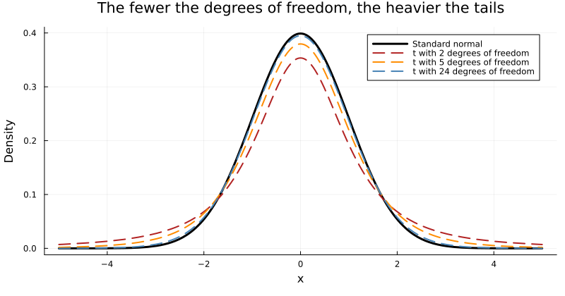
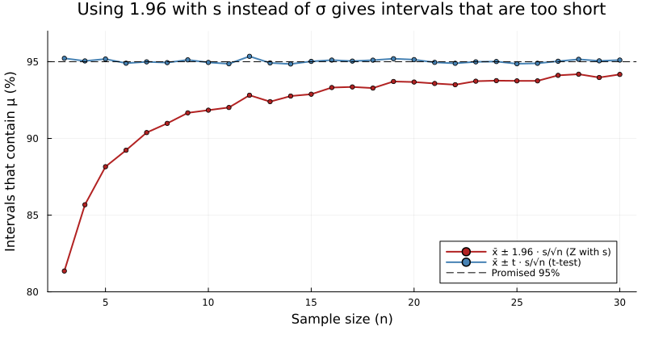
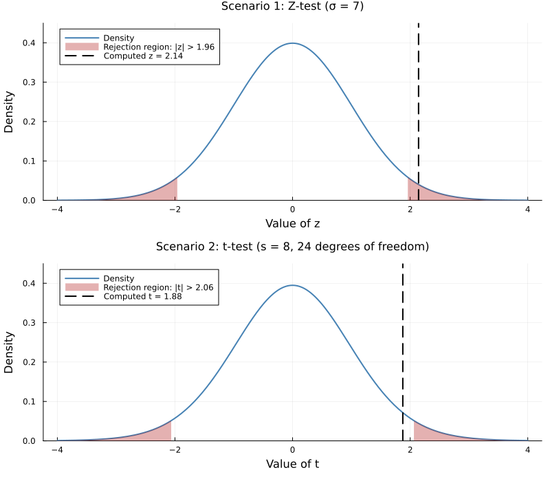

---
layout: post
image: /assets/images/zort.avif
title: "Z-Test or Student's t-Test: Which One to Use?"
categories: [STATISTICAL INFERENCE, HYPOTHESIS TESTING]
tags: [Statistics, Probability]
lang: en
ref: z-vs-t-test
author: dante-bertuzzi
mathjax: true
description: "When to use the Z-test and when to use Student's t-test for a mean, what the n > 30 rule hides, and a worked example by hand, in Julia and in Python."
---

You want to test whether the mean of a population equals a reference value. Textbooks offer two routes, the **Z-test** and **Student's t-test**, and their formulas are almost the same. Which one should you use?

The short answer: **if the population standard deviation ($$\sigma$$) is estimated from the sample itself, use the t-test, whatever the sample size.** The Z-test is for when $$\sigma$$ is truly known, from outside the data, which is rare.

In this post you will see where the difference comes from, why the old rule "with more than 30 observations, use Z" is only an approximation, a complete example worked out in both scenarios (with a surprise about what actually changes the conclusion), and what to do with a Z value that does not fit in the table.

## A bit of history: Gosset and Guinness

The t-test was born in a brewery. **William Sealy Gosset**, a chemist and brewer, spent his career at Guinness in Dublin and faced a practical problem: making decisions about raw materials and quality from **small samples**, as in experiments with barley.

In 1908 he published "The probable error of a mean" in the journal *Biometrika* (volume 6, issue 1, pages 1–25) under the pseudonym **"Student"**. According to Wikipedia, after a paper by another company researcher revealed information that management feared could help competitors, Guinness decided that its staff's publications could not mention beer, Guinness or the author's real name.

Gosset called his statistic "z". It was through Ronald Fisher's work that the distribution became known as "Student's distribution" and the test as "Student's t-test".

## The two statistics

To test $$H_0: \mu = \mu_0$$ with a sample of $$n$$ observations and mean $$\bar{x}$$, both statistics measure the same thing: how many **standard errors** the sample mean is away from $$\mu_0$$.

$$
Z = \frac{\bar{x} - \mu_0}{\sigma / \sqrt{n}}
\qquad\qquad
t = \frac{\bar{x} - \mu_0}{s / \sqrt{n}}
$$

The only difference is in the denominator. Z uses $$\sigma$$, the standard deviation of the **population**, a fixed number. t uses $$s$$, the standard deviation of the **sample**, which changes from sample to sample.

That swap has a consequence. If the population is normal and $$H_0$$ is true, $$Z$$ follows the standard [normal distribution](/normal-distribution/). But $$t$$ follows **Student's t distribution** with $$n - 1$$ [degrees of freedom](/en/glossary#degrees-of-freedom). Sometimes the sample gives an $$s$$ smaller than $$\sigma$$, by chance, and the denominator shrinks; that is why large values of $$t$$ are more frequent than large values of $$Z$$, and the t distribution has **heavier tails**. The larger $$n$$, the closer $$s$$ gets to $$\sigma$$ and the more the t looks like the normal.

  

  

    
Julia

    

    <button class="copy-button" onclick="copyCode(this)">
      <i class="bi bi-clipboard"></i>Copy
    </button>
  

  

    <pre><code>using Distributions, Plots, Printf

z = quantile(Normal(), 0.975)
println("  n    df   critical t   difference from 1.96")
for n in (5, 10, 20, 25, 30, 31, 50, 100, 1000)
    c = quantile(TDist(n - 1), 0.975)
    @printf("%4d %5d %10.4f %10.1f%%\n", n, n - 1, c, 100 * (c / z - 1))
end

plot(x -&gt; pdf(Normal(), x), -5, 5, lw = 3, color = :black, label = "Standard normal",
     xlabel = "x", ylabel = "Density", title = "The fewer the degrees of freedom, the heavier the tails",
     size = (800, 420), legend = :topright)
for (df, color) in ((2, :firebrick), (5, :darkorange), (24, :steelblue))
    plot!(x -&gt; pdf(TDist(df), x), -5, 5, lw = 2, ls = :dash, color = color, label = "t with $df degrees of freedom")
end
savefig("t-distribution-tails.png")</code></pre>
  

  
# Output

  <pre style="overflow-x: auto; font-size: 0.9em;">  n    df   critical t   difference from 1.96
   5     4     2.7764       41.7%
  10     9     2.2622       15.4%
  20    19     2.0930        6.8%
  25    24     2.0639        5.3%
  30    29     2.0452        4.4%
  31    30     2.0423        4.2%
  50    49     2.0096        2.5%
 100    99     1.9842        1.2%
1000   999     1.9623        0.1%</pre>

  

  

  

    
Python

    

    <button class="copy-button" onclick="copyCode(this)">
      <i class="bi bi-clipboard"></i>Copy
    </button>
  

  

    <pre><code>import numpy as np
import matplotlib.pyplot as plt
from scipy import stats

z = stats.norm.ppf(0.975)
print("  n    df   critical t   difference from 1.96")
for n in (5, 10, 20, 25, 30, 31, 50, 100, 1000):
    c = stats.t.ppf(0.975, n - 1)
    print(f"{n:4d} {n - 1:5d} {c:10.4f} {100 * (c / z - 1):10.1f}%")

x = np.linspace(-5, 5, 1001)
plt.figure(figsize=(8, 4.2))
plt.plot(x, stats.norm.pdf(x), lw=3, color="black", label="Standard normal")
for df, color in ((2, "firebrick"), (5, "darkorange"), (24, "steelblue")):
    plt.plot(x, stats.t.pdf(x, df), lw=2, ls="--", color=color, label=f"t with {df} degrees of freedom")
plt.xlabel("x"); plt.ylabel("Density")
plt.title("The fewer the degrees of freedom, the heavier the tails"); plt.legend()
plt.savefig("t-distribution-tails-py.png", dpi=120, bbox_inches="tight")</code></pre>
  

  
# Output

  <pre style="overflow-x: auto; font-size: 0.9em;">  n    df   critical t   difference from 1.96
   5     4     2.7764       41.7%
  10     9     2.2622       15.4%
  20    19     2.0930        6.8%
  25    24     2.0639        5.3%
  30    29     2.0452        4.4%
  31    30     2.0423        4.2%
  50    49     2.0096        2.5%
 100    99     1.9842        1.2%
1000   999     1.9623        0.1%</pre>

  

Figure 1 – The t distribution has a lower peak and higher tails than the normal. With 24 degrees of freedom, the two curves almost match (Julia code above).

The output table shows the effect on the critical value of a two-sided test at 5%: with $$n = 5$$, the critical t is 2.776, 41.7% larger than 1.96. With $$n = 30$$, it is 2.045, still 4.4% larger. The site's [t table](/ttable.html) has these values for other levels.

## What about the "n > 30" rule?

Many textbooks teach: with $$\sigma$$ unknown, use t if $$n \le 30$$ and Z if $$n > 30$$. The idea is that, with about 30 degrees of freedom, the critical value of the t is already close to that of the normal (2.045 against 1.96).

But "close" is not "equal". With $$\sigma$$ unknown, the statistic follows the t, whatever $$n$$ is; swapping the t critical value for the normal's 1.96 produces intervals that are shorter than they should be and tests that reject $$H_0$$ more often than the advertised 5%. NIST's e-Handbook (section 7.2.2) presents the case where $$\sigma$$ must be estimated as "the more typical case" and uses the t statistic for it, with no sample size cutoff.

To see how big the problem is, the simulation below draws 20,000 samples from a normal population for each $$n$$ from 3 to 30 and counts how many "95%" intervals contain the true mean, with 1.96 and with the t critical value.

  

  

    
Julia

    

    <button class="copy-button" onclick="copyCode(this)">
      <i class="bi bi-clipboard"></i>Copy
    </button>
  

  

    <pre><code>using Random, Statistics, Distributions, Plots, Printf

Random.seed!(2025)
reps = 20_000                         # simulated samples for each n
sizes = 3:30
cov_z = Float64[]; cov_t = Float64[]
for n in sizes
    hits_z = 0; hits_t = 0
    z = quantile(Normal(), 0.975); t = quantile(TDist(n - 1), 0.975)
    for _ in 1:reps
        x = randn(n)                  # normal population with μ = 0 and σ = 1
        se = std(x) / sqrt(n)         # σ "unknown": we use s
        hits_z += abs(mean(x)) &lt;= z * se
        hits_t += abs(mean(x)) &lt;= t * se
    end
    push!(cov_z, hits_z / reps); push!(cov_t, hits_t / reps)
end
for n in (3, 5, 10, 20, 30)
    i = n - 2
    @printf("n = %2d: coverage with 1.96 = %.3f   with t = %.3f\n", n, cov_z[i], cov_t[i])
end

plot(sizes, 100 .* cov_z, lw = 2, marker = :circle, ms = 3, color = :firebrick,
     label = "x̄ ± 1.96 · s/√n (Z with s)", xlabel = "Sample size (n)",
     ylabel = "Intervals that contain μ (%)", ylims = (80, 97), yticks = 80:5:95, size = (800, 420), legend = :bottomright,
     title = "Using 1.96 with s instead of σ gives intervals that are too short")
plot!(sizes, 100 .* cov_t, lw = 2, marker = :circle, ms = 3, color = :steelblue, label = "x̄ ± t · s/√n (t-test)")
hline!([95], ls = :dash, color = :black, label = "Promised 95%")
savefig("z-vs-t-coverage.png")</code></pre>
  

  
# Output

  <pre style="overflow-x: auto; font-size: 0.9em;">n =  3: coverage with 1.96 = 0.814   with t = 0.952
n =  5: coverage with 1.96 = 0.882   with t = 0.952
n = 10: coverage with 1.96 = 0.918   with t = 0.950
n = 20: coverage with 1.96 = 0.937   with t = 0.951
n = 30: coverage with 1.96 = 0.942   with t = 0.951</pre>

  

  

  

    
Python

    

    <button class="copy-button" onclick="copyCode(this)">
      <i class="bi bi-clipboard"></i>Copy
    </button>
  

  

    <pre><code>import numpy as np
import matplotlib.pyplot as plt
from scipy import stats

rng = np.random.default_rng(2025)
reps = 20_000                           # simulated samples for each n
sizes = np.arange(3, 31)
cov_z, cov_t = [], []
for n in sizes:
    x = rng.standard_normal((reps, n))  # normal population with μ = 0 and σ = 1
    se = x.std(axis=1, ddof=1) / np.sqrt(n)   # σ "unknown": we use s
    error = np.abs(x.mean(axis=1))
    cov_z.append(np.mean(error &lt;= stats.norm.ppf(0.975) * se))
    cov_t.append(np.mean(error &lt;= stats.t.ppf(0.975, n - 1) * se))
for n in (3, 5, 10, 20, 30):
    i = n - 3
    print(f"n = {n:2d}: coverage with 1.96 = {cov_z[i]:.3f}   with t = {cov_t[i]:.3f}")

plt.figure(figsize=(8, 4.2))
plt.plot(sizes, 100 * np.array(cov_z), "o-", ms=3, lw=2, color="firebrick", label="x̄ ± 1.96 · s/√n (Z with s)")
plt.plot(sizes, 100 * np.array(cov_t), "o-", ms=3, lw=2, color="steelblue", label="x̄ ± t · s/√n (t-test)")
plt.axhline(95, ls="--", color="black", label="Promised 95%")
plt.ylim(80, 97); plt.yticks(range(80, 96, 5)); plt.xlabel("Sample size (n)"); plt.ylabel("Intervals that contain μ (%)")
plt.title("Using 1.96 with s instead of σ gives intervals that are too short"); plt.legend(loc="lower right")
plt.savefig("z-vs-t-coverage-py.png", dpi=120, bbox_inches="tight")</code></pre>
  

  
# Output

  <pre style="overflow-x: auto; font-size: 0.9em;">n =  3: coverage with 1.96 = 0.815   with t = 0.951
n =  5: coverage with 1.96 = 0.878   with t = 0.951
n = 10: coverage with 1.96 = 0.922   with t = 0.952
n = 20: coverage with 1.96 = 0.936   with t = 0.950
n = 30: coverage with 1.96 = 0.943   with t = 0.953</pre>

  

Figure 2 – With the t critical value, the intervals are right 95% of the time at any sample size. With 1.96 and $$s$$, they are right less often: about 81% with $$n = 3$$ and still below 95% with $$n = 30$$.

The simulation matches the exact calculation. If the population is normal, the interval $$\bar{x} \pm 1.96 \cdot s/\sqrt{n}$$ contains $$\mu$$ with probability $$P(\lvert T_{n-1} \rvert \le 1.96)$$, which is 81.1% with $$n = 3$$, 87.8% with $$n = 5$$, 91.8% with $$n = 10$$ and 94.0% with $$n = 30$$.

With $$n$$ in the hundreds the difference becomes small (1.2% in the critical value with $$n = 100$$), which is why the rule works as an approximation. But any software computes the t critical value for any $$n$$, and there is no reason to trade an exact calculation for an approximate one.

## When is $$\sigma$$ really known?

Almost never. The standard deviation would have to come from outside the sample, from a reliable source, and hold for the population being studied now. A case that comes close is an industrial process measured over a long time and very stable. Even so, in a NIST example (section 7.2.2), the process has a history, but it "has not been stable enough to justify the assumption that the standard deviation is known".

A standard deviation from an old study, from another population or from another time does **not** make $$\sigma$$ known; it is only a guess, and the Z-test will treat it as a certainty.

## How to decide

1. **Do the data come from a random sample, with independent observations?** If not (repeated measurements on the same person, data clustered by school, a time series), neither test is right; you need a method for dependent data.
2. **Is $$\sigma$$ known from an external, reliable source?** If so, Z-test. If $$\sigma$$ is estimated from the sample, t-test.
3. **Is the population approximately normal?** Both tests are exact for a normal population. If it is not, they hold approximately when the sample is large enough, by the [central limit theorem](/en/probability/central-limit-theorem). With a small sample **and** strongly skewed data or extreme values, consider a transformation (such as the logarithm), the bootstrap or a nonparametric test, such as the Wilcoxon signed-rank test, which tests something else (the median, under symmetry).

Before step 3, look at the data: a histogram or a [boxplot](/boxplot-o-que-e-cada-elemento-como-se-calcula-e-como-interpretar/) (in Portuguese) shows skewness and extreme values that no single number reveals.

## Example: the mean height of first-year students

**Data** (illustrative): a researcher wants to know whether the mean height of first-year students at her university differs from 175 cm, a reference value. She measures a random sample of $$n = 25$$ students and gets mean $$\bar{x} = 178$$ cm and standard deviation $$s = 8$$ cm. The significance level is $$\alpha = 0.05$$.

**Hypotheses** (the same in both scenarios):

$$
H_0: \mu = 175 \text{ cm} \qquad\qquad H_1: \mu \neq 175 \text{ cm}
$$

The test is **two-sided**: a difference in either direction matters.

### Scenario 1: $$\sigma$$ known (Z-test)

Suppose an earlier survey, carried out in the same population, established $$\sigma = 7$$ cm.

**Standard error:** $$\frac{\sigma}{\sqrt{n}} = \frac{7}{\sqrt{25}} = \frac{7}{5} = 1.4$$ cm.

**Statistic:**

$$
Z = \frac{\bar{x} - \mu_0}{\sigma / \sqrt{n}} = \frac{178 - 175}{1.4} = \frac{3}{1.4} = 2.1429
$$

**Critical value:** in a two-sided test at 5%, 2.5% goes in each tail, and the critical value is $$z_{0.025} = 1.96$$ (in the [Z table](/ztable.html), it is the value with cumulative area 0.975).

**p-value:** the probability of a $$Z$$ at least as far from zero as 2.1429, in either direction: $$p = 2 \times P(Z > 2.1429) = 2 \times 0.01606 = 0.0321$$. Using the table with $$z$$ rounded to 2.14 gives $$P(Z > 2.14) = 0.0162$$ and $$p = 0.0324$$; the difference comes only from rounding.

**Decision:** $$2.1429 > 1.96$$ and $$0.0321 < 0.05$$: **$$H_0$$ is rejected** at the 5% level.

**95% confidence interval:**

$$
\begin{aligned}
\bar{x} \pm z_{0.025} \cdot \frac{\sigma}{\sqrt{n}} &= 178 \pm 1.96 \times 1.4 \\
&= 178 \pm 2.744 \\
&= [175.26,\ 180.74]
\end{aligned}
$$

The value 175 is outside the interval, which agrees with the rejection: a two-sided test at 5% rejects $$H_0$$ exactly when $$\mu_0$$ is outside the 95% [confidence interval](/en/statistical-inference/confidence-intervals).

  

  

    
Julia

    

    <button class="copy-button" onclick="copyCode(this)">
      <i class="bi bi-clipboard"></i>Copy
    </button>
  

  

    <pre><code>using Distributions, HypothesisTests, Printf

x̄, μ₀, σ, n = 178, 175, 7, 25    # sample mean, mean under H₀, known σ, sample size
α = 0.05
Z = Normal()                      # standard normal

se = σ / sqrt(n)                  # standard error of the mean
z = (x̄ - μ₀) / se
z_crit = quantile(Z, 1 - α / 2)   # leaves 2.5% in each tail
p = 2 * ccdf(Z, abs(z))           # two-sided p-value

@printf("Standard error = %.2f\n", se)
@printf("z = %.4f   critical z = ±%.4f   p-value = %.4f\n", z, z_crit, p)
@printf("95%% CI: [%.2f, %.2f]\n", x̄ - z_crit * se, x̄ + z_crit * se)

z_one = quantile(Z, 1 - α)        # 5% in a single tail
@printf("One-sided 95%% bounds: [%.2f, +∞) and (-∞, %.2f]\n", x̄ - z_one * se, x̄ + z_one * se)

# Cross-check with the HypothesisTests package
test = OneSampleZTest(x̄, σ, n, μ₀)
@printf("HypothesisTests: p = %.4f, CI = [%.2f, %.2f]\n", pvalue(test), confint(test)...)</code></pre>
  

  
# Output

  <pre style="overflow-x: auto; font-size: 0.9em;">Standard error = 1.40
z = 2.1429   critical z = ±1.9600   p-value = 0.0321
95% CI: [175.26, 180.74]
One-sided 95% bounds: [175.70, +∞) and (-∞, 180.30]
HypothesisTests: p = 0.0321, CI = [175.26, 180.74]</pre>

  

  

  

    
Python

    

    <button class="copy-button" onclick="copyCode(this)">
      <i class="bi bi-clipboard"></i>Copy
    </button>
  

  

    <pre><code>import numpy as np
from scipy import stats

x_bar, mu0, sigma, n = 178, 175, 7, 25     # sample mean, mean under H0, known σ, sample size
alpha = 0.05

se = sigma / np.sqrt(n)                    # standard error of the mean
z = (x_bar - mu0) / se
z_crit = stats.norm.ppf(1 - alpha / 2)     # leaves 2.5% in each tail
p = 2 * stats.norm.sf(abs(z))              # two-sided p-value

print(f"Standard error = {se:.2f}")
print(f"z = {z:.4f}   critical z = ±{z_crit:.4f}   p-value = {p:.4f}")
print(f"95% CI: [{x_bar - z_crit * se:.2f}, {x_bar + z_crit * se:.2f}]")

z_one = stats.norm.ppf(1 - alpha)          # 5% in a single tail
print(f"One-sided 95% bounds: [{x_bar - z_one * se:.2f}, +∞) and (-∞, {x_bar + z_one * se:.2f}]")</code></pre>
  

  
# Output

  <pre style="overflow-x: auto; font-size: 0.9em;">Standard error = 1.40
z = 2.1429   critical z = ±1.9600   p-value = 0.0321
95% CI: [175.26, 180.74]
One-sided 95% bounds: [175.70, +∞) and (-∞, 180.30]</pre>

  

### Scenario 2: $$\sigma$$ unknown (t-test)

Now the realistic scenario: there is no reliable $$\sigma$$, and the researcher uses the standard deviation of her own sample, $$s = 8$$ cm.

**Estimated standard error:** $$\frac{s}{\sqrt{n}} = \frac{8}{5} = 1.6$$ cm.

**Statistic**, with $$n - 1 = 24$$ degrees of freedom:

$$
t = \frac{\bar{x} - \mu_0}{s / \sqrt{n}} = \frac{178 - 175}{1.6} = \frac{3}{1.6} = 1.875
$$

**Critical value:** $$t_{0.025,\,24} = 2.064$$ (in the [t table](/ttable.html), row for 24 degrees of freedom).

**p-value:** $$p = 2 \times P(T_{24} > 1.875) = 0.0730$$.

**Decision:** $$1.875 < 2.064$$ and $$0.0730 > 0.05$$: **$$H_0$$ is not rejected** at the 5% level.

**95% confidence interval:**

$$
\begin{aligned}
\bar{x} \pm t_{0.025,\,24} \cdot \frac{s}{\sqrt{n}} &= 178 \pm 2.064 \times 1.6 \\
&= 178 \pm 3.302 \\
&= [174.70,\ 181.30]
\end{aligned}
$$

Now 175 is inside the interval.

  

  

    
Julia

    

    <button class="copy-button" onclick="copyCode(this)">
      <i class="bi bi-clipboard"></i>Copy
    </button>
  

  

    <pre><code>using Distributions, HypothesisTests, Printf

x̄, μ₀, s, n = 178, 175, 8, 25    # now we only have the sample standard deviation
α = 0.05
df = n - 1
T = TDist(df)

se = s / sqrt(n)
t = (x̄ - μ₀) / se
t_crit = quantile(T, 1 - α / 2)
p = 2 * ccdf(T, abs(t))

@printf("Standard error = %.2f   degrees of freedom = %d\n", se, df)
@printf("t = %.4f   critical t = ±%.4f   p-value = %.4f\n", t, t_crit, p)
@printf("95%% CI: [%.2f, %.2f]\n", x̄ - t_crit * se, x̄ + t_crit * se)

t_one = quantile(T, 1 - α)
@printf("One-sided critical t = %.4f   one-sided p-value (H₁: μ &gt; 175) = %.4f\n", t_one, ccdf(T, t))
@printf("One-sided 95%% bounds: [%.2f, +∞) and (-∞, %.2f]\n", x̄ - t_one * se, x̄ + t_one * se)

test = OneSampleTTest(x̄, s, n, μ₀)
@printf("HypothesisTests: p = %.4f, CI = [%.2f, %.2f]\n", pvalue(test), confint(test)...)</code></pre>
  

  
# Output

  <pre style="overflow-x: auto; font-size: 0.9em;">Standard error = 1.60   degrees of freedom = 24
t = 1.8750   critical t = ±2.0639   p-value = 0.0730
95% CI: [174.70, 181.30]
One-sided critical t = 1.7109   one-sided p-value (H₁: μ &gt; 175) = 0.0365
One-sided 95% bounds: [175.26, +∞) and (-∞, 180.74]
HypothesisTests: p = 0.0730, CI = [174.70, 181.30]</pre>

  

  

  

    
Python

    

    <button class="copy-button" onclick="copyCode(this)">
      <i class="bi bi-clipboard"></i>Copy
    </button>
  

  

    <pre><code>import numpy as np
from scipy import stats

x_bar, mu0, s, n = 178, 175, 8, 25        # now we only have the sample standard deviation
alpha = 0.05
df = n - 1

se = s / np.sqrt(n)
t = (x_bar - mu0) / se
t_crit = stats.t.ppf(1 - alpha / 2, df)
p = 2 * stats.t.sf(abs(t), df)

print(f"Standard error = {se:.2f}   degrees of freedom = {df}")
print(f"t = {t:.4f}   critical t = ±{t_crit:.4f}   p-value = {p:.4f}")
print(f"95% CI: [{x_bar - t_crit * se:.2f}, {x_bar + t_crit * se:.2f}]")

t_one = stats.t.ppf(1 - alpha, df)
print(f"One-sided critical t = {t_one:.4f}   one-sided p-value (H1: μ &gt; 175) = {stats.t.sf(t, df):.4f}")
print(f"One-sided 95% bounds: [{x_bar - t_one * se:.2f}, +∞) and (-∞, {x_bar + t_one * se:.2f}]")</code></pre>
  

  
# Output

  <pre style="overflow-x: auto; font-size: 0.9em;">Standard error = 1.60   degrees of freedom = 24
t = 1.8750   critical t = ±2.0639   p-value = 0.0730
95% CI: [174.70, 181.30]
One-sided critical t = 1.7109   one-sided p-value (H1: μ &gt; 175) = 0.0365
One-sided 95% bounds: [175.26, +∞) and (-∞, 180.74]</pre>

  

  

  

    
Julia

    

    <button class="copy-button" onclick="copyCode(this)">
      <i class="bi bi-clipboard"></i>Copy
    </button>
  

  

    <pre><code>using Distributions, Plots, Printf

fmt(x) = @sprintf("%.2f", x)
scenarios = [(Normal(), 3 / 1.4, "Scenario 1: Z-test (σ = 7)", "z"),
             (TDist(24), 3 / 1.6, "Scenario 2: t-test (s = 8, 24 degrees of freedom)", "t")]

panels = map(scenarios) do (D, stat, title, letter)
    c = quantile(D, 0.975)
    g = plot(x -&gt; pdf(D, x), -4, 4, lw = 2, color = :steelblue, label = "Density",
             title = title, xlabel = "Value of $letter", ylabel = "Density",
             ylims = (0, 0.45), legend = :topleft, titlefontsize = 11)
    plot!(g, x -&gt; pdf(D, x), c, 4, fillrange = 0, fillalpha = 0.35, color = :firebrick, lw = 0,
          label = "Rejection region: |$letter| &gt; $(fmt(c))")
    plot!(g, x -&gt; pdf(D, x), -4, -c, fillrange = 0, fillalpha = 0.35, color = :firebrick, lw = 0, label = "")
    vline!(g, [stat], ls = :dash, lw = 2, color = :black, label = "Computed $letter = $(fmt(stat))")
end
plot(panels..., layout = (2, 1), size = (800, 700))
savefig("z-t-rejection-regions.png")</code></pre>
  

  
# Output

  <pre style="overflow-x: auto; font-size: 0.9em;"></pre>

  

  

  

    
Python

    

    <button class="copy-button" onclick="copyCode(this)">
      <i class="bi bi-clipboard"></i>Copy
    </button>
  

  

    <pre><code>import numpy as np
import matplotlib.pyplot as plt
from scipy import stats

scenarios = [(stats.norm(), 3 / 1.4, "Scenario 1: Z-test (σ = 7)", "z"),
             (stats.t(24), 3 / 1.6, "Scenario 2: t-test (s = 8, 24 degrees of freedom)", "t")]

fig, axes = plt.subplots(2, 1, figsize=(8, 7))
x = np.linspace(-4, 4, 801)
for ax, (dist, stat, title, letter) in zip(axes, scenarios):
    c = dist.ppf(0.975)
    ax.plot(x, dist.pdf(x), lw=2, color="steelblue", label="Density")
    ax.fill_between(x, dist.pdf(x), where=np.abs(x) &gt; c, color="firebrick", alpha=0.35,
                    label=f"Rejection region: |{letter}| &gt; {c:.2f}")
    ax.axvline(stat, ls="--", lw=2, color="black", label=f"Computed {letter} = {stat:.2f}")
    ax.set(title=title, xlabel=f"Value of {letter}", ylabel="Density", ylim=(0, 0.45))
    ax.legend(loc="upper left")
fig.tight_layout()
fig.savefig("z-t-rejection-regions-py.png", dpi=120)</code></pre>
  

  
# Output

  <pre style="overflow-x: auto; font-size: 0.9em;"></pre>

  

Figure 3 – In scenario 1, the computed $$z$$ (2.14) falls in the rejection region; in scenario 2, the computed $$t$$ (1.88) stops short of it (Julia code above).

### What actually changed the conclusion?

It is tempting to say that the "more conservative" t-test changed the decision. But the two scenarios change **two** things at once: the reference distribution (normal or t) and the number in the denominator (7 or 8). Separating the two:

  

  

    
Julia

    

    <button class="copy-button" onclick="copyCode(this)">
      <i class="bi bi-clipboard"></i>Copy
    </button>
  

  

    <pre><code>using Distributions, Printf

x̄, μ₀, n = 178, 175, 25
@printf("%-14s %-10s %10s %10s %9s  %s\n", "Std. dev.", "Test", "Statistic", "Critical", "p-value", "Decision")
for sd in (7, 8), (name, D) in (("Z", Normal()), ("t (24 df)", TDist(n - 1)))
    stat = (x̄ - μ₀) / (sd / sqrt(n))
    crit = quantile(D, 0.975)
    p = 2 * ccdf(D, stat)
    @printf("%-14d %-10s %10.4f %10.4f %9.4f  %s\n", sd, name, stat, crit, p, p &lt; 0.05 ? "reject H₀" : "do not reject")
end</code></pre>
  

  
# Output

  <pre style="overflow-x: auto; font-size: 0.9em;">Std. dev.      Test        Statistic   Critical   p-value  Decision
7              Z              2.1429     1.9600    0.0321  reject H₀
7              t (24 df)      2.1429     2.0639    0.0425  reject H₀
8              Z              1.8750     1.9600    0.0608  do not reject
8              t (24 df)      1.8750     2.0639    0.0730  do not reject</pre>

  

  

  

    
Python

    

    <button class="copy-button" onclick="copyCode(this)">
      <i class="bi bi-clipboard"></i>Copy
    </button>
  

  

    <pre><code>import numpy as np
from scipy import stats

x_bar, mu0, n = 178, 175, 25
print(f"{'Std. dev.':&lt;14} {'Test':&lt;10} {'Statistic':&gt;10} {'Critical':&gt;10} {'p-value':&gt;9}  Decision")
for sd in (7, 8):
    for name, dist in (("Z", stats.norm()), ("t (24 df)", stats.t(n - 1))):
        stat = (x_bar - mu0) / (sd / np.sqrt(n))
        crit = dist.ppf(0.975)
        p = 2 * dist.sf(stat)
        decision = "reject H0" if p &lt; 0.05 else "do not reject"
        print(f"{sd:&lt;14} {name:&lt;10} {stat:10.4f} {crit:10.4f} {p:9.4f}  {decision}")</code></pre>
  

  
# Output

  <pre style="overflow-x: auto; font-size: 0.9em;">Std. dev.      Test        Statistic   Critical   p-value  Decision
7              Z              2.1429     1.9600    0.0321  reject H0
7              t (24 df)      2.1429     2.0639    0.0425  reject H0
8              Z              1.8750     1.9600    0.0608  do not reject
8              t (24 df)      1.8750     2.0639    0.0730  do not reject</pre>

  

- With the same standard deviation of 7, both tests reject $$H_0$$ (p of 0.0321 and 0.0425).
- With the same standard deviation of 8, neither rejects (p of 0.0608 and 0.0730).

In this example, what changed the decision was the standard deviation being 7 or 8. Swapping the normal for the t raised the p-value by about 0.01 in both cases: that is the price of estimating $$\sigma$$, and it is real, but here it was not what decided. And the t-test does not "demand more evidence" on a whim: it charges exactly the uncertainty that comes from not knowing $$\sigma$$, as Figure 2 showed.

### Two-sided or one-sided?

If the researcher's question had been, from the start, "are first-year students **taller** than 175 cm?", the hypotheses would be $$H_0: \mu \le 175$$ against $$H_1: \mu > 175$$, and the test would be **one-sided**, with the whole 5% in a single tail. In scenario 2:

- critical value: $$t_{0.05,\,24} = 1.711$$, and $$1.875 > 1.711$$;
- p-value: $$P(T_{24} > 1.875) = 0.0365 < 0.05$$;
- 95% lower confidence bound: $$178 - 1.711 \times 1.6 = 178 - 2.737 = 175.26$$ cm, that is, $$[175.26,\ +\infty)$$, which does not contain 175.

The one-sided test **would reject** $$H_0$$. That is not a contradiction, but it is a trap: the direction must be chosen **before** seeing the data, for a reason that comes from the problem. Someone who looks at the data, sees $$\bar{x} > 175$$ and only then decides to test "greater than" is in practice running a two-sided test with $$\alpha = 0.10$$, because they would have picked the other side if the mean had come out below.

In scenario 1, the one-sided 95% bounds are $$178 - 1.645 \times 1.4 = 175.70$$ and $$178 + 1.645 \times 1.4 = 180.30$$.

### "Not rejecting" is not "accepting"

In scenario 2, not rejecting $$H_0$$ does not prove that the mean is 175 cm. The interval $$[174.70,\ 181.30]$$ says that the data are compatible with means from just under 175 to over 181 cm. With 25 students, the test is not precise enough to tell 175 from 178; a larger sample would shrink the interval. The [page on hypothesis testing](/en/statistical-inference/hypothesis-testing) covers type I and II errors and power.

## Appendix: a Z value off the table

The site's [Z table](/ztable.html) ends at $$z = 4.0$$. What do you do with, say, $$z = -6.36$$?

That value is 6.36 standard errors below what is expected under $$H_0$$, and the area to its left is tiny. The exact calculation, by software, gives

$$
P(Z < -6.36) = 1.009 \times 10^{-10}
$$

about 1 in 9.9 billion. In a two-sided test, the p-value is twice that: $$2.02 \times 10^{-10}$$.

**By hand**, there is a simple approximation for the tail. With $$\varphi(z) = \frac{1}{\sqrt{2\pi}} e^{-z^2/2}$$ the standard normal density, for $$z$$ negative and far from zero:

$$
P(Z < z) \approx \frac{\varphi(z)}{\lvert z \rvert}
$$

With $$z = -6.36$$:

$$
\begin{aligned}
z^2 &= 6.36^2 = 40.4496 \\
e^{-z^2/2} &= e^{-40.4496/2} = e^{-20.2248} = 1.646 \times 10^{-9} \\
\varphi(-6.36) &= 0.39894 \times 1.646 \times 10^{-9} = 6.567 \times 10^{-10} \\
P(Z < -6.36) &\approx \frac{6.567 \times 10^{-10}}{6.36} = 1.033 \times 10^{-10}
\end{aligned}
$$

The approximation is off by 2.4%, and always **on the high side**. To see why, use symmetry, $$P(Z < z) = P(Z > a)$$ with $$a = \lvert z \rvert$$, and the fact that $$\varphi'(t) = -t\,\varphi(t)$$. For every $$t \ge a$$, we have $$1 \le t/a$$, so

$$
P(Z > a) = \int_a^{\infty} \varphi(t)\,dt \le \int_a^{\infty} \frac{t}{a}\,\varphi(t)\,dt = \frac{1}{a}\Big[-\varphi(t)\Big]_a^{\infty} = \frac{\varphi(a)}{a}
$$

The farther from zero, the smaller the relative error; at $$z = -2$$, the approximation is already off by 19%, and there the table does the job.

  

  

    
Julia

    

    <button class="copy-button" onclick="copyCode(this)">
      <i class="bi bi-clipboard"></i>Copy
    </button>
  

  

    <pre><code>using Distributions, Printf

z = -6.36
φ = pdf(Normal(), z)                     # standard normal density at z
@printf("Exact P(Z &lt; %.2f)       = %.4e\n", z, cdf(Normal(), z))
@printf("Approximation φ(z)/|z|  = %.4e\n", φ / abs(z))
@printf("Relative error          = %.1f%%\n", 100 * (φ / abs(z) / cdf(Normal(), z) - 1))
@printf("Two-sided p-value       = %.4e\n", 2 * cdf(Normal(), z))</code></pre>
  

  
# Output

  <pre style="overflow-x: auto; font-size: 0.9em;">Exact P(Z &lt; -6.36)       = 1.0088e-10
Approximation φ(z)/|z|  = 1.0326e-10
Relative error          = 2.4%
Two-sided p-value       = 2.0175e-10</pre>

  

  

  

    
Python

    

    <button class="copy-button" onclick="copyCode(this)">
      <i class="bi bi-clipboard"></i>Copy
    </button>
  

  

    <pre><code>import numpy as np
from scipy import stats

z = -6.36
phi = stats.norm.pdf(z)                  # standard normal density at z
print(f"Exact P(Z &lt; {z})       = {stats.norm.cdf(z):.4e}")
print(f"Approximation φ(z)/|z|  = {phi / abs(z):.4e}")
print(f"Relative error          = {100 * (phi / abs(z) / stats.norm.cdf(z) - 1):.1f}%")
print(f"Two-sided p-value       = {2 * stats.norm.cdf(z):.4e}")</code></pre>
  

  
# Output

  <pre style="overflow-x: auto; font-size: 0.9em;">Exact P(Z &lt; -6.36)       = 1.0088e-10
Approximation φ(z)/|z|  = 1.0326e-10
Relative error          = 2.4%
Two-sided p-value       = 2.0175e-10</pre>

  

**Interpretation:** a p-value of this order is very strong evidence against $$H_0$$, and for practical purposes it can be reported as $$p < 0.0001$$. But before celebrating, check the data: a $$z$$ this large also shows up when there is a typo, a mixed-up unit or observations that are not independent.

## Summary

| | Z-test | Student's t-test |
|---|---|---|
| When to use | $$\sigma$$ known, from an external source | $$\sigma$$ estimated from the sample ($$s$$) |
| Statistic | $$Z = \frac{\bar{x} - \mu_0}{\sigma / \sqrt{n}}$$ | $$t = \frac{\bar{x} - \mu_0}{s / \sqrt{n}}$$ |
| Distribution under $$H_0$$ | Standard normal | t with $$n - 1$$ degrees of freedom |
| Two-sided critical value at 5% | 1.96 | 2.776 ($$n = 5$$), 2.064 ($$n = 25$$), 2.045 ($$n = 30$$) |
| Large sample | Used as an approximation of the t | Still right; the critical value approaches 1.96 |

- If $$\sigma$$ is estimated from the sample, use t, whatever $$n$$ is. The $$n > 30$$ rule is an approximation.
- Using 1.96 with $$s$$ gives intervals that are too short: with $$n = 5$$, the "95%" intervals are right only 87.8% of the time.
- Both tests assume a random sample and independent observations; with a small sample, also an approximately normal population.
- When comparing scenarios, change one thing at a time: in the example, what changed the decision was the standard deviation (7 or 8), not swapping Z for t.
- Choose between two-sided and one-sided before seeing the data.

## Podcast: Z-test vs. Student's t-test

For an audio discussion of the topic, listen to the episode of our podcast (in Portuguese).

<iframe title="Podcast (in Portuguese): Teste Z vs Teste t de Student, qual escolher?" width="100%" height="166" scrolling="no" frameborder="no" allow="autoplay" src="https://w.soundcloud.com/player/?url=https%3A//api.soundcloud.com/tracks/soundcloud%253Atracks%253A2193736583&color=%23ff5500&auto_play=false&hide_related=false&show_comments=true&show_user=true&show_reposts=false&show_teaser=true"></iframe>

Also on SoundCloud: [Teste Z vs Teste t de Student, qual escolher?](https://soundcloud.com/morrison-kuehlsen/teste-z-vs-teste-t-de-student-qual-escolher) (in Portuguese)

## References

1. NIST/SEMATECH. *e-Handbook of Statistical Methods*, section 1.3.5.2, "Confidence Limits for the Mean". Available at <https://www.itl.nist.gov/div898/handbook/eda/section3/eda352.htm>. Accessed November 25, 2026.
2. NIST/SEMATECH. *e-Handbook of Statistical Methods*, section 7.2.2, "Are the data consistent with the assumed process mean?". Available at <https://www.itl.nist.gov/div898/handbook/prc/section2/prc22.htm>. Accessed November 25, 2026.
3. Wikipedia. "William Sealy Gosset". Available at <https://en.wikipedia.org/wiki/William_Sealy_Gosset>. Accessed November 25, 2026.
4. Wikipedia. "Student's t-test". Available at <https://en.wikipedia.org/wiki/Student%27s_t-test>. Accessed November 25, 2026.
