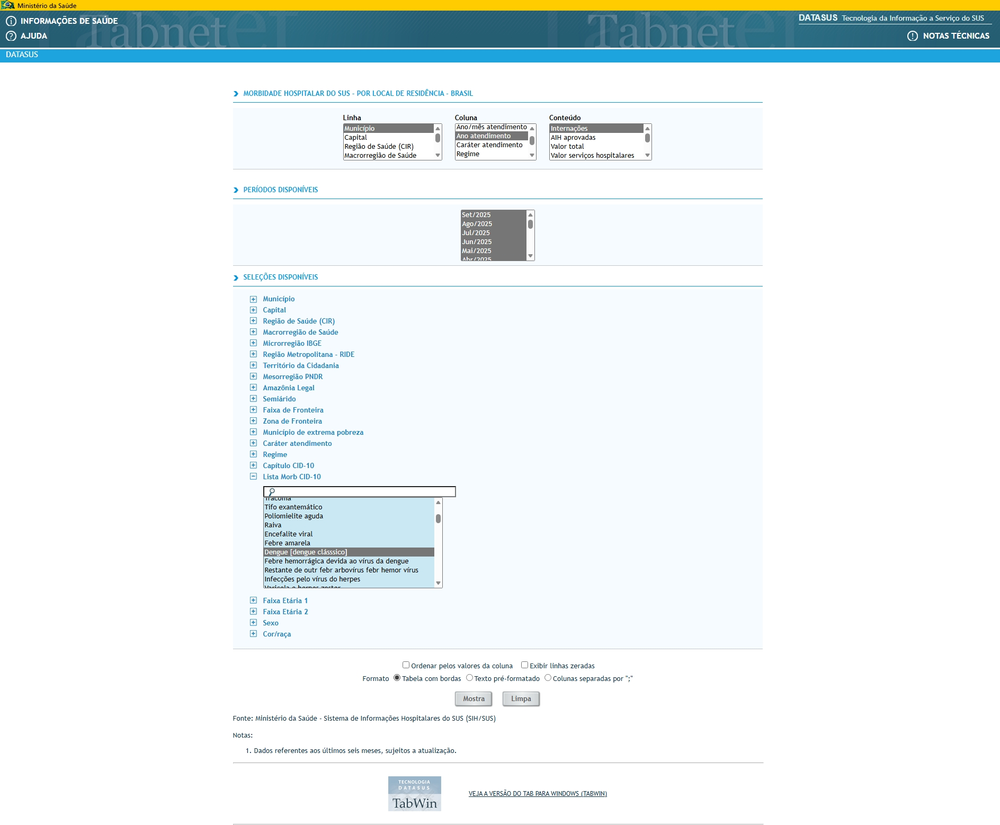
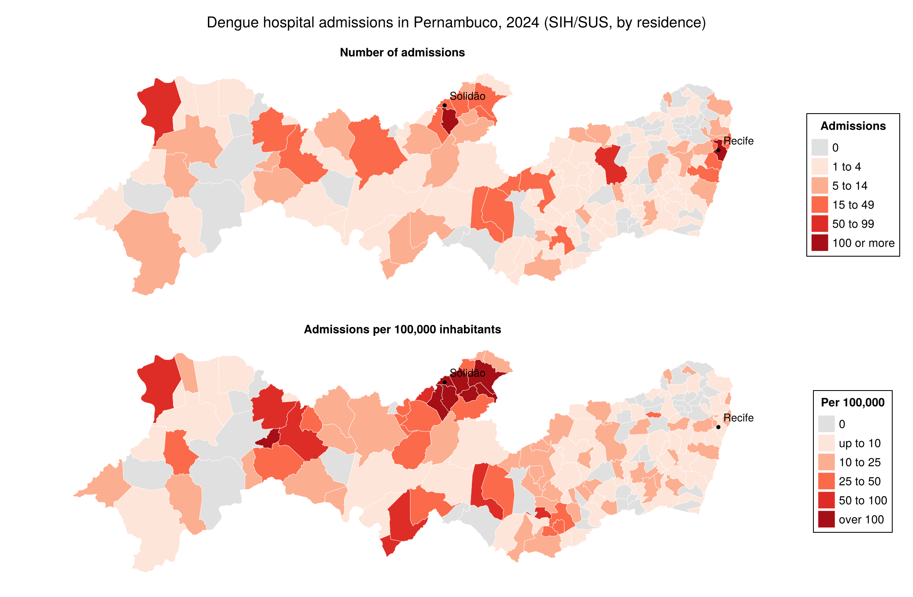

---
layout: post
image: /assets/images/dengue-mapa.avif
title: "Mapping Public Health: Dengue Hospital Admissions in Pernambuco with Julia and Python"
categories: [DATA VISUALIZATION, JULIA, PUBLIC HEALTH]
tags: [Data analysis]
lang: en
ref: dengue-pernambuco-julia
author: dante-bertuzzi
mathjax: true
description: "From the TabNet file to the map: dengue hospital admissions in the municipalities of Pernambuco, Brazil, in 2024, from counts to rates per 100,000 inhabitants, with Julia and Python."
---

In the [post on GDP by state](/visualization-pib-brazil-julia/), we made a map of Brazil. Now we go down to the level of municipalities, with public health data: **dengue hospital admissions in Pernambuco, a state in northeastern Brazil, in 2024**, recorded in the Hospital Information System of SUS (SIH/SUS), the Brazilian public health system.

The path is the same as in any project with government data: download a file that is not ready for analysis, clean it, join it with the population and with the municipal boundaries, and draw the map. Along the way comes the most important lesson of the post: **the map of counts and the map of rates tell different stories.** Recife, the state capital, has the largest number of admissions in the state, but ranks 104th once you divide by the population.

## Where the data come from

The data come from **TabNet**, DATASUS's tabulation tool, on the page [SUS hospital morbidity, by place of residence](https://tabnet.datasus.gov.br/cgi/deftohtm.exe?sih/cnv/nrbr.def) (in Portuguese). The table was built with **Município** (municipality) in the rows, **Ano atendimento** (year of admission) in the columns, **Internações** (admissions) as the content and, in the "Lista Morb CID-10" selection, the category **"Dengue [dengue clássico]"** (classic dengue), for the whole available period. The result was exported as semicolon-separated text.

Figure 1 – The query in TabNet (interface in Portuguese), in November 2025.

### What these numbers are, and what they are not

Before mapping, it pays to know exactly what is being counted. According to TabNet's technical notes:

- **They are hospital admissions, not dengue cases.** Not everyone with dengue is admitted to hospital. Notified cases are kept in another system, [Sinan](https://tabnet.datasus.gov.br/cgi/deftohtm.exe?sinannet/cnv/denguebbr.def) (the Notifiable Diseases Information System). That is why this post talks about the **admission rate**, not dengue incidence.
- **Only hospitals that serve SUS patients are included**, public or contracted private ones. The notes speak of "a large part of the hospital admissions in Brazil", not all of them.
- **"Admissions" is the number of approved hospital admission authorizations (AIH).** The notes warn that it is "an approximate value of the admissions", because transfers and readmissions are counted again.
- **The municipality is the patient's place of residence**, not the hospital's. Someone who lives in Solidão and was admitted in another town counts for Solidão. That is what allows dividing by the resident population.
- **The year is that of the admission date** ("Ano atendimento").
- **Only code A90 was included**, "Dengue [dengue clássico]". The list also has "Febre hemorrágica devida ao vírus da dengue" (dengue hemorrhagic fever, A91), which was left out of the extract. In a query to the same TabNet on November 25, 2026, A91 added another 130 admissions of Pernambuco residents in 2024, on top of the 1,301 under A90.

## The challenge: the TabNet file

The exported file is not a clean table:

- **The header is not on the first line.** Before it come the title of the query, the chosen category and the period.
- **The first column mixes code and name**: `"261160 RECIFE"`. The code has 6 digits; IBGE's (the Brazilian statistics office) has 7, and the first 6 match the SIH code.
- **The separator is the semicolon**, and the file is in Latin-1, not UTF-8.
- **Zero shows up as `-`.** In TabNet's legend, `-` is "numeric value equal to 0, not resulting from rounding".
- **At the end come a total row and the notes**, which are not municipalities.

## Prerequisites

The packages used, in each language:

  

  

    
Julia

    

    <button class="copy-button" onclick="copyCode(this)">
      <i class="bi bi-clipboard"></i>Copy
    </button>
  

  

    <pre><code>using Pkg
Pkg.add(["CSV", "DataFrames", "JSON3", "GeoJSON", "GeoInterface", "CairoMakie", "Distributions"])
# Downloads and Printf ship with Julia</code></pre>
  

  

  

  

    
Python

    

    <button class="copy-button" onclick="copyCode(this)">
      <i class="bi bi-clipboard"></i>Copy
    </button>
  

  

    <pre><code># In the terminal:
# pip install pandas geopandas matplotlib scipy</code></pre>
  

  

The population data, the municipal boundaries and the list of microregions come from public IBGE APIs, downloaded directly by the code. The TabNet file is in the [project repository](https://github.com/morrisonkuhlsen/map-dengue-1).

## Step 1: read the TabNet file

The code finds the header line by the text `"Município"`, keeps only the lines that start with a 6-digit code (which drops the title, total and notes), extracts the code and the name, and keeps the municipalities whose code starts with 26, the code of Pernambuco.

  

  

    
Julia

    

    <button class="copy-button" onclick="copyCode(this)">
      <i class="bi bi-clipboard"></i>Copy
    </button>
  

  

    <pre><code>using CSV, DataFrames, Downloads, Printf

# File exported from TabNet (SIH/SUS, by place of residence), kept in the project repository
url_sih = "https://raw.githubusercontent.com/morrisonkuhlsen/map-dengue-1/main/sih_cnv_nibr111825170_150_81_250.csv"
bytes = read(Downloads.download(url_sih))
text = String(Char.(bytes))        # TabNet writes Latin-1: each byte becomes one character

lines = split(text, r"\r?\n")
start = findfirst(l -&gt; startswith(l, "\"Município\""), lines)             # the real header
municipalities = filter(l -&gt; occursin(r"^\"\d{6} ", l), lines[start+1:end]) # drops title, total and notes
sih = CSV.read(IOBuffer(join([lines[start]; municipalities], "\n")), DataFrame;
               delim = ';', missingstring = "-")

sih.cod6 = first.(sih.Município, 6)                # 6-digit IBGE code
sih.name = chop.(sih.Município; head = 7, tail = 0)
pe = filter(:cod6 =&gt; startswith("26"), sih)        # 26 = Pernambuco
pe.admissions = coalesce.(pe[!, "2024"], 0)        # in TabNet, "-" means zero

@printf("Municipalities in PE: %d\n", nrow(pe))
@printf("Admissions in 2024: %d\n", sum(pe.admissions))
@printf("Municipalities with zero admissions: %d\n", count(==(0), pe.admissions))
println("\nMost admissions in 2024:")
for (i, r) in enumerate(eachrow(first(sort(pe, [order(:admissions, rev = true), :name]), 10)))
    @printf("%2d. %-24s %4d\n", i, r.name, r.admissions)
end</code></pre>
  

  
# Output

  <pre style="overflow-x: auto; font-size: 0.9em;">Municipalities in PE: 185
Admissions in 2024: 1301
Municipalities with zero admissions: 44
Most admissions in 2024:
 1. RECIFE                    113
 2. AFOGADOS DA INGAZEIRA     107
 3. ARARIPINA                  90
 4. CARUARU                    52
 5. OLINDA                     46
 6. PAULISTA                   43
 7. GARANHUNS                  39
 8. SOLIDAO                    39
 9. SALGUEIRO                  38
10. SAO JOSE DO EGITO          38</pre>

  

  

  

    
Python

    

    <button class="copy-button" onclick="copyCode(this)">
      <i class="bi bi-clipboard"></i>Copy
    </button>
  

  

    <pre><code>import io
import urllib.request
import pandas as pd

# File exported from TabNet (SIH/SUS, by place of residence), kept in the project repository
url_sih = "https://raw.githubusercontent.com/morrisonkuhlsen/map-dengue-1/main/sih_cnv_nibr111825170_150_81_250.csv"
text = urllib.request.urlopen(url_sih).read().decode("latin-1")   # TabNet writes Latin-1

lines = text.splitlines()
start = next(i for i, l in enumerate(lines) if l.startswith('"Município"'))      # the real header
municipalities = [l for l in lines[start + 1:] if l[1:7].isdigit()]             # drops title, total and notes
sih = pd.read_csv(io.StringIO("\n".join([lines[start]] + municipalities)), sep=";", na_values="-")

sih["cod6"] = sih["Município"].str[:6]             # 6-digit IBGE code
sih["name"] = sih["Município"].str[7:]
pe = sih[sih["cod6"].str.startswith("26")].copy()  # 26 = Pernambuco
pe["admissions"] = pe["2024"].fillna(0).astype(int)   # in TabNet, "-" means zero

print(f"Municipalities in PE: {len(pe)}")
print(f"Admissions in 2024: {pe['admissions'].sum()}")
print(f"Municipalities with zero admissions: {(pe['admissions'] == 0).sum()}")
print("\nMost admissions in 2024:")
top = pe.sort_values(["admissions", "name"], ascending=[False, True]).head(10)
for i, (name, n) in enumerate(zip(top["name"], top["admissions"]), start=1):
    print(f"{i:2d}. {name:&lt;24s} {n:4d}")</code></pre>
  

  
# Output

  <pre style="overflow-x: auto; font-size: 0.9em;">Municipalities in PE: 185
Admissions in 2024: 1301
Municipalities with zero admissions: 44
Most admissions in 2024:
 1. RECIFE                    113
 2. AFOGADOS DA INGAZEIRA     107
 3. ARARIPINA                  90
 4. CARUARU                    52
 5. OLINDA                     46
 6. PAULISTA                   43
 7. GARANHUNS                  39
 8. SOLIDAO                    39
 9. SALGUEIRO                  38
10. SAO JOSE DO EGITO          38</pre>

  

There are 185 municipalities (IBGE counts Fernando de Noronha among them), 1,301 admissions in 2024, and 44 municipalities with none. The list above is the same one the original post showed: Recife leads, with 113.

## Step 2: from counts to rates

Recife has more admissions than Solidão, but it also has almost 300 times as many residents. To compare municipalities of different sizes, divide the number of admissions by the population and multiply by 100,000:

$$
\text{rate} = \frac{\text{admissions}}{\text{population}} \times 100{,}000
$$

The population comes from **IBGE's population estimates for 2024** (SIDRA table 6579, "Estimated resident population").

**Examples, by hand:**

- Solidão: $$\frac{39}{5{,}403} \times 100{,}000 = 721.8$$ admissions per 100,000 inhabitants.
- Recife: $$\frac{113}{1{,}587{,}707} \times 100{,}000 = 7.1$$ per 100,000.
- Pernambuco: $$\frac{1{,}301}{9{,}539{,}029} \times 100{,}000 = 13.6$$ per 100,000.

The two tables are joined by the municipality **code**, not by the name. SIH writes `BELEM DE SAO FRANCISCO`; IBGE, "Belém do São Francisco". A join by name, even after removing accents and capitals, would lose this municipality, and it would show up on the map as if it had zero admissions. The code is spelled the same on both sides.

  

  

    
Julia

    

    <button class="copy-button" onclick="copyCode(this)">
      <i class="bi bi-clipboard"></i>Copy
    </button>
  

  

    <pre><code>using JSON3

# Estimated resident population in 2024 (IBGE, SIDRA table 6579), municipalities of PE
url_pop = "https://apisidra.ibge.gov.br/values/t/6579/n6/in%20n3%2026/v/9324/p/2024"
records = JSON3.read(read(Downloads.download(url_pop), String))[2:end]   # the 1st row describes the columns
pop = DataFrame(cod7 = [String(r.D1C) for r in records],
                municipality = [replace(String(r.D1N), " - PE" =&gt; "") for r in records],
                population = [parse(Int, r.V) for r in records])
pop.cod6 = first.(pop.cod7, 6)

# Join by code, not by name: "BELEM DE SAO FRANCISCO" (SIH) is "Belém do São Francisco" (IBGE)
data = innerjoin(pop, select(pe, :cod6, :admissions), on = :cod6)
@assert nrow(data) == nrow(pe) == 185
data.rate = 1e5 .* data.admissions ./ data.population   # admissions per 100,000 inhabitants

@printf("Pernambuco rate: %d admissions / %d inhabitants = %.1f per 100,000\n",
        sum(data.admissions), sum(data.population), 1e5 * sum(data.admissions) / sum(data.population))
ranked = sort(data, :rate, rev = true)
println("\nHighest rates in 2024:")
println("    Municipality              Admissions  Population  Per 100,000")
for (i, r) in enumerate(eachrow(first(ranked, 10)))
    @printf("%2d. %-24s %11d %11d %12.1f\n", i, r.municipality, r.admissions, r.population, r.rate)
end
pos = findfirst(==("Recife"), ranked.municipality)
@printf("\nRecife: %d admissions, rate of %.1f per 100,000, rank %d of %d municipalities\n",
        ranked.admissions[pos], ranked.rate[pos], pos, nrow(ranked))</code></pre>
  

  
# Output

  <pre style="overflow-x: auto; font-size: 0.9em;">Pernambuco rate: 1301 admissions / 9539029 inhabitants = 13.6 per 100,000
Highest rates in 2024:
    Municipality              Admissions  Population  Per 100,000
 1. Solidão                           39        5403        721.8
 2. Tuparetama                        24        8252        290.8
 3. Afogados da Ingazeira            107       42407        252.3
 4. Ingazeira                          7        4959        141.2
 5. Tabira                            36       29093        123.7
 6. São José do Egito                 38       32491        117.0
 7. Terra Nova                        10        9221        108.4
 8. Carnaíba                          20       19513        102.5
 9. Araripina                         90       90104         99.9
10. Fernando de Noronha                3        3316         90.5
Recife: 113 admissions, rate of 7.1 per 100,000, rank 104 of 185 municipalities</pre>

  

  

  

    
Python

    

    <button class="copy-button" onclick="copyCode(this)">
      <i class="bi bi-clipboard"></i>Copy
    </button>
  

  

    <pre><code>import json

# Estimated resident population in 2024 (IBGE, SIDRA table 6579), municipalities of PE
url_pop = "https://apisidra.ibge.gov.br/values/t/6579/n6/in%20n3%2026/v/9324/p/2024"
records = json.load(urllib.request.urlopen(url_pop))[1:]   # the 1st row describes the columns
pop = pd.DataFrame({"cod7": [r["D1C"] for r in records],
                    "municipality": [r["D1N"].replace(" - PE", "") for r in records],
                    "population": [int(r["V"]) for r in records]})
pop["cod6"] = pop["cod7"].str[:6]

# Join by code, not by name: "BELEM DE SAO FRANCISCO" (SIH) is "Belém do São Francisco" (IBGE)
data = pop.merge(pe[["cod6", "admissions"]], on="cod6", how="inner")
assert len(data) == len(pe) == 185
data["rate"] = 1e5 * data["admissions"] / data["population"]   # admissions per 100,000 inhabitants

total, inhabitants = data["admissions"].sum(), data["population"].sum()
print(f"Pernambuco rate: {total} admissions / {inhabitants} inhabitants = {1e5 * total / inhabitants:.1f} per 100,000")
ranked = data.sort_values("rate", ascending=False).reset_index(drop=True)
print("\nHighest rates in 2024:")
print("    Municipality              Admissions  Population  Per 100,000")
for i, r in ranked.head(10).iterrows():
    print(f"{i + 1:2d}. {r.municipality:&lt;24s} {r.admissions:11d} {r.population:11d} {r.rate:12.1f}")
pos = ranked.index[ranked["municipality"] == "Recife"][0]
r = ranked.loc[pos]
print(f"\nRecife: {r.admissions} admissions, rate of {r.rate:.1f} per 100,000, rank {pos + 1} of {len(ranked)} municipalities")</code></pre>
  

  
# Output

  <pre style="overflow-x: auto; font-size: 0.9em;">Pernambuco rate: 1301 admissions / 9539029 inhabitants = 13.6 per 100,000
Highest rates in 2024:
    Municipality              Admissions  Population  Per 100,000
 1. Solidão                           39        5403        721.8
 2. Tuparetama                        24        8252        290.8
 3. Afogados da Ingazeira            107       42407        252.3
 4. Ingazeira                          7        4959        141.2
 5. Tabira                            36       29093        123.7
 6. São José do Egito                 38       32491        117.0
 7. Terra Nova                        10        9221        108.4
 8. Carnaíba                          20       19513        102.5
 9. Araripina                         90       90104         99.9
10. Fernando de Noronha                3        3316         90.5
Recife: 113 admissions, rate of 7.1 per 100,000, rank 104 of 185 municipalities</pre>

  

The order changes completely. Recife, first in number of admissions, has a rate of 7.1 per 100,000, below the state average, and ranks 104th of 185. Solidão, eighth in number, has the highest rate: 721.8 per 100,000, 53 times that of Pernambuco.

## Step 3: the map

The map uses the municipal mesh from IBGE's mesh API, which carries the 7-digit code of each polygon. Each municipality is colored according to the **class** its value falls into: this is a **choropleth map**. Classes work better than a continuous scale when the data are very skewed, as here: half of the municipalities have 2 admissions or fewer, and one has 113. Zero gets a neutral color, so it is not confused with small values.

  

  

    
Julia

    

    <button class="copy-button" onclick="copyCode(this)">
      <i class="bi bi-clipboard"></i>Copy
    </button>
  

  

    <pre><code>using CairoMakie, GeoJSON, GeoInterface

# Municipal boundaries of PE (IBGE mesh API), with the 7-digit code in "codarea"
url_mesh = "https://servicodados.ibge.gov.br/api/v3/malhas/estados/26?intrarregiao=municipio&amp;formato=application/vnd.geo+json&amp;qualidade=intermediaria"
mesh = GeoJSON.read(read(Downloads.download(url_mesh)))
mesh = [f for f in mesh if String(f.codarea) != "2605459"]   # Fernando de Noronha is left out of the frame
row = Dict(c =&gt; i for (i, c) in enumerate(data.cod7))
idx = [row[String(f.codarea)] for f in mesh]       # position of each polygon in the data table

# Outer ring of each part of the municipality (Polygon or MultiPolygon)
function rings(geom)
    c = GeoInterface.coordinates(geom)
    parts = GeoInterface.geomtrait(geom) isa GeoInterface.PolygonTrait ? [c] : c
    return [Point2f.(first.(p[1]), last.(p[1])) for p in parts]
end
center(geom) = (pts = reduce(vcat, rings(geom)); Point2f(sum(pts) / length(pts)))

# Classes: zero in a neutral color and the rest on a red scale
colors = ["#e0e0e0", "#fee5d9", "#fcae91", "#fb6a4a", "#de2d26", "#a50f15"]
function class(x, breaks)
    x == 0 &amp;&amp; return 1
    return 1 + something(findfirst(b -&gt; x &lt;= b, breaks), length(breaks) + 1)
end
panels = [(data.admissions, [4, 14, 49, 99], ["0", "1 to 4", "5 to 14", "15 to 49", "50 to 99", "100 or more"],
           "Number of admissions", "Admissions"),
          (data.rate, [10, 25, 50, 100], ["0", "up to 10", "10 to 25", "25 to 50", "50 to 100", "over 100"],
           "Admissions per 100,000 inhabitants", "Per 100,000")]

fig = Figure(size = (1100, 720))
for (k, (values, breaks, labels, title, legend_title)) in enumerate(panels)
    ax = Axis(fig[k, 1]; title = title, aspect = DataAspect())
    hidedecorations!(ax); hidespines!(ax)
    for (f, i) in zip(mesh, idx)
        for ring in rings(GeoInterface.geometry(f))
            poly!(ax, ring; color = colors[class(values[i], breaks)], strokecolor = :white, strokewidth = 0.4)
        end
    end
    for name in ("Recife", "Solidão")
        f = mesh[findfirst(i -&gt; data.municipality[i] == name, idx)]
        p = center(GeoInterface.geometry(f))
        scatter!(ax, [p]; color = :black, markersize = 7)
        text!(ax, p; text = name, offset = (6, 4), fontsize = 13)
    end
    Legend(fig[k, 2], [PolyElement(color = c, strokecolor = :gray70) for c in colors], labels, legend_title)
end
Label(fig[0, :], "Dengue hospital admissions in Pernambuco, 2024 (SIH/SUS, by residence)", fontsize = 18)
save("dengue-pe-maps.png", fig)</code></pre>
  

  

  

  

    
Python

    

    <button class="copy-button" onclick="copyCode(this)">
      <i class="bi bi-clipboard"></i>Copy
    </button>
  

  

    <pre><code>import geopandas as gpd
import matplotlib.pyplot as plt
from matplotlib.patches import Patch

# Municipal boundaries of PE (IBGE mesh API), with the 7-digit code in "codarea"
url_mesh = "https://servicodados.ibge.gov.br/api/v3/malhas/estados/26?intrarregiao=municipio&amp;formato=application/vnd.geo+json&amp;qualidade=intermediaria"
mesh = gpd.GeoDataFrame.from_features(json.load(urllib.request.urlopen(url_mesh)))
mesh = mesh[mesh["codarea"] != "2605459"]          # Fernando de Noronha is left out of the frame
geo = mesh.merge(data, left_on="codarea", right_on="cod7")

# Classes: zero in a neutral color and the rest on a red scale
colors = ["#e0e0e0", "#fee5d9", "#fcae91", "#fb6a4a", "#de2d26", "#a50f15"]
def to_class(x, breaks):
    if x == 0:
        return 0
    return 1 + next((j for j, b in enumerate(breaks) if x &lt;= b), len(breaks))
panels = [("admissions", [4, 14, 49, 99], ["0", "1 to 4", "5 to 14", "15 to 49", "50 to 99", "100 or more"],
           "Number of admissions", "Admissions"),
          ("rate", [10, 25, 50, 100], ["0", "up to 10", "10 to 25", "25 to 50", "50 to 100", "over 100"],
           "Admissions per 100,000 inhabitants", "Per 100,000")]

fig, axes = plt.subplots(2, 1, figsize=(11, 7.2))
for ax, (column, breaks, labels, title, legend_title) in zip(axes, panels):
    geo.plot(ax=ax, color=[colors[to_class(x, breaks)] for x in geo[column]], edgecolor="white", linewidth=0.4)
    for name in ("Recife", "Solidão"):
        p = geo.loc[geo["municipality"] == name].geometry.iloc[0].representative_point()
        ax.plot(p.x, p.y, "ko", ms=4)
        ax.annotate(name, (p.x, p.y), xytext=(5, 4), textcoords="offset points", fontsize=10)
    ax.legend([Patch(facecolor=c, edgecolor="0.7") for c in colors], labels, title=legend_title,
              loc="center left", bbox_to_anchor=(1, 0.5), frameon=False)
    ax.set_title(title); ax.set_axis_off()
fig.suptitle("Dengue hospital admissions in Pernambuco, 2024 (SIH/SUS, by residence)")
fig.tight_layout()
fig.savefig("dengue-pe-maps-py.png", dpi=120, bbox_inches="tight")</code></pre>
  

  

Figure 2 – Dengue admissions in 2024, as a count (top) and per 100,000 inhabitants (bottom). Fernando de Noronha (3 admissions, 90.5 per 100,000) is left out of the frame (Julia code above).

On the top map, the large municipalities catch the eye. On the bottom one, Recife almost disappears, and a dark block shows up in the interior, around Solidão.

## Beware of rates in small municipalities

Solidão has 5,403 residents. Each admission more or less changes the rate by $$\frac{100{,}000}{5{,}403} = 18.5$$ per 100,000. In Recife, one admission changes the rate by less than 0.1. That is why rates in small municipalities swing a lot from one year to the next, and the extremes of the ranking tend to be held by them, at the top and at the bottom.

One way to measure this uncertainty is to treat the number of admissions as a [Poisson](/en/glossary#poisson-distribution) count and compute a 95% interval for the rate. The exact interval has limits $$\lambda_{\text{lo}}$$ and $$\lambda_{\text{hi}}$$ such that, with $$k$$ observed admissions, $$P(X \ge k) = 0.025$$ when the mean is $$\lambda_{\text{lo}}$$ and $$P(X \le k) = 0.025$$ when the mean is $$\lambda_{\text{hi}}$$. They can be computed with chi-square quantiles:

$$
\lambda_{\text{lo}} = \tfrac{1}{2}\,\chi^2_{0.025;\;2k}
\qquad\qquad
\lambda_{\text{hi}} = \tfrac{1}{2}\,\chi^2_{0.975;\;2k+2}
$$

and, divided by the population and multiplied by 100,000, they become limits for the rate.

  

  

    
Julia

    

    <button class="copy-button" onclick="copyCode(this)">
      <i class="bi bi-clipboard"></i>Copy
    </button>
  

  

    <pre><code>using Distributions

# Exact 95% interval for a Poisson count, divided by the population
function rate_interval(k, population)
    lo = k == 0 ? 0.0 : quantile(Chisq(2k), 0.025) / 2
    hi = quantile(Chisq(2k + 2), 0.975) / 2
    return 1e5 * lo / population, 1e5 * hi / population
end

println("Municipality              Admissions  Per 100,000  95% interval         1 more case")
for r in eachrow(vcat(first(ranked, 5), filter(:municipality =&gt; ==("Recife"), ranked)))
    lo, hi = rate_interval(r.admissions, r.population)
    @printf("%-24s %11d %12.1f   %7.1f to %7.1f   %+10.1f\n",
            r.municipality, r.admissions, r.rate, lo, hi, 1e5 / r.population)
end</code></pre>
  

  
# Output

  <pre style="overflow-x: auto; font-size: 0.9em;">Municipality              Admissions  Per 100,000  95% interval         1 more case
Solidão                           39        721.8     513.3 to   986.8        +18.5
Tuparetama                        24        290.8     186.3 to   432.7        +12.1
Afogados da Ingazeira            107        252.3     206.8 to   304.9         +2.4
Ingazeira                          7        141.2      56.8 to   290.8        +20.2
Tabira                            36        123.7      86.7 to   171.3         +3.4
Recife                           113          7.1       5.9 to     8.6         +0.1</pre>

  

  

  

    
Python

    

    <button class="copy-button" onclick="copyCode(this)">
      <i class="bi bi-clipboard"></i>Copy
    </button>
  

  

    <pre><code>from scipy import stats

# Exact 95% interval for a Poisson count, divided by the population
def rate_interval(k, population):
    lo = 0.0 if k == 0 else stats.chi2.ppf(0.025, 2 * k) / 2
    hi = stats.chi2.ppf(0.975, 2 * k + 2) / 2
    return 1e5 * lo / population, 1e5 * hi / population

print("Municipality              Admissions  Per 100,000  95% interval         1 more case")
rows = pd.concat([ranked.head(5), ranked[ranked["municipality"] == "Recife"]])
for r in rows.itertuples():
    lo, hi = rate_interval(r.admissions, r.population)
    print(f"{r.municipality:&lt;24s} {r.admissions:11d} {r.rate:12.1f}   {lo:7.1f} to {hi:7.1f}   {1e5 / r.population:+10.1f}")</code></pre>
  

  
# Output

  <pre style="overflow-x: auto; font-size: 0.9em;">Municipality              Admissions  Per 100,000  95% interval         1 more case
Solidão                           39        721.8     513.3 to   986.8        +18.5
Tuparetama                        24        290.8     186.3 to   432.7        +12.1
Afogados da Ingazeira            107        252.3     206.8 to   304.9         +2.4
Ingazeira                          7        141.2      56.8 to   290.8        +20.2
Tabira                            36        123.7      86.7 to   171.3         +3.4
Recife                           113          7.1       5.9 to     8.6         +0.1</pre>

  

Solidão's interval runs from 513 to 987 per 100,000: wide, but entirely above every other municipality on the list, which suggests the high rate is not just chance. Ingazeira, with 7 admissions, runs from 57 to 291; its fourth place in the ranking is fragile. Recife's interval (5.9 to 8.6) is narrow because the population is large.

## A regional pattern: Pajeú

The dark municipalities on the bottom map are neighbors. Adding up admissions and populations by **IBGE microregion** (as given by IBGE's localities API), the pattern becomes clear:

  

  

    
Julia

    

    <button class="copy-button" onclick="copyCode(this)">
      <i class="bi bi-clipboard"></i>Copy
    </button>
  

  

    <pre><code># Microregion of each municipality (IBGE localities API)
url_loc = "https://servicodados.ibge.gov.br/api/v1/localidades/estados/26/municipios"
loc = JSON3.read(read(Downloads.download(url_loc), String))
micro = DataFrame(cod7 = [string(m.id) for m in loc], microregion = [String(m.microrregiao.nome) for m in loc])

regions = combine(groupby(innerjoin(data, micro, on = :cod7), :microregion),
                  :admissions =&gt; sum =&gt; :admissions, :population =&gt; sum =&gt; :population, nrow =&gt; :municipalities)
regions.rate = 1e5 .* regions.admissions ./ regions.population
sort!(regions, :rate, rev = true)
println("Microregion             Municipalities  Admissions  Population  Per 100,000")
for r in eachrow(first(regions, 6))
    @printf("%-24s %13d %11d %11d %12.1f\n", r.microregion, r.municipalities, r.admissions, r.population, r.rate)
end</code></pre>
  

  
# Output

  <pre style="overflow-x: auto; font-size: 0.9em;">Microregion             Municipalities  Admissions  Population  Per 100,000
Pajeú                               17         328      344414         95.2
Fernando de Noronha                  1           3        3316         90.5
Salgueiro                            7          68      175092         38.8
Araripina                           10         112      335464         33.4
Itaparica                            7          30      142769         21.0
Garanhuns                           19          85      481239         17.7</pre>

  

  

  

    
Python

    

    <button class="copy-button" onclick="copyCode(this)">
      <i class="bi bi-clipboard"></i>Copy
    </button>
  

  

    <pre><code># Microregion of each municipality (IBGE localities API)
url_loc = "https://servicodados.ibge.gov.br/api/v1/localidades/estados/26/municipios"
loc = json.load(urllib.request.urlopen(url_loc))
micro = pd.DataFrame({"cod7": [str(m["id"]) for m in loc], "microregion": [m["microrregiao"]["nome"] for m in loc]})

regions = (data.merge(micro, on="cod7")
           .groupby("microregion")
           .agg(municipalities=("cod7", "size"), admissions=("admissions", "sum"), population=("population", "sum")))
regions["rate"] = 1e5 * regions["admissions"] / regions["population"]
regions = regions.sort_values("rate", ascending=False)
print("Microregion             Municipalities  Admissions  Population  Per 100,000")
for r in regions.head(6).itertuples():
    print(f"{r.Index:&lt;24s} {r.municipalities:13d} {r.admissions:11d} {r.population:11d} {r.rate:12.1f}")</code></pre>
  

  
# Output

  <pre style="overflow-x: auto; font-size: 0.9em;">Microregion             Municipalities  Admissions  Population  Per 100,000
Pajeú                               17         328      344414         95.2
Fernando de Noronha                  1           3        3316         90.5
Salgueiro                            7          68      175092         38.8
Araripina                           10         112      335464         33.4
Itaparica                            7          30      142769         21.0
Garanhuns                           19          85      481239         17.7</pre>

  

The **Pajeú** microregion, in the interior of the state, brings together 17 municipalities and 344,000 inhabitants, and had 328 admissions in 2024: 95.2 per 100,000, about 7 times the state rate. Seven of the eight municipalities with the highest rates are in it: Solidão, Tuparetama, Afogados da Ingazeira, Ingazeira, Tabira, São José do Egito and Carnaíba. The exception is Terra Nova, in the Petrolina microregion. Fernando de Noronha comes second only because it is a "microregion" of a single municipality, with 3 admissions.

The map shows **where** there were more admissions per inhabitant, not **why**. A high rate may come from more dengue, but also from more access to hospitals or different criteria for admitting patients. Telling these explanations apart would require looking at the cases notified in Sinan and at a series of several years.

## Source code and data

The TabNet file used here is in the [project repository](https://github.com/morrisonkuhlsen/map-dengue-1). The code in this post downloads that file and the IBGE data by itself, so you only need to copy the blocks above, in order, into a single Julia or Python session.

## Conclusion

- TabNet files need cleaning: header out of place, code and name in the same column, Latin-1 and `-` for zero.
- Join tables by municipality code, not by name.
- Counts show where more people live; rates per inhabitant let you compare municipalities.
- Rates in small municipalities are unstable; a confidence interval and aggregation by region help separate signal from noise.
- Admissions are not cases: SIH shows the part of dengue that reaches a SUS hospital.

### Note on the data and the analysis

All data used are public, from DATASUS (Brazilian Ministry of Health) and IBGE. This analysis is independent and for educational purposes: it is not an official statement from any public body, and it should not be used as a basis for public policy or resource allocation decisions.

## References

1. DATASUS. *Morbidade Hospitalar do SUS – por local de residência – Brasil* (TabNet). Available at <https://tabnet.datasus.gov.br/cgi/deftohtm.exe?sih/cnv/nrbr.def>. Accessed November 25, 2026. (in Portuguese)
2. DATASUS. *Morbidade Hospitalar do SUS por local de residência – a partir de 2008: notas técnicas*. Available at <http://tabnet.datasus.gov.br/cgi/sih/Morb_geral_loc_res_2008.pdf>. Accessed November 25, 2026. (in Portuguese)
3. DATASUS. *Dengue – notificações registradas no Sistema de Informação de Agravos de Notificação* (TabNet). Available at <https://tabnet.datasus.gov.br/cgi/deftohtm.exe?sinannet/cnv/denguebbr.def>. Accessed November 25, 2026. (in Portuguese)
4. IBGE. *Estimativas de População*, SIDRA table 6579 ("População residente estimada"). API: <https://apisidra.ibge.gov.br/values/t/6579/n6/in%20n3%2026/v/9324/p/2024>. Accessed November 25, 2026.
5. IBGE. Mesh API (v3): <https://servicodados.ibge.gov.br/api/v3/malhas/estados/26?intrarregiao=municipio&formato=application/vnd.geo+json&qualidade=intermediaria>; localities API (v1): <https://servicodados.ibge.gov.br/api/v1/localidades/estados/26/municipios>. Accessed November 25, 2026.
6. Packages: [CSV.jl](https://csv.juliadata.org/stable/), [DataFrames.jl](https://dataframes.juliadata.org/stable/), [CairoMakie.jl](https://docs.makie.org/stable/), [GeoJSON.jl](https://github.com/JuliaGeo/GeoJSON.jl), [pandas](https://pandas.pydata.org/), [GeoPandas](https://geopandas.org/).
