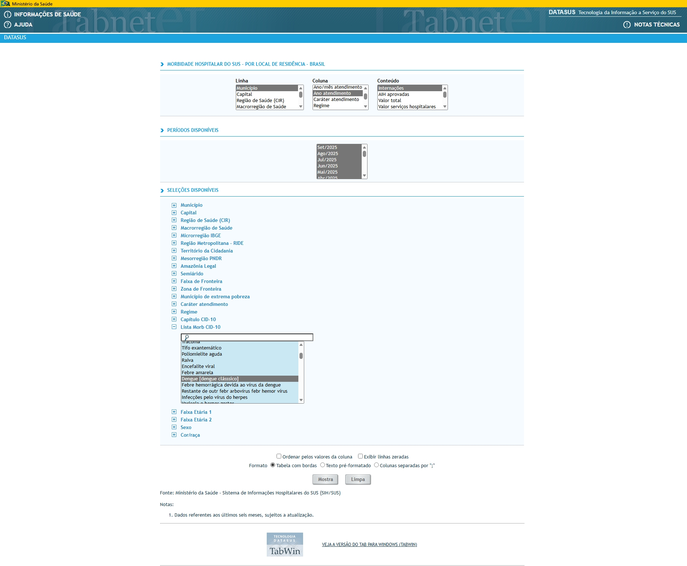
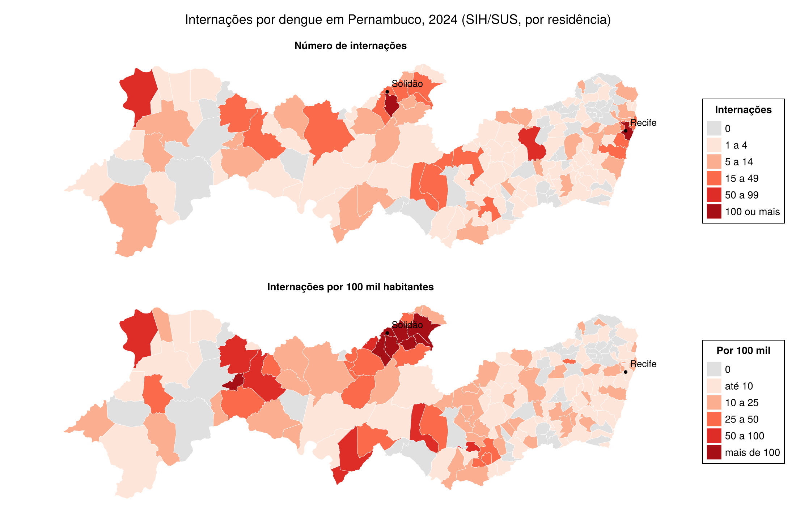

---
layout: post
image: /assets/images/dengue-mapa.avif
title: "Mapeando a Saúde Pública: Internações por Dengue em Pernambuco com Julia e Python"
categories: [VISUALIZAÇÃO DE DADOS, JULIA, SAÚDE PÚBLICA]
tags: [Análise de dados]
lang: pt
ref: dengue-pernambuco-julia
author: dante-bertuzzi
mathjax: true
description: "Do arquivo do TabNet ao mapa: internações por dengue nos municípios de Pernambuco em 2024, de contagens a taxas por 100 mil habitantes, com Julia e Python."
---

No [post sobre o PIB por estado](/visualizacao-pib-brasil-julia/), fizemos um mapa do Brasil. Agora vamos descer ao nível dos municípios, com dados de saúde pública: as **internações por dengue em Pernambuco em 2024**, registradas no Sistema de Informações Hospitalares do SUS (SIH/SUS).

O caminho é o de qualquer projeto com dados governamentais: baixar um arquivo que não vem pronto para análise, limpá-lo, juntá-lo com a população e com a malha dos municípios e desenhar o mapa. No meio do caminho aparece a lição mais importante do post: **o mapa de contagens e o mapa de taxas contam histórias diferentes.** Recife tem o maior número de internações do estado, mas fica em 104º lugar quando se divide pela população.

## De onde vêm os dados

Os dados vêm do **TabNet**, o tabulador do DATASUS, na página [Morbidade Hospitalar do SUS, por local de residência](https://tabnet.datasus.gov.br/cgi/deftohtm.exe?sih/cnv/nrbr.def). A tabela foi montada com **Município** na linha, **Ano atendimento** na coluna, **Internações** no conteúdo e, na seleção "Lista Morb CID-10", a categoria **"Dengue [dengue clássico]"**, para todo o período disponível. O resultado foi exportado como texto separado por ponto e vírgula.

Figura 1 – A consulta no TabNet, em novembro de 2025.

### O que esses números são, e o que não são

Antes de mapear, vale saber exatamente o que se está contando. Segundo as notas técnicas do TabNet:

- **São internações, não casos de dengue.** Nem toda pessoa com dengue é internada. Os casos notificados ficam em outro sistema, o [Sinan](https://tabnet.datasus.gov.br/cgi/deftohtm.exe?sinannet/cnv/denguebbr.def) (Sistema de Informação de Agravos de Notificação). Por isso este post fala em **taxa de internação**, e não em incidência de dengue.
- **Só entram hospitais que atendem pelo SUS**, públicos ou privados conveniados. As notas falam em "grande parte das internações hospitalares realizadas no Brasil", não em todas.
- **"Internações" é a quantidade de autorizações de internação (AIH) aprovadas.** As notas avisam que é "um valor aproximado das internações", porque transferências e reinternações entram de novo.
- **O município é o de residência do paciente**, não o do hospital. Quem mora em Solidão e foi internado em outra cidade conta para Solidão. É isso que permite dividir pela população residente.
- **O ano é o da data de internação** ("Ano atendimento").
- **Só entrou o código A90**, "Dengue [dengue clássico]". A lista tem também a "Febre hemorrágica devida ao vírus da dengue" (A91), que ficou de fora da extração. Numa consulta ao mesmo TabNet em 25 nov. 2026, a A91 somava mais 130 internações de residentes de Pernambuco em 2024, além das 1.301 da A90.

## O desafio: o arquivo do TabNet

O arquivo exportado não é uma tabela limpa:

- **O cabeçalho não está na primeira linha.** Antes dele vêm o título da consulta, a categoria escolhida e o período.
- **A primeira coluna mistura código e nome**: `"261160 RECIFE"`. O código tem 6 dígitos; o do IBGE tem 7, e os 6 primeiros coincidem com o do SIH.
- **O separador é o ponto e vírgula**, e o arquivo está em Latin-1, não em UTF-8.
- **Zero aparece como `-`.** Na legenda do TabNet, `-` é "dado numérico igual a 0 não resultante de arredondamento".
- **No fim vêm uma linha de total e as notas**, que não são municípios.

## Pré-requisitos

Os pacotes usados, em cada linguagem:

  

  

    
Julia

    

    <button class="copy-button" onclick="copyCode(this)">
      <i class="bi bi-clipboard"></i>Copiar
    </button>
  

  

    <pre><code>using Pkg
Pkg.add(["CSV", "DataFrames", "JSON3", "GeoJSON", "GeoInterface", "CairoMakie", "Distributions"])
# Downloads e Printf já vêm com o Julia</code></pre>
  

  

  

  

    
Python

    

    <button class="copy-button" onclick="copyCode(this)">
      <i class="bi bi-clipboard"></i>Copiar
    </button>
  

  

    <pre><code># No terminal:
# pip install pandas geopandas matplotlib scipy</code></pre>
  

  

Os dados de população, a malha dos municípios e a lista de microrregiões vêm de APIs públicas do IBGE, baixados direto pelo código. O arquivo do TabNet está no [repositório do projeto](https://github.com/morrisonkuhlsen/map-dengue-1).

## Passo 1: ler o arquivo do TabNet

O código acha a linha do cabeçalho pelo texto `"Município"`, guarda só as linhas que começam com um código de 6 dígitos (isso descarta título, total e notas), extrai o código e o nome e fica com os municípios cujo código começa com 26, o código de Pernambuco.

  

  

    
Julia

    

    <button class="copy-button" onclick="copyCode(this)">
      <i class="bi bi-clipboard"></i>Copiar
    </button>
  

  

    <pre><code>using CSV, DataFrames, Downloads, Printf

# Arquivo exportado do TabNet (SIH/SUS, por local de residência), guardado no repositório do projeto
url_sih = "https://raw.githubusercontent.com/morrisonkuhlsen/map-dengue-1/main/sih_cnv_nibr111825170_150_81_250.csv"
bytes = read(Downloads.download(url_sih))
texto = String(Char.(bytes))       # o TabNet grava em Latin-1: cada byte vira um caractere

linhas = split(texto, r"\r?\n")
inicio = findfirst(l -&gt; startswith(l, "\"Município\""), linhas)        # o cabeçalho de verdade
municipios = filter(l -&gt; occursin(r"^\"\d{6} ", l), linhas[inicio+1:end]) # descarta título, total e notas
sih = CSV.read(IOBuffer(join([linhas[inicio]; municipios], "\n")), DataFrame;
               delim = ';', missingstring = "-")

sih.cod6 = first.(sih.Município, 6)                # código IBGE de 6 dígitos
sih.nome = chop.(sih.Município; head = 7, tail = 0)
pe = filter(:cod6 =&gt; startswith("26"), sih)        # 26 = Pernambuco
pe.internacoes = coalesce.(pe[!, "2024"], 0)       # no TabNet, "-" quer dizer zero

@printf("Municípios de PE: %d\n", nrow(pe))
@printf("Internações em 2024: %d\n", sum(pe.internacoes))
@printf("Municípios com zero internações: %d\n", count(==(0), pe.internacoes))
println("\nMais internações em 2024:")
for (i, r) in enumerate(eachrow(first(sort(pe, [order(:internacoes, rev = true), :nome]), 10)))
    @printf("%2d. %-24s %4d\n", i, r.nome, r.internacoes)
end</code></pre>
  

  
# Saída

  <pre style="overflow-x: auto; font-size: 0.9em;">Municípios de PE: 185
Internações em 2024: 1301
Municípios com zero internações: 44
Mais internações em 2024:
 1. RECIFE                    113
 2. AFOGADOS DA INGAZEIRA     107
 3. ARARIPINA                  90
 4. CARUARU                    52
 5. OLINDA                     46
 6. PAULISTA                   43
 7. GARANHUNS                  39
 8. SOLIDAO                    39
 9. SALGUEIRO                  38
10. SAO JOSE DO EGITO          38</pre>

  

  

  

    
Python

    

    <button class="copy-button" onclick="copyCode(this)">
      <i class="bi bi-clipboard"></i>Copiar
    </button>
  

  

    <pre><code>import io
import urllib.request
import pandas as pd

# Arquivo exportado do TabNet (SIH/SUS, por local de residência), guardado no repositório do projeto
url_sih = "https://raw.githubusercontent.com/morrisonkuhlsen/map-dengue-1/main/sih_cnv_nibr111825170_150_81_250.csv"
texto = urllib.request.urlopen(url_sih).read().decode("latin-1")   # o TabNet grava em Latin-1

linhas = texto.splitlines()
inicio = next(i for i, l in enumerate(linhas) if l.startswith('"Município"'))   # o cabeçalho de verdade
municipios = [l for l in linhas[inicio + 1:] if l[1:7].isdigit()]                # descarta título, total e notas
sih = pd.read_csv(io.StringIO("\n".join([linhas[inicio]] + municipios)), sep=";", na_values="-")

sih["cod6"] = sih["Município"].str[:6]             # código IBGE de 6 dígitos
sih["nome"] = sih["Município"].str[7:]
pe = sih[sih["cod6"].str.startswith("26")].copy()  # 26 = Pernambuco
pe["internacoes"] = pe["2024"].fillna(0).astype(int)   # no TabNet, "-" quer dizer zero

print(f"Municípios de PE: {len(pe)}")
print(f"Internações em 2024: {pe['internacoes'].sum()}")
print(f"Municípios com zero internações: {(pe['internacoes'] == 0).sum()}")
print("\nMais internações em 2024:")
top = pe.sort_values(["internacoes", "nome"], ascending=[False, True]).head(10)
for i, (nome, n) in enumerate(zip(top["nome"], top["internacoes"]), start=1):
    print(f"{i:2d}. {nome:&lt;24s} {n:4d}")</code></pre>
  

  
# Saída

  <pre style="overflow-x: auto; font-size: 0.9em;">Municípios de PE: 185
Internações em 2024: 1301
Municípios com zero internações: 44
Mais internações em 2024:
 1. RECIFE                    113
 2. AFOGADOS DA INGAZEIRA     107
 3. ARARIPINA                  90
 4. CARUARU                    52
 5. OLINDA                     46
 6. PAULISTA                   43
 7. GARANHUNS                  39
 8. SOLIDAO                    39
 9. SALGUEIRO                  38
10. SAO JOSE DO EGITO          38</pre>

  

São 185 municípios (o IBGE conta Fernando de Noronha entre eles), 1.301 internações em 2024, e 44 municípios sem nenhuma. A lista de cima é a mesma que o post original mostrava: Recife lidera, com 113.

## Passo 2: de contagens para taxas

Recife tem mais internações do que Solidão, mas também tem quase 300 vezes mais moradores. Para comparar municípios de tamanhos diferentes, divide-se o número de internações pela população e multiplica-se por 100 mil:

$$
\text{taxa} = \frac{\text{internações}}{\text{população}} \times 100.000
$$

A população vem das **estimativas de população do IBGE para 2024** (tabela 6579 do SIDRA, "População residente estimada").

**Exemplos, à mão:**

- Solidão: $$\frac{39}{5.403} \times 100.000 = 721{,}8$$ internações por 100 mil habitantes.
- Recife: $$\frac{113}{1.587.707} \times 100.000 = 7{,}1$$ por 100 mil.
- Pernambuco: $$\frac{1.301}{9.539.029} \times 100.000 = 13{,}6$$ por 100 mil.

A junção entre as duas tabelas é feita pelo **código** do município, não pelo nome. O SIH escreve `BELEM DE SAO FRANCISCO`; o IBGE, "Belém do São Francisco". Uma junção por nome, mesmo tirando acentos e maiúsculas, perderia esse município, e ele apareceria no mapa como se tivesse zero internações. O código tem a mesma grafia nos dois lados.

  

  

    
Julia

    

    <button class="copy-button" onclick="copyCode(this)">
      <i class="bi bi-clipboard"></i>Copiar
    </button>
  

  

    <pre><code>using JSON3

# População residente estimada em 2024 (IBGE, tabela 6579 do SIDRA), municípios de PE
url_pop = "https://apisidra.ibge.gov.br/values/t/6579/n6/in%20n3%2026/v/9324/p/2024"
registros = JSON3.read(read(Downloads.download(url_pop), String))[2:end]   # a 1ª linha descreve as colunas
pop = DataFrame(cod7 = [String(r.D1C) for r in registros],
                municipio = [replace(String(r.D1N), " - PE" =&gt; "") for r in registros],
                populacao = [parse(Int, r.V) for r in registros])
pop.cod6 = first.(pop.cod7, 6)

# Junta pelo código, não pelo nome: "BELEM DE SAO FRANCISCO" (SIH) é "Belém do São Francisco" (IBGE)
dados = innerjoin(pop, select(pe, :cod6, :internacoes), on = :cod6)
@assert nrow(dados) == nrow(pe) == 185
dados.taxa = 1e5 .* dados.internacoes ./ dados.populacao   # internações por 100 mil habitantes

@printf("Taxa de Pernambuco: %d internações / %d habitantes = %.1f por 100 mil\n",
        sum(dados.internacoes), sum(dados.populacao), 1e5 * sum(dados.internacoes) / sum(dados.populacao))
ordem = sort(dados, :taxa, rev = true)
println("\nMaiores taxas em 2024:")
println("    Município                Internações  População  Por 100 mil")
for (i, r) in enumerate(eachrow(first(ordem, 10)))
    @printf("%2d. %-24s %10d %10d %12.1f\n", i, r.municipio, r.internacoes, r.populacao, r.taxa)
end
pos = findfirst(==("Recife"), ordem.municipio)
@printf("\nRecife: %d internações, taxa de %.1f por 100 mil, %dª maior taxa entre %d municípios\n",
        ordem.internacoes[pos], ordem.taxa[pos], pos, nrow(ordem))</code></pre>
  

  
# Saída

  <pre style="overflow-x: auto; font-size: 0.9em;">Taxa de Pernambuco: 1301 internações / 9539029 habitantes = 13.6 por 100 mil
Maiores taxas em 2024:
    Município                Internações  População  Por 100 mil
 1. Solidão                          39       5403        721.8
 2. Tuparetama                       24       8252        290.8
 3. Afogados da Ingazeira           107      42407        252.3
 4. Ingazeira                         7       4959        141.2
 5. Tabira                           36      29093        123.7
 6. São José do Egito                38      32491        117.0
 7. Terra Nova                       10       9221        108.4
 8. Carnaíba                         20      19513        102.5
 9. Araripina                        90      90104         99.9
10. Fernando de Noronha               3       3316         90.5
Recife: 113 internações, taxa de 7.1 por 100 mil, 104ª maior taxa entre 185 municípios</pre>

  

  

  

    
Python

    

    <button class="copy-button" onclick="copyCode(this)">
      <i class="bi bi-clipboard"></i>Copiar
    </button>
  

  

    <pre><code>import json

# População residente estimada em 2024 (IBGE, tabela 6579 do SIDRA), municípios de PE
url_pop = "https://apisidra.ibge.gov.br/values/t/6579/n6/in%20n3%2026/v/9324/p/2024"
registros = json.load(urllib.request.urlopen(url_pop))[1:]   # a 1ª linha descreve as colunas
pop = pd.DataFrame({"cod7": [r["D1C"] for r in registros],
                    "municipio": [r["D1N"].replace(" - PE", "") for r in registros],
                    "populacao": [int(r["V"]) for r in registros]})
pop["cod6"] = pop["cod7"].str[:6]

# Junta pelo código, não pelo nome: "BELEM DE SAO FRANCISCO" (SIH) é "Belém do São Francisco" (IBGE)
dados = pop.merge(pe[["cod6", "internacoes"]], on="cod6", how="inner")
assert len(dados) == len(pe) == 185
dados["taxa"] = 1e5 * dados["internacoes"] / dados["populacao"]   # internações por 100 mil habitantes

total, habitantes = dados["internacoes"].sum(), dados["populacao"].sum()
print(f"Taxa de Pernambuco: {total} internações / {habitantes} habitantes = {1e5 * total / habitantes:.1f} por 100 mil")
ordem = dados.sort_values("taxa", ascending=False).reset_index(drop=True)
print("\nMaiores taxas em 2024:")
print("    Município                Internações  População  Por 100 mil")
for i, r in ordem.head(10).iterrows():
    print(f"{i + 1:2d}. {r.municipio:&lt;24s} {r.internacoes:10d} {r.populacao:10d} {r.taxa:12.1f}")
pos = ordem.index[ordem["municipio"] == "Recife"][0]
r = ordem.loc[pos]
print(f"\nRecife: {r.internacoes} internações, taxa de {r.taxa:.1f} por 100 mil, {pos + 1}ª maior taxa entre {len(ordem)} municípios")</code></pre>
  

  
# Saída

  <pre style="overflow-x: auto; font-size: 0.9em;">Taxa de Pernambuco: 1301 internações / 9539029 habitantes = 13.6 por 100 mil
Maiores taxas em 2024:
    Município                Internações  População  Por 100 mil
 1. Solidão                          39       5403        721.8
 2. Tuparetama                       24       8252        290.8
 3. Afogados da Ingazeira           107      42407        252.3
 4. Ingazeira                         7       4959        141.2
 5. Tabira                           36      29093        123.7
 6. São José do Egito                38      32491        117.0
 7. Terra Nova                       10       9221        108.4
 8. Carnaíba                         20      19513        102.5
 9. Araripina                        90      90104         99.9
10. Fernando de Noronha               3       3316         90.5
Recife: 113 internações, taxa de 7.1 por 100 mil, 104ª maior taxa entre 185 municípios</pre>

  

A ordem muda completamente. Recife, primeiro em número de internações, tem taxa de 7,1 por 100 mil, abaixo da média do estado, e fica em 104º lugar entre 185. Solidão, oitava em número, tem a maior taxa: 721,8 por 100 mil, 53 vezes a de Pernambuco.

## Passo 3: o mapa

O mapa usa a malha municipal da API de malhas do IBGE, que traz o código de 7 dígitos de cada polígono. Cada município é pintado conforme a **faixa** em que seu valor cai: é um **mapa coroplético**. Faixas funcionam melhor que uma escala contínua quando os dados são muito assimétricos, como aqui: metade dos municípios tem 2 internações ou menos, e um tem 113. O zero ganha uma cor neutra, para não se confundir com valores pequenos.

  

  

    
Julia

    

    <button class="copy-button" onclick="copyCode(this)">
      <i class="bi bi-clipboard"></i>Copiar
    </button>
  

  

    <pre><code>using CairoMakie, GeoJSON, GeoInterface

# Malha municipal de PE (API de malhas do IBGE), com o código de 7 dígitos em "codarea"
url_malha = "https://servicodados.ibge.gov.br/api/v3/malhas/estados/26?intrarregiao=municipio&amp;formato=application/vnd.geo+json&amp;qualidade=intermediaria"
malha = GeoJSON.read(read(Downloads.download(url_malha)))
linha = Dict(c =&gt; i for (i, c) in enumerate(dados.cod7))
malha = [f for f in malha if String(f.codarea) != "2605459"]   # Fernando de Noronha fica fora do recorte
idx = [linha[String(f.codarea)] for f in malha]    # posição de cada polígono na tabela de dados

# Contorno externo de cada parte do município (Polygon ou MultiPolygon)
function contornos(geom)
    c = GeoInterface.coordinates(geom)
    partes = GeoInterface.geomtrait(geom) isa GeoInterface.PolygonTrait ? [c] : c
    return [Point2f.(first.(p[1]), last.(p[1])) for p in partes]
end
centro(geom) = (pts = reduce(vcat, contornos(geom)); Point2f(sum(pts) / length(pts)))

# Faixas: zero numa cor neutra e o resto numa escala de vermelhos
cores = ["#e0e0e0", "#fee5d9", "#fcae91", "#fb6a4a", "#de2d26", "#a50f15"]
function faixa(x, cortes)
    x == 0 &amp;&amp; return 1
    return 1 + something(findfirst(c -&gt; x &lt;= c, cortes), length(cortes) + 1)
end
paineis = [(dados.internacoes, [4, 14, 49, 99], ["0", "1 a 4", "5 a 14", "15 a 49", "50 a 99", "100 ou mais"],
            "Número de internações", "Internações"),
           (dados.taxa, [10, 25, 50, 100], ["0", "até 10", "10 a 25", "25 a 50", "50 a 100", "mais de 100"],
            "Internações por 100 mil habitantes", "Por 100 mil")]

fig = Figure(size = (1100, 720))
for (k, (valores, cortes, rotulos, titulo, titulo_legenda)) in enumerate(paineis)
    ax = Axis(fig[k, 1]; title = titulo, aspect = DataAspect())
    hidedecorations!(ax); hidespines!(ax)
    for (f, i) in zip(malha, idx)
        for anel in contornos(GeoInterface.geometry(f))
            poly!(ax, anel; color = cores[faixa(valores[i], cortes)], strokecolor = :white, strokewidth = 0.4)
        end
    end
    for nome in ("Recife", "Solidão")
        f = malha[findfirst(i -&gt; dados.municipio[i] == nome, idx)]
        p = centro(GeoInterface.geometry(f))
        scatter!(ax, [p]; color = :black, markersize = 7)
        text!(ax, p; text = nome, offset = (6, 4), fontsize = 13)
    end
    Legend(fig[k, 2], [PolyElement(color = c, strokecolor = :gray70) for c in cores], rotulos, titulo_legenda)
end
Label(fig[0, :], "Internações por dengue em Pernambuco, 2024 (SIH/SUS, por residência)", fontsize = 18)
save("dengue-pe-mapas.png", fig)</code></pre>
  

  

  

  

    
Python

    

    <button class="copy-button" onclick="copyCode(this)">
      <i class="bi bi-clipboard"></i>Copiar
    </button>
  

  

    <pre><code>import geopandas as gpd
import matplotlib.pyplot as plt
from matplotlib.patches import Patch

# Malha municipal de PE (API de malhas do IBGE), com o código de 7 dígitos em "codarea"
url_malha = "https://servicodados.ibge.gov.br/api/v3/malhas/estados/26?intrarregiao=municipio&amp;formato=application/vnd.geo+json&amp;qualidade=intermediaria"
malha = gpd.GeoDataFrame.from_features(json.load(urllib.request.urlopen(url_malha)))
malha = malha[malha["codarea"] != "2605459"]       # Fernando de Noronha fica fora do recorte
mapa = malha.merge(dados, left_on="codarea", right_on="cod7")

# Faixas: zero numa cor neutra e o resto numa escala de vermelhos
cores = ["#e0e0e0", "#fee5d9", "#fcae91", "#fb6a4a", "#de2d26", "#a50f15"]
def faixa(x, cortes):
    if x == 0:
        return 0
    return 1 + next((j for j, c in enumerate(cortes) if x &lt;= c), len(cortes))
paineis = [("internacoes", [4, 14, 49, 99], ["0", "1 a 4", "5 a 14", "15 a 49", "50 a 99", "100 ou mais"],
            "Número de internações", "Internações"),
           ("taxa", [10, 25, 50, 100], ["0", "até 10", "10 a 25", "25 a 50", "50 a 100", "mais de 100"],
            "Internações por 100 mil habitantes", "Por 100 mil")]

fig, eixos = plt.subplots(2, 1, figsize=(11, 7.2))
for ax, (coluna, cortes, rotulos, titulo, titulo_legenda) in zip(eixos, paineis):
    mapa.plot(ax=ax, color=[cores[faixa(x, cortes)] for x in mapa[coluna]], edgecolor="white", linewidth=0.4)
    for nome in ("Recife", "Solidão"):
        p = mapa.loc[mapa["municipio"] == nome].geometry.iloc[0].representative_point()
        ax.plot(p.x, p.y, "ko", ms=4)
        ax.annotate(nome, (p.x, p.y), xytext=(5, 4), textcoords="offset points", fontsize=10)
    ax.legend([Patch(facecolor=c, edgecolor="0.7") for c in cores], rotulos, title=titulo_legenda,
              loc="center left", bbox_to_anchor=(1, 0.5), frameon=False)
    ax.set_title(titulo); ax.set_axis_off()
fig.suptitle("Internações por dengue em Pernambuco, 2024 (SIH/SUS, por residência)")
fig.tight_layout()
fig.savefig("dengue-pe-mapas-py.png", dpi=120, bbox_inches="tight")</code></pre>
  

  

Figura 2 – Internações por dengue em 2024, em número (acima) e por 100 mil habitantes (abaixo). Fernando de Noronha (3 internações, 90,5 por 100 mil) fica fora do recorte (código em Julia acima).

No mapa de cima, os municípios grandes chamam a atenção. No de baixo, Recife quase desaparece, e surge um bloco escuro no sertão, em volta de Solidão.

## Cuidado com as taxas de municípios pequenos

Solidão tem 5.403 moradores. Cada internação a mais ou a menos muda a taxa em $$\frac{100.000}{5.403} = 18{,}5$$ por 100 mil. Em Recife, uma internação muda a taxa em menos de 0,1. Por isso as taxas de municípios pequenos oscilam muito de um ano para outro, e os extremos do ranking tendem a ser ocupados por eles, para cima e para baixo.

Uma forma de medir essa incerteza é tratar o número de internações como uma contagem de [Poisson](/pt/glossario#distribuicao-de-poisson) e calcular um intervalo de 95% para a taxa. O intervalo exato tem limites $$\lambda_{\text{inf}}$$ e $$\lambda_{\text{sup}}$$ tais que, com $$k$$ internações observadas, $$P(X \ge k) = 0{,}025$$ quando a média é $$\lambda_{\text{inf}}$$ e $$P(X \le k) = 0{,}025$$ quando a média é $$\lambda_{\text{sup}}$$. Eles podem ser calculados com quantis da qui-quadrado:

$$
\lambda_{\text{inf}} = \tfrac{1}{2}\,\chi^2_{0{,}025;\;2k}
\qquad\qquad
\lambda_{\text{sup}} = \tfrac{1}{2}\,\chi^2_{0{,}975;\;2k+2}
$$

e, divididos pela população e multiplicados por 100 mil, viram limites para a taxa.

  

  

    
Julia

    

    <button class="copy-button" onclick="copyCode(this)">
      <i class="bi bi-clipboard"></i>Copiar
    </button>
  

  

    <pre><code>using Distributions

# Intervalo de 95% exato para uma contagem de Poisson, dividido pela população
function intervalo_taxa(k, populacao)
    inf = k == 0 ? 0.0 : quantile(Chisq(2k), 0.025) / 2
    sup = quantile(Chisq(2k + 2), 0.975) / 2
    return 1e5 * inf / populacao, 1e5 * sup / populacao
end

println("Município                Internações  Por 100 mil  Intervalo de 95%     1 caso a mais")
for r in eachrow(vcat(first(ordem, 5), filter(:municipio =&gt; ==("Recife"), ordem)))
    inf, sup = intervalo_taxa(r.internacoes, r.populacao)
    @printf("%-24s %10d %12.1f   %7.1f a %7.1f   %+10.1f\n",
            r.municipio, r.internacoes, r.taxa, inf, sup, 1e5 / r.populacao)
end</code></pre>
  

  
# Saída

  <pre style="overflow-x: auto; font-size: 0.9em;">Município                Internações  Por 100 mil  Intervalo de 95%     1 caso a mais
Solidão                          39        721.8     513.3 a   986.8        +18.5
Tuparetama                       24        290.8     186.3 a   432.7        +12.1
Afogados da Ingazeira           107        252.3     206.8 a   304.9         +2.4
Ingazeira                         7        141.2      56.8 a   290.8        +20.2
Tabira                           36        123.7      86.7 a   171.3         +3.4
Recife                          113          7.1       5.9 a     8.6         +0.1</pre>

  

  

  

    
Python

    

    <button class="copy-button" onclick="copyCode(this)">
      <i class="bi bi-clipboard"></i>Copiar
    </button>
  

  

    <pre><code>from scipy import stats

# Intervalo de 95% exato para uma contagem de Poisson, dividido pela população
def intervalo_taxa(k, populacao):
    inf = 0.0 if k == 0 else stats.chi2.ppf(0.025, 2 * k) / 2
    sup = stats.chi2.ppf(0.975, 2 * k + 2) / 2
    return 1e5 * inf / populacao, 1e5 * sup / populacao

print("Município                Internações  Por 100 mil  Intervalo de 95%     1 caso a mais")
linhas = pd.concat([ordem.head(5), ordem[ordem["municipio"] == "Recife"]])
for r in linhas.itertuples():
    inf, sup = intervalo_taxa(r.internacoes, r.populacao)
    print(f"{r.municipio:&lt;24s} {r.internacoes:10d} {r.taxa:12.1f}   {inf:7.1f} a {sup:7.1f}   {1e5 / r.populacao:+10.1f}")</code></pre>
  

  
# Saída

  <pre style="overflow-x: auto; font-size: 0.9em;">Município                Internações  Por 100 mil  Intervalo de 95%     1 caso a mais
Solidão                          39        721.8     513.3 a   986.8        +18.5
Tuparetama                       24        290.8     186.3 a   432.7        +12.1
Afogados da Ingazeira           107        252.3     206.8 a   304.9         +2.4
Ingazeira                         7        141.2      56.8 a   290.8        +20.2
Tabira                           36        123.7      86.7 a   171.3         +3.4
Recife                          113          7.1       5.9 a     8.6         +0.1</pre>

  

O intervalo de Solidão vai de 513 a 987 por 100 mil: largo, mas inteiro acima de qualquer outro município da lista, o que indica que a taxa alta não é só acaso. Já Ingazeira, com 7 internações, vai de 57 a 291; sua quarta posição no ranking é frágil. O intervalo de Recife (5,9 a 8,6) é estreito porque a população é grande.

## Um padrão regional: o Pajeú

Os municípios escuros do mapa de baixo são vizinhos. Somando internações e populações por **microrregião do IBGE** (informada pela API de localidades do IBGE), o padrão fica claro:

  

  

    
Julia

    

    <button class="copy-button" onclick="copyCode(this)">
      <i class="bi bi-clipboard"></i>Copiar
    </button>
  

  

    <pre><code># Microrregião de cada município (API de localidades do IBGE)
url_loc = "https://servicodados.ibge.gov.br/api/v1/localidades/estados/26/municipios"
loc = JSON3.read(read(Downloads.download(url_loc), String))
micro = DataFrame(cod7 = [string(m.id) for m in loc], microrregiao = [String(m.microrregiao.nome) for m in loc])

regioes = combine(groupby(innerjoin(dados, micro, on = :cod7), :microrregiao),
                  :internacoes =&gt; sum =&gt; :internacoes, :populacao =&gt; sum =&gt; :populacao, nrow =&gt; :municipios)
regioes.taxa = 1e5 .* regioes.internacoes ./ regioes.populacao
sort!(regioes, :taxa, rev = true)
println("Microrregião             Municípios  Internações  População  Por 100 mil")
for r in eachrow(first(regioes, 6))
    @printf("%-24s %10d %12d %10d %12.1f\n", r.microrregiao, r.municipios, r.internacoes, r.populacao, r.taxa)
end</code></pre>
  

  
# Saída

  <pre style="overflow-x: auto; font-size: 0.9em;">Microrregião             Municípios  Internações  População  Por 100 mil
Pajeú                            17          328     344414         95.2
Fernando de Noronha               1            3       3316         90.5
Salgueiro                         7           68     175092         38.8
Araripina                        10          112     335464         33.4
Itaparica                         7           30     142769         21.0
Garanhuns                        19           85     481239         17.7</pre>

  

  

  

    
Python

    

    <button class="copy-button" onclick="copyCode(this)">
      <i class="bi bi-clipboard"></i>Copiar
    </button>
  

  

    <pre><code># Microrregião de cada município (API de localidades do IBGE)
url_loc = "https://servicodados.ibge.gov.br/api/v1/localidades/estados/26/municipios"
loc = json.load(urllib.request.urlopen(url_loc))
micro = pd.DataFrame({"cod7": [str(m["id"]) for m in loc], "microrregiao": [m["microrregiao"]["nome"] for m in loc]})

regioes = (dados.merge(micro, on="cod7")
           .groupby("microrregiao")
           .agg(municipios=("cod7", "size"), internacoes=("internacoes", "sum"), populacao=("populacao", "sum")))
regioes["taxa"] = 1e5 * regioes["internacoes"] / regioes["populacao"]
regioes = regioes.sort_values("taxa", ascending=False)
print("Microrregião             Municípios  Internações  População  Por 100 mil")
for r in regioes.head(6).itertuples():
    print(f"{r.Index:&lt;24s} {r.municipios:10d} {r.internacoes:12d} {r.populacao:10d} {r.taxa:12.1f}")</code></pre>
  

  
# Saída

  <pre style="overflow-x: auto; font-size: 0.9em;">Microrregião             Municípios  Internações  População  Por 100 mil
Pajeú                            17          328     344414         95.2
Fernando de Noronha               1            3       3316         90.5
Salgueiro                         7           68     175092         38.8
Araripina                        10          112     335464         33.4
Itaparica                         7           30     142769         21.0
Garanhuns                        19           85     481239         17.7</pre>

  

A microrregião do **Pajeú**, no sertão, reúne 17 municípios e 344 mil habitantes, e teve 328 internações em 2024: 95,2 por 100 mil, cerca de 7 vezes a taxa do estado. Sete dos oito municípios com as maiores taxas estão nela: Solidão, Tuparetama, Afogados da Ingazeira, Ingazeira, Tabira, São José do Egito e Carnaíba. A exceção é Terra Nova, da microrregião de Petrolina. Fernando de Noronha aparece em segundo só porque é uma "microrregião" de um município só, com 3 internações.

O mapa mostra **onde** houve mais internações por habitante, não **por quê**. Uma taxa alta pode vir de mais dengue, mas também de mais acesso a hospital ou de critérios diferentes para internar. Para separar essas explicações, seria preciso olhar também os casos notificados no Sinan e a série de vários anos.

## Código-fonte e dados

O arquivo do TabNet usado aqui está no [repositório do projeto](https://github.com/morrisonkuhlsen/map-dengue-1). O código deste post baixa esse arquivo e os dados do IBGE sozinho, então basta copiar os blocos acima, em ordem, numa mesma sessão de Julia ou de Python.

## Conclusão

- Arquivos do TabNet pedem limpeza: cabeçalho fora do lugar, código e nome na mesma coluna, Latin-1 e `-` para zero.
- Junte tabelas pelo código do município, não pelo nome.
- Contagens mostram onde mora mais gente; taxas por habitante permitem comparar municípios.
- Taxas de municípios pequenos são instáveis; um intervalo de confiança e a agregação por região ajudam a separar sinal de ruído.
- Internações não são casos: o SIH mostra a parte da dengue que chega a um hospital do SUS.

### Nota sobre os dados e a análise

Todos os dados usados são públicos, do DATASUS (Ministério da Saúde) e do IBGE. Esta análise é independente e tem fins educacionais: não é um comunicado oficial de nenhum órgão público, e não deve ser usada como base para decisões de política pública ou de alocação de recursos.

## Referências

1. DATASUS. *Morbidade Hospitalar do SUS – por local de residência – Brasil* (TabNet). Disponível em: <https://tabnet.datasus.gov.br/cgi/deftohtm.exe?sih/cnv/nrbr.def>. Acesso em: 25 nov. 2026.
2. DATASUS. *Morbidade Hospitalar do SUS por local de residência – a partir de 2008: notas técnicas*. Disponível em: <http://tabnet.datasus.gov.br/cgi/sih/Morb_geral_loc_res_2008.pdf>. Acesso em: 25 nov. 2026.
3. DATASUS. *Dengue – notificações registradas no Sistema de Informação de Agravos de Notificação* (TabNet). Disponível em: <https://tabnet.datasus.gov.br/cgi/deftohtm.exe?sinannet/cnv/denguebbr.def>. Acesso em: 25 nov. 2026.
4. IBGE. *Estimativas de População*, tabela 6579 do SIDRA ("População residente estimada"). API: <https://apisidra.ibge.gov.br/values/t/6579/n6/in%20n3%2026/v/9324/p/2024>. Acesso em: 25 nov. 2026.
5. IBGE. *API de malhas geográficas* (v3): <https://servicodados.ibge.gov.br/api/v3/malhas/estados/26?intrarregiao=municipio&formato=application/vnd.geo+json&qualidade=intermediaria>; *API de localidades* (v1): <https://servicodados.ibge.gov.br/api/v1/localidades/estados/26/municipios>. Acesso em: 25 nov. 2026.
6. Pacotes: [CSV.jl](https://csv.juliadata.org/stable/), [DataFrames.jl](https://dataframes.juliadata.org/stable/), [CairoMakie.jl](https://docs.makie.org/stable/), [GeoJSON.jl](https://github.com/JuliaGeo/GeoJSON.jl), [pandas](https://pandas.pydata.org/), [GeoPandas](https://geopandas.org/).
