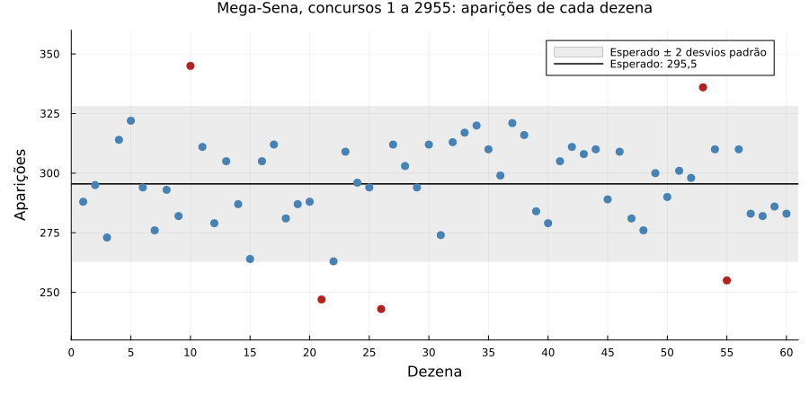

---
layout: post
image: /assets/images/sorteio.avif
title: "Mega-Sena: o que dá para concluir (e o que não dá) só com frequências"
categories: [PROBABILIDADE, ESTATÍSTICA]
lang: pt
tags: [Probabilidade]
ref: mega-sena-frequencias
author: dante-bertuzzi
description: "Por que algumas dezenas da Mega-Sena saem mais que outras, o que o histórico real de 2.955 concursos mostra, se números quentes dão vantagem e quanto valem apostas de 20 dezenas e bolões."
mathjax: true
---

Toda lista de "dezenas mais sorteadas da Mega-Sena" mostra números que saíram dezenas de vezes a mais que outros. Este post responde, com contas e com o histórico oficial, às perguntas que essa lista provoca: por que as frequências não são iguais, se o histórico real é compatível com um sorteio justo, se vale a pena escolher as dezenas "quentes" e o que muda quando se marcam 20 dezenas ou se joga um bolão de 57 apostas.

Os dados são os 2.955 concursos da Mega-Sena, do concurso 1 (11/03/1996) à Mega da Virada de 2025 (concurso 2955), baixados da API do Portal de Loterias da Caixa. Todos os blocos de código têm versão em Julia e em Python.

---

## 1. Por que algumas dezenas saem mais que outras?

Porque um sorteio justo produz flutuações. Mesmo com todas as dezenas igualmente prováveis, as contagens num número finito de sorteios não ficam iguais; elas só se aproximam umas das outras, em termos relativos, à medida que os sorteios se acumulam (a lei dos grandes números). E quem olha 60 dezenas ao mesmo tempo sempre vai encontrar algumas bem acima e outras bem abaixo da média.

### O modelo

Em cada sorteio saem 6 dezenas distintas entre 60. Fixe uma dezena $$k\in\{1,\dots,60\}$$ e defina a variável indicadora

$$
I_{n,k}=
\begin{cases}
1, & \text{se a dezena }k\text{ saiu no sorteio }n\\
0, & \text{caso contrário.}
\end{cases}
$$

O número de aparições de $$k$$ em $$N$$ sorteios é

$$
X_k=\sum_{n=1}^{N} I_{n,k}.
$$

Num sorteio, a chance de $$k$$ estar entre as 6 é

$$
P(I_{n,k}=1)=\frac{6}{60}=\frac{1}{10}=0{,}1.
$$

Com sorteios independentes, cada contagem segue uma distribuição binomial:

$$
X_k \sim \text{Binomial}(N,\ p),\qquad p=0{,}1.
$$

As 60 contagens, porém, não são independentes entre si: elas sempre somam $$6N$$, e uma dezena que sai ocupa uma das 6 vagas do sorteio. Essa dependência é fraca e quase não pesa nas contas desta seção, mas vai importar no teste qui-quadrado da seção 4.

### Esperado e desvio padrão

A esperança de cada contagem é

$$
\mathbb{E}[X_k]=Np=\frac{N}{10},
$$

e a variância e o desvio padrão são

$$
\mathrm{Var}(X_k)=Np(1-p),\qquad \sigma=\sqrt{Np(1-p)}=\sqrt{0{,}09N}.
$$

Duas consequências:
- o desvio **absoluto** típico cresce como $$\sqrt{N}$$: quanto mais sorteios, maiores as diferenças em número de aparições;
- o desvio **relativo** cai como $$1/\sqrt{N}$$: as frequências, em porcentagem, ficam cada vez mais parecidas.

### Um exemplo com 2.500 sorteios

Com $$N=2500$$:

$$
E=\frac{2500}{10}=250,\qquad \sigma=\sqrt{2500\cdot0{,}1\cdot0{,}9}=\sqrt{225}=15.
$$

Desvios de 15 aparições ($$1\sigma$$) para cima ou para baixo são comuns, e desvios de 30 ($$2\sigma$$) ainda são plausíveis. Uma dezena com 220 ou 280 aparições não tem nada de estranho.

### Uma dezena com 290 aparições é suspeita?

Pela aproximação normal com correção de continuidade,

$$
z=\frac{289{,}5-250}{15}=\frac{39{,}5}{15}\approx 2{,}633,\qquad P(Z\ge 2{,}633)\approx 0{,}0042.
$$

A conta exata com a binomial dá $$P(X_k\ge 290)\approx 0{,}0049$$, um pouco mais. A diferença vem da cauda: a binomial com $$p=0{,}1$$ é levemente assimétrica à direita, e a normal subestima a cauda superior. Para **uma dezena escolhida antes**, 290 aparições seriam raras, cerca de 1 chance em 200.

### Mas são 60 dezenas

Ninguém escolhe a dezena antes: a lista mostra a mais frequente de todas. Tratando as 60 dezenas como independentes (uma aproximação), a chance de **pelo menos uma** chegar a 290 é

$$
P\Big(\max_k X_k\ge 290\Big)\approx 1-(1-0{,}0049)^{60}\approx 0{,}25.
$$

Uma em cada quatro histórias justas de 2.500 sorteios teria alguma dezena com 290 aparições ou mais. É por isso que sempre existe um "top 10 das mais sorteadas".

No outro extremo, $$P(X_k\le 220)\approx 0{,}023$$ pela binomial ($$0{,}025$$ pela normal), e a chance de pelo menos uma das 60 ficar em 220 ou menos é

$$
1-(1-0{,}023)^{60}\approx 0{,}75.
$$

Três em cada quatro históricos justos teriam uma dezena "fria" assim.

  

  

    
Julia

    

    <button class="copy-button" onclick="copyCode(this)">
      <i class="bi bi-clipboard"></i>Copiar
    </button>
  

  

    <pre><code>using Distributions, Printf

# Um número fixo em N sorteios: X ~ Binomial(N, 6/60)
N, p = 2500, 6 / 60
X = Binomial(N, p)
μ, σ = mean(X), std(X)
@printf("Esperado: %.0f aparições   desvio padrão: %.0f\n\n", μ, σ)

acima  = ccdf(X, 289)                     # P(X ≥ 290)
abaixo = cdf(X, 220)                      # P(X ≤ 220)
println("              Binomial exata   Normal com correção")
@printf("P(X ≥ 290)   %15.5f   %19.5f\n", acima,  ccdf(Normal(μ, σ), 289.5))
@printf("P(X ≤ 220)   %15.5f   %19.5f\n", abaixo, cdf(Normal(μ, σ), 220.5))

# Pelo menos um dos 60 números passa do limite (tratando os 60 como independentes)
@printf("\nAlgum dos 60 com 290 ou mais: %.3f\n", 1 - (1 - acima)^60)
@printf("Algum dos 60 com 220 ou menos: %.3f\n", 1 - (1 - abaixo)^60)

# Dois sorteios seguidos sem nenhuma dezena em comum
sem = binomial(54, 6) / binomial(60, 6)
@printf("\nP(nenhuma repetida) = %.4f   P(ao menos uma repetida) = %.4f\n", sem, 1 - sem)
@printf("Pares seguidos com repetição esperados em %d: %.0f\n", N - 1, (N - 1) * (1 - sem))</code></pre>
  

  
# Saída

  <pre style="overflow-x: auto; font-size: 0.9em;">Esperado: 250 aparições   desvio padrão: 15
              Binomial exata   Normal com correção
P(X ≥ 290)           0.00488               0.00423
P(X ≤ 220)           0.02309               0.02461
Algum dos 60 com 290 ou mais: 0.254
Algum dos 60 com 220 ou menos: 0.754
P(nenhuma repetida) = 0.5159   P(ao menos uma repetida) = 0.4841
Pares seguidos com repetição esperados em 2499: 1210</pre>

  

  

  

    
Python

    

    <button class="copy-button" onclick="copyCode(this)">
      <i class="bi bi-clipboard"></i>Copiar
    </button>
  

  

    <pre><code>from math import comb
from scipy.stats import binom, norm

# Um número fixo em N sorteios: X ~ Binomial(N, 6/60)
N, p = 2500, 6 / 60
mu, sigma = binom.mean(N, p), binom.std(N, p)
print(f"Esperado: {mu:.0f} aparições   desvio padrão: {sigma:.0f}\n")

acima  = binom.sf(289, N, p)              # P(X ≥ 290)
abaixo = binom.cdf(220, N, p)             # P(X ≤ 220)
print("              Binomial exata   Normal com correção")
print(f"P(X ≥ 290)   {acima:15.5f}   {norm.sf(289.5, mu, sigma):19.5f}")
print(f"P(X ≤ 220)   {abaixo:15.5f}   {norm.cdf(220.5, mu, sigma):19.5f}")

# Pelo menos um dos 60 números passa do limite (tratando os 60 como independentes)
print(f"\nAlgum dos 60 com 290 ou mais: {1 - (1 - acima)**60:.3f}")
print(f"Algum dos 60 com 220 ou menos: {1 - (1 - abaixo)**60:.3f}")

# Dois sorteios seguidos sem nenhuma dezena em comum
sem = comb(54, 6) / comb(60, 6)
print(f"\nP(nenhuma repetida) = {sem:.4f}   P(ao menos uma repetida) = {1 - sem:.4f}")
print(f"Pares seguidos com repetição esperados em {N - 1}: {(N - 1) * (1 - sem):.0f}")</code></pre>
  

  
# Saída

  <pre style="overflow-x: auto; font-size: 0.9em;">Esperado: 250 aparições   desvio padrão: 15
              Binomial exata   Normal com correção
P(X ≥ 290)           0.00488               0.00423
P(X ≤ 220)           0.02309               0.02461
Algum dos 60 com 290 ou mais: 0.254
Algum dos 60 com 220 ou menos: 0.754
P(nenhuma repetida) = 0.5159   P(ao menos uma repetida) = 0.4841
Pares seguidos com repetição esperados em 2499: 1210</pre>

  

A aproximação "60 dezenas independentes" ignora a dependência entre as contagens. Uma simulação de Monte Carlo com 2.000 históricos de 2.500 sorteios, cada sorteio com 6 dezenas distintas, confirma que ela funciona bem aqui. A simulação usa números aleatórios, e por isso o resultado muda um pouco entre Julia e Python:

  

  

    
Julia

    

    <button class="copy-button" onclick="copyCode(this)">
      <i class="bi bi-clipboard"></i>Copiar
    </button>
  

  

    <pre><code>using Random

# R históricos de N sorteios, cada sorteio com 6 dezenas distintas de 60
function extremos(rng, N, R)
    maior, menor = zeros(Int, R), zeros(Int, R)
    freq = zeros(Int, 60)
    for r in 1:R
        fill!(freq, 0)
        for _ in 1:N, k in randperm(rng, 60)[1:6]
            freq[k] += 1
        end
        maior[r], menor[r] = maximum(freq), minimum(freq)
    end
    maior, menor
end

maior, menor = extremos(Xoshiro(2025), N, 2000)
@printf("Simulação, algum dos 60 com 290 ou mais: %.3f\n", mean(maior .&gt;= 290))
@printf("Simulação, algum dos 60 com 220 ou menos: %.3f\n", mean(menor .&lt;= 220))
@printf("Mediana do mais frequente: %.0f   do menos frequente: %.0f\n", median(maior), median(menor))</code></pre>
  

  
# Saída

  <pre style="overflow-x: auto; font-size: 0.9em;">Simulação, algum dos 60 com 290 ou mais: 0.268
Simulação, algum dos 60 com 220 ou menos: 0.765
Mediana do mais frequente: 285   do menos frequente: 217</pre>

  

  

  

    
Python

    

    <button class="copy-button" onclick="copyCode(this)">
      <i class="bi bi-clipboard"></i>Copiar
    </button>
  

  

    <pre><code>import numpy as np

# R históricos de N sorteios, cada sorteio com 6 dezenas distintas de 60
def extremos(rng, N, R):
    maior, menor = np.empty(R, int), np.empty(R, int)
    for r in range(R):
        # as posições das 6 menores de 60 chaves aleatórias formam um sorteio
        dezenas = rng.random((N, 60)).argpartition(6, axis=1)[:, :6]
        freq = np.bincount(dezenas.ravel(), minlength=60)
        maior[r], menor[r] = freq.max(), freq.min()
    return maior, menor

maior, menor = extremos(np.random.default_rng(2025), N, 2000)
print(f"Simulação, algum dos 60 com 290 ou mais: {np.mean(maior &gt;= 290):.3f}")
print(f"Simulação, algum dos 60 com 220 ou menos: {np.mean(menor &lt;= 220):.3f}")
print(f"Mediana do mais frequente: {np.median(maior):.0f}   do menos frequente: {np.median(menor):.0f}")</code></pre>
  

  
# Saída

  <pre style="overflow-x: auto; font-size: 0.9em;">Simulação, algum dos 60 com 290 ou mais: 0.248
Simulação, algum dos 60 com 220 ou menos: 0.777
Mediana do mais frequente: 285   do menos frequente: 216</pre>

  

### Repetição de dezenas entre sorteios seguidos

Muita gente estranha quando uma dezena do sorteio anterior volta a sair. Mas isso acontece em quase metade das vezes. Fixado um sorteio, o seguinte não repete nenhuma dezena só se as 6 dezenas novas vierem das 54 que ficaram de fora:

$$
P(\text{nenhuma repetida})=\frac{\binom{54}{6}}{\binom{60}{6}}=\frac{25.827.165}{50.063.860}\approx 0{,}516,
$$

logo

$$
P(\text{ao menos uma repetida})\approx 1-0{,}516=0{,}484.
$$

Em 2.500 sorteios há 2.499 pares de sorteios seguidos, e o número esperado de pares com repetição é $$2499\cdot 0{,}484\approx 1210$$.

---

## 2. O que o histórico real mostra

A Caixa publica o resultado de cada concurso numa API pública, um concurso por endereço. O bloco abaixo lê o concurso 2955, a Mega da Virada de 2025:

  

  

    
Julia

    

    <button class="copy-button" onclick="copyCode(this)">
      <i class="bi bi-clipboard"></i>Copiar
    </button>
  

  

    <pre><code>using Downloads, JSON3

# Um concurso lido direto da API do Portal de Loterias da Caixa
url = "https://servicebus2.caixa.gov.br/portaldeloterias/api/megasena/2955"
c = JSON3.read(String(take!(Downloads.download(url, IOBuffer()))))
println("Concurso ", c.numero, " (", c.dataApuracao, "): ", join(c.listaDezenas, " "))
for f in c.listaRateioPremio
    @printf("%-10s %8d ganhadores   R\$ %15.2f cada\n", f.descricaoFaixa, f.numeroDeGanhadores, f.valorPremio)
end</code></pre>
  

  
# Saída

  <pre style="overflow-x: auto; font-size: 0.9em;">Concurso 2955 (01/01/2026): 09 13 21 32 33 59
6 acertos         6 ganhadores   R$    181892881.09 cada
5 acertos      3921 ganhadores   R$        11931.42 cada
4 acertos    308315 ganhadores   R$          216.76 cada</pre>

  

  

  

    
Python

    

    <button class="copy-button" onclick="copyCode(this)">
      <i class="bi bi-clipboard"></i>Copiar
    </button>
  

  

    <pre><code>import json, urllib.request

# Um concurso lido direto da API do Portal de Loterias da Caixa
url = "https://servicebus2.caixa.gov.br/portaldeloterias/api/megasena/2955"
c = json.load(urllib.request.urlopen(url))
print(f"Concurso {c['numero']} ({c['dataApuracao']}): {' '.join(c['listaDezenas'])}")
for f in c["listaRateioPremio"]:
    print(f"{f['descricaoFaixa']:&lt;10s} {f['numeroDeGanhadores']:8d} ganhadores   R$ {f['valorPremio']:15.2f} cada")</code></pre>
  

  
# Saída

  <pre style="overflow-x: auto; font-size: 0.9em;">Concurso 2955 (01/01/2026): 09 13 21 32 33 59
6 acertos         6 ganhadores   R$    181892881.09 cada
5 acertos      3921 ganhadores   R$        11931.42 cada
4 acertos    308315 ganhadores   R$          216.76 cada</pre>

  

Para não repetir 2.955 consultas, juntei os concursos 1 a 2955 num arquivo CSV, [`mega-sena.csv`](/assets/data/mega-sena.csv), com uma linha por concurso: o número do concurso, a data e as 6 dezenas em ordem crescente. Na montagem, cada concurso foi conferido: 6 dezenas distintas, todas entre 1 e 60, e as mesmas dezenas na lista em ordem crescente e na lista em ordem de sorteio.

  

  

    
Julia

    

    <button class="copy-button" onclick="copyCode(this)">
      <i class="bi bi-clipboard"></i>Copiar
    </button>
  

  

    <pre><code>using DelimitedFiles

# Concursos 1 (11/03/1996) a 2955 (Mega da Virada de 2025), um por linha
arq = Downloads.download("https://morrisonkuhlsen.com/assets/data/mega-sena.csv")
tab, cabecalho = readdlm(arq, ',', header = true)
dezenas = Int.(tab[:, 3:8])
N = size(dezenas, 1)
freq = [count(==(k), dezenas) for k in 1:60]
E, σ = N * p, sqrt(N * p * (1 - p))
z = (freq .- E) ./ σ
@printf("%d sorteios: esperado %.1f aparições por dezena, desvio padrão %.2f\n\n", N, E, σ)

ordem = sortperm(freq, rev = true)
mostra(ks) = join([@sprintf("%02d: %d (z = %+.2f)", k, freq[k], z[k]) for k in ks], "   ")
println("Mais frequentes:  ", mostra(ordem[1:5]))
println("Menos frequentes: ", mostra(reverse(ordem)[1:5]))
@printf("Dezenas com |z| &gt; 2: %d (esperado em 60 dezenas: %.1f)\n", count(abs.(z) .&gt; 2), 60 * 2 * ccdf(Normal(), 2))

# Quão raro seria um extremo assim entre 60 dezenas, com sorteios justos?
X = Binomial(N, p)
@printf("\nP(alguma dezena com %d ou mais) ≈ %.3f\n", maximum(freq), 1 - (1 - ccdf(X, maximum(freq) - 1))^60)
@printf("P(alguma dezena com %d ou menos) ≈ %.3f\n", minimum(freq), 1 - (1 - cdf(X, minimum(freq)))^60)

# Repetições entre sorteios seguidos: com sorteios independentes, Binomial(N - 1, 1 - sem)
rep = sum(!isempty(intersect(dezenas[i, :], dezenas[i + 1, :])) for i in 1:N-1)
Rep = Binomial(N - 1, 1 - sem)
@printf("\nPares seguidos com repetição: %d de %d (esperado %.0f, desvio padrão %.1f)\n",
        rep, N - 1, mean(Rep), std(Rep))</code></pre>
  

  
# Saída

  <pre style="overflow-x: auto; font-size: 0.9em;">2955 sorteios: esperado 295.5 aparições por dezena, desvio padrão 16.31
Mais frequentes:  10: 345 (z = +3.04)   53: 336 (z = +2.48)   05: 322 (z = +1.62)   37: 321 (z = +1.56)   34: 320 (z = +1.50)
Menos frequentes: 26: 243 (z = -3.22)   21: 247 (z = -2.97)   55: 255 (z = -2.48)   22: 263 (z = -1.99)   15: 264 (z = -1.93)
Dezenas com |z| &gt; 2: 5 (esperado em 60 dezenas: 2.7)
P(alguma dezena com 345 ou mais) ≈ 0.093
P(alguma dezena com 243 ou menos) ≈ 0.032
Pares seguidos com repetição: 1414 de 2954 (esperado 1430, desvio padrão 27.2)</pre>

  

  

  

    
Python

    

    <button class="copy-button" onclick="copyCode(this)">
      <i class="bi bi-clipboard"></i>Copiar
    </button>
  

  

    <pre><code>import csv, io

# Concursos 1 (11/03/1996) a 2955 (Mega da Virada de 2025), um por linha
url = "https://morrisonkuhlsen.com/assets/data/mega-sena.csv"
linhas = list(csv.reader(io.TextIOWrapper(urllib.request.urlopen(url), encoding="utf-8")))[1:]
dezenas = np.array([[int(x) for x in l[2:8]] for l in linhas])
N = len(dezenas)
freq = np.bincount(dezenas.ravel(), minlength=61)[1:]
E, sigma = N * p, np.sqrt(N * p * (1 - p))
z = (freq - E) / sigma
print(f"{N} sorteios: esperado {E:.1f} aparições por dezena, desvio padrão {sigma:.2f}\n")

ordem = np.argsort(-freq, kind="stable") + 1
mostra = lambda ks: "   ".join(f"{k:02d}: {freq[k - 1]} (z = {z[k - 1]:+.2f})" for k in ks)
print("Mais frequentes: ", mostra(ordem[:5]))
print("Menos frequentes:", mostra(ordem[::-1][:5]))
print(f"Dezenas com |z| &gt; 2: {np.sum(np.abs(z) &gt; 2)} (esperado em 60 dezenas: {60 * 2 * norm.sf(2):.1f})")

# Quão raro seria um extremo assim entre 60 dezenas, com sorteios justos?
print(f"\nP(alguma dezena com {freq.max()} ou mais) ≈ {1 - (1 - binom.sf(freq.max() - 1, N, p))**60:.3f}")
print(f"P(alguma dezena com {freq.min()} ou menos) ≈ {1 - (1 - binom.cdf(freq.min(), N, p))**60:.3f}")

# Repetições entre sorteios seguidos: com sorteios independentes, Binomial(N - 1, 1 - sem)
rep = sum(len(set(a) &amp; set(b)) &gt; 0 for a, b in zip(dezenas[:-1], dezenas[1:]))
print(f"\nPares seguidos com repetição: {rep} de {N - 1} "
      f"(esperado {binom.mean(N - 1, 1 - sem):.0f}, desvio padrão {binom.std(N - 1, 1 - sem):.1f})")</code></pre>
  

  
# Saída

  <pre style="overflow-x: auto; font-size: 0.9em;">2955 sorteios: esperado 295.5 aparições por dezena, desvio padrão 16.31
Mais frequentes:  10: 345 (z = +3.04)   53: 336 (z = +2.48)   05: 322 (z = +1.62)   37: 321 (z = +1.56)   34: 320 (z = +1.50)
Menos frequentes: 26: 243 (z = -3.22)   21: 247 (z = -2.97)   55: 255 (z = -2.48)   22: 263 (z = -1.99)   15: 264 (z = -1.93)
Dezenas com |z| &gt; 2: 5 (esperado em 60 dezenas: 2.7)
P(alguma dezena com 345 ou mais) ≈ 0.093
P(alguma dezena com 243 ou menos) ≈ 0.032
Pares seguidos com repetição: 1414 de 2954 (esperado 1430, desvio padrão 27.2)</pre>

  

Com $$N=2955$$, o esperado é $$295{,}5$$ aparições por dezena, com desvio padrão $$16{,}31$$. O que os dados mostram:

- **As extremas.** A dezena 10 saiu 345 vezes ($$z=+3{,}04$$) e a 26 saiu 243 ($$z=-3{,}22$$). Pela mesma conta da seção anterior, a chance de alguma das 60 chegar a 345 é de cerca de 9%, e a de alguma ficar em 243 ou menos, de cerca de 3%. Isoladamente, nenhuma das duas é alarmante.
- **As que saem da faixa.** Cinco dezenas ficaram a mais de 2 desvios padrão do esperado (10, 53, 55, 21 e 26). Com 60 dezenas, o esperado seria cerca de 2,7. É um pouco mais do que o esperado, e o teste conjunto da seção 4 diz se esse excesso é grande demais.
- **As repetições.** Houve 1.414 pares de sorteios seguidos com ao menos uma dezena repetida, contra 1.430 esperados, com desvio padrão de 27. A diferença é de 0,6 desvio padrão: nada indica memória de um sorteio para o seguinte.

A contagem de pares com repetição segue mesmo uma binomial: dado o sorteio do meio, a repetição em relação ao anterior e a repetição em relação ao seguinte são independentes, e cada uma tem chance de 0,484 qualquer que seja o sorteio do meio.

  

  

    
Julia

    

    <button class="copy-button" onclick="copyCode(this)">
      <i class="bi bi-clipboard"></i>Copiar
    </button>
  

  

    <pre><code>using Plots

virgula(x) = replace(@sprintf("%.1f", x), "." =&gt; ",")
tons = [abs(zk) &gt; 2 ? :firebrick : :steelblue for zk in z]
plot(xlabel = "Dezena", ylabel = "Aparições", xticks = 0:5:60, ylims = (230, 360), xlims = (0, 61),
     title = "Mega-Sena, concursos 1 a $N: aparições de cada dezena", titlefontsize = 11,
     size = (900, 450), legend = :topright, left_margin = 4Plots.mm, bottom_margin = 4Plots.mm)
hspan!([E - 2σ, E + 2σ], color = :gray, alpha = 0.15, lw = 0, label = "Esperado ± 2 desvios padrão")
hline!([E], color = :black, lw = 1.5, label = "Esperado: $(virgula(E))")
scatter!(1:60, freq, color = tons, markersize = 5, markerstrokewidth = 0, label = "")
savefig("mega-sena-frequencias.png")</code></pre>
  

  

  

  

    
Python

    

    <button class="copy-button" onclick="copyCode(this)">
      <i class="bi bi-clipboard"></i>Copiar
    </button>
  

  

    <pre><code>import matplotlib.pyplot as plt

fig, ax = plt.subplots(figsize=(9, 4.5))
ax.axhspan(E - 2 * sigma, E + 2 * sigma, color="gray", alpha=0.15, lw=0, label="Esperado ± 2 desvios padrão")
ax.axhline(E, color="black", lw=1.5, label=f"Esperado: {E:.1f}".replace(".", ","))
ax.scatter(range(1, 61), freq, s=25, color=np.where(np.abs(z) &gt; 2, "firebrick", "steelblue"))
ax.set(xlabel="Dezena", ylabel="Aparições", xticks=range(0, 61, 5), xlim=(0, 61), ylim=(230, 360),
       title=f"Mega-Sena, concursos 1 a {N}: aparições de cada dezena")
ax.legend(loc="upper right")
fig.tight_layout()
fig.savefig("mega-sena-frequencias-py.png", dpi=120)</code></pre>
  

  

Figura 1 – Aparições de cada dezena nos concursos 1 a 2955. Em vermelho, as cinco dezenas a mais de 2 desvios padrão do esperado (código em Julia acima).

### Por que os padrões enganam

A intuição espera que a aleatoriedade pareça "bem distribuída". Por isso tendemos a ler extremos e sequências curtas como sinais ("essa dezena está viciada", "essa está atrasada") e a esquecer que, entre 60 dezenas, alguma sempre vai estar na ponta. As contas acima são a correção para isso: antes de achar estranho, pergunte qual é a chance de aparecer **algum** caso tão extremo quanto esse, e não a chance daquele caso específico.

---

## 3. Escolher as dezenas mais sorteadas dá vantagem?

Não, se os sorteios são independentes. A chance de uma dezena sair no próximo sorteio não depende do histórico.

Para uma dezena fixa $$k$$, seja $$A_n$$ o evento "$$k$$ sai no sorteio $$n$$". Independência significa

$$
P(A_{n+1}\mid A_1,\dots,A_n)=P(A_{n+1})=\frac{6}{60}=\frac{1}{10}.
$$

Com os dados reais: a dezena 10 saiu 345 vezes e a 26 saiu 243, mas

$$
P(10\ \text{no próximo sorteio})=P(26\ \text{no próximo sorteio})=\frac{1}{10}.
$$

Os dados também permitem testar isso diretamente. Se as dezenas mais frequentes numa parte do histórico tivessem alguma vantagem real, elas continuariam mais frequentes na outra. O bloco abaixo divide os 2.955 concursos em duas metades e compara as frequências:

  

  

    
Julia

    

    <button class="copy-button" onclick="copyCode(this)">
      <i class="bi bi-clipboard"></i>Copiar
    </button>
  

  

    <pre><code>using Statistics

# As dezenas "quentes" de uma metade do histórico continuam quentes na outra?
metade = N ÷ 2
f1 = [count(==(k), dezenas[1:metade, :]) for k in 1:60]
f2 = [count(==(k), dezenas[metade+1:end, :]) for k in 1:60]
r = cor(f1, f2)
t = r * sqrt(58 / (1 - r^2))
@printf("Concursos 1 a %d contra %d a %d\n", metade, metade + 1, N)
@printf("Correlação entre as frequências: r = %.3f (p = %.2f)\n", r, 2 * ccdf(TDist(58), abs(t)))

quentes = sortperm(f1, rev = true)[1:10]
@printf("As 10 mais frequentes da 1ª metade saíram, em média, %.1f vezes na 2ª (média de todas: %.1f)\n",
        mean(f2[quentes]), mean(f2))</code></pre>
  

  
# Saída

  <pre style="overflow-x: auto; font-size: 0.9em;">Concursos 1 a 1477 contra 1478 a 2955
Correlação entre as frequências: r = 0.072 (p = 0.58)
As 10 mais frequentes da 1ª metade saíram, em média, 146.5 vezes na 2ª (média de todas: 147.8)</pre>

  

  

  

    
Python

    

    <button class="copy-button" onclick="copyCode(this)">
      <i class="bi bi-clipboard"></i>Copiar
    </button>
  

  

    <pre><code>from scipy.stats import pearsonr

# As dezenas "quentes" de uma metade do histórico continuam quentes na outra?
metade = N // 2
f1 = np.bincount(dezenas[:metade].ravel(), minlength=61)[1:]
f2 = np.bincount(dezenas[metade:].ravel(), minlength=61)[1:]
r, pval = pearsonr(f1, f2)
print(f"Concursos 1 a {metade} contra {metade + 1} a {N}")
print(f"Correlação entre as frequências: r = {r:.3f} (p = {pval:.2f})")

quentes = np.argsort(-f1, kind="stable")[:10]
print(f"As 10 mais frequentes da 1ª metade saíram, em média, {f2[quentes].mean():.1f} vezes na 2ª "
      f"(média de todas: {f2.mean():.1f})")</code></pre>
  

  
# Saída

  <pre style="overflow-x: auto; font-size: 0.9em;">Concursos 1 a 1477 contra 1478 a 2955
Correlação entre as frequências: r = 0.072 (p = 0.58)
As 10 mais frequentes da 1ª metade saíram, em média, 146.5 vezes na 2ª (média de todas: 147.8)</pre>

  

A correlação entre as frequências das duas metades é de 0,07 (p = 0,58), compatível com zero. As 10 dezenas mais frequentes dos concursos 1 a 1477 saíram, em média, 146,5 vezes nos concursos 1478 a 2955, abaixo da média de todas as dezenas, 147,8. Ser "quente" numa metade não trouxe vantagem na outra.

### A falácia do jogador

"Essa dezena está atrasada" e "essa dezena está quente" são duas versões do mesmo erro, a falácia do jogador: supor que o globo se lembra do que já saiu. Se os sorteios são independentes, o passado não altera a chance do próximo.

### O que pode mudar: a divisão do prêmio

A chance de acertar é a mesma para qualquer combinação, mas o **valor** recebido por quem acerta depende de quantas outras pessoas marcaram a mesma combinação, porque o prêmio de cada faixa é dividido entre os ganhadores.

Sejam $$p$$ a chance de acertar, $$J$$ o prêmio da faixa e $$W$$ o número de ganhadores, contando você. Se você ganha, recebe $$J/W$$, e o retorno esperado é

$$
\mathbb{E}[\text{retorno}]=p\cdot J\cdot\mathbb{E}\!\left[\frac{1}{W}\right].
$$

Atenção: $$\mathbb{E}[1/W]$$ não é igual a $$1/\mathbb{E}[W]$$. Por exemplo, se o número de outros ganhadores $$O$$ segue uma distribuição de Poisson de média $$\lambda$$ e $$W=1+O$$, então

$$
\mathbb{E}\!\left[\frac{1}{1+O}\right]=\sum_{j=0}^{\infty}\frac{e^{-\lambda}\lambda^j}{(j+1)!}=\frac{1-e^{-\lambda}}{\lambda},
$$

que é sempre maior que $$1/(1+\lambda)$$:

  

  

    
Julia

    

    <button class="copy-button" onclick="copyCode(this)">
      <i class="bi bi-clipboard"></i>Copiar
    </button>
  

  

    <pre><code># Os outros ganhadores O seguem uma Poisson de média λ; a sua parte do prêmio é 1/(1 + O)
# E[1/(1 + O)] = (1 - e^(-λ))/λ, que não é igual a 1/E[1 + O] = 1/(1 + λ)
println("λ (outros ganhadores)   E[1/W]   1/E[W]")
for λ in (0.5, 1, 2, 4, 5)
    @printf("%21.1f   %6.3f   %6.3f\n", λ, (1 - exp(-λ)) / λ, 1 / (1 + λ))
end
parte(λ) = (1 - exp(-λ)) / λ
@printf("\nCom E[W] = 2 contra E[W] = 5: a razão das partes esperadas é %.2f (não 2,5)\n", parte(1) / parte(4))</code></pre>
  

  
# Saída

  <pre style="overflow-x: auto; font-size: 0.9em;">λ (outros ganhadores)   E[1/W]   1/E[W]
                  0.5    0.787    0.667
                  1.0    0.632    0.500
                  2.0    0.432    0.333
                  4.0    0.245    0.200
                  5.0    0.199    0.167
Com E[W] = 2 contra E[W] = 5: a razão das partes esperadas é 2.58 (não 2,5)</pre>

  

  

  

    
Python

    

    <button class="copy-button" onclick="copyCode(this)">
      <i class="bi bi-clipboard"></i>Copiar
    </button>
  

  

    <pre><code>import math

# Os outros ganhadores O seguem uma Poisson de média λ; a sua parte do prêmio é 1/(1 + O)
# E[1/(1 + O)] = (1 - e^(-λ))/λ, que não é igual a 1/E[1 + O] = 1/(1 + λ)
print("λ (outros ganhadores)   E[1/W]   1/E[W]")
for lam in (0.5, 1, 2, 4, 5):
    print(f"{lam:21.1f}   {(1 - math.exp(-lam)) / lam:6.3f}   {1 / (1 + lam):6.3f}")
parte = lambda lam: (1 - math.exp(-lam)) / lam
print(f"\nCom E[W] = 2 contra E[W] = 5: a razão das partes esperadas é {parte(1) / parte(4):.2f} (não 2,5)")</code></pre>
  

  
# Saída

  <pre style="overflow-x: auto; font-size: 0.9em;">λ (outros ganhadores)   E[1/W]   1/E[W]
                  0.5    0.787    0.667
                  1.0    0.632    0.500
                  2.0    0.432    0.333
                  4.0    0.245    0.200
                  5.0    0.199    0.167
Com E[W] = 2 contra E[W] = 5: a razão das partes esperadas é 2.58 (não 2,5)</pre>

  

Se as combinações populares costumam ter $$\mathbb{E}[W]=5$$ e as pouco escolhidas $$\mathbb{E}[W]=2$$, a parte esperada de quem acerta uma combinação pouco escolhida é cerca de 2,6 vezes maior, e não exatamente 2,5. A probabilidade de ganhar continua a mesma. Só muda quanto se leva quando se ganha.

Na Mega da Virada de 2025 (concurso 2955), o prêmio principal foi dividido entre 6 apostas, com R\\$ 181.892.881,09 para cada uma, R\\$ 1.091.357.286,54 no total. As dezenas sorteadas foram 09, 13, 21, 32, 33 e 59.

Daí vêm as recomendações comuns para quem quer reduzir a chance de dividir: evitar combinações que muita gente marca, como datas de aniversário (dezenas até 31) e desenhos no volante (sequências, colunas, diagonais). Os dados usados aqui trazem os resultados, não as apostas feitas, então não permitem medir quais combinações são populares; essas recomendações valem só na medida em que esses hábitos dos apostadores sejam reais.

---

## 4. Dá para detectar viés ou manipulação só com as frequências?

Dá para testar se os dados são **compatíveis** com um sorteio justo e para detectar desvios grandes. Não dá para provar que o sorteio é justo, nem, quando os dados destoam, dizer por quê.

A hipótese nula é

$$
H_0:\ \text{sorteios independentes, com as 60 dezenas igualmente prováveis.}
$$

Se os dados contradizem fortemente $$H_0$$, há evidência contra esse modelo. Se não contradizem, há compatibilidade com ele, o que não é uma prova de que ele vale.

### Quão grande precisa ser um viés para aparecer?

Com $$N=2500$$, cada contagem tem $$\mu=250$$ e $$\sigma=15$$ sob $$H_0$$. Suponha que uma dezena tenha chance $$0{,}11$$ por sorteio, em vez de $$0{,}10$$. A média dela passaria a

$$
\mu_1=2500\cdot 0{,}11=275,
$$

ou seja, $$\Delta=275-250=25$$ aparições acima, o que em desvios padrão é

$$
z=\frac{25}{15}\approx 1{,}67.
$$

Isso não chama atenção, ainda mais com 60 dezenas olhadas ao mesmo tempo.

Quantos sorteios seriam precisos para esse viés de 1 ponto percentual virar uma diferença de 3 desvios padrão? É preciso que

$$
N(0{,}11-0{,}10)=3\sqrt{0{,}09N}
\ \Rightarrow\ 0{,}01N=0{,}9\sqrt{N}
\ \Rightarrow\ \sqrt{N}=90
\ \Rightarrow\ N=8100.
$$

Mais que o dobro do histórico inteiro da Mega-Sena.

### O teste qui-quadrado, e um ajuste necessário

O teste qui-quadrado de aderência compara as contagens observadas $$O_i$$ com as esperadas $$E_i$$:

$$
X^2=\sum_i\frac{(O_i-E_i)^2}{E_i}.
$$

Como exemplo didático, agrupe as dezenas em 6 classes de 10 (1–10, 11–20, …, 51–60). Em $$N=2500$$ sorteios saem $$6N=15.000$$ dezenas, e o esperado por classe é $$15.000/6=2500$$. Com as contagens hipotéticas 2600, 2450, 2520, 2400, 2520 e 2510:

$$
X^2=\frac{100^2}{2500}+\frac{50^2}{2500}+\frac{20^2}{2500}+\frac{100^2}{2500}+\frac{20^2}{2500}+\frac{10^2}{2500}
=4+1+0{,}16+4+0{,}16+0{,}04=9{,}36.
$$

Aqui entra um detalhe que costuma passar despercebido. A tabela usual do qui-quadrado, com $$k-1$$ graus de liberdade, supõe que cada dezena sorteada é independente das outras, como se as bolas voltassem ao globo. Na Mega-Sena, as 6 dezenas de um sorteio são distintas, e isso deixa as contagens um pouco menos variáveis: quando uma dezena sai, as outras perdem uma vaga. Com 60 dezenas, cada contagem tem variância $$Np(1-p)$$, e duas contagens diferentes têm covariância $$-Np(1-p)/59$$. Fazendo as contas, a estatística $$X^2$$ fica com média $$60(1-p)=54$$, e não 59, e sua distribuição é a de $$\tfrac{54}{59}\chi^2_{59}$$. O mesmo fator $$54/59$$ vale para as 6 classes. O teste correto divide $$X^2$$ por $$54/59$$ antes de consultar a tabela.

No exemplo, $$9{,}36/(54/59)\approx 10{,}23$$, com 5 graus de liberdade, dá p ≈ 0,069. Sem o ajuste, o p seria 0,096. Em nenhum dos dois casos há evidência forte contra $$H_0$$, mas o ajuste conta.

### O teste com os dados reais

  

  

    
Julia

    

    <button class="copy-button" onclick="copyCode(this)">
      <i class="bi bi-clipboard"></i>Copiar
    </button>
  

  

    <pre><code># Qui-quadrado de aderência com as 60 dezenas
function qui2(d)
    n = size(d, 1)
    f = [count(==(k), d) for k in 1:60]
    sum((f .- n * p) .^ 2 ./ (n * p))
end

# As 6 dezenas de um sorteio são distintas: o qui-quadrado usual sai multiplicado por 54/59
fator = 54 / 59
partes = [("Concursos 1 a $N", dezenas), ("1 a $metade", dezenas[1:metade, :]),
          ("$(metade + 1) a $N", dezenas[metade+1:end, :]), ("1 a 1000", dezenas[1:1000, :]),
          ("1001 a 2000", dezenas[1001:2000, :]), ("2001 a $N", dezenas[2001:end, :])]
println("Período               X²    X²/fator     p   p sem a correção")
for (nome, d) in partes
    x = qui2(d)
    @printf("%-17s %6.2f %10.2f %7.4f %9.4f\n", nome, x, x / fator, ccdf(Chisq(59), x / fator), ccdf(Chisq(59), x))
end

# Conferência por simulação: 2000 históricos justos de N sorteios
function sorteia(rng, N)
    d = zeros(Int, N, 6)
    for i in 1:N
        d[i, :] = randperm(rng, 60)[1:6]
    end
    d
end
rng = Xoshiro(59)
sim = [qui2(sorteia(rng, N)) for _ in 1:2000]
@printf("\nSimulação: média de X² = %.1f (teoria: 54)   fração com X² ≥ %.2f: %.4f\n",
        mean(sim), qui2(dezenas), mean(sim .&gt;= qui2(dezenas)))

# O exemplo didático com 6 classes de 10 dezenas
O = [2600, 2450, 2520, 2400, 2520, 2510]
x = sum((O .- 2500) .^ 2 ./ 2500)
@printf("\nExemplo com 6 classes: X² = %.2f   corrigido = %.2f   p = %.3f\n", x, x / fator, ccdf(Chisq(5), x / fator))</code></pre>
  

  
# Saída

  <pre style="overflow-x: auto; font-size: 0.9em;">Período               X²    X²/fator     p   p sem a correção
Concursos 1 a 2955  79.06      86.38  0.0116    0.0417
1 a 1477           55.66      60.81  0.4105    0.5995
1478 a 2955        92.08     100.61  0.0006    0.0038
1 a 1000           64.20      70.14  0.1519    0.2993
1001 a 2000        58.48      63.89  0.3086    0.4946
2001 a 2955        87.70      95.82  0.0017    0.0090
Simulação: média de X² = 54.1 (teoria: 54)   fração com X² ≥ 79.06: 0.0135
Exemplo com 6 classes: X² = 9.36   corrigido = 10.23   p = 0.069</pre>

  

  

  

    
Python

    

    <button class="copy-button" onclick="copyCode(this)">
      <i class="bi bi-clipboard"></i>Copiar
    </button>
  

  

    <pre><code>from scipy.stats import chi2

# Qui-quadrado de aderência com as 60 dezenas
def qui2(d):
    n = len(d)
    f = np.bincount(np.ravel(d), minlength=61)[1:]
    return np.sum((f - n * p) ** 2 / (n * p))

# As 6 dezenas de um sorteio são distintas: o qui-quadrado usual sai multiplicado por 54/59
fator = 54 / 59
partes = [(f"Concursos 1 a {N}", dezenas), (f"1 a {metade}", dezenas[:metade]),
          (f"{metade + 1} a {N}", dezenas[metade:]), ("1 a 1000", dezenas[:1000]),
          ("1001 a 2000", dezenas[1000:2000]), (f"2001 a {N}", dezenas[2000:])]
print("Período               X²    X²/fator     p   p sem a correção")
for nome, d in partes:
    x = qui2(d)
    print(f"{nome:&lt;17s} {x:6.2f} {x / fator:10.2f} {chi2.sf(x / fator, 59):7.4f} {chi2.sf(x, 59):9.4f}")

# Conferência por simulação: 2000 históricos justos de N sorteios
rng = np.random.default_rng(59)
sim = np.array([qui2(rng.random((N, 60)).argpartition(6, axis=1)[:, :6] + 1) for _ in range(2000)])
print(f"\nSimulação: média de X² = {sim.mean():.1f} (teoria: 54)   "
      f"fração com X² ≥ {qui2(dezenas):.2f}: {np.mean(sim &gt;= qui2(dezenas)):.4f}")

# O exemplo didático com 6 classes de 10 dezenas
O = np.array([2600, 2450, 2520, 2400, 2520, 2510])
x = np.sum((O - 2500) ** 2 / 2500)
print(f"\nExemplo com 6 classes: X² = {x:.2f}   corrigido = {x / fator:.2f}   p = {chi2.sf(x / fator, 5):.3f}")</code></pre>
  

  
# Saída

  <pre style="overflow-x: auto; font-size: 0.9em;">Período               X²    X²/fator     p   p sem a correção
Concursos 1 a 2955  79.06      86.38  0.0116    0.0417
1 a 1477           55.66      60.81  0.4105    0.5995
1478 a 2955        92.08     100.61  0.0006    0.0038
1 a 1000           64.20      70.14  0.1519    0.2993
1001 a 2000        58.48      63.89  0.3086    0.4946
2001 a 2955        87.70      95.82  0.0017    0.0090
Simulação: média de X² = 54.0 (teoria: 54)   fração com X² ≥ 79.06: 0.0095
Exemplo com 6 classes: X² = 9.36   corrigido = 10.23   p = 0.069</pre>

  

Com as 60 dezenas e os 2.955 concursos, $$X^2=79{,}06$$. Dividido por $$54/59$$, dá $$86{,}38$$, com 59 graus de liberdade: **p ≈ 0,012**. A simulação de 2.000 históricos justos, que não depende do ajuste, concorda: só cerca de 1% deles chega a um $$X^2$$ tão alto.

Esse é o teste natural para a pergunta do post, e ele diz que o histórico é **pouco compatível** com 60 dezenas exatamente equiprováveis e sorteios independentes. Um p de 0,012 acontece por acaso em cerca de 1 a cada 86 históricos justos. É raro, mas não impossível.

Dividindo o histórico, o desvio aparece concentrado nos concursos mais recentes: a primeira metade (concursos 1 a 1477, de 1996 a março de 2013) tem p ≈ 0,41, e a segunda (1478 a 2955, de março de 2013 a 2026) tem p ≈ 0,0006. Em blocos de 1.000 concursos, o quadro é o mesmo: p ≈ 0,15 e 0,31 nos dois primeiros e p ≈ 0,002 nos concursos 2001 a 2955 (de 2018 em diante).

Três cuidados ao ler esses números:

- **Os cortes vieram depois de olhar os dados.** Testar vários pedaços do histórico é uma forma de comparações múltiplas: entre muitos cortes possíveis, algum sempre parece mais estranho. O p do histórico completo é o que vale como teste; os cortes servem para descrever onde está o desvio.
- **O teste não diz a causa.** Diferenças físicas mínimas entre as bolas, mudanças de equipamento ou de procedimento ao longo de 30 anos e o puro acaso são todas compatíveis com o mesmo $$X^2$$. Nada nos dados aponta para manipulação, e distinguir entre essas explicações exige informação que as frequências não têm, como auditorias e registros do procedimento.
- **O jeito certo de confirmar é com dados novos.** Uma hipótese tirada destes dados (por exemplo, "as dezenas mais frequentes desde 2013 continuarão mais frequentes") precisa ser testada em concursos posteriores ao 2955, e não nos mesmos que a sugeriram.

E mesmo que exista um viés real, ele é pequeno demais para ser aproveitado. Se a dezena 10 tivesse de fato chance de 11,7% por sorteio (a frequência observada, $$345/2955$$), uma aposta com ela acertaria a sena algo como 17% mais vezes que as outras. Como só 43,79% da arrecadação da Mega-Sena vira prêmio, o retorno esperado continuaria bem abaixo do valor apostado.

### Limitações

Mesmo quando os testes não acusam nada:
- pode haver um viés pequeno demais para o tamanho do histórico, como o de 1 ponto percentual acima;
- um desvio que muda com o tempo é difícil de flagrar só com frequências totais;
- quem faz muitos testes encontra resultados "significativos" por acaso, a menos que corrija para comparações múltiplas (com Bonferroni ou controlando a [taxa de falsas descobertas](/bh-fdr-contraexemplo/), por exemplo).

Sinais realmente fortes seriam desvios grandes que se repetem em períodos diferentes, p-valores minúsculos que resistem a essas correções e padrões que se confirmam em dados novos.

---

## 5. Quanto vale uma aposta de 20 dezenas?

A Mega-Sena aceita apostas de 6 a 20 dezenas. Há $$\binom{60}{6}$$ resultados possíveis, e uma aposta de 20 dezenas cobre todas as $$\binom{20}{6}$$ combinações de 6 dentro delas. A chance de acertar a sena com ela é

$$
p_{20}=\frac{\binom{20}{6}}{\binom{60}{6}}.
$$

**O numerador:**

$$
\begin{aligned}
\binom{20}{6}
&=\frac{20\cdot19\cdot18\cdot17\cdot16\cdot15}{6\cdot5\cdot4\cdot3\cdot2\cdot1} \\
&=\frac{(20/5)\cdot19\cdot(18/6)\cdot17\cdot(16/4)\cdot(15/3)}{2\cdot1} \\
&=\frac{4\cdot19\cdot3\cdot17\cdot4\cdot5}{2}=\frac{77.520}{2}=38.760.
\end{aligned}
$$

**O denominador:**

$$
\begin{aligned}
\binom{60}{6}
&=\frac{60\cdot59\cdot58\cdot57\cdot56\cdot55}{6\cdot5\cdot4\cdot3\cdot2\cdot1} \\
&=\frac{60}{6}\cdot59\cdot\frac{58}{2}\cdot\frac{57}{3}\cdot\frac{56}{4}\cdot\frac{55}{5}
=10\cdot59\cdot29\cdot19\cdot14\cdot11=50.063.860.
\end{aligned}
$$

**A probabilidade:**

$$
p_{20}=\frac{38.760}{50.063.860}=\frac{102}{131.747}\approx 0{,}000774\ (0{,}0774\%),
\qquad \frac{1}{p_{20}}=\frac{131.747}{102}\approx 1291{,}6.
$$

É **1 chance em cerca de 1.292**. O preço acompanha o número de combinações: a aposta simples, de 6 dezenas, custa R\\$ 6,00, e a de 20 dezenas custa $$38.760\times 6=$$ R\\$ 232.560,00.

Para a quina e a quadra, a conta usa a distribuição hipergeométrica. Seja $$X$$ o número de dezenas sorteadas que caem entre as $$n$$ marcadas. Então

$$
X\sim\text{Hipergeométrica}(60,\ 6,\ n),\qquad
P(X=j)=\frac{\binom{6}{j}\binom{54}{n-j}}{\binom{60}{n}}.
$$

O bloco abaixo calcula, para cada tamanho de aposta, o preço e as chances de sena ($$X=6$$), quina ($$X=5$$) e quadra ($$X=4$$). A tabela coincide com a que a Caixa publica na página da Mega-Sena.

  

  

    
Julia

    

    <button class="copy-button" onclick="copyCode(this)">
      <i class="bi bi-clipboard"></i>Copiar
    </button>
  

  

    <pre><code># X = quantas das 6 sorteadas caem entre as n dezenas marcadas: Hipergeométrica(6, 54, n)
println("Dezenas   Preço (R\$)   Sena: 1 em   Quina: 1 em   Quadra: 1 em")
for n in 6:20
    H = Hypergeometric(6, 54, n)
    @printf("%7d %12d %12.0f %13.0f %14.0f\n", n, 6 * binomial(n, 6), 1 / pdf(H, 6), 1 / pdf(H, 5), 1 / pdf(H, 4))
end

# Probabilidades exatas da aposta de 20 dezenas
P(k) = binomial(6, k) * binomial(54, 20 - k) // binomial(60, 20)
println("\nk   P(X = k) com 20 dezenas")
for k in 0:6
    @printf("%d   %-14s = %.8f\n", k, string(numerator(P(k)), "/", denominator(P(k))), float(P(k)))
end

# Quantas combinações de 6 premiadas há dentro da aposta, para cada X
println("\nX   senas   quinas   quadras")
for j in 4:6
    @printf("%d %7d %8d %9d\n", j, binomial(j, 6) * binomial(20 - j, 0),
            binomial(j, 5) * binomial(20 - j, 1), binomial(j, 4) * binomial(20 - j, 2))
end</code></pre>
  

  
# Saída

  <pre style="overflow-x: auto; font-size: 0.9em;">Dezenas   Preço (R$)   Sena: 1 em   Quina: 1 em   Quadra: 1 em
      6            6     50063860        154518           2332
      7           42      7151980         44981           1038
      8          168      1787995         17192            539
      9          504       595998          7791            312
     10         1260       238399          3973            195
     11         2772       108363          2211            129
     12         5544        54182          1317             90
     13        10296        29175           828             65
     14        18018        16671           544             48
     15        30030        10003           370             37
     16        48048         6252           260             29
     17        74256         4045           188             23
     18       111384         2697           139             19
     19       162792         1845           105             16
     20       232560         1292            81             13
k   P(X = k) com 20 dezenas
0   1443/18821     = 0.07666968
1   34632/131747   = 0.26286747
2   45695/131747   = 0.34683902
3   29640/131747   = 0.22497666
4   9945/131747    = 0.07548559
5   1632/131747    = 0.01238738
6   102/131747     = 0.00077421
X   senas   quinas   quadras
4       0        0       120
5       0       15       525
6       1       84      1365</pre>

  

  

  

    
Python

    

    <button class="copy-button" onclick="copyCode(this)">
      <i class="bi bi-clipboard"></i>Copiar
    </button>
  

  

    <pre><code>from fractions import Fraction
from scipy.stats import hypergeom

# X = quantas das 6 sorteadas caem entre as n dezenas marcadas: Hipergeométrica(60, 6, n)
print("Dezenas   Preço (R$)   Sena: 1 em   Quina: 1 em   Quadra: 1 em")
for n in range(6, 21):
    H = hypergeom(60, 6, n)
    print(f"{n:7d} {6 * comb(n, 6):12d} {1 / H.pmf(6):12.0f} {1 / H.pmf(5):13.0f} {1 / H.pmf(4):14.0f}")

# Probabilidades exatas da aposta de 20 dezenas
P = lambda k: Fraction(comb(6, k) * comb(54, 20 - k), comb(60, 20))
print("\nk   P(X = k) com 20 dezenas")
for k in range(7):
    print(f"{k}   {str(P(k)):&lt;14s} = {float(P(k)):.8f}")

# Quantas combinações de 6 premiadas há dentro da aposta, para cada X
print("\nX   senas   quinas   quadras")
for j in range(4, 7):
    print(f"{j} {comb(j, 6) * comb(20 - j, 0):7d} {comb(j, 5) * comb(20 - j, 1):8d} {comb(j, 4) * comb(20 - j, 2):9d}")</code></pre>
  

  
# Saída

  <pre style="overflow-x: auto; font-size: 0.9em;">Dezenas   Preço (R$)   Sena: 1 em   Quina: 1 em   Quadra: 1 em
      6            6     50063860        154518           2332
      7           42      7151980         44981           1038
      8          168      1787995         17192            539
      9          504       595998          7791            312
     10         1260       238399          3973            195
     11         2772       108363          2211            129
     12         5544        54182          1317             90
     13        10296        29175           828             65
     14        18018        16671           544             48
     15        30030        10003           370             37
     16        48048         6252           260             29
     17        74256         4045           188             23
     18       111384         2697           139             19
     19       162792         1845           105             16
     20       232560         1292            81             13
k   P(X = k) com 20 dezenas
0   1443/18821     = 0.07666968
1   34632/131747   = 0.26286747
2   45695/131747   = 0.34683902
3   29640/131747   = 0.22497666
4   9945/131747    = 0.07548559
5   1632/131747    = 0.01238738
6   102/131747     = 0.00077421
X   senas   quinas   quadras
4       0        0       120
5       0       15       525
6       1       84      1365</pre>

  

Com 20 dezenas, $$P(X=5)=1632/131.747\approx 1{,}24\%$$ e $$P(X=6)=102/131.747\approx 0{,}077\%$$. Uma aposta de 20 dezenas que acerta 5 contém 15 quinas (as 5 dezenas sorteadas mais uma das outras 15) e 525 quadras; uma que acerta as 6 contém 1 sena, 84 quinas e 1.365 quadras.

### "1 em 1.292" não é garantia

"1 em 1.292" quer dizer que, em média, uma aposta assim acerta a sena uma vez a cada 1.292 concursos. Não quer dizer que 1.292 tentativas garantem o prêmio. Com uma aposta de 20 dezenas em cada um de $$x$$ concursos diferentes, a chance de acertar pelo menos uma vez é

$$
1-(1-p_{20})^{x}.
$$

Com $$x=1/p_{20}\approx 1292$$ concursos,

$$
1-(1-p_{20})^{1/p_{20}}\approx 1-e^{-1}\approx 0{,}632.
$$

Cerca de **63%**, não 100%.

---

## 6. Duas apostas de 20 dezenas: é só somar?

Depende de as apostas estarem no **mesmo concurso** ou em **concursos diferentes**.

**No mesmo concurso**, há um único sorteio, e as duas apostas $$A$$ e $$B$$ ganham juntas só se as 6 dezenas sorteadas estiverem na interseção $$A\cap B$$. Então

$$
P(\text{alguma ganha})=2p_{20}-P(\text{as duas ganham})=2p_{20}-\frac{\binom{\lvert A\cap B\rvert }{6}}{\binom{60}{6}}.
$$

Se as duas apostas têm no máximo 5 dezenas em comum, $$\binom{\lvert A\cap B\rvert }{6}=0$$ e a soma é **exata**: $$2p_{20}\approx 0{,}0015484$$, ou 1 em 645,8. Se as duas apostas são iguais, a chance é a de uma só, $$p_{20}$$. Repetir a aposta não aumenta a chance; só divide o prêmio com você mesmo, se ela sair.

**Em concursos diferentes**, os sorteios são independentes, e o certo é o complemento:

$$
1-(1-p_{20})^2=2p_{20}-p_{20}^2\approx 0{,}0015478,
$$

ou 1 em 646,1. Como $$p_{20}^2$$ é minúsculo, somar dá quase o mesmo resultado, mas aqui a soma é só uma aproximação.

---

## 7. O bolão de 57 apostas de 20 dezenas

Em 29/12/2025, o jornal Correio noticiou que um grupo de Cachoeira Dourada (GO) tinha registrado 57 jogos de 20 números para a Mega da Virada, num total de cerca de R\\$ 13 milhões. Pela tabela da Caixa, 57 apostas de 20 dezenas custam $$57\times 232.560=$$ R\\$ 13.255.920,00, o que bate com o valor noticiado.

As 57 apostas estavam no **mesmo** concurso. Então as contas da seção anterior se aplicam: elas não são 57 tentativas independentes.

**A sena.** Pela mesma conta da seção 6, a chance de alguma aposta acertar a sena é, no máximo, a soma das 57 chances:

$$
P(\text{sena})\le 57\,p_{20}=57\cdot\frac{102}{131.747}\approx 0{,}0441\ (4{,}41\%).
$$

A igualdade só valeria se nenhum par de apostas tivesse 6 dezenas em comum, e isso é impossível com 57 apostas de 20 dezenas. Para ver por quê, conte as dezenas em comum de todos os pares de apostas. Se cada par tivesse no máximo 5, o total seria no máximo $$5\binom{57}{2}=7980$$. Mas o mesmo total pode ser contado dezena por dezena: uma dezena marcada em $$r$$ apostas aparece em $$\binom{r}{2}$$ pares. As 57 apostas somam $$57\cdot 20=1140$$ marcações, uma média de 19 por dezena, e o total fica no mínimo quando todas as dezenas estão em 19 apostas: $$60\binom{19}{2}=10.260$$, mais que 7980.

A conta $$1-(1-p_{20})^{57}\approx 4{,}32\%$$ é outra coisa: a chance de quem joga uma aposta de 20 dezenas em cada um de 57 concursos **diferentes**.

**A quina.** O número esperado de quinas não depende de como as apostas foram escolhidas. As 57 apostas cobrem $$57\times 38.760$$ combinações de 6 dezenas, e cada combinação é uma quina com chance $$6\cdot 54/\binom{60}{6}$$, porque há 6 maneiras de escolher as 5 dezenas sorteadas e 54 para a sexta dezena, não sorteada. Logo

$$
\mathbb{E}[\text{quinas}]=57\cdot 38.760\cdot\frac{6\cdot 54}{50.063.860}\approx 14{,}30.
$$

Já a chance de sair **pelo menos uma** quina depende muito da escolha. Apostas que repetem muitas dezenas entre si ganham juntas ou perdem juntas. O bloco abaixo faz uma simulação de Monte Carlo com 200 mil sorteios contra dois conjuntos de 57 apostas: um escolhido ao acaso e outro com 14 dezenas comuns a todas as apostas:

  

  

    
Julia

    

    <button class="copy-button" onclick="copyCode(this)">
      <i class="bi bi-clipboard"></i>Copiar
    </button>
  

  

    <pre><code>p20 = binomial(20, 6) / binomial(60, 6)
@printf("Uma aposta de 20 dezenas: p = %.6f (1 em %.0f)\n\n", p20, 1 / p20)
println("Sena com 57 apostas de 20 dezenas")
@printf("  no mesmo concurso, teto dado pela soma das 57 chances:        %.5f\n", 57 * p20)
@printf("  em 57 concursos diferentes, uma aposta em cada:               %.5f\n", 1 - (1 - p20)^57)

# Quinas esperadas: 57 × 38.760 combinações, cada uma com chance 6 × 54 / C(60, 6) de ser quina
@printf("\nQuinas esperadas nas 57 apostas, qualquer que seja a escolha: %.2f\n",
        57 * binomial(20, 6) * 6 * 54 / binomial(60, 6))

# Monte Carlo: duas maneiras de escolher as 57 apostas, contra os mesmos 200 mil sorteios
rng = Xoshiro(57)
sorteios = [randperm(rng, 60)[1:6] for _ in 1:200_000]
ao_acaso = [randperm(rng, 60)[1:20] for _ in 1:57]
nucleo = randperm(rng, 60)[1:14]                     # 14 dezenas fixas em todas as apostas
resto = setdiff(1:60, nucleo)
concentradas = [vcat(nucleo, shuffle(rng, resto)[1:6]) for _ in 1:57]
println("\nEscolha das apostas        P(sena)   P(ao menos uma quina)   quinas por sorteio")
for (nome, apostas) in [("ao acaso", ao_acaso), ("14 dezenas em comum", concentradas)]
    marca = [falses(60) for _ in apostas]
    for (m, a) in zip(marca, apostas); m[a] .= true; end
    sena = quina = 0; quinas = 0
    for s in sorteios
        acertos = [count(m[s]) for m in marca]
        sena += any(==(6), acertos)
        quina += any(&gt;=(5), acertos)
        quinas += sum(binomial(a, 5) * (20 - a) for a in acertos if a &gt;= 5; init = 0)
    end
    S = length(sorteios)
    @printf("%-24s %9.4f %23.4f %20.2f\n", nome, sena / S, quina / S, quinas / S)
end</code></pre>
  

  
# Saída

  <pre style="overflow-x: auto; font-size: 0.9em;">Uma aposta de 20 dezenas: p = 0.000774 (1 em 1292)
Sena com 57 apostas de 20 dezenas
  no mesmo concurso, teto dado pela soma das 57 chances:        0.04413
  em 57 concursos diferentes, uma aposta em cada:               0.04319
Quinas esperadas nas 57 apostas, qualquer que seja a escolha: 14.30
Escolha das apostas        P(sena)   P(ao menos uma quina)   quinas por sorteio
ao acaso                    0.0433                  0.5341                14.29
14 dezenas em comum         0.0239                  0.2078                14.57</pre>

  

  

  

    
Python

    

    <button class="copy-button" onclick="copyCode(this)">
      <i class="bi bi-clipboard"></i>Copiar
    </button>
  

  

    <pre><code>p20 = comb(20, 6) / comb(60, 6)
print(f"Uma aposta de 20 dezenas: p = {p20:.6f} (1 em {1 / p20:.0f})\n")
print("Sena com 57 apostas de 20 dezenas")
print(f"  no mesmo concurso, teto dado pela soma das 57 chances:        {57 * p20:.5f}")
print(f"  em 57 concursos diferentes, uma aposta em cada:               {1 - (1 - p20)**57:.5f}")

# Quinas esperadas: 57 × 38.760 combinações, cada uma com chance 6 × 54 / C(60, 6) de ser quina
print(f"\nQuinas esperadas nas 57 apostas, qualquer que seja a escolha: "
      f"{57 * comb(20, 6) * 6 * 54 / comb(60, 6):.2f}")

# Monte Carlo: duas maneiras de escolher as 57 apostas, contra os mesmos 200 mil sorteios
rng = np.random.default_rng(57)
S = 200_000
sorteios = rng.random((S, 60)).argpartition(6, axis=1)[:, :6]
ao_acaso = [rng.permutation(60)[:20] for _ in range(57)]
nucleo = rng.permutation(60)[:14]                    # 14 dezenas fixas em todas as apostas
resto = np.setdiff1d(np.arange(60), nucleo)
concentradas = [np.concatenate([nucleo, rng.permutation(resto)[:6]]) for _ in range(57)]
print("\nEscolha das apostas        P(sena)   P(ao menos uma quina)   quinas por sorteio")
for nome, apostas in [("ao acaso", ao_acaso), ("14 dezenas em comum", concentradas)]:
    marca = np.zeros((57, 60), dtype=np.int8)
    for m, a in zip(marca, apostas):
        m[a] = 1
    acertos = marca[:, sorteios].sum(axis=2)         # acertos de cada aposta em cada sorteio
    quinas = np.array([comb(a, 5) * (20 - a) for a in range(7)])[acertos].sum(axis=0)
    print(f"{nome:&lt;24s} {np.mean((acertos == 6).any(axis=0)):9.4f} {np.mean((acertos &gt;= 5).any(axis=0)):23.4f} "
          f"{quinas.mean():20.2f}")</code></pre>
  

  
# Saída

  <pre style="overflow-x: auto; font-size: 0.9em;">Uma aposta de 20 dezenas: p = 0.000774 (1 em 1292)
Sena com 57 apostas de 20 dezenas
  no mesmo concurso, teto dado pela soma das 57 chances:        0.04413
  em 57 concursos diferentes, uma aposta em cada:               0.04319
Quinas esperadas nas 57 apostas, qualquer que seja a escolha: 14.30
Escolha das apostas        P(sena)   P(ao menos uma quina)   quinas por sorteio
ao acaso                    0.0434                  0.5314                14.30
14 dezenas em comum         0.0229                  0.2059                14.22</pre>

  

Com as apostas escolhidas ao acaso, a chance da sena fica em cerca de 4,3%, um pouco abaixo do teto, e a de pelo menos uma quina, em cerca de 53%, perto do que daria a conta com 57 tentativas independentes, $$1-(1-1734/131.747)^{57}\approx 53{,}0\%$$. Com 14 dezenas em comum, a chance de pelo menos uma quina cai para cerca de 21%, e a da sena, para pouco mais de 2%. Nos dois casos, a média continua em cerca de 14,3 quinas por sorteio. Concentrar as dezenas não muda o número médio de prêmios, só os junta em menos sorteios.

### O que aconteceu

O sorteio foi na manhã de 1º de janeiro de 2026, com as dezenas 09, 13, 21, 32, 33 e 59. Segundo o Correio, em reportagem de 02/01/2026, o grupo não acertou a sena, "contabilizou 45 quinas" e deve receber "cerca de R\\$ 433 mil pelas quadras e pouco mais de R\\$ 536 mil pelas quinas". No concurso 2955, cada quina pagou R\\$ 11.931,42, e $$45\times 11.931{,}42=536.913{,}90$$: os valores fecham com 45 quinas.

A mesma reportagem diz que, dos 57 jogos de 20 números, "45 acertaram cinco das seis dezenas". Isso não fecha com as contas da seção 5: uma aposta de 20 dezenas com 5 acertos contém 15 quinas, e 45 apostas assim dariam $$45\times 15=675$$ quinas, mais de R\\$ 8 milhões só nessa faixa. Os "45 jogos" do título são combinações de 6 dezenas, e não apostas. Se todas as apostas eram de 20 dezenas, 45 quinas correspondem a 3 apostas com 5 acertos cada.

São 45 quinas contra 14,3 esperadas, acima da média. Mas, como cada aposta que acerta 5 dezenas traz 15 quinas de uma vez, o número de quinas varia muito de um sorteio para outro. Mesmo assim, o grupo recebeu perto de R\\$ 970 mil em prêmios, contra cerca de R\\$ 13,26 milhões apostados.

---

## Resumo

- Chance de uma dezena específica sair num sorteio: $$6/60=1/10$$.
- Aparições de uma dezena em $$N$$ sorteios: $$X_k\sim\text{Binomial}(N;\ 0{,}1)$$, com média $$N/10$$ e desvio padrão $$\sqrt{0{,}09N}$$.
- Entre 60 dezenas, extremos de 2 a 3 desvios padrão são esperados; a pergunta certa é a chance de **algum** caso tão extremo.
- Chance de pelo menos uma dezena repetida entre dois sorteios seguidos: $$1-\binom{54}{6}/\binom{60}{6}\approx 0{,}484$$. No histórico, foram 1.414 pares com repetição, contra 1.430 esperados.
- No qui-quadrado com as dezenas de um sorteio, divida $$X^2$$ por $$54/59$$. Com os concursos 1 a 2955, o resultado é p ≈ 0,012, com o desvio concentrado nos concursos mais recentes; a causa não pode ser determinada pelas frequências.
- Dezenas "quentes" numa metade do histórico não foram mais frequentes na outra (correlação de 0,07).
- Sena com uma aposta de 20 dezenas: $$\binom{20}{6}/\binom{60}{6}=102/131.747$$, 1 em cerca de 1.292, por R\\$ 232.560,00.
- Apostas no mesmo concurso não são tentativas independentes: a soma das chances é um teto para a sena, e a chance de pelo menos uma quina depende de quantas dezenas as apostas têm em comum.

## Referências

1. CAIXA. **Mega-Sena** (regras, preços e probabilidades). Disponível em: <https://loterias.caixa.gov.br/Paginas/Mega-Sena.aspx>. Acesso em: 25 nov. 2026.
2. CAIXA. **API do Portal de Loterias**, resultados dos concursos 1 a 2955 da Mega-Sena. Exemplo de endereço: <https://servicebus2.caixa.gov.br/portaldeloterias/api/megasena/2955>. Acesso em: 25 nov. 2026.
3. LOBO, Monique. Bolão milionário: grupo aposta R\\$ 13 milhões para tentar levar a Mega da Virada. **Correio**, 29 dez. 2025. Disponível em: <https://www.correio24horas.com.br/brasil/bolao-milionario-grupo-aposta-r-13-milhoes-para-tentar-levar-a-mega-da-virada-1225>.
4. Grupo que apostou R\\$ 13 milhões na Mega da Virada ficou a uma dezena de levar o prêmio em 45 jogos. **Correio**, 2 jan. 2026. Disponível em: <https://www.correio24horas.com.br/brasil/grupo-que-apostou-r-13-milhoes-na-mega-da-virada-ficou-a-uma-dezena-de-levar-o-premio-em-45-jogos-0126>.
