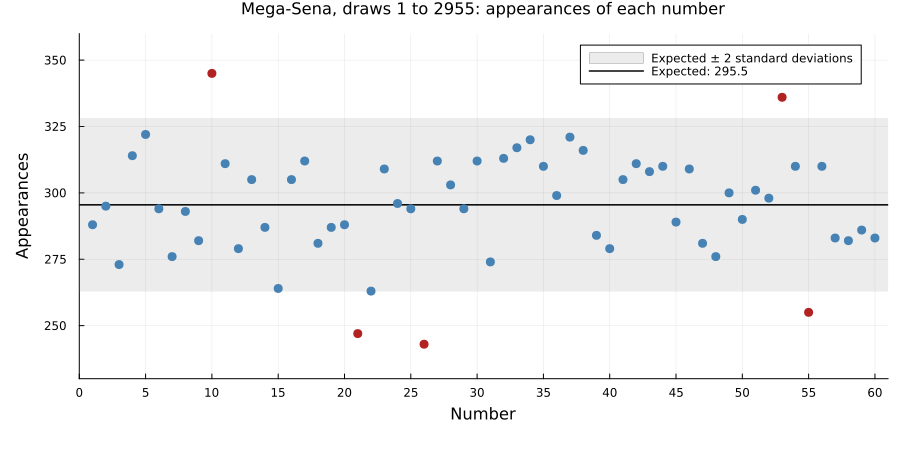

---
layout: post
image: /assets/images/sorteio.avif
title: "Mega-Sena: what frequencies can (and can't) tell you"
categories: [PROBABILITY, STATISTICS]
lang: en
tags: [Probability]
ref: mega-sena-frequencias
author: dante-bertuzzi
description: "Why some Mega-Sena numbers come up more often than others, what the real record of 2,955 draws shows, whether hot numbers give an edge, and what 20-number bets and a 57-bet pool are worth."
mathjax: true
---

The Mega-Sena is Brazil's largest lottery: each draw picks 6 distinct numbers from 1 to 60, and a bet wins the top prize (the *sena*) by matching all six. Five matches (the *quina*) and four (the *quadra*) pay smaller prizes. Every list of "the most drawn Mega-Sena numbers" shows numbers that came up dozens of times more than others. This post answers, with calculations and with the official record, the questions such a list raises: why the frequencies are not equal, whether the real record fits a fair draw, whether it pays to pick the "hot" numbers, and what changes when you mark 20 numbers or play a pool of 57 bets.

The data are the 2,955 Mega-Sena draws from draw 1 (March 11, 1996) to the 2025 New Year's Eve draw (draw 2955), downloaded from the API of CAIXA's lottery portal (CAIXA is the state-owned bank that runs Brazil's federal lotteries). Every code block comes in Julia and in Python.

---

## 1. Why do some numbers come up more than others?

Because a fair draw produces fluctuations. Even when every number is equally likely, the counts over a finite number of draws do not come out equal; they only get closer to one another, in relative terms, as draws accumulate (the law of large numbers). And anyone looking at 60 numbers at once will always find some well above and some well below the average.

### The model

Each draw picks 6 distinct numbers out of 60. Fix a number $$k\in\{1,\dots,60\}$$ and define the indicator variable

$$
I_{n,k}=
\begin{cases}
1, & \text{if number }k\text{ came up in draw }n\\
0, & \text{otherwise.}
\end{cases}
$$

The number of appearances of $$k$$ in $$N$$ draws is

$$
X_k=\sum_{n=1}^{N} I_{n,k}.
$$

In one draw, the chance that $$k$$ is among the 6 is

$$
P(I_{n,k}=1)=\frac{6}{60}=\frac{1}{10}=0.1.
$$

With independent draws, each count follows a binomial distribution:

$$
X_k \sim \text{Binomial}(N,\ p),\qquad p=0.1.
$$

The 60 counts, however, are not independent of one another: they always add up to $$6N$$, and a number that comes up takes one of the 6 slots in the draw. This dependence is weak and barely affects the calculations in this section, but it will matter for the chi-square test in section 4.

### Expected value and standard deviation

The expected value of each count is

$$
\mathbb{E}[X_k]=Np=\frac{N}{10},
$$

and the variance and standard deviation are

$$
\mathrm{Var}(X_k)=Np(1-p),\qquad \sigma=\sqrt{Np(1-p)}=\sqrt{0.09N}.
$$

Two consequences:
- the typical **absolute** deviation grows like $$\sqrt{N}$$: the more draws, the larger the differences in number of appearances;
- the **relative** deviation shrinks like $$1/\sqrt{N}$$: the frequencies, as percentages, get closer and closer.

### An example with 2,500 draws

With $$N=2500$$:

$$
E=\frac{2500}{10}=250,\qquad \sigma=\sqrt{2500\cdot0.1\cdot0.9}=\sqrt{225}=15.
$$

Deviations of 15 appearances ($$1\sigma$$) up or down are common, and deviations of 30 ($$2\sigma$$) are still plausible. A number with 220 or 280 appearances is nothing strange.

### Is a number with 290 appearances suspicious?

With the normal approximation and a continuity correction,

$$
z=\frac{289.5-250}{15}=\frac{39.5}{15}\approx 2.633,\qquad P(Z\ge 2.633)\approx 0.0042.
$$

The exact binomial calculation gives $$P(X_k\ge 290)\approx 0.0049$$, a little more. The difference is in the tail: the binomial with $$p=0.1$$ is slightly skewed to the right, and the normal underestimates the upper tail. For **a number chosen in advance**, 290 appearances would be rare, about 1 chance in 200.

### But there are 60 numbers

Nobody chooses the number in advance: the list shows the most frequent of all. Treating the 60 numbers as independent (an approximation), the chance that **at least one** reaches 290 is

$$
P\Big(\max_k X_k\ge 290\Big)\approx 1-(1-0.0049)^{60}\approx 0.25.
$$

One in four fair histories of 2,500 draws would have some number with 290 appearances or more. That is why there is always a "top 10 most drawn numbers".

At the other end, $$P(X_k\le 220)\approx 0.023$$ by the binomial ($$0.025$$ by the normal), and the chance that at least one of the 60 stays at 220 or below is

$$
1-(1-0.023)^{60}\approx 0.75.
$$

Three in four fair histories would have a "cold" number like that.

  

  

    
Julia

    

    <button class="copy-button" onclick="copyCode(this)">
      <i class="bi bi-clipboard"></i>Copy
    </button>
  

  

    <pre><code>using Distributions, Printf

# One fixed number over N draws: X ~ Binomial(N, 6/60)
N, p = 2500, 6 / 60
X = Binomial(N, p)
μ, σ = mean(X), std(X)
@printf("Expected: %.0f appearances   standard deviation: %.0f\n\n", μ, σ)

above = ccdf(X, 289)                      # P(X ≥ 290)
below = cdf(X, 220)                       # P(X ≤ 220)
println("              Exact binomial   Normal with correction")
@printf("P(X ≥ 290)   %15.5f   %22.5f\n", above, ccdf(Normal(μ, σ), 289.5))
@printf("P(X ≤ 220)   %15.5f   %22.5f\n", below, cdf(Normal(μ, σ), 220.5))

# At least one of the 60 numbers crosses the line (treating the 60 as independent)
@printf("\nSome of the 60 at 290 or more: %.3f\n", 1 - (1 - above)^60)
@printf("Some of the 60 at 220 or less: %.3f\n", 1 - (1 - below)^60)

# Two consecutive draws with no number in common
p_none = binomial(54, 6) / binomial(60, 6)
@printf("\nP(no repeat) = %.4f   P(at least one repeat) = %.4f\n", p_none, 1 - p_none)
@printf("Expected consecutive pairs with a repeat, out of %d: %.0f\n", N - 1, (N - 1) * (1 - p_none))</code></pre>
  

  
# Output

  <pre style="overflow-x: auto; font-size: 0.9em;">Expected: 250 appearances   standard deviation: 15
              Exact binomial   Normal with correction
P(X ≥ 290)           0.00488                  0.00423
P(X ≤ 220)           0.02309                  0.02461
Some of the 60 at 290 or more: 0.254
Some of the 60 at 220 or less: 0.754
P(no repeat) = 0.5159   P(at least one repeat) = 0.4841
Expected consecutive pairs with a repeat, out of 2499: 1210</pre>

  

  

  

    
Python

    

    <button class="copy-button" onclick="copyCode(this)">
      <i class="bi bi-clipboard"></i>Copy
    </button>
  

  

    <pre><code>from math import comb
from scipy.stats import binom, norm

# One fixed number over N draws: X ~ Binomial(N, 6/60)
N, p = 2500, 6 / 60
mu, sigma = binom.mean(N, p), binom.std(N, p)
print(f"Expected: {mu:.0f} appearances   standard deviation: {sigma:.0f}\n")

above = binom.sf(289, N, p)               # P(X ≥ 290)
below = binom.cdf(220, N, p)              # P(X ≤ 220)
print("              Exact binomial   Normal with correction")
print(f"P(X ≥ 290)   {above:15.5f}   {norm.sf(289.5, mu, sigma):22.5f}")
print(f"P(X ≤ 220)   {below:15.5f}   {norm.cdf(220.5, mu, sigma):22.5f}")

# At least one of the 60 numbers crosses the line (treating the 60 as independent)
print(f"\nSome of the 60 at 290 or more: {1 - (1 - above)**60:.3f}")
print(f"Some of the 60 at 220 or less: {1 - (1 - below)**60:.3f}")

# Two consecutive draws with no number in common
p_none = comb(54, 6) / comb(60, 6)
print(f"\nP(no repeat) = {p_none:.4f}   P(at least one repeat) = {1 - p_none:.4f}")
print(f"Expected consecutive pairs with a repeat, out of {N - 1}: {(N - 1) * (1 - p_none):.0f}")</code></pre>
  

  
# Output

  <pre style="overflow-x: auto; font-size: 0.9em;">Expected: 250 appearances   standard deviation: 15
              Exact binomial   Normal with correction
P(X ≥ 290)           0.00488                  0.00423
P(X ≤ 220)           0.02309                  0.02461
Some of the 60 at 290 or more: 0.254
Some of the 60 at 220 or less: 0.754
P(no repeat) = 0.5159   P(at least one repeat) = 0.4841
Expected consecutive pairs with a repeat, out of 2499: 1210</pre>

  

The "60 independent numbers" approximation ignores the dependence between the counts. A Monte Carlo simulation of 2,000 histories of 2,500 draws, each draw with 6 distinct numbers, confirms that it works well here. The simulation uses random numbers, so the result changes a little between Julia and Python:

  

  

    
Julia

    

    <button class="copy-button" onclick="copyCode(this)">
      <i class="bi bi-clipboard"></i>Copy
    </button>
  

  

    <pre><code>using Random

# R histories of N draws, each draw with 6 distinct numbers out of 60
function extremes(rng, N, R)
    highest, lowest = zeros(Int, R), zeros(Int, R)
    freq = zeros(Int, 60)
    for r in 1:R
        fill!(freq, 0)
        for _ in 1:N, k in randperm(rng, 60)[1:6]
            freq[k] += 1
        end
        highest[r], lowest[r] = maximum(freq), minimum(freq)
    end
    highest, lowest
end

highest, lowest = extremes(Xoshiro(2025), N, 2000)
@printf("Simulation, some of the 60 at 290 or more: %.3f\n", mean(highest .&gt;= 290))
@printf("Simulation, some of the 60 at 220 or less: %.3f\n", mean(lowest .&lt;= 220))
@printf("Median of the most frequent: %.0f   of the least frequent: %.0f\n", median(highest), median(lowest))</code></pre>
  

  
# Output

  <pre style="overflow-x: auto; font-size: 0.9em;">Simulation, some of the 60 at 290 or more: 0.268
Simulation, some of the 60 at 220 or less: 0.765
Median of the most frequent: 285   of the least frequent: 217</pre>

  

  

  

    
Python

    

    <button class="copy-button" onclick="copyCode(this)">
      <i class="bi bi-clipboard"></i>Copy
    </button>
  

  

    <pre><code>import numpy as np

# R histories of N draws, each draw with 6 distinct numbers out of 60
def extremes(rng, N, R):
    highest, lowest = np.empty(R, int), np.empty(R, int)
    for r in range(R):
        # the positions of the 6 smallest of 60 random keys make up one draw
        draws = rng.random((N, 60)).argpartition(6, axis=1)[:, :6]
        freq = np.bincount(draws.ravel(), minlength=60)
        highest[r], lowest[r] = freq.max(), freq.min()
    return highest, lowest

highest, lowest = extremes(np.random.default_rng(2025), N, 2000)
print(f"Simulation, some of the 60 at 290 or more: {np.mean(highest &gt;= 290):.3f}")
print(f"Simulation, some of the 60 at 220 or less: {np.mean(lowest &lt;= 220):.3f}")
print(f"Median of the most frequent: {np.median(highest):.0f}   of the least frequent: {np.median(lowest):.0f}")</code></pre>
  

  
# Output

  <pre style="overflow-x: auto; font-size: 0.9em;">Simulation, some of the 60 at 290 or more: 0.248
Simulation, some of the 60 at 220 or less: 0.777
Median of the most frequent: 285   of the least frequent: 216</pre>

  

### Numbers repeated between consecutive draws

Many people find it odd when a number from the previous draw comes up again. But it happens almost half the time. Given one draw, the next one repeats no number only if its 6 numbers all come from the 54 left out:

$$
P(\text{no repeat})=\frac{\binom{54}{6}}{\binom{60}{6}}=\frac{25{,}827{,}165}{50{,}063{,}860}\approx 0.516,
$$

so

$$
P(\text{at least one repeat})\approx 1-0.516=0.484.
$$

In 2,500 draws there are 2,499 pairs of consecutive draws, and the expected number of pairs with a repeat is $$2499\cdot 0.484\approx 1210$$.

---

## 2. What the real record shows

CAIXA publishes the result of every draw in a public API, one draw per address. The block below reads draw 2955, the 2025 New Year's Eve draw:

  

  

    
Julia

    

    <button class="copy-button" onclick="copyCode(this)">
      <i class="bi bi-clipboard"></i>Copy
    </button>
  

  

    <pre><code>using Downloads, JSON3

# One draw read straight from the API of CAIXA's lottery portal
url = "https://servicebus2.caixa.gov.br/portaldeloterias/api/megasena/2955"
c = JSON3.read(String(take!(Downloads.download(url, IOBuffer()))))
println("Draw ", c.numero, " (", c.dataApuracao, "): ", join(c.listaDezenas, " "))
for f in c.listaRateioPremio
    @printf("%d hits %10d winners   R\$ %15.2f each\n", 7 - f.faixa, f.numeroDeGanhadores, f.valorPremio)
end</code></pre>
  

  
# Output

  <pre style="overflow-x: auto; font-size: 0.9em;">Draw 2955 (01/01/2026): 09 13 21 32 33 59
6 hits          6 winners   R$    181892881.09 each
5 hits       3921 winners   R$        11931.42 each
4 hits     308315 winners   R$          216.76 each</pre>

  

  

  

    
Python

    

    <button class="copy-button" onclick="copyCode(this)">
      <i class="bi bi-clipboard"></i>Copy
    </button>
  

  

    <pre><code>import json, urllib.request

# One draw read straight from the API of CAIXA's lottery portal
url = "https://servicebus2.caixa.gov.br/portaldeloterias/api/megasena/2955"
c = json.load(urllib.request.urlopen(url))
print(f"Draw {c['numero']} ({c['dataApuracao']}): {' '.join(c['listaDezenas'])}")
for f in c["listaRateioPremio"]:
    print(f"{7 - f['faixa']} hits {f['numeroDeGanhadores']:10d} winners   R$ {f['valorPremio']:15.2f} each")</code></pre>
  

  
# Output

  <pre style="overflow-x: auto; font-size: 0.9em;">Draw 2955 (01/01/2026): 09 13 21 32 33 59
6 hits          6 winners   R$    181892881.09 each
5 hits       3921 winners   R$        11931.42 each
4 hits     308315 winners   R$          216.76 each</pre>

  

To avoid 2,955 requests, I put draws 1 to 2955 together in a CSV file, [`mega-sena.csv`](/assets/data/mega-sena.csv), with one row per draw: the draw number (`concurso`), the date (`data`) and the 6 numbers in increasing order (`d1` to `d6`). While building it, each draw was checked: 6 distinct numbers, all between 1 and 60, and the same numbers in the sorted list and in the list in drawing order.

  

  

    
Julia

    

    <button class="copy-button" onclick="copyCode(this)">
      <i class="bi bi-clipboard"></i>Copy
    </button>
  

  

    <pre><code>using DelimitedFiles

# Draws 1 (1996-03-11) to 2955 (the 2025 New Year's Eve draw), one per row
path = Downloads.download("https://morrisonkuhlsen.com/assets/data/mega-sena.csv")
data, header = readdlm(path, ',', header = true)
numbers = Int.(data[:, 3:8])
N = size(numbers, 1)
freq = [count(==(k), numbers) for k in 1:60]
E, σ = N * p, sqrt(N * p * (1 - p))
z = (freq .- E) ./ σ
@printf("%d draws: %.1f appearances expected per number, standard deviation %.2f\n\n", N, E, σ)

ranking = sortperm(freq, rev = true)
fmt(ks) = join([@sprintf("%02d: %d (z = %+.2f)", k, freq[k], z[k]) for k in ks], "   ")
println("Most frequent:  ", fmt(ranking[1:5]))
println("Least frequent: ", fmt(reverse(ranking)[1:5]))
@printf("Numbers with |z| &gt; 2: %d (expected among 60 numbers: %.1f)\n", count(abs.(z) .&gt; 2), 60 * 2 * ccdf(Normal(), 2))

# How rare would extremes like these be among 60 numbers, if the draws are fair?
X = Binomial(N, p)
@printf("\nP(some number at %d or more) ≈ %.3f\n", maximum(freq), 1 - (1 - ccdf(X, maximum(freq) - 1))^60)
@printf("P(some number at %d or less) ≈ %.3f\n", minimum(freq), 1 - (1 - cdf(X, minimum(freq)))^60)

# Repeats between consecutive draws: with independent draws, Binomial(N - 1, 1 - p_none)
repeats = sum(!isempty(intersect(numbers[i, :], numbers[i + 1, :])) for i in 1:N-1)
Rpt = Binomial(N - 1, 1 - p_none)
@printf("\nConsecutive pairs with a repeat: %d of %d (expected %.0f, standard deviation %.1f)\n",
        repeats, N - 1, mean(Rpt), std(Rpt))</code></pre>
  

  
# Output

  <pre style="overflow-x: auto; font-size: 0.9em;">2955 draws: 295.5 appearances expected per number, standard deviation 16.31
Most frequent:  10: 345 (z = +3.04)   53: 336 (z = +2.48)   05: 322 (z = +1.62)   37: 321 (z = +1.56)   34: 320 (z = +1.50)
Least frequent: 26: 243 (z = -3.22)   21: 247 (z = -2.97)   55: 255 (z = -2.48)   22: 263 (z = -1.99)   15: 264 (z = -1.93)
Numbers with |z| &gt; 2: 5 (expected among 60 numbers: 2.7)
P(some number at 345 or more) ≈ 0.093
P(some number at 243 or less) ≈ 0.032
Consecutive pairs with a repeat: 1414 of 2954 (expected 1430, standard deviation 27.2)</pre>

  

  

  

    
Python

    

    <button class="copy-button" onclick="copyCode(this)">
      <i class="bi bi-clipboard"></i>Copy
    </button>
  

  

    <pre><code>import csv, io

# Draws 1 (1996-03-11) to 2955 (the 2025 New Year's Eve draw), one per row
url = "https://morrisonkuhlsen.com/assets/data/mega-sena.csv"
rows = list(csv.reader(io.TextIOWrapper(urllib.request.urlopen(url), encoding="utf-8")))[1:]
numbers = np.array([[int(x) for x in row[2:8]] for row in rows])
N = len(numbers)
freq = np.bincount(numbers.ravel(), minlength=61)[1:]
E, sigma = N * p, np.sqrt(N * p * (1 - p))
z = (freq - E) / sigma
print(f"{N} draws: {E:.1f} appearances expected per number, standard deviation {sigma:.2f}\n")

ranking = np.argsort(-freq, kind="stable") + 1
fmt = lambda ks: "   ".join(f"{k:02d}: {freq[k - 1]} (z = {z[k - 1]:+.2f})" for k in ks)
print("Most frequent: ", fmt(ranking[:5]))
print("Least frequent:", fmt(ranking[::-1][:5]))
print(f"Numbers with |z| &gt; 2: {np.sum(np.abs(z) &gt; 2)} (expected among 60 numbers: {60 * 2 * norm.sf(2):.1f})")

# How rare would extremes like these be among 60 numbers, if the draws are fair?
print(f"\nP(some number at {freq.max()} or more) ≈ {1 - (1 - binom.sf(freq.max() - 1, N, p))**60:.3f}")
print(f"P(some number at {freq.min()} or less) ≈ {1 - (1 - binom.cdf(freq.min(), N, p))**60:.3f}")

# Repeats between consecutive draws: with independent draws, Binomial(N - 1, 1 - p_none)
repeats = sum(len(set(a) &amp; set(b)) &gt; 0 for a, b in zip(numbers[:-1], numbers[1:]))
print(f"\nConsecutive pairs with a repeat: {repeats} of {N - 1} "
      f"(expected {binom.mean(N - 1, 1 - p_none):.0f}, standard deviation {binom.std(N - 1, 1 - p_none):.1f})")</code></pre>
  

  
# Output

  <pre style="overflow-x: auto; font-size: 0.9em;">2955 draws: 295.5 appearances expected per number, standard deviation 16.31
Most frequent:  10: 345 (z = +3.04)   53: 336 (z = +2.48)   05: 322 (z = +1.62)   37: 321 (z = +1.56)   34: 320 (z = +1.50)
Least frequent: 26: 243 (z = -3.22)   21: 247 (z = -2.97)   55: 255 (z = -2.48)   22: 263 (z = -1.99)   15: 264 (z = -1.93)
Numbers with |z| &gt; 2: 5 (expected among 60 numbers: 2.7)
P(some number at 345 or more) ≈ 0.093
P(some number at 243 or less) ≈ 0.032
Consecutive pairs with a repeat: 1414 of 2954 (expected 1430, standard deviation 27.2)</pre>

  

With $$N=2955$$, the expected count is $$295.5$$ appearances per number, with a standard deviation of $$16.31$$. What the data show:

- **The extremes.** Number 10 came up 345 times ($$z=+3.04$$) and number 26 came up 243 times ($$z=-3.22$$). By the same calculation as in the previous section, the chance that some of the 60 reaches 345 is about 9%, and the chance that some stays at 243 or below is about 3%. On their own, neither is alarming.
- **The numbers outside the band.** Five numbers ended up more than 2 standard deviations from the expected count (10, 53, 55, 21 and 26). With 60 numbers, about 2.7 would be expected. That is a little more than expected, and the joint test in section 4 says whether the excess is too large.
- **The repeats.** There were 1,414 pairs of consecutive draws with at least one repeated number, against 1,430 expected, with a standard deviation of 27. The difference is 0.6 standard deviations: nothing suggests memory from one draw to the next.

The count of pairs with a repeat really does follow a binomial: given the middle draw, a repeat relative to the previous draw and a repeat relative to the next one are independent, and each has a chance of 0.484 whatever the middle draw is.

  

  

    
Julia

    

    <button class="copy-button" onclick="copyCode(this)">
      <i class="bi bi-clipboard"></i>Copy
    </button>
  

  

    <pre><code>using Plots

dotcolor = [abs(zk) &gt; 2 ? :firebrick : :steelblue for zk in z]
plot(xlabel = "Number", ylabel = "Appearances", xticks = 0:5:60, ylims = (230, 360), xlims = (0, 61),
     title = "Mega-Sena, draws 1 to $N: appearances of each number", titlefontsize = 11,
     size = (900, 450), legend = :topright, left_margin = 4Plots.mm, bottom_margin = 4Plots.mm)
hspan!([E - 2σ, E + 2σ], color = :gray, alpha = 0.15, lw = 0, label = "Expected ± 2 standard deviations")
hline!([E], color = :black, lw = 1.5, label = "Expected: $(round(E, digits = 1))")
scatter!(1:60, freq, color = dotcolor, markersize = 5, markerstrokewidth = 0, label = "")
savefig("mega-sena-frequencies.png")</code></pre>
  

  

  

  

    
Python

    

    <button class="copy-button" onclick="copyCode(this)">
      <i class="bi bi-clipboard"></i>Copy
    </button>
  

  

    <pre><code>import matplotlib.pyplot as plt

fig, ax = plt.subplots(figsize=(9, 4.5))
ax.axhspan(E - 2 * sigma, E + 2 * sigma, color="gray", alpha=0.15, lw=0, label="Expected ± 2 standard deviations")
ax.axhline(E, color="black", lw=1.5, label=f"Expected: {E:.1f}")
ax.scatter(range(1, 61), freq, s=25, color=np.where(np.abs(z) &gt; 2, "firebrick", "steelblue"))
ax.set(xlabel="Number", ylabel="Appearances", xticks=range(0, 61, 5), xlim=(0, 61), ylim=(230, 360),
       title=f"Mega-Sena, draws 1 to {N}: appearances of each number")
ax.legend(loc="upper right")
fig.tight_layout()
fig.savefig("mega-sena-frequencies-py.png", dpi=120)</code></pre>
  

  

Figure 1 – Appearances of each number in draws 1 to 2955. In red, the five numbers more than 2 standard deviations from the expected count (Julia code above).

### Why patterns mislead

Intuition expects randomness to look "evenly spread". So we tend to read extremes and short streaks as signals ("that number is rigged", "that one is overdue") and to forget that, among 60 numbers, one of them is always at the top. The calculations above are the correction: before calling something strange, ask how likely it is that **some** case as extreme as this one shows up, not how likely that particular case is.

---

## 3. Does picking the most drawn numbers give you an edge?

No, if the draws are independent. The chance that a number comes up in the next draw does not depend on the record.

For a fixed number $$k$$, let $$A_n$$ be the event "$$k$$ comes up in draw $$n$$". Independence means

$$
P(A_{n+1}\mid A_1,\dots,A_n)=P(A_{n+1})=\frac{6}{60}=\frac{1}{10}.
$$

With the real data: number 10 came up 345 times and number 26 came up 243 times, but

$$
P(10\ \text{in the next draw})=P(26\ \text{in the next draw})=\frac{1}{10}.
$$

The data also allow a direct test. If the most frequent numbers in one part of the record had some real advantage, they would stay more frequent in the other part. The block below splits the 2,955 draws into two halves and compares the frequencies:

  

  

    
Julia

    

    <button class="copy-button" onclick="copyCode(this)">
      <i class="bi bi-clipboard"></i>Copy
    </button>
  

  

    <pre><code>using Statistics

# Do the "hot" numbers of one half of the history stay hot in the other half?
half = N ÷ 2
f1 = [count(==(k), numbers[1:half, :]) for k in 1:60]
f2 = [count(==(k), numbers[half+1:end, :]) for k in 1:60]
r = cor(f1, f2)
t = r * sqrt(58 / (1 - r^2))
@printf("Draws 1 to %d against %d to %d\n", half, half + 1, N)
@printf("Correlation between the frequencies: r = %.3f (p = %.2f)\n", r, 2 * ccdf(TDist(58), abs(t)))

hot = sortperm(f1, rev = true)[1:10]
@printf("The 10 most frequent numbers of the 1st half came up %.1f times on average in the 2nd (mean of all: %.1f)\n",
        mean(f2[hot]), mean(f2))</code></pre>
  

  
# Output

  <pre style="overflow-x: auto; font-size: 0.9em;">Draws 1 to 1477 against 1478 to 2955
Correlation between the frequencies: r = 0.072 (p = 0.58)
The 10 most frequent numbers of the 1st half came up 146.5 times on average in the 2nd (mean of all: 147.8)</pre>

  

  

  

    
Python

    

    <button class="copy-button" onclick="copyCode(this)">
      <i class="bi bi-clipboard"></i>Copy
    </button>
  

  

    <pre><code>from scipy.stats import pearsonr

# Do the "hot" numbers of one half of the history stay hot in the other half?
half = N // 2
f1 = np.bincount(numbers[:half].ravel(), minlength=61)[1:]
f2 = np.bincount(numbers[half:].ravel(), minlength=61)[1:]
r, pval = pearsonr(f1, f2)
print(f"Draws 1 to {half} against {half + 1} to {N}")
print(f"Correlation between the frequencies: r = {r:.3f} (p = {pval:.2f})")

hot = np.argsort(-f1, kind="stable")[:10]
print(f"The 10 most frequent numbers of the 1st half came up {f2[hot].mean():.1f} times on average in the 2nd "
      f"(mean of all: {f2.mean():.1f})")</code></pre>
  

  
# Output

  <pre style="overflow-x: auto; font-size: 0.9em;">Draws 1 to 1477 against 1478 to 2955
Correlation between the frequencies: r = 0.072 (p = 0.58)
The 10 most frequent numbers of the 1st half came up 146.5 times on average in the 2nd (mean of all: 147.8)</pre>

  

The correlation between the frequencies in the two halves is 0.07 (p = 0.58), consistent with zero. The 10 most frequent numbers in draws 1 to 1477 came up 146.5 times on average in draws 1478 to 2955, below the mean of all numbers, 147.8. Being "hot" in one half brought no advantage in the other.

### The gambler's fallacy

"This number is overdue" and "this number is hot" are two versions of the same mistake, the gambler's fallacy: assuming that the drum remembers what has already come up. If the draws are independent, the past does not change the chance of the next one.

### What can change: sharing the prize

The chance of winning is the same for every combination, but the **amount** a winner receives depends on how many other people marked the same combination, because the prize of each tier is split among the winners.

Let $$p$$ be the chance of winning, $$J$$ the prize of the tier and $$W$$ the number of winners, counting you. If you win, you get $$J/W$$, and the expected return is

$$
\mathbb{E}[\text{return}]=p\cdot J\cdot\mathbb{E}\!\left[\frac{1}{W}\right].
$$

Careful: $$\mathbb{E}[1/W]$$ is not the same as $$1/\mathbb{E}[W]$$. For example, if the number of other winners $$O$$ follows a Poisson distribution with mean $$\lambda$$ and $$W=1+O$$, then

$$
\mathbb{E}\!\left[\frac{1}{1+O}\right]=\sum_{j=0}^{\infty}\frac{e^{-\lambda}\lambda^j}{(j+1)!}=\frac{1-e^{-\lambda}}{\lambda},
$$

which is always greater than $$1/(1+\lambda)$$:

  

  

    
Julia

    

    <button class="copy-button" onclick="copyCode(this)">
      <i class="bi bi-clipboard"></i>Copy
    </button>
  

  

    <pre><code># The other winners O follow a Poisson with mean λ; your share of the prize is 1/(1 + O)
# E[1/(1 + O)] = (1 - e^(-λ))/λ, which is not the same as 1/E[1 + O] = 1/(1 + λ)
println("λ (other winners)   E[1/W]   1/E[W]")
for λ in (0.5, 1, 2, 4, 5)
    @printf("%17.1f   %6.3f   %6.3f\n", λ, (1 - exp(-λ)) / λ, 1 / (1 + λ))
end
share(λ) = (1 - exp(-λ)) / λ
@printf("\nE[W] = 2 against E[W] = 5: the ratio of the expected shares is %.2f (not 2.5)\n", share(1) / share(4))</code></pre>
  

  
# Output

  <pre style="overflow-x: auto; font-size: 0.9em;">λ (other winners)   E[1/W]   1/E[W]
              0.5    0.787    0.667
              1.0    0.632    0.500
              2.0    0.432    0.333
              4.0    0.245    0.200
              5.0    0.199    0.167
E[W] = 2 against E[W] = 5: the ratio of the expected shares is 2.58 (not 2.5)</pre>

  

  

  

    
Python

    

    <button class="copy-button" onclick="copyCode(this)">
      <i class="bi bi-clipboard"></i>Copy
    </button>
  

  

    <pre><code>import math

# The other winners O follow a Poisson with mean λ; your share of the prize is 1/(1 + O)
# E[1/(1 + O)] = (1 - e^(-λ))/λ, which is not the same as 1/E[1 + O] = 1/(1 + λ)
print("λ (other winners)   E[1/W]   1/E[W]")
for lam in (0.5, 1, 2, 4, 5):
    print(f"{lam:17.1f}   {(1 - math.exp(-lam)) / lam:6.3f}   {1 / (1 + lam):6.3f}")
share = lambda lam: (1 - math.exp(-lam)) / lam
print(f"\nE[W] = 2 against E[W] = 5: the ratio of the expected shares is {share(1) / share(4):.2f} (not 2.5)")</code></pre>
  

  
# Output

  <pre style="overflow-x: auto; font-size: 0.9em;">λ (other winners)   E[1/W]   1/E[W]
              0.5    0.787    0.667
              1.0    0.632    0.500
              2.0    0.432    0.333
              4.0    0.245    0.200
              5.0    0.199    0.167
E[W] = 2 against E[W] = 5: the ratio of the expected shares is 2.58 (not 2.5)</pre>

  

If popular combinations tend to have $$\mathbb{E}[W]=5$$ and rarely chosen ones $$\mathbb{E}[W]=2$$, the expected share of someone who hits a rarely chosen combination is about 2.6 times larger, not exactly 2.5. The probability of winning stays the same. Only the amount you take home when you win changes.

In the 2025 New Year's Eve draw (draw 2955), the top prize was split among 6 bets, with R\\$ 181,892,881.09 each, R\\$ 1,091,357,286.54 in total. The numbers drawn were 09, 13, 21, 32, 33 and 59.

That is where the usual advice for reducing the chance of sharing comes from: avoid combinations that many people mark, such as birthdays (numbers up to 31) and shapes on the slip (sequences, columns, diagonals). The data used here contain the results, not the bets placed, so they cannot measure which combinations are popular; this advice holds only to the extent that these betting habits are real.

---

## 4. Can frequencies alone detect bias or tampering?

They can test whether the data are **consistent** with a fair draw and detect large deviations. They cannot prove that the draw is fair, nor, when the data disagree, say why.

The null hypothesis is

$$
H_0:\ \text{independent draws, with all 60 numbers equally likely.}
$$

If the data strongly contradict $$H_0$$, there is evidence against that model. If they do not, they are consistent with it, which is not a proof that it holds.

### How large must a bias be to show up?

With $$N=2500$$, each count has $$\mu=250$$ and $$\sigma=15$$ under $$H_0$$. Suppose one number has a chance of $$0.11$$ per draw instead of $$0.10$$. Its mean would become

$$
\mu_1=2500\cdot 0.11=275,
$$

that is, $$\Delta=275-250=25$$ appearances more, which in standard deviations is

$$
z=\frac{25}{15}\approx 1.67.
$$

That does not stand out, especially with 60 numbers examined at once.

How many draws would it take for this 1-percentage-point bias to become a 3-standard-deviation difference? We need

$$
N(0.11-0.10)=3\sqrt{0.09N}
\ \Rightarrow\ 0.01N=0.9\sqrt{N}
\ \Rightarrow\ \sqrt{N}=90
\ \Rightarrow\ N=8100.
$$

More than twice the entire Mega-Sena record.

### The chi-square test, and a necessary adjustment

The chi-square goodness-of-fit test compares observed counts $$O_i$$ with expected counts $$E_i$$:

$$
X^2=\sum_i\frac{(O_i-E_i)^2}{E_i}.
$$

As a teaching example, group the numbers into 6 classes of 10 (1–10, 11–20, …, 51–60). In $$N=2500$$ draws, $$6N=15{,}000$$ numbers come up, and the expected count per class is $$15{,}000/6=2500$$. With the hypothetical counts 2600, 2450, 2520, 2400, 2520 and 2510:

$$
X^2=\frac{100^2}{2500}+\frac{50^2}{2500}+\frac{20^2}{2500}+\frac{100^2}{2500}+\frac{20^2}{2500}+\frac{10^2}{2500}
=4+1+0.16+4+0.16+0.04=9.36.
$$

Here comes a detail that is easy to miss. The usual chi-square table, with $$k-1$$ degrees of freedom, assumes that each number drawn is independent of the others, as if the balls went back into the drum. In the Mega-Sena, the 6 numbers of a draw are distinct, and that makes the counts slightly less variable: when one number comes up, the others lose a slot. With 60 numbers, each count has variance $$Np(1-p)$$, and two different counts have covariance $$-Np(1-p)/59$$. Working it through, the statistic $$X^2$$ has mean $$60(1-p)=54$$, not 59, and its distribution is that of $$\tfrac{54}{59}\chi^2_{59}$$. The same factor $$54/59$$ applies to the 6 classes. The correct test divides $$X^2$$ by $$54/59$$ before looking it up in the table.

In the example, $$9.36/(54/59)\approx 10.23$$, with 5 degrees of freedom, gives p ≈ 0.069. Without the adjustment, p would be 0.096. Neither case is strong evidence against $$H_0$$, but the adjustment matters.

### The test with the real data

  

  

    
Julia

    

    <button class="copy-button" onclick="copyCode(this)">
      <i class="bi bi-clipboard"></i>Copy
    </button>
  

  

    <pre><code># Chi-square goodness-of-fit test with the 60 numbers
function chi2stat(d)
    n = size(d, 1)
    f = [count(==(k), d) for k in 1:60]
    sum((f .- n * p) .^ 2 ./ (n * p))
end

# The 6 numbers of a draw are distinct: the usual chi-square comes out multiplied by 54/59
factor = 54 / 59
parts = [("Draws 1 to $N", numbers), ("1 to $half", numbers[1:half, :]),
         ("$(half + 1) to $N", numbers[half+1:end, :]), ("1 to 1000", numbers[1:1000, :]),
         ("1001 to 2000", numbers[1001:2000, :]), ("2001 to $N", numbers[2001:end, :])]
println("Period                X²    X²/factor     p   p without correction")
for (name, d) in parts
    x = chi2stat(d)
    @printf("%-17s %6.2f %11.2f %7.4f %9.4f\n", name, x, x / factor, ccdf(Chisq(59), x / factor), ccdf(Chisq(59), x))
end

# Check by simulation: 2000 fair histories of N draws
function simulate_draws(rng, N)
    d = zeros(Int, N, 6)
    for i in 1:N
        d[i, :] = randperm(rng, 60)[1:6]
    end
    d
end
rng = Xoshiro(59)
sim = [chi2stat(simulate_draws(rng, N)) for _ in 1:2000]
@printf("\nSimulation: mean X² = %.1f (theory: 54)   share with X² ≥ %.2f: %.4f\n",
        mean(sim), chi2stat(numbers), mean(sim .&gt;= chi2stat(numbers)))

# The teaching example with 6 classes of 10 numbers
O = [2600, 2450, 2520, 2400, 2520, 2510]
x = sum((O .- 2500) .^ 2 ./ 2500)
@printf("\nExample with 6 classes: X² = %.2f   corrected = %.2f   p = %.3f\n", x, x / factor, ccdf(Chisq(5), x / factor))</code></pre>
  

  
# Output

  <pre style="overflow-x: auto; font-size: 0.9em;">Period                X²    X²/factor     p   p without correction
Draws 1 to 2955    79.06       86.38  0.0116    0.0417
1 to 1477          55.66       60.81  0.4105    0.5995
1478 to 2955       92.08      100.61  0.0006    0.0038
1 to 1000          64.20       70.14  0.1519    0.2993
1001 to 2000       58.48       63.89  0.3086    0.4946
2001 to 2955       87.70       95.82  0.0017    0.0090
Simulation: mean X² = 54.1 (theory: 54)   share with X² ≥ 79.06: 0.0135
Example with 6 classes: X² = 9.36   corrected = 10.23   p = 0.069</pre>

  

  

  

    
Python

    

    <button class="copy-button" onclick="copyCode(this)">
      <i class="bi bi-clipboard"></i>Copy
    </button>
  

  

    <pre><code>from scipy.stats import chi2

# Chi-square goodness-of-fit test with the 60 numbers
def chi2stat(d):
    n = len(d)
    f = np.bincount(np.ravel(d), minlength=61)[1:]
    return np.sum((f - n * p) ** 2 / (n * p))

# The 6 numbers of a draw are distinct: the usual chi-square comes out multiplied by 54/59
factor = 54 / 59
parts = [(f"Draws 1 to {N}", numbers), (f"1 to {half}", numbers[:half]),
         (f"{half + 1} to {N}", numbers[half:]), ("1 to 1000", numbers[:1000]),
         ("1001 to 2000", numbers[1000:2000]), (f"2001 to {N}", numbers[2000:])]
print("Period                X²    X²/factor     p   p without correction")
for name, d in parts:
    x = chi2stat(d)
    print(f"{name:&lt;17s} {x:6.2f} {x / factor:11.2f} {chi2.sf(x / factor, 59):7.4f} {chi2.sf(x, 59):9.4f}")

# Check by simulation: 2000 fair histories of N draws
rng = np.random.default_rng(59)
sim = np.array([chi2stat(rng.random((N, 60)).argpartition(6, axis=1)[:, :6] + 1) for _ in range(2000)])
print(f"\nSimulation: mean X² = {sim.mean():.1f} (theory: 54)   "
      f"share with X² ≥ {chi2stat(numbers):.2f}: {np.mean(sim &gt;= chi2stat(numbers)):.4f}")

# The teaching example with 6 classes of 10 numbers
O = np.array([2600, 2450, 2520, 2400, 2520, 2510])
x = np.sum((O - 2500) ** 2 / 2500)
print(f"\nExample with 6 classes: X² = {x:.2f}   corrected = {x / factor:.2f}   p = {chi2.sf(x / factor, 5):.3f}")</code></pre>
  

  
# Output

  <pre style="overflow-x: auto; font-size: 0.9em;">Period                X²    X²/factor     p   p without correction
Draws 1 to 2955    79.06       86.38  0.0116    0.0417
1 to 1477          55.66       60.81  0.4105    0.5995
1478 to 2955       92.08      100.61  0.0006    0.0038
1 to 1000          64.20       70.14  0.1519    0.2993
1001 to 2000       58.48       63.89  0.3086    0.4946
2001 to 2955       87.70       95.82  0.0017    0.0090
Simulation: mean X² = 54.0 (theory: 54)   share with X² ≥ 79.06: 0.0095
Example with 6 classes: X² = 9.36   corrected = 10.23   p = 0.069</pre>

  

With the 60 numbers and the 2,955 draws, $$X^2=79.06$$. Divided by $$54/59$$, it gives $$86.38$$, with 59 degrees of freedom: **p ≈ 0.012**. The simulation of 2,000 fair histories, which does not depend on the adjustment, agrees: only about 1% of them reach an $$X^2$$ that high.

This is the natural test for the question in this post, and it says the record is **hard to reconcile** with 60 exactly equally likely numbers and independent draws. A p of 0.012 happens by chance in about 1 in 86 fair histories. That is rare, but not impossible.

Splitting the record, the deviation is concentrated in the most recent draws: the first half (draws 1 to 1477, from 1996 to March 2013) has p ≈ 0.41, and the second (1478 to 2955, from March 2013 to 2026) has p ≈ 0.0006. In blocks of 1,000 draws the picture is the same: p ≈ 0.15 and 0.31 in the first two and p ≈ 0.002 in draws 2001 to 2955 (from 2018 on).

Three cautions when reading these numbers:

- **The splits came after looking at the data.** Testing several pieces of the record is a form of multiple comparisons: among many possible splits, some will always look odder. The p-value of the full record is the one that counts as a test; the splits describe where the deviation is.
- **The test does not give the cause.** Tiny physical differences between the balls, changes of equipment or procedure over 30 years, and plain chance are all consistent with the same $$X^2$$. Nothing in the data points to tampering, and telling these explanations apart requires information that frequencies do not have, such as audits and records of the procedure.
- **The right way to confirm is with new data.** A hypothesis drawn from these data (for example, "the most frequent numbers since 2013 will stay more frequent") has to be tested on draws after 2955, not on the same draws that suggested it.

And even if there is a real bias, it is too small to exploit. If number 10 really had an 11.7% chance per draw (its observed frequency, $$345/2955$$), a bet containing it would hit the jackpot something like 17% more often than others. Since only 43.79% of Mega-Sena ticket sales go to prizes, the expected return would still be far below the amount bet.

### Limitations

Even when the tests flag nothing:
- there may be a bias too small for the size of the record, like the 1-percentage-point one above;
- a deviation that changes over time is hard to catch with total frequencies alone;
- whoever runs many tests will find "significant" results by chance, unless they correct for multiple comparisons (with Bonferroni or by controlling the [false discovery rate](/bh-fdr-contraexemplo/), in Portuguese, for example).

Truly strong signals would be large deviations that recur in different periods, tiny p-values that survive those corrections, and patterns that hold up in new data.

---

## 5. What is a 20-number bet worth?

The Mega-Sena accepts bets of 6 to 20 numbers. There are $$\binom{60}{6}$$ possible results, and a 20-number bet covers all $$\binom{20}{6}$$ combinations of 6 inside it. Its chance of hitting the jackpot is

$$
p_{20}=\frac{\binom{20}{6}}{\binom{60}{6}}.
$$

**The numerator:**

$$
\begin{aligned}
\binom{20}{6}
&=\frac{20\cdot19\cdot18\cdot17\cdot16\cdot15}{6\cdot5\cdot4\cdot3\cdot2\cdot1} \\
&=\frac{(20/5)\cdot19\cdot(18/6)\cdot17\cdot(16/4)\cdot(15/3)}{2\cdot1} \\
&=\frac{4\cdot19\cdot3\cdot17\cdot4\cdot5}{2}=\frac{77{,}520}{2}=38{,}760.
\end{aligned}
$$

**The denominator:**

$$
\begin{aligned}
\binom{60}{6}
&=\frac{60\cdot59\cdot58\cdot57\cdot56\cdot55}{6\cdot5\cdot4\cdot3\cdot2\cdot1} \\
&=\frac{60}{6}\cdot59\cdot\frac{58}{2}\cdot\frac{57}{3}\cdot\frac{56}{4}\cdot\frac{55}{5}
=10\cdot59\cdot29\cdot19\cdot14\cdot11=50{,}063{,}860.
\end{aligned}
$$

**The probability:**

$$
p_{20}=\frac{38{,}760}{50{,}063{,}860}=\frac{102}{131{,}747}\approx 0.000774\ (0.0774\%),
\qquad \frac{1}{p_{20}}=\frac{131{,}747}{102}\approx 1291.6.
$$

That is **1 chance in about 1,292**. The price follows the number of combinations: the basic 6-number bet costs R\\$ 6.00, and the 20-number bet costs $$38{,}760\times 6=$$ R\\$ 232,560.00.

For five and four matches, the calculation uses the hypergeometric distribution. Let $$X$$ be the number of drawn numbers that fall among the $$n$$ marked. Then

$$
X\sim\text{Hypergeometric}(60,\ 6,\ n),\qquad
P(X=j)=\frac{\binom{6}{j}\binom{54}{n-j}}{\binom{60}{n}}.
$$

The block below computes, for each bet size, the price and the chances of 6 hits ($$X=6$$), 5 hits ($$X=5$$) and 4 hits ($$X=4$$). The table matches the one CAIXA publishes on its Mega-Sena page.

  

  

    
Julia

    

    <button class="copy-button" onclick="copyCode(this)">
      <i class="bi bi-clipboard"></i>Copy
    </button>
  

  

    <pre><code># X = how many of the 6 drawn numbers fall among the n numbers marked: Hypergeometric(6, 54, n)
println("Numbers   Price (R\$)   6 hits: 1 in   5 hits: 1 in   4 hits: 1 in")
for n in 6:20
    H = Hypergeometric(6, 54, n)
    @printf("%7d %12d %14.0f %14.0f %14.0f\n", n, 6 * binomial(n, 6), 1 / pdf(H, 6), 1 / pdf(H, 5), 1 / pdf(H, 4))
end

# Exact probabilities for a 20-number bet
P(k) = binomial(6, k) * binomial(54, 20 - k) // binomial(60, 20)
println("\nk   P(X = k) with 20 numbers")
for k in 0:6
    @printf("%d   %-14s = %.8f\n", k, string(numerator(P(k)), "/", denominator(P(k))), float(P(k)))
end

# How many winning 6-number combinations the bet contains, for each X
println("\nX   6 hits   5 hits   4 hits")
for j in 4:6
    @printf("%d %8d %8d %8d\n", j, binomial(j, 6) * binomial(20 - j, 0),
            binomial(j, 5) * binomial(20 - j, 1), binomial(j, 4) * binomial(20 - j, 2))
end</code></pre>
  

  
# Output

  <pre style="overflow-x: auto; font-size: 0.9em;">Numbers   Price (R$)   6 hits: 1 in   5 hits: 1 in   4 hits: 1 in
      6            6       50063860         154518           2332
      7           42        7151980          44981           1038
      8          168        1787995          17192            539
      9          504         595998           7791            312
     10         1260         238399           3973            195
     11         2772         108363           2211            129
     12         5544          54182           1317             90
     13        10296          29175            828             65
     14        18018          16671            544             48
     15        30030          10003            370             37
     16        48048           6252            260             29
     17        74256           4045            188             23
     18       111384           2697            139             19
     19       162792           1845            105             16
     20       232560           1292             81             13
k   P(X = k) with 20 numbers
0   1443/18821     = 0.07666968
1   34632/131747   = 0.26286747
2   45695/131747   = 0.34683902
3   29640/131747   = 0.22497666
4   9945/131747    = 0.07548559
5   1632/131747    = 0.01238738
6   102/131747     = 0.00077421
X   6 hits   5 hits   4 hits
4        0        0      120
5        0       15      525
6        1       84     1365</pre>

  

  

  

    
Python

    

    <button class="copy-button" onclick="copyCode(this)">
      <i class="bi bi-clipboard"></i>Copy
    </button>
  

  

    <pre><code>from fractions import Fraction
from scipy.stats import hypergeom

# X = how many of the 6 drawn numbers fall among the n numbers marked: Hypergeometric(60, 6, n)
print("Numbers   Price (R$)   6 hits: 1 in   5 hits: 1 in   4 hits: 1 in")
for n in range(6, 21):
    H = hypergeom(60, 6, n)
    print(f"{n:7d} {6 * comb(n, 6):12d} {1 / H.pmf(6):14.0f} {1 / H.pmf(5):14.0f} {1 / H.pmf(4):14.0f}")

# Exact probabilities for a 20-number bet
P = lambda k: Fraction(comb(6, k) * comb(54, 20 - k), comb(60, 20))
print("\nk   P(X = k) with 20 numbers")
for k in range(7):
    print(f"{k}   {str(P(k)):&lt;14s} = {float(P(k)):.8f}")

# How many winning 6-number combinations the bet contains, for each X
print("\nX   6 hits   5 hits   4 hits")
for j in range(4, 7):
    print(f"{j} {comb(j, 6) * comb(20 - j, 0):8d} {comb(j, 5) * comb(20 - j, 1):8d} {comb(j, 4) * comb(20 - j, 2):8d}")</code></pre>
  

  
# Output

  <pre style="overflow-x: auto; font-size: 0.9em;">Numbers   Price (R$)   6 hits: 1 in   5 hits: 1 in   4 hits: 1 in
      6            6       50063860         154518           2332
      7           42        7151980          44981           1038
      8          168        1787995          17192            539
      9          504         595998           7791            312
     10         1260         238399           3973            195
     11         2772         108363           2211            129
     12         5544          54182           1317             90
     13        10296          29175            828             65
     14        18018          16671            544             48
     15        30030          10003            370             37
     16        48048           6252            260             29
     17        74256           4045            188             23
     18       111384           2697            139             19
     19       162792           1845            105             16
     20       232560           1292             81             13
k   P(X = k) with 20 numbers
0   1443/18821     = 0.07666968
1   34632/131747   = 0.26286747
2   45695/131747   = 0.34683902
3   29640/131747   = 0.22497666
4   9945/131747    = 0.07548559
5   1632/131747    = 0.01238738
6   102/131747     = 0.00077421
X   6 hits   5 hits   4 hits
4        0        0      120
5        0       15      525
6        1       84     1365</pre>

  

With 20 numbers, $$P(X=5)=1632/131{,}747\approx 1.24\%$$ and $$P(X=6)=102/131{,}747\approx 0.077\%$$. A 20-number bet that hits 5 contains 15 five-hit combinations (the 5 drawn numbers plus one of the other 15) and 525 four-hit combinations; one that hits all 6 contains 1 jackpot, 84 five-hit and 1,365 four-hit combinations.

### "1 in 1,292" is not a guarantee

"1 in 1,292" means that, on average, such a bet hits the jackpot once every 1,292 draws. It does not mean that 1,292 tries guarantee the prize. With one 20-number bet in each of $$x$$ different draws, the chance of winning at least once is

$$
1-(1-p_{20})^{x}.
$$

With $$x=1/p_{20}\approx 1292$$ draws,

$$
1-(1-p_{20})^{1/p_{20}}\approx 1-e^{-1}\approx 0.632.
$$

About **63%**, not 100%.

---

## 6. Two 20-number bets: do you just add?

It depends on whether the bets are in the **same draw** or in **different draws**.

**In the same draw**, there is a single drawing, and the two bets $$A$$ and $$B$$ both win only if the 6 numbers drawn are in the intersection $$A\cap B$$. So

$$
P(\text{either wins})=2p_{20}-P(\text{both win})=2p_{20}-\frac{\binom{\lvert A\cap B\rvert }{6}}{\binom{60}{6}}.
$$

If the two bets share at most 5 numbers, $$\binom{\lvert A\cap B\rvert }{6}=0$$ and the sum is **exact**: $$2p_{20}\approx 0.0015484$$, or 1 in 645.8. If the two bets are identical, the chance is that of a single bet, $$p_{20}$$. Repeating a bet does not raise the chance; it only splits the prize with yourself if it comes up.

**In different draws**, the draws are independent, and the right tool is the complement:

$$
1-(1-p_{20})^2=2p_{20}-p_{20}^2\approx 0.0015478,
$$

or 1 in 646.1. Since $$p_{20}^2$$ is tiny, adding gives almost the same result, but here the sum is only an approximation.

---

## 7. The pool of 57 bets of 20 numbers

On December 29, 2025, the Brazilian newspaper Correio reported that a group from Cachoeira Dourada, in the state of Goiás, had registered 57 bets of 20 numbers for the New Year's Eve draw, for a total of about R\\$ 13 million. By CAIXA's price table, 57 bets of 20 numbers cost $$57\times 232{,}560=$$ R\\$ 13,255,920.00, which matches the amount reported.

The 57 bets were in the **same** draw. So the reasoning of the previous section applies: they are not 57 independent tries.

**The jackpot.** By the same reasoning as in section 6, the chance that some bet hits the jackpot is at most the sum of the 57 chances:

$$
P(\text{jackpot})\le 57\,p_{20}=57\cdot\frac{102}{131{,}747}\approx 0.0441\ (4.41\%).
$$

Equality would hold only if no pair of bets shared 6 numbers, and that is impossible with 57 bets of 20 numbers. To see why, count the numbers in common over all pairs of bets. If each pair shared at most 5, the total would be at most $$5\binom{57}{2}=7980$$. But the same total can be counted number by number: a number marked in $$r$$ bets appears in $$\binom{r}{2}$$ pairs. The 57 bets add up to $$57\cdot 20=1140$$ marks, an average of 19 per number, and the total is smallest when every number is in 19 bets: $$60\binom{19}{2}=10{,}260$$, more than 7980.

The calculation $$1-(1-p_{20})^{57}\approx 4.32\%$$ is something else: the chance for someone who plays one 20-number bet in each of 57 **different** draws.

**Five hits.** The expected number of five-hit prizes does not depend on how the bets were chosen. The 57 bets cover $$57\times 38{,}760$$ combinations of 6 numbers, and each combination hits exactly 5 with chance $$6\cdot 54/\binom{60}{6}$$, because there are 6 ways to choose the 5 drawn numbers and 54 for the sixth, undrawn number. So

$$
\mathbb{E}[\text{five-hit prizes}]=57\cdot 38{,}760\cdot\frac{6\cdot 54}{50{,}063{,}860}\approx 14.30.
$$

The chance of getting **at least one**, though, depends a lot on the choice. Bets that share many numbers win together or lose together. The block below runs a Monte Carlo simulation of 200,000 draws against two sets of 57 bets: one chosen at random and one with 14 numbers shared by every bet:

  

  

    
Julia

    

    <button class="copy-button" onclick="copyCode(this)">
      <i class="bi bi-clipboard"></i>Copy
    </button>
  

  

    <pre><code>p20 = binomial(20, 6) / binomial(60, 6)
@printf("One 20-number bet: p = %.6f (1 in %.0f)\n\n", p20, 1 / p20)
println("Jackpot with 57 bets of 20 numbers")
@printf("  in the same draw, ceiling given by the sum of the 57 chances: %.5f\n", 57 * p20)
@printf("  in 57 different draws, one bet in each:                       %.5f\n", 1 - (1 - p20)^57)

# Expected five-hit prizes: 57 × 38,760 combinations, each with chance 6 × 54 / C(60, 6) of hitting 5
@printf("\nExpected five-hit prizes in the 57 bets, however they are chosen: %.2f\n",
        57 * binomial(20, 6) * 6 * 54 / binomial(60, 6))

# Monte Carlo: two ways of choosing the 57 bets, against the same 200,000 draws
rng = Xoshiro(57)
draws = [randperm(rng, 60)[1:6] for _ in 1:200_000]
random_bets = [randperm(rng, 60)[1:20] for _ in 1:57]
core = randperm(rng, 60)[1:14]                       # 14 numbers shared by every bet
others = setdiff(1:60, core)
clustered = [vcat(core, shuffle(rng, others)[1:6]) for _ in 1:57]
println("\nHow the bets are chosen   P(jackpot)   P(at least one 5-hit)   5-hit prizes per draw")
for (name, bets) in [("at random", random_bets), ("14 numbers in common", clustered)]
    marks = [falses(60) for _ in bets]
    for (m, b) in zip(marks, bets); m[b] .= true; end
    six = five = 0; prizes = 0
    for s in draws
        hits = [count(m[s]) for m in marks]
        six += any(==(6), hits)
        five += any(&gt;=(5), hits)
        prizes += sum(binomial(h, 5) * (20 - h) for h in hits if h &gt;= 5; init = 0)
    end
    S = length(draws)
    @printf("%-24s %11.4f %23.4f %23.2f\n", name, six / S, five / S, prizes / S)
end</code></pre>
  

  
# Output

  <pre style="overflow-x: auto; font-size: 0.9em;">One 20-number bet: p = 0.000774 (1 in 1292)
Jackpot with 57 bets of 20 numbers
  in the same draw, ceiling given by the sum of the 57 chances: 0.04413
  in 57 different draws, one bet in each:                       0.04319
Expected five-hit prizes in the 57 bets, however they are chosen: 14.30
How the bets are chosen   P(jackpot)   P(at least one 5-hit)   5-hit prizes per draw
at random                     0.0433                  0.5341                   14.29
14 numbers in common          0.0239                  0.2078                   14.57</pre>

  

  

  

    
Python

    

    <button class="copy-button" onclick="copyCode(this)">
      <i class="bi bi-clipboard"></i>Copy
    </button>
  

  

    <pre><code>p20 = comb(20, 6) / comb(60, 6)
print(f"One 20-number bet: p = {p20:.6f} (1 in {1 / p20:.0f})\n")
print("Jackpot with 57 bets of 20 numbers")
print(f"  in the same draw, ceiling given by the sum of the 57 chances: {57 * p20:.5f}")
print(f"  in 57 different draws, one bet in each:                       {1 - (1 - p20)**57:.5f}")

# Expected five-hit prizes: 57 × 38,760 combinations, each with chance 6 × 54 / C(60, 6) of hitting 5
print(f"\nExpected five-hit prizes in the 57 bets, however they are chosen: "
      f"{57 * comb(20, 6) * 6 * 54 / comb(60, 6):.2f}")

# Monte Carlo: two ways of choosing the 57 bets, against the same 200,000 draws
rng = np.random.default_rng(57)
S = 200_000
draws = rng.random((S, 60)).argpartition(6, axis=1)[:, :6]
random_bets = [rng.permutation(60)[:20] for _ in range(57)]
core = rng.permutation(60)[:14]                      # 14 numbers shared by every bet
others = np.setdiff1d(np.arange(60), core)
clustered = [np.concatenate([core, rng.permutation(others)[:6]]) for _ in range(57)]
print("\nHow the bets are chosen   P(jackpot)   P(at least one 5-hit)   5-hit prizes per draw")
for name, bets in [("at random", random_bets), ("14 numbers in common", clustered)]:
    marks = np.zeros((57, 60), dtype=np.int8)
    for m, b in zip(marks, bets):
        m[b] = 1
    hits = marks[:, draws].sum(axis=2)               # hits of each bet in each draw
    prizes = np.array([comb(h, 5) * (20 - h) for h in range(7)])[hits].sum(axis=0)
    print(f"{name:&lt;24s} {np.mean((hits == 6).any(axis=0)):11.4f} {np.mean((hits &gt;= 5).any(axis=0)):23.4f} "
          f"{prizes.mean():23.2f}")</code></pre>
  

  
# Output

  <pre style="overflow-x: auto; font-size: 0.9em;">One 20-number bet: p = 0.000774 (1 in 1292)
Jackpot with 57 bets of 20 numbers
  in the same draw, ceiling given by the sum of the 57 chances: 0.04413
  in 57 different draws, one bet in each:                       0.04319
Expected five-hit prizes in the 57 bets, however they are chosen: 14.30
How the bets are chosen   P(jackpot)   P(at least one 5-hit)   5-hit prizes per draw
at random                     0.0434                  0.5314                   14.30
14 numbers in common          0.0229                  0.2059                   14.22</pre>

  

With bets chosen at random, the jackpot chance is about 4.3%, a little below the ceiling, and the chance of at least one five-hit prize is about 53%, close to what the calculation with 57 independent tries would give, $$1-(1-1734/131{,}747)^{57}\approx 53.0\%$$. With 14 numbers in common, the chance of at least one five-hit prize drops to about 21%, and the jackpot chance to just over 2%. In both cases the mean stays at about 14.3 five-hit prizes per draw. Clustering the numbers does not change the average number of prizes; it only bunches them into fewer draws.

### What happened

The draw took place on the morning of January 1, 2026, with the numbers 09, 13, 21, 32, 33 and 59. According to Correio, in a report of January 2, 2026, the group did not hit the jackpot, "counted 45 quinas" and should receive "about R\\$ 433 thousand for the quadras and a little over R\\$ 536 thousand for the quinas" (our translation). In draw 2955, each five-hit prize paid R\\$ 11,931.42, and $$45\times 11{,}931.42=536{,}913.90$$: the amounts add up with 45 five-hit prizes.

The same report says that, of the 57 bets of 20 numbers, "45 matched five of the six numbers" (our translation). That does not add up with the calculations in section 5: a 20-number bet with 5 hits contains 15 five-hit combinations, and 45 such bets would give $$45\times 15=675$$ five-hit prizes, more than R\\$ 8 million in that tier alone. The "45 games" in the headline are 6-number combinations, not bets. If every bet had 20 numbers, 45 five-hit prizes correspond to 3 bets with 5 hits each.

That is 45 five-hit prizes against 14.3 expected, above the average. But since each bet that hits 5 numbers brings 15 five-hit prizes at once, the number of prizes varies a lot from one draw to another. Even so, the group received close to R\\$ 970 thousand in prizes, against about R\\$ 13.26 million bet.

---

## Summary

- Chance that a specific number comes up in a draw: $$6/60=1/10$$.
- Appearances of a number in $$N$$ draws: $$X_k\sim\text{Binomial}(N,\ 0.1)$$, with mean $$N/10$$ and standard deviation $$\sqrt{0.09N}$$.
- Among 60 numbers, extremes of 2 to 3 standard deviations are expected; the right question is the chance of **some** case that extreme.
- Chance of at least one repeated number between two consecutive draws: $$1-\binom{54}{6}/\binom{60}{6}\approx 0.484$$. In the record, there were 1,414 pairs with a repeat, against 1,430 expected.
- In the chi-square test with the numbers of a draw, divide $$X^2$$ by $$54/59$$. With draws 1 to 2955, the result is p ≈ 0.012, with the deviation concentrated in the most recent draws; frequencies cannot tell the cause.
- "Hot" numbers in one half of the record were not more frequent in the other (correlation of 0.07).
- Jackpot with a 20-number bet: $$\binom{20}{6}/\binom{60}{6}=102/131{,}747$$, 1 in about 1,292, for R\\$ 232,560.00.
- Bets in the same draw are not independent tries: the sum of the chances is a ceiling for the jackpot, and the chance of at least one five-hit prize depends on how many numbers the bets share.

## References

1. CAIXA. **Mega-Sena** (rules, prices and probabilities, in Portuguese). Available at: <https://loterias.caixa.gov.br/Paginas/Mega-Sena.aspx>. Accessed on: Nov. 25, 2026.
2. CAIXA. **Lottery portal API**, results of Mega-Sena draws 1 to 2955. Example address: <https://servicebus2.caixa.gov.br/portaldeloterias/api/megasena/2955>. Accessed on: Nov. 25, 2026.
3. LOBO, Monique. Bolão milionário: grupo aposta R\\$ 13 milhões para tentar levar a Mega da Virada. **Correio**, Dec. 29, 2025 (in Portuguese). Available at: <https://www.correio24horas.com.br/brasil/bolao-milionario-grupo-aposta-r-13-milhoes-para-tentar-levar-a-mega-da-virada-1225>.
4. Grupo que apostou R\\$ 13 milhões na Mega da Virada ficou a uma dezena de levar o prêmio em 45 jogos. **Correio**, Jan. 2, 2026 (in Portuguese). Available at: <https://www.correio24horas.com.br/brasil/grupo-que-apostou-r-13-milhoes-na-mega-da-virada-ficou-a-uma-dezena-de-levar-o-premio-em-45-jogos-0126>.
