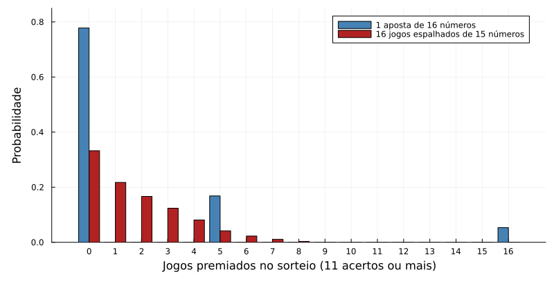

---
layout: post
image: /assets/images/sorteio.avif
title: "16 apostas de 15 números têm a mesma probabilidade que 1 aposta de 16 números na Lotofácil?"
categories: [MATEMÁTICA, GUIA]
tags: [Probabilidade]
lang: pt
ref: lotofacil-16v15
author: dante-bertuzzi
description: "Demonstração à mão de que 16 jogos de 15 números têm a mesma chance de acertar 15 que 1 jogo de 16 números na Lotofácil, com o preço, as outras faixas de prêmio e a conferência de todos os sorteios possíveis no computador."
mathjax: true
---

Resposta curta: **sim**. Para acertar os 15 números (a faixa principal), **16 apostas simples distintas de 15 números** têm exatamente a **mesma probabilidade** que **1 aposta de 16 números** na Lotofácil: 1 em 204.297,5. As duas também custam o mesmo, R\\$ 56,00, porque a aposta de 16 números é, na prática, um pacote com os 16 jogos de 15 números que cabem dentro dela.

O que muda está nas faixas menores. A aposta de 16 números concentra os prêmios: na maior parte dos sorteios não ganha nada e, quando ganha, ganha vários de uma vez. A seguir vão a demonstração à mão, a tabela de preços e chances da Caixa conferida com as fórmulas, e uma conferência no computador com todos os 3.268.760 sorteios possíveis.

---

## 1. O modelo do sorteio

- O volante tem **25** números.
- O sorteio escolhe **15** deles, todos os conjuntos de 15 com a mesma chance.

O espaço amostral, isto é, o conjunto de todos os resultados possíveis do sorteio, é

$$
\Omega=\{D\subset\{1,\dots,25\}:\ \lvert D\rvert=15\},
\qquad \lvert\Omega\rvert=\binom{25}{15},
$$

onde $$\lvert D\rvert$$ é a quantidade de elementos do conjunto $$D$$. Como todos os sorteios são igualmente prováveis, a probabilidade de um evento é o número de sorteios favoráveis dividido por $$\binom{25}{15}$$.

---

## 2. O cálculo de $$\binom{25}{15}$$ à mão

Escolher os 15 sorteados é o mesmo que escolher os 10 que ficam de fora, então $$\binom{25}{15}=\binom{25}{10}$$:

$$
\binom{25}{10}
=\frac{25\cdot 24\cdot 23\cdot 22\cdot 21\cdot 20\cdot 19\cdot 18\cdot 17\cdot 16}{10\cdot 9\cdot 8\cdot 7\cdot 6\cdot 5\cdot 4\cdot 3\cdot 2\cdot 1}.
$$

Para não lidar com números enormes, dá para calcular como um produto de frações:

$$
\binom{25}{10}
=\frac{25}{1}\cdot\frac{24}{2}\cdot\frac{23}{3}\cdot\frac{22}{4}\cdot\frac{21}{5}\cdot\frac{20}{6}\cdot\frac{19}{7}\cdot\frac{18}{8}\cdot\frac{17}{9}\cdot\frac{16}{10}.
$$

Multiplicando da esquerda para a direita, o resultado é inteiro em todos os passos, porque depois do passo $$i$$ ele vale $$\binom{25}{i}$$:

1. $$25$$
2. $$25\cdot\frac{24}{2}=25\cdot 12=300$$
3. $$300\cdot\frac{23}{3}=100\cdot 23=2.300$$
4. $$2.300\cdot\frac{22}{4}=2.300\cdot\frac{11}{2}=1.150\cdot 11=12.650$$
5. $$12.650\cdot\frac{21}{5}=2.530\cdot 21=53.130$$
6. $$53.130\cdot\frac{20}{6}=53.130\cdot\frac{10}{3}=17.710\cdot 10=177.100$$
7. $$177.100\cdot\frac{19}{7}=25.300\cdot 19=480.700$$
8. $$480.700\cdot\frac{18}{8}=480.700\cdot\frac{9}{4}=120.175\cdot 9=1.081.575$$
9. $$1.081.575\cdot\frac{17}{9}=120.175\cdot 17=2.042.975$$
10. $$2.042.975\cdot\frac{16}{10}=2.042.975\cdot\frac{8}{5}=408.595\cdot 8=3.268.760$$

Portanto,

$$
\boxed{\binom{25}{15}=3.268.760}
$$

O passo 9 dá $$\binom{25}{9}=\binom{25}{16}=2.042.975$$, número que volta a aparecer na seção 5.

---

## 3. Uma aposta simples (15 números)

Uma aposta simples é um conjunto $$A$$ com $$\lvert A\rvert=15$$. Ela acerta os 15 números só se o sorteio for exatamente esse conjunto, $$D=A$$. Assim,

$$
\mathbb{P}(\text{15 acertos com 1 jogo})
=\frac{1}{\binom{25}{15}}
=\frac{1}{3.268.760}
\approx 3{,}059264\times 10^{-7}.
$$

---

## 4. Dezesseis apostas simples distintas

Com 16 jogos **distintos** $$A_1,\dots,A_{16}$$, o sorteio $$D$$ pode ser igual a **no máximo um** deles, porque $$D$$ não pode ser dois conjuntos diferentes ao mesmo tempo. Os eventos "$$D=A_1$$", ..., "$$D=A_{16}$$" são **eventos mutuamente exclusivos**, e a probabilidade de que algum aconteça é a soma das probabilidades:

$$
\mathbb{P}(\text{15 acertos em algum dos 16 jogos})
=\sum_{i=1}^{16}\mathbb{P}(D=A_i)
=\frac{16}{3.268.760}
\approx 4{,}8948225\times 10^{-6}.
$$

Em chances,

$$
\frac{1}{\mathbb{P}}=\frac{3.268.760}{16}=204.297{,}5,
$$

isto é, cerca de **1 em 204.298**.

Isso vale para **quaisquer** 16 jogos distintos, sem nenhuma condição sobre quais números eles usam. Se houver jogos repetidos, a chance cai: com apenas $$k$$ jogos distintos, ela é $$\dfrac{k}{\binom{25}{15}}$$, porque o jogo repetido acerta nos mesmos sorteios que o original.

---

## 5. Uma aposta de 16 números

Uma aposta de 16 números é um conjunto $$B$$ com $$\lvert B\rvert=16$$. Ela faz **15 acertos** quando os 15 sorteados estão todos dentro de $$B$$, isto é, quando $$D\subset B$$. Há dois jeitos de contar.

### Contando os sorteios

Quantos sorteios $$D$$ cabem dentro de $$B$$? Basta escolher qual dos 16 números de $$B$$ fica de fora: $$\binom{16}{15}=16$$ sorteios. Logo,

$$
\mathbb{P}(\text{15 acertos com 1 aposta de 16})
=\frac{16}{\binom{25}{15}}
=\frac{16}{3.268.760}.
$$

### Contando as apostas

O mesmo resultado sai fixando o sorteio $$D$$ e contando as apostas $$B$$ que o contêm. Para formar $$B\supset D$$, falta escolher **1** número extra entre os $$25-15=10$$ que não saíram:

$$
\#\{B:\ \lvert B\rvert=16,\ D\subset B\}=\binom{10}{1}=10.
$$

Como há $$\binom{25}{16}$$ apostas de 16 números possíveis,

$$
\mathbb{P}(\text{15 acertos com 1 aposta de 16})
=\frac{10}{\binom{25}{16}}.
$$

Para comparar com a seção 4, use

$$
\binom{25}{16}
=\binom{25}{15}\cdot\frac{25-15}{16}
=\binom{25}{15}\cdot\frac{10}{16},
$$

que vem de $$\binom{n}{k+1}=\binom{n}{k}\cdot\frac{n-k}{k+1}$$. Substituindo,

$$
\frac{10}{\binom{25}{16}}
=\frac{10}{\binom{25}{15}\cdot\frac{10}{16}}
=\frac{16}{\binom{25}{15}}.
$$

Numericamente, $$\frac{10}{2.042.975}\approx 4{,}8948225\times 10^{-6}$$, ou 1 em 204.297,5.

### Por que dá igual

A primeira contagem já mostra a razão: os 16 sorteios que fazem 15 acertos na aposta $$B$$ são exatamente os 16 subconjuntos de 15 números de $$B$$. Uma aposta de 16 números acerta os 15 nos mesmos sorteios que as 16 apostas simples formadas por esses subconjuntos. É um caso particular da seção 4, com 16 jogos distintos escolhidos de um jeito específico.

$$
\boxed{\mathbb{P}(\text{15 acertos com 1 aposta de 16})=\mathbb{P}(\text{15 acertos com 16 apostas simples distintas})=\frac{16}{3.268.760}}
$$

O bloco abaixo refaz as contas das seções 2 a 5 com frações exatas:

  

  

    
Julia

    

    <button class="copy-button" onclick="copyCode(this)">
      <i class="bi bi-clipboard"></i>Copiar
    </button>
  

  

    <pre><code>using Printf

# C(25, 10) pelo produto de frações da seção 2: cada passo dá um inteiro
c = 1
for i in 1:10
    global c = c * (26 - i) ÷ i                 # depois do passo i, c = C(25, i)
    println("passo ", lpad(i, 2), ": ", lpad(c, 9))
end
total = binomial(25, 15)
println("C(25, 15) = ", total, "   C(25, 16) = ", binomial(25, 16))

fracao(p) = string(numerator(p), "/", denominator(p))
p1  = 1 // total                                # 1 aposta de 15 números
p16 = 16 // total                               # 16 apostas distintas de 15 números
pB  = binomial(10, 1) // binomial(25, 16)       # 1 aposta de 16 números
println("1 aposta simples:        ", fracao(p1), "  ≈ ", @sprintf("%.7e", Float64(p1)))
println("16 apostas distintas:    ", fracao(p16), "  ≈ ", @sprintf("%.7e", Float64(p16)))
println("1 aposta de 16 números:  ", fracao(pB), "  ≈ ", @sprintf("%.7e", Float64(pB)))
println("iguais? ", pB == p16, "   1 em ", Float64(1 / pB))</code></pre>
  

  
# Saída

  <pre style="overflow-x: auto; font-size: 0.9em;">passo  1:        25
passo  2:       300
passo  3:      2300
passo  4:     12650
passo  5:     53130
passo  6:    177100
passo  7:    480700
passo  8:   1081575
passo  9:   2042975
passo 10:   3268760
C(25, 15) = 3268760   C(25, 16) = 2042975
1 aposta simples:        1/3268760  ≈ 3.0592641e-07
16 apostas distintas:    2/408595  ≈ 4.8948225e-06
1 aposta de 16 números:  2/408595  ≈ 4.8948225e-06
iguais? true   1 em 204297.5</pre>

  

  

  

    
Python

    

    <button class="copy-button" onclick="copyCode(this)">
      <i class="bi bi-clipboard"></i>Copiar
    </button>
  

  

    <pre><code>from fractions import Fraction
from math import comb

# C(25, 10) pelo produto de frações da seção 2: cada passo dá um inteiro
c = 1
for i in range(1, 11):
    c = c * (26 - i) // i                       # depois do passo i, c = C(25, i)
    print(f"passo {i:&gt;2}: {c:&gt;9}")
total = comb(25, 15)
print(f"C(25, 15) = {total}   C(25, 16) = {comb(25, 16)}")

fracao = lambda p: f"{p.numerator}/{p.denominator}"
p1 = Fraction(1, total)                         # 1 aposta de 15 números
p16 = Fraction(16, total)                       # 16 apostas distintas de 15 números
pB = Fraction(comb(10, 1), comb(25, 16))        # 1 aposta de 16 números
print(f"1 aposta simples:        {fracao(p1)}  ≈ {float(p1):.7e}")
print(f"16 apostas distintas:    {fracao(p16)}  ≈ {float(p16):.7e}")
print(f"1 aposta de 16 números:  {fracao(pB)}  ≈ {float(pB):.7e}")
print(f"iguais? {str(pB == p16).lower()}   1 em {float(1 / pB)}")</code></pre>
  

  
# Saída

  <pre style="overflow-x: auto; font-size: 0.9em;">passo  1:        25
passo  2:       300
passo  3:      2300
passo  4:     12650
passo  5:     53130
passo  6:    177100
passo  7:    480700
passo  8:   1081575
passo  9:   2042975
passo 10:   3268760
C(25, 15) = 3268760   C(25, 16) = 2042975
1 aposta simples:        1/3268760  ≈ 3.0592641e-07
16 apostas distintas:    2/408595  ≈ 4.8948225e-06
1 aposta de 16 números:  2/408595  ≈ 4.8948225e-06
iguais? true   1 em 204297.5</pre>

  

---

## 6. O preço e as apostas de 15 a 20 números

Na Lotofácil, dá para marcar de 15 a 20 números. Segundo a [página oficial da Caixa](https://loterias.caixa.gov.br/Paginas/Lotofacil.aspx), consultada em 25 de novembro de 2026, a aposta mínima, de 15 números, custa R\\$ 3,50, e a de 16 números custa R\\$ 56,00, que é $$16\times 3{,}50$$. A tabela da Caixa segue o mesmo padrão até 20 números: o preço é sempre o número de jogos de 15 embutidos, $$\binom{n}{15}$$, vezes R\\$ 3,50.

Pelo mesmo argumento da seção 5, uma aposta de $$n$$ números faz 15 acertos em $$\binom{n}{15}$$ sorteios, então

$$
\mathbb{P}(\text{15 acertos com } n \text{ números})=\frac{\binom{n}{15}}{\binom{25}{15}}.
$$

Chance e preço crescem na mesma proporção: em todas as apostas, cada R\\$ 3,50 compra a mesma chance de 1 em 3.268.760 de acertar os 15.

Para as outras faixas, o número de acertos entre os $$n$$ números marcados segue a **distribuição hipergeométrica**, a mesma do [post da Mega-Sena](/mega-sena-frequencias/): das 25 bolas, 15 são "sorteadas" e $$n$$ são "marcadas", e

$$
\mathbb{P}(k\text{ acertos com } n \text{ números})=\frac{\binom{15}{k}\binom{10}{n-k}}{\binom{25}{n}}.
$$

O bloco abaixo monta a tabela para $$n$$ de 15 a 20, com as chances em "1 em ...":

  

  

    
Julia

    

    <button class="copy-button" onclick="copyCode(this)">
      <i class="bi bi-clipboard"></i>Copiar
    </button>
  

  

    <pre><code># Apostas de 15 a 20 números: jogos embutidos, preço e chance de cada faixa
# Acertos entre os n números marcados: hipergeométrica com 25 bolas, 15 sorteadas
prob(n, k) = binomial(15, k) * binomial(10, n - k) / binomial(25, n)
println(" n   jogos       preço (R\$)   ", join((lpad("$k acertos", 10) for k in 15:-1:11), " "), "   (1 em ...)")
for n in 15:20
    jogos = binomial(n, 15)
    chances = (@sprintf("%10.1f", 1 / prob(n, k)) for k in 15:-1:11)
    @printf("%2d %7d %14.2f   %s\n", n, jogos, 3.5 * jogos, join(chances, " "))
end</code></pre>
  

  
# Saída

  <pre style="overflow-x: auto; font-size: 0.9em;"> n   jogos       preço (R$)   15 acertos 14 acertos 13 acertos 12 acertos 11 acertos   (1 em ...)
15       1           3.50    3268760.0    21791.7      691.8       59.9       11.4
16      16          56.00     204297.5     3026.6      162.1       21.4        5.9
17     136         476.00      24035.0      600.9       49.1        9.4        3.8
18     816        2856.00       4005.8      152.6       18.2        5.0        2.9
19    3876       13566.00        843.3       46.9        8.0        3.2        2.9
20   15504       54264.00        210.8       16.9        4.2        2.6        3.9</pre>

  

  

  

    
Python

    

    <button class="copy-button" onclick="copyCode(this)">
      <i class="bi bi-clipboard"></i>Copiar
    </button>
  

  

    <pre><code># Apostas de 15 a 20 números: jogos embutidos, preço e chance de cada faixa
# Acertos entre os n números marcados: hipergeométrica com 25 bolas, 15 sorteadas
prob = lambda n, k: comb(15, k) * comb(10, n - k) / comb(25, n)
cab = " ".join(f"{f'{k} acertos':&gt;10}" for k in range(15, 10, -1))
print(f" n   jogos       preço (R$)   {cab}   (1 em ...)")
for n in range(15, 21):
    jogos = comb(n, 15)
    chances = " ".join(f"{1 / prob(n, k):10.1f}" for k in range(15, 10, -1))
    print(f"{n:2d} {jogos:7d} {3.5 * jogos:14.2f}   {chances}")</code></pre>
  

  
# Saída

  <pre style="overflow-x: auto; font-size: 0.9em;"> n   jogos       preço (R$)   15 acertos 14 acertos 13 acertos 12 acertos 11 acertos   (1 em ...)
15       1           3.50    3268760.0    21791.7      691.8       59.9       11.4
16      16          56.00     204297.5     3026.6      162.1       21.4        5.9
17     136         476.00      24035.0      600.9       49.1        9.4        3.8
18     816        2856.00       4005.8      152.6       18.2        5.0        2.9
19    3876       13566.00        843.3       46.9        8.0        3.2        2.9
20   15504       54264.00        210.8       16.9        4.2        2.6        3.9</pre>

  

Os valores, arredondados, são os mesmos da tabela de probabilidades publicada na página da Caixa. Dois detalhes:

- a tabela mostra a chance de acertar **exatamente** $$k$$ números entre os $$n$$ marcados;
- é por isso que, com 20 números, fazer exatamente 11 acertos (1 em 3,9) é menos provável que com 19 (1 em 2,9). Com 20 números marcados e só 5 de fora, pelo menos 10 dos 15 sorteados caem na aposta, e a probabilidade se desloca para 12 acertos ou mais.

---

## 7. As faixas de 11 a 14 acertos

A aposta de 16 números é premiada como o pacote dos seus 16 jogos de 15 números. Se $$j$$ dos 15 sorteados estão entre os 16 marcados, cada um dos 16 jogos embutidos tira um número de $$B$$:

- se o número tirado é um dos $$j$$ acertos, o jogo fica com $$j-1$$ acertos, o que acontece em $$j$$ jogos;
- se o número tirado é um dos $$16-j$$ erros, o jogo fica com $$j$$ acertos, o que acontece em $$16-j$$ jogos.

| Acertos entre os 16 | Chance (1 em) | Jogos premiados | Prêmios fixos (R\\$) |
|---|---|---|---|
| 15 | 204.297,5 | 1 de 15 e 15 de 14 | (só variáveis) |
| 14 | 3.026,6 | 2 de 14 e 14 de 13 | $$14\times 35=490$$, mais 2 prêmios de 14 |
| 13 | 162,1 | 3 de 13 e 13 de 12 | $$3\times 35+13\times 14=287$$ |
| 12 | 21,4 | 4 de 12 e 12 de 11 | $$4\times 14+12\times 7=140$$ |
| 11 | 5,9 | 5 de 11 (e 11 jogos com 10) | $$5\times 7=35$$ |
| 10 ou menos | — | nenhum | 0 |

Os prêmios de 11, 12 e 13 acertos são fixos: R\\$ 7,00, R\\$ 14,00 e R\\$ 35,00, segundo a página da Caixa. Os de 14 e 15 acertos são variáveis, porque saem de uma parte da arrecadação dividida entre os ganhadores do concurso. A divisão por jogos é a mesma da tabela de premiação da Caixa para apostas de 16 números.

---

## 8. Mesma média, distribuição diferente

Cada um dos 16 jogos, sozinho, tem as mesmas chances de qualquer aposta simples. Pela **linearidade da esperança**, o número esperado de jogos premiados em cada faixa é a soma das esperanças de cada jogo, e não depende de como os jogos se sobrepõem. Por isso, 1 aposta de 16 números e 16 apostas simples distintas quaisquer têm o mesmo número médio de prêmios em **todas** as faixas, não só na de 15 acertos.

O que muda é a distribuição. Os 16 jogos de uma aposta de 16 números são quase iguais entre si (quaisquer dois deles têm 14 números em comum), então acertam e erram juntos. Jogos com menos números em comum diversificam o risco.

O bloco abaixo percorre os 3.268.760 sorteios possíveis e compara duas estratégias de R\\$ 56,00:

- **1 aposta de 16 números**, de 1 a 16;
- **16 jogos "espalhados"**, cada um com 15 números consecutivos numa volta de 1 a 25 (de 1 a 15, de 3 a 17, de 5 a 19 e assim por diante, começando em cada número ímpar até o 25 e depois no 2, no 4 e no 6; depois do 25 vem o 1).

Cada sorteio é representado por um número de 25 bits, um por bola, e os acertos de um jogo são contados pelos bits em comum.

  

  

    
Julia

    

    <button class="copy-button" onclick="copyCode(this)">
      <i class="bi bi-clipboard"></i>Copiar
    </button>
  

  

    <pre><code># Todos os 3.268.760 sorteios possíveis, cada um como uma máscara de 25 bits
sorteios = [UInt32(m) for m in 0:(2^25 - 1) if count_ones(m) == 15]
mascara(nums) = sum(UInt32(1) &lt;&lt; (k - 1) for k in nums)

# Estratégia A: uma aposta de 16 números (1 a 16) = os 16 jogos que tiram um número
B = 1:16
concentrada = [mascara(setdiff(B, k)) for k in B]
# Estratégia B: 16 jogos de 15 números consecutivos (em círculo), começando em 1, 3, ..., 25, 2, 4, 6
inicios = [(2i) % 25 for i in 0:15]
espalhada = [mascara(((s + j) % 25) + 1 for j in 0:14) for s in inicios]

premio_fixo = Dict(11 =&gt; 7.0, 12 =&gt; 14.0, 13 =&gt; 35.0)
function avalia(jogos)
    faixa = zeros(Int, 15)                      # faixa[k] = total de jogos com k acertos
    algum15 = 0; algum_premio = 0
    premiados = zeros(Int, 17)                  # premiados[m + 1] = sorteios com m jogos premiados
    for d in sorteios
        m = 0; tem15 = false
        for j in jogos
            k = count_ones(d &amp; j)
            faixa[k] += 1
            m += k &gt;= 11
            tem15 |= k == 15
        end
        algum15 += tem15; algum_premio += m &gt; 0; premiados[m + 1] += 1
    end
    return faixa, algum15, algum_premio, premiados
end

N = length(sorteios)
println("sorteios possíveis: ", N)
resultados = Dict{String, Any}()
for (nome, jogos) in (("16 números", concentrada), ("16 jogos espalhados", espalhada))
    faixa, algum15, algum_premio, premiados = avalia(jogos)
    resultados[nome] = premiados
    println("\n", nome, ": ", length(unique(jogos)), " jogos distintos")
    println("  sorteios com 15 acertos em algum jogo: ", algum15)
    println("  jogos premiados esperados por sorteio:")
    for k in 15:-1:11
        @printf("    %2d acertos: %.6f\n", k, faixa[k] / N)
    end
    @printf("  prêmio fixo esperado (11 a 13 acertos): R\$ %.4f\n",
            sum(premio_fixo[k] * faixa[k] for k in 11:13) / N)
    @printf("  P(pelo menos um jogo premiado): %.6f\n", algum_premio / N)
    print("  nº de jogos premiados (P &gt; 0):")
    for m in 0:16
        premiados[m + 1] &gt; 0 &amp;&amp; @printf(" %d: %.4f;", m, premiados[m + 1] / N)
    end
    println()
end</code></pre>
  

  
# Saída

  <pre style="overflow-x: auto; font-size: 0.9em;">sorteios possíveis: 3268760
16 números: 16 jogos distintos
  sorteios com 15 acertos em algum jogo: 16
  jogos premiados esperados por sorteio:
    15 acertos: 0.000005
    14 acertos: 0.000734
    13 acertos: 0.023128
    12 acertos: 0.267257
    11 acertos: 1.403101
  prêmio fixo esperado (11 a 13 acertos): R$ 14.3728
  P(pelo menos um jogo premiado): 0.221645
  nº de jogos premiados (P &gt; 0): 0: 0.7784; 5: 0.1684; 16: 0.0533;
16 jogos espalhados: 16 jogos distintos
  sorteios com 15 acertos em algum jogo: 16
  jogos premiados esperados por sorteio:
    15 acertos: 0.000005
    14 acertos: 0.000734
    13 acertos: 0.023128
    12 acertos: 0.267257
    11 acertos: 1.403101
  prêmio fixo esperado (11 a 13 acertos): R$ 14.3728
  P(pelo menos um jogo premiado): 0.667660
  nº de jogos premiados (P &gt; 0): 0: 0.3323; 1: 0.2175; 2: 0.1666; 3: 0.1238; 4: 0.0811; 5: 0.0418; 6: 0.0227; 7: 0.0109; 8: 0.0033;</pre>

  

  

  

    
Python

    

    <button class="copy-button" onclick="copyCode(this)">
      <i class="bi bi-clipboard"></i>Copiar
    </button>
  

  

    <pre><code>import numpy as np

# Todos os 3.268.760 sorteios possíveis, cada um como uma máscara de 25 bits
m = np.arange(2**25, dtype=np.uint32)
sorteios = m[np.bitwise_count(m) == 15]
mascara = lambda nums: sum(1 &lt;&lt; (k - 1) for k in nums)

# Estratégia A: uma aposta de 16 números (1 a 16) = os 16 jogos que tiram um número
B = range(1, 17)
concentrada = [mascara(k2 for k2 in B if k2 != k) for k in B]
# Estratégia B: 16 jogos de 15 números consecutivos (em círculo), começando em 1, 3, ..., 25, 2, 4, 6
inicios = [(2 * i) % 25 for i in range(16)]
espalhada = [mascara(((s + j) % 25) + 1 for j in range(15)) for s in inicios]

premio_fixo = {11: 7.0, 12: 14.0, 13: 35.0}
def avalia(jogos):
    acertos = np.stack([np.bitwise_count(sorteios &amp; np.uint32(j)) for j in jogos])  # 16 x N
    faixa = {k: int((acertos == k).sum()) for k in range(11, 16)}
    algum15 = int((acertos == 15).any(axis=0).sum())
    m = (acertos &gt;= 11).sum(axis=0)              # jogos premiados em cada sorteio
    return faixa, algum15, int((m &gt; 0).sum()), np.bincount(m, minlength=17)

N = len(sorteios)
print("sorteios possíveis:", N)
resultados = {}
for nome, jogos in (("16 números", concentrada), ("16 jogos espalhados", espalhada)):
    faixa, algum15, algum_premio, premiados = avalia(jogos)
    resultados[nome] = premiados
    print(f"\n{nome}: {len(set(jogos))} jogos distintos")
    print("  sorteios com 15 acertos em algum jogo:", algum15)
    print("  jogos premiados esperados por sorteio:")
    for k in range(15, 10, -1):
        print(f"    {k:2d} acertos: {faixa[k] / N:.6f}")
    print(f"  prêmio fixo esperado (11 a 13 acertos): R$ {sum(premio_fixo[k] * faixa[k] for k in range(11, 14)) / N:.4f}")
    print(f"  P(pelo menos um jogo premiado): {algum_premio / N:.6f}")
    print("  nº de jogos premiados (P &gt; 0):", end="")
    for k in range(17):
        if premiados[k] &gt; 0:
            print(f" {k}: {premiados[k] / N:.4f};", end="")
    print()</code></pre>
  

  
# Saída

  <pre style="overflow-x: auto; font-size: 0.9em;">sorteios possíveis: 3268760
16 números: 16 jogos distintos
  sorteios com 15 acertos em algum jogo: 16
  jogos premiados esperados por sorteio:
    15 acertos: 0.000005
    14 acertos: 0.000734
    13 acertos: 0.023128
    12 acertos: 0.267257
    11 acertos: 1.403101
  prêmio fixo esperado (11 a 13 acertos): R$ 14.3728
  P(pelo menos um jogo premiado): 0.221645
  nº de jogos premiados (P &gt; 0): 0: 0.7784; 5: 0.1684; 16: 0.0533;
16 jogos espalhados: 16 jogos distintos
  sorteios com 15 acertos em algum jogo: 16
  jogos premiados esperados por sorteio:
    15 acertos: 0.000005
    14 acertos: 0.000734
    13 acertos: 0.023128
    12 acertos: 0.267257
    11 acertos: 1.403101
  prêmio fixo esperado (11 a 13 acertos): R$ 14.3728
  P(pelo menos um jogo premiado): 0.667660
  nº de jogos premiados (P &gt; 0): 0: 0.3323; 1: 0.2175; 2: 0.1666; 3: 0.1238; 4: 0.0811; 5: 0.0418; 6: 0.0227; 7: 0.0109; 8: 0.0033;</pre>

  

Nas duas estratégias:

- os mesmos 16 sorteios dão 15 acertos;
- o número esperado de jogos premiados é o mesmo em cada faixa, como garante a linearidade da esperança;
- o prêmio fixo esperado é o mesmo: R\\$ 14,37 por sorteio, ou cerca de R\\$ 0,90 por jogo de R\\$ 3,50.

A diferença está na chance de ganhar alguma coisa. A aposta de 16 números ganha pelo menos um prêmio em 22,2% dos sorteios, contra 66,8% dos jogos espalhados. Em compensação, quando ganha, ganha muito: 5 jogos premiados com 11 acertos entre os 16, e todos os 16 com 12 acertos ou mais.

  

  

    
Julia

    

    <button class="copy-button" onclick="copyCode(this)">
      <i class="bi bi-clipboard"></i>Copiar
    </button>
  

  

    <pre><code>using Plots

x = 0:16
pa = resultados["16 números"] ./ N
pb = resultados["16 jogos espalhados"] ./ N
bar(x .- 0.2, pa, bar_width = 0.4, color = :steelblue, label = "1 aposta de 16 números",
    xlabel = "Jogos premiados no sorteio (11 acertos ou mais)", ylabel = "Probabilidade",
    xticks = 0:16, ylims = (0, 0.85), size = (800, 420), left_margin = 4Plots.mm, bottom_margin = 4Plots.mm)
bar!(x .+ 0.2, pb, bar_width = 0.4, color = :firebrick, label = "16 jogos espalhados de 15 números")
savefig("lotofacil-jogos-premiados.png")</code></pre>
  

  

  

  

    
Python

    

    <button class="copy-button" onclick="copyCode(this)">
      <i class="bi bi-clipboard"></i>Copiar
    </button>
  

  

    <pre><code>import matplotlib.pyplot as plt

x = np.arange(17)
pa = resultados["16 números"] / N
pb = resultados["16 jogos espalhados"] / N
fig, ax = plt.subplots(figsize=(8, 4.2))
ax.bar(x - 0.2, pa, width=0.4, color="steelblue", label="1 aposta de 16 números")
ax.bar(x + 0.2, pb, width=0.4, color="firebrick", label="16 jogos espalhados de 15 números")
ax.set(xlabel="Jogos premiados no sorteio (11 acertos ou mais)", ylabel="Probabilidade", xticks=x, ylim=(0, 0.85))
ax.legend()
fig.tight_layout()
fig.savefig("lotofacil-jogos-premiados-py.png", dpi=120)</code></pre>
  

  

Figura 1 – Número de jogos premiados (11 acertos ou mais) num sorteio, para duas estratégias de R\$ 56,00 com a mesma média de prêmios. Código em Julia acima.

---

## 9. Quanto volta, em média

Os números da seção 8 também dizem quanto se recupera nas faixas fixas: R\\$ 0,90 por jogo de R\\$ 3,50, em média. As faixas de 14 e 15 acertos dependem da arrecadação e do número de ganhadores de cada concurso. No conjunto, segundo a página da Caixa, o prêmio bruto corresponde a 43,79% da arrecadação. Somando todas as apostas, cada R\\$ 3,50 apostado devolve em média cerca de R\\$ 1,53 em prêmios brutos.

Nenhuma combinação de jogos muda essa média. Como mostra a seção 8, escolher entre uma aposta de 16 números e 16 jogos simples só muda a forma como o resultado se distribui: ganhar raramente e muito, ou com mais frequência e pouco. E, como cada sorteio é independente dos anteriores, olhar os resultados passados também não ajuda, como discutido no post da Mega-Sena (a **falácia do jogador**).

---

## Conclusão

**Sim.** Para a faixa de 15 acertos, 16 apostas simples distintas de 15 números dão a mesma chance que 1 aposta de 16 números: 16 em 3.268.760, ou 1 em 204.297,5. A razão é que a aposta de 16 números contém exatamente $$\binom{16}{15}=16$$ jogos de 15 números, e acerta os 15 nos mesmos sorteios que eles. O preço acompanha: R\\$ 56,00 nos dois casos.

A média de prêmios também é a mesma em todas as faixas. O que muda é a variabilidade: a aposta de 16 números não ganha nada em cerca de 78% dos sorteios e, quando ganha, leva vários prêmios de uma vez; 16 jogos com menos números em comum ganham alguma coisa com mais frequência, em geral um ou dois prêmios menores.
