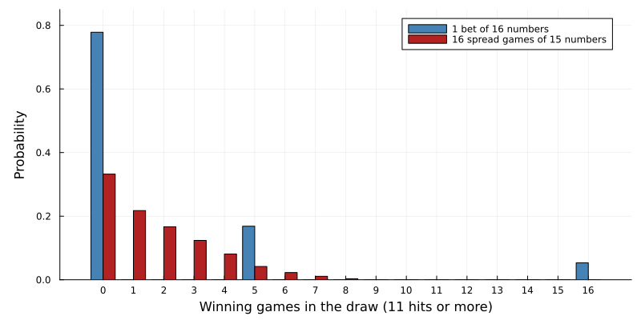

---
layout: post
image: /assets/images/sorteio.avif
title: "Do 16 bets of 15 numbers have the same probability as 1 bet of 16 numbers in the Lotofácil?"
categories: [MATHEMATICS, GUIDE]
tags: [Probability]
lang: en
ref: lotofacil-16v15
author: dante-bertuzzi
description: "A hand-worked proof that 16 games of 15 numbers have the same chance of matching all 15 as 1 game of 16 numbers in the Brazilian Lotofácil lottery, with the prices, the other prize tiers and a computer check over every possible draw."
mathjax: true
---

Short answer: **yes**. For matching all 15 numbers (the top prize), **16 distinct single bets of 15 numbers** have exactly the **same probability** as **1 bet of 16 numbers** in the Lotofácil, a Brazilian lottery run by the federal bank Caixa: 1 in 204,297.5. They also cost the same, R\\$ 56.00, because a 16-number bet is in practice a bundle of the 16 games of 15 numbers that fit inside it.

What changes is in the lower tiers. The 16-number bet concentrates the prizes: in most draws it wins nothing, and when it wins, it wins several prizes at once. Below are the proof by hand, Caixa's price and odds table checked against the formulas, and a computer check over all 3,268,760 possible draws.

---

## 1. The draw model

- The betting slip has **25** numbers.
- The draw picks **15** of them, with every set of 15 equally likely.

The sample space, that is, the set of all possible outcomes of the draw, is

$$
\Omega=\{D\subset\{1,\dots,25\}:\ \lvert D\rvert=15\},
\qquad \lvert\Omega\rvert=\binom{25}{15},
$$

where $$\lvert D\rvert$$ is the number of elements of the set $$D$$. Since every draw is equally likely, the probability of an event is the number of favorable draws divided by $$\binom{25}{15}$$.

---

## 2. Computing $$\binom{25}{15}$$ by hand

Choosing the 15 drawn numbers is the same as choosing the 10 left out, so $$\binom{25}{15}=\binom{25}{10}$$:

$$
\binom{25}{10}
=\frac{25\cdot 24\cdot 23\cdot 22\cdot 21\cdot 20\cdot 19\cdot 18\cdot 17\cdot 16}{10\cdot 9\cdot 8\cdot 7\cdot 6\cdot 5\cdot 4\cdot 3\cdot 2\cdot 1}.
$$

To avoid huge numbers, it can be computed as a product of fractions:

$$
\binom{25}{10}
=\frac{25}{1}\cdot\frac{24}{2}\cdot\frac{23}{3}\cdot\frac{22}{4}\cdot\frac{21}{5}\cdot\frac{20}{6}\cdot\frac{19}{7}\cdot\frac{18}{8}\cdot\frac{17}{9}\cdot\frac{16}{10}.
$$

Multiplying from left to right, the result is an integer at every step, because after step $$i$$ it equals $$\binom{25}{i}$$:

1. $$25$$
2. $$25\cdot\frac{24}{2}=25\cdot 12=300$$
3. $$300\cdot\frac{23}{3}=100\cdot 23=2{,}300$$
4. $$2{,}300\cdot\frac{22}{4}=2{,}300\cdot\frac{11}{2}=1{,}150\cdot 11=12{,}650$$
5. $$12{,}650\cdot\frac{21}{5}=2{,}530\cdot 21=53{,}130$$
6. $$53{,}130\cdot\frac{20}{6}=53{,}130\cdot\frac{10}{3}=17{,}710\cdot 10=177{,}100$$
7. $$177{,}100\cdot\frac{19}{7}=25{,}300\cdot 19=480{,}700$$
8. $$480{,}700\cdot\frac{18}{8}=480{,}700\cdot\frac{9}{4}=120{,}175\cdot 9=1{,}081{,}575$$
9. $$1{,}081{,}575\cdot\frac{17}{9}=120{,}175\cdot 17=2{,}042{,}975$$
10. $$2{,}042{,}975\cdot\frac{16}{10}=2{,}042{,}975\cdot\frac{8}{5}=408{,}595\cdot 8=3{,}268{,}760$$

Therefore,

$$
\boxed{\binom{25}{15}=3{,}268{,}760}
$$

Step 9 gives $$\binom{25}{9}=\binom{25}{16}=2{,}042{,}975$$, a number that comes back in section 5.

---

## 3. One single bet (15 numbers)

A single bet is a set $$A$$ with $$\lvert A\rvert=15$$. It matches all 15 numbers only if the draw is exactly that set, $$D=A$$. So

$$
\mathbb{P}(\text{15 hits with 1 game})
=\frac{1}{\binom{25}{15}}
=\frac{1}{3{,}268{,}760}
\approx 3.059264\times 10^{-7}.
$$

---

## 4. Sixteen distinct single bets

With 16 **distinct** games $$A_1,\dots,A_{16}$$, the draw $$D$$ can equal **at most one** of them, because $$D$$ cannot be two different sets at the same time. The events "$$D=A_1$$", ..., "$$D=A_{16}$$" are **mutually exclusive events**, and the probability that one of them happens is the sum of the probabilities:

$$
\mathbb{P}(\text{15 hits in one of the 16 games})
=\sum_{i=1}^{16}\mathbb{P}(D=A_i)
=\frac{16}{3{,}268{,}760}
\approx 4.8948225\times 10^{-6}.
$$

As odds,

$$
\frac{1}{\mathbb{P}}=\frac{3{,}268{,}760}{16}=204{,}297.5,
$$

that is, about **1 in 204,298**.

This holds for **any** 16 distinct games, with no condition on which numbers they use. If some games are repeated, the chance drops: with only $$k$$ distinct games, it is $$\dfrac{k}{\binom{25}{15}}$$, because a repeated game wins in the same draws as the original.

---

## 5. One bet of 16 numbers

A 16-number bet is a set $$B$$ with $$\lvert B\rvert=16$$. It makes **15 hits** when all 15 drawn numbers are inside $$B$$, that is, when $$D\subset B$$. There are two ways to count.

### Counting the draws

How many draws $$D$$ fit inside $$B$$? Just choose which of the 16 numbers of $$B$$ is left out: $$\binom{16}{15}=16$$ draws. So

$$
\mathbb{P}(\text{15 hits with 1 bet of 16})
=\frac{16}{\binom{25}{15}}
=\frac{16}{3{,}268{,}760}.
$$

### Counting the bets

The same result comes from fixing the draw $$D$$ and counting the bets $$B$$ that contain it. To build $$B\supset D$$, you need to choose **1** extra number among the $$25-15=10$$ that were not drawn:

$$
\#\{B:\ \lvert B\rvert=16,\ D\subset B\}=\binom{10}{1}=10.
$$

Since there are $$\binom{25}{16}$$ possible 16-number bets,

$$
\mathbb{P}(\text{15 hits with 1 bet of 16})
=\frac{10}{\binom{25}{16}}.
$$

To compare with section 4, use

$$
\binom{25}{16}
=\binom{25}{15}\cdot\frac{25-15}{16}
=\binom{25}{15}\cdot\frac{10}{16},
$$

which comes from $$\binom{n}{k+1}=\binom{n}{k}\cdot\frac{n-k}{k+1}$$. Substituting,

$$
\frac{10}{\binom{25}{16}}
=\frac{10}{\binom{25}{15}\cdot\frac{10}{16}}
=\frac{16}{\binom{25}{15}}.
$$

Numerically, $$\frac{10}{2{,}042{,}975}\approx 4.8948225\times 10^{-6}$$, or 1 in 204,297.5.

### Why they come out equal

The first count already shows the reason: the 16 draws that give 15 hits on bet $$B$$ are exactly the 16 subsets of 15 numbers of $$B$$. A 16-number bet matches all 15 in the same draws as the 16 single bets formed by those subsets. It is a special case of section 4, with 16 distinct games chosen in a specific way.

$$
\boxed{\mathbb{P}(\text{15 hits with 1 bet of 16})=\mathbb{P}(\text{15 hits with 16 distinct single bets})=\frac{16}{3{,}268{,}760}}
$$

The block below redoes the calculations in sections 2 to 5 with exact fractions:

  

  

    
Julia

    

    <button class="copy-button" onclick="copyCode(this)">
      <i class="bi bi-clipboard"></i>Copy
    </button>
  

  

    <pre><code>using Printf

# C(25, 10) via the product of fractions in section 2: every step is an integer
c = 1
for i in 1:10
    global c = c * (26 - i) ÷ i                 # after step i, c = C(25, i)
    println("step ", lpad(i, 2), ": ", lpad(c, 9))
end
total = binomial(25, 15)
println("C(25, 15) = ", total, "   C(25, 16) = ", binomial(25, 16))

fraction(p) = string(numerator(p), "/", denominator(p))
p1  = 1 // total                                # 1 bet of 15 numbers
p16 = 16 // total                               # 16 distinct bets of 15 numbers
pB  = binomial(10, 1) // binomial(25, 16)       # 1 bet of 16 numbers
println("1 single bet:            ", fraction(p1), "  ≈ ", @sprintf("%.7e", Float64(p1)))
println("16 distinct bets:        ", fraction(p16), "  ≈ ", @sprintf("%.7e", Float64(p16)))
println("1 bet of 16 numbers:     ", fraction(pB), "  ≈ ", @sprintf("%.7e", Float64(pB)))
println("equal? ", pB == p16, "   1 in ", Float64(1 / pB))</code></pre>
  

  
# Output

  <pre style="overflow-x: auto; font-size: 0.9em;">step  1:        25
step  2:       300
step  3:      2300
step  4:     12650
step  5:     53130
step  6:    177100
step  7:    480700
step  8:   1081575
step  9:   2042975
step 10:   3268760
C(25, 15) = 3268760   C(25, 16) = 2042975
1 single bet:            1/3268760  ≈ 3.0592641e-07
16 distinct bets:        2/408595  ≈ 4.8948225e-06
1 bet of 16 numbers:     2/408595  ≈ 4.8948225e-06
equal? true   1 in 204297.5</pre>

  

  

  

    
Python

    

    <button class="copy-button" onclick="copyCode(this)">
      <i class="bi bi-clipboard"></i>Copy
    </button>
  

  

    <pre><code>from fractions import Fraction
from math import comb

# C(25, 10) via the product of fractions in section 2: every step is an integer
c = 1
for i in range(1, 11):
    c = c * (26 - i) // i                       # after step i, c = C(25, i)
    print(f"step {i:&gt;2}: {c:&gt;9}")
total = comb(25, 15)
print(f"C(25, 15) = {total}   C(25, 16) = {comb(25, 16)}")

fraction = lambda p: f"{p.numerator}/{p.denominator}"
p1 = Fraction(1, total)                         # 1 bet of 15 numbers
p16 = Fraction(16, total)                       # 16 distinct bets of 15 numbers
pB = Fraction(comb(10, 1), comb(25, 16))        # 1 bet of 16 numbers
print(f"1 single bet:            {fraction(p1)}  ≈ {float(p1):.7e}")
print(f"16 distinct bets:        {fraction(p16)}  ≈ {float(p16):.7e}")
print(f"1 bet of 16 numbers:     {fraction(pB)}  ≈ {float(pB):.7e}")
print(f"equal? {str(pB == p16).lower()}   1 in {float(1 / pB)}")</code></pre>
  

  
# Output

  <pre style="overflow-x: auto; font-size: 0.9em;">step  1:        25
step  2:       300
step  3:      2300
step  4:     12650
step  5:     53130
step  6:    177100
step  7:    480700
step  8:   1081575
step  9:   2042975
step 10:   3268760
C(25, 15) = 3268760   C(25, 16) = 2042975
1 single bet:            1/3268760  ≈ 3.0592641e-07
16 distinct bets:        2/408595  ≈ 4.8948225e-06
1 bet of 16 numbers:     2/408595  ≈ 4.8948225e-06
equal? true   1 in 204297.5</pre>

  

---

## 6. The price and bets of 15 to 20 numbers

In the Lotofácil, you can mark from 15 to 20 numbers. According to [Caixa's official page](https://loterias.caixa.gov.br/Paginas/Lotofacil.aspx) (in Portuguese), accessed on November 25, 2026, the minimum bet, of 15 numbers, costs R\\$ 3.50, and the 16-number bet costs R\\$ 56.00, which is $$16\times 3.50$$. Caixa's table follows the same pattern up to 20 numbers: the price is always the number of embedded 15-number games, $$\binom{n}{15}$$, times R\\$ 3.50.

By the same argument as in section 5, an $$n$$-number bet makes 15 hits in $$\binom{n}{15}$$ draws, so

$$
\mathbb{P}(\text{15 hits with } n \text{ numbers})=\frac{\binom{n}{15}}{\binom{25}{15}}.
$$

Chance and price grow in the same proportion: in every bet size, each R\\$ 3.50 buys the same 1 in 3,268,760 chance of matching all 15.

For the other tiers, the number of hits among the $$n$$ marked numbers follows the **hypergeometric distribution**, the same one as in the [Mega-Sena post](/mega-sena-frequencies/): of the 25 balls, 15 are "drawn" and $$n$$ are "marked", and

$$
\mathbb{P}(k\text{ hits with } n \text{ numbers})=\frac{\binom{15}{k}\binom{10}{n-k}}{\binom{25}{n}}.
$$

The block below builds the table for $$n$$ from 15 to 20, with the odds as "1 in ...":

  

  

    
Julia

    

    <button class="copy-button" onclick="copyCode(this)">
      <i class="bi bi-clipboard"></i>Copy
    </button>
  

  

    <pre><code># Bets of 15 to 20 numbers: embedded games, price and odds of each prize tier
# Matches among the n marked numbers: hypergeometric with 25 balls, 15 drawn
prob(n, k) = binomial(15, k) * binomial(10, n - k) / binomial(25, n)
println(" n   games     price (BRL)   ", join((lpad("$k hits", 10) for k in 15:-1:11), " "), "   (1 in ...)")
for n in 15:20
    games = binomial(n, 15)
    odds = (@sprintf("%10.1f", 1 / prob(n, k)) for k in 15:-1:11)
    @printf("%2d %7d %14.2f   %s\n", n, games, 3.5 * games, join(odds, " "))
end</code></pre>
  

  
# Output

  <pre style="overflow-x: auto; font-size: 0.9em;"> n   games     price (BRL)      15 hits    14 hits    13 hits    12 hits    11 hits   (1 in ...)
15       1           3.50    3268760.0    21791.7      691.8       59.9       11.4
16      16          56.00     204297.5     3026.6      162.1       21.4        5.9
17     136         476.00      24035.0      600.9       49.1        9.4        3.8
18     816        2856.00       4005.8      152.6       18.2        5.0        2.9
19    3876       13566.00        843.3       46.9        8.0        3.2        2.9
20   15504       54264.00        210.8       16.9        4.2        2.6        3.9</pre>

  

  

  

    
Python

    

    <button class="copy-button" onclick="copyCode(this)">
      <i class="bi bi-clipboard"></i>Copy
    </button>
  

  

    <pre><code># Bets of 15 to 20 numbers: embedded games, price and odds of each prize tier
# Matches among the n marked numbers: hypergeometric with 25 balls, 15 drawn
prob = lambda n, k: comb(15, k) * comb(10, n - k) / comb(25, n)
head = " ".join(f"{f'{k} hits':&gt;10}" for k in range(15, 10, -1))
print(f" n   games     price (BRL)   {head}   (1 in ...)")
for n in range(15, 21):
    games = comb(n, 15)
    odds = " ".join(f"{1 / prob(n, k):10.1f}" for k in range(15, 10, -1))
    print(f"{n:2d} {games:7d} {3.5 * games:14.2f}   {odds}")</code></pre>
  

  
# Output

  <pre style="overflow-x: auto; font-size: 0.9em;"> n   games     price (BRL)      15 hits    14 hits    13 hits    12 hits    11 hits   (1 in ...)
15       1           3.50    3268760.0    21791.7      691.8       59.9       11.4
16      16          56.00     204297.5     3026.6      162.1       21.4        5.9
17     136         476.00      24035.0      600.9       49.1        9.4        3.8
18     816        2856.00       4005.8      152.6       18.2        5.0        2.9
19    3876       13566.00        843.3       46.9        8.0        3.2        2.9
20   15504       54264.00        210.8       16.9        4.2        2.6        3.9</pre>

  

The rounded values are the same as in the probability table published on Caixa's page. Two details:

- the table gives the chance of matching **exactly** $$k$$ numbers among the $$n$$ marked;
- that is why, with 20 numbers, exactly 11 hits (1 in 3.9) is less likely than with 19 (1 in 2.9). With 20 numbers marked and only 5 left out, at least 10 of the 15 drawn numbers land in the bet, and the probability shifts to 12 hits or more.

---

## 7. The tiers from 11 to 14 hits

A 16-number bet pays out as the bundle of its 16 games of 15 numbers. If $$j$$ of the 15 drawn numbers are among the 16 marked, each of the 16 embedded games leaves out one number of $$B$$:

- if the number left out is one of the $$j$$ hits, the game has $$j-1$$ hits, which happens in $$j$$ games;
- if the number left out is one of the $$16-j$$ misses, the game has $$j$$ hits, which happens in $$16-j$$ games.

| Hits among the 16 | Odds (1 in) | Winning games | Fixed prizes (R\\$) |
|---|---|---|---|
| 15 | 204,297.5 | 1 with 15 and 15 with 14 | (variable only) |
| 14 | 3,026.6 | 2 with 14 and 14 with 13 | $$14\times 35=490$$, plus 2 prizes for 14 |
| 13 | 162.1 | 3 with 13 and 13 with 12 | $$3\times 35+13\times 14=287$$ |
| 12 | 21.4 | 4 with 12 and 12 with 11 | $$4\times 14+12\times 7=140$$ |
| 11 | 5.9 | 5 with 11 (and 11 games with 10) | $$5\times 7=35$$ |
| 10 or fewer | — | none | 0 |

The prizes for 11, 12 and 13 hits are fixed: R\\$ 7.00, R\\$ 14.00 and R\\$ 35.00, according to Caixa's page. The prizes for 14 and 15 hits are variable, because they come from a share of the ticket sales split among that draw's winners. The breakdown by games matches Caixa's prize table for 16-number bets.

---

## 8. Same average, different distribution

Each of the 16 games, on its own, has the same odds as any single bet. By **linearity of expectation**, the expected number of winning games in each tier is the sum of each game's expectation, and it does not depend on how the games overlap. So 1 bet of 16 numbers and any 16 distinct single bets have the same average number of prizes in **every** tier, not only in the 15-hit tier.

What changes is the distribution. The 16 games of a 16-number bet are almost identical (any two of them share 14 numbers), so they win and lose together. Games with fewer numbers in common spread the risk.

The block below goes through all 3,268,760 possible draws and compares two R\\$ 56.00 strategies:

- **1 bet of 16 numbers**, from 1 to 16;
- **16 "spread" games**, each with 15 consecutive numbers around a circle from 1 to 25 (1 to 15, 3 to 17, 5 to 19 and so on, starting at each odd number up to 25 and then at 2, 4 and 6; after 25 comes 1).

Each draw is represented as a 25-bit number, one bit per ball, and a game's hits are counted as the bits it shares with the draw.

  

  

    
Julia

    

    <button class="copy-button" onclick="copyCode(this)">
      <i class="bi bi-clipboard"></i>Copy
    </button>
  

  

    <pre><code># All 3,268,760 possible draws, each one as a 25-bit mask
draws = [UInt32(m) for m in 0:(2^25 - 1) if count_ones(m) == 15]
mask(nums) = sum(UInt32(1) &lt;&lt; (k - 1) for k in nums)

# Strategy A: one bet of 16 numbers (1 to 16) = the 16 games that leave out one number
B = 1:16
concentrated = [mask(setdiff(B, k)) for k in B]
# Strategy B: 16 games of 15 consecutive numbers (in a circle), starting at 1, 3, ..., 25, 2, 4, 6
starts = [(2i) % 25 for i in 0:15]
spread = [mask(((s + j) % 25) + 1 for j in 0:14) for s in starts]

fixed_prize = Dict(11 =&gt; 7.0, 12 =&gt; 14.0, 13 =&gt; 35.0)
function evaluate(games)
    tier = zeros(Int, 15)                       # tier[k] = total games with k hits
    any15 = 0; any_prize = 0
    winners = zeros(Int, 17)                    # winners[m + 1] = draws with m winning games
    for d in draws
        m = 0; has15 = false
        for g in games
            k = count_ones(d &amp; g)
            tier[k] += 1
            m += k &gt;= 11
            has15 |= k == 15
        end
        any15 += has15; any_prize += m &gt; 0; winners[m + 1] += 1
    end
    return tier, any15, any_prize, winners
end

N = length(draws)
println("possible draws: ", N)
results = Dict{String, Any}()
for (name, games) in (("16 numbers", concentrated), ("16 spread games", spread))
    tier, any15, any_prize, winners = evaluate(games)
    results[name] = winners
    println("\n", name, ": ", length(unique(games)), " distinct games")
    println("  draws with 15 hits in some game: ", any15)
    println("  expected winning games per draw:")
    for k in 15:-1:11
        @printf("    %2d hits: %.6f\n", k, tier[k] / N)
    end
    @printf("  expected fixed prize (11 to 13 hits): BRL %.4f\n",
            sum(fixed_prize[k] * tier[k] for k in 11:13) / N)
    @printf("  P(at least one winning game): %.6f\n", any_prize / N)
    print("  no. of winning games (P &gt; 0):")
    for m in 0:16
        winners[m + 1] &gt; 0 &amp;&amp; @printf(" %d: %.4f;", m, winners[m + 1] / N)
    end
    println()
end</code></pre>
  

  
# Output

  <pre style="overflow-x: auto; font-size: 0.9em;">possible draws: 3268760
16 numbers: 16 distinct games
  draws with 15 hits in some game: 16
  expected winning games per draw:
    15 hits: 0.000005
    14 hits: 0.000734
    13 hits: 0.023128
    12 hits: 0.267257
    11 hits: 1.403101
  expected fixed prize (11 to 13 hits): BRL 14.3728
  P(at least one winning game): 0.221645
  no. of winning games (P &gt; 0): 0: 0.7784; 5: 0.1684; 16: 0.0533;
16 spread games: 16 distinct games
  draws with 15 hits in some game: 16
  expected winning games per draw:
    15 hits: 0.000005
    14 hits: 0.000734
    13 hits: 0.023128
    12 hits: 0.267257
    11 hits: 1.403101
  expected fixed prize (11 to 13 hits): BRL 14.3728
  P(at least one winning game): 0.667660
  no. of winning games (P &gt; 0): 0: 0.3323; 1: 0.2175; 2: 0.1666; 3: 0.1238; 4: 0.0811; 5: 0.0418; 6: 0.0227; 7: 0.0109; 8: 0.0033;</pre>

  

  

  

    
Python

    

    <button class="copy-button" onclick="copyCode(this)">
      <i class="bi bi-clipboard"></i>Copy
    </button>
  

  

    <pre><code>import numpy as np

# All 3,268,760 possible draws, each one as a 25-bit mask
m = np.arange(2**25, dtype=np.uint32)
draws = m[np.bitwise_count(m) == 15]
mask = lambda nums: sum(1 &lt;&lt; (k - 1) for k in nums)

# Strategy A: one bet of 16 numbers (1 to 16) = the 16 games that leave out one number
B = range(1, 17)
concentrated = [mask(k2 for k2 in B if k2 != k) for k in B]
# Strategy B: 16 games of 15 consecutive numbers (in a circle), starting at 1, 3, ..., 25, 2, 4, 6
starts = [(2 * i) % 25 for i in range(16)]
spread = [mask(((s + j) % 25) + 1 for j in range(15)) for s in starts]

fixed_prize = {11: 7.0, 12: 14.0, 13: 35.0}
def evaluate(games):
    hits = np.stack([np.bitwise_count(draws &amp; np.uint32(g)) for g in games])  # 16 x N
    tier = {k: int((hits == k).sum()) for k in range(11, 16)}
    any15 = int((hits == 15).any(axis=0).sum())
    m = (hits &gt;= 11).sum(axis=0)                 # winning games in each draw
    return tier, any15, int((m &gt; 0).sum()), np.bincount(m, minlength=17)

N = len(draws)
print("possible draws:", N)
results = {}
for name, games in (("16 numbers", concentrated), ("16 spread games", spread)):
    tier, any15, any_prize, winners = evaluate(games)
    results[name] = winners
    print(f"\n{name}: {len(set(games))} distinct games")
    print("  draws with 15 hits in some game:", any15)
    print("  expected winning games per draw:")
    for k in range(15, 10, -1):
        print(f"    {k:2d} hits: {tier[k] / N:.6f}")
    print(f"  expected fixed prize (11 to 13 hits): BRL {sum(fixed_prize[k] * tier[k] for k in range(11, 14)) / N:.4f}")
    print(f"  P(at least one winning game): {any_prize / N:.6f}")
    print("  no. of winning games (P &gt; 0):", end="")
    for k in range(17):
        if winners[k] &gt; 0:
            print(f" {k}: {winners[k] / N:.4f};", end="")
    print()</code></pre>
  

  
# Output

  <pre style="overflow-x: auto; font-size: 0.9em;">possible draws: 3268760
16 numbers: 16 distinct games
  draws with 15 hits in some game: 16
  expected winning games per draw:
    15 hits: 0.000005
    14 hits: 0.000734
    13 hits: 0.023128
    12 hits: 0.267257
    11 hits: 1.403101
  expected fixed prize (11 to 13 hits): BRL 14.3728
  P(at least one winning game): 0.221645
  no. of winning games (P &gt; 0): 0: 0.7784; 5: 0.1684; 16: 0.0533;
16 spread games: 16 distinct games
  draws with 15 hits in some game: 16
  expected winning games per draw:
    15 hits: 0.000005
    14 hits: 0.000734
    13 hits: 0.023128
    12 hits: 0.267257
    11 hits: 1.403101
  expected fixed prize (11 to 13 hits): BRL 14.3728
  P(at least one winning game): 0.667660
  no. of winning games (P &gt; 0): 0: 0.3323; 1: 0.2175; 2: 0.1666; 3: 0.1238; 4: 0.0811; 5: 0.0418; 6: 0.0227; 7: 0.0109; 8: 0.0033;</pre>

  

In both strategies:

- the same 16 draws give 15 hits;
- the expected number of winning games is the same in every tier, as linearity of expectation guarantees;
- the expected fixed prize is the same: R\\$ 14.37 per draw, or about R\\$ 0.90 per R\\$ 3.50 game.

The difference is in the chance of winning anything at all. The 16-number bet wins at least one prize in 22.2% of draws, against 66.8% for the spread games. In return, when it wins, it wins big: 5 winning games with 11 hits among the 16, and all 16 games with 12 hits or more.

  

  

    
Julia

    

    <button class="copy-button" onclick="copyCode(this)">
      <i class="bi bi-clipboard"></i>Copy
    </button>
  

  

    <pre><code>using Plots

x = 0:16
pa = results["16 numbers"] ./ N
pb = results["16 spread games"] ./ N
bar(x .- 0.2, pa, bar_width = 0.4, color = :steelblue, label = "1 bet of 16 numbers",
    xlabel = "Winning games in the draw (11 hits or more)", ylabel = "Probability",
    xticks = 0:16, ylims = (0, 0.85), size = (800, 420), left_margin = 4Plots.mm, bottom_margin = 4Plots.mm)
bar!(x .+ 0.2, pb, bar_width = 0.4, color = :firebrick, label = "16 spread games of 15 numbers")
savefig("lotofacil-winning-games.png")</code></pre>
  

  

  

  

    
Python

    

    <button class="copy-button" onclick="copyCode(this)">
      <i class="bi bi-clipboard"></i>Copy
    </button>
  

  

    <pre><code>import matplotlib.pyplot as plt

x = np.arange(17)
pa = results["16 numbers"] / N
pb = results["16 spread games"] / N
fig, ax = plt.subplots(figsize=(8, 4.2))
ax.bar(x - 0.2, pa, width=0.4, color="steelblue", label="1 bet of 16 numbers")
ax.bar(x + 0.2, pb, width=0.4, color="firebrick", label="16 spread games of 15 numbers")
ax.set(xlabel="Winning games in the draw (11 hits or more)", ylabel="Probability", xticks=x, ylim=(0, 0.85))
ax.legend()
fig.tight_layout()
fig.savefig("lotofacil-winning-games-py.png", dpi=120)</code></pre>
  

  

Figure 1 – Number of winning games (11 hits or more) in a draw, for two R\$ 56.00 strategies with the same average number of prizes. Julia code above.

---

## 9. How much comes back, on average

The numbers in section 8 also show how much is recovered in the fixed tiers: R\\$ 0.90 per R\\$ 3.50 game, on average. The 14- and 15-hit tiers depend on each draw's ticket sales and number of winners. Overall, according to Caixa's page, the gross prize pool is 43.79% of ticket sales. Across all bets, each R\\$ 3.50 wagered returns on average about R\\$ 1.53 in gross prizes.

No combination of games changes that average. As section 8 shows, choosing between a 16-number bet and 16 single games only changes how the result is distributed: winning rarely and a lot, or more often and a little. And since each draw is independent of the previous ones, looking at past results does not help either, as discussed in the Mega-Sena post (the **gambler's fallacy**).

---

## Conclusion

**Yes.** For the 15-hit tier, 16 distinct single bets of 15 numbers give the same chance as 1 bet of 16 numbers: 16 in 3,268,760, or 1 in 204,297.5. The reason is that the 16-number bet contains exactly $$\binom{16}{15}=16$$ games of 15 numbers, and it matches all 15 in the same draws as they do. The price follows suit: R\\$ 56.00 in both cases.

The average number of prizes is also the same in every tier. What changes is the variability: the 16-number bet wins nothing in about 78% of draws and, when it wins, takes several prizes at once; 16 games with fewer numbers in common win something more often, usually one or two smaller prizes.
