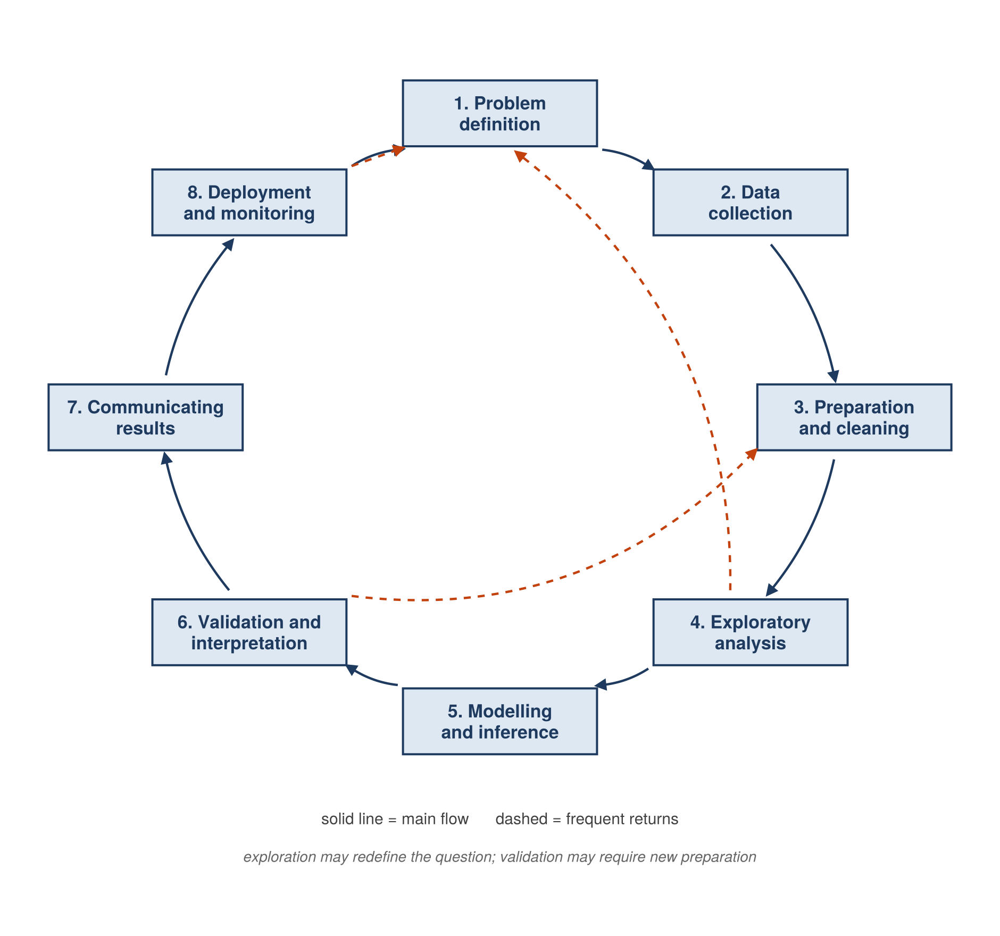

Data analysis is almost never what courses draw: a straight line that starts in a spreadsheet and ends in a nice chart. In practice it is a **cycle** — linked stages, with frequent returns to earlier phases, whose goal is not to produce a chart but to produce a **defensible decision**.

In this post I go through the eight stages of that cycle: what characterizes each one, the typical mistake made in it, and the criterion that lets you say "this stage is done". At the end, I show how the classic frameworks — CRISP-DM, KDD, SEMMA, OSEMN — say almost the same things with different names.

---

## 1. The cycle, in one figure

The life cycle organizes analytical work into stages with defined inputs, outputs and quality criteria. Its most important property is the one the figure tries to make explicit: **this is not a conveyor belt**.

<figure style="display: flex; flex-direction: column; align-items: center; margin: 2.5em 0 2em 0;">
  
  <figcaption class="img-caption-contrast">
    <strong>Figure 1:</strong> the eight stages of the cycle. The solid arrows are the main flow; the dashed ones are the returns that happen in practically every real project — exploration redefining the question, validation requiring new preparation, monitoring opening the next iteration. Diagram generated in Julia (CairoMakie) for this post.
  </figcaption>
</figure>

The three dashed arrows are neither decoration nor a sign of a badly run project. They are the normal behaviour of analytical work: discoveries made during exploration reshape the original question, and what is observed in production feeds the next iteration.

Where the time goes
In many projects, preparing and cleaning the data takes more time than any other stage. There is no universal number for that share: it depends on the quality of the source data and on how much the collection was designed for the question.

The most expensive stage tends to be the least glamorous — and it is the one that determines the quality of everything else.

---

## 2. Problem definition

No technique makes up for a badly framed question. This stage turns a vague request (*"we want to understand churn"*) into an answerable analytical question, with explicit scope, unit of analysis and success criterion.

- **Input:** business demand, domain context, constraints of time and data.
- **Output:** an operationalized question, hypotheses, success metrics, definition of the population and of the time horizon.

Four questions need an answer before the first line of code is written:

1. **What decision will be made based on this result?** If none, the project is optional.
2. **What is the unit of analysis** — customer, transaction, session, month?
3. **What is the aim:** to *describe* (what happened), *diagnose* (why), *predict* (what will happen) or *prescribe* (what to do)?
4. **What would an inconvenient result look like**, and would it still be accepted?

The fourth is the one most people skip, and it is what separates analysis from a commissioned answer. If the answer is "no", what is being requested is not an analysis.

**Typical pitfall:** confusing a metric with the concept it stands for. "Engagement" is not "number of clicks"; choosing the wrong proxy here irreversibly contaminates every later stage — and the worst part is that nothing in the later stages will flag the mistake.

---

## 3. Data collection and acquisition

This is where the raw material is gathered: transactional databases, *data warehouses*, APIs, third-party files, *web scraping*, product instrumentation, surveys and designed experiments.

The distinction that matters most:

- **Primary data** are generated to answer *your* question (experiments, questionnaires) — expensive, but aligned with the problem.
- **Secondary data** already exist (logs, internal systems, public databases) — cheap, but collected for another purpose, which introduces silent biases.

Three central precautions:

- **Representativeness.** The mechanism that generated the data also decides who is *not* in them. Survivors, respondents and active users rarely represent the population of interest.
- **Traceability.** Record the source, extraction date, query used and version of the database. Analysis without provenance is not reproducible — and, six months later, nobody remembers which snapshot that number came from.
- **Compliance.** A legal basis for the processing, minimization of personal data, anonymization whenever possible (Brazil's LGPD, the European GDPR).

---

## 4. Preparation, cleaning and transformation

The longest stage, by a wide margin. Raw data are practically never ready for analysis. The aim is to reach a *tidy* data set: **each row an observation, each column a variable, each cell a value**.

<table>
  <thead>
    <tr>
      <th>Problem</th>
      <th>Usual treatment</th>
    </tr>
  </thead>
  <tbody>
    <tr>
      <td><strong>Missing data</strong></td>
      <td>Diagnose the mechanism (MCAR, MAR, MNAR) before deciding; deletion, single or multiple imputation. Never impute without recording what was imputed.</td>
    </tr>
    <tr>
      <td><strong>Duplicates</strong></td>
      <td>Define the key that identifies a unique observation; deduplicate by an explicit rule, not by intuition.</td>
    </tr>
    <tr>
      <td><strong>Type and format inconsistencies</strong></td>
      <td>Standardize dates, units, text encoding and categories written in different ways ("SP", "S.P.", "São Paulo").</td>
    </tr>
    <tr>
      <td><strong>Outliers</strong></td>
      <td>Separate measurement errors from legitimate extreme values. The second case is often the most informative in the data set.</td>
    </tr>
    <tr>
      <td><strong>Scales and distributions</strong></td>
      <td>Standardization, normalization, transformations (log, Box–Cox) when the later method requires them.</td>
    </tr>
    <tr>
      <td><strong>Derived variables</strong></td>
      <td><em>Feature engineering</em>: ratios, lags, window aggregations, encoding of categorical variables.</td>
    </tr>
  </tbody>
</table>

### MCAR, MAR, MNAR: why the mechanism decides everything

The first row of the table deserves a paragraph of its own, because it is the item that most silently invalidates analyses. The classification of missing-data mechanisms into these three acronyms is usually attributed to the work of **Donald Rubin (1976)**, and the central idea is that what matters is not *how much* is missing — it is **why it is missing**.

The three mechanisms

- **MCAR** (*missing completely at random*) — missingness **depends on nothing**: neither on the value that is missing nor on any observed variable. The laboratory equipment burned out on a Tuesday and that day's samples were lost. The data present are a simple random sample of the complete data.
- **MAR** (*missing at random*) — missingness depends **only on what you observed**. Income is missing more often in questionnaires from young people; if age is recorded, then *within each age band* missingness does not depend on income itself. The name is unfortunate: it is not "random", it is **random conditional on what was observed**.
- **MNAR** (*missing not at random*) — missingness depends on **the very value that was not observed**. Income is missing more often among people who earn a lot: the probability of answering is a function of exactly the number you do not have.

The practical consequence of each is different, and this is where the choice of treatment is decided:

<table>
  <thead>
    <tr>
      <th>Mechanism</th>
      <th>Is dropping incomplete cases valid?</th>
      <th>Does imputation fix it?</th>
      <th>Can it be tested in the data?</th>
    </tr>
  </thead>
  <tbody>
    <tr>
      <td><strong>MCAR</strong></td>
      <td>Yes — you lose power, not validity</td>
      <td>Unnecessary, but recovers power</td>
      <td>Partly: MCAR can be rejected (for example, with Little's test, 1988), not confirmed</td>
    </tr>
    <tr>
      <td><strong>MAR</strong></td>
      <td>Generally not — it can bias (depends on what is estimated)</td>
      <td>Yes, <em>if</em> the imputation model includes the variables that explain the missingness</td>
      <td><strong>No</strong></td>
    </tr>
    <tr>
      <td><strong>MNAR</strong></td>
      <td>Generally not — it can bias</td>
      <td>Not with the usual methods</td>
      <td><strong>No</strong></td>
    </tr>
  </tbody>
</table>

Under MAR, imputing income without using age saves nobody: the guarantee holds for the model that contains the variable responsible for the missingness, not for any imputation. And under MNAR, no method that uses only the observed data corrects the problem — what is left is to model the missingness mechanism itself (Heckman selection models, *pattern-mixture models*) or, more honestly, to run a **sensitivity analysis**: show how the conclusion changes under alternative assumptions about the missing values.

The point most texts leave out:

MAR versus MNAR cannot be decided from the data
There is no test. By definition, telling the two apart would require knowing the missing values — and if you knew them, there would be no problem at all.

In other words: **MAR is always an assumption, never a finding.** That is why the table says "diagnose the mechanism *before* deciding": the diagnosis is substantive, not statistical. It comes from understanding how the data were collected — who answered, who dropped out, what the system failed to record and why. It is the same logic of representativeness as in the previous stage: the mechanism that generated the data also decides who is *not* in them.

### An example with numbers

To see the three situations happening, the code below makes up the monthly income of 100,000 people (in thousands of BRL; illustrative numbers), with income growing with age, and deletes values in three ways:

- **MCAR:** 30% of the values disappear, depending on nothing.
- **MAR:** 50% of the incomes of people under 30 disappear, and 15% of the others. Missingness depends only on age, which is recorded.
- **MNAR:** 50% of the incomes above the 70th percentile disappear, and 15% of the others. Missingness depends on income itself.

In each case, the code computes the mean in two ways: with the complete cases only, and after imputing each missing value with the observed mean of its age band (10-year bands).

  

  

    
Julia

    

    <button class="copy-button" onclick="copyCode(this)">
      <i class="bi bi-clipboard"></i>Copy
    </button>
  

  

    <pre><code>using Random, Statistics, Printf

# Monthly income (thousands of BRL) of 100,000 people: made-up numbers, for illustration only.
# Income grows with age, so younger people earn less on average.
Random.seed!(123)
n = 100_000
age = rand(18:70, n)
income = 1.0 .+ 0.08 .* age .+ randn(n)

band = div.(age, 10)                          # 10-year bands: 1 = 18–19, 2 = 20–29, …
miss_mcar = rand(n) .&lt; 0.30                     # 30% missing, depending on nothing
miss_mar  = rand(n) .&lt; ifelse.(age .&lt; 30, 0.50, 0.15)                     # depends on age
miss_mnar = rand(n) .&lt; ifelse.(income .&gt; quantile(income, 0.70), 0.50, 0.15)  # depends on income

# Simple imputation: each missing value gets the observed mean of its age band
function impute_by_band(income, missing, band)
    completed = copy(income)
    for f in unique(band)
        group = band .== f
        completed[group .&amp; missing] .= mean(income[group .&amp; .!missing])
    end
    completed
end

@printf("true mean:                   %.3f\n", mean(income))
for (name, missing) in (("MCAR", miss_mcar), ("MAR", miss_mar), ("MNAR", miss_mnar))
    @printf("%-4s  missing %4.1f%%   complete cases %.3f   imputed by band %.3f\n", name,
            100 * mean(missing), mean(income[.!missing]), mean(impute_by_band(income, missing, band)))
end</code></pre>
  

  
# Output

  <pre style="overflow-x: auto; font-size: 0.9em;">true mean:                   4.519
MCAR  missing 29.9%   complete cases 4.518   imputed by band 4.521
MAR   missing 22.9%   complete cases 4.689   imputed by band 4.522
MNAR  missing 25.5%   complete cases 4.256   imputed by band 4.406</pre>

  

  

  

    
R

    

    <button class="copy-button" onclick="copyCode(this)">
      <i class="bi bi-clipboard"></i>Copy
    </button>
  

  

    <pre><code># Monthly income (thousands of BRL) of 100,000 people: made-up numbers, for illustration only.
# Income grows with age, so younger people earn less on average.
set.seed(123)
n &lt;- 100000
age &lt;- sample(18:70, n, replace = TRUE)
income &lt;- 1 + 0.08 * age + rnorm(n)

band &lt;- age %/% 10                            # 10-year bands: 1 = 18–19, 2 = 20–29, …
miss_mcar &lt;- runif(n) &lt; 0.30                    # 30% missing, depending on nothing
miss_mar  &lt;- runif(n) &lt; ifelse(age &lt; 30, 0.50, 0.15)                     # depends on age
miss_mnar &lt;- runif(n) &lt; ifelse(income &gt; quantile(income, 0.70), 0.50, 0.15)  # depends on income

# Simple imputation: each missing value gets the observed mean of its age band
impute_by_band &lt;- function(income, missing, band) {
  means &lt;- tapply(income[!missing], band[!missing], mean)
  completed &lt;- income
  completed[missing] &lt;- means[as.character(band[missing])]
  completed
}

cat(sprintf("true mean:                   %.3f\n", mean(income)))
for (name in c("MCAR", "MAR", "MNAR")) {
  missing &lt;- list(MCAR = miss_mcar, MAR = miss_mar, MNAR = miss_mnar)[[name]]
  cat(sprintf("%-4s  missing %4.1f%%   complete cases %.3f   imputed by band %.3f\n", name,
              100 * mean(missing), mean(income[!missing]), mean(impute_by_band(income, missing, band))))
}</code></pre>
  

  
# Output

  <pre style="overflow-x: auto; font-size: 0.9em;">true mean:                   4.513
MCAR  missing 30.1%   complete cases 4.516   imputed by band 4.514
MAR   missing 23.0%   complete cases 4.684   imputed by band 4.511
MNAR  missing 25.8%   complete cases 4.249   imputed by band 4.399</pre>

  

  

  

    
Python

    

    <button class="copy-button" onclick="copyCode(this)">
      <i class="bi bi-clipboard"></i>Copy
    </button>
  

  

    <pre><code>import numpy as np
import pandas as pd

# Monthly income (thousands of BRL) of 100,000 people: made-up numbers, for illustration only.
# Income grows with age, so younger people earn less on average.
rng = np.random.default_rng(123)
n = 100_000
age = rng.integers(18, 71, n)
income = 1.0 + 0.08 * age + rng.normal(size=n)

band = age // 10                              # 10-year bands: 1 = 18–19, 2 = 20–29, …
missing = {
    "MCAR": rng.random(n) &lt; 0.30,                                            # depending on nothing
    "MAR": rng.random(n) &lt; np.where(age &lt; 30, 0.50, 0.15),                 # depends on age
    "MNAR": rng.random(n) &lt; np.where(income &gt; np.quantile(income, 0.70), 0.50, 0.15),  # on income
}

def impute_by_band(income, missing, band):
    """Each missing value gets the observed mean of its age band."""
    s = pd.Series(np.where(missing, np.nan, income))
    return s.fillna(s.groupby(band).transform("mean")).to_numpy()

print(f"true mean:                   {income.mean():.3f}")
for name, f in missing.items():
    print(f"{name:&lt;4}  missing {100 * f.mean():4.1f}%   complete cases {income[~f].mean():.3f}   "
          f"imputed by band {impute_by_band(income, f, band).mean():.3f}")</code></pre>
  

  
# Output

  <pre style="overflow-x: auto; font-size: 0.9em;">true mean:                   4.518
MCAR  missing 29.9%   complete cases 4.518   imputed by band 4.519
MAR   missing 22.8%   complete cases 4.682   imputed by band 4.513
MNAR  missing 25.6%   complete cases 4.251   imputed by band 4.401</pre>

  

In the Julia version, the true mean is 4.519. The three languages draw different numbers, but they tell the same story:

- **MCAR:** the complete cases give 4.518. Dropping created no bias, it only made the sample smaller. This holds whenever missingness is independent of the variable, and it is proved in Lean (`provas/Provas/CicloVida.lean`).
- **MAR:** the complete cases give 4.689. Since more young people, who earn less, are missing, the mean goes up. The exact calculation gives the same value: with ages from 18 to 70 equally likely, the expected mean of the complete cases is 4.689 and the share missing is 22.9%. Imputing by age band, the variable that explains the missingness, recovers 4.522.
- **MNAR:** the complete cases give 4.256, and imputation by age band only reaches 4.406. No correction built from what was observed brings back what disappeared precisely because it was high.

That is where the second sentence of that cell comes from — *never impute without recording what was imputed*. An imputed value carries uncertainty that a measured value does not. If it circulates unmarked, validation (stage 6) will measure accuracy on made-up numbers, with no way of knowing it.

Data leakage
Any transformation that uses statistics of the full data set (mean, deviation, categories) must be **fitted on the training set only** and then applied to the others.

Standardizing before splitting the data is the most common mistake and the hardest to detect — it produces optimistic metrics that collapse in production, and nothing in the report gives the problem away.

---

## 5. Exploratory data analysis (EDA)

Before modelling, you need to know the data. EDA is deliberately open-ended: it looks for structure, patterns, anomalies and relationships, and it serves both to generate hypotheses and to check the assumptions of the techniques to come.

- **Univariate:** distributions, measures of central tendency and dispersion, skewness, counts by category.
- **Bivariate:** correlations, cross-tabulations, comparisons between groups, scatter plots.
- **Multivariate:** interactions, dimensionality reduction, clustering, temporal and spatial structure.

Visualization is not decoration: it is the main instrument of this stage. [Anscombe's quartet](/quarteto-de-anscombe-por-que-graficos-sao-indispensaveis-na-estatistica/) (in Portuguese) and the data sets by Matejka and Fitzmaurice (2017), known as the *Datasaurus Dozen*, show data with practically equal means, variances and correlations and radically different shapes. **Numerical summaries hide; charts reveal.**

**Typical pitfall:** *p-hacking* by exploration — testing dozens of relationships and reporting only the significant ones. EDA **generates** hypotheses; it does not confirm them. Confirmation requires data that were not used to formulate them.

---

## 6. Modelling and inference

Here the question is formalized as a model. The choice follows directly from the aim defined in stage 1 — not from what is fashionable:

<table>
  <thead>
    <tr>
      <th>Aim</th>
      <th>Question</th>
      <th>Typical approaches</th>
    </tr>
  </thead>
  <tbody>
    <tr>
      <td><strong>Descriptive</strong></td>
      <td>What happened?</td>
      <td>Descriptive statistics, segmentation, clustering, historical series.</td>
    </tr>
    <tr>
      <td><strong>Inferential</strong></td>
      <td>Does the observed pattern hold in the population?</td>
      <td>Confidence intervals, hypothesis tests, linear and generalized models, Bayesian methods.</td>
    </tr>
    <tr>
      <td><strong>Predictive</strong></td>
      <td>What is likely to happen?</td>
      <td>Regression, trees and <em>ensembles</em>, neural networks, time series models.</td>
    </tr>
    <tr>
      <td><strong>Causal</strong></td>
      <td>What happens <em>if</em> we intervene?</td>
      <td>Randomized experiments, difference-in-differences, instrumental variables, propensity scores.</td>
    </tr>
  </tbody>
</table>

Prediction is not causation
A model can predict very well using variables that cause nothing — ice cream sales predict drownings. To answer "what should we do", high-accuracy prediction is **insufficient**: a causal identification design is needed.

A good modelling report always includes three things: the assumptions made, the validation strategy and the **simplest model that serves as a baseline**. A complex model that does not beat the historical mean does not justify its own complexity.

---

## 7. Validation and interpretation

The stage of counter-evidence. A result only counts if it survives honest attempts to knock it down.

- **Statistical validation:** checking assumptions, residual analysis, cross-validation, evaluation on an untouched test set and — when there is a time dimension — *out-of-time* validation.
- **Sensitivity analysis:** do the results change under other reasonable choices of cleaning, specification or period?
- **Metrics that fit the problem:** accuracy is misleading on imbalanced data; the choice between precision, recall, AUC, calibration or expected cost should reflect the real cost of the errors.
- **Practical significance:** a statistically significant effect can be irrelevant in size. Report the **effect size**, not just the p-value.
- **Fairness and bias:** does performance hold across subgroups? Models trained on historical data inherit historical inequalities.

---

## 8. Communicating the results

An analysis that is not understood does not produce a decision. Communication should be built for the audience, not for the analyst.

- **Structure:** conclusion first, then evidence, then method. Technical detail goes to the appendix.
- **Honesty about uncertainty:** show intervals, not just points; state limitations and what the data do **not** allow you to claim.
- **Responsible visualization:** no misleadingly truncated axes, comparable scales, no decorative clutter.
- **Actionable recommendation:** link each conclusion to the decision it informs and to its degree of confidence.

---

## 9. Deployment and monitoring

When the result feeds a recurring process — a *dashboard*, a score in production, an automated rule — the cycle does not end at delivery.

- **Operationalization:** versioning of code, data and model; reproducible pipelines; automated tests on the input data.
- **Performance monitoring:** do the validation metrics hold with new data?
- ***Data drift* and *concept drift*:** the distribution of the variables changes; so does the relationship between the variables and the target. A model that is stable in an unstable world degrades silently.
- **Feedback loops:** a model that influences the behaviour it predicts changes the very data that feed it.
- **Retirement criterion:** define the retraining or retirement trigger **before** deployment.

---

## 10. The classic frameworks, side by side

Different traditions name the same stages in different ways. It is worth knowing the correspondence so you do not get lost when someone says "we are in the *Modify* phase".

<table>
  <thead>
    <tr>
      <th>This cycle</th>
      <th>CRISP-DM</th>
      <th>KDD</th>
      <th>SEMMA</th>
      <th>OSEMN</th>
    </tr>
  </thead>
  <tbody>
    <tr>
      <td>1. Problem</td>
      <td>Business understanding</td>
      <td>—</td>
      <td>—</td>
      <td>—</td>
    </tr>
    <tr>
      <td>2. Collection</td>
      <td>Data understanding</td>
      <td>Selection</td>
      <td><em>Sample</em></td>
      <td><em>Obtain</em></td>
    </tr>
    <tr>
      <td>3. Preparation</td>
      <td>Data preparation</td>
      <td>Pre-processing and transformation</td>
      <td><em>Modify</em></td>
      <td><em>Scrub</em></td>
    </tr>
    <tr>
      <td>4. Exploration</td>
      <td>Data understanding</td>
      <td>—</td>
      <td><em>Explore</em></td>
      <td><em>Explore</em></td>
    </tr>
    <tr>
      <td>5. Modelling</td>
      <td>Modeling</td>
      <td>Data mining</td>
      <td><em>Model</em></td>
      <td><em>Model</em></td>
    </tr>
    <tr>
      <td>6. Validation</td>
      <td>Evaluation</td>
      <td>Interpretation / evaluation</td>
      <td><em>Assess</em></td>
      <td>—</td>
    </tr>
    <tr>
      <td>7. Communication</td>
      <td>Deployment</td>
      <td>Consolidating the knowledge</td>
      <td>—</td>
      <td>i<em>N</em>terpret</td>
    </tr>
    <tr>
      <td>8. Monitoring</td>
      <td>Deployment</td>
      <td>—</td>
      <td>—</td>
      <td>—</td>
    </tr>
  </tbody>
</table>

- **CRISP-DM** has six phases (business understanding, data understanding, data preparation, modeling, evaluation and deployment), is explicitly iterative and starts from the business, not from the data.
- **KDD** (*knowledge discovery in databases*) emphasizes the discovery of knowledge; in its most cited version, its stages are selection, pre-processing, transformation, data mining and interpretation/evaluation.
- **SEMMA** (*Sample, Explore, Modify, Model, Assess*) comes from SAS and covers the technical modelling cycle; it has no stage for framing the problem or for deployment. SAS itself presents it as an organization of its software's tools rather than as a general methodology.
- **OSEMN** is a mnemonic (*Obtain, Scrub, Explore, Model, iNterpret*).

The correspondence in the table is approximate and is this post's reading: each framework divides the work in its own way.

None of them replaces judgement: **they are maps, not rails.** Notice the dashes in the table — the gaps say more about each framework than the filled cells do.

---

## 11. Why the cycle is iterative

Three returns are so frequent that they should be **planned in the schedule**, not treated as surprises:

1. **Exploration → Problem definition.** EDA reveals that the original question cannot be answered with the available data, or that the interesting question is a different one.
2. **Validation → Preparation.** Residuals with structure, unstable performance across subgroups or detected leakage force a revision of how the variables were built.
3. **Monitoring → New cycle.** Degradation in production is new information about the phenomenon, and it starts the next iteration with a better question.

Treating these returns as failure leads to hiding them. Treating them as part of the process is what distinguishes mature analysis from rushed analysis.

---

## 12. Checklist: when a stage is done

A stage is done when…

1. **Problem:** the question fits in one sentence and the decision it informs is named.
2. **Collection:** the origin of every field is traceable and the mechanism that selected the sample is known.
3. **Preparation:** every transformation is in executable code, and the data set can be rebuilt from the raw data without manual intervention.
4. **Exploration:** you can describe the distribution of every relevant variable and explain every anomaly found.
5. **Modelling:** there is a simple baseline and the chosen model beats it measurably.
6. **Validation:** performance was measured on data never used to fit anything, and it is stable under reasonable alternative choices.
7. **Communication:** the audience can reproduce the conclusion and state the limitations in their own words.
8. **Deployment:** there is a monitored metric, an alert in place and a retraining criterion defined.

---

> *"All models are wrong but some are useful."*
> — George E. P. Box, title of a section of "Robustness in the Strategy of Scientific Model Building" (1979), p. 202

The cycle exists to make the most of the second half of the sentence.

---

## Summary

- Data analysis is a cycle of eight stages, and three returns (exploration → problem, validation → preparation, monitoring → new cycle) are expected, not accidents.
- The question comes before the data: without the decision the result will inform, no technique saves the project.
- In preparation, what decides how to treat missing values is *why* they are missing. Under MCAR, dropping does not bias; under MAR, only imputation that uses the variable responsible for the missingness corrects; under MNAR, the observed data are not enough, and what is left is sensitivity analysis.
- Prediction is not causation, significance is not importance, and every model must beat a simple baseline.
- The cycle does not end at delivery: what happens in production is the input of the next iteration.

---

## References

- Rubin, D. B. (1976). Inference and missing data. *Biometrika*, 63(3), 581–592. DOI: [10.1093/biomet/63.3.581](https://doi.org/10.1093/biomet/63.3.581). (Not consulted directly.)
- Little, R. J. A. (1988). A test of missing completely at random for multivariate data with missing values. *Journal of the American Statistical Association*, 83(404), 1198–1202. DOI: [10.1080/01621459.1988.10478722](https://doi.org/10.1080/01621459.1988.10478722).
- Matejka, J.; Fitzmaurice, G. (2017). Same stats, different graphs. In: *Proceedings of the 2017 CHI Conference on Human Factors in Computing Systems*, pp. 1290–1294. DOI: [10.1145/3025453.3025912](https://doi.org/10.1145/3025453.3025912). (Not consulted directly.)
- Box, G. E. P. (1979). Robustness in the strategy of scientific model building. In: Launer, R. L.; Wilkinson, G. N. (Eds.). *Robustness in Statistics*. Academic Press, pp. 201–236.
