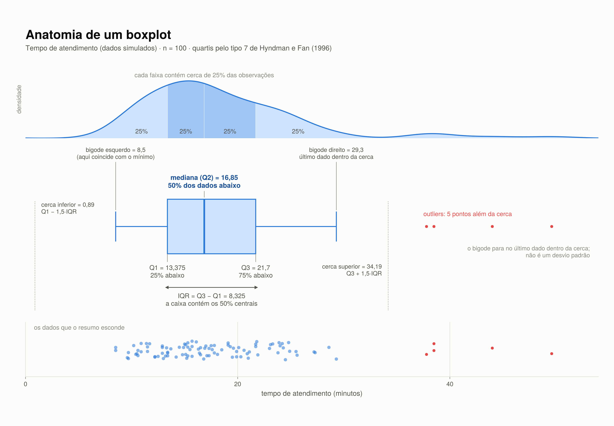
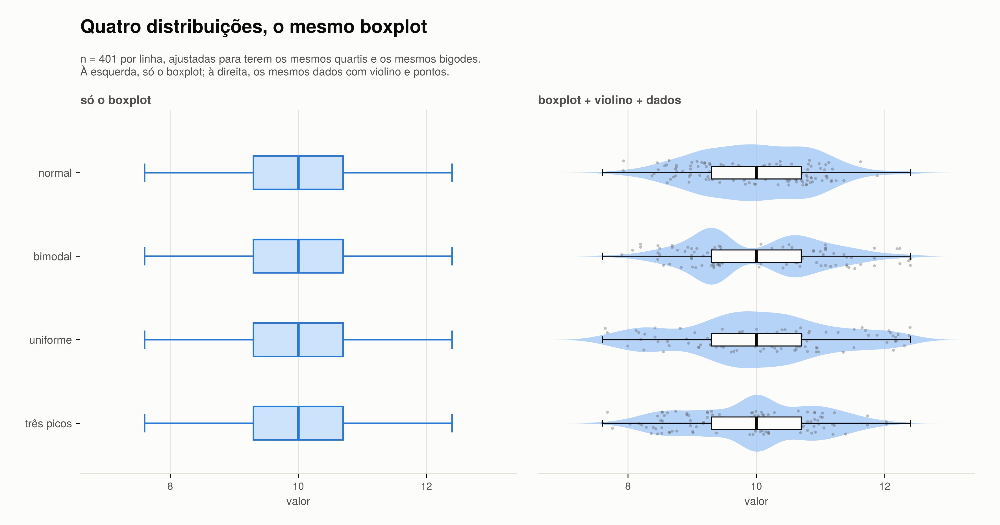
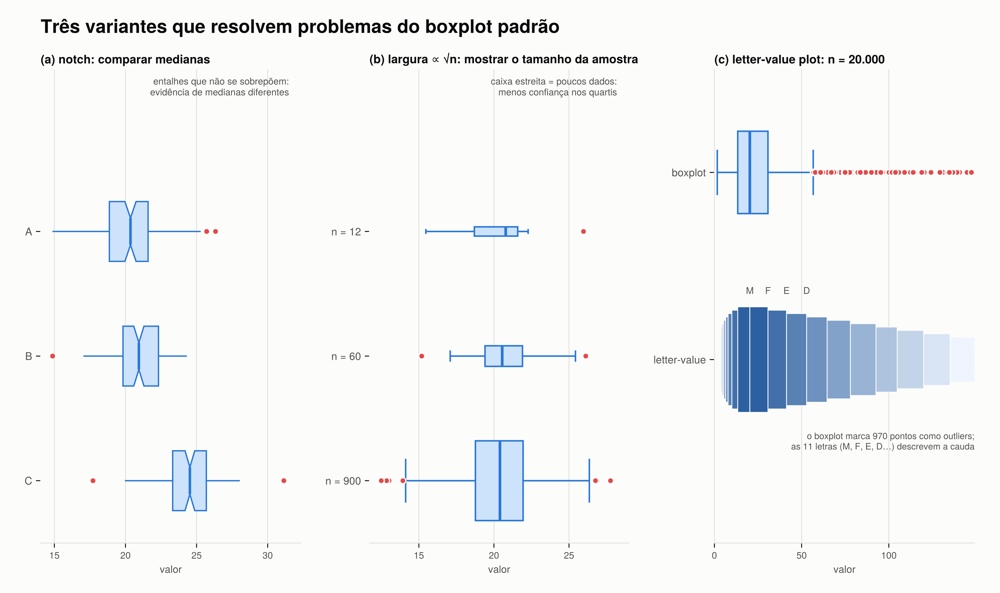

Existe um gráfico que todo relatório estatístico tem e que quase ninguém lê inteiro. O leitor olha a caixa, localiza a mediana, vê os pontinhos soltos e segue em frente. Passa sem saber que a ponta do bigode quase nunca é o valor máximo, que o número 1,5 da regra das cercas é uma escolha, e não uma dedução, e que dois programas podem desenhar caixas diferentes para os mesmos dados.

Este post desmonta o **boxplot** peça por peça. Para cada elemento: o que é, como se calcula (à mão, com um exemplo de 100 números) e como se interpreta. No fim vêm o que ele esconde, as variantes que resolvem cada limitação e o código em Julia, R e Python que gera tudo.

---

## 1. O boxplot em uma figura

---

O **boxplot** (diagrama de caixa, em inglês *box plot* ou *box-and-whisker plot*) aparece em quase todo relatório estatístico, e muita gente o lê pela metade. Quase todo mundo sabe apontar a mediana. Bem menos gente sabe dizer o que a ponta do bigode representa, de onde vem o 1,5 da conta das cercas ou por que dois programas desenham caixas ligeiramente diferentes para os mesmos dados.

Cada elemento do gráfico tem três perguntas a responder: **o que é**, **como se calcula** e **como se interpreta**.

A figura abaixo é o mapa do post. Ela mostra, sobre o mesmo eixo horizontal: a distribuição dos dados (em cima), o boxplot com todos os elementos anotados (no meio) e os dados brutos que o resumo esconde (embaixo).

<figure style="text-align:center; margin: 2em auto; max-width: 1000px;">
  
  <figcaption style="margin-top:0.75em; font-size:0.88rem; color:#555;">
    Figura 1. Anatomia de um boxplot. Tempo de atendimento de 100 pessoas, em minutos (dados simulados, só para ilustrar). Compare o bigode direito, que para em 29,3, com a cerca superior, em 34,19: o bigode é sempre um dado observado. O código está na seção 11.
  </figcaption>
</figure>

  <strong>A ideia em uma frase:</strong> 
  O boxplot troca 100 números por cinco, escolhidos de modo que o resumo não se deixe levar por valores extremos, e marca à parte tudo o que ficou longe demais do miolo.

---

## 2. Os cinco números de Tukey

---

O gráfico foi apresentado por **John W. Tukey**, com o nome de *schematic plot*, numa edição preliminar do livro *Exploratory Data Analysis*, em 1970. Só ficou conhecido com a publicação do livro, em 1977. A forma básica, uma barra com caixa e extremos (o *range bar*), já aparecia num livro de **Mary Eleanor Spear** de 1952. Segundo Wickham e Stryjewski (2011), a contribuição de Tukey foi escolher resumos que funcionassem bem para dados muito diferentes e ligá-los às peças do desenho.

A base é o **resumo de cinco números**. No exemplo deste post, com os 100 tempos de atendimento:

<table class="mk-table">
  <thead>
    <tr>
      <th>Elemento</th>
      <th>O que é</th>
      <th>No exemplo (minutos)</th>
    </tr>
  </thead>
  <tbody>
    <tr>
      <td>Mínimo</td>
      <td>Menor valor observado</td>
      <td>8,5</td>
    </tr>
    <tr>
      <td>Q1 (1º quartil)</td>
      <td>Valor que deixa cerca de 25% das observações abaixo</td>
      <td>13,375</td>
    </tr>
    <tr>
      <td>Q2 (mediana)</td>
      <td>Valor que divide a amostra ordenada ao meio</td>
      <td>16,85</td>
    </tr>
    <tr>
      <td>Q3 (3º quartil)</td>
      <td>Valor que deixa cerca de 75% das observações abaixo</td>
      <td>21,7</td>
    </tr>
    <tr>
      <td>Máximo</td>
      <td>Maior valor observado</td>
      <td>49,6</td>
    </tr>
  </tbody>
</table>

Os quartis estão com todas as casas que a conta produz; a seção 4 mostra a conta. Os dados têm uma casa decimal, e a interpolação dos quartis acrescenta mais.

Repare que o gráfico **não desenha necessariamente o mínimo e o máximo**. Ele desenha os quartis e, no lugar dos extremos, os *bigodes*, que param no último dado dentro das cercas. Aqui o bigode esquerdo coincide com o mínimo, mas o direito não chega nem perto do máximo. Essa é a fonte de erro de leitura mais comum, e a seção 5 trata dela.

---

## 3. A caixa: Q1, mediana, Q3 e o IQR

---

### 3.1 A caixa

A caixa vai de $Q_1$ a $Q_3$. Ela contém cerca de **50% centrais** dos dados: um quarto deles fica entre $Q_1$ e a mediana, outro quarto entre a mediana e $Q_3$. No painel de cima da figura 1, são as duas faixas mais escuras sob a curva.

### 3.2 A linha interna

A linha grossa dentro da caixa é a **mediana**, não a média. A distinção importa. A mediana depende só dos valores do meio da amostra ordenada, então não se move quando um valor extremo fica ainda mais extremo. A média se move.

No exemplo, a média é 18,372 minutos e a mediana, 16,85. A média fica acima porque os poucos atendimentos muito longos (até 49,6 minutos) puxam a média para cima e não mexem na mediana. Média bem acima da mediana costuma indicar uma cauda longa à direita, mas não é regra sem exceção: o boxplot e o histograma é que confirmam.

### 3.3 O IQR

A largura da caixa é o **intervalo interquartil** (IQR, do inglês *interquartile range*):

$$
\mathrm{IQR} = Q_3 - Q_1
$$

No exemplo:

$$
\mathrm{IQR} = 21{,}7 - 13{,}375 = 8{,}325 \text{ minutos}
$$

Ou seja, a metade central dos atendimentos durou entre 13,375 e 21,7 minutos, uma faixa de pouco mais de 8 minutos.

O IQR é a medida de dispersão do boxplot. Ele cumpre papel parecido com o do desvio padrão, com uma vantagem: seu **ponto de ruptura** é de 25%. Dá para trocar quase um quarto das observações por valores absurdos sem que o IQR dispare, porque os quartis continuam caindo sobre dados bons. Com o desvio padrão, basta um único valor absurdo para inflar a medida sem limite.

  <strong>Como interpretar a caixa:</strong> 
  Posição da caixa = onde estão os valores típicos. Largura da caixa = quão espalhados eles são. Posição da mediana <em>dentro</em> da caixa = indício de assimetria.

### 3.4 A assimetria já aparece dentro da caixa

Compare as duas metades da caixa:

$$
Q_2 - Q_1 = 16{,}85 - 13{,}375 = 3{,}475
\qquad\text{e}\qquad
Q_3 - Q_2 = 21{,}7 - 16{,}85 = 4{,}85
$$

As duas somam o IQR: $3{,}475 + 4{,}85 = 8{,}325$. A metade de cima é mais larga, então entre a mediana e $Q_3$ os dados estão mais espalhados do que entre $Q_1$ e a mediana. Isso é **assimetria à direita**, e dá para vê-la sem calcular nenhum coeficiente: basta notar que a linha da mediana não está no centro da caixa.

---

## 4. Como se calcula um quartil (e por que programas discordam)

---

Este é o detalhe que muitos textos didáticos omitem: **não existe uma única definição de quartil amostral**. Hyndman e Fan (1996) compararam **nove** definições usadas em pacotes estatísticos.

Julia, R e NumPy usam por padrão a **definição 7** desse artigo, o "tipo 7". As documentações das três dizem isso, e o código da seção 11 dá o mesmo resultado nas três.

### 4.1 O tipo 7, passo a passo

**Dados.** A amostra ordenada $x_{(1)} \le x_{(2)} \le \dots \le x_{(n)}$, com $n = 100$ (os valores estão no código da seção 11). Só seis deles entram nas contas:

<table class="mk-table">
  <thead>
    <tr><th>Posição</th><th>25</th><th>26</th><th>50</th><th>51</th><th>75</th><th>76</th></tr>
  </thead>
  <tbody>
    <tr><td>Valor (minutos)</td><td>13,3</td><td>13,4</td><td>16,8</td><td>16,9</td><td>21,7</td><td>21,7</td></tr>
  </tbody>
</table>

**Fórmula.** Para a proporção $p$ (0,25 para Q1, 0,5 para a mediana, 0,75 para Q3), calcula-se a posição $h$, separa-se a parte inteira $j = \lfloor h \rfloor$ (o maior inteiro que não passa de $h$) e a parte fracionária $g = h - j$, e interpola-se entre as duas observações vizinhas:

$$
h = (n-1)\,p + 1, \qquad
Q(p) = x_{(j)} + g\,\bigl(x_{(j+1)} - x_{(j)}\bigr)
$$

**Q1** ($p = 0{,}25$):

$$
\begin{aligned}
h &= (100 - 1) \times 0{,}25 + 1 = 99 \times 0{,}25 + 1 = 24{,}75 + 1 = 25{,}75\\
j &= 25, \quad g = 0{,}75\\
Q_1 &= x_{(25)} + 0{,}75 \times \bigl(x_{(26)} - x_{(25)}\bigr)\\
&= 13{,}3 + 0{,}75 \times (13{,}4 - 13{,}3)\\
&= 13{,}3 + 0{,}75 \times 0{,}1\\
&= 13{,}3 + 0{,}075 = 13{,}375
\end{aligned}
$$

**Mediana** ($p = 0{,}5$):

$$
\begin{aligned}
h &= 99 \times 0{,}5 + 1 = 49{,}5 + 1 = 50{,}5\\
Q_2 &= x_{(50)} + 0{,}5 \times \bigl(x_{(51)} - x_{(50)}\bigr) = 16{,}8 + 0{,}5 \times 0{,}1 = 16{,}8 + 0{,}05 = 16{,}85
\end{aligned}
$$

**Q3** ($p = 0{,}75$):

$$
\begin{aligned}
h &= 99 \times 0{,}75 + 1 = 74{,}25 + 1 = 75{,}25\\
Q_3 &= x_{(75)} + 0{,}25 \times \bigl(x_{(76)} - x_{(75)}\bigr) = 21{,}7 + 0{,}25 \times 0 = 21{,}7
\end{aligned}
$$

Como $0 \le g \le 1$, o resultado fica sempre entre as duas observações vizinhas.

### 4.2 Os hinges de Tukey

O boxplot **original de Tukey** não usa esse quartil. Ele usa os *hinges*: a mediana da metade inferior e a mediana da metade superior da amostra ordenada, com a mediana geral entrando nas duas metades quando $n$ é ímpar. Na linguagem de profundidade (a posição contada a partir da ponta), o hinge inferior fica na profundidade

$$
d = \frac{\lfloor (n+1)/2 \rfloor + 1}{2}
$$

Com $n = 100$: $(n+1)/2 = 50{,}5$, cuja parte inteira é 50, e $d = (50 + 1)/2 = 25{,}5$. Profundidade "e meia" significa média das duas vizinhas:

$$
\text{hinge inferior} = \frac{x_{(25)} + x_{(26)}}{2} = \frac{13{,}3 + 13{,}4}{2} = \frac{26{,}7}{2} = 13{,}35
$$

O hinge superior fica na profundidade 25,5 contada de cima, isto é, entre $x_{(75)}$ e $x_{(76)}$: $(21{,}7 + 21{,}7)/2 = 21{,}7$.

O hinge inferior (13,35) difere do $Q_1$ do tipo 7 (13,375) em 0,025 minuto. É pouco, e não é acaso. A posição do hinge e a do quartil do tipo 7 ficam sempre a no máximo **1/4 de posição** uma da outra, e coincidem quando $n$ é ímpar. As duas afirmações estão provadas em Lean (`provas/Provas/Boxplot.lean`).

  <strong>Consequência prática:</strong> 
  Em amostras grandes a diferença some no desenho. Em amostras pequenas, a mesma amostra pode gerar caixas visivelmente diferentes em programas diferentes, e, como as cercas dependem dos quartis, isso pode mudar também quais pontos são marcados como outliers. Hyndman e Fan (1996, p. 364) notam ainda que um mesmo pacote pode usar uma definição para calcular quantis e outra para desenhar gráficos. O R é um exemplo: <code>quantile()</code> usa o tipo 7 e <code>boxplot()</code> usa os hinges de <code>fivenum()</code>. Ao publicar um boxplot, diga qual definição você usou.

---

## 5. Os bigodes e as cercas: de onde vem o 1,5

---

Esta é a parte do gráfico mais mal interpretada. São **duas coisas diferentes** com nomes parecidos.

### 5.1 As cercas: valores calculados

As cercas são limites aritméticos. A maioria dos programas não as desenha; na figura 1 elas aparecem pontilhadas, de propósito.

$$
\text{cerca inferior} = Q_1 - 1{,}5 \cdot \mathrm{IQR}
\qquad
\text{cerca superior} = Q_3 + 1{,}5 \cdot \mathrm{IQR}
$$

No exemplo, com os quartis da seção 4:

$$
\begin{aligned}
1{,}5 \times \mathrm{IQR} &= 1{,}5 \times 8{,}325 = 12{,}4875\\
\text{cerca inferior} &= 13{,}375 - 12{,}4875 = 0{,}8875\\
\text{cerca superior} &= 21{,}7 + 12{,}4875 = 34{,}1875
\end{aligned}
$$

A figura mostra 0,89 e 34,19, arredondados para duas casas.

### 5.2 Os bigodes: valores observados

O bigode **não vai até a cerca**. Ele para no **valor adjacente**: a observação mais extrema que ainda está *dentro* da cerca.

No exemplo, a cerca inferior está em 0,8875 minuto, mas nenhum atendimento durou tão pouco. O bigode esquerdo para em 8,5, o menor tempo observado, e aqui coincide com o mínimo. Do lado direito, a cerca está em 34,1875, e o bigode para em 29,3, o maior tempo que não passa dela. Os cinco tempos acima da cerca viram pontos soltos.

  <strong>Três leituras erradas comuns:</strong> 
  ❌ "O bigode é o mínimo e o máximo." Só quando não há outliers daquele lado. 
  ❌ "O bigode é um desvio padrão." O boxplot padrão não usa desvio padrão em lugar nenhum. 
  ❌ "O bigode marca 1,5 × IQR." Isso é a <em>cerca</em>. O bigode para no último dado antes dela.

### 5.3 Por que 1,5?

O 1,5 é uma escolha de Tukey, não uma dedução. Para ver o que ela significa, suponha dados de uma distribuição normal com média $\mu$ e desvio padrão $\sigma$. Os quartis da normal ficam em $\mu \pm z\sigma$, com $z = 0{,}6745$ (valor da tabela Z: $P(Z < 0{,}6745) = 0{,}75$). Então:

$$
\begin{aligned}
\mathrm{IQR} &= (\mu + z\sigma) - (\mu - z\sigma) = 2z\sigma = 1{,}349\,\sigma\\
\text{cerca superior} &= (\mu + z\sigma) + 1{,}5 \times 2z\sigma = \mu + 4z\sigma = \mu + 2{,}698\,\sigma
\end{aligned}
$$

Pela simetria, a cerca inferior fica em $\mu - 2{,}698\,\sigma$. A identidade $Q_3 + 1{,}5 \cdot \mathrm{IQR} = \mu + 4z\sigma$ está provada em Lean. Para a probabilidade, use $z$ sem arredondar ($z = 0{,}674490$), o que põe a cerca em $4z = 2{,}697959$ desvios padrão. A chance de uma observação normal cair fora das cercas é

$$
2 \times P(Z > 2{,}697959) = 2 \times 0{,}0034883 = 0{,}0069766 \approx 0{,}70\%
$$

com $P(Z > 2{,}697959)$ calculado em Julia com `ccdf(Normal(), 4 * quantile(Normal(), 0.75))`. Hofmann, Wickham e Kafadar (2017) chegam aos mesmos ±2,70σ e 0,7%.

  

    <strong>1,5 · IQR</strong>
    distância da cerca ao quartil
  

  

    <strong>2,698 σ</strong>
    a mesma cerca, se os dados forem normais
  

  

    <strong>0,70%</strong>
    pontos fora das cercas, se normal
  

  

    <strong>0,70</strong>
    outliers esperados em n = 100
  

Numa amostra normal de 100 observações, o número esperado de "outliers" é $100 \times 0{,}0069766 = 0{,}698$, ou cerca de 0,70. Isso é uma média de longo prazo: algumas amostras normais terão zero pontos soltos, outras terão dois ou três. O critério foi escolhido para ser raro sob normalidade e ainda assim sinalizar caudas pesadas.

Também se usa uma **cerca externa**, a $3 \cdot \mathrm{IQR}$ dos quartis, para separar os pontos muito distantes. Sob normalidade ela fica em $\mu \pm 7z\sigma = \mu \pm 4{,}72\,\sigma$, e a chance de passar dela é de cerca de 2 em cada milhão de observações.

---

## 6. Outliers: o que o ponto solto significa

---

Cada ponto além das cercas é desenhado individualmente. No exemplo são cinco: 37,8; 38,5; 38,5; 44,0 e 49,6 minutos.

O que esses pontos **significam**:

<table class="mk-table">
  <thead>
    <tr>
      <th>O ponto é…</th>
      <th>Leitura correta</th>
    </tr>
  </thead>
  <tbody>
    <tr>
      <td>um valor incomum <em>em relação ao IQR desta amostra</em></td>
      <td>É uma marcação relativa. Muda se a dispersão do resto mudar.</td>
    </tr>
    <tr>
      <td>um candidato à investigação</td>
      <td>Vale olhar o caso: erro de digitação? Outra população? Evento real e raro?</td>
    </tr>
    <tr>
      <td><strong>não</strong> um erro comprovado</td>
      <td>O critério é geométrico, não diagnóstico. Ele não sabe nada sobre o fenômeno.</td>
    </tr>
    <tr>
      <td><strong>não</strong> licença para excluir o dado</td>
      <td>Excluir uma observação só porque o gráfico a destacou é como quebrar o termômetro por causa da febre.</td>
    </tr>
  </tbody>
</table>

Um detalhe muda a leitura. Sob normalidade, esperaríamos 0,70 outlier em $n = 100$, e encontramos 5. Isso não indica cinco erros de medição. Indica que a distribuição **não é normal**: ela tem cauda direita longa, como é comum em tempos de espera e de atendimento. Neste exemplo sabemos de onde vem a cauda: os 100 valores foram simulados de uma distribuição log-normal, e três deles foram trocados por 38,5; 44,0 e 49,6 para o exemplo ter casos extremos.

  <strong>Efeito de mascaramento:</strong> 
  Quando existem <em>muitos</em> valores extremos juntos, eles inflam o próprio IQR, empurram as cercas para longe e podem deixar de ser marcados. O boxplot resiste a valores extremos, mas não é infalível. Com caudas muito pesadas, veja também a seção 9.

---

## 7. Como ler um boxplot em seis passos

---

<strong>1. Mediana.</strong> Onde está o valor típico?

<strong>2. Largura da caixa (IQR).</strong> Quão concentrados estão os 50% centrais? Caixa estreita = grupo homogêneo.

<strong>3. Posição da mediana dentro da caixa.</strong> No centro = metades parecidas. Mais perto de Q1 (o lado dos valores menores) = metade de cima mais espalhada, cauda para os valores maiores. Mais perto de Q3 = o contrário.

<strong>4. Comprimento relativo dos bigodes.</strong> Confirma (ou desmente) a assimetria vista na caixa.

<strong>5. Pontos além das cercas.</strong> Quantos, de que lado, quão longe. Um ponto muito distante conta uma história diferente da de cinco pontos logo depois da cerca.

<strong>6. O que não está no gráfico.</strong> O n, a unidade de medida e a possibilidade de a distribuição ter dois picos. É o passo que a seção 8 justifica.

Comparando **vários grupos**, acrescente: as caixas se sobrepõem? A mediana de um grupo cai fora da caixa do outro? A dispersão cresce junto com o nível? Caixas maiores onde a mediana é maior sugerem que uma escala logarítmica pode ajudar.

---

## 8. O que o boxplot esconde

---

O boxplot é um resumo, e todo resumo perde informação. A pergunta é: **quanta**?

A figura 2 mostra quatro amostras de $n = 401$ com formas bem diferentes: normal, bimodal (dois picos), uniforme e com três picos. Cada amostra foi ajustada para ter exatamente o mesmo boxplot. O ajuste é uma função crescente, linear em cada trecho, que leva o mínimo, Q1, a mediana, Q3 e o máximo de cada amostra aos mesmos cinco valores (7,6; 9,3; 10; 10,7 e 12,4). Como a função é crescente, a ordem dos dados não muda e a forma dentro de cada quarto se preserva. Com $n$ ímpar, os quartis do tipo 7 caem exatamente sobre observações e o ajuste é exato. As cercas ficam em 7,2 e 12,8, então os bigodes vão de 7,6 a 12,4 e não há outliers. À esquerda, só os boxplots. À direita, os mesmos dados com violino e pontos.

<figure style="text-align:center; margin: 2em auto; max-width: 1000px;">
  
  <figcaption style="margin-top:0.75em; font-size:0.88rem; color:#555;">
    Figura 2. Quatro formas, o mesmo boxplot: mesmos quartis, mesmos bigodes, nenhum outlier. Olhe a linha "bimodal" à direita: a mediana cai no vale entre os dois picos, onde há poucos dados.
  </figcaption>
</figure>

O caso grave é o **bimodal**. Uma distribuição com dois grupos separados produz um boxplot de aparência comum, e a mediana cai justamente na região onde há poucos dados. É o mesmo argumento do [Quarteto de Anscombe](/quarteto-de-anscombe-por-que-graficos-sao-indispensaveis-na-estatistica/), levado dos resumos de duas variáveis para os de uma.

  <strong>Regra prática:</strong> 
  Até algumas centenas de pontos, desenhe os dados sobre o boxplot (com <em>jitter</em>, um pequeno deslocamento aleatório para os pontos não se esconderem uns atrás dos outros). Custa uma linha de código e evita esse tipo de erro. Com mais pontos, use um violino.

---

## 9. Truques e variantes

---

Três variantes clássicas resolvem três limitações reais do boxplot padrão. Todas estão na figura 3 e no código da seção 11.

<figure style="text-align:center; margin: 2em auto; max-width: 1000px;">
  
  <figcaption style="margin-top:0.75em; font-size:0.88rem; color:#555;">
    Figura 3. (a) notch, (b) largura proporcional a √n e (c) letter-value plot. Dados simulados. Em (a), os entalhes de A e B se sobrepõem e o de C fica separado.
  </figcaption>
</figure>

### 9.1 Notch: comparar medianas sem fazer teste

O *notch* é um entalhe na altura da mediana, com meia-largura

$$
1{,}58 \cdot \frac{\mathrm{IQR}}{\sqrt{n}}
$$

O entalhe vai de $\text{mediana} - 1{,}58\,\mathrm{IQR}/\sqrt{n}$ a $\text{mediana} + 1{,}58\,\mathrm{IQR}/\sqrt{n}$. A constante 1,58 merece cuidado. Segundo a documentação do R (`boxplot.stats`), ela vem da mesma conta da fórmula com 1,57 de Chambers et al. (1983, p. 62), dada em McGill, Tukey e Larsen (1978, p. 16). A conta supõe que a mediana tem distribuição aproximadamente normal e que os grupos comparados têm tamanhos parecidos. A ideia é dar algo como um intervalo de 95% de confiança para a *diferença* entre duas medianas, e não para a mediana de um grupo isolado.

A leitura: **se os entalhes de dois grupos não se sobrepõem, há evidência de que as medianas diferem**. Sobrepor não prova que são iguais. Na figura 3, os grupos foram simulados de normais com médias 20; 21 e 24,5 e desvio padrão 2,3 (120 valores cada). Os entalhes saíram assim (saída do código Julia):

- A: mediana 20,35, entalhe [19,96; 20,75]
- B: mediana 20,94, entalhe [20,58; 21,30]
- C: mediana 24,53, entalhe [24,19; 24,87]

A e B se sobrepõem, embora as populações difiram em 1 unidade: com 120 valores por grupo, o entalhe não tem precisão para separá-las. C fica bem longe dos dois. É uma aproximação e não substitui um teste formal.

### 9.2 Largura proporcional a √n

O boxplot padrão desenha uma caixa de $n = 12$ do mesmo tamanho de uma caixa de $n = 900$, e o leitor confia igualmente nas duas. McGill, Tukey e Larsen (1978) propuseram fazer a largura da caixa variar com o tamanho do grupo. No R, `boxplot(..., varwidth = TRUE)` usa largura proporcional a $\sqrt{n}$, como na figura 3(b).

### 9.3 Letter-value plot: para amostras grandes

Com $n$ grande, a regra de 1,5 · IQR marca pontos demais. Ela foi calibrada para ser rara sob normalidade. Em dados assimétricos, a proporção de pontos marcados é fixa e o número de pontos cresce com $n$. No exemplo da figura 3(c), 20.000 valores de uma log-normal, o boxplot padrão marca **970 pontos** como outliers, 4,85% da amostra (saída do código Julia). Para essa log-normal, a proporção teórica é 4,78%. Não é informação: é entulho.

O *letter-value plot* (Hofmann, Wickham e Kafadar, 2017) troca a decisão "dentro ou fora" por uma sequência de quantis cada vez mais extremos: a mediana (M), os quartos (F, de *fourths*), os oitavos (E, de *eighths*), os dezesseis avos (D) e assim por diante. A profundidade de cada letra é $d_1 = (n+1)/2$ para a mediana e $d_i = (\lfloor d_{i-1} \rfloor + 1)/2$ para as seguintes, de modo que cada caixa cobre aproximadamente metade da cauda que sobrou da anterior. O número de letras cresce com $n$, porque uma amostra maior permite estimar a cauda com mais confiança. Uma das regras do artigo é mostrar $k = \lfloor \log_2 n \rfloor - 3$ letras. Com $n = 20.000$: $\log_2 20.000 = 14{,}29$, cuja parte inteira é 14, e $k = 14 - 3 = 11$.

### 9.4 Outros truques que valem a pena

<table class="mk-table">
  <thead>
    <tr>
      <th>Situação</th>
      <th>O que fazer</th>
    </tr>
  </thead>
  <tbody>
    <tr>
      <td>n muito pequeno (menos de uns 10 por grupo)</td>
      <td>Não use boxplot: mostre os pontos. Cinco pontos não sustentam quartis.</td>
    </tr>
    <tr>
      <td>Vários grupos sem ordem natural</td>
      <td>Ordene as caixas pela mediana. O gráfico passa a ser lido de uma vez.</td>
    </tr>
    <tr>
      <td>Dados positivos muito assimétricos (tempo, renda, contagens)</td>
      <td>Escala logarítmica no eixo dos valores. Muitos dos "outliers" deixam de sê-lo.</td>
    </tr>
    <tr>
      <td>Suspeita de dois ou mais picos</td>
      <td>Violino ou <em>raincloud</em> (densidade + boxplot + pontos).</td>
    </tr>
    <tr>
      <td>Boxplot horizontal ou vertical</td>
      <td>Horizontal quando os rótulos dos grupos são longos: os nomes ficam legíveis sem girar o texto.</td>
    </tr>
    <tr>
      <td>Publicação científica</td>
      <td>Diga na legenda o que os bigodes representam, qual definição de quartil foi usada e o n de cada grupo.</td>
    </tr>
  </tbody>
</table>

---

## 10. Erros comuns

---

  <strong>1. Ler o bigode como mínimo e máximo.</strong> Já tratado na seção 5: é o erro campeão.

  <strong>2. Achar que a caixa é a média ± desvio padrão.</strong> Não é. Não há média nem desvio padrão em nenhuma parte do boxplot padrão.

  <strong>3. Excluir automaticamente os pontos marcados.</strong> A marcação é relativa ao IQR da própria amostra e não sabe nada sobre o fenômeno medido.

  <strong>4. Comparar caixas de tamanhos de amostra muito diferentes sem dizer o n.</strong> Use largura proporcional a √n ou escreva o n abaixo de cada caixa.

  <strong>5. Usar só o boxplot com dados de dois picos.</strong> O gráfico fica bonito e a conclusão fica errada.

  <strong>6. Omitir a definição usada.</strong> Bigode até 1,5 · IQR, até percentis fixos (como 2% e 98%) ou até o mínimo e o máximo? As três convenções existem (Wickham e Stryjewski, 2011) e produzem figuras diferentes.

---

## 11. Código em Julia, R e Python

---

Cada bloco abaixo tem três versões; escolha a linguagem no cabeçalho do bloco. As três usam os mesmos 100 tempos de atendimento e o quartil do tipo 7, e dão exatamente os mesmos números da seção 4.

### 11.1 Os cinco números, as cercas e os hinges

  

  

    
Julia

    

    <button class="copy-button" onclick="copyCode(this)">
      <i class="bi bi-clipboard"></i>Copiar
    </button>
  

  

    <pre><code>using Statistics, Printf

# Tempo de atendimento (minutos) de 100 pessoas: dados simulados, só para ilustrar
tempos = [15.5, 19.1, 15.7, 15.7, 23.1, 20.6, 38.5, 10.6, 8.5, 17.8,
         13.2, 23.3, 20.3, 15.3, 20.9, 28.6, 17.0, 11.4, 24.3, 16.9,
         10.9, 10.6, 27.2, 37.8, 29.3, 21.8, 23.8, 19.3, 25.5, 21.9,
         18.5, 25.6, 44.0, 23.0, 15.3, 15.1, 21.7, 17.1, 13.4, 13.0,
         20.1, 19.5, 11.5, 16.5, 16.5, 13.3, 12.9, 16.4, 12.5, 10.4,
         14.2, 21.7, 14.9, 24.5, 19.6, 19.9, 9.7, 12.9, 38.5, 17.6,
         49.6, 27.3, 15.1, 9.6, 24.2, 11.7, 21.0, 8.5, 14.8, 14.5,
         12.2, 13.7, 24.0, 17.3, 12.9, 23.9, 10.2, 15.0, 17.8, 13.4,
         19.9, 10.9, 11.5, 16.8, 13.4, 15.2, 9.7, 21.1, 15.3, 16.1,
         24.8, 17.5, 10.5, 19.1, 12.2, 24.9, 16.3, 15.7, 17.3, 18.1]

# Tudo o que o boxplot desenha. quantile usa o tipo 7 de Hyndman e Fan (1996).
function cinco_numeros(x)
    q1, q2, q3 = quantile(x, [0.25, 0.50, 0.75])
    iqr = q3 - q1
    cerca_inf, cerca_sup = q1 - 1.5iqr, q3 + 1.5iqr
    dentro = x[cerca_inf .&lt;= x .&lt;= cerca_sup]
    fora = x[(x .&lt; cerca_inf) .| (x .&gt; cerca_sup)]
    (; q1, q2, q3, iqr, cerca_inf, cerca_sup,
       adj_inf = minimum(dentro), adj_sup = maximum(dentro),   # pontas dos bigodes
       outliers = sort(fora), n = length(x))
end

s = cinco_numeros(tempos)
@printf("n                    %d\n", s.n)
@printf("mínimo               %.1f\n", minimum(tempos))
@printf("Q1                   %.3f\n", s.q1)
@printf("mediana (Q2)         %.3f\n", s.q2)
@printf("Q3                   %.3f\n", s.q3)
@printf("IQR                  %.3f\n", s.iqr)
@printf("cerca inferior       %.4f\n", s.cerca_inf)
@printf("cerca superior       %.4f\n", s.cerca_sup)
@printf("bigode esquerdo      %.1f\n", s.adj_inf)
@printf("bigode direito       %.1f\n", s.adj_sup)
@printf("máximo               %.1f\n", maximum(tempos))
println("outliers             ", length(s.outliers), " valores: ", join(s.outliers, "; "))
@printf("média                %.3f\n", mean(tempos))

# Comparação: os hinges de Tukey (medianas das duas metades da amostra ordenada)
ordenados = sort(tempos)
metade = (s.n + 1) ÷ 2                    # inclui a mediana nas duas metades se n for ímpar
hinge_inf = median(ordenados[1:metade])
hinge_sup = median(ordenados[end-metade+1:end])
@printf("hinges de Tukey      %.3f e %.3f\n", hinge_inf, hinge_sup)</code></pre>
  

  
# Saída

  <pre style="overflow-x: auto; font-size: 0.9em;">n                    100
mínimo               8.5
Q1                   13.375
mediana (Q2)         16.850
Q3                   21.700
IQR                  8.325
cerca inferior       0.8875
cerca superior       34.1875
bigode esquerdo      8.5
bigode direito       29.3
máximo               49.6
outliers             5 valores: 37.8; 38.5; 38.5; 44.0; 49.6
média                18.372
hinges de Tukey      13.350 e 21.700</pre>

  

  

  

    
R

    

    <button class="copy-button" onclick="copyCode(this)">
      <i class="bi bi-clipboard"></i>Copiar
    </button>
  

  

    <pre><code># Tempo de atendimento (minutos) de 100 pessoas: dados simulados, só para ilustrar
tempos &lt;- c(15.5, 19.1, 15.7, 15.7, 23.1, 20.6, 38.5, 10.6, 8.5, 17.8,
         13.2, 23.3, 20.3, 15.3, 20.9, 28.6, 17.0, 11.4, 24.3, 16.9,
         10.9, 10.6, 27.2, 37.8, 29.3, 21.8, 23.8, 19.3, 25.5, 21.9,
         18.5, 25.6, 44.0, 23.0, 15.3, 15.1, 21.7, 17.1, 13.4, 13.0,
         20.1, 19.5, 11.5, 16.5, 16.5, 13.3, 12.9, 16.4, 12.5, 10.4,
         14.2, 21.7, 14.9, 24.5, 19.6, 19.9, 9.7, 12.9, 38.5, 17.6,
         49.6, 27.3, 15.1, 9.6, 24.2, 11.7, 21.0, 8.5, 14.8, 14.5,
         12.2, 13.7, 24.0, 17.3, 12.9, 23.9, 10.2, 15.0, 17.8, 13.4,
         19.9, 10.9, 11.5, 16.8, 13.4, 15.2, 9.7, 21.1, 15.3, 16.1,
         24.8, 17.5, 10.5, 19.1, 12.2, 24.9, 16.3, 15.7, 17.3, 18.1)

# Tudo o que o boxplot desenha. quantile(type = 7) é o tipo 7 de Hyndman e Fan (1996).
cinco_numeros &lt;- function(x) {
  q &lt;- quantile(x, c(0.25, 0.50, 0.75), type = 7, names = FALSE)
  iqr &lt;- q[3] - q[1]
  cerca_inf &lt;- q[1] - 1.5 * iqr
  cerca_sup &lt;- q[3] + 1.5 * iqr
  dentro &lt;- x[x &gt;= cerca_inf &amp; x &lt;= cerca_sup]
  list(q1 = q[1], q2 = q[2], q3 = q[3], iqr = iqr,
       cerca_inf = cerca_inf, cerca_sup = cerca_sup,
       adj_inf = min(dentro), adj_sup = max(dentro),   # pontas dos bigodes
       outliers = sort(x[x &lt; cerca_inf | x &gt; cerca_sup]), n = length(x))
}

s &lt;- cinco_numeros(tempos)
cat(sprintf("n                    %d\n", s$n))
cat(sprintf("mínimo               %.1f\n", min(tempos)))
cat(sprintf("Q1                   %.3f\n", s$q1))
cat(sprintf("mediana (Q2)         %.3f\n", s$q2))
cat(sprintf("Q3                   %.3f\n", s$q3))
cat(sprintf("IQR                  %.3f\n", s$iqr))
cat(sprintf("cerca inferior       %.4f\n", s$cerca_inf))
cat(sprintf("cerca superior       %.4f\n", s$cerca_sup))
cat(sprintf("bigode esquerdo      %.1f\n", s$adj_inf))
cat(sprintf("bigode direito       %.1f\n", s$adj_sup))
cat(sprintf("máximo               %.1f\n", max(tempos)))
cat(sprintf("outliers             %d valores: %s\n", length(s$outliers),
            paste(sprintf("%.1f", s$outliers), collapse = "; ")))
cat(sprintf("média                %.3f\n", mean(tempos)))

# Comparação: os hinges de Tukey. fivenum() devolve mínimo, hinges, mediana e máximo;
# é o que boxplot() do R usa para desenhar a caixa.
h &lt;- fivenum(tempos)
cat(sprintf("hinges de Tukey      %.3f e %.3f\n", h[2], h[4]))</code></pre>
  

  
# Saída

  <pre style="overflow-x: auto; font-size: 0.9em;">n                    100
mínimo               8.5
Q1                   13.375
mediana (Q2)         16.850
Q3                   21.700
IQR                  8.325
cerca inferior       0.8875
cerca superior       34.1875
bigode esquerdo      8.5
bigode direito       29.3
máximo               49.6
outliers             5 valores: 37.8; 38.5; 38.5; 44.0; 49.6
média                18.372
hinges de Tukey      13.350 e 21.700</pre>

  

  

  

    
Python

    

    <button class="copy-button" onclick="copyCode(this)">
      <i class="bi bi-clipboard"></i>Copiar
    </button>
  

  

    <pre><code>import numpy as np

# Tempo de atendimento (minutos) de 100 pessoas: dados simulados, só para ilustrar
tempos = np.array([15.5, 19.1, 15.7, 15.7, 23.1, 20.6, 38.5, 10.6, 8.5, 17.8,
         13.2, 23.3, 20.3, 15.3, 20.9, 28.6, 17.0, 11.4, 24.3, 16.9,
         10.9, 10.6, 27.2, 37.8, 29.3, 21.8, 23.8, 19.3, 25.5, 21.9,
         18.5, 25.6, 44.0, 23.0, 15.3, 15.1, 21.7, 17.1, 13.4, 13.0,
         20.1, 19.5, 11.5, 16.5, 16.5, 13.3, 12.9, 16.4, 12.5, 10.4,
         14.2, 21.7, 14.9, 24.5, 19.6, 19.9, 9.7, 12.9, 38.5, 17.6,
         49.6, 27.3, 15.1, 9.6, 24.2, 11.7, 21.0, 8.5, 14.8, 14.5,
         12.2, 13.7, 24.0, 17.3, 12.9, 23.9, 10.2, 15.0, 17.8, 13.4,
         19.9, 10.9, 11.5, 16.8, 13.4, 15.2, 9.7, 21.1, 15.3, 16.1,
         24.8, 17.5, 10.5, 19.1, 12.2, 24.9, 16.3, 15.7, 17.3, 18.1])

# Tudo o que o boxplot desenha. method="linear" (o padrão) é o tipo 7 de Hyndman e Fan (1996).
def cinco_numeros(x):
    q1, q2, q3 = np.quantile(x, [0.25, 0.50, 0.75], method="linear")
    iqr = q3 - q1
    cerca_inf, cerca_sup = q1 - 1.5 * iqr, q3 + 1.5 * iqr
    dentro = x[(x &gt;= cerca_inf) &amp; (x &lt;= cerca_sup)]
    return dict(q1=q1, q2=q2, q3=q3, iqr=iqr, cerca_inf=cerca_inf, cerca_sup=cerca_sup,
                adj_inf=dentro.min(), adj_sup=dentro.max(),   # pontas dos bigodes
                outliers=np.sort(x[(x &lt; cerca_inf) | (x &gt; cerca_sup)]), n=len(x))

s = cinco_numeros(tempos)
print(f"n                    {s['n']}")
print(f"mínimo               {tempos.min():.1f}")
print(f"Q1                   {s['q1']:.3f}")
print(f"mediana (Q2)         {s['q2']:.3f}")
print(f"Q3                   {s['q3']:.3f}")
print(f"IQR                  {s['iqr']:.3f}")
print(f"cerca inferior       {s['cerca_inf']:.4f}")
print(f"cerca superior       {s['cerca_sup']:.4f}")
print(f"bigode esquerdo      {s['adj_inf']:.1f}")
print(f"bigode direito       {s['adj_sup']:.1f}")
print(f"máximo               {tempos.max():.1f}")
print(f"outliers             {len(s['outliers'])} valores: " + "; ".join(f"{v:.1f}" for v in s["outliers"]))
print(f"média                {tempos.mean():.3f}")

# Comparação: os hinges de Tukey (medianas das duas metades da amostra ordenada)
ordenados = np.sort(tempos)
metade = (s["n"] + 1) // 2              # inclui a mediana nas duas metades se n for ímpar
print(f"hinges de Tukey      {np.median(ordenados[:metade]):.3f} e {np.median(ordenados[-metade:]):.3f}")</code></pre>
  

  
# Saída

  <pre style="overflow-x: auto; font-size: 0.9em;">n                    100
mínimo               8.5
Q1                   13.375
mediana (Q2)         16.850
Q3                   21.700
IQR                  8.325
cerca inferior       0.8875
cerca superior       34.1875
bigode esquerdo      8.5
bigode direito       29.3
máximo               49.6
outliers             5 valores: 37.8; 38.5; 38.5; 44.0; 49.6
média                18.372
hinges de Tukey      13.350 e 21.700</pre>

  

As três saídas são idênticas e batem com as contas à mão: $Q_1 = 13{,}375$, mediana 16,85, $Q_3 = 21{,}7$, cercas em 0,8875 e 34,1875, bigodes em 8,5 e 29,3 e cinco outliers. A última linha compara com os hinges de Tukey (13,35 e 21,7), calculados como na seção 4.2. No R, `fivenum()` dá os hinges diretamente.

### 11.2 As figuras

Para instalar o que as figuras usam:

  

  

    
Julia

    

    <button class="copy-button" onclick="copyCode(this)">
      <i class="bi bi-clipboard"></i>Copiar
    </button>
  

  

    <pre><code>using Pkg
Pkg.add(["CairoMakie", "Distributions", "KernelDensity"])</code></pre>
  

  

  

  

    
R

    

    <button class="copy-button" onclick="copyCode(this)">
      <i class="bi bi-clipboard"></i>Copiar
    </button>
  

  

    <pre><code># As figuras usam só o R base (grDevices, graphics e stats): nada a instalar.</code></pre>
  

  

  

  

    
Python

    

    <button class="copy-button" onclick="copyCode(this)">
      <i class="bi bi-clipboard"></i>Copiar
    </button>
  

  

    <pre><code># No terminal (de preferência num ambiente virtual):
# pip install numpy scipy matplotlib</code></pre>
  

  

O script abaixo gera as três figuras do post. As figuras publicadas vêm da versão em Julia, com CairoMakie; as versões em R (gráficos base) e Python (matplotlib) geram figuras equivalentes. A figura 1 usa os 100 tempos fixos e sai igual nas três. As figuras 2 e 3 usam números sorteados, e cada linguagem sorteia números diferentes com a mesma semente. Por isso os entalhes do notch e o número de outliers da log-normal (970 em Julia) mudam de uma linguagem para outra. Os boxplots da figura 2 saem idênticos nas três, por construção.

  

  

    
Julia

    

    <button class="copy-button" onclick="copyCode(this)">
      <i class="bi bi-clipboard"></i>Copiar
    </button>
  

  

    <pre><code># Figuras do post: anatomia do boxplot, a armadilha e três variantes.
# Julia com CairoMakie. Salva três PNG na pasta atual.
using CairoMakie, Statistics, Random, Distributions, KernelDensity, Printf

CairoMakie.activate!(type = "png", px_per_unit = 3)

# Paleta
const SURF   = colorant"#fcfcfb"   # fundo
const INK    = colorant"#0b0b0b"   # texto principal
const INK2   = colorant"#52514e"   # texto secundário
const MUTED  = colorant"#898781"   # eixos e notas
const GRID   = colorant"#e1e0d9"   # grade
const BLUE   = colorant"#2a78d6"
const BLUE_L = colorant"#cde2fb"
const BLUE_M = colorant"#9ec5f4"
const BLUE_D = colorant"#184f95"
const RED    = colorant"#e34948"   # outliers

# Tempo de atendimento (minutos) de 100 pessoas: dados simulados, só para ilustrar
tempos = [15.5, 19.1, 15.7, 15.7, 23.1, 20.6, 38.5, 10.6, 8.5, 17.8,
         13.2, 23.3, 20.3, 15.3, 20.9, 28.6, 17.0, 11.4, 24.3, 16.9,
         10.9, 10.6, 27.2, 37.8, 29.3, 21.8, 23.8, 19.3, 25.5, 21.9,
         18.5, 25.6, 44.0, 23.0, 15.3, 15.1, 21.7, 17.1, 13.4, 13.0,
         20.1, 19.5, 11.5, 16.5, 16.5, 13.3, 12.9, 16.4, 12.5, 10.4,
         14.2, 21.7, 14.9, 24.5, 19.6, 19.9, 9.7, 12.9, 38.5, 17.6,
         49.6, 27.3, 15.1, 9.6, 24.2, 11.7, 21.0, 8.5, 14.8, 14.5,
         12.2, 13.7, 24.0, 17.3, 12.9, 23.9, 10.2, 15.0, 17.8, 13.4,
         19.9, 10.9, 11.5, 16.8, 13.4, 15.2, 9.7, 21.1, 15.3, 16.1,
         24.8, 17.5, 10.5, 19.1, 12.2, 24.9, 16.3, 15.7, 17.3, 18.1]

# Tudo o que o boxplot desenha (quartis pelo tipo 7 de Hyndman e Fan)
function cinco_numeros(x)
    q1, q2, q3 = quantile(x, [0.25, 0.50, 0.75])
    iqr = q3 - q1
    cerca_inf, cerca_sup = q1 - 1.5iqr, q3 + 1.5iqr
    dentro = x[cerca_inf .&lt;= x .&lt;= cerca_sup]
    (; q1, q2, q3, iqr, cerca_inf, cerca_sup,
       adj_inf = minimum(dentro), adj_sup = maximum(dentro),
       outliers = x[(x .&lt; cerca_inf) .| (x .&gt; cerca_sup)], n = length(x))
end

# Caixa, bigodes e outliers na horizontal, centrados em y, com meia-altura h
function boxplot_h!(ax, s, y, h; cor = BLUE, fundo = BLUE_L, lw = 1.8, pontos = true)
    lines!(ax, [s.adj_inf, s.q1], [y, y]; color = cor, linewidth = lw)
    lines!(ax, [s.q3, s.adj_sup], [y, y]; color = cor, linewidth = lw)
    for v in (s.adj_inf, s.adj_sup)
        lines!(ax, [v, v], [y - 0.55h, y + 0.55h]; color = cor, linewidth = lw)
    end
    poly!(ax, Rect2f(s.q1, y - h, s.q3 - s.q1, 2h); color = fundo,
          strokecolor = cor, strokewidth = lw)
    lines!(ax, [s.q2, s.q2], [y - h, y + h]; color = cor, linewidth = 3.2)
    if pontos
        scatter!(ax, s.outliers, fill(y, length(s.outliers)); color = RED,
                 markersize = 10, strokecolor = SURF, strokewidth = 1.5)
    end
    return nothing
end

function seta_dupla!(ax, x1, x2, y; cor = INK2)
    lines!(ax, [x1, x2], [y, y]; color = cor, linewidth = 1.3)
    scatter!(ax, [x1, x2], [y, y]; marker = [:ltriangle, :rtriangle], color = cor,
             markersize = 9)
end

guia!(ax, x, y1, y2) = lines!(ax, [x, x], [y1, y2]; color = MUTED, linewidth = 0.9)

# Número com vírgula decimal
rot(x; d = 1) = replace(@sprintf("%.*f", d, x), "." =&gt; ",")

# ---------------------------------------------------------------------------
# Figura 1: anatomia
# ---------------------------------------------------------------------------
s = cinco_numeros(tempos)
xmin, xmax = 0.0, 54.0

fig1 = Figure(size = (1180, 820), backgroundcolor = SURF, figure_padding = (30, 30, 22, 18))
Label(fig1[1, 1], "Anatomia de um boxplot"; fontsize = 24, font = :bold, color = INK,
      halign = :left, justification = :left, tellwidth = false)
Label(fig1[2, 1], "Tempo de atendimento (dados simulados) · n = $(s.n) · " *
      "quartis pelo tipo 7 de Hyndman e Fan (1996)"; fontsize = 13.5, color = INK2,
      halign = :left, justification = :left, tellwidth = false)

# Painel A: a distribuição que o resumo resume
axA = Axis(fig1[3, 1]; backgroundcolor = SURF, ylabel = "densidade", ylabelsize = 12,
           ylabelcolor = MUTED)
hidespines!(axA); hidedecorations!(axA, label = false)
k = kde(tempos; boundary = (xmin, xmax))
xs, ys = collect(k.x), collect(k.density)
for (a, b, cor) in ((xmin, s.q1, BLUE_L), (s.q1, s.q2, BLUE_M),
                    (s.q2, s.q3, BLUE_M), (s.q3, xmax, BLUE_L))
    m = a .&lt;= xs .&lt;= b
    band!(axA, xs[m], zeros(count(m)), ys[m]; color = cor)
    meio = a == xmin ? (s.adj_inf + s.q1) / 2 : b == xmax ? s.q3 + 4 : (a + b) / 2
    text!(axA, meio, 0.004; text = "25%", align = (:center, :bottom), fontsize = 12,
          color = INK2)
end
lines!(axA, xs, ys; color = BLUE, linewidth = 2)
text!(axA, s.q2, maximum(ys) * 1.04; text = "cada faixa contém cerca de 25% das observações",
      align = (:center, :bottom), fontsize = 12, color = MUTED)
ylims!(axA, 0, maximum(ys) * 1.36)

# Painel B: o boxplot anotado
axB = Axis(fig1[4, 1]; backgroundcolor = SURF)
hidespines!(axB); hidedecorations!(axB); ylims!(axB, 0, 1)
for (v, lab, al) in ((s.cerca_inf, "cerca inferior = $(rot(s.cerca_inf, d = 2))\nQ1 − 1,5·IQR", :left),
                     (s.cerca_sup, "cerca superior = $(rot(s.cerca_sup, d = 2))\nQ3 + 1,5·IQR", :right))
    lines!(axB, [v, v], [0.06, 0.66]; color = MUTED, linewidth = 1.1, linestyle = :dot)
    text!(axB, v + (al == :left ? 0.6 : -0.6), al == :left ? 0.66 : 0.32; text = lab, align = (al, :top),
          fontsize = 11.5, color = INK2)
end
boxplot_h!(axB, s, 0.52, 0.15)
guia!(axB, s.q2, 0.68, 0.715)
text!(axB, s.q2, 0.725; text = "mediana (Q2) = $(rot(s.q2, d = 2))\n50% dos dados abaixo",
      align = (:center, :bottom), fontsize = 13, color = BLUE_D, font = :bold)
for (v, lab) in ((s.adj_inf, "bigode esquerdo = $(rot(s.adj_inf))\n(aqui coincide com o mínimo)"),
                 (s.adj_sup, "bigode direito = $(rot(s.adj_sup))\núltimo dado dentro da cerca"))
    guia!(axB, v, 0.61, 0.875)
    text!(axB, v, 0.885; text = lab, align = (:center, :bottom), fontsize = 11.5, color = INK2)
end
for (v, lab) in ((s.q1, "Q1 = $(rot(s.q1, d = 3))\n25% abaixo"),
                 (s.q3, "Q3 = $(rot(s.q3, d = 1))\n75% abaixo"))
    guia!(axB, v, 0.37, 0.325)
    text!(axB, v, 0.315; text = lab, align = (:center, :top), fontsize = 12.5, color = INK2)
end
seta_dupla!(axB, s.q1, s.q3, 0.185)
text!(axB, (s.q1 + s.q3) / 2, 0.16;
      text = "IQR = Q3 − Q1 = $(rot(s.iqr, d = 3))\na caixa contém os 50% centrais",
      align = (:center, :top), fontsize = 12.5, color = INK2)
text!(axB, mean(s.outliers), 0.57; text = "outliers: $(length(s.outliers)) pontos além da cerca",
      align = (:center, :bottom), fontsize = 12, color = RED)
text!(axB, xmax - 0.8, 0.42; text = "o bigode para no último dado dentro da cerca;\n" *
      "não é um desvio padrão", align = (:right, :top), fontsize = 11.5, color = MUTED)

# Painel C: os dados brutos, com jitter vertical
axC = Axis(fig1[5, 1]; backgroundcolor = SURF, xlabel = "tempo de atendimento (minutos)",
           xlabelsize = 13.5, xlabelcolor = INK2, xticklabelsize = 12, xticklabelcolor = INK2,
           xgridcolor = GRID, ygridvisible = false, bottomspinecolor = GRID,
           xtickcolor = MUTED, xticksize = 4)
hidespines!(axC, :l, :r, :t); hideydecorations!(axC)
Random.seed!(7)
jit = 0.48 .+ 0.34 .* (rand(length(tempos)) .- 0.5)
fora = (tempos .&lt; s.cerca_inf) .| (tempos .&gt; s.cerca_sup)
scatter!(axC, tempos[.!fora], jit[.!fora]; color = (BLUE, 0.55), markersize = 9)
scatter!(axC, tempos[fora], jit[fora]; color = RED, markersize = 10, strokecolor = SURF,
         strokewidth = 1.5)
text!(axC, xmin + 0.8, 0.97; text = "os dados que o resumo esconde", align = (:left, :top),
      fontsize = 12, color = MUTED)
ylims!(axC, 0, 1)
linkxaxes!(axA, axB, axC); xlims!(axC, xmin, xmax)

rowsize!(fig1.layout, 3, Fixed(150)); rowsize!(fig1.layout, 4, Fixed(350))
rowsize!(fig1.layout, 5, Fixed(105))
rowgap!(fig1.layout, 1, 4); rowgap!(fig1.layout, 2, 16)
rowgap!(fig1.layout, 3, 2); rowgap!(fig1.layout, 4, 2)
save("boxplot-anatomia.png", fig1)

# ---------------------------------------------------------------------------
# Figura 2: quatro formas, o mesmo boxplot
# ---------------------------------------------------------------------------
# Leva os cinco valores desenhados de uma amostra (mínimo, Q1, mediana, Q3, máximo)
# aos valores-alvo por uma função crescente, linear em cada trecho. A ordem dos
# dados não muda, então a forma dentro de cada quarto é preservada.
function alinhar(v, alvo)
    origem = [minimum(v); quantile(v, [0.25, 0.50, 0.75]); maximum(v)]
    map(v) do x
        i = clamp(searchsortedlast(origem, x), 1, 4)
        alvo[i] + (x - origem[i]) * (alvo[i+1] - alvo[i]) / (origem[i+1] - origem[i])
    end
end

Random.seed!(11)
n = 401                                 # ímpar: os quartis caem sobre observações
alvo = [7.6, 9.3, 10.0, 10.7, 12.4]     # cercas em 7,2 e 12,8: nenhum outlier
amostras = [
    ("normal",     randn(n)),
    ("bimodal",    vcat(randn(200) .* 0.4 .- 1.6, randn(201) .* 0.4 .+ 1.6)),
    ("uniforme",   rand(n)),
    ("três picos", vcat(randn(134) .* 0.3 .- 2, randn(133) .* 0.3, randn(134) .* 0.3 .+ 2)),
]
amostras = [(nome, alinhar(v, alvo)) for (nome, v) in amostras]

fig2 = Figure(size = (1180, 620), backgroundcolor = SURF, figure_padding = (30, 30, 22, 18))
Label(fig2[1, 1:2], "Quatro distribuições, o mesmo boxplot"; fontsize = 22, font = :bold,
      color = INK, halign = :left, justification = :left, tellwidth = false)
Label(fig2[2, 1:2], "n = 401 por linha, ajustadas para terem os mesmos quartis e os mesmos " *
      "bigodes.\nÀ esquerda, só o boxplot; à direita, os mesmos dados com violino e pontos.";
      fontsize = 13, color = INK2, halign = :left, justification = :left, tellwidth = false)
estilo = (backgroundcolor = SURF, titlesize = 14, titlecolor = INK2, titlealign = :left,
          xticklabelsize = 12, xticklabelcolor = INK2, xgridcolor = GRID,
          ygridvisible = false, xlabel = "valor", xlabelsize = 13, xlabelcolor = INK2)
axL = Axis(fig2[3, 1]; title = "só o boxplot", yticks = (1:4, reverse(first.(amostras))),
           yticklabelsize = 13, yticklabelcolor = INK2, estilo...)
axR = Axis(fig2[3, 2]; title = "boxplot + violino + dados", yticksvisible = false,
           yticklabelsvisible = false, estilo...)
for (i, (nome, v)) in enumerate(amostras)
    si = cinco_numeros(v)
    y = Float64(5 - i)                      # primeira amostra no topo
    boxplot_h!(axL, si, y, 0.20)
    ki = kde(v)
    largura = ki.density ./ maximum(ki.density) .* 0.34
    band!(axR, collect(ki.x), y .- largura, y .+ largura; color = (BLUE_M, 0.75))
    Random.seed!(100 + i)
    idx = rand(1:n, 120)
    scatter!(axR, v[idx], y .+ 0.30 .* (rand(120) .- 0.5); color = (INK2, 0.35),
             markersize = 5)
    boxplot_h!(axR, si, y, 0.075; cor = INK, fundo = SURF, lw = 1.2, pontos = false)
end
for a in (axL, axR)
    hidespines!(a, :t, :r, :l); a.bottomspinecolor = GRID
    ylims!(a, 0.4, 4.75); xlims!(a, 6.6, 13.4)
end
colgap!(fig2.layout, 26)
for (nome, v) in amostras
    si = cinco_numeros(v)
    @printf("%-11s Q1 %.4f  mediana %.4f  Q3 %.4f  bigodes %.4f e %.4f  outliers %d\n",
            nome, si.q1, si.q2, si.q3, si.adj_inf, si.adj_sup, length(si.outliers))
end
save("boxplot-armadilha.png", fig2)

# ---------------------------------------------------------------------------
# Figura 3: três variantes
# ---------------------------------------------------------------------------
# Caixa com entalhe (notch) de meia-largura 1,58·IQR/√n em torno da mediana
function caixa_notch!(ax, s, y, h; cor = BLUE, fundo = BLUE_L, lw = 1.6)
    nlo = max(s.q2 - 1.58 * s.iqr / sqrt(s.n), s.q1)
    nhi = min(s.q2 + 1.58 * s.iqr / sqrt(s.n), s.q3)
    hn = 0.45h
    pts = Point2f[(s.q1, y - h), (nlo, y - h), (s.q2, y - hn), (nhi, y - h), (s.q3, y - h),
                  (s.q3, y + h), (nhi, y + h), (s.q2, y + hn), (nlo, y + h), (s.q1, y + h)]
    lines!(ax, [s.adj_inf, s.q1], [y, y]; color = cor, linewidth = lw)
    lines!(ax, [s.q3, s.adj_sup], [y, y]; color = cor, linewidth = lw)
    poly!(ax, pts; color = fundo, strokecolor = cor, strokewidth = lw)
    lines!(ax, [s.q2, s.q2], [y - hn, y + hn]; color = cor, linewidth = 3)
    scatter!(ax, s.outliers, fill(y, length(s.outliers)); color = RED, markersize = 8)
    return (nlo, nhi)
end

# Letter values: profundidade d₁ = (n+1)/2 e dᵢ = (⌊dᵢ₋₁⌋ + 1)/2 (Hofmann, Wickham e
# Kafadar); k = ⌊log₂ n⌋ − 3 letras, a regra (1) do artigo
function letter_values(x)
    ordenado = sort(x); n = length(x)
    k = floor(Int, log2(n)) - 3
    prof = [(n + 1) / 2]
    while length(prof) &lt; k
        push!(prof, (floor(prof[end]) + 1) / 2)
    end
    valor(d) = (ordenado[floor(Int, d)] + ordenado[ceil(Int, d)]) / 2
    (; prof, inf = valor.(prof), sup = [valor(n + 1 - d) for d in prof])
end

fig3 = Figure(size = (1180, 700), backgroundcolor = SURF, figure_padding = (30, 30, 22, 18))
Label(fig3[1, 1:3], "Três variantes que resolvem problemas do boxplot padrão";
      fontsize = 22, font = :bold, color = INK, halign = :left, justification = :left, tellwidth = false)
estilo3 = (backgroundcolor = SURF, titlesize = 14, titlealign = :left, titlecolor = INK,
           yticklabelsize = 12.5, yticklabelcolor = INK2, xticklabelsize = 11,
           xticklabelcolor = INK2, xgridcolor = GRID, ygridvisible = false,
           xlabel = "valor", xlabelsize = 12, xlabelcolor = INK2)

# (a) notch
Random.seed!(3)
grupos = [("A", randn(120) .* 2.3 .+ 20.0), ("B", randn(120) .* 2.3 .+ 21.0),
          ("C", randn(120) .* 2.3 .+ 24.5)]
axa = Axis(fig3[2, 1]; title = "(a) notch: comparar medianas",
           yticks = (1:3, reverse(first.(grupos))), estilo3...)
for (i, (nome, v)) in enumerate(grupos)
    nlo, nhi = caixa_notch!(axa, cinco_numeros(v), Float64(4 - i), 0.24)
    @printf("notch %s: mediana %.2f, entalhe [%.2f, %.2f]\n", nome, median(v), nlo, nhi)
end
text!(axa, 31.5, 4.25; text = "entalhes que não se sobrepõem:\nevidência de medianas diferentes",
      align = (:right, :top), fontsize = 11, color = INK2)
ylims!(axa, 0.5, 4.3)

# (b) largura proporcional a √n
Random.seed!(5)
gr2 = [("n = 12", randn(12) .* 2.4 .+ 20), ("n = 60", randn(60) .* 2.4 .+ 21),
       ("n = 900", randn(900) .* 2.4 .+ 20.5)]
axb = Axis(fig3[2, 2]; title = "(b) largura ∝ √n: mostrar o tamanho da amostra",
           yticks = (1:3, reverse(first.(gr2))), estilo3...)
nmax = maximum(length(v) for (_, v) in gr2)
for (i, (_, v)) in enumerate(gr2)
    boxplot_h!(axb, cinco_numeros(v), Float64(4 - i), 0.32 * sqrt(length(v) / nmax))
end
text!(axb, 28.2, 4.25; text = "caixa estreita = poucos dados:\nmenos confiança nos quartis",
      align = (:right, :top), fontsize = 11, color = INK2)
ylims!(axb, 0.5, 4.3)

# (c) letter-value plot
Random.seed!(9)
grande = rand(LogNormal(3.0, 0.62), 20_000)
sg = cinco_numeros(grande)
axc = Axis(fig3[2, 3]; title = "(c) letter-value plot: n = 20.000",
           yticks = ([1, 2], ["letter-value", "boxplot"]), estilo3...)
boxplot_h!(axc, sg, 2.0, 0.22)
lv = letter_values(grande)
rampa = range(BLUE_D, colorant"#eef5fe", length = length(lv.prof))
for i in length(lv.prof):-1:1
    h = 0.30 * (1 - 0.06 * (i - 1))
    poly!(axc, Rect2f(lv.inf[i], 1 - h, lv.sup[i] - lv.inf[i], 2h); color = rampa[i],
          strokecolor = SURF, strokewidth = 1)
end
for (i, letra) in enumerate(["M", "F", "E", "D"])
    text!(axc, lv.sup[i], 1.34; text = letra, align = (:center, :bottom), fontsize = 11,
          color = INK2)
end
text!(axc, quantile(grande, 0.9995), 0.62;
      text = "o boxplot marca $(length(sg.outliers)) pontos como outliers;\n" *
             "as $(length(lv.prof)) letras (M, F, E, D…) descrevem a cauda",
      align = (:right, :top), fontsize = 10.5, color = INK2)
ylims!(axc, 0.02, 2.55); xlims!(axc, 0, quantile(grande, 0.9995))
for a in (axa, axb, axc)
    hidespines!(a, :t, :r, :l); a.bottomspinecolor = GRID
end
colgap!(fig3.layout, 30)
save("boxplot-variantes.png", fig3)

@printf("letter-value: k = %d, profundidade da última letra = %.1f\n",
        length(lv.prof), lv.prof[end])
@printf("n = 20.000: %d outliers (%.2f%%)\n", length(sg.outliers),
        100 * length(sg.outliers) / length(grande))</code></pre>
  

  
# Saída

  <pre style="overflow-x: auto; font-size: 0.9em;">normal      Q1 9.3000  mediana 10.0000  Q3 10.7000  bigodes 7.6000 e 12.4000  outliers 0
bimodal     Q1 9.3000  mediana 10.0000  Q3 10.7000  bigodes 7.6000 e 12.4000  outliers 0
uniforme    Q1 9.3000  mediana 10.0000  Q3 10.7000  bigodes 7.6000 e 12.4000  outliers 0
três picos  Q1 9.3000  mediana 10.0000  Q3 10.7000  bigodes 7.6000 e 12.4000  outliers 0
notch A: mediana 20.35, entalhe [19.96, 20.75]
notch B: mediana 20.94, entalhe [20.58, 21.30]
notch C: mediana 24.53, entalhe [24.19, 24.87]
letter-value: k = 11, profundidade da última letra = 10.5
n = 20.000: 970 outliers (4.85%)</pre>

  

  

  

    
R

    

    <button class="copy-button" onclick="copyCode(this)">
      <i class="bi bi-clipboard"></i>Copiar
    </button>
  

  

    <pre><code># Figuras do post: anatomia do boxplot, a armadilha e três variantes.
# R base (pacotes grDevices, graphics e stats). Salva três PNG na pasta atual.

AZUL &lt;- "#2a78d6"; AZUL_C &lt;- "#cde2fb"; AZUL_M &lt;- "#9ec5f4"; AZUL_E &lt;- "#184f95"
TINTA &lt;- "#0b0b0b"; TINTA2 &lt;- "#52514e"; APAGADO &lt;- "#898781"; GRADE &lt;- "#e1e0d9"
VERMELHO &lt;- "#e34948"; FUNDO &lt;- "#fcfcfb"

# Tempo de atendimento (minutos) de 100 pessoas: dados simulados, só para ilustrar
tempos &lt;- c(15.5, 19.1, 15.7, 15.7, 23.1, 20.6, 38.5, 10.6, 8.5, 17.8,
            13.2, 23.3, 20.3, 15.3, 20.9, 28.6, 17.0, 11.4, 24.3, 16.9,
            10.9, 10.6, 27.2, 37.8, 29.3, 21.8, 23.8, 19.3, 25.5, 21.9,
            18.5, 25.6, 44.0, 23.0, 15.3, 15.1, 21.7, 17.1, 13.4, 13.0,
            20.1, 19.5, 11.5, 16.5, 16.5, 13.3, 12.9, 16.4, 12.5, 10.4,
            14.2, 21.7, 14.9, 24.5, 19.6, 19.9, 9.7, 12.9, 38.5, 17.6,
            49.6, 27.3, 15.1, 9.6, 24.2, 11.7, 21.0, 8.5, 14.8, 14.5,
            12.2, 13.7, 24.0, 17.3, 12.9, 23.9, 10.2, 15.0, 17.8, 13.4,
            19.9, 10.9, 11.5, 16.8, 13.4, 15.2, 9.7, 21.1, 15.3, 16.1,
            24.8, 17.5, 10.5, 19.1, 12.2, 24.9, 16.3, 15.7, 17.3, 18.1)

# Tudo o que o boxplot desenha (quartis pelo tipo 7 de Hyndman e Fan).
# Atenção: boxplot() do R usa os hinges de fivenum(), por isso desenhamos à mão.
cinco_numeros &lt;- function(x) {
  q &lt;- quantile(x, c(0.25, 0.50, 0.75), type = 7, names = FALSE)
  iqr &lt;- q[3] - q[1]
  cerca_inf &lt;- q[1] - 1.5 * iqr; cerca_sup &lt;- q[3] + 1.5 * iqr
  dentro &lt;- x[x &gt;= cerca_inf &amp; x &lt;= cerca_sup]
  list(q1 = q[1], q2 = q[2], q3 = q[3], iqr = iqr, cerca_inf = cerca_inf,
       cerca_sup = cerca_sup, adj_inf = min(dentro), adj_sup = max(dentro),
       outliers = x[x &lt; cerca_inf | x &gt; cerca_sup], n = length(x))
}

# Caixa, bigodes e outliers na horizontal, centrados em y, com meia-altura h
boxplot_h &lt;- function(s, y, h, cor = AZUL, fundo = AZUL_C, lw = 2, pontos = TRUE) {
  segments(c(s$adj_inf, s$q3), y, c(s$q1, s$adj_sup), y, col = cor, lwd = lw)
  segments(c(s$adj_inf, s$adj_sup), y - 0.55 * h, c(s$adj_inf, s$adj_sup), y + 0.55 * h,
           col = cor, lwd = lw)
  rect(s$q1, y - h, s$q3, y + h, col = fundo, border = cor, lwd = lw)
  segments(s$q2, y - h, s$q2, y + h, col = cor, lwd = 3.5)
  if (pontos &amp;&amp; length(s$outliers) &gt; 0)
    points(s$outliers, rep(y, length(s$outliers)), pch = 21, bg = VERMELHO, col = FUNDO, cex = 1.3)
}

rot &lt;- function(x, d = 1) sub(".", ",", sprintf(paste0("%.", d, "f"), x), fixed = TRUE)

# ---------------------------------------------------------------------------
# Figura 1: anatomia
# ---------------------------------------------------------------------------
s &lt;- cinco_numeros(tempos)
xlim &lt;- c(0, 54)
png("boxplot-anatomia.png", width = 3540, height = 2460, res = 300, bg = FUNDO)
layout(matrix(1:3), heights = c(1.4, 3.2, 1))
par(family = "sans", col.axis = TINTA2, col.lab = TINTA2)

# Painel A: a distribuição que o resumo resume
par(mar = c(0.5, 3, 5, 1))
dens &lt;- density(tempos, from = xlim[1], to = xlim[2])
plot(dens$x, dens$y, type = "n", xlim = xlim, ylim = c(0, max(dens$y) * 1.3), axes = FALSE,
     xlab = "", ylab = "", xaxs = "i")
title(ylab = "densidade", line = 1, col.lab = APAGADO)
cortes &lt;- c(xlim[1], s$q1, s$q2, s$q3, xlim[2])
cores &lt;- c(AZUL_C, AZUL_M, AZUL_M, AZUL_C)
for (i in 1:4) {
  m &lt;- dens$x &gt;= cortes[i] &amp; dens$x &lt;= cortes[i + 1]
  polygon(c(dens$x[m], rev(dens$x[m])), c(dens$y[m], rep(0, sum(m))), col = cores[i], border = NA)
}
lines(dens$x, dens$y, col = AZUL, lwd = 2.2)
meios &lt;- c((s$adj_inf + s$q1) / 2, (s$q1 + s$q2) / 2, (s$q2 + s$q3) / 2, s$q3 + 4)
text(meios, max(dens$y) * 0.06, "25%", col = TINTA2)
text(s$q2, max(dens$y) * 1.15, "cada faixa contém cerca de 25% das observações", col = APAGADO)
mtext("Anatomia de um boxplot", side = 3, line = 3, adj = 0, font = 2, cex = 1.4, col = TINTA)
mtext(sprintf("Tempo de atendimento (dados simulados) · n = %d · quartis pelo tipo 7 de Hyndman e Fan (1996)",
              s$n), side = 3, line = 1.6, adj = 0, col = TINTA2)

# Painel B: o boxplot anotado
par(mar = c(0, 3, 0, 1))
plot(NA, xlim = xlim, ylim = c(0, 1), axes = FALSE, xlab = "", ylab = "", xaxs = "i")
segments(c(s$cerca_inf, s$cerca_sup), 0.06, c(s$cerca_inf, s$cerca_sup), 0.66, col = APAGADO, lty = 3)
text(s$cerca_inf + 0.6, 0.62, paste0("cerca inferior = ", rot(s$cerca_inf, 2), "\nQ1 − 1,5·IQR"),
     adj = c(0, 1), col = TINTA2, cex = 0.9)
text(s$cerca_sup - 0.6, 0.30, paste0("cerca superior = ", rot(s$cerca_sup, 2), "\nQ3 + 1,5·IQR"),
     adj = c(1, 1), col = TINTA2, cex = 0.9)
boxplot_h(s, 0.52, 0.15)
segments(s$q2, 0.68, s$q2, 0.715, col = APAGADO)
text(s$q2, 0.73, paste0("mediana (Q2) = ", rot(s$q2, 2), "\n50% dos dados abaixo"),
     adj = c(0.5, 0), col = AZUL_E, font = 2)
segments(c(s$adj_inf, s$adj_sup), 0.61, c(s$adj_inf, s$adj_sup), 0.875, col = APAGADO)
text(s$adj_inf, 0.885, paste0("bigode esquerdo = ", rot(s$adj_inf), "\n(aqui coincide com o mínimo)"),
     adj = c(0.5, 0), col = TINTA2, cex = 0.9)
text(s$adj_sup, 0.885, paste0("bigode direito = ", rot(s$adj_sup), "\núltimo dado dentro da cerca"),
     adj = c(0.5, 0), col = TINTA2, cex = 0.9)
segments(c(s$q1, s$q3), 0.37, c(s$q1, s$q3), 0.325, col = APAGADO)
text(s$q1, 0.315, paste0("Q1 = ", rot(s$q1, 3), "\n25% abaixo"), adj = c(0.5, 1), col = TINTA2)
text(s$q3, 0.315, paste0("Q3 = ", rot(s$q3, 1), "\n75% abaixo"), adj = c(0.5, 1), col = TINTA2)
arrows(s$q1, 0.185, s$q3, 0.185, code = 3, length = 0.08, col = TINTA2)
text((s$q1 + s$q3) / 2, 0.16, paste0("IQR = Q3 − Q1 = ", rot(s$iqr, 3), "\na caixa contém os 50% centrais"),
     adj = c(0.5, 1), col = TINTA2)
text(mean(s$outliers), 0.58, sprintf("outliers: %d pontos além da cerca", length(s$outliers)),
     adj = c(0.5, 0), col = VERMELHO)
text(xlim[2] - 0.8, 0.42, "o bigode para no último dado dentro da cerca;\nnão é um desvio padrão",
     adj = c(1, 1), col = APAGADO, cex = 0.9)

# Painel C: os dados brutos, com jitter vertical
par(mar = c(4.5, 3, 0, 1))
set.seed(7)
jit &lt;- 0.48 + 0.34 * (runif(length(tempos)) - 0.5)
fora &lt;- tempos &lt; s$cerca_inf | tempos &gt; s$cerca_sup
plot(tempos, jit, type = "n", xlim = xlim, ylim = c(0, 1), axes = FALSE, xlab = "",
     ylab = "", xaxs = "i")
abline(v = seq(0, 50, 10), col = GRADE)
points(tempos[!fora], jit[!fora], pch = 16, col = adjustcolor(AZUL, 0.55), cex = 1.2)
points(tempos[fora], jit[fora], pch = 21, bg = VERMELHO, col = FUNDO, cex = 1.3)
axis(1, at = seq(0, 50, 10), col = GRADE, col.ticks = APAGADO)
title(xlab = "tempo de atendimento (minutos)", line = 2.8)
text(0.8, 0.95, "os dados que o resumo esconde", adj = c(0, 1), col = APAGADO)
invisible(dev.off())

# ---------------------------------------------------------------------------
# Figura 2: quatro formas, o mesmo boxplot
# ---------------------------------------------------------------------------
# Leva os cinco valores desenhados de uma amostra (mínimo, Q1, mediana, Q3, máximo)
# aos valores-alvo por uma função crescente, linear em cada trecho (approx).
alinhar &lt;- function(v, alvo) {
  origem &lt;- c(min(v), quantile(v, c(0.25, 0.50, 0.75), type = 7, names = FALSE), max(v))
  approx(origem, alvo, xout = v)$y
}

set.seed(11)
n &lt;- 401                                   # ímpar: os quartis caem sobre observações
alvo &lt;- c(7.6, 9.3, 10.0, 10.7, 12.4)      # cercas em 7,2 e 12,8: nenhum outlier
amostras &lt;- list(
  "normal"     = rnorm(n),
  "bimodal"    = c(rnorm(200, -1.6, 0.4), rnorm(201, 1.6, 0.4)),
  "uniforme"   = runif(n),
  "três picos" = c(rnorm(134, -2, 0.3), rnorm(133, 0, 0.3), rnorm(134, 2, 0.3))
)
amostras &lt;- lapply(amostras, alinhar, alvo = alvo)

png("boxplot-armadilha.png", width = 3540, height = 1860, res = 300, bg = FUNDO)
par(mfrow = c(1, 2), oma = c(0, 0, 4.5, 0), mar = c(4, 7, 2.5, 1), col.axis = TINTA2,
    col.lab = TINTA2)
for (painel in c("só o boxplot", "boxplot + violino + dados")) {
  plot(NA, xlim = c(6.6, 13.4), ylim = c(0.4, 4.75), axes = FALSE, xlab = "valor", ylab = "")
  abline(v = c(8, 10, 12), col = GRADE)
  axis(1, at = c(8, 10, 12), col = GRADE, col.ticks = APAGADO)
  if (painel == "só o boxplot") axis(2, at = 4:1, labels = names(amostras), las = 1, tick = FALSE)
  mtext(painel, side = 3, adj = 0, font = 2, col = TINTA2)
  for (i in seq_along(amostras)) {
    v &lt;- amostras[[i]]; si &lt;- cinco_numeros(v); y &lt;- 5 - i
    if (painel == "só o boxplot") {
      boxplot_h(si, y, 0.20)
    } else {
      d &lt;- density(v)
      largura &lt;- d$y / max(d$y) * 0.34
      polygon(c(d$x, rev(d$x)), c(y - largura, rev(y + largura)),
              col = adjustcolor(AZUL_M, 0.75), border = NA)
      set.seed(100 + i)
      idx &lt;- sample(n, 120, replace = TRUE)
      points(v[idx], y + 0.30 * (runif(120) - 0.5), pch = 16, cex = 0.5,
             col = adjustcolor(TINTA2, 0.35))
      boxplot_h(si, y, 0.075, cor = TINTA, fundo = FUNDO, lw = 1.3, pontos = FALSE)
    }
  }
}
mtext("Quatro distribuições, o mesmo boxplot", outer = TRUE, side = 3, line = 2.6, adj = 0.02,
      font = 2, cex = 1.3, col = TINTA)
mtext(paste("n = 401 por linha, ajustadas para terem os mesmos quartis e os mesmos bigodes.",
            "À esquerda, só o boxplot; à direita, os mesmos dados com violino e pontos.", sep = "\n"),
      outer = TRUE, side = 3, line = 0.2, adj = 0.02, col = TINTA2)
invisible(dev.off())
for (nome in names(amostras)) {
  si &lt;- cinco_numeros(amostras[[nome]])
  cat(sprintf("%s Q1 %.4f  mediana %.4f  Q3 %.4f  bigodes %.4f e %.4f  outliers %d\n",
              formatC(nome, width = -11), si$q1, si$q2, si$q3, si$adj_inf, si$adj_sup, length(si$outliers)))
}

# ---------------------------------------------------------------------------
# Figura 3: três variantes
# ---------------------------------------------------------------------------
# Caixa com entalhe (notch) de meia-largura 1,58·IQR/√n em torno da mediana
caixa_notch &lt;- function(s, y, h, cor = AZUL, fundo = AZUL_C, lw = 1.8) {
  nlo &lt;- max(s$q2 - 1.58 * s$iqr / sqrt(s$n), s$q1)
  nhi &lt;- min(s$q2 + 1.58 * s$iqr / sqrt(s$n), s$q3)
  hn &lt;- 0.45 * h
  segments(c(s$adj_inf, s$q3), y, c(s$q1, s$adj_sup), y, col = cor, lwd = lw)
  polygon(c(s$q1, nlo, s$q2, nhi, s$q3, s$q3, nhi, s$q2, nlo, s$q1),
          c(y - h, y - h, y - hn, y - h, y - h, y + h, y + h, y + hn, y + h, y + h),
          col = fundo, border = cor, lwd = lw)
  segments(s$q2, y - hn, s$q2, y + hn, col = cor, lwd = 3)
  if (length(s$outliers) &gt; 0) points(s$outliers, rep(y, length(s$outliers)), pch = 16, col = VERMELHO)
  c(nlo, nhi)
}

# Letter values: d1 = (n+1)/2 e d_i = (floor(d_{i-1}) + 1)/2 (Hofmann, Wickham e
# Kafadar); k = floor(log2 n) − 3 letras, a regra (1) do artigo
letter_values &lt;- function(x) {
  ordenado &lt;- sort(x); n &lt;- length(x)
  k &lt;- floor(log2(n)) - 3
  prof &lt;- (n + 1) / 2
  while (length(prof) &lt; k) prof &lt;- c(prof, (floor(prof[length(prof)]) + 1) / 2)
  valor &lt;- function(d) (ordenado[floor(d)] + ordenado[ceiling(d)]) / 2
  list(prof = prof, inf = sapply(prof, valor), sup = sapply(n + 1 - prof, valor))
}

png("boxplot-variantes.png", width = 3540, height = 2100, res = 300, bg = FUNDO)
par(mfrow = c(1, 3), oma = c(0, 0, 3, 0), mar = c(4, 6.5, 3, 1), col.axis = TINTA2,
    col.lab = TINTA2)

# (a) notch
set.seed(3)
grupos &lt;- list(A = rnorm(120, 20.0, 2.3), B = rnorm(120, 21.0, 2.3), C = rnorm(120, 24.5, 2.3))
plot(NA, xlim = c(14, 32), ylim = c(0.5, 4.3), axes = FALSE, xlab = "valor", ylab = "")
abline(v = seq(15, 30, 5), col = GRADE); axis(1, col = GRADE)
axis(2, at = 3:1, labels = names(grupos), las = 1, tick = FALSE)
mtext("(a) notch: comparar medianas", side = 3, adj = 0, font = 2, line = 1)
for (i in 1:3) {
  e &lt;- caixa_notch(cinco_numeros(grupos[[i]]), 4 - i, 0.24)
  cat(sprintf("notch %s: mediana %.2f, entalhe [%.2f, %.2f]\n", names(grupos)[i],
              median(grupos[[i]]), e[1], e[2]))
}
text(31.5, 4.25, "entalhes que não se sobrepõem:\nevidência de medianas diferentes", adj = c(1, 1),
     col = TINTA2, cex = 0.9)

# (b) largura proporcional a √n
set.seed(5)
gr2 &lt;- list("n = 12" = rnorm(12, 20, 2.4), "n = 60" = rnorm(60, 21, 2.4), "n = 900" = rnorm(900, 20.5, 2.4))
nmax &lt;- max(lengths(gr2))
plot(NA, xlim = c(12, 29), ylim = c(0.5, 4.3), axes = FALSE, xlab = "valor", ylab = "")
abline(v = seq(15, 25, 5), col = GRADE); axis(1, col = GRADE)
axis(2, at = 3:1, labels = names(gr2), las = 1, tick = FALSE)
mtext("(b) largura ∝ √n: mostrar o tamanho da amostra", side = 3, adj = 0, font = 2, line = 1)
for (i in 1:3) boxplot_h(cinco_numeros(gr2[[i]]), 4 - i, 0.32 * sqrt(length(gr2[[i]]) / nmax))
text(28.8, 4.25, "caixa estreita = poucos dados:\nmenos confiança nos quartis", adj = c(1, 1),
     col = TINTA2, cex = 0.9)

# (c) letter-value plot
set.seed(9)
grande &lt;- rlnorm(20000, meanlog = 3.0, sdlog = 0.62)
sg &lt;- cinco_numeros(grande)
lv &lt;- letter_values(grande)
xmax &lt;- quantile(grande, 0.9995, names = FALSE)
plot(NA, xlim = c(0, xmax), ylim = c(0.02, 2.55), axes = FALSE, xlab = "valor", ylab = "", xaxs = "i")
abline(v = seq(0, 150, 50), col = GRADE); axis(1, col = GRADE)
axis(2, at = c(1, 2), labels = c("letter-value", "boxplot"), las = 1, tick = FALSE)
mtext("(c) letter-value plot: n = 20.000", side = 3, adj = 0, font = 2, line = 1)
boxplot_h(sg, 2, 0.22)
rampa &lt;- colorRampPalette(c(AZUL_E, "#eef5fe"))(length(lv$prof))
for (i in length(lv$prof):1) {
  h &lt;- 0.30 * (1 - 0.06 * (i - 1))
  rect(lv$inf[i], 1 - h, lv$sup[i], 1 + h, col = rampa[i], border = FUNDO)
}
text(lv$sup[1:4], 1.38, c("M", "F", "E", "D"), col = TINTA2)
text(xmax, 0.62, sprintf("o boxplot marca %d pontos como outliers;\nas %d letras (M, F, E, D…) descrevem a cauda",
                         length(sg$outliers), length(lv$prof)), adj = c(1, 1), col = TINTA2, cex = 0.85)
mtext("Três variantes que resolvem problemas do boxplot padrão", outer = TRUE, side = 3, line = 1,
      adj = 0.02, font = 2, cex = 1.3, col = TINTA)
invisible(dev.off())

cat(sprintf("letter-value: k = %d, profundidade da última letra = %.1f\n", length(lv$prof),
            lv$prof[length(lv$prof)]))
cat(sprintf("n = 20.000: %d outliers (%.2f%%)\n", length(sg$outliers),
            100 * length(sg$outliers) / length(grande)))</code></pre>
  

  
# Saída

  <pre style="overflow-x: auto; font-size: 0.9em;">normal      Q1 9.3000  mediana 10.0000  Q3 10.7000  bigodes 7.6000 e 12.4000  outliers 0
bimodal     Q1 9.3000  mediana 10.0000  Q3 10.7000  bigodes 7.6000 e 12.4000  outliers 0
uniforme    Q1 9.3000  mediana 10.0000  Q3 10.7000  bigodes 7.6000 e 12.4000  outliers 0
três picos  Q1 9.3000  mediana 10.0000  Q3 10.7000  bigodes 7.6000 e 12.4000  outliers 0
notch A: mediana 20.08, entalhe [19.62, 20.54]
notch B: mediana 20.93, entalhe [20.39, 21.47]
notch C: mediana 24.95, entalhe [24.56, 25.34]
letter-value: k = 11, profundidade da última letra = 10.5
n = 20.000: 914 outliers (4.57%)</pre>

  

  

  

    
Python

    

    <button class="copy-button" onclick="copyCode(this)">
      <i class="bi bi-clipboard"></i>Copiar
    </button>
  

  

    <pre><code># Figuras do post: anatomia do boxplot, a armadilha e três variantes.
# Python com numpy, scipy e matplotlib. Salva três PNG na pasta atual.
import numpy as np
import matplotlib.pyplot as plt
from matplotlib.colors import LinearSegmentedColormap
from matplotlib.patches import Polygon, Rectangle
from scipy.stats import gaussian_kde

AZUL, AZUL_C, AZUL_M, AZUL_E = "#2a78d6", "#cde2fb", "#9ec5f4", "#184f95"
TINTA, TINTA2, APAGADO, GRADE = "#0b0b0b", "#52514e", "#898781", "#e1e0d9"
VERMELHO, FUNDO = "#e34948", "#fcfcfb"
plt.rcParams.update({"figure.facecolor": FUNDO, "axes.facecolor": FUNDO, "font.size": 11,
                     "axes.edgecolor": GRADE, "xtick.color": TINTA2, "ytick.color": TINTA2,
                     "axes.labelcolor": TINTA2})

# Tempo de atendimento (minutos) de 100 pessoas: dados simulados, só para ilustrar
tempos = np.array([15.5, 19.1, 15.7, 15.7, 23.1, 20.6, 38.5, 10.6, 8.5, 17.8,
                   13.2, 23.3, 20.3, 15.3, 20.9, 28.6, 17.0, 11.4, 24.3, 16.9,
                   10.9, 10.6, 27.2, 37.8, 29.3, 21.8, 23.8, 19.3, 25.5, 21.9,
                   18.5, 25.6, 44.0, 23.0, 15.3, 15.1, 21.7, 17.1, 13.4, 13.0,
                   20.1, 19.5, 11.5, 16.5, 16.5, 13.3, 12.9, 16.4, 12.5, 10.4,
                   14.2, 21.7, 14.9, 24.5, 19.6, 19.9, 9.7, 12.9, 38.5, 17.6,
                   49.6, 27.3, 15.1, 9.6, 24.2, 11.7, 21.0, 8.5, 14.8, 14.5,
                   12.2, 13.7, 24.0, 17.3, 12.9, 23.9, 10.2, 15.0, 17.8, 13.4,
                   19.9, 10.9, 11.5, 16.8, 13.4, 15.2, 9.7, 21.1, 15.3, 16.1,
                   24.8, 17.5, 10.5, 19.1, 12.2, 24.9, 16.3, 15.7, 17.3, 18.1])

def cinco_numeros(x):
    """Tudo o que o boxplot desenha (quartis pelo tipo 7 de Hyndman e Fan)."""
    q1, q2, q3 = np.quantile(x, [0.25, 0.50, 0.75], method="linear")
    iqr = q3 - q1
    cerca_inf, cerca_sup = q1 - 1.5 * iqr, q3 + 1.5 * iqr
    dentro = x[(x &gt;= cerca_inf) &amp; (x &lt;= cerca_sup)]
    return dict(q1=q1, q2=q2, q3=q3, iqr=iqr, cerca_inf=cerca_inf, cerca_sup=cerca_sup,
                adj_inf=dentro.min(), adj_sup=dentro.max(),
                outliers=x[(x &lt; cerca_inf) | (x &gt; cerca_sup)], n=len(x))

def boxplot_h(ax, s, y, h, cor=AZUL, fundo=AZUL_C, lw=1.8, pontos=True):
    """Caixa, bigodes e outliers na horizontal, centrados em y, com meia-altura h."""
    ax.plot([s["adj_inf"], s["q1"]], [y, y], color=cor, lw=lw)
    ax.plot([s["q3"], s["adj_sup"]], [y, y], color=cor, lw=lw)
    for v in (s["adj_inf"], s["adj_sup"]):
        ax.plot([v, v], [y - 0.55 * h, y + 0.55 * h], color=cor, lw=lw)
    ax.add_patch(Rectangle((s["q1"], y - h), s["iqr"], 2 * h, facecolor=fundo, edgecolor=cor, lw=lw))
    ax.plot([s["q2"], s["q2"]], [y - h, y + h], color=cor, lw=3.2)
    if pontos:
        ax.scatter(s["outliers"], np.full(len(s["outliers"]), y), color=VERMELHO, s=36,
                   edgecolor=FUNDO, zorder=3)

def rot(x, d=1):
    return f"{x:.{d}f}".replace(".", ",")

def limpar(ax, esquerda=False):
    for lado in ("top", "right", "left"):
        ax.spines[lado].set_visible(False)
    if not esquerda:
        ax.tick_params(axis="y", length=0)

# ---------------------------------------------------------------------------
# Figura 1: anatomia
# ---------------------------------------------------------------------------
s = cinco_numeros(tempos)
xmin, xmax = 0.0, 54.0
fig, (axA, axB, axC) = plt.subplots(3, 1, figsize=(11.8, 8.2), sharex=True,
                                    gridspec_kw=dict(height_ratios=[1.4, 3.2, 1], hspace=0.02))
fig.text(0.04, 0.965, "Anatomia de um boxplot", fontsize=18, weight="bold", color=TINTA)
fig.text(0.04, 0.935, f"Tempo de atendimento (dados simulados) · n = {s['n']} · "
         "quartis pelo tipo 7 de Hyndman e Fan (1996)", fontsize=12, color=TINTA2)

# Painel A: a distribuição que o resumo resume
xs = np.linspace(xmin, xmax, 512)
ys = gaussian_kde(tempos)(xs)
cortes = [xmin, s["q1"], s["q2"], s["q3"], xmax]
for a, b, cor in zip(cortes[:-1], cortes[1:], [AZUL_C, AZUL_M, AZUL_M, AZUL_C]):
    m = (xs &gt;= a) &amp; (xs &lt;= b)
    axA.fill_between(xs[m], 0, ys[m], color=cor, lw=0)
axA.plot(xs, ys, color=AZUL, lw=2)
for meio in [(s["adj_inf"] + s["q1"]) / 2, (s["q1"] + s["q2"]) / 2, (s["q2"] + s["q3"]) / 2, s["q3"] + 4]:
    axA.text(meio, ys.max() * 0.04, "25%", ha="center", va="bottom", color=TINTA2)
axA.text(s["q2"], ys.max() * 1.06, "cada faixa contém cerca de 25% das observações",
         ha="center", color=APAGADO)
axA.set_ylim(0, ys.max() * 1.3)
axA.set_ylabel("densidade", color=APAGADO)
axA.set_yticks([]); axA.tick_params(axis="x", length=0)
for lado in axA.spines.values():
    lado.set_visible(False)

# Painel B: o boxplot anotado
axB.set_ylim(0, 1); axB.axis("off")
for v, lab, al, y in ((s["cerca_inf"], f"cerca inferior = {rot(s['cerca_inf'], 2)}\nQ1 − 1,5·IQR", "left", 0.66),
                      (s["cerca_sup"], f"cerca superior = {rot(s['cerca_sup'], 2)}\nQ3 + 1,5·IQR", "right", 0.32)):
    axB.plot([v, v], [0.06, 0.66], color=APAGADO, lw=1.1, ls=":")
    axB.text(v + (0.6 if al == "left" else -0.6), y, lab, ha=al, va="top", fontsize=10, color=TINTA2)
boxplot_h(axB, s, 0.52, 0.15)
axB.plot([s["q2"]] * 2, [0.68, 0.715], color=APAGADO, lw=0.9)
axB.text(s["q2"], 0.725, f"mediana (Q2) = {rot(s['q2'], 2)}\n50% dos dados abaixo", ha="center",
         va="bottom", color=AZUL_E, weight="bold")
for v, lab in ((s["adj_inf"], f"bigode esquerdo = {rot(s['adj_inf'])}\n(aqui coincide com o mínimo)"),
               (s["adj_sup"], f"bigode direito = {rot(s['adj_sup'])}\núltimo dado dentro da cerca")):
    axB.plot([v, v], [0.61, 0.875], color=APAGADO, lw=0.9)
    axB.text(v, 0.885, lab, ha="center", va="bottom", fontsize=10, color=TINTA2)
for v, lab in ((s["q1"], f"Q1 = {rot(s['q1'], 3)}\n25% abaixo"), (s["q3"], f"Q3 = {rot(s['q3'], 1)}\n75% abaixo")):
    axB.plot([v, v], [0.37, 0.325], color=APAGADO, lw=0.9)
    axB.text(v, 0.315, lab, ha="center", va="top", color=TINTA2)
axB.annotate("", xy=(s["q3"], 0.185), xytext=(s["q1"], 0.185),
             arrowprops=dict(arrowstyle="&lt;|-|&gt;", color=TINTA2, lw=1.2))
axB.text((s["q1"] + s["q3"]) / 2, 0.16, f"IQR = Q3 − Q1 = {rot(s['iqr'], 3)}\na caixa contém os 50% centrais",
         ha="center", va="top", color=TINTA2)
axB.text(s["outliers"].mean(), 0.57, f"outliers: {len(s['outliers'])} pontos além da cerca", ha="center",
         va="bottom", color=VERMELHO)
axB.text(xmax - 0.8, 0.42, "o bigode para no último dado dentro da cerca;\nnão é um desvio padrão",
         ha="right", va="top", fontsize=10, color=APAGADO)

# Painel C: os dados brutos, com jitter vertical
rng = np.random.default_rng(7)
jit = 0.48 + 0.34 * (rng.random(len(tempos)) - 0.5)
fora = (tempos &lt; s["cerca_inf"]) | (tempos &gt; s["cerca_sup"])
axC.scatter(tempos[~fora], jit[~fora], color=AZUL, alpha=0.55, s=30, lw=0)
axC.scatter(tempos[fora], jit[fora], color=VERMELHO, s=36, edgecolor=FUNDO)
axC.text(xmin + 0.8, 0.95, "os dados que o resumo esconde", va="top", color=APAGADO)
axC.set_ylim(0, 1); axC.set_yticks([]); axC.set_xlim(xmin, xmax)
axC.grid(axis="x", color=GRADE); axC.set_axisbelow(True)
axC.set_xlabel("tempo de atendimento (minutos)")
limpar(axC)
fig.subplots_adjust(left=0.04, right=0.98, top=0.9, bottom=0.08)
fig.savefig("boxplot-anatomia.png", dpi=300)
plt.close(fig)

# ---------------------------------------------------------------------------
# Figura 2: quatro formas, o mesmo boxplot
# ---------------------------------------------------------------------------
def alinhar(v, alvo):
    """Leva mínimo, Q1, mediana, Q3 e máximo aos valores-alvo por uma função
    crescente, linear em cada trecho (np.interp). A ordem dos dados não muda."""
    origem = [v.min(), *np.quantile(v, [0.25, 0.50, 0.75]), v.max()]
    return np.interp(v, origem, alvo)

rng = np.random.default_rng(11)
n = 401                                   # ímpar: os quartis caem sobre observações
alvo = [7.6, 9.3, 10.0, 10.7, 12.4]       # cercas em 7,2 e 12,8: nenhum outlier
amostras = {
    "normal": rng.normal(size=n),
    "bimodal": np.concatenate([rng.normal(-1.6, 0.4, 200), rng.normal(1.6, 0.4, 201)]),
    "uniforme": rng.random(n),
    "três picos": np.concatenate([rng.normal(-2, 0.3, 134), rng.normal(0, 0.3, 133),
                                  rng.normal(2, 0.3, 134)]),
}
amostras = {nome: alinhar(v, alvo) for nome, v in amostras.items()}

fig, (axL, axR) = plt.subplots(1, 2, figsize=(11.8, 6.2), sharey=True)
fig.text(0.03, 0.95, "Quatro distribuições, o mesmo boxplot", fontsize=17, weight="bold", color=TINTA)
fig.text(0.03, 0.865, "n = 401 por linha, ajustadas para terem os mesmos quartis e os mesmos bigodes.\n"
         "À esquerda, só o boxplot; à direita, os mesmos dados com violino e pontos.", color=TINTA2)
for i, (nome, v) in enumerate(amostras.items(), start=1):
    si = cinco_numeros(v)
    y = 5 - i
    boxplot_h(axL, si, y, 0.20)
    xs = np.linspace(v.min() - 0.8, v.max() + 0.8, 400)
    dens = gaussian_kde(v)(xs)
    largura = dens / dens.max() * 0.34
    axR.fill_between(xs, y - largura, y + largura, color=AZUL_M, alpha=0.75, lw=0)
    rng_p = np.random.default_rng(100 + i)
    idx = rng_p.integers(0, n, 120)
    axR.scatter(v[idx], y + 0.30 * (rng_p.random(120) - 0.5), color=TINTA2, alpha=0.35, s=6, lw=0)
    boxplot_h(axR, si, y, 0.075, cor=TINTA, fundo=FUNDO, lw=1.2, pontos=False)
    print(f"{nome:&lt;11} Q1 {si['q1']:.4f}  mediana {si['q2']:.4f}  Q3 {si['q3']:.4f}  "
          f"bigodes {si['adj_inf']:.4f} e {si['adj_sup']:.4f}  outliers {len(si['outliers'])}")
axL.set_yticks([4, 3, 2, 1], list(amostras))
for ax, titulo in ((axL, "só o boxplot"), (axR, "boxplot + violino + dados")):
    ax.set_title(titulo, loc="left", weight="bold", color=TINTA2, fontsize=12)
    ax.set_xlim(6.6, 13.4); ax.set_ylim(0.4, 4.75); ax.set_xlabel("valor")
    ax.grid(axis="x", color=GRADE); ax.set_axisbelow(True)
    limpar(ax)
fig.subplots_adjust(left=0.1, right=0.98, top=0.78, bottom=0.1, wspace=0.08)
fig.savefig("boxplot-armadilha.png", dpi=300)
plt.close(fig)

# ---------------------------------------------------------------------------
# Figura 3: três variantes
# ---------------------------------------------------------------------------
def caixa_notch(ax, s, y, h, cor=AZUL, fundo=AZUL_C, lw=1.6):
    """Caixa com entalhe (notch) de meia-largura 1,58·IQR/√n em torno da mediana."""
    nlo = max(s["q2"] - 1.58 * s["iqr"] / np.sqrt(s["n"]), s["q1"])
    nhi = min(s["q2"] + 1.58 * s["iqr"] / np.sqrt(s["n"]), s["q3"])
    hn = 0.45 * h
    q1, q2, q3 = s["q1"], s["q2"], s["q3"]
    ax.plot([s["adj_inf"], q1], [y, y], color=cor, lw=lw)
    ax.plot([q3, s["adj_sup"]], [y, y], color=cor, lw=lw)
    ax.add_patch(Polygon([(q1, y - h), (nlo, y - h), (q2, y - hn), (nhi, y - h), (q3, y - h),
                          (q3, y + h), (nhi, y + h), (q2, y + hn), (nlo, y + h), (q1, y + h)],
                         facecolor=fundo, edgecolor=cor, lw=lw))
    ax.plot([q2, q2], [y - hn, y + hn], color=cor, lw=3)
    ax.scatter(s["outliers"], np.full(len(s["outliers"]), y), color=VERMELHO, s=25, zorder=3)
    return nlo, nhi

def letter_values(x):
    """d1 = (n+1)/2 e d_i = (floor(d_{i-1}) + 1)/2 (Hofmann, Wickham e Kafadar);
    k = floor(log2 n) − 3 letras, a regra (1) do artigo."""
    ordenado = np.sort(x); n = len(x)
    k = int(np.floor(np.log2(n))) - 3
    prof = [(n + 1) / 2]
    while len(prof) &lt; k:
        prof.append((np.floor(prof[-1]) + 1) / 2)
    valor = lambda d: (ordenado[int(np.floor(d)) - 1] + ordenado[int(np.ceil(d)) - 1]) / 2
    return dict(prof=prof, inf=[valor(d) for d in prof], sup=[valor(n + 1 - d) for d in prof])

fig, (axa, axb, axc) = plt.subplots(1, 3, figsize=(11.8, 7))
fig.text(0.02, 0.95, "Três variantes que resolvem problemas do boxplot padrão", fontsize=17,
         weight="bold", color=TINTA)

# (a) notch
rng = np.random.default_rng(3)
grupos = {"A": rng.normal(20.0, 2.3, 120), "B": rng.normal(21.0, 2.3, 120), "C": rng.normal(24.5, 2.3, 120)}
for i, (nome, v) in enumerate(grupos.items(), start=1):
    nlo, nhi = caixa_notch(axa, cinco_numeros(v), 4 - i, 0.24)
    print(f"notch {nome}: mediana {np.median(v):.2f}, entalhe [{nlo:.2f}, {nhi:.2f}]")
axa.set_yticks([3, 2, 1], list(grupos))
axa.set_title("(a) notch: comparar medianas", loc="left", weight="bold", fontsize=11.5)
axa.text(0.98, 0.98, "entalhes que não se sobrepõem:\nevidência de medianas diferentes",
         transform=axa.transAxes, ha="right", va="top", fontsize=9.5, color=TINTA2)

# (b) largura proporcional a √n
rng = np.random.default_rng(5)
gr2 = {"n = 12": rng.normal(20, 2.4, 12), "n = 60": rng.normal(21, 2.4, 60), "n = 900": rng.normal(20.5, 2.4, 900)}
nmax = max(len(v) for v in gr2.values())
for i, v in enumerate(gr2.values(), start=1):
    boxplot_h(axb, cinco_numeros(v), 4 - i, 0.32 * np.sqrt(len(v) / nmax))
axb.set_yticks([3, 2, 1], list(gr2))
axb.set_title("(b) largura ∝ √n: tamanho da amostra", loc="left", weight="bold", fontsize=11.5)
axb.text(0.98, 0.98, "caixa estreita = poucos dados:\nmenos confiança nos quartis",
         transform=axb.transAxes, ha="right", va="top", fontsize=9.5, color=TINTA2)

# (c) letter-value plot
rng = np.random.default_rng(9)
grande = rng.lognormal(mean=3.0, sigma=0.62, size=20_000)
sg = cinco_numeros(grande)
lv = letter_values(grande)
boxplot_h(axc, sg, 2.0, 0.22)
rampa = LinearSegmentedColormap.from_list("rampa", [AZUL_E, "#eef5fe"])
k = len(lv["prof"])
for i in range(k - 1, -1, -1):
    h = 0.30 * (1 - 0.06 * i)
    axc.add_patch(Rectangle((lv["inf"][i], 1 - h), lv["sup"][i] - lv["inf"][i], 2 * h,
                            facecolor=rampa(i / max(k - 1, 1)), edgecolor=FUNDO, lw=1))
for i, letra in enumerate("MFED"):
    axc.text(lv["sup"][i], 1.34, letra, ha="center", va="bottom", fontsize=10, color=TINTA2)
xlim_c = np.quantile(grande, 0.9995)
axc.text(xlim_c, 0.62, f"o boxplot marca {len(sg['outliers'])} pontos como outliers;\n"
         f"as {k} letras (M, F, E, D…) descrevem a cauda", ha="right", va="top", fontsize=9, color=TINTA2)
axc.set_xlim(0, xlim_c); axc.set_ylim(0.02, 2.55)
axc.set_yticks([1, 2], ["letter-value", "boxplot"])
axc.set_title("(c) letter-value plot: n = 20.000", loc="left", weight="bold", fontsize=11.5)
for ax in (axa, axb):
    ax.set_ylim(0.5, 4.3)
for ax in (axa, axb, axc):
    ax.set_xlabel("valor"); ax.grid(axis="x", color=GRADE); ax.set_axisbelow(True)
    limpar(ax)
fig.subplots_adjust(left=0.07, right=0.98, top=0.86, bottom=0.09, wspace=0.35)
fig.savefig("boxplot-variantes.png", dpi=300)
plt.close(fig)

print(f"letter-value: k = {k}, profundidade da última letra = {lv['prof'][-1]:.1f}")
print(f"n = 20.000: {len(sg['outliers'])} outliers ({100 * len(sg['outliers']) / len(grande):.2f}%)")</code></pre>
  

  
# Saída

  <pre style="overflow-x: auto; font-size: 0.9em;">normal      Q1 9.3000  mediana 10.0000  Q3 10.7000  bigodes 7.6000 e 12.4000  outliers 0
bimodal     Q1 9.3000  mediana 10.0000  Q3 10.7000  bigodes 7.6000 e 12.4000  outliers 0
uniforme    Q1 9.3000  mediana 10.0000  Q3 10.7000  bigodes 7.6000 e 12.4000  outliers 0
três picos  Q1 9.3000  mediana 10.0000  Q3 10.7000  bigodes 7.6000 e 12.4000  outliers 0
notch A: mediana 19.97, entalhe [19.53, 20.41]
notch B: mediana 20.96, entalhe [20.55, 21.38]
notch C: mediana 24.59, entalhe [24.14, 25.04]
letter-value: k = 11, profundidade da última letra = 10.5
n = 20.000: 951 outliers (4.75%)</pre>

  

  <strong>Por que desenhar à mão:</strong> 
  as figuras são feitas com primitivas (retângulos, linhas e pontos) em vez da função pronta de boxplot. Dá mais trabalho, mas permite anotar cada elemento, controlar a altura de cada caixa, implementar variantes que a função pronta não oferece e, principalmente, garantir que os quartis sejam os do tipo 7 nas três linguagens. O <code>boxplot()</code> do R, por exemplo, usaria os hinges.

---

## 12. Conclusão

---

O boxplot é um resumo de cinco números desenhado de forma resistente a valores extremos. Cada elemento tem um significado preciso:

- a **caixa** vai de Q1 a Q3 e contém cerca de 50% centrais dos dados;
- a **linha interna** é a mediana, não a média;
- o **IQR** é a largura da caixa e mede a dispersão sem se deixar levar por um único valor absurdo;
- as **cercas** são limites calculados a 1,5 · IQR dos quartis;
- os **bigodes** param no último dado antes da cerca: não necessariamente no mínimo ou no máximo, e nunca num desvio padrão;
- os **pontos soltos** são observações incomuns em relação ao IQR desta amostra, e nada mais que isso;
- os quartis dependem da **definição** usada (tipo 7, hinges…), e programas diferentes podem dar caixas um pouco diferentes.

Como todo resumo, ele tem um preço: distribuições de formas muito diferentes podem produzir exatamente o mesmo boxplot. Desenhar os dados por cima custa uma linha de código e devolve o que o resumo tirou.

  <strong>Resumo em uma frase:</strong> 
  O boxplot responde "onde estão os dados típicos e quão espalhados eles são" sem se deixar levar por extremos, mas não responde "que forma a distribuição tem". Por isso ele quase sempre pede companhia.

---

## Referências

---

- Tukey, J. W. (1977). *Exploratory Data Analysis*. Addison-Wesley. (Edição preliminar em 1970. Não consultado diretamente; datas e editora conferidas nas referências de Wickham e Stryjewski, 2011.)

- Spear, M. E. (1952). *Charting Statistics*. McGraw-Hill. (Não consultado diretamente; citado por Wickham e Stryjewski, 2011, como origem do *range bar*, p. 164.)

- McGill, R., Tukey, J. W. e Larsen, W. A. (1978). Variations of box plots. *The American Statistician*, 32(1), 12–16. DOI: [10.1080/00031305.1978.10479236](https://doi.org/10.1080/00031305.1978.10479236).

- Hyndman, R. J. e Fan, Y. (1996). Sample quantiles in statistical packages. *The American Statistician*, 50(4), 361–365. DOI: [10.1080/00031305.1996.10473566](https://doi.org/10.1080/00031305.1996.10473566).

- Hintze, J. L. e Nelson, R. D. (1998). Violin plots: a box plot-density trace synergism. *The American Statistician*, 52(2), 181–184. DOI: [10.1080/00031305.1998.10480559](https://doi.org/10.1080/00031305.1998.10480559).

- Wickham, H. e Stryjewski, L. (2011). *40 years of boxplots*. Texto disponível no site de H. Wickham (versão de 29 de novembro de 2011): [vita.had.co.nz/papers/boxplots.pdf](https://vita.had.co.nz/papers/boxplots.pdf).

- Hofmann, H., Wickham, H. e Kafadar, K. (2017). Letter-value plots: boxplots for large data. *Journal of Computational and Graphical Statistics*, 26(3), 469–477. DOI: [10.1080/10618600.2017.1305277](https://doi.org/10.1080/10618600.2017.1305277). (Consultada a versão preliminar de 2011, no site de H. Wickham.)

- Anscombe, F. J. (1973). Graphs in statistical analysis. *The American Statistician*, 27(1), 17–21. DOI: [10.1080/00031305.1973.10478966](https://doi.org/10.1080/00031305.1973.10478966).

- R Core Team. Documentação de `boxplot.stats` (grDevices), `boxplot` (graphics), `quantile` e `fivenum` (stats): [boxplot.stats](https://stat.ethz.ch/R-manual/R-patched/library/grDevices/html/boxplot.stats.html).

- Julia. Documentação da biblioteca padrão Statistics (`quantile`, `median`): [docs.julialang.org/en/v1/stdlib/Statistics](https://docs.julialang.org/en/v1/stdlib/Statistics/).

- NumPy. Documentação de `numpy.quantile`: [numpy.org/doc/stable/reference/generated/numpy.quantile.html](https://numpy.org/doc/stable/reference/generated/numpy.quantile.html).

- Makie.jl. Documentação do CairoMakie: [docs.makie.org/stable/explanations/backends/cairomakie](https://docs.makie.org/stable/explanations/backends/cairomakie).

---

## Compartilhe este artigo

