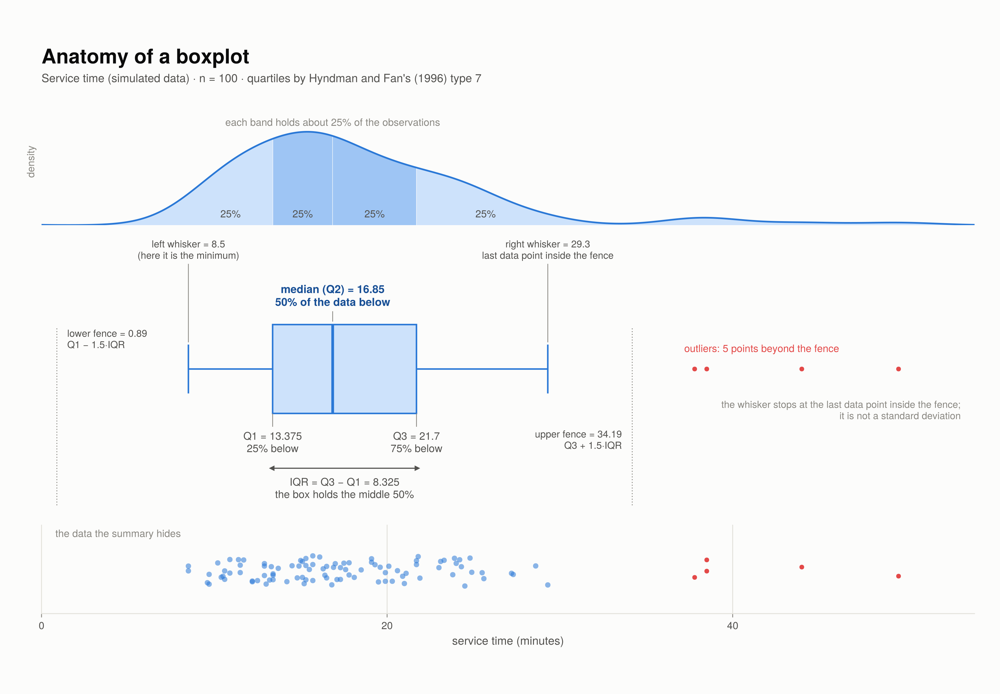
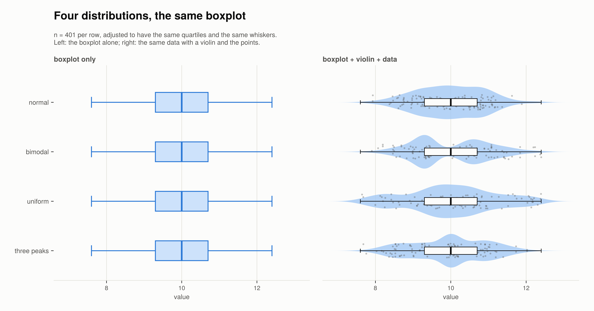
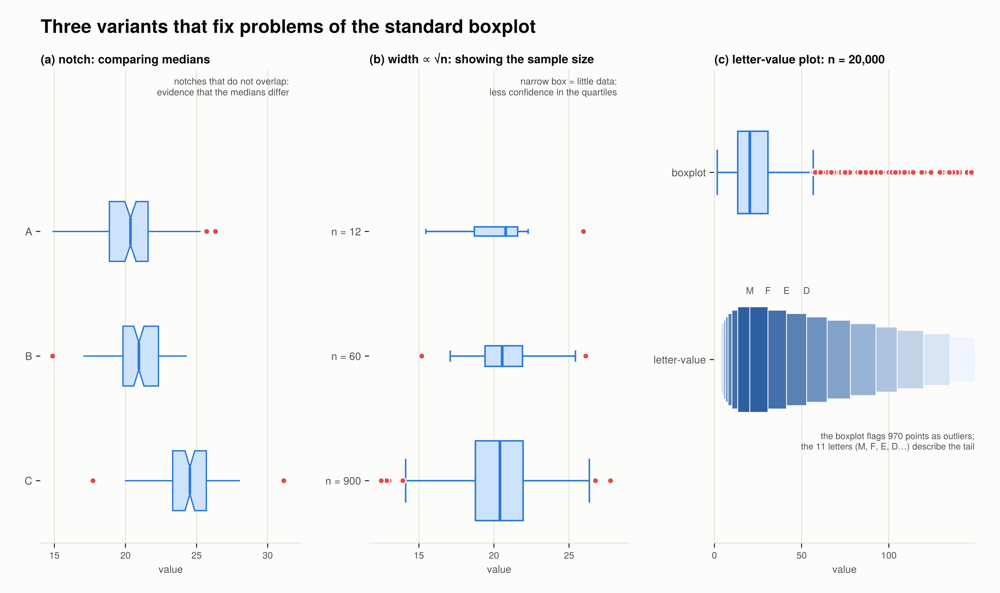

There is a chart that every statistical report has and that almost nobody reads in full. The reader looks at the box, finds the median, sees the stray dots and moves on. They never learn that the end of the whisker is rarely the maximum, that the 1.5 in the fence rule is a choice rather than a deduction, and that two programs can draw different boxes for the same data.

This post takes the **boxplot** apart piece by piece. For each element: what it is, how it is calculated (by hand, with a 100-number example) and how to read it. At the end come what it hides, the variants that fix each limitation, and the Julia, R and Python code that produces everything.

---

## 1. The boxplot in one figure

---

The **boxplot** (also *box plot* or *box-and-whisker plot*) shows up in almost every statistical report, and many people read only half of it. Almost everyone can point to the median. Far fewer can say what the end of the whisker stands for, where the 1.5 in the fence calculation comes from, or why two programs draw slightly different boxes for the same data.

Each element of the chart has three questions to answer: **what it is**, **how it is calculated** and **how to read it**.

The figure below is the map of the post. On the same horizontal axis it shows the distribution of the data (top), the boxplot with every element labelled (middle) and the raw data the summary hides (bottom).

<figure style="text-align:center; margin: 2em auto; max-width: 1000px;">
  
  <figcaption style="margin-top:0.75em; font-size:0.88rem; color:#555;">
    Figure 1. Anatomy of a boxplot. Service time for 100 people, in minutes (simulated data, for illustration only). Compare the right whisker, which stops at 29.3, with the upper fence at 34.19: a whisker always ends at an observed value. The code is in section 11.
  </figcaption>
</figure>

  <strong>The idea in one sentence:</strong> 
  The boxplot replaces 100 numbers with five, chosen so that the summary is not dragged around by extreme values, and marks separately everything that lies too far from the bulk.

---

## 2. Tukey's five numbers

---

The chart was introduced by **John W. Tukey**, under the name *schematic plot*, in a preliminary edition of his book *Exploratory Data Analysis* in 1970. It became widely known only when the book was published in 1977. The basic form, a bar with a box and extremes (the *range bar*), already appeared in a 1952 book by **Mary Eleanor Spear**. According to Wickham and Stryjewski (2011), Tukey's contribution was to choose summaries that work well for very different data and to tie them to the parts of the drawing.

The basis is the **five-number summary**. In this post's example, with the 100 service times:

<table class="mk-table">
  <thead>
    <tr>
      <th>Element</th>
      <th>What it is</th>
      <th>In the example (minutes)</th>
    </tr>
  </thead>
  <tbody>
    <tr>
      <td>Minimum</td>
      <td>Smallest observed value</td>
      <td>8.5</td>
    </tr>
    <tr>
      <td>Q1 (first quartile)</td>
      <td>Value with about 25% of the observations below it</td>
      <td>13.375</td>
    </tr>
    <tr>
      <td>Q2 (median)</td>
      <td>Value that splits the sorted sample in half</td>
      <td>16.85</td>
    </tr>
    <tr>
      <td>Q3 (third quartile)</td>
      <td>Value with about 75% of the observations below it</td>
      <td>21.7</td>
    </tr>
    <tr>
      <td>Maximum</td>
      <td>Largest observed value</td>
      <td>49.6</td>
    </tr>
  </tbody>
</table>

The quartiles carry every digit the calculation produces; section 4 shows the calculation. The data have one decimal place, and interpolating the quartiles adds more.

Notice that the chart **does not necessarily draw the minimum and the maximum**. It draws the quartiles and, in place of the extremes, the *whiskers*, which stop at the last data point inside the fences. Here the left whisker is the minimum, but the right one does not come close to the maximum. This is the most common reading error, and section 5 deals with it.

---

## 3. The box: Q1, median, Q3 and the IQR

---

### 3.1 The box

The box runs from $Q_1$ to $Q_3$. It holds about the **middle 50%** of the data: one quarter between $Q_1$ and the median, another quarter between the median and $Q_3$. In the top panel of figure 1, these are the two darker bands under the curve.

### 3.2 The line inside

The thick line inside the box is the **median**, not the mean. The distinction matters. The median depends only on the middle values of the sorted sample, so it does not move when an extreme value becomes even more extreme. The mean does.

In the example, the mean is 18.372 minutes and the median is 16.85. The mean is higher because the few very long services (up to 49.6 minutes) pull the mean up and leave the median alone. A mean well above the median often signals a long right tail, but it is not a rule without exceptions: the boxplot and the histogram are what confirm it.

### 3.3 The IQR

The width of the box is the **interquartile range** (IQR):

$$
\mathrm{IQR} = Q_3 - Q_1
$$

In the example:

$$
\mathrm{IQR} = 21.7 - 13.375 = 8.325 \text{ minutes}
$$

So the middle half of the services took between 13.375 and 21.7 minutes, a range of a little over 8 minutes.

The IQR is the boxplot's measure of spread. It plays a role similar to the standard deviation, with one advantage: its **breakdown point** is 25%. You can replace almost a quarter of the observations with absurd values without the IQR blowing up, because the quartiles still land on good data. With the standard deviation, a single absurd value is enough to inflate the measure without limit.

  <strong>How to read the box:</strong> 
  Position of the box = where the typical values are. Width of the box = how spread out they are. Position of the median <em>inside</em> the box = a hint of skewness.

### 3.4 Skewness already shows inside the box

Compare the two halves of the box:

$$
Q_2 - Q_1 = 16.85 - 13.375 = 3.475
\qquad\text{and}\qquad
Q_3 - Q_2 = 21.7 - 16.85 = 4.85
$$

They add up to the IQR: $3.475 + 4.85 = 8.325$. The upper half is wider, so between the median and $Q_3$ the data are more spread out than between $Q_1$ and the median. That is **right skew**, and you can see it without computing any coefficient: just notice that the median line is not in the middle of the box.

---

## 4. How a quartile is calculated (and why programs disagree)

---

This is the detail many textbooks leave out: **there is no single definition of the sample quartile**. Hyndman and Fan (1996) compared **nine** definitions used in statistical packages.

Julia, R and NumPy use **definition 7** of that paper by default, "type 7". All three documentations say so, and the code in section 11 gives the same result in all three.

### 4.1 Type 7, step by step

**Data.** The sorted sample $x_{(1)} \le x_{(2)} \le \dots \le x_{(n)}$, with $n = 100$ (the values are in the code in section 11). Only six of them enter the calculations:

<table class="mk-table">
  <thead>
    <tr><th>Position</th><th>25</th><th>26</th><th>50</th><th>51</th><th>75</th><th>76</th></tr>
  </thead>
  <tbody>
    <tr><td>Value (minutes)</td><td>13.3</td><td>13.4</td><td>16.8</td><td>16.9</td><td>21.7</td><td>21.7</td></tr>
  </tbody>
</table>

**Formula.** For the proportion $p$ (0.25 for Q1, 0.5 for the median, 0.75 for Q3), compute the position $h$, split it into its integer part $j = \lfloor h \rfloor$ (the largest integer not above $h$) and its fractional part $g = h - j$, and interpolate between the two neighbouring observations:

$$
h = (n-1)\,p + 1, \qquad
Q(p) = x_{(j)} + g\,\bigl(x_{(j+1)} - x_{(j)}\bigr)
$$

**Q1** ($p = 0.25$):

$$
\begin{aligned}
h &= (100 - 1) \times 0.25 + 1 = 99 \times 0.25 + 1 = 24.75 + 1 = 25.75\\
j &= 25, \quad g = 0.75\\
Q_1 &= x_{(25)} + 0.75 \times \bigl(x_{(26)} - x_{(25)}\bigr)\\
&= 13.3 + 0.75 \times (13.4 - 13.3)\\
&= 13.3 + 0.75 \times 0.1\\
&= 13.3 + 0.075 = 13.375
\end{aligned}
$$

**Median** ($p = 0.5$):

$$
\begin{aligned}
h &= 99 \times 0.5 + 1 = 49.5 + 1 = 50.5\\
Q_2 &= x_{(50)} + 0.5 \times \bigl(x_{(51)} - x_{(50)}\bigr) = 16.8 + 0.5 \times 0.1 = 16.8 + 0.05 = 16.85
\end{aligned}
$$

**Q3** ($p = 0.75$):

$$
\begin{aligned}
h &= 99 \times 0.75 + 1 = 74.25 + 1 = 75.25\\
Q_3 &= x_{(75)} + 0.25 \times \bigl(x_{(76)} - x_{(75)}\bigr) = 21.7 + 0.25 \times 0 = 21.7
\end{aligned}
$$

Since $0 \le g \le 1$, the result always lies between the two neighbouring observations.

### 4.2 Tukey's hinges

Tukey's **original** boxplot does not use this quartile. It uses the *hinges*: the median of the lower half and the median of the upper half of the sorted sample, with the overall median included in both halves when $n$ is odd. In the language of depth (the position counted from the nearer end), the lower hinge sits at depth

$$
d = \frac{\lfloor (n+1)/2 \rfloor + 1}{2}
$$

With $n = 100$: $(n+1)/2 = 50.5$, whose integer part is 50, so $d = (50 + 1)/2 = 25.5$. A depth "and a half" means the average of the two neighbours:

$$
\text{lower hinge} = \frac{x_{(25)} + x_{(26)}}{2} = \frac{13.3 + 13.4}{2} = \frac{26.7}{2} = 13.35
$$

The upper hinge is at depth 25.5 counted from the top, that is, between $x_{(75)}$ and $x_{(76)}$: $(21.7 + 21.7)/2 = 21.7$.

The lower hinge (13.35) differs from the type 7 $Q_1$ (13.375) by 0.025 minute. That is small, and not by chance. The position of the hinge and that of the type 7 quartile are always at most **1/4 of a position** apart, and they coincide when $n$ is odd. Both statements are proved in Lean (`provas/Provas/Boxplot.lean`).

  <strong>Practical consequence:</strong> 
  In large samples the difference disappears from the drawing. In small samples, the same data can produce visibly different boxes in different programs, and since the fences depend on the quartiles, this can also change which points are flagged as outliers. Hyndman and Fan (1996, p. 364) also note that a single package may use one definition to compute quantiles and another to draw plots. R is an example: <code>quantile()</code> uses type 7 and <code>boxplot()</code> uses the hinges from <code>fivenum()</code>. When you publish a boxplot, say which definition you used.

---

## 5. Whiskers and fences: where the 1.5 comes from

---

This is the most misread part of the chart. These are **two different things** with similar names.

### 5.1 Fences: calculated values

The fences are arithmetic limits. Most programs do not draw them; in figure 1 they appear dotted, on purpose.

$$
\text{lower fence} = Q_1 - 1.5 \cdot \mathrm{IQR}
\qquad
\text{upper fence} = Q_3 + 1.5 \cdot \mathrm{IQR}
$$

In the example, with the quartiles from section 4:

$$
\begin{aligned}
1.5 \times \mathrm{IQR} &= 1.5 \times 8.325 = 12.4875\\
\text{lower fence} &= 13.375 - 12.4875 = 0.8875\\
\text{upper fence} &= 21.7 + 12.4875 = 34.1875
\end{aligned}
$$

The figure shows 0.89 and 34.19, rounded to two decimal places.

### 5.2 Whiskers: observed values

The whisker **does not go to the fence**. It stops at the **adjacent value**: the most extreme observation still *inside* the fence.

In the example, the lower fence is at 0.8875 minute, but no service was that short. The left whisker stops at 8.5, the shortest time observed, which here is the minimum. On the right, the fence is at 34.1875 and the whisker stops at 29.3, the longest time that does not exceed it. The five times above the fence become stray points.

  <strong>Three common misreadings:</strong> 
  ❌ "The whiskers are the minimum and maximum." Only when there are no outliers on that side. 
  ❌ "The whisker is a standard deviation." The standard boxplot does not use the standard deviation anywhere. 
  ❌ "The whisker marks 1.5 × IQR." That is the <em>fence</em>. The whisker stops at the last data point before it.

### 5.3 Why 1.5?

The 1.5 is Tukey's choice, not a deduction. To see what it means, suppose the data come from a normal distribution with mean $\mu$ and standard deviation $\sigma$. The quartiles of the normal are at $\mu \pm z\sigma$, with $z = 0.6745$ (from the Z table: $P(Z < 0.6745) = 0.75$). Then:

$$
\begin{aligned}
\mathrm{IQR} &= (\mu + z\sigma) - (\mu - z\sigma) = 2z\sigma = 1.349\,\sigma\\
\text{upper fence} &= (\mu + z\sigma) + 1.5 \times 2z\sigma = \mu + 4z\sigma = \mu + 2.698\,\sigma
\end{aligned}
$$

By symmetry, the lower fence is at $\mu - 2.698\,\sigma$. The identity $Q_3 + 1.5 \cdot \mathrm{IQR} = \mu + 4z\sigma$ is proved in Lean. For the probability, use $z$ unrounded ($z = 0.674490$), which puts the fence at $4z = 2.697959$ standard deviations. The chance that a normal observation falls outside the fences is

$$
2 \times P(Z > 2.697959) = 2 \times 0.0034883 = 0.0069766 \approx 0.70\%
$$

with $P(Z > 2.697959)$ computed in Julia as `ccdf(Normal(), 4 * quantile(Normal(), 0.75))`. Hofmann, Wickham and Kafadar (2017) arrive at the same ±2.70σ and 0.7%.

  

    <strong>1.5 · IQR</strong>
    distance from fence to quartile
  

  

    <strong>2.698 σ</strong>
    the same fence, if the data are normal
  

  

    <strong>0.70%</strong>
    points outside the fences, if normal
  

  

    <strong>0.70</strong>
    expected outliers when n = 100
  

In a normal sample of 100 observations, the expected number of "outliers" is $100 \times 0.0069766 = 0.698$, or about 0.70. That is a long-run average: some normal samples will have no stray points, others two or three. The rule was chosen to be rare under normality and still flag heavy tails.

An **outer fence**, at $3 \cdot \mathrm{IQR}$ from the quartiles, is also used to set apart points that are very far out. Under normality it sits at $\mu \pm 7z\sigma = \mu \pm 4.72\,\sigma$, and the chance of going past it is about 2 in a million observations.

---

## 6. Outliers: what a stray point means

---

Each point beyond the fences is drawn individually. In the example there are five: 37.8, 38.5, 38.5, 44.0 and 49.6 minutes.

What these points **mean**:

<table class="mk-table">
  <thead>
    <tr>
      <th>The point is…</th>
      <th>Correct reading</th>
    </tr>
  </thead>
  <tbody>
    <tr>
      <td>an unusual value <em>relative to this sample's IQR</em></td>
      <td>It is a relative flag. It changes if the spread of the rest changes.</td>
    </tr>
    <tr>
      <td>a candidate for investigation</td>
      <td>Worth looking at the case: a typo? Another population? A real, rare event?</td>
    </tr>
    <tr>
      <td><strong>not</strong> a proven error</td>
      <td>The rule is geometric, not diagnostic. It knows nothing about the phenomenon.</td>
    </tr>
    <tr>
      <td><strong>not</strong> a licence to drop the data point</td>
      <td>Dropping an observation just because the chart highlighted it is like breaking the thermometer because of the fever.</td>
    </tr>
  </tbody>
</table>

One detail changes the reading. Under normality we would expect 0.70 outlier with $n = 100$, and we found 5. That does not mean five measurement errors. It means the distribution is **not normal**: it has a long right tail, as is common for waiting and service times. In this example we know where the tail comes from: the 100 values were simulated from a log-normal distribution, and three of them were replaced by 38.5, 44.0 and 49.6 so that the example would have extreme cases.

  <strong>Masking effect:</strong> 
  When there are <em>many</em> extreme values together, they inflate the IQR itself, push the fences out and may stop being flagged. The boxplot resists extreme values, but it is not infallible. With very heavy tails, see section 9 as well.

---

## 7. How to read a boxplot in six steps

---

<strong>1. Median.</strong> Where is the typical value?

<strong>2. Width of the box (IQR).</strong> How concentrated is the middle 50%? A narrow box = a homogeneous group.

<strong>3. Position of the median inside the box.</strong> In the middle = similar halves. Closer to Q1 (the side of smaller values) = the upper half is more spread out, a tail towards larger values. Closer to Q3 = the opposite.

<strong>4. Relative length of the whiskers.</strong> Confirms (or contradicts) the skewness seen in the box.

<strong>5. Points beyond the fences.</strong> How many, on which side, how far. One very distant point tells a different story from five points just past the fence.

<strong>6. What is not on the chart.</strong> The n, the unit of measurement and the possibility that the distribution has two peaks. Section 8 is the reason for this step.

When comparing **several groups**, add: do the boxes overlap? Does one group's median fall outside the other's box? Does the spread grow with the level? Bigger boxes where the median is higher suggest that a log scale may help.

---

## 8. What the boxplot hides

---

A boxplot is a summary, and every summary loses information. The question is: **how much**?

Figure 2 shows four samples of $n = 401$ with very different shapes: normal, bimodal (two peaks), uniform and three-peaked. Each sample was adjusted to have exactly the same boxplot. The adjustment is an increasing function, linear on each piece, that maps each sample's minimum, Q1, median, Q3 and maximum to the same five values (7.6, 9.3, 10, 10.7 and 12.4). Since the function is increasing, the order of the data does not change and the shape within each quarter is preserved. With odd $n$, the type 7 quartiles fall exactly on observations and the adjustment is exact. The fences are at 7.2 and 12.8, so the whiskers run from 7.6 to 12.4 and there are no outliers. On the left, the boxplots alone. On the right, the same data with a violin and the points.

<figure style="text-align:center; margin: 2em auto; max-width: 1000px;">
  
  <figcaption style="margin-top:0.75em; font-size:0.88rem; color:#555;">
    Figure 2. Four shapes, the same boxplot: same quartiles, same whiskers, no outliers. Look at the "bimodal" row on the right: the median falls in the valley between the two peaks, where there are few data.
  </figcaption>
</figure>

The serious case is the **bimodal** one. A distribution made of two separate groups produces an ordinary-looking boxplot, and the median falls exactly where there are few data. It is the same argument as [Anscombe's quartet](/quarteto-de-anscombe-por-que-graficos-sao-indispensaveis-na-estatistica/) (in Portuguese), carried over from two-variable summaries to one-variable summaries.

  <strong>Rule of thumb:</strong> 
  Up to a few hundred points, draw the data on top of the boxplot (with <em>jitter</em>, a small random shift so the points do not hide behind each other). It costs one line of code and prevents this kind of error. With more points, use a violin.

---

## 9. Tricks and variants

---

Three classic variants fix three real limitations of the standard boxplot. All of them are in figure 3 and in the code in section 11.

<figure style="text-align:center; margin: 2em auto; max-width: 1000px;">
  
  <figcaption style="margin-top:0.75em; font-size:0.88rem; color:#555;">
    Figure 3. (a) notch, (b) width proportional to √n and (c) letter-value plot. Simulated data. In (a), the notches of A and B overlap and the notch of C stands apart.
  </figcaption>
</figure>

### 9.1 Notch: comparing medians without a test

The *notch* is a cut at the height of the median, with half-width

$$
1.58 \cdot \frac{\mathrm{IQR}}{\sqrt{n}}
$$

The notch runs from $\text{median} - 1.58\,\mathrm{IQR}/\sqrt{n}$ to $\text{median} + 1.58\,\mathrm{IQR}/\sqrt{n}$. The constant 1.58 needs care. According to the R documentation (`boxplot.stats`), it comes from the same calculation as the formula with 1.57 in Chambers et al. (1983, p. 62), given in McGill, Tukey and Larsen (1978, p. 16). The calculation assumes that the median is approximately normally distributed and that the groups being compared have similar sizes. The idea is to give something like a 95% confidence interval for the *difference* between two medians, not for the median of a single group.

The reading: **if the notches of two groups do not overlap, there is evidence that the medians differ**. Overlapping does not prove they are equal. In figure 3, the groups were simulated from normal distributions with means 20, 21 and 24.5 and standard deviation 2.3 (120 values each). The notches came out as follows (output of the Julia code):

- A: median 20.35, notch [19.96, 20.75]
- B: median 20.94, notch [20.58, 21.30]
- C: median 24.53, notch [24.19, 24.87]

A and B overlap, even though the populations differ by 1 unit: with 120 values per group, the notch is not precise enough to separate them. C is far from both. It is an approximation and does not replace a formal test.

### 9.2 Width proportional to √n

The standard boxplot draws a box for $n = 12$ the same size as a box for $n = 900$, and the reader trusts both equally. McGill, Tukey and Larsen (1978) proposed letting the width of the box vary with the size of the group. In R, `boxplot(..., varwidth = TRUE)` uses a width proportional to $\sqrt{n}$, as in figure 3(b).

### 9.3 Letter-value plot: for large samples

With large $n$, the 1.5 · IQR rule flags too many points. It was calibrated to be rare under normality. With skewed data, the proportion of flagged points is fixed and their number grows with $n$. In the example in figure 3(c), 20,000 values from a log-normal, the standard boxplot flags **970 points** as outliers, 4.85% of the sample (output of the Julia code). For this log-normal, the theoretical proportion is 4.78%. That is not information: it is clutter.

The *letter-value plot* (Hofmann, Wickham and Kafadar, 2017) replaces the "in or out" decision with a sequence of ever more extreme quantiles: the median (M), the fourths (F), the eighths (E), the sixteenths (D) and so on. The depth of each letter is $d_1 = (n+1)/2$ for the median and $d_i = (\lfloor d_{i-1} \rfloor + 1)/2$ for the following ones, so that each box covers roughly half of the tail left over by the previous one. The number of letters grows with $n$, because a larger sample allows the tail to be estimated with more confidence. One of the rules in the paper is to show $k = \lfloor \log_2 n \rfloor - 3$ letters. With $n = 20{,}000$: $\log_2 20{,}000 = 14.29$, whose integer part is 14, and $k = 14 - 3 = 11$.

### 9.4 Other tricks worth knowing

<table class="mk-table">
  <thead>
    <tr>
      <th>Situation</th>
      <th>What to do</th>
    </tr>
  </thead>
  <tbody>
    <tr>
      <td>Very small n (fewer than about 10 per group)</td>
      <td>Do not use a boxplot: show the points. Five points cannot support quartiles.</td>
    </tr>
    <tr>
      <td>Several groups with no natural order</td>
      <td>Sort the boxes by median. The chart can then be read in one pass.</td>
    </tr>
    <tr>
      <td>Very skewed positive data (time, income, counts)</td>
      <td>Log scale on the value axis. Many of the "outliers" stop being outliers.</td>
    </tr>
    <tr>
      <td>Suspicion of two or more peaks</td>
      <td>A violin or a <em>raincloud</em> plot (density + boxplot + points).</td>
    </tr>
    <tr>
      <td>Horizontal or vertical boxplot</td>
      <td>Horizontal when group labels are long: the names stay readable without rotating the text.</td>
    </tr>
    <tr>
      <td>Scientific publication</td>
      <td>State in the caption what the whiskers represent, which quartile definition was used and the n of each group.</td>
    </tr>
  </tbody>
</table>

---

## 10. Common mistakes

---

  <strong>1. Reading the whiskers as the minimum and maximum.</strong> Covered in section 5: it is the most common mistake.

  <strong>2. Thinking the box is the mean ± standard deviation.</strong> It is not. There is no mean and no standard deviation anywhere in the standard boxplot.

  <strong>3. Automatically dropping the flagged points.</strong> The flag is relative to the sample's own IQR and knows nothing about the phenomenon being measured.

  <strong>4. Comparing boxes with very different sample sizes without stating the n.</strong> Use a width proportional to √n or write the n under each box.

  <strong>5. Using only a boxplot for data with two peaks.</strong> The chart looks nice and the conclusion is wrong.

  <strong>6. Not stating the definition used.</strong> Whiskers to 1.5 · IQR, to fixed percentiles (such as 2% and 98%) or to the minimum and maximum? All three conventions exist (Wickham and Stryjewski, 2011) and produce different figures.

---

## 11. Code in Julia, R and Python

---

Each block below has three versions; choose the language in the block's header. All three use the same 100 service times and the type 7 quartile, and give exactly the numbers from section 4.

### 11.1 The five numbers, the fences and the hinges

  

  

    
Julia

    

    <button class="copy-button" onclick="copyCode(this)">
      <i class="bi bi-clipboard"></i>Copy
    </button>
  

  

    <pre><code>using Statistics, Printf

# Service time (minutes) for 100 people: simulated data, for illustration only
times = [15.5, 19.1, 15.7, 15.7, 23.1, 20.6, 38.5, 10.6, 8.5, 17.8,
         13.2, 23.3, 20.3, 15.3, 20.9, 28.6, 17.0, 11.4, 24.3, 16.9,
         10.9, 10.6, 27.2, 37.8, 29.3, 21.8, 23.8, 19.3, 25.5, 21.9,
         18.5, 25.6, 44.0, 23.0, 15.3, 15.1, 21.7, 17.1, 13.4, 13.0,
         20.1, 19.5, 11.5, 16.5, 16.5, 13.3, 12.9, 16.4, 12.5, 10.4,
         14.2, 21.7, 14.9, 24.5, 19.6, 19.9, 9.7, 12.9, 38.5, 17.6,
         49.6, 27.3, 15.1, 9.6, 24.2, 11.7, 21.0, 8.5, 14.8, 14.5,
         12.2, 13.7, 24.0, 17.3, 12.9, 23.9, 10.2, 15.0, 17.8, 13.4,
         19.9, 10.9, 11.5, 16.8, 13.4, 15.2, 9.7, 21.1, 15.3, 16.1,
         24.8, 17.5, 10.5, 19.1, 12.2, 24.9, 16.3, 15.7, 17.3, 18.1]

# Everything the boxplot draws. quantile uses Hyndman and Fan's (1996) type 7.
function five_numbers(x)
    q1, q2, q3 = quantile(x, [0.25, 0.50, 0.75])
    iqr = q3 - q1
    fence_lo, fence_hi = q1 - 1.5iqr, q3 + 1.5iqr
    inside = x[fence_lo .&lt;= x .&lt;= fence_hi]
    outside = x[(x .&lt; fence_lo) .| (x .&gt; fence_hi)]
    (; q1, q2, q3, iqr, fence_lo, fence_hi,
       adj_lo = minimum(inside), adj_hi = maximum(inside),   # whisker ends
       outliers = sort(outside), n = length(x))
end

s = five_numbers(times)
@printf("n                    %d\n", s.n)
@printf("minimum              %.1f\n", minimum(times))
@printf("Q1                   %.3f\n", s.q1)
@printf("median (Q2)          %.3f\n", s.q2)
@printf("Q3                   %.3f\n", s.q3)
@printf("IQR                  %.3f\n", s.iqr)
@printf("lower fence          %.4f\n", s.fence_lo)
@printf("upper fence          %.4f\n", s.fence_hi)
@printf("left whisker         %.1f\n", s.adj_lo)
@printf("right whisker        %.1f\n", s.adj_hi)
@printf("maximum              %.1f\n", maximum(times))
println("outliers             ", length(s.outliers), " values: ", join(s.outliers, ", "))
@printf("mean                 %.3f\n", mean(times))

# For comparison: Tukey's hinges (medians of the two halves of the sorted sample)
sorted_times = sort(times)
half = (s.n + 1) ÷ 2                    # includes the median in both halves when n is odd
hinge_lo = median(sorted_times[1:half])
hinge_hi = median(sorted_times[end-half+1:end])
@printf("Tukey's hinges       %.3f and %.3f\n", hinge_lo, hinge_hi)</code></pre>
  

  
# Output

  <pre style="overflow-x: auto; font-size: 0.9em;">n                    100
minimum              8.5
Q1                   13.375
median (Q2)          16.850
Q3                   21.700
IQR                  8.325
lower fence          0.8875
upper fence          34.1875
left whisker         8.5
right whisker        29.3
maximum              49.6
outliers             5 values: 37.8, 38.5, 38.5, 44.0, 49.6
mean                 18.372
Tukey's hinges       13.350 and 21.700</pre>

  

  

  

    
R

    

    <button class="copy-button" onclick="copyCode(this)">
      <i class="bi bi-clipboard"></i>Copy
    </button>
  

  

    <pre><code># Service time (minutes) for 100 people: simulated data, for illustration only
times &lt;- c(15.5, 19.1, 15.7, 15.7, 23.1, 20.6, 38.5, 10.6, 8.5, 17.8,
         13.2, 23.3, 20.3, 15.3, 20.9, 28.6, 17.0, 11.4, 24.3, 16.9,
         10.9, 10.6, 27.2, 37.8, 29.3, 21.8, 23.8, 19.3, 25.5, 21.9,
         18.5, 25.6, 44.0, 23.0, 15.3, 15.1, 21.7, 17.1, 13.4, 13.0,
         20.1, 19.5, 11.5, 16.5, 16.5, 13.3, 12.9, 16.4, 12.5, 10.4,
         14.2, 21.7, 14.9, 24.5, 19.6, 19.9, 9.7, 12.9, 38.5, 17.6,
         49.6, 27.3, 15.1, 9.6, 24.2, 11.7, 21.0, 8.5, 14.8, 14.5,
         12.2, 13.7, 24.0, 17.3, 12.9, 23.9, 10.2, 15.0, 17.8, 13.4,
         19.9, 10.9, 11.5, 16.8, 13.4, 15.2, 9.7, 21.1, 15.3, 16.1,
         24.8, 17.5, 10.5, 19.1, 12.2, 24.9, 16.3, 15.7, 17.3, 18.1)

# Everything the boxplot draws. quantile(type = 7) is Hyndman and Fan's (1996) type 7.
five_numbers &lt;- function(x) {
  q &lt;- quantile(x, c(0.25, 0.50, 0.75), type = 7, names = FALSE)
  iqr &lt;- q[3] - q[1]
  fence_lo &lt;- q[1] - 1.5 * iqr
  fence_hi &lt;- q[3] + 1.5 * iqr
  inside &lt;- x[x &gt;= fence_lo &amp; x &lt;= fence_hi]
  list(q1 = q[1], q2 = q[2], q3 = q[3], iqr = iqr,
       fence_lo = fence_lo, fence_hi = fence_hi,
       adj_lo = min(inside), adj_hi = max(inside),   # whisker ends
       outliers = sort(x[x &lt; fence_lo | x &gt; fence_hi]), n = length(x))
}

s &lt;- five_numbers(times)
cat(sprintf("n                    %d\n", s$n))
cat(sprintf("minimum              %.1f\n", min(times)))
cat(sprintf("Q1                   %.3f\n", s$q1))
cat(sprintf("median (Q2)          %.3f\n", s$q2))
cat(sprintf("Q3                   %.3f\n", s$q3))
cat(sprintf("IQR                  %.3f\n", s$iqr))
cat(sprintf("lower fence          %.4f\n", s$fence_lo))
cat(sprintf("upper fence          %.4f\n", s$fence_hi))
cat(sprintf("left whisker         %.1f\n", s$adj_lo))
cat(sprintf("right whisker        %.1f\n", s$adj_hi))
cat(sprintf("maximum              %.1f\n", max(times)))
cat(sprintf("outliers             %d values: %s\n", length(s$outliers),
            paste(sprintf("%.1f", s$outliers), collapse = ", ")))
cat(sprintf("mean                 %.3f\n", mean(times)))

# For comparison: Tukey's hinges. fivenum() returns minimum, hinges, median and maximum;
# it is what R's boxplot() uses to draw the box.
h &lt;- fivenum(times)
cat(sprintf("Tukey's hinges       %.3f and %.3f\n", h[2], h[4]))</code></pre>
  

  
# Output

  <pre style="overflow-x: auto; font-size: 0.9em;">n                    100
minimum              8.5
Q1                   13.375
median (Q2)          16.850
Q3                   21.700
IQR                  8.325
lower fence          0.8875
upper fence          34.1875
left whisker         8.5
right whisker        29.3
maximum              49.6
outliers             5 values: 37.8, 38.5, 38.5, 44.0, 49.6
mean                 18.372
Tukey's hinges       13.350 and 21.700</pre>

  

  

  

    
Python

    

    <button class="copy-button" onclick="copyCode(this)">
      <i class="bi bi-clipboard"></i>Copy
    </button>
  

  

    <pre><code>import numpy as np

# Service time (minutes) for 100 people: simulated data, for illustration only
times = np.array([15.5, 19.1, 15.7, 15.7, 23.1, 20.6, 38.5, 10.6, 8.5, 17.8,
         13.2, 23.3, 20.3, 15.3, 20.9, 28.6, 17.0, 11.4, 24.3, 16.9,
         10.9, 10.6, 27.2, 37.8, 29.3, 21.8, 23.8, 19.3, 25.5, 21.9,
         18.5, 25.6, 44.0, 23.0, 15.3, 15.1, 21.7, 17.1, 13.4, 13.0,
         20.1, 19.5, 11.5, 16.5, 16.5, 13.3, 12.9, 16.4, 12.5, 10.4,
         14.2, 21.7, 14.9, 24.5, 19.6, 19.9, 9.7, 12.9, 38.5, 17.6,
         49.6, 27.3, 15.1, 9.6, 24.2, 11.7, 21.0, 8.5, 14.8, 14.5,
         12.2, 13.7, 24.0, 17.3, 12.9, 23.9, 10.2, 15.0, 17.8, 13.4,
         19.9, 10.9, 11.5, 16.8, 13.4, 15.2, 9.7, 21.1, 15.3, 16.1,
         24.8, 17.5, 10.5, 19.1, 12.2, 24.9, 16.3, 15.7, 17.3, 18.1])

# Everything the boxplot draws. method="linear" (the default) is Hyndman and Fan's (1996) type 7.
def five_numbers(x):
    q1, q2, q3 = np.quantile(x, [0.25, 0.50, 0.75], method="linear")
    iqr = q3 - q1
    fence_lo, fence_hi = q1 - 1.5 * iqr, q3 + 1.5 * iqr
    inside = x[(x &gt;= fence_lo) &amp; (x &lt;= fence_hi)]
    return dict(q1=q1, q2=q2, q3=q3, iqr=iqr, fence_lo=fence_lo, fence_hi=fence_hi,
                adj_lo=inside.min(), adj_hi=inside.max(),   # whisker ends
                outliers=np.sort(x[(x &lt; fence_lo) | (x &gt; fence_hi)]), n=len(x))

s = five_numbers(times)
print(f"n                    {s['n']}")
print(f"minimum              {times.min():.1f}")
print(f"Q1                   {s['q1']:.3f}")
print(f"median (Q2)          {s['q2']:.3f}")
print(f"Q3                   {s['q3']:.3f}")
print(f"IQR                  {s['iqr']:.3f}")
print(f"lower fence          {s['fence_lo']:.4f}")
print(f"upper fence          {s['fence_hi']:.4f}")
print(f"left whisker         {s['adj_lo']:.1f}")
print(f"right whisker        {s['adj_hi']:.1f}")
print(f"maximum              {times.max():.1f}")
print(f"outliers             {len(s['outliers'])} values: " + ", ".join(f"{v:.1f}" for v in s["outliers"]))
print(f"mean                 {times.mean():.3f}")

# For comparison: Tukey's hinges (medians of the two halves of the sorted sample)
sorted_times = np.sort(times)
half = (s["n"] + 1) // 2              # includes the median in both halves when n is odd
print(f"Tukey's hinges       {np.median(sorted_times[:half]):.3f} and {np.median(sorted_times[-half:]):.3f}")</code></pre>
  

  
# Output

  <pre style="overflow-x: auto; font-size: 0.9em;">n                    100
minimum              8.5
Q1                   13.375
median (Q2)          16.850
Q3                   21.700
IQR                  8.325
lower fence          0.8875
upper fence          34.1875
left whisker         8.5
right whisker        29.3
maximum              49.6
outliers             5 values: 37.8, 38.5, 38.5, 44.0, 49.6
mean                 18.372
Tukey's hinges       13.350 and 21.700</pre>

  

The three outputs are identical and match the hand calculations: $Q_1 = 13.375$, median 16.85, $Q_3 = 21.7$, fences at 0.8875 and 34.1875, whiskers at 8.5 and 29.3 and five outliers. The last line compares them with Tukey's hinges (13.35 and 21.7), computed as in section 4.2. In R, `fivenum()` gives the hinges directly.

### 11.2 The figures

To install what the figures use:

  

  

    
Julia

    

    <button class="copy-button" onclick="copyCode(this)">
      <i class="bi bi-clipboard"></i>Copy
    </button>
  

  

    <pre><code>using Pkg
Pkg.add(["CairoMakie", "Distributions", "KernelDensity"])</code></pre>
  

  

  

  

    
R

    

    <button class="copy-button" onclick="copyCode(this)">
      <i class="bi bi-clipboard"></i>Copy
    </button>
  

  

    <pre><code># The figures use base R only (grDevices, graphics and stats): nothing to install.</code></pre>
  

  

  

  

    
Python

    

    <button class="copy-button" onclick="copyCode(this)">
      <i class="bi bi-clipboard"></i>Copy
    </button>
  

  

    <pre><code># In the terminal (preferably in a virtual environment):
# pip install numpy scipy matplotlib</code></pre>
  

  

The script below produces the three figures in the post. The published figures come from the Julia version, with CairoMakie; the R (base graphics) and Python (matplotlib) versions produce equivalent figures. Figure 1 uses the 100 fixed service times and comes out the same in all three. Figures 2 and 3 use random numbers, and each language draws different numbers from the same seed. That is why the notches and the number of log-normal outliers (970 in Julia) change from one language to another. The boxplots in figure 2 come out identical in all three, by construction.

  

  

    
Julia

    

    <button class="copy-button" onclick="copyCode(this)">
      <i class="bi bi-clipboard"></i>Copy
    </button>
  

  

    <pre><code># Figures for the post: boxplot anatomy, the trap and three variants.
# Julia with CairoMakie. Saves three PNG files in the current folder.
using CairoMakie, Statistics, Random, Distributions, KernelDensity, Printf

CairoMakie.activate!(type = "png", px_per_unit = 3)

# Palette
const SURF   = colorant"#fcfcfb"   # background
const INK    = colorant"#0b0b0b"   # main text
const INK2   = colorant"#52514e"   # secondary text
const MUTED  = colorant"#898781"   # axes and notes
const GRID   = colorant"#e1e0d9"   # grid
const BLUE   = colorant"#2a78d6"
const BLUE_L = colorant"#cde2fb"
const BLUE_M = colorant"#9ec5f4"
const BLUE_D = colorant"#184f95"
const RED    = colorant"#e34948"   # outliers

# Service time (minutes) for 100 people: simulated data, for illustration only
times = [15.5, 19.1, 15.7, 15.7, 23.1, 20.6, 38.5, 10.6, 8.5, 17.8,
         13.2, 23.3, 20.3, 15.3, 20.9, 28.6, 17.0, 11.4, 24.3, 16.9,
         10.9, 10.6, 27.2, 37.8, 29.3, 21.8, 23.8, 19.3, 25.5, 21.9,
         18.5, 25.6, 44.0, 23.0, 15.3, 15.1, 21.7, 17.1, 13.4, 13.0,
         20.1, 19.5, 11.5, 16.5, 16.5, 13.3, 12.9, 16.4, 12.5, 10.4,
         14.2, 21.7, 14.9, 24.5, 19.6, 19.9, 9.7, 12.9, 38.5, 17.6,
         49.6, 27.3, 15.1, 9.6, 24.2, 11.7, 21.0, 8.5, 14.8, 14.5,
         12.2, 13.7, 24.0, 17.3, 12.9, 23.9, 10.2, 15.0, 17.8, 13.4,
         19.9, 10.9, 11.5, 16.8, 13.4, 15.2, 9.7, 21.1, 15.3, 16.1,
         24.8, 17.5, 10.5, 19.1, 12.2, 24.9, 16.3, 15.7, 17.3, 18.1]

# Everything the boxplot draws (quartiles by Hyndman and Fan's type 7)
function five_numbers(x)
    q1, q2, q3 = quantile(x, [0.25, 0.50, 0.75])
    iqr = q3 - q1
    fence_lo, fence_hi = q1 - 1.5iqr, q3 + 1.5iqr
    inside = x[fence_lo .&lt;= x .&lt;= fence_hi]
    (; q1, q2, q3, iqr, fence_lo, fence_hi,
       adj_lo = minimum(inside), adj_hi = maximum(inside),
       outliers = x[(x .&lt; fence_lo) .| (x .&gt; fence_hi)], n = length(x))
end

# Box, whiskers and outliers, horizontal, centred at y, with half-height h
function boxplot_h!(ax, s, y, h; color = BLUE, boxfill = BLUE_L, lw = 1.8, show_out = true)
    lines!(ax, [s.adj_lo, s.q1], [y, y]; color = color, linewidth = lw)
    lines!(ax, [s.q3, s.adj_hi], [y, y]; color = color, linewidth = lw)
    for v in (s.adj_lo, s.adj_hi)
        lines!(ax, [v, v], [y - 0.55h, y + 0.55h]; color = color, linewidth = lw)
    end
    poly!(ax, Rect2f(s.q1, y - h, s.q3 - s.q1, 2h); color = boxfill,
          strokecolor = color, strokewidth = lw)
    lines!(ax, [s.q2, s.q2], [y - h, y + h]; color = color, linewidth = 3.2)
    if show_out
        scatter!(ax, s.outliers, fill(y, length(s.outliers)); color = RED,
                 markersize = 10, strokecolor = SURF, strokewidth = 1.5)
    end
    return nothing
end

function double_arrow!(ax, x1, x2, y; color = INK2)
    lines!(ax, [x1, x2], [y, y]; color = color, linewidth = 1.3)
    scatter!(ax, [x1, x2], [y, y]; marker = [:ltriangle, :rtriangle], color = color,
             markersize = 9)
end

leader!(ax, x, y1, y2) = lines!(ax, [x, x], [y1, y2]; color = MUTED, linewidth = 0.9)

fmt(x; d = 1) = @sprintf("%.*f", d, x)

# ---------------------------------------------------------------------------
# Figure 1: anatomy
# ---------------------------------------------------------------------------
s = five_numbers(times)
xmin, xmax = 0.0, 54.0

fig1 = Figure(size = (1180, 820), backgroundcolor = SURF, figure_padding = (30, 30, 22, 18))
Label(fig1[1, 1], "Anatomy of a boxplot"; fontsize = 24, font = :bold, color = INK,
      halign = :left, justification = :left, tellwidth = false)
Label(fig1[2, 1], "Service time (simulated data) · n = $(s.n) · " *
      "quartiles by Hyndman and Fan's (1996) type 7"; fontsize = 13.5, color = INK2,
      halign = :left, justification = :left, tellwidth = false)

# Panel A: the distribution behind the summary
axA = Axis(fig1[3, 1]; backgroundcolor = SURF, ylabel = "density", ylabelsize = 12,
           ylabelcolor = MUTED)
hidespines!(axA); hidedecorations!(axA, label = false)
k = kde(times; boundary = (xmin, xmax))
xs, ys = collect(k.x), collect(k.density)
for (a, b, color) in ((xmin, s.q1, BLUE_L), (s.q1, s.q2, BLUE_M),
                    (s.q2, s.q3, BLUE_M), (s.q3, xmax, BLUE_L))
    m = a .&lt;= xs .&lt;= b
    band!(axA, xs[m], zeros(count(m)), ys[m]; color = color)
    mid = a == xmin ? (s.adj_lo + s.q1) / 2 : b == xmax ? s.q3 + 4 : (a + b) / 2
    text!(axA, mid, 0.004; text = "25%", align = (:center, :bottom), fontsize = 12,
          color = INK2)
end
lines!(axA, xs, ys; color = BLUE, linewidth = 2)
text!(axA, s.q2, maximum(ys) * 1.04; text = "each band holds about 25% of the observations",
      align = (:center, :bottom), fontsize = 12, color = MUTED)
ylims!(axA, 0, maximum(ys) * 1.36)

# Panel B: the annotated boxplot
axB = Axis(fig1[4, 1]; backgroundcolor = SURF)
hidespines!(axB); hidedecorations!(axB); ylims!(axB, 0, 1)
for (v, lab, al) in ((s.fence_lo, "lower fence = $(fmt(s.fence_lo, d = 2))\nQ1 − 1.5·IQR", :left),
                     (s.fence_hi, "upper fence = $(fmt(s.fence_hi, d = 2))\nQ3 + 1.5·IQR", :right))
    lines!(axB, [v, v], [0.06, 0.66]; color = MUTED, linewidth = 1.1, linestyle = :dot)
    text!(axB, v + (al == :left ? 0.6 : -0.6), al == :left ? 0.66 : 0.32; text = lab, align = (al, :top),
          fontsize = 11.5, color = INK2)
end
boxplot_h!(axB, s, 0.52, 0.15)
leader!(axB, s.q2, 0.68, 0.715)
text!(axB, s.q2, 0.725; text = "median (Q2) = $(fmt(s.q2, d = 2))\n50% of the data below",
      align = (:center, :bottom), fontsize = 13, color = BLUE_D, font = :bold)
for (v, lab) in ((s.adj_lo, "left whisker = $(fmt(s.adj_lo))\n(here it is the minimum)"),
                 (s.adj_hi, "right whisker = $(fmt(s.adj_hi))\nlast data point inside the fence"))
    leader!(axB, v, 0.61, 0.875)
    text!(axB, v, 0.885; text = lab, align = (:center, :bottom), fontsize = 11.5, color = INK2)
end
for (v, lab) in ((s.q1, "Q1 = $(fmt(s.q1, d = 3))\n25% below"),
                 (s.q3, "Q3 = $(fmt(s.q3, d = 1))\n75% below"))
    leader!(axB, v, 0.37, 0.325)
    text!(axB, v, 0.315; text = lab, align = (:center, :top), fontsize = 12.5, color = INK2)
end
double_arrow!(axB, s.q1, s.q3, 0.185)
text!(axB, (s.q1 + s.q3) / 2, 0.16;
      text = "IQR = Q3 − Q1 = $(fmt(s.iqr, d = 3))\nthe box holds the middle 50%",
      align = (:center, :top), fontsize = 12.5, color = INK2)
text!(axB, mean(s.outliers), 0.57; text = "outliers: $(length(s.outliers)) points beyond the fence",
      align = (:center, :bottom), fontsize = 12, color = RED)
text!(axB, xmax - 0.8, 0.42; text = "the whisker stops at the last data point inside the fence;\n" *
      "it is not a standard deviation", align = (:right, :top), fontsize = 11.5, color = MUTED)

# Panel C: the raw data, with vertical jitter
axC = Axis(fig1[5, 1]; backgroundcolor = SURF, xlabel = "service time (minutes)",
           xlabelsize = 13.5, xlabelcolor = INK2, xticklabelsize = 12, xticklabelcolor = INK2,
           xgridcolor = GRID, ygridvisible = false, bottomspinecolor = GRID,
           xtickcolor = MUTED, xticksize = 4)
hidespines!(axC, :l, :r, :t); hideydecorations!(axC)
Random.seed!(7)
jit = 0.48 .+ 0.34 .* (rand(length(times)) .- 0.5)
outside = (times .&lt; s.fence_lo) .| (times .&gt; s.fence_hi)
scatter!(axC, times[.!outside], jit[.!outside]; color = (BLUE, 0.55), markersize = 9)
scatter!(axC, times[outside], jit[outside]; color = RED, markersize = 10, strokecolor = SURF,
         strokewidth = 1.5)
text!(axC, xmin + 0.8, 0.97; text = "the data the summary hides", align = (:left, :top),
      fontsize = 12, color = MUTED)
ylims!(axC, 0, 1)
linkxaxes!(axA, axB, axC); xlims!(axC, xmin, xmax)

rowsize!(fig1.layout, 3, Fixed(150)); rowsize!(fig1.layout, 4, Fixed(350))
rowsize!(fig1.layout, 5, Fixed(105))
rowgap!(fig1.layout, 1, 4); rowgap!(fig1.layout, 2, 16)
rowgap!(fig1.layout, 3, 2); rowgap!(fig1.layout, 4, 2)
save("boxplot-anatomia.png", fig1)

# ---------------------------------------------------------------------------
# Figure 2: four shapes, the same boxplot
# ---------------------------------------------------------------------------
# Maps the five drawn values of a sample (minimum, Q1, median, Q3, maximum) to the
# target values with an increasing function, linear on each piece. The order of the
# data does not change, so the shape within each quarter is preserved.
function align_to(v, target)
    source = [minimum(v); quantile(v, [0.25, 0.50, 0.75]); maximum(v)]
    map(v) do x
        i = clamp(searchsortedlast(source, x), 1, 4)
        target[i] + (x - source[i]) * (target[i+1] - target[i]) / (source[i+1] - source[i])
    end
end

Random.seed!(11)
n = 401                                 # odd: the quartiles fall on observations
target = [7.6, 9.3, 10.0, 10.7, 12.4]     # fences at 7.2 and 12.8: no outliers
samples = [
    ("normal",     randn(n)),
    ("bimodal",    vcat(randn(200) .* 0.4 .- 1.6, randn(201) .* 0.4 .+ 1.6)),
    ("uniform",   rand(n)),
    ("three peaks", vcat(randn(134) .* 0.3 .- 2, randn(133) .* 0.3, randn(134) .* 0.3 .+ 2)),
]
samples = [(name, align_to(v, target)) for (name, v) in samples]

fig2 = Figure(size = (1180, 620), backgroundcolor = SURF, figure_padding = (30, 30, 22, 18))
Label(fig2[1, 1:2], "Four distributions, the same boxplot"; fontsize = 22, font = :bold,
      color = INK, halign = :left, justification = :left, tellwidth = false)
Label(fig2[2, 1:2], "n = 401 per row, adjusted to have the same quartiles and the same " *
      "whiskers.\nLeft: the boxplot alone; right: the same data with a violin and the points.";
      fontsize = 13, color = INK2, halign = :left, justification = :left, tellwidth = false)
style = (backgroundcolor = SURF, titlesize = 14, titlecolor = INK2, titlealign = :left,
          xticklabelsize = 12, xticklabelcolor = INK2, xgridcolor = GRID,
          ygridvisible = false, xlabel = "value", xlabelsize = 13, xlabelcolor = INK2)
axL = Axis(fig2[3, 1]; title = "boxplot only", yticks = (1:4, reverse(first.(samples))),
           yticklabelsize = 13, yticklabelcolor = INK2, style...)
axR = Axis(fig2[3, 2]; title = "boxplot + violin + data", yticksvisible = false,
           yticklabelsvisible = false, style...)
for (i, (name, v)) in enumerate(samples)
    si = five_numbers(v)
    y = Float64(5 - i)                      # first sample at the top
    boxplot_h!(axL, si, y, 0.20)
    ki = kde(v)
    width = ki.density ./ maximum(ki.density) .* 0.34
    band!(axR, collect(ki.x), y .- width, y .+ width; color = (BLUE_M, 0.75))
    Random.seed!(100 + i)
    idx = rand(1:n, 120)
    scatter!(axR, v[idx], y .+ 0.30 .* (rand(120) .- 0.5); color = (INK2, 0.35),
             markersize = 5)
    boxplot_h!(axR, si, y, 0.075; color = INK, boxfill = SURF, lw = 1.2, show_out = false)
end
for a in (axL, axR)
    hidespines!(a, :t, :r, :l); a.bottomspinecolor = GRID
    ylims!(a, 0.4, 4.75); xlims!(a, 6.6, 13.4)
end
colgap!(fig2.layout, 26)
for (name, v) in samples
    si = five_numbers(v)
    @printf("%-11s Q1 %.4f  median %.4f  Q3 %.4f  whiskers %.4f and %.4f  outliers %d\n",
            name, si.q1, si.q2, si.q3, si.adj_lo, si.adj_hi, length(si.outliers))
end
save("boxplot-armadilha.png", fig2)

# ---------------------------------------------------------------------------
# Figure 3: three variants
# ---------------------------------------------------------------------------
# Box with a notch of half-width 1.58·IQR/√n around the median
function notched_box!(ax, s, y, h; color = BLUE, boxfill = BLUE_L, lw = 1.6)
    nlo = max(s.q2 - 1.58 * s.iqr / sqrt(s.n), s.q1)
    nhi = min(s.q2 + 1.58 * s.iqr / sqrt(s.n), s.q3)
    hn = 0.45h
    pts = Point2f[(s.q1, y - h), (nlo, y - h), (s.q2, y - hn), (nhi, y - h), (s.q3, y - h),
                  (s.q3, y + h), (nhi, y + h), (s.q2, y + hn), (nlo, y + h), (s.q1, y + h)]
    lines!(ax, [s.adj_lo, s.q1], [y, y]; color = color, linewidth = lw)
    lines!(ax, [s.q3, s.adj_hi], [y, y]; color = color, linewidth = lw)
    poly!(ax, pts; color = boxfill, strokecolor = color, strokewidth = lw)
    lines!(ax, [s.q2, s.q2], [y - hn, y + hn]; color = color, linewidth = 3)
    scatter!(ax, s.outliers, fill(y, length(s.outliers)); color = RED, markersize = 8)
    return (nlo, nhi)
end

# Letter values: depth d₁ = (n+1)/2 and dᵢ = (⌊dᵢ₋₁⌋ + 1)/2 (Hofmann, Wickham and
# Kafadar); k = ⌊log₂ n⌋ − 3 letters, rule (1) of the paper
function letter_values(x)
    sorted_x = sort(x); n = length(x)
    k = floor(Int, log2(n)) - 3
    depth = [(n + 1) / 2]
    while length(depth) &lt; k
        push!(depth, (floor(depth[end]) + 1) / 2)
    end
    value(d) = (sorted_x[floor(Int, d)] + sorted_x[ceil(Int, d)]) / 2
    (; depth, lo = value.(depth), hi = [value(n + 1 - d) for d in depth])
end

fig3 = Figure(size = (1180, 700), backgroundcolor = SURF, figure_padding = (30, 30, 22, 18))
Label(fig3[1, 1:3], "Three variants that fix problems of the standard boxplot";
      fontsize = 22, font = :bold, color = INK, halign = :left, justification = :left, tellwidth = false)
style3 = (backgroundcolor = SURF, titlesize = 14, titlealign = :left, titlecolor = INK,
           yticklabelsize = 12.5, yticklabelcolor = INK2, xticklabelsize = 11,
           xticklabelcolor = INK2, xgridcolor = GRID, ygridvisible = false,
           xlabel = "value", xlabelsize = 12, xlabelcolor = INK2)

# (a) notch
Random.seed!(3)
groups = [("A", randn(120) .* 2.3 .+ 20.0), ("B", randn(120) .* 2.3 .+ 21.0),
          ("C", randn(120) .* 2.3 .+ 24.5)]
axa = Axis(fig3[2, 1]; title = "(a) notch: comparing medians",
           yticks = (1:3, reverse(first.(groups))), style3...)
for (i, (name, v)) in enumerate(groups)
    nlo, nhi = notched_box!(axa, five_numbers(v), Float64(4 - i), 0.24)
    @printf("notch %s: median %.2f, notch [%.2f, %.2f]\n", name, median(v), nlo, nhi)
end
text!(axa, 31.5, 4.25; text = "notches that do not overlap:\nevidence that the medians differ",
      align = (:right, :top), fontsize = 11, color = INK2)
ylims!(axa, 0.5, 4.3)

# (b) width proportional to √n
Random.seed!(5)
gr2 = [("n = 12", randn(12) .* 2.4 .+ 20), ("n = 60", randn(60) .* 2.4 .+ 21),
       ("n = 900", randn(900) .* 2.4 .+ 20.5)]
axb = Axis(fig3[2, 2]; title = "(b) width ∝ √n: showing the sample size",
           yticks = (1:3, reverse(first.(gr2))), style3...)
nmax = maximum(length(v) for (_, v) in gr2)
for (i, (_, v)) in enumerate(gr2)
    boxplot_h!(axb, five_numbers(v), Float64(4 - i), 0.32 * sqrt(length(v) / nmax))
end
text!(axb, 28.2, 4.25; text = "narrow box = little data:\nless confidence in the quartiles",
      align = (:right, :top), fontsize = 11, color = INK2)
ylims!(axb, 0.5, 4.3)

# (c) letter-value plot
Random.seed!(9)
large = rand(LogNormal(3.0, 0.62), 20_000)
sg = five_numbers(large)
axc = Axis(fig3[2, 3]; title = "(c) letter-value plot: n = 20,000",
           yticks = ([1, 2], ["letter-value", "boxplot"]), style3...)
boxplot_h!(axc, sg, 2.0, 0.22)
lv = letter_values(large)
ramp = range(BLUE_D, colorant"#eef5fe", length = length(lv.depth))
for i in length(lv.depth):-1:1
    h = 0.30 * (1 - 0.06 * (i - 1))
    poly!(axc, Rect2f(lv.lo[i], 1 - h, lv.hi[i] - lv.lo[i], 2h); color = ramp[i],
          strokecolor = SURF, strokewidth = 1)
end
for (i, letter) in enumerate(["M", "F", "E", "D"])
    text!(axc, lv.hi[i], 1.34; text = letter, align = (:center, :bottom), fontsize = 11,
          color = INK2)
end
text!(axc, quantile(large, 0.9995), 0.62;
      text = "the boxplot flags $(length(sg.outliers)) points as outliers;\n" *
             "the $(length(lv.depth)) letters (M, F, E, D…) describe the tail",
      align = (:right, :top), fontsize = 10.5, color = INK2)
ylims!(axc, 0.02, 2.55); xlims!(axc, 0, quantile(large, 0.9995))
for a in (axa, axb, axc)
    hidespines!(a, :t, :r, :l); a.bottomspinecolor = GRID
end
colgap!(fig3.layout, 30)
save("boxplot-variantes.png", fig3)

@printf("letter-value: k = %d, depth of the last letter = %.1f\n",
        length(lv.depth), lv.depth[end])
@printf("n = 20,000: %d outliers (%.2f%%)\n", length(sg.outliers),
        100 * length(sg.outliers) / length(large))</code></pre>
  

  
# Output

  <pre style="overflow-x: auto; font-size: 0.9em;">normal      Q1 9.3000  median 10.0000  Q3 10.7000  whiskers 7.6000 and 12.4000  outliers 0
bimodal     Q1 9.3000  median 10.0000  Q3 10.7000  whiskers 7.6000 and 12.4000  outliers 0
uniform     Q1 9.3000  median 10.0000  Q3 10.7000  whiskers 7.6000 and 12.4000  outliers 0
three peaks Q1 9.3000  median 10.0000  Q3 10.7000  whiskers 7.6000 and 12.4000  outliers 0
notch A: median 20.35, notch [19.96, 20.75]
notch B: median 20.94, notch [20.58, 21.30]
notch C: median 24.53, notch [24.19, 24.87]
letter-value: k = 11, depth of the last letter = 10.5
n = 20,000: 970 outliers (4.85%)</pre>

  

  

  

    
R

    

    <button class="copy-button" onclick="copyCode(this)">
      <i class="bi bi-clipboard"></i>Copy
    </button>
  

  

    <pre><code># Figures for the post: boxplot anatomy, the trap and three variants.
# Base R (grDevices, graphics and stats packages). Saves three PNG files in the current folder.

BLUE &lt;- "#2a78d6"; BLUE_L &lt;- "#cde2fb"; BLUE_M &lt;- "#9ec5f4"; BLUE_D &lt;- "#184f95"
INK &lt;- "#0b0b0b"; INK2 &lt;- "#52514e"; MUTED &lt;- "#898781"; GRID &lt;- "#e1e0d9"
RED &lt;- "#e34948"; SURF &lt;- "#fcfcfb"

# Service time (minutes) for 100 people: simulated data, for illustration only
times &lt;- c(15.5, 19.1, 15.7, 15.7, 23.1, 20.6, 38.5, 10.6, 8.5, 17.8,
            13.2, 23.3, 20.3, 15.3, 20.9, 28.6, 17.0, 11.4, 24.3, 16.9,
            10.9, 10.6, 27.2, 37.8, 29.3, 21.8, 23.8, 19.3, 25.5, 21.9,
            18.5, 25.6, 44.0, 23.0, 15.3, 15.1, 21.7, 17.1, 13.4, 13.0,
            20.1, 19.5, 11.5, 16.5, 16.5, 13.3, 12.9, 16.4, 12.5, 10.4,
            14.2, 21.7, 14.9, 24.5, 19.6, 19.9, 9.7, 12.9, 38.5, 17.6,
            49.6, 27.3, 15.1, 9.6, 24.2, 11.7, 21.0, 8.5, 14.8, 14.5,
            12.2, 13.7, 24.0, 17.3, 12.9, 23.9, 10.2, 15.0, 17.8, 13.4,
            19.9, 10.9, 11.5, 16.8, 13.4, 15.2, 9.7, 21.1, 15.3, 16.1,
            24.8, 17.5, 10.5, 19.1, 12.2, 24.9, 16.3, 15.7, 17.3, 18.1)

# Everything the boxplot draws (quartiles by Hyndman and Fan's type 7).
# Note: R's boxplot() uses the hinges from fivenum(), so we draw by hand.
five_numbers &lt;- function(x) {
  q &lt;- quantile(x, c(0.25, 0.50, 0.75), type = 7, names = FALSE)
  iqr &lt;- q[3] - q[1]
  fence_lo &lt;- q[1] - 1.5 * iqr; fence_hi &lt;- q[3] + 1.5 * iqr
  inside &lt;- x[x &gt;= fence_lo &amp; x &lt;= fence_hi]
  list(q1 = q[1], q2 = q[2], q3 = q[3], iqr = iqr, fence_lo = fence_lo,
       fence_hi = fence_hi, adj_lo = min(inside), adj_hi = max(inside),
       outliers = x[x &lt; fence_lo | x &gt; fence_hi], n = length(x))
}

# Box, whiskers and outliers, horizontal, centred at y, with half-height h
boxplot_h &lt;- function(s, y, h, color = BLUE, boxfill = BLUE_L, lw = 2, show_out = TRUE) {
  segments(c(s$adj_lo, s$q3), y, c(s$q1, s$adj_hi), y, col = color, lwd = lw)
  segments(c(s$adj_lo, s$adj_hi), y - 0.55 * h, c(s$adj_lo, s$adj_hi), y + 0.55 * h,
           col = color, lwd = lw)
  rect(s$q1, y - h, s$q3, y + h, col = boxfill, border = color, lwd = lw)
  segments(s$q2, y - h, s$q2, y + h, col = color, lwd = 3.5)
  if (show_out &amp;&amp; length(s$outliers) &gt; 0)
    points(s$outliers, rep(y, length(s$outliers)), pch = 21, bg = RED, col = SURF, cex = 1.3)
}

fmt &lt;- function(x, d = 1) sprintf(paste0("%.", d, "f"), x)

# ---------------------------------------------------------------------------
# Figure 1: anatomy
# ---------------------------------------------------------------------------
s &lt;- five_numbers(times)
xlim &lt;- c(0, 54)
png("boxplot-anatomia.png", width = 3540, height = 2460, res = 300, bg = SURF)
layout(matrix(1:3), heights = c(1.4, 3.2, 1))
par(family = "sans", col.axis = INK2, col.lab = INK2)

# Panel A: the distribution behind the summary
par(mar = c(0.5, 3, 5, 1))
dens &lt;- density(times, from = xlim[1], to = xlim[2])
plot(dens$x, dens$y, type = "n", xlim = xlim, ylim = c(0, max(dens$y) * 1.3), axes = FALSE,
     xlab = "", ylab = "", xaxs = "i")
title(ylab = "density", line = 1, col.lab = MUTED)
cuts &lt;- c(xlim[1], s$q1, s$q2, s$q3, xlim[2])
colors &lt;- c(BLUE_L, BLUE_M, BLUE_M, BLUE_L)
for (i in 1:4) {
  m &lt;- dens$x &gt;= cuts[i] &amp; dens$x &lt;= cuts[i + 1]
  polygon(c(dens$x[m], rev(dens$x[m])), c(dens$y[m], rep(0, sum(m))), col = colors[i], border = NA)
}
lines(dens$x, dens$y, col = BLUE, lwd = 2.2)
mids &lt;- c((s$adj_lo + s$q1) / 2, (s$q1 + s$q2) / 2, (s$q2 + s$q3) / 2, s$q3 + 4)
text(mids, max(dens$y) * 0.06, "25%", col = INK2)
text(s$q2, max(dens$y) * 1.15, "each band holds about 25% of the observations", col = MUTED)
mtext("Anatomy of a boxplot", side = 3, line = 3, adj = 0, font = 2, cex = 1.4, col = INK)
mtext(sprintf("Service time (simulated data) · n = %d · quartiles by Hyndman and Fan's (1996) type 7",
              s$n), side = 3, line = 1.6, adj = 0, col = INK2)

# Panel B: the annotated boxplot
par(mar = c(0, 3, 0, 1))
plot(NA, xlim = xlim, ylim = c(0, 1), axes = FALSE, xlab = "", ylab = "", xaxs = "i")
segments(c(s$fence_lo, s$fence_hi), 0.06, c(s$fence_lo, s$fence_hi), 0.66, col = MUTED, lty = 3)
text(s$fence_lo + 0.6, 0.62, paste0("lower fence = ", fmt(s$fence_lo, 2), "\nQ1 − 1.5·IQR"),
     adj = c(0, 1), col = INK2, cex = 0.9)
text(s$fence_hi - 0.6, 0.30, paste0("upper fence = ", fmt(s$fence_hi, 2), "\nQ3 + 1.5·IQR"),
     adj = c(1, 1), col = INK2, cex = 0.9)
boxplot_h(s, 0.52, 0.15)
segments(s$q2, 0.68, s$q2, 0.715, col = MUTED)
text(s$q2, 0.73, paste0("median (Q2) = ", fmt(s$q2, 2), "\n50% of the data below"),
     adj = c(0.5, 0), col = BLUE_D, font = 2)
segments(c(s$adj_lo, s$adj_hi), 0.61, c(s$adj_lo, s$adj_hi), 0.875, col = MUTED)
text(s$adj_lo, 0.885, paste0("left whisker = ", fmt(s$adj_lo), "\n(here it is the minimum)"),
     adj = c(0.5, 0), col = INK2, cex = 0.9)
text(s$adj_hi, 0.885, paste0("right whisker = ", fmt(s$adj_hi), "\nlast data point inside the fence"),
     adj = c(0.5, 0), col = INK2, cex = 0.9)
segments(c(s$q1, s$q3), 0.37, c(s$q1, s$q3), 0.325, col = MUTED)
text(s$q1, 0.315, paste0("Q1 = ", fmt(s$q1, 3), "\n25% below"), adj = c(0.5, 1), col = INK2)
text(s$q3, 0.315, paste0("Q3 = ", fmt(s$q3, 1), "\n75% below"), adj = c(0.5, 1), col = INK2)
arrows(s$q1, 0.185, s$q3, 0.185, code = 3, length = 0.08, col = INK2)
text((s$q1 + s$q3) / 2, 0.16, paste0("IQR = Q3 − Q1 = ", fmt(s$iqr, 3), "\nthe box holds the middle 50%"),
     adj = c(0.5, 1), col = INK2)
text(mean(s$outliers), 0.58, sprintf("outliers: %d points beyond the fence", length(s$outliers)),
     adj = c(0.5, 0), col = RED)
text(xlim[2] - 0.8, 0.42, "the whisker stops at the last data point inside the fence;\nit is not a standard deviation",
     adj = c(1, 1), col = MUTED, cex = 0.9)

# Panel C: the raw data, with vertical jitter
par(mar = c(4.5, 3, 0, 1))
set.seed(7)
jit &lt;- 0.48 + 0.34 * (runif(length(times)) - 0.5)
outside &lt;- times &lt; s$fence_lo | times &gt; s$fence_hi
plot(times, jit, type = "n", xlim = xlim, ylim = c(0, 1), axes = FALSE, xlab = "",
     ylab = "", xaxs = "i")
abline(v = seq(0, 50, 10), col = GRID)
points(times[!outside], jit[!outside], pch = 16, col = adjustcolor(BLUE, 0.55), cex = 1.2)
points(times[outside], jit[outside], pch = 21, bg = RED, col = SURF, cex = 1.3)
axis(1, at = seq(0, 50, 10), col = GRID, col.ticks = MUTED)
title(xlab = "service time (minutes)", line = 2.8)
text(0.8, 0.95, "the data the summary hides", adj = c(0, 1), col = MUTED)
invisible(dev.off())

# ---------------------------------------------------------------------------
# Figure 2: four shapes, the same boxplot
# ---------------------------------------------------------------------------
# Maps the five drawn values of a sample (minimum, Q1, median, Q3, maximum) to the
# target values with an increasing function, linear on each piece (approx).
align_to &lt;- function(v, target) {
  source &lt;- c(min(v), quantile(v, c(0.25, 0.50, 0.75), type = 7, names = FALSE), max(v))
  approx(source, target, xout = v)$y
}

set.seed(11)
n &lt;- 401                                   # odd: the quartiles fall on observations
target &lt;- c(7.6, 9.3, 10.0, 10.7, 12.4)      # fences at 7.2 and 12.8: no outliers
samples &lt;- list(
  "normal"     = rnorm(n),
  "bimodal"    = c(rnorm(200, -1.6, 0.4), rnorm(201, 1.6, 0.4)),
  "uniform"   = runif(n),
  "three peaks" = c(rnorm(134, -2, 0.3), rnorm(133, 0, 0.3), rnorm(134, 2, 0.3))
)
samples &lt;- lapply(samples, align_to, target = target)

png("boxplot-armadilha.png", width = 3540, height = 1860, res = 300, bg = SURF)
par(mfrow = c(1, 2), oma = c(0, 0, 4.5, 0), mar = c(4, 7, 2.5, 1), col.axis = INK2,
    col.lab = INK2)
for (panel in c("boxplot only", "boxplot + violin + data")) {
  plot(NA, xlim = c(6.6, 13.4), ylim = c(0.4, 4.75), axes = FALSE, xlab = "value", ylab = "")
  abline(v = c(8, 10, 12), col = GRID)
  axis(1, at = c(8, 10, 12), col = GRID, col.ticks = MUTED)
  if (panel == "boxplot only") axis(2, at = 4:1, labels = names(samples), las = 1, tick = FALSE)
  mtext(panel, side = 3, adj = 0, font = 2, col = INK2)
  for (i in seq_along(samples)) {
    v &lt;- samples[[i]]; si &lt;- five_numbers(v); y &lt;- 5 - i
    if (panel == "boxplot only") {
      boxplot_h(si, y, 0.20)
    } else {
      d &lt;- density(v)
      width &lt;- d$y / max(d$y) * 0.34
      polygon(c(d$x, rev(d$x)), c(y - width, rev(y + width)),
              col = adjustcolor(BLUE_M, 0.75), border = NA)
      set.seed(100 + i)
      idx &lt;- sample(n, 120, replace = TRUE)
      points(v[idx], y + 0.30 * (runif(120) - 0.5), pch = 16, cex = 0.5,
             col = adjustcolor(INK2, 0.35))
      boxplot_h(si, y, 0.075, color = INK, boxfill = SURF, lw = 1.3, show_out = FALSE)
    }
  }
}
mtext("Four distributions, the same boxplot", outer = TRUE, side = 3, line = 2.6, adj = 0.02,
      font = 2, cex = 1.3, col = INK)
mtext(paste("n = 401 per row, adjusted to have the same quartiles and the same whiskers.",
            "Left: the boxplot alone; right: the same data with a violin and the points.", sep = "\n"),
      outer = TRUE, side = 3, line = 0.2, adj = 0.02, col = INK2)
invisible(dev.off())
for (name in names(samples)) {
  si &lt;- five_numbers(samples[[name]])
  cat(sprintf("%s Q1 %.4f  median %.4f  Q3 %.4f  whiskers %.4f and %.4f  outliers %d\n",
              formatC(name, width = -11), si$q1, si$q2, si$q3, si$adj_lo, si$adj_hi, length(si$outliers)))
}

# ---------------------------------------------------------------------------
# Figure 3: three variants
# ---------------------------------------------------------------------------
# Box with a notch of half-width 1.58·IQR/√n around the median
notched_box &lt;- function(s, y, h, color = BLUE, boxfill = BLUE_L, lw = 1.8) {
  nlo &lt;- max(s$q2 - 1.58 * s$iqr / sqrt(s$n), s$q1)
  nhi &lt;- min(s$q2 + 1.58 * s$iqr / sqrt(s$n), s$q3)
  hn &lt;- 0.45 * h
  segments(c(s$adj_lo, s$q3), y, c(s$q1, s$adj_hi), y, col = color, lwd = lw)
  polygon(c(s$q1, nlo, s$q2, nhi, s$q3, s$q3, nhi, s$q2, nlo, s$q1),
          c(y - h, y - h, y - hn, y - h, y - h, y + h, y + h, y + hn, y + h, y + h),
          col = boxfill, border = color, lwd = lw)
  segments(s$q2, y - hn, s$q2, y + hn, col = color, lwd = 3)
  if (length(s$outliers) &gt; 0) points(s$outliers, rep(y, length(s$outliers)), pch = 16, col = RED)
  c(nlo, nhi)
}

# Letter values: d1 = (n+1)/2 and d_i = (floor(d_{i-1}) + 1)/2 (Hofmann, Wickham and
# Kafadar); k = floor(log2 n) − 3 letters, rule (1) of the paper
letter_values &lt;- function(x) {
  sorted_x &lt;- sort(x); n &lt;- length(x)
  k &lt;- floor(log2(n)) - 3
  depth &lt;- (n + 1) / 2
  while (length(depth) &lt; k) depth &lt;- c(depth, (floor(depth[length(depth)]) + 1) / 2)
  value &lt;- function(d) (sorted_x[floor(d)] + sorted_x[ceiling(d)]) / 2
  list(depth = depth, lo = sapply(depth, value), hi = sapply(n + 1 - depth, value))
}

png("boxplot-variantes.png", width = 3540, height = 2100, res = 300, bg = SURF)
par(mfrow = c(1, 3), oma = c(0, 0, 3, 0), mar = c(4, 6.5, 3, 1), col.axis = INK2,
    col.lab = INK2)

# (a) notch
set.seed(3)
groups &lt;- list(A = rnorm(120, 20.0, 2.3), B = rnorm(120, 21.0, 2.3), C = rnorm(120, 24.5, 2.3))
plot(NA, xlim = c(14, 32), ylim = c(0.5, 4.3), axes = FALSE, xlab = "value", ylab = "")
abline(v = seq(15, 30, 5), col = GRID); axis(1, col = GRID)
axis(2, at = 3:1, labels = names(groups), las = 1, tick = FALSE)
mtext("(a) notch: comparing medians", side = 3, adj = 0, font = 2, line = 1)
for (i in 1:3) {
  e &lt;- notched_box(five_numbers(groups[[i]]), 4 - i, 0.24)
  cat(sprintf("notch %s: median %.2f, notch [%.2f, %.2f]\n", names(groups)[i],
              median(groups[[i]]), e[1], e[2]))
}
text(31.5, 4.25, "notches that do not overlap:\nevidence that the medians differ", adj = c(1, 1),
     col = INK2, cex = 0.9)

# (b) width proportional to √n
set.seed(5)
gr2 &lt;- list("n = 12" = rnorm(12, 20, 2.4), "n = 60" = rnorm(60, 21, 2.4), "n = 900" = rnorm(900, 20.5, 2.4))
nmax &lt;- max(lengths(gr2))
plot(NA, xlim = c(12, 29), ylim = c(0.5, 4.3), axes = FALSE, xlab = "value", ylab = "")
abline(v = seq(15, 25, 5), col = GRID); axis(1, col = GRID)
axis(2, at = 3:1, labels = names(gr2), las = 1, tick = FALSE)
mtext("(b) width ∝ √n: showing the sample size", side = 3, adj = 0, font = 2, line = 1)
for (i in 1:3) boxplot_h(five_numbers(gr2[[i]]), 4 - i, 0.32 * sqrt(length(gr2[[i]]) / nmax))
text(28.8, 4.25, "narrow box = little data:\nless confidence in the quartiles", adj = c(1, 1),
     col = INK2, cex = 0.9)

# (c) letter-value plot
set.seed(9)
large &lt;- rlnorm(20000, meanlog = 3.0, sdlog = 0.62)
sg &lt;- five_numbers(large)
lv &lt;- letter_values(large)
xmax &lt;- quantile(large, 0.9995, names = FALSE)
plot(NA, xlim = c(0, xmax), ylim = c(0.02, 2.55), axes = FALSE, xlab = "value", ylab = "", xaxs = "i")
abline(v = seq(0, 150, 50), col = GRID); axis(1, col = GRID)
axis(2, at = c(1, 2), labels = c("letter-value", "boxplot"), las = 1, tick = FALSE)
mtext("(c) letter-value plot: n = 20,000", side = 3, adj = 0, font = 2, line = 1)
boxplot_h(sg, 2, 0.22)
ramp &lt;- colorRampPalette(c(BLUE_D, "#eef5fe"))(length(lv$depth))
for (i in length(lv$depth):1) {
  h &lt;- 0.30 * (1 - 0.06 * (i - 1))
  rect(lv$lo[i], 1 - h, lv$hi[i], 1 + h, col = ramp[i], border = SURF)
}
text(lv$hi[1:4], 1.38, c("M", "F", "E", "D"), col = INK2)
text(xmax, 0.62, sprintf("the boxplot flags %d points as outliers;\nthe %d letters (M, F, E, D…) describe the tail",
                         length(sg$outliers), length(lv$depth)), adj = c(1, 1), col = INK2, cex = 0.85)
mtext("Three variants that fix problems of the standard boxplot", outer = TRUE, side = 3, line = 1,
      adj = 0.02, font = 2, cex = 1.3, col = INK)
invisible(dev.off())

cat(sprintf("letter-value: k = %d, depth of the last letter = %.1f\n", length(lv$depth),
            lv$depth[length(lv$depth)]))
cat(sprintf("n = 20,000: %d outliers (%.2f%%)\n", length(sg$outliers),
            100 * length(sg$outliers) / length(large)))</code></pre>
  

  
# Output

  <pre style="overflow-x: auto; font-size: 0.9em;">normal      Q1 9.3000  median 10.0000  Q3 10.7000  whiskers 7.6000 and 12.4000  outliers 0
bimodal     Q1 9.3000  median 10.0000  Q3 10.7000  whiskers 7.6000 and 12.4000  outliers 0
uniform     Q1 9.3000  median 10.0000  Q3 10.7000  whiskers 7.6000 and 12.4000  outliers 0
three peaks Q1 9.3000  median 10.0000  Q3 10.7000  whiskers 7.6000 and 12.4000  outliers 0
notch A: median 20.08, notch [19.62, 20.54]
notch B: median 20.93, notch [20.39, 21.47]
notch C: median 24.95, notch [24.56, 25.34]
letter-value: k = 11, depth of the last letter = 10.5
n = 20,000: 914 outliers (4.57%)</pre>

  

  

  

    
Python

    

    <button class="copy-button" onclick="copyCode(this)">
      <i class="bi bi-clipboard"></i>Copy
    </button>
  

  

    <pre><code># Figures for the post: boxplot anatomy, the trap and three variants.
# Python with numpy, scipy and matplotlib. Saves three PNG files in the current folder.
import numpy as np
import matplotlib.pyplot as plt
from matplotlib.colors import LinearSegmentedColormap
from matplotlib.patches import Polygon, Rectangle
from scipy.stats import gaussian_kde

BLUE, BLUE_L, BLUE_M, BLUE_D = "#2a78d6", "#cde2fb", "#9ec5f4", "#184f95"
INK, INK2, MUTED, GRID = "#0b0b0b", "#52514e", "#898781", "#e1e0d9"
RED, SURF = "#e34948", "#fcfcfb"
plt.rcParams.update({"figure.facecolor": SURF, "axes.facecolor": SURF, "font.size": 11,
                     "axes.edgecolor": GRID, "xtick.color": INK2, "ytick.color": INK2,
                     "axes.labelcolor": INK2})

# Service time (minutes) for 100 people: simulated data, for illustration only
times = np.array([15.5, 19.1, 15.7, 15.7, 23.1, 20.6, 38.5, 10.6, 8.5, 17.8,
                   13.2, 23.3, 20.3, 15.3, 20.9, 28.6, 17.0, 11.4, 24.3, 16.9,
                   10.9, 10.6, 27.2, 37.8, 29.3, 21.8, 23.8, 19.3, 25.5, 21.9,
                   18.5, 25.6, 44.0, 23.0, 15.3, 15.1, 21.7, 17.1, 13.4, 13.0,
                   20.1, 19.5, 11.5, 16.5, 16.5, 13.3, 12.9, 16.4, 12.5, 10.4,
                   14.2, 21.7, 14.9, 24.5, 19.6, 19.9, 9.7, 12.9, 38.5, 17.6,
                   49.6, 27.3, 15.1, 9.6, 24.2, 11.7, 21.0, 8.5, 14.8, 14.5,
                   12.2, 13.7, 24.0, 17.3, 12.9, 23.9, 10.2, 15.0, 17.8, 13.4,
                   19.9, 10.9, 11.5, 16.8, 13.4, 15.2, 9.7, 21.1, 15.3, 16.1,
                   24.8, 17.5, 10.5, 19.1, 12.2, 24.9, 16.3, 15.7, 17.3, 18.1])

def five_numbers(x):
    """Everything the boxplot draws (quartiles by Hyndman and Fan's type 7)."""
    q1, q2, q3 = np.quantile(x, [0.25, 0.50, 0.75], method="linear")
    iqr = q3 - q1
    fence_lo, fence_hi = q1 - 1.5 * iqr, q3 + 1.5 * iqr
    inside = x[(x &gt;= fence_lo) &amp; (x &lt;= fence_hi)]
    return dict(q1=q1, q2=q2, q3=q3, iqr=iqr, fence_lo=fence_lo, fence_hi=fence_hi,
                adj_lo=inside.min(), adj_hi=inside.max(),
                outliers=x[(x &lt; fence_lo) | (x &gt; fence_hi)], n=len(x))

def boxplot_h(ax, s, y, h, color=BLUE, boxfill=BLUE_L, lw=1.8, show_out=True):
    """Box, whiskers and outliers, horizontal, centred at y, with half-height h."""
    ax.plot([s["adj_lo"], s["q1"]], [y, y], color=color, lw=lw)
    ax.plot([s["q3"], s["adj_hi"]], [y, y], color=color, lw=lw)
    for v in (s["adj_lo"], s["adj_hi"]):
        ax.plot([v, v], [y - 0.55 * h, y + 0.55 * h], color=color, lw=lw)
    ax.add_patch(Rectangle((s["q1"], y - h), s["iqr"], 2 * h, facecolor=boxfill, edgecolor=color, lw=lw))
    ax.plot([s["q2"], s["q2"]], [y - h, y + h], color=color, lw=3.2)
    if show_out:
        ax.scatter(s["outliers"], np.full(len(s["outliers"]), y), color=RED, s=36,
                   edgecolor=SURF, zorder=3)

def fmt(x, d=1):
    return f"{x:.{d}f}"

def tidy(ax, left=False):
    for side in ("top", "right", "left"):
        ax.spines[side].set_visible(False)
    if not left:
        ax.tick_params(axis="y", length=0)

# ---------------------------------------------------------------------------
# Figure 1: anatomy
# ---------------------------------------------------------------------------
s = five_numbers(times)
xmin, xmax = 0.0, 54.0
fig, (axA, axB, axC) = plt.subplots(3, 1, figsize=(11.8, 8.2), sharex=True,
                                    gridspec_kw=dict(height_ratios=[1.4, 3.2, 1], hspace=0.02))
fig.text(0.04, 0.965, "Anatomy of a boxplot", fontsize=18, weight="bold", color=INK)
fig.text(0.04, 0.935, f"Service time (simulated data) · n = {s['n']} · "
         "quartiles by Hyndman and Fan's (1996) type 7", fontsize=12, color=INK2)

# Panel A: the distribution behind the summary
xs = np.linspace(xmin, xmax, 512)
ys = gaussian_kde(times)(xs)
cuts = [xmin, s["q1"], s["q2"], s["q3"], xmax]
for a, b, color in zip(cuts[:-1], cuts[1:], [BLUE_L, BLUE_M, BLUE_M, BLUE_L]):
    m = (xs &gt;= a) &amp; (xs &lt;= b)
    axA.fill_between(xs[m], 0, ys[m], color=color, lw=0)
axA.plot(xs, ys, color=BLUE, lw=2)
for mid in [(s["adj_lo"] + s["q1"]) / 2, (s["q1"] + s["q2"]) / 2, (s["q2"] + s["q3"]) / 2, s["q3"] + 4]:
    axA.text(mid, ys.max() * 0.04, "25%", ha="center", va="bottom", color=INK2)
axA.text(s["q2"], ys.max() * 1.06, "each band holds about 25% of the observations",
         ha="center", color=MUTED)
axA.set_ylim(0, ys.max() * 1.3)
axA.set_ylabel("density", color=MUTED)
axA.set_yticks([]); axA.tick_params(axis="x", length=0)
for side in axA.spines.values():
    side.set_visible(False)

# Panel B: the annotated boxplot
axB.set_ylim(0, 1); axB.axis("off")
for v, lab, al, y in ((s["fence_lo"], f"lower fence = {fmt(s['fence_lo'], 2)}\nQ1 − 1.5·IQR", "left", 0.66),
                      (s["fence_hi"], f"upper fence = {fmt(s['fence_hi'], 2)}\nQ3 + 1.5·IQR", "right", 0.32)):
    axB.plot([v, v], [0.06, 0.66], color=MUTED, lw=1.1, ls=":")
    axB.text(v + (0.6 if al == "left" else -0.6), y, lab, ha=al, va="top", fontsize=10, color=INK2)
boxplot_h(axB, s, 0.52, 0.15)
axB.plot([s["q2"]] * 2, [0.68, 0.715], color=MUTED, lw=0.9)
axB.text(s["q2"], 0.725, f"median (Q2) = {fmt(s['q2'], 2)}\n50% of the data below", ha="center",
         va="bottom", color=BLUE_D, weight="bold")
for v, lab in ((s["adj_lo"], f"left whisker = {fmt(s['adj_lo'])}\n(here it is the minimum)"),
               (s["adj_hi"], f"right whisker = {fmt(s['adj_hi'])}\nlast data point inside the fence")):
    axB.plot([v, v], [0.61, 0.875], color=MUTED, lw=0.9)
    axB.text(v, 0.885, lab, ha="center", va="bottom", fontsize=10, color=INK2)
for v, lab in ((s["q1"], f"Q1 = {fmt(s['q1'], 3)}\n25% below"), (s["q3"], f"Q3 = {fmt(s['q3'], 1)}\n75% below")):
    axB.plot([v, v], [0.37, 0.325], color=MUTED, lw=0.9)
    axB.text(v, 0.315, lab, ha="center", va="top", color=INK2)
axB.annotate("", xy=(s["q3"], 0.185), xytext=(s["q1"], 0.185),
             arrowprops=dict(arrowstyle="&lt;|-|&gt;", color=INK2, lw=1.2))
axB.text((s["q1"] + s["q3"]) / 2, 0.16, f"IQR = Q3 − Q1 = {fmt(s['iqr'], 3)}\nthe box holds the middle 50%",
         ha="center", va="top", color=INK2)
axB.text(s["outliers"].mean(), 0.57, f"outliers: {len(s['outliers'])} points beyond the fence", ha="center",
         va="bottom", color=RED)
axB.text(xmax - 0.8, 0.42, "the whisker stops at the last data point inside the fence;\nit is not a standard deviation",
         ha="right", va="top", fontsize=10, color=MUTED)

# Panel C: the raw data, with vertical jitter
rng = np.random.default_rng(7)
jit = 0.48 + 0.34 * (rng.random(len(times)) - 0.5)
outside = (times &lt; s["fence_lo"]) | (times &gt; s["fence_hi"])
axC.scatter(times[~outside], jit[~outside], color=BLUE, alpha=0.55, s=30, lw=0)
axC.scatter(times[outside], jit[outside], color=RED, s=36, edgecolor=SURF)
axC.text(xmin + 0.8, 0.95, "the data the summary hides", va="top", color=MUTED)
axC.set_ylim(0, 1); axC.set_yticks([]); axC.set_xlim(xmin, xmax)
axC.grid(axis="x", color=GRID); axC.set_axisbelow(True)
axC.set_xlabel("service time (minutes)")
tidy(axC)
fig.subplots_adjust(left=0.04, right=0.98, top=0.9, bottom=0.08)
fig.savefig("boxplot-anatomia.png", dpi=300)
plt.close(fig)

# ---------------------------------------------------------------------------
# Figure 2: four shapes, the same boxplot
# ---------------------------------------------------------------------------
def align_to(v, target):
    """Maps minimum, Q1, median, Q3 and maximum to the target values with an
    increasing function, linear on each piece (np.interp). The data order does not change."""
    source = [v.min(), *np.quantile(v, [0.25, 0.50, 0.75]), v.max()]
    return np.interp(v, source, target)

rng = np.random.default_rng(11)
n = 401                                   # odd: the quartiles fall on observations
target = [7.6, 9.3, 10.0, 10.7, 12.4]       # fences at 7.2 and 12.8: no outliers
samples = {
    "normal": rng.normal(size=n),
    "bimodal": np.concatenate([rng.normal(-1.6, 0.4, 200), rng.normal(1.6, 0.4, 201)]),
    "uniform": rng.random(n),
    "three peaks": np.concatenate([rng.normal(-2, 0.3, 134), rng.normal(0, 0.3, 133),
                                  rng.normal(2, 0.3, 134)]),
}
samples = {name: align_to(v, target) for name, v in samples.items()}

fig, (axL, axR) = plt.subplots(1, 2, figsize=(11.8, 6.2), sharey=True)
fig.text(0.03, 0.95, "Four distributions, the same boxplot", fontsize=17, weight="bold", color=INK)
fig.text(0.03, 0.865, "n = 401 per row, adjusted to have the same quartiles and the same whiskers.\n"
         "Left: the boxplot alone; right: the same data with a violin and the points.", color=INK2)
for i, (name, v) in enumerate(samples.items(), start=1):
    si = five_numbers(v)
    y = 5 - i
    boxplot_h(axL, si, y, 0.20)
    xs = np.linspace(v.min() - 0.8, v.max() + 0.8, 400)
    dens = gaussian_kde(v)(xs)
    width = dens / dens.max() * 0.34
    axR.fill_between(xs, y - width, y + width, color=BLUE_M, alpha=0.75, lw=0)
    rng_p = np.random.default_rng(100 + i)
    idx = rng_p.integers(0, n, 120)
    axR.scatter(v[idx], y + 0.30 * (rng_p.random(120) - 0.5), color=INK2, alpha=0.35, s=6, lw=0)
    boxplot_h(axR, si, y, 0.075, color=INK, boxfill=SURF, lw=1.2, show_out=False)
    print(f"{name:&lt;11} Q1 {si['q1']:.4f}  median {si['q2']:.4f}  Q3 {si['q3']:.4f}  "
          f"whiskers {si['adj_lo']:.4f} and {si['adj_hi']:.4f}  outliers {len(si['outliers'])}")
axL.set_yticks([4, 3, 2, 1], list(samples))
for ax, heading in ((axL, "boxplot only"), (axR, "boxplot + violin + data")):
    ax.set_title(heading, loc="left", weight="bold", color=INK2, fontsize=12)
    ax.set_xlim(6.6, 13.4); ax.set_ylim(0.4, 4.75); ax.set_xlabel("value")
    ax.grid(axis="x", color=GRID); ax.set_axisbelow(True)
    tidy(ax)
fig.subplots_adjust(left=0.1, right=0.98, top=0.78, bottom=0.1, wspace=0.08)
fig.savefig("boxplot-armadilha.png", dpi=300)
plt.close(fig)

# ---------------------------------------------------------------------------
# Figure 3: three variants
# ---------------------------------------------------------------------------
def notched_box(ax, s, y, h, color=BLUE, boxfill=BLUE_L, lw=1.6):
    """Box with a notch of half-width 1.58·IQR/√n around the median."""
    nlo = max(s["q2"] - 1.58 * s["iqr"] / np.sqrt(s["n"]), s["q1"])
    nhi = min(s["q2"] + 1.58 * s["iqr"] / np.sqrt(s["n"]), s["q3"])
    hn = 0.45 * h
    q1, q2, q3 = s["q1"], s["q2"], s["q3"]
    ax.plot([s["adj_lo"], q1], [y, y], color=color, lw=lw)
    ax.plot([q3, s["adj_hi"]], [y, y], color=color, lw=lw)
    ax.add_patch(Polygon([(q1, y - h), (nlo, y - h), (q2, y - hn), (nhi, y - h), (q3, y - h),
                          (q3, y + h), (nhi, y + h), (q2, y + hn), (nlo, y + h), (q1, y + h)],
                         facecolor=boxfill, edgecolor=color, lw=lw))
    ax.plot([q2, q2], [y - hn, y + hn], color=color, lw=3)
    ax.scatter(s["outliers"], np.full(len(s["outliers"]), y), color=RED, s=25, zorder=3)
    return nlo, nhi

def letter_values(x):
    """d1 = (n+1)/2 and d_i = (floor(d_{i-1}) + 1)/2 (Hofmann, Wickham and Kafadar);
    k = floor(log2 n) − 3 letters, rule (1) of the paper."""
    sorted_x = np.sort(x); n = len(x)
    k = int(np.floor(np.log2(n))) - 3
    depth = [(n + 1) / 2]
    while len(depth) &lt; k:
        depth.append((np.floor(depth[-1]) + 1) / 2)
    value = lambda d: (sorted_x[int(np.floor(d)) - 1] + sorted_x[int(np.ceil(d)) - 1]) / 2
    return dict(depth=depth, lo=[value(d) for d in depth], hi=[value(n + 1 - d) for d in depth])

fig, (axa, axb, axc) = plt.subplots(1, 3, figsize=(11.8, 7))
fig.text(0.02, 0.95, "Three variants that fix problems of the standard boxplot", fontsize=17,
         weight="bold", color=INK)

# (a) notch
rng = np.random.default_rng(3)
groups = {"A": rng.normal(20.0, 2.3, 120), "B": rng.normal(21.0, 2.3, 120), "C": rng.normal(24.5, 2.3, 120)}
for i, (name, v) in enumerate(groups.items(), start=1):
    nlo, nhi = notched_box(axa, five_numbers(v), 4 - i, 0.24)
    print(f"notch {name}: median {np.median(v):.2f}, notch [{nlo:.2f}, {nhi:.2f}]")
axa.set_yticks([3, 2, 1], list(groups))
axa.set_title("(a) notch: comparing medians", loc="left", weight="bold", fontsize=11.5)
axa.text(0.98, 0.98, "notches that do not overlap:\nevidence that the medians differ",
         transform=axa.transAxes, ha="right", va="top", fontsize=9.5, color=INK2)

# (b) width proportional to √n
rng = np.random.default_rng(5)
gr2 = {"n = 12": rng.normal(20, 2.4, 12), "n = 60": rng.normal(21, 2.4, 60), "n = 900": rng.normal(20.5, 2.4, 900)}
nmax = max(len(v) for v in gr2.values())
for i, v in enumerate(gr2.values(), start=1):
    boxplot_h(axb, five_numbers(v), 4 - i, 0.32 * np.sqrt(len(v) / nmax))
axb.set_yticks([3, 2, 1], list(gr2))
axb.set_title("(b) width ∝ √n: sample size", loc="left", weight="bold", fontsize=11.5)
axb.text(0.98, 0.98, "narrow box = little data:\nless confidence in the quartiles",
         transform=axb.transAxes, ha="right", va="top", fontsize=9.5, color=INK2)

# (c) letter-value plot
rng = np.random.default_rng(9)
large = rng.lognormal(mean=3.0, sigma=0.62, size=20_000)
sg = five_numbers(large)
lv = letter_values(large)
boxplot_h(axc, sg, 2.0, 0.22)
ramp = LinearSegmentedColormap.from_list("ramp", [BLUE_D, "#eef5fe"])
k = len(lv["depth"])
for i in range(k - 1, -1, -1):
    h = 0.30 * (1 - 0.06 * i)
    axc.add_patch(Rectangle((lv["lo"][i], 1 - h), lv["hi"][i] - lv["lo"][i], 2 * h,
                            facecolor=ramp(i / max(k - 1, 1)), edgecolor=SURF, lw=1))
for i, letter in enumerate("MFED"):
    axc.text(lv["hi"][i], 1.34, letter, ha="center", va="bottom", fontsize=10, color=INK2)
xlim_c = np.quantile(large, 0.9995)
axc.text(xlim_c, 0.62, f"the boxplot flags {len(sg['outliers'])} points as outliers;\n"
         f"the {k} letters (M, F, E, D…) describe the tail", ha="right", va="top", fontsize=9, color=INK2)
axc.set_xlim(0, xlim_c); axc.set_ylim(0.02, 2.55)
axc.set_yticks([1, 2], ["letter-value", "boxplot"])
axc.set_title("(c) letter-value plot: n = 20,000", loc="left", weight="bold", fontsize=11.5)
for ax in (axa, axb):
    ax.set_ylim(0.5, 4.3)
for ax in (axa, axb, axc):
    ax.set_xlabel("value"); ax.grid(axis="x", color=GRID); ax.set_axisbelow(True)
    tidy(ax)
fig.subplots_adjust(left=0.07, right=0.98, top=0.86, bottom=0.09, wspace=0.35)
fig.savefig("boxplot-variantes.png", dpi=300)
plt.close(fig)

print(f"letter-value: k = {k}, depth of the last letter = {lv['depth'][-1]:.1f}")
print(f"n = 20,000: {len(sg['outliers'])} outliers ({100 * len(sg['outliers']) / len(large):.2f}%)")</code></pre>
  

  
# Output

  <pre style="overflow-x: auto; font-size: 0.9em;">normal      Q1 9.3000  median 10.0000  Q3 10.7000  whiskers 7.6000 and 12.4000  outliers 0
bimodal     Q1 9.3000  median 10.0000  Q3 10.7000  whiskers 7.6000 and 12.4000  outliers 0
uniform     Q1 9.3000  median 10.0000  Q3 10.7000  whiskers 7.6000 and 12.4000  outliers 0
three peaks Q1 9.3000  median 10.0000  Q3 10.7000  whiskers 7.6000 and 12.4000  outliers 0
notch A: median 19.97, notch [19.53, 20.41]
notch B: median 20.96, notch [20.55, 21.38]
notch C: median 24.59, notch [24.14, 25.04]
letter-value: k = 11, depth of the last letter = 10.5
n = 20,000: 951 outliers (4.75%)</pre>

  

  <strong>Why draw by hand:</strong> 
  the figures are built from primitives (rectangles, lines and points) instead of the ready-made boxplot function. It takes more work, but it lets you label every element, control the height of each box, implement variants the ready-made function does not offer and, above all, make sure the quartiles are type 7 in all three languages. R's <code>boxplot()</code>, for example, would use the hinges.

---

## 12. Conclusion

---

A boxplot is a five-number summary drawn so that it resists extreme values. Each element has a precise meaning:

- the **box** runs from Q1 to Q3 and holds about the middle 50% of the data;
- the **line inside** is the median, not the mean;
- the **IQR** is the width of the box and measures spread without being swayed by a single absurd value;
- the **fences** are limits calculated 1.5 · IQR from the quartiles;
- the **whiskers** stop at the last data point before the fence: not necessarily at the minimum or maximum, and never at a standard deviation;
- the **stray points** are observations that are unusual relative to this sample's IQR, and nothing more;
- the quartiles depend on the **definition** used (type 7, hinges…), and different programs can give slightly different boxes.

Like every summary, it has a price: distributions with very different shapes can produce exactly the same boxplot. Drawing the data on top costs one line of code and gives back what the summary took away.

  <strong>Summary in one sentence:</strong> 
  A boxplot answers "where are the typical values and how spread out are they" without being swayed by extremes, but it does not answer "what shape does the distribution have". That is why it almost always needs company.

---

## References

---

- Tukey, J. W. (1977). *Exploratory Data Analysis*. Addison-Wesley. (Preliminary edition in 1970. Not consulted directly; dates and publisher checked in the references of Wickham and Stryjewski, 2011.)

- Spear, M. E. (1952). *Charting Statistics*. McGraw-Hill. (Not consulted directly; cited by Wickham and Stryjewski, 2011, as the origin of the *range bar*, p. 164.)

- McGill, R., Tukey, J. W. and Larsen, W. A. (1978). Variations of box plots. *The American Statistician*, 32(1), 12–16. DOI: [10.1080/00031305.1978.10479236](https://doi.org/10.1080/00031305.1978.10479236).

- Hyndman, R. J. and Fan, Y. (1996). Sample quantiles in statistical packages. *The American Statistician*, 50(4), 361–365. DOI: [10.1080/00031305.1996.10473566](https://doi.org/10.1080/00031305.1996.10473566).

- Hintze, J. L. and Nelson, R. D. (1998). Violin plots: a box plot-density trace synergism. *The American Statistician*, 52(2), 181–184. DOI: [10.1080/00031305.1998.10480559](https://doi.org/10.1080/00031305.1998.10480559).

- Wickham, H. and Stryjewski, L. (2011). *40 years of boxplots*. Available on H. Wickham's website (version of 29 November 2011): [vita.had.co.nz/papers/boxplots.pdf](https://vita.had.co.nz/papers/boxplots.pdf).

- Hofmann, H., Wickham, H. and Kafadar, K. (2017). Letter-value plots: boxplots for large data. *Journal of Computational and Graphical Statistics*, 26(3), 469–477. DOI: [10.1080/10618600.2017.1305277](https://doi.org/10.1080/10618600.2017.1305277). (The 2011 preliminary version on H. Wickham's website was consulted.)

- Anscombe, F. J. (1973). Graphs in statistical analysis. *The American Statistician*, 27(1), 17–21. DOI: [10.1080/00031305.1973.10478966](https://doi.org/10.1080/00031305.1973.10478966).

- R Core Team. Documentation for `boxplot.stats` (grDevices), `boxplot` (graphics), `quantile` and `fivenum` (stats): [boxplot.stats](https://stat.ethz.ch/R-manual/R-patched/library/grDevices/html/boxplot.stats.html).

- Julia. Documentation of the Statistics standard library (`quantile`, `median`): [docs.julialang.org/en/v1/stdlib/Statistics](https://docs.julialang.org/en/v1/stdlib/Statistics/).

- NumPy. Documentation of `numpy.quantile`: [numpy.org/doc/stable/reference/generated/numpy.quantile.html](https://numpy.org/doc/stable/reference/generated/numpy.quantile.html).

- Makie.jl. CairoMakie documentation: [docs.makie.org/stable/explanations/backends/cairomakie](https://docs.makie.org/stable/explanations/backends/cairomakie).

---

## Share this article

