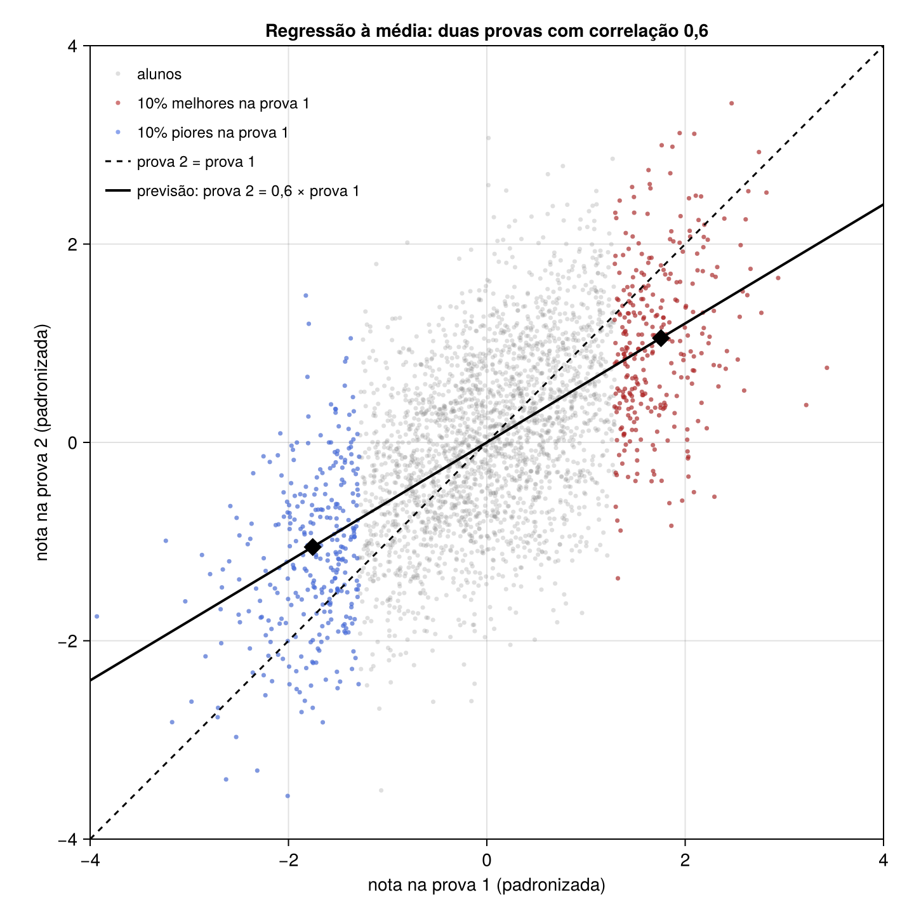
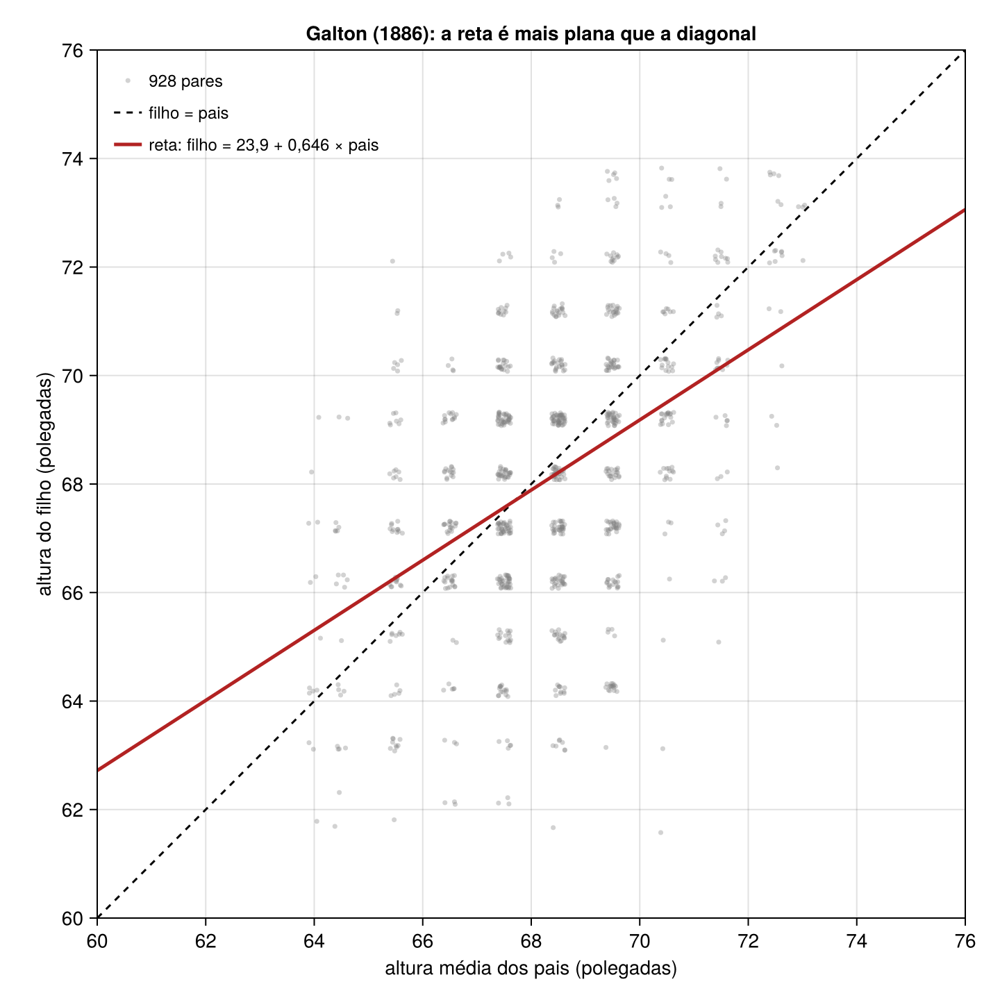

Uma escola aplica uma prova e chama os 10% de alunos com as piores notas para um reforço. Na prova seguinte, esses alunos melhoram bastante. O reforço funcionou?

Talvez. Mas há um detalhe incômodo: se ninguém tivesse feito nada, eles também teriam melhorado. E os 10% melhores da primeira prova, que ninguém tocou, teriam piorado. Não é azar nem preguiça. É um efeito estatístico com nome, a **regressão à média**, e ele aparece toda vez que se escolhe um grupo por ter tido um resultado extremo e se mede de novo.

Este post explica de onde vem o efeito, faz a conta à mão, mostra o efeito numa simulação e nos dados de alturas que Francis Galton publicou em 1886, e termina com o que a regressão à média *não* é, que é onde mora a maior parte dos erros.

## A ideia: habilidade mais sorte

Pense na nota de uma prova como a soma de duas partes:

$$
\text{nota} = \text{habilidade} + \text{sorte}
$$

A habilidade é o que o aluno sabe e não muda de uma semana para a outra. A sorte é tudo o que muda: a noite mal dormida, a questão que por acaso ele tinha revisado, um chute que deu certo. Na segunda prova, a habilidade é a mesma, mas a sorte é nova.

Agora olhe para quem tirou as notas mais altas na primeira prova. Para chegar lá, a pessoa precisou de muita habilidade, de muita sorte ou das duas coisas. Na média, o grupo do topo teve sorte acima da média. Na segunda prova, essa sorte não se repete: ela volta a ser, em média, zero. A habilidade fica, e a nota cai um pouco. Com os piores acontece o espelho: eles tiveram, em média, azar, o azar não se repete, e a nota sobe.

Para fazer contas, vou supor que habilidade e sorte variam como uma distribuição normal, com variância da habilidade igual a 0,6 e variância da sorte igual a 0,4, e que a sorte não tem relação com a habilidade nem com a sorte da outra prova. Com isso:

- a variância de cada prova é $0{,}6 + 0{,}4 = 1$;
- a covariância entre as duas provas é a variância da parte comum, a habilidade: 0,6;
- a **correlação** entre as provas é $0{,}6 / 1 = 0{,}6$.

As duas primeiras afirmações valem sempre que a sorte não tem correlação com a habilidade nem entre as provas, e estão provadas em Lean (seção "As provas em Lean"). A correlação é a fração da variação de cada prova que vem da parte que se repete. Quanto mais sorte há na prova, menor a correlação.

## A conta à mão

As notas estão **padronizadas**: medidas em desvios padrão a partir da média, de modo que a média é 0 e o desvio padrão é 1. Nesse caso, a melhor previsão da segunda nota, sabendo a primeira, é

$$
\hat z_2 = \rho \, z_1
$$

em que $z_1$ é a nota padronizada na prova 1, $\hat z_2$ é a nota prevista na prova 2 e $\rho$ (rô) é a correlação entre as provas. É a reta de regressão em unidades padronizadas, e ela vale como previsão da média quando a relação entre as provas é linear, como no modelo normal acima.

**Um aluno.** Dados: $\rho = 0{,}6$ (do modelo) e $z_1 = 2$, um aluno 2 desvios padrão acima da média.

$$
\hat z_2 = 0{,}6 \times 2 = 1{,}2
$$

Na segunda prova, espera-se que ele fique 1,2 desvio padrão acima da média: ainda bem acima, mas menos do que antes. Repare que "espera-se" é uma média sobre muitos alunos como ele; o aluno em particular pode subir ou descer.

**Os 10% melhores.** Primeiro, o corte: quem passou do percentil 90. Na tabela Z, $P(Z < 1{,}2816) = 0{,}90$, então o corte é $c = 1{,}2816$ (com mais casas, 1,281552).

Depois, a média do grupo acima do corte. Para a normal padrão, cuja densidade é $\varphi(z) = e^{-z^2/2}/\sqrt{2\pi}$, essa média é

$$
\text{média acima de } c = \frac{\varphi(c)}{P(Z > c)}
$$

A fórmula sai em uma linha: a derivada de $\varphi(z)$ é $-z\,\varphi(z)$, então a integral de $z\,\varphi(z)$ de $c$ até infinito é $\varphi(c)$, e dividir por $P(Z > c)$ dá a média do grupo. Substituindo, com $c = 1{,}281552$:

$$
\begin{aligned}
c^2 &= 1{,}642374\\
c^2/2 &= 0{,}821187\\
e^{-0{,}821187} &= 0{,}439909\\
\varphi(c) &= \frac{0{,}439909}{\sqrt{2\pi}} = \frac{0{,}439909}{2{,}506628} = 0{,}175498\\
\text{média acima de } c &= \frac{0{,}175498}{0{,}10} = 1{,}75498
\end{aligned}
$$

Os 10% melhores tiveram, em média, nota 1,7550 na prova 1. A previsão para a prova 2:

$$
0{,}6 \times 1{,}75498 = 1{,}05299 \approx 1{,}0530
$$

Ou seja, o grupo do topo cai, em média, de 1,755 para 1,053 desvio padrão acima da média, sem ninguém fazer nada com ele. Pela simetria da normal, os 10% piores sobem de −1,755 para −1,053. O código abaixo refaz as contas:

  

  

    
Julia

    

    <button class="copy-button" onclick="copyCode(this)">
      <i class="bi bi-clipboard"></i>Copiar
    </button>
  

  

    <pre><code>using Distributions, Printf

ρ = 0.6                                   # correlação entre as duas provas
z = Normal()                              # notas padronizadas: média 0, desvio padrão 1

# Um aluno 2 desvios padrão acima da média na prova 1
@printf("previsão para a prova 2: %.4f\n", ρ * 2)

# Os 10% melhores da prova 1: quem passou do percentil 90
corte = quantile(z, 0.90)
media_topo = pdf(z, corte) / 0.10         # média da normal acima do corte
@printf("corte dos 10%% melhores: %.4f\n", corte)
@printf("média deles na prova 1:  %.4f\n", media_topo)
@printf("média esperada na prova 2: %.4f\n", ρ * media_topo)</code></pre>
  

  
# Saída

  <pre style="overflow-x: auto; font-size: 0.9em;">previsão para a prova 2: 1.2000
corte dos 10% melhores: 1.2816
média deles na prova 1:  1.7550
média esperada na prova 2: 1.0530</pre>

  

  

  

    
R

    

    <button class="copy-button" onclick="copyCode(this)">
      <i class="bi bi-clipboard"></i>Copiar
    </button>
  

  

    <pre><code>rho &lt;- 0.6                                # correlação entre as duas provas

# Um aluno 2 desvios padrão acima da média na prova 1 (notas padronizadas)
cat(sprintf("previsão para a prova 2: %.4f\n", rho * 2))

# Os 10% melhores da prova 1: quem passou do percentil 90
corte &lt;- qnorm(0.90)
media_topo &lt;- dnorm(corte) / 0.10         # média da normal acima do corte
cat(sprintf("corte dos 10%% melhores: %.4f\n", corte))
cat(sprintf("média deles na prova 1:  %.4f\n", media_topo))
cat(sprintf("média esperada na prova 2: %.4f\n", rho * media_topo))</code></pre>
  

  
# Saída

  <pre style="overflow-x: auto; font-size: 0.9em;">previsão para a prova 2: 1.2000
corte dos 10% melhores: 1.2816
média deles na prova 1:  1.7550
média esperada na prova 2: 1.0530</pre>

  

  

  

    
Python

    

    <button class="copy-button" onclick="copyCode(this)">
      <i class="bi bi-clipboard"></i>Copiar
    </button>
  

  

    <pre><code>from scipy.stats import norm

rho = 0.6                                 # correlação entre as duas provas

# Um aluno 2 desvios padrão acima da média na prova 1 (notas padronizadas)
print(f"previsão para a prova 2: {rho * 2:.4f}")

# Os 10% melhores da prova 1: quem passou do percentil 90
corte = norm.ppf(0.90)
media_topo = norm.pdf(corte) / 0.10       # média da normal acima do corte
print(f"corte dos 10% melhores: {corte:.4f}")
print(f"média deles na prova 1:  {media_topo:.4f}")
print(f"média esperada na prova 2: {rho * media_topo:.4f}")</code></pre>
  

  
# Saída

  <pre style="overflow-x: auto; font-size: 0.9em;">previsão para a prova 2: 1.2000
corte dos 10% melhores: 1.2816
média deles na prova 1:  1.7550
média esperada na prova 2: 1.0530</pre>

  

## A simulação

Agora com alunos: 100 mil, cada um com uma habilidade sorteada e duas sortes independentes, exatamente como no modelo. O código separa os 10% melhores e os 10% piores na prova 1 e olha a média deles nas duas provas.

  

  

    
Julia

    

    <button class="copy-button" onclick="copyCode(this)">
      <i class="bi bi-clipboard"></i>Copiar
    </button>
  

  

    <pre><code>using CairoMakie, Random, Statistics, Printf

# Nota = habilidade + sorte. Variância da habilidade 0,6 e da sorte 0,4:
# cada prova tem variância 1, e a correlação entre as provas é 0,6.
Random.seed!(123)
n = 100_000
habilidade = sqrt(0.6) .* randn(n)
prova1 = habilidade .+ sqrt(0.4) .* randn(n)     # sorte da prova 1
prova2 = habilidade .+ sqrt(0.4) .* randn(n)     # sorte nova na prova 2

topo = prova1 .&gt;= quantile(prova1, 0.90)          # 10% melhores na prova 1
base = prova1 .&lt;= quantile(prova1, 0.10)          # 10% piores na prova 1
@printf("correlação entre as provas:       %.4f\n", cor(prova1, prova2))
@printf("10%% melhores: prova 1 %.4f, prova 2 %.4f\n", mean(prova1[topo]), mean(prova2[topo]))
@printf("10%% piores:   prova 1 %.4f, prova 2 %.4f\n", mean(prova1[base]), mean(prova2[base]))
@printf("desvio padrão: prova 1 %.4f, prova 2 %.4f\n", std(prova1), std(prova2))

# O mesmo efeito de trás para a frente: os 10% melhores da prova 2
topo2 = prova2 .&gt;= quantile(prova2, 0.90)
@printf("10%% melhores da prova 2: prova 2 %.4f, prova 1 %.4f\n", mean(prova2[topo2]), mean(prova1[topo2]))

# Gráfico com 3.000 alunos sorteados
idx = randperm(n)[1:3000]
fig = Figure(size = (720, 720))
ax = Axis(fig[1, 1]; xlabel = "nota na prova 1 (padronizada)", ylabel = "nota na prova 2 (padronizada)",
          title = "Regressão à média: duas provas com correlação 0,6", aspect = DataAspect())
scatter!(ax, prova1[idx], prova2[idx]; color = (:gray, 0.25), markersize = 5, label = "alunos")
scatter!(ax, prova1[idx][topo[idx]], prova2[idx][topo[idx]]; color = (:firebrick, 0.6), markersize = 5,
         label = "10% melhores na prova 1")
scatter!(ax, prova1[idx][base[idx]], prova2[idx][base[idx]]; color = (:royalblue, 0.6), markersize = 5,
         label = "10% piores na prova 1")
ablines!(ax, 0, 1; color = :black, linestyle = :dash, label = "prova 2 = prova 1")
ablines!(ax, 0, 0.6; color = :black, linewidth = 2, label = "previsão: prova 2 = 0,6 × prova 1")
for grupo in (topo, base)
    scatter!(ax, [mean(prova1[grupo])], [mean(prova2[grupo])]; color = :black, marker = :diamond, markersize = 16)
end
limits!(ax, -4, 4, -4, 4)
axislegend(ax; position = :lt, framevisible = false, labelsize = 12)
save("regressao_media_simulacao.png", fig, px_per_unit = 2)</code></pre>
  

  
# Saída

  <pre style="overflow-x: auto; font-size: 0.9em;">correlação entre as provas:       0.5991
10% melhores: prova 1 1.7561, prova 2 1.0514
10% piores:   prova 1 -1.7554, prova 2 -1.0553
desvio padrão: prova 1 1.0010, prova 2 1.0022
10% melhores da prova 2: prova 2 1.7544, prova 1 1.0529</pre>

  

  

  

    
R

    

    <button class="copy-button" onclick="copyCode(this)">
      <i class="bi bi-clipboard"></i>Copiar
    </button>
  

  

    <pre><code># Nota = habilidade + sorte. Variância da habilidade 0,6 e da sorte 0,4:
# cada prova tem variância 1, e a correlação entre as provas é 0,6.
set.seed(123)
n &lt;- 100000
habilidade &lt;- rnorm(n, sd = sqrt(0.6))
prova1 &lt;- habilidade + rnorm(n, sd = sqrt(0.4))   # sorte da prova 1
prova2 &lt;- habilidade + rnorm(n, sd = sqrt(0.4))   # sorte nova na prova 2

topo &lt;- prova1 &gt;= quantile(prova1, 0.90)          # 10% melhores na prova 1
base &lt;- prova1 &lt;= quantile(prova1, 0.10)          # 10% piores na prova 1
cat(sprintf("correlação entre as provas:       %.4f\n", cor(prova1, prova2)))
cat(sprintf("10%% melhores: prova 1 %.4f, prova 2 %.4f\n", mean(prova1[topo]), mean(prova2[topo])))
cat(sprintf("10%% piores:   prova 1 %.4f, prova 2 %.4f\n", mean(prova1[base]), mean(prova2[base])))
cat(sprintf("desvio padrão: prova 1 %.4f, prova 2 %.4f\n", sd(prova1), sd(prova2)))

# O mesmo efeito de trás para a frente: os 10% melhores da prova 2
topo2 &lt;- prova2 &gt;= quantile(prova2, 0.90)
cat(sprintf("10%% melhores da prova 2: prova 2 %.4f, prova 1 %.4f\n", mean(prova2[topo2]), mean(prova1[topo2])))

# Gráfico com 3.000 alunos sorteados
idx &lt;- sample(n, 3000)
png("regressao_media_simulacao.png", width = 1600, height = 1400, res = 200)
plot(prova1[idx], prova2[idx], pch = 16, cex = 0.5, col = adjustcolor("gray40", 0.3), asp = 1,
     xlim = c(-4, 4), ylim = c(-4, 4), xlab = "nota na prova 1 (padronizada)",
     ylab = "nota na prova 2 (padronizada)", main = "Regressão à média: duas provas com correlação 0,6")
points(prova1[idx][topo[idx]], prova2[idx][topo[idx]], pch = 16, cex = 0.5, col = adjustcolor("firebrick", 0.6))
points(prova1[idx][base[idx]], prova2[idx][base[idx]], pch = 16, cex = 0.5, col = adjustcolor("royalblue", 0.6))
abline(0, 1, lty = 2)
abline(0, 0.6, lwd = 2)
points(c(mean(prova1[topo]), mean(prova1[base])), c(mean(prova2[topo]), mean(prova2[base])), pch = 18, cex = 2.2)
legend("topleft", bty = "n", cex = 0.8,
       legend = c("alunos", "10% melhores na prova 1", "10% piores na prova 1", "prova 2 = prova 1",
                  "previsão: prova 2 = 0,6 × prova 1"),
       col = c("gray40", "firebrick", "royalblue", "black", "black"), pch = c(16, 16, 16, NA, NA),
       lty = c(NA, NA, NA, 2, 1), lwd = c(NA, NA, NA, 1, 2))
invisible(dev.off())</code></pre>
  

  
# Saída

  <pre style="overflow-x: auto; font-size: 0.9em;">correlação entre as provas:       0.5981
10% melhores: prova 1 1.7561, prova 2 1.0482
10% piores:   prova 1 -1.7515, prova 2 -1.0460
desvio padrão: prova 1 1.0001, prova 2 0.9987
10% melhores da prova 2: prova 2 1.7541, prova 1 1.0482</pre>

  

  

  

    
Python

    

    <button class="copy-button" onclick="copyCode(this)">
      <i class="bi bi-clipboard"></i>Copiar
    </button>
  

  

    <pre><code>import numpy as np
import matplotlib.pyplot as plt

# Nota = habilidade + sorte. Variância da habilidade 0,6 e da sorte 0,4:
# cada prova tem variância 1, e a correlação entre as provas é 0,6.
rng = np.random.default_rng(123)
n = 100_000
habilidade = rng.normal(0, np.sqrt(0.6), n)
prova1 = habilidade + rng.normal(0, np.sqrt(0.4), n)   # sorte da prova 1
prova2 = habilidade + rng.normal(0, np.sqrt(0.4), n)   # sorte nova na prova 2

topo = prova1 &gt;= np.quantile(prova1, 0.90)             # 10% melhores na prova 1
base = prova1 &lt;= np.quantile(prova1, 0.10)             # 10% piores na prova 1
print(f"correlação entre as provas:       {np.corrcoef(prova1, prova2)[0, 1]:.4f}")
print(f"10% melhores: prova 1 {prova1[topo].mean():.4f}, prova 2 {prova2[topo].mean():.4f}")
print(f"10% piores:   prova 1 {prova1[base].mean():.4f}, prova 2 {prova2[base].mean():.4f}")
print(f"desvio padrão: prova 1 {prova1.std(ddof=1):.4f}, prova 2 {prova2.std(ddof=1):.4f}")

# O mesmo efeito de trás para a frente: os 10% melhores da prova 2
topo2 = prova2 &gt;= np.quantile(prova2, 0.90)
print(f"10% melhores da prova 2: prova 2 {prova2[topo2].mean():.4f}, prova 1 {prova1[topo2].mean():.4f}")

# Gráfico com 3.000 alunos sorteados
idx = rng.choice(n, 3000, replace=False)
fig, ax = plt.subplots(figsize=(8, 7))
ax.scatter(prova1[idx], prova2[idx], s=5, color="gray", alpha=0.25, label="alunos")
ax.scatter(prova1[idx][topo[idx]], prova2[idx][topo[idx]], s=5, color="firebrick", alpha=0.6,
           label="10% melhores na prova 1")
ax.scatter(prova1[idx][base[idx]], prova2[idx][base[idx]], s=5, color="royalblue", alpha=0.6,
           label="10% piores na prova 1")
xs = np.array([-4, 4])
ax.plot(xs, xs, "k--", label="prova 2 = prova 1")
ax.plot(xs, 0.6 * xs, "k-", lw=2, label="previsão: prova 2 = 0,6 × prova 1")
for grupo in (topo, base):
    ax.scatter(prova1[grupo].mean(), prova2[grupo].mean(), marker="D", s=80, color="black", zorder=3)
ax.set(xlim=(-4, 4), ylim=(-4, 4), aspect="equal", xlabel="nota na prova 1 (padronizada)",
       ylabel="nota na prova 2 (padronizada)", title="Regressão à média: duas provas com correlação 0,6")
ax.legend(loc="upper left", frameon=False, fontsize=9)
fig.savefig("regressao_media_simulacao.png", dpi=200, bbox_inches="tight")</code></pre>
  

  
# Saída

  <pre style="overflow-x: auto; font-size: 0.9em;">correlação entre as provas:       0.6015
10% melhores: prova 1 1.7519, prova 2 1.0592
10% piores:   prova 1 -1.7617, prova 2 -1.0536
desvio padrão: prova 1 1.0000, prova 2 0.9998
10% melhores da prova 2: prova 2 1.7541, prova 1 1.0428</pre>

  

Na versão em Julia, os 10% melhores tiveram média 1,7561 na prova 1 e 1,0514 na prova 2; a conta à mão dava 1,7550 e 1,0530. Os 10% piores foram de −1,7554 para −1,0553. As diferenças em relação à conta são o acaso de uma amostra finita, e cada linguagem sorteia números diferentes com a mesma semente, por isso as três saídas não são idênticas (todas ficam a menos de 0,01 da conta).

<figure style="text-align:center; margin: 2em auto; max-width: 760px;">
  
  <figcaption style="margin-top:0.75em; font-size:0.88rem; color:#555;">
    Figura 1. Notas de 3.000 dos 100 mil alunos simulados (versão em Julia). Os losangos são as médias dos 10% melhores e dos 10% piores da prova 1: eles caem sobre a reta de previsão (inclinação 0,6), não sobre a diagonal. A nuvem vermelha está mais baixa que a diagonal; a azul, mais alta.
  </figcaption>
</figure>

## Os dados de Galton

O nome vem de Francis Galton. Em 1886 ele publicou um artigo chamado "Regression towards mediocrity in hereditary stature" ("regressão em direção à mediocridade na estatura hereditária", em tradução livre), com uma tabela de 928 filhos adultos de 205 casais, cruzando a altura de cada filho com a altura média dos pais. Os dados estão no pacote HistData, do R, com licença GPL, e o código abaixo os lê de um espelho público desse pacote. Dois cuidados, ambos registrados na documentação do HistData: as alturas foram agrupadas em intervalos de uma polegada, e as alturas das filhas foram multiplicadas por 1,08 antes da tabulação, para compensar a diferença entre os sexos.

  

  

    
Julia

    

    <button class="copy-button" onclick="copyCode(this)">
      <i class="bi bi-clipboard"></i>Copiar
    </button>
  

  

    <pre><code>using CairoMakie, CSV, DataFrames, Downloads, Statistics, Printf, Random

# Dados de Galton (1886): altura média dos pais e altura do filho adulto, em polegadas.
# Fonte: pacote HistData do R (licença GPL), espelhado no Rdatasets.
url = "https://vincentarelbundock.github.io/Rdatasets/csv/HistData/Galton.csv"
galton = CSV.read(Downloads.download(url), DataFrame)
pais, filho = galton.parent, galton.child

b = cov(pais, filho) / var(pais)               # inclinação da reta filho ~ pais
a = mean(filho) - b * mean(pais)
@printf("n = %d pares\n", nrow(galton))
@printf("médias: pais %.2f, filho %.2f polegadas\n", mean(pais), mean(filho))
@printf("correlação: %.4f\n", cor(pais, filho))
@printf("reta: filho = %.4f + %.4f × pais\n", a, b)
@printf("inclinação ao contrário (pais ~ filho): %.4f\n", cov(pais, filho) / var(filho))

# Pais baixos e pais altos: previsão da reta e média observada dos filhos
for h in (64.0, 71.5)
    @printf("pais = %.1f: previsão %.2f, média observada %.2f (%d filhos)\n",
            h, a + b * h, mean(filho[pais .== h]), count(pais .== h))
end

# Gráfico (pontos com um pequeno ruído, porque as alturas foram agrupadas de polegada em polegada)
Random.seed!(1)
ruido() = 0.25 .* (rand(nrow(galton)) .- 0.5)
fig = Figure(size = (720, 720))
ax = Axis(fig[1, 1]; xlabel = "altura média dos pais (polegadas)", ylabel = "altura do filho (polegadas)",
          title = "Galton (1886): a reta é mais plana que a diagonal", aspect = DataAspect())
scatter!(ax, pais .+ ruido(), filho .+ ruido(); color = (:gray, 0.35), markersize = 5, label = "928 pares")
ablines!(ax, 0, 1; color = :black, linestyle = :dash, label = "filho = pais")
ablines!(ax, a, b; color = :firebrick, linewidth = 2.5, label = replace(@sprintf("reta: filho = %.1f + %.3f × pais", a, b), "." =&gt; ","))
limits!(ax, 60, 76, 60, 76)
axislegend(ax; position = :lt, framevisible = false, labelsize = 12)
save("regressao_media_galton.png", fig, px_per_unit = 2)</code></pre>
  

  
# Saída

  <pre style="overflow-x: auto; font-size: 0.9em;">n = 928 pares
médias: pais 68.31, filho 68.09 polegadas
correlação: 0.4588
reta: filho = 23.9415 + 0.6463 × pais
inclinação ao contrário (pais ~ filho): 0.3256
pais = 64.0: previsão 65.30, média observada 65.31 (14 filhos)
pais = 71.5: previsão 70.15, média observada 70.08 (43 filhos)</pre>

  

  

  

    
R

    

    <button class="copy-button" onclick="copyCode(this)">
      <i class="bi bi-clipboard"></i>Copiar
    </button>
  

  

    <pre><code># Dados de Galton (1886): altura média dos pais e altura do filho adulto, em polegadas.
# Fonte: pacote HistData do R (licença GPL), espelhado no Rdatasets.
url &lt;- "https://vincentarelbundock.github.io/Rdatasets/csv/HistData/Galton.csv"
galton &lt;- read.csv(url)
pais &lt;- galton$parent; filho &lt;- galton$child

ajuste &lt;- lm(filho ~ pais)                    # reta de mínimos quadrados
a &lt;- coef(ajuste)[[1]]; b &lt;- coef(ajuste)[[2]]
cat(sprintf("n = %d pares\n", nrow(galton)))
cat(sprintf("médias: pais %.2f, filho %.2f polegadas\n", mean(pais), mean(filho)))
cat(sprintf("correlação: %.4f\n", cor(pais, filho)))
cat(sprintf("reta: filho = %.4f + %.4f × pais\n", a, b))
cat(sprintf("inclinação ao contrário (pais ~ filho): %.4f\n", coef(lm(pais ~ filho))[[2]]))

# Pais baixos e pais altos: previsão da reta e média observada dos filhos
for (h in c(64.0, 71.5)) {
  cat(sprintf("pais = %.1f: previsão %.2f, média observada %.2f (%d filhos)\n",
              h, a + b * h, mean(filho[pais == h]), sum(pais == h)))
}

# Gráfico (pontos com um pequeno ruído, porque as alturas foram agrupadas de polegada em polegada)
set.seed(1)
png("regressao_media_galton.png", width = 1440, height = 1440, res = 200)
plot(jitter(pais, amount = 0.125), jitter(filho, amount = 0.125), pch = 16, cex = 0.5,
     col = adjustcolor("gray40", 0.35), asp = 1, xlim = c(60, 76), ylim = c(60, 76),
     xlab = "altura média dos pais (polegadas)", ylab = "altura do filho (polegadas)",
     main = "Galton (1886): a reta é mais plana que a diagonal")
abline(0, 1, lty = 2)
abline(a, b, col = "firebrick", lwd = 2.5)
legend("topleft", bty = "n", cex = 0.85,
       legend = c("928 pares", "filho = pais", gsub(".", ",", sprintf("reta: filho = %.1f + %.3f × pais", a, b), fixed = TRUE)),
       col = c("gray40", "black", "firebrick"), pch = c(16, NA, NA), lty = c(NA, 2, 1), lwd = c(NA, 1, 2.5))
invisible(dev.off())</code></pre>
  

  
# Saída

  <pre style="overflow-x: auto; font-size: 0.9em;">n = 928 pares
médias: pais 68.31, filho 68.09 polegadas
correlação: 0.4588
reta: filho = 23.9415 + 0.6463 × pais
inclinação ao contrário (pais ~ filho): 0.3256
pais = 64.0: previsão 65.30, média observada 65.31 (14 filhos)
pais = 71.5: previsão 70.15, média observada 70.08 (43 filhos)</pre>

  

  

  

    
Python

    

    <button class="copy-button" onclick="copyCode(this)">
      <i class="bi bi-clipboard"></i>Copiar
    </button>
  

  

    <pre><code>import numpy as np
import pandas as pd
import matplotlib.pyplot as plt

# Dados de Galton (1886): altura média dos pais e altura do filho adulto, em polegadas.
# Fonte: pacote HistData do R (licença GPL), espelhado no Rdatasets.
url = "https://vincentarelbundock.github.io/Rdatasets/csv/HistData/Galton.csv"
galton = pd.read_csv(url)
pais, filho = galton["parent"].to_numpy(), galton["child"].to_numpy()

b, a = np.polyfit(pais, filho, 1)              # reta de mínimos quadrados: inclinação, intercepto
print(f"n = {len(galton)} pares")
print(f"médias: pais {pais.mean():.2f}, filho {filho.mean():.2f} polegadas")
print(f"correlação: {np.corrcoef(pais, filho)[0, 1]:.4f}")
print(f"reta: filho = {a:.4f} + {b:.4f} × pais")
print(f"inclinação ao contrário (pais ~ filho): {np.polyfit(filho, pais, 1)[0]:.4f}")

# Pais baixos e pais altos: previsão da reta e média observada dos filhos
for h in (64.0, 71.5):
    grupo = pais == h
    print(f"pais = {h:.1f}: previsão {a + b * h:.2f}, média observada {filho[grupo].mean():.2f} ({grupo.sum()} filhos)")

# Gráfico (pontos com um pequeno ruído, porque as alturas foram agrupadas de polegada em polegada)
rng = np.random.default_rng(1)
ruido = lambda: 0.25 * (rng.random(len(galton)) - 0.5)
fig, ax = plt.subplots(figsize=(7.2, 7.2))
ax.scatter(pais + ruido(), filho + ruido(), s=5, color="gray", alpha=0.35, label="928 pares")
xs = np.array([60, 76])
ax.plot(xs, xs, "k--", label="filho = pais")
ax.plot(xs, a + b * xs, color="firebrick", lw=2.5, label=f"reta: filho = {a:.1f} + {b:.3f} × pais".replace(".", ","))
ax.set(xlim=(60, 76), ylim=(60, 76), aspect="equal", xlabel="altura média dos pais (polegadas)",
       ylabel="altura do filho (polegadas)", title="Galton (1886): a reta é mais plana que a diagonal")
ax.legend(loc="upper left", frameon=False)
fig.savefig("regressao_media_galton.png", dpi=200, bbox_inches="tight")</code></pre>
  

  
# Saída

  <pre style="overflow-x: auto; font-size: 0.9em;">n = 928 pares
médias: pais 68.31, filho 68.09 polegadas
correlação: 0.4588
reta: filho = 23.9415 + 0.6463 × pais
inclinação ao contrário (pais ~ filho): 0.3256
pais = 64.0: previsão 65.30, média observada 65.31 (14 filhos)
pais = 71.5: previsão 70.15, média observada 70.08 (43 filhos)</pre>

  

As três linguagens dão o mesmo resultado. A reta de mínimos quadrados é

$$
\text{filho} = 23{,}9415 + 0{,}6463 \times \text{pais} \quad \text{(em polegadas; 1 polegada = 2,54 cm)}
$$

A inclinação, 0,6463, é menor que 1: cada polegada a mais na altura média dos pais vem acompanhada, em média, de só 0,65 polegada a mais no filho. Na figura 2, a reta vermelha é mais plana que a diagonal tracejada.

Dois grupos mostram o efeito nos dois sentidos:

- Pais com altura média de **64,0 polegadas** (162,56 cm, bem abaixo da média de 68,31): os 14 filhos têm, em média, 65,31 polegadas (165,89 cm). São mais altos que os pais, e a reta previa 65,30.
- Pais com **71,5 polegadas** (181,61 cm, bem acima da média): os 43 filhos têm, em média, 70,08 polegadas (178,00 cm). São mais baixos que os pais, e a reta previa 70,15.

Em unidades padronizadas, a inclinação vira a correlação. A altura média dos pais varia menos que a dos filhos (desvios padrão de 1,79 e 2,52 polegadas), porque é a média de duas pessoas. Por isso a inclinação em polegadas (0,6463) é maior que a correlação (0,4588):

$$
0{,}6463 \times \frac{1{,}7873}{2{,}5179} = 0{,}4588
$$

A passagem de uma forma para a outra está provada em Lean.

<figure style="text-align:center; margin: 2em auto; max-width: 760px;">
  
  <figcaption style="margin-top:0.75em; font-size:0.88rem; color:#555;">
    Figura 2. Os 928 pares de Galton (1886), com um pequeno ruído nos pontos porque as alturas foram agrupadas de polegada em polegada. A reta de regressão (vermelha) é mais plana que a diagonal: filhos de pais altos são, em média, mais baixos que os pais, e filhos de pais baixos, mais altos.
  </figcaption>
</figure>

Um limite dos dados: nas pontas, a reta ajusta pior. Os 19 filhos de pais com 72,5 polegadas têm média de 71,88, acima das 70,80 que a reta prevê. Ainda é regressão (71,88 é menos que 72,5), só que menor. A documentação do HistData cita um estudo sobre essa curvatura nos dados de Galton (Wachsmuth, Wilkinson e Dallal, 2003). Os grupos das pontas também são pequenos, então a média deles oscila mais.

## Onde a regressão à média engana

O padrão é sempre o mesmo: **escolher pelo extremo, agir, medir de novo e atribuir a mudança à ação**. Alguns cenários em que isso acontece (são exemplos de raciocínio, não dados):

- **Tratamentos.** Uma pessoa procura um tratamento quando os sintomas estão no pior momento. Sintomas que oscilam tendem a melhorar depois do pior momento, com ou sem tratamento.
- **Radares e lombadas.** Se o cruzamento escolhido para receber um radar foi o que teve mais acidentes no ano, no ano seguinte ele tende a ter menos, mesmo que o radar não faça nada.
- **Castigo e elogio.** Quem só repreende depois de um desempenho muito ruim vê melhora logo em seguida, e quem só elogia depois de um desempenho excelente vê piora. A conclusão "castigo funciona, elogio estraga" pode ser só regressão à média.
- **O melhor estreante do ano.** Um atleta escolhido por ter tido a melhor temporada de estreia tende a ter uma segunda temporada pior, sem que nada tenha mudado nele.

Como se proteger:

- **Grupo de controle.** Compare quem recebeu a ação com um grupo escolhido do mesmo jeito que não recebeu. Os dois regridem; a diferença entre eles é o efeito da ação.
- **Compare com a previsão, não com o valor anterior.** No exemplo das provas, a pergunta certa não é "os piores melhoraram?" (melhorariam de qualquer jeito), e sim "melhoraram mais que os −1,053 previstos?".
- **Escolha por uma medida e avalie com outra**, independente da primeira. Se a seleção foi feita com a prova 1, o "antes" não pode ser a própria prova 1.

## O que a regressão à média não é

- **Não é uma força que puxa todos para o meio.** Se fosse, as notas ficariam cada vez mais parecidas. Não ficam: na simulação, o desvio padrão é 1,0010 na prova 1 e 1,0022 na prova 2. A parte prevista da variação encolhe (é $\rho^2$ da variância), mas a sorte nova repõe exatamente o que falta ($1 - \rho^2$), e a soma é a variância de antes. A conta está provada em Lean.
- **Não tem direção no tempo.** O efeito aparece de trás para a frente: na simulação em Julia, os 10% melhores *da prova 2* tiveram média 1,7544 na prova 2 e só 1,0529 na prova 1. Ninguém diria que a prova 2 causou a nota da prova 1. Isso mostra que a regressão à média é um efeito da seleção pelo extremo, não uma causa.
- **Não acontece sem sorte.** Se a correlação fosse 1 (nota = só habilidade), a previsão seria $\hat z_2 = z_1$ e ninguém regrediria. Quanto mais a medida depende do acaso, mais forte o efeito.
- **Não diz nada sobre um indivíduo.** É uma afirmação sobre médias de grupos selecionados. Um aluno do topo pode ir ainda melhor na segunda prova.

## As provas em Lean

As afirmações que o post faz "para todo" caso estão demonstradas em Lean, no arquivo [`provas/Provas/RegressaoMedia.lean`](https://github.com/morrisonkuhlsen/morrisonkuhlsen/blob/master/provas/Provas/RegressaoMedia.lean). (O post [Lean: a linguagem em que o computador confere a sua prova](/lean-linguagem-computador-confere-prova/) explica como ler esses arquivos.)

- Se a sorte não tem correlação com a habilidade nem entre as provas, a covariância entre as provas é a variância da habilidade, e a variância de cada prova é a soma das duas variâncias.
- Com variância da habilidade $a \ge 0$ e da sorte $b > 0$, a correlação $a/(a+b)$ fica entre 0 (inclusive) e 1 (exclusive); no exemplo, $0{,}6/(0{,}6 + 0{,}4) = 0{,}6$.
- Se $\lvert\rho\rvert < 1$ e $z \neq 0$, então $\lvert\rho z\rvert < \lvert z\rvert$: a previsão fica estritamente mais perto da média. Com $\lvert\rho\rvert \le 1$, nunca mais longe.
- A reta de mínimos quadrados, escrita em desvios padrão, tem inclinação igual à correlação.
- $\rho^2 \sigma^2 + (1 - \rho^2)\sigma^2 = \sigma^2$: a variância não encolhe.

O que o Lean não cobre: a fórmula da média acima do corte foi conferida pela derivação acima e pela simulação, e os números dos dados de Galton foram conferidos rodando o código nas três linguagens.

## Resumo

- Quando uma medida mistura uma parte que se repete (habilidade) com uma parte que não se repete (sorte), quem foi selecionado por um resultado extremo tende a ficar menos extremo na medida seguinte.
- Em unidades padronizadas, a previsão é $\hat z_2 = \rho z_1$. Com $\rho = 0{,}6$, os 10% melhores caem, em média, de 1,755 para 1,053 desvio padrão acima da média, sem nenhuma intervenção.
- Galton viu o efeito nas alturas: a reta filho × pais tem inclinação 0,6463, menor que 1, e a correlação é 0,4588.
- A variância não encolhe e o efeito aparece também de trás para a frente: é consequência da seleção, não uma força.
- Para saber se uma ação funcionou, compare com um grupo de controle escolhido do mesmo jeito, ou com a previsão da regressão, nunca só com o valor anterior.

Para ir além: a [regressão linear](/pt/analise-de-dados/regressao-linear) mostra como a reta de mínimos quadrados é calculada, e o [coeficiente de Pearson](/formulas/coeficiente-pearson.html) é a correlação usada aqui.

## Referências

- Galton, F. (1886). Regression towards mediocrity in hereditary stature. *The Journal of the Anthropological Institute of Great Britain and Ireland*, 15, 246–263. DOI: [10.2307/2841583](https://doi.org/10.2307/2841583). (Não consultado diretamente; dados e descrição conforme a documentação do HistData.)
- Friendly, M.; Dray, S.; Li, P.; Bellhouse, D. et al. *HistData: Data Sets from the History of Statistics and Data Visualization*. Pacote do R, versão 1.1.1 (publicada em 5 out. 2026), licença GPL-2 | GPL-3. DOI: [10.32614/CRAN.package.HistData](https://doi.org/10.32614/CRAN.package.HistData). Conjunto de dados `Galton` e sua documentação.
- Arel-Bundock, V. Rdatasets (espelho em CSV dos conjuntos de dados de pacotes do R), arquivo `HistData/Galton.csv`: [vincentarelbundock.github.io/Rdatasets](https://vincentarelbundock.github.io/Rdatasets/). Acesso em 26 nov. 2026.
- Wachsmuth, A. W.; Wilkinson, L.; Dallal, G. E. (2003). Galton's bend. *The American Statistician*, 57(3), 190–192. DOI: [10.1198/0003130031874](https://doi.org/10.1198/0003130031874). (Não consultado diretamente; citado na documentação do HistData como estudo da curvatura nos dados de Galton.)
