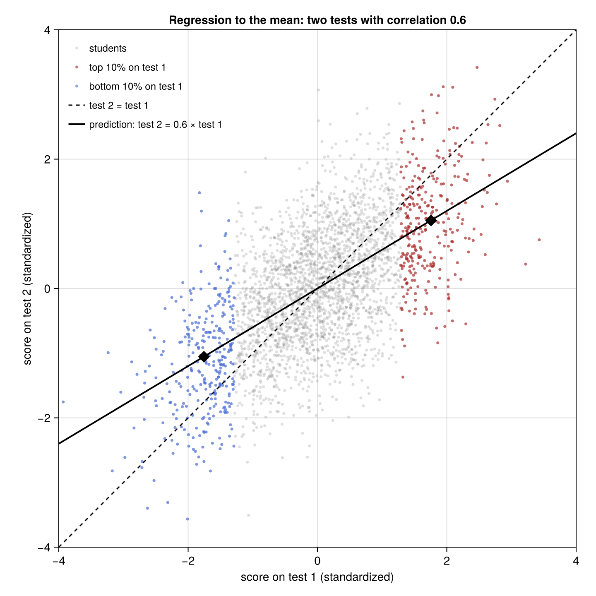
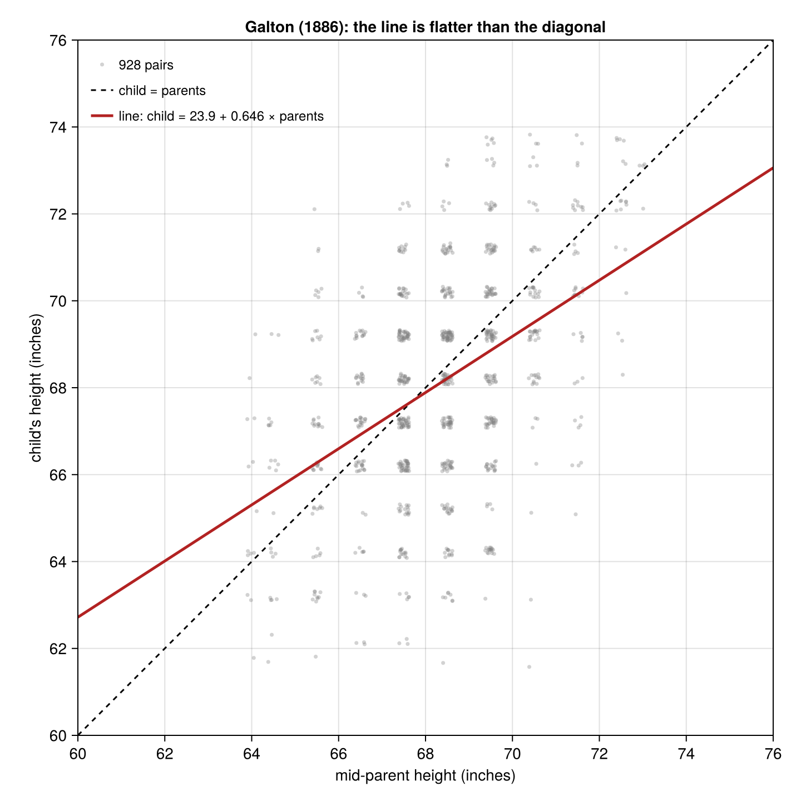

A school gives a test and calls the 10% of students with the lowest scores in for extra tutoring. On the next test, those students improve a lot. Did the tutoring work?

Maybe. But there is an awkward detail: if nobody had done anything, they would have improved too. And the top 10% on the first test, whom nobody touched, would have got worse. It is neither bad luck nor laziness. It is a statistical effect with a name, **regression to the mean**, and it shows up every time a group is chosen for an extreme result and then measured again.

This post explains where the effect comes from, does the calculation by hand, shows the effect in a simulation and in the height data Francis Galton published in 1886, and ends with what regression to the mean is *not*, which is where most of the mistakes live.

## The idea: ability plus luck

Think of a test score as the sum of two parts:

$$
\text{score} = \text{ability} + \text{luck}
$$

Ability is what the student knows, and it does not change from one week to the next. Luck is everything that does change: a bad night's sleep, the question they happened to have revised, a guess that came off. On the second test, the ability is the same, but the luck is new.

Now look at those who got the highest scores on the first test. To get there, a person needed a lot of ability, a lot of luck, or both. On average, the top group had above-average luck. On the second test, that luck is not repeated: it goes back to being, on average, zero. The ability stays, and the score drops a little. The worst students are the mirror image: on average they had bad luck, the bad luck is not repeated, and the score goes up.

To do the calculations, I will assume that ability and luck vary like a normal distribution, with the variance of ability equal to 0.6 and the variance of luck equal to 0.4, and that luck is unrelated to ability and to the luck on the other test. Then:

- the variance of each test is $0.6 + 0.4 = 1$;
- the covariance between the two tests is the variance of the shared part, ability: 0.6;
- the **correlation** between the tests is $0.6 / 1 = 0.6$.

The first two statements hold whenever luck is uncorrelated with ability and between the tests, and they are proved in Lean (section "The proofs in Lean"). The correlation is the share of each test's variation that comes from the part that repeats. The more luck there is in the test, the lower the correlation.

## The calculation by hand

The scores are **standardized**: measured in standard deviations from the mean, so the mean is 0 and the standard deviation is 1. In that case, the best prediction of the second score, given the first, is

$$
\hat z_2 = \rho \, z_1
$$

where $z_1$ is the standardized score on test 1, $\hat z_2$ is the predicted score on test 2 and $\rho$ (rho) is the correlation between the tests. It is the regression line in standardized units, and it works as a prediction of the mean when the relationship between the tests is linear, as in the normal model above.

**One student.** Data: $\rho = 0.6$ (from the model) and $z_1 = 2$, a student 2 standard deviations above the mean.

$$
\hat z_2 = 0.6 \times 2 = 1.2
$$

On the second test, they are expected to be 1.2 standard deviations above the mean: still well above, but less than before. Note that "expected" is an average over many students like them; this particular student may go up or down.

**The top 10%.** First, the cutoff: those above the 90th percentile. From the Z table, $P(Z < 1.2816) = 0.90$, so the cutoff is $c = 1.2816$ (with more digits, 1.281552).

Then, the mean of the group above the cutoff. For the standard normal, whose density is $\varphi(z) = e^{-z^2/2}/\sqrt{2\pi}$, that mean is

$$
\text{mean above } c = \frac{\varphi(c)}{P(Z > c)}
$$

The formula takes one line: the derivative of $\varphi(z)$ is $-z\,\varphi(z)$, so the integral of $z\,\varphi(z)$ from $c$ to infinity is $\varphi(c)$, and dividing by $P(Z > c)$ gives the group's mean. Substituting, with $c = 1.281552$:

$$
\begin{aligned}
c^2 &= 1.642374\\
c^2/2 &= 0.821187\\
e^{-0.821187} &= 0.439909\\
\varphi(c) &= \frac{0.439909}{\sqrt{2\pi}} = \frac{0.439909}{2.506628} = 0.175498\\
\text{mean above } c &= \frac{0.175498}{0.10} = 1.75498
\end{aligned}
$$

The top 10% had, on average, a score of 1.7550 on test 1. The prediction for test 2:

$$
0.6 \times 1.75498 = 1.05299 \approx 1.0530
$$

In other words, the top group drops, on average, from 1.755 to 1.053 standard deviations above the mean, without anyone doing anything to it. By the symmetry of the normal, the bottom 10% rise from −1.755 to −1.053. The code below redoes the calculation:

  

  

    
Julia

    

    <button class="copy-button" onclick="copyCode(this)">
      <i class="bi bi-clipboard"></i>Copy
    </button>
  

  

    <pre><code>using Distributions, Printf

ρ = 0.6                                   # correlation between the two tests
z = Normal()                              # standardized scores: mean 0, standard deviation 1

# A student 2 standard deviations above the mean on test 1
@printf("prediction for test 2: %.4f\n", ρ * 2)

# The top 10% on test 1: those above the 90th percentile
cutoff = quantile(z, 0.90)
top_mean = pdf(z, cutoff) / 0.10         # mean of the normal above the cutoff
@printf("cutoff for the top 10%%: %.4f\n", cutoff)
@printf("their mean on test 1:   %.4f\n", top_mean)
@printf("expected mean on test 2: %.4f\n", ρ * top_mean)</code></pre>
  

  
# Output

  <pre style="overflow-x: auto; font-size: 0.9em;">prediction for test 2: 1.2000
cutoff for the top 10%: 1.2816
their mean on test 1:   1.7550
expected mean on test 2: 1.0530</pre>

  

  

  

    
R

    

    <button class="copy-button" onclick="copyCode(this)">
      <i class="bi bi-clipboard"></i>Copy
    </button>
  

  

    <pre><code>rho &lt;- 0.6                                # correlation between the two tests

# A student 2 standard deviations above the mean on test 1 (standardized scores)
cat(sprintf("prediction for test 2: %.4f\n", rho * 2))

# The top 10% on test 1: those above the 90th percentile
cutoff &lt;- qnorm(0.90)
top_mean &lt;- dnorm(cutoff) / 0.10         # mean of the normal above the cutoff
cat(sprintf("cutoff for the top 10%%: %.4f\n", cutoff))
cat(sprintf("their mean on test 1:   %.4f\n", top_mean))
cat(sprintf("expected mean on test 2: %.4f\n", rho * top_mean))</code></pre>
  

  
# Output

  <pre style="overflow-x: auto; font-size: 0.9em;">prediction for test 2: 1.2000
cutoff for the top 10%: 1.2816
their mean on test 1:   1.7550
expected mean on test 2: 1.0530</pre>

  

  

  

    
Python

    

    <button class="copy-button" onclick="copyCode(this)">
      <i class="bi bi-clipboard"></i>Copy
    </button>
  

  

    <pre><code>from scipy.stats import norm

rho = 0.6                                 # correlation between the two tests

# A student 2 standard deviations above the mean on test 1 (standardized scores)
print(f"prediction for test 2: {rho * 2:.4f}")

# The top 10% on test 1: those above the 90th percentile
cutoff = norm.ppf(0.90)
top_mean = norm.pdf(cutoff) / 0.10       # mean of the normal above the cutoff
print(f"cutoff for the top 10%: {cutoff:.4f}")
print(f"their mean on test 1:   {top_mean:.4f}")
print(f"expected mean on test 2: {rho * top_mean:.4f}")</code></pre>
  

  
# Output

  <pre style="overflow-x: auto; font-size: 0.9em;">prediction for test 2: 1.2000
cutoff for the top 10%: 1.2816
their mean on test 1:   1.7550
expected mean on test 2: 1.0530</pre>

  

## The simulation

Now with students: 100,000 of them, each with a randomly drawn ability and two independent lucks, exactly as in the model. The code picks out the top 10% and the bottom 10% on test 1 and looks at their mean on both tests.

  

  

    
Julia

    

    <button class="copy-button" onclick="copyCode(this)">
      <i class="bi bi-clipboard"></i>Copy
    </button>
  

  

    <pre><code>using CairoMakie, Random, Statistics, Printf

# Score = ability + luck. Variance of ability 0.6 and of luck 0.4:
# each test has variance 1, and the correlation between the tests is 0.6.
Random.seed!(123)
n = 100_000
ability = sqrt(0.6) .* randn(n)
test1 = ability .+ sqrt(0.4) .* randn(n)     # luck on test 1
test2 = ability .+ sqrt(0.4) .* randn(n)     # new luck on test 2

top = test1 .&gt;= quantile(test1, 0.90)          # top 10% on test 1
bottom = test1 .&lt;= quantile(test1, 0.10)          # bottom 10% on test 1
@printf("correlation between the tests:    %.4f\n", cor(test1, test2))
@printf("top 10%%:    test 1 %.4f, test 2 %.4f\n", mean(test1[top]), mean(test2[top]))
@printf("bottom 10%%: test 1 %.4f, test 2 %.4f\n", mean(test1[bottom]), mean(test2[bottom]))
@printf("standard deviation: test 1 %.4f, test 2 %.4f\n", std(test1), std(test2))

# The same effect backwards: the top 10% on test 2
top2 = test2 .&gt;= quantile(test2, 0.90)
@printf("top 10%% on test 2: test 2 %.4f, test 1 %.4f\n", mean(test2[top2]), mean(test1[top2]))

# Plot with 3,000 randomly chosen students
idx = randperm(n)[1:3000]
fig = Figure(size = (720, 720))
ax = Axis(fig[1, 1]; xlabel = "score on test 1 (standardized)", ylabel = "score on test 2 (standardized)",
          title = "Regression to the mean: two tests with correlation 0.6", aspect = DataAspect())
scatter!(ax, test1[idx], test2[idx]; color = (:gray, 0.25), markersize = 5, label = "students")
scatter!(ax, test1[idx][top[idx]], test2[idx][top[idx]]; color = (:firebrick, 0.6), markersize = 5,
         label = "top 10% on test 1")
scatter!(ax, test1[idx][bottom[idx]], test2[idx][bottom[idx]]; color = (:royalblue, 0.6), markersize = 5,
         label = "bottom 10% on test 1")
ablines!(ax, 0, 1; color = :black, linestyle = :dash, label = "test 2 = test 1")
ablines!(ax, 0, 0.6; color = :black, linewidth = 2, label = "prediction: test 2 = 0.6 × test 1")
for group in (top, bottom)
    scatter!(ax, [mean(test1[group])], [mean(test2[group])]; color = :black, marker = :diamond, markersize = 16)
end
limits!(ax, -4, 4, -4, 4)
axislegend(ax; position = :lt, framevisible = false, labelsize = 12)
save("regression_mean_simulation.png", fig, px_per_unit = 2)</code></pre>
  

  
# Output

  <pre style="overflow-x: auto; font-size: 0.9em;">correlation between the tests:    0.5991
top 10%:    test 1 1.7561, test 2 1.0514
bottom 10%: test 1 -1.7554, test 2 -1.0553
standard deviation: test 1 1.0010, test 2 1.0022
top 10% on test 2: test 2 1.7544, test 1 1.0529</pre>

  

  

  

    
R

    

    <button class="copy-button" onclick="copyCode(this)">
      <i class="bi bi-clipboard"></i>Copy
    </button>
  

  

    <pre><code># Score = ability + luck. Variance of ability 0.6 and of luck 0.4:
# each test has variance 1, and the correlation between the tests is 0.6.
set.seed(123)
n &lt;- 100000
ability &lt;- rnorm(n, sd = sqrt(0.6))
test1 &lt;- ability + rnorm(n, sd = sqrt(0.4))   # luck on test 1
test2 &lt;- ability + rnorm(n, sd = sqrt(0.4))   # new luck on test 2

top &lt;- test1 &gt;= quantile(test1, 0.90)          # top 10% on test 1
bottom &lt;- test1 &lt;= quantile(test1, 0.10)          # bottom 10% on test 1
cat(sprintf("correlation between the tests:    %.4f\n", cor(test1, test2)))
cat(sprintf("top 10%%:    test 1 %.4f, test 2 %.4f\n", mean(test1[top]), mean(test2[top])))
cat(sprintf("bottom 10%%: test 1 %.4f, test 2 %.4f\n", mean(test1[bottom]), mean(test2[bottom])))
cat(sprintf("standard deviation: test 1 %.4f, test 2 %.4f\n", sd(test1), sd(test2)))

# The same effect backwards: the top 10% on test 2
top2 &lt;- test2 &gt;= quantile(test2, 0.90)
cat(sprintf("top 10%% on test 2: test 2 %.4f, test 1 %.4f\n", mean(test2[top2]), mean(test1[top2])))

# Plot with 3,000 randomly chosen students
idx &lt;- sample(n, 3000)
png("regression_mean_simulation.png", width = 1600, height = 1400, res = 200)
plot(test1[idx], test2[idx], pch = 16, cex = 0.5, col = adjustcolor("gray40", 0.3), asp = 1,
     xlim = c(-4, 4), ylim = c(-4, 4), xlab = "score on test 1 (standardized)",
     ylab = "score on test 2 (standardized)", main = "Regression to the mean: two tests with correlation 0.6")
points(test1[idx][top[idx]], test2[idx][top[idx]], pch = 16, cex = 0.5, col = adjustcolor("firebrick", 0.6))
points(test1[idx][bottom[idx]], test2[idx][bottom[idx]], pch = 16, cex = 0.5, col = adjustcolor("royalblue", 0.6))
abline(0, 1, lty = 2)
abline(0, 0.6, lwd = 2)
points(c(mean(test1[top]), mean(test1[bottom])), c(mean(test2[top]), mean(test2[bottom])), pch = 18, cex = 2.2)
legend("topleft", bty = "n", cex = 0.8,
       legend = c("students", "top 10% on test 1", "bottom 10% on test 1", "test 2 = test 1",
                  "prediction: test 2 = 0.6 × test 1"),
       col = c("gray40", "firebrick", "royalblue", "black", "black"), pch = c(16, 16, 16, NA, NA),
       lty = c(NA, NA, NA, 2, 1), lwd = c(NA, NA, NA, 1, 2))
invisible(dev.off())</code></pre>
  

  
# Output

  <pre style="overflow-x: auto; font-size: 0.9em;">correlation between the tests:    0.5981
top 10%:    test 1 1.7561, test 2 1.0482
bottom 10%: test 1 -1.7515, test 2 -1.0460
standard deviation: test 1 1.0001, test 2 0.9987
top 10% on test 2: test 2 1.7541, test 1 1.0482</pre>

  

  

  

    
Python

    

    <button class="copy-button" onclick="copyCode(this)">
      <i class="bi bi-clipboard"></i>Copy
    </button>
  

  

    <pre><code>import numpy as np
import matplotlib.pyplot as plt

# Score = ability + luck. Variance of ability 0.6 and of luck 0.4:
# each test has variance 1, and the correlation between the tests is 0.6.
rng = np.random.default_rng(123)
n = 100_000
ability = rng.normal(0, np.sqrt(0.6), n)
test1 = ability + rng.normal(0, np.sqrt(0.4), n)   # luck on test 1
test2 = ability + rng.normal(0, np.sqrt(0.4), n)   # new luck on test 2

top = test1 &gt;= np.quantile(test1, 0.90)             # top 10% on test 1
bottom = test1 &lt;= np.quantile(test1, 0.10)             # bottom 10% on test 1
print(f"correlation between the tests:    {np.corrcoef(test1, test2)[0, 1]:.4f}")
print(f"top 10%:    test 1 {test1[top].mean():.4f}, test 2 {test2[top].mean():.4f}")
print(f"bottom 10%: test 1 {test1[bottom].mean():.4f}, test 2 {test2[bottom].mean():.4f}")
print(f"standard deviation: test 1 {test1.std(ddof=1):.4f}, test 2 {test2.std(ddof=1):.4f}")

# The same effect backwards: the top 10% on test 2
top2 = test2 &gt;= np.quantile(test2, 0.90)
print(f"top 10% on test 2: test 2 {test2[top2].mean():.4f}, test 1 {test1[top2].mean():.4f}")

# Plot with 3,000 randomly chosen students
idx = rng.choice(n, 3000, replace=False)
fig, ax = plt.subplots(figsize=(8, 7))
ax.scatter(test1[idx], test2[idx], s=5, color="gray", alpha=0.25, label="students")
ax.scatter(test1[idx][top[idx]], test2[idx][top[idx]], s=5, color="firebrick", alpha=0.6,
           label="top 10% on test 1")
ax.scatter(test1[idx][bottom[idx]], test2[idx][bottom[idx]], s=5, color="royalblue", alpha=0.6,
           label="bottom 10% on test 1")
xs = np.array([-4, 4])
ax.plot(xs, xs, "k--", label="test 2 = test 1")
ax.plot(xs, 0.6 * xs, "k-", lw=2, label="prediction: test 2 = 0.6 × test 1")
for group in (top, bottom):
    ax.scatter(test1[group].mean(), test2[group].mean(), marker="D", s=80, color="black", zorder=3)
ax.set(xlim=(-4, 4), ylim=(-4, 4), aspect="equal", xlabel="score on test 1 (standardized)",
       ylabel="score on test 2 (standardized)", title="Regression to the mean: two tests with correlation 0.6")
ax.legend(loc="upper left", frameon=False, fontsize=9)
fig.savefig("regression_mean_simulation.png", dpi=200, bbox_inches="tight")</code></pre>
  

  
# Output

  <pre style="overflow-x: auto; font-size: 0.9em;">correlation between the tests:    0.6015
top 10%:    test 1 1.7519, test 2 1.0592
bottom 10%: test 1 -1.7617, test 2 -1.0536
standard deviation: test 1 1.0000, test 2 0.9998
top 10% on test 2: test 2 1.7541, test 1 1.0428</pre>

  

In the Julia version, the top 10% had a mean of 1.7561 on test 1 and 1.0514 on test 2; the hand calculation gave 1.7550 and 1.0530. The bottom 10% went from −1.7554 to −1.0553. The differences from the calculation are the chance of a finite sample, and each language draws different numbers from the same seed, so the three outputs are not identical (all are within 0.01 of the calculation).

<figure style="text-align:center; margin: 2em auto; max-width: 760px;">
  
  <figcaption style="margin-top:0.75em; font-size:0.88rem; color:#555;">
    Figure 1. Scores for 3,000 of the 100,000 simulated students (Julia version). The diamonds are the means of the top 10% and the bottom 10% on test 1: they fall on the prediction line (slope 0.6), not on the diagonal. The red cloud sits below the diagonal; the blue one, above it.
  </figcaption>
</figure>

## Galton's data

The name comes from Francis Galton. In 1886 he published a paper called "Regression towards mediocrity in hereditary stature", with a table of 928 adult children of 205 couples, crossing each child's height with the average height of the parents (the mid-parent height). The data are in the R package HistData, under the GPL licence, and the code below reads them from a public mirror of that package. Two caveats, both recorded in the HistData documentation: the heights were grouped into one-inch intervals, and the daughters' heights were multiplied by 1.08 before tabulation, to make up for the difference between the sexes.

  

  

    
Julia

    

    <button class="copy-button" onclick="copyCode(this)">
      <i class="bi bi-clipboard"></i>Copy
    </button>
  

  

    <pre><code>using CairoMakie, CSV, DataFrames, Downloads, Statistics, Printf, Random

# Galton's (1886) data: mid-parent height and adult child height, in inches.
# Source: the R package HistData (GPL licence), mirrored on Rdatasets.
url = "https://vincentarelbundock.github.io/Rdatasets/csv/HistData/Galton.csv"
galton = CSV.read(Downloads.download(url), DataFrame)
parents, child = galton.parent, galton.child

b = cov(parents, child) / var(parents)               # slope of the line child ~ parents
a = mean(child) - b * mean(parents)
@printf("n = %d pairs\n", nrow(galton))
@printf("means: parents %.2f, child %.2f inches\n", mean(parents), mean(child))
@printf("correlation: %.4f\n", cor(parents, child))
@printf("line: child = %.4f + %.4f × parents\n", a, b)
@printf("reverse slope (parents ~ child): %.4f\n", cov(parents, child) / var(child))

# Short and tall parents: the line's prediction and the observed mean of the children
for h in (64.0, 71.5)
    @printf("parents = %.1f: prediction %.2f, observed mean %.2f (%d children)\n",
            h, a + b * h, mean(child[parents .== h]), count(parents .== h))
end

# Plot (points with a little noise, because the heights were grouped inch by inch)
Random.seed!(1)
noise() = 0.25 .* (rand(nrow(galton)) .- 0.5)
fig = Figure(size = (720, 720))
ax = Axis(fig[1, 1]; xlabel = "mid-parent height (inches)", ylabel = "child's height (inches)",
          title = "Galton (1886): the line is flatter than the diagonal", aspect = DataAspect())
scatter!(ax, parents .+ noise(), child .+ noise(); color = (:gray, 0.35), markersize = 5, label = "928 pairs")
ablines!(ax, 0, 1; color = :black, linestyle = :dash, label = "child = parents")
ablines!(ax, a, b; color = :firebrick, linewidth = 2.5, label = @sprintf("line: child = %.1f + %.3f × parents", a, b))
limits!(ax, 60, 76, 60, 76)
axislegend(ax; position = :lt, framevisible = false, labelsize = 12)
save("regression_mean_galton.png", fig, px_per_unit = 2)</code></pre>
  

  
# Output

  <pre style="overflow-x: auto; font-size: 0.9em;">n = 928 pairs
means: parents 68.31, child 68.09 inches
correlation: 0.4588
line: child = 23.9415 + 0.6463 × parents
reverse slope (parents ~ child): 0.3256
parents = 64.0: prediction 65.30, observed mean 65.31 (14 children)
parents = 71.5: prediction 70.15, observed mean 70.08 (43 children)</pre>

  

  

  

    
R

    

    <button class="copy-button" onclick="copyCode(this)">
      <i class="bi bi-clipboard"></i>Copy
    </button>
  

  

    <pre><code># Galton's (1886) data: mid-parent height and adult child height, in inches.
# Source: the R package HistData (GPL licence), mirrored on Rdatasets.
url &lt;- "https://vincentarelbundock.github.io/Rdatasets/csv/HistData/Galton.csv"
galton &lt;- read.csv(url)
parents &lt;- galton$parent; child &lt;- galton$child

fit &lt;- lm(child ~ parents)                    # least squares line
a &lt;- coef(fit)[[1]]; b &lt;- coef(fit)[[2]]
cat(sprintf("n = %d pairs\n", nrow(galton)))
cat(sprintf("means: parents %.2f, child %.2f inches\n", mean(parents), mean(child)))
cat(sprintf("correlation: %.4f\n", cor(parents, child)))
cat(sprintf("line: child = %.4f + %.4f × parents\n", a, b))
cat(sprintf("reverse slope (parents ~ child): %.4f\n", coef(lm(parents ~ child))[[2]]))

# Short and tall parents: the line's prediction and the observed mean of the children
for (h in c(64.0, 71.5)) {
  cat(sprintf("parents = %.1f: prediction %.2f, observed mean %.2f (%d children)\n",
              h, a + b * h, mean(child[parents == h]), sum(parents == h)))
}

# Plot (points with a little noise, because the heights were grouped inch by inch)
set.seed(1)
png("regression_mean_galton.png", width = 1440, height = 1440, res = 200)
plot(jitter(parents, amount = 0.125), jitter(child, amount = 0.125), pch = 16, cex = 0.5,
     col = adjustcolor("gray40", 0.35), asp = 1, xlim = c(60, 76), ylim = c(60, 76),
     xlab = "mid-parent height (inches)", ylab = "child's height (inches)",
     main = "Galton (1886): the line is flatter than the diagonal")
abline(0, 1, lty = 2)
abline(a, b, col = "firebrick", lwd = 2.5)
legend("topleft", bty = "n", cex = 0.85,
       legend = c("928 pairs", "child = parents", sprintf("line: child = %.1f + %.3f × parents", a, b)),
       col = c("gray40", "black", "firebrick"), pch = c(16, NA, NA), lty = c(NA, 2, 1), lwd = c(NA, 1, 2.5))
invisible(dev.off())</code></pre>
  

  
# Output

  <pre style="overflow-x: auto; font-size: 0.9em;">n = 928 pairs
means: parents 68.31, child 68.09 inches
correlation: 0.4588
line: child = 23.9415 + 0.6463 × parents
reverse slope (parents ~ child): 0.3256
parents = 64.0: prediction 65.30, observed mean 65.31 (14 children)
parents = 71.5: prediction 70.15, observed mean 70.08 (43 children)</pre>

  

  

  

    
Python

    

    <button class="copy-button" onclick="copyCode(this)">
      <i class="bi bi-clipboard"></i>Copy
    </button>
  

  

    <pre><code>import numpy as np
import pandas as pd
import matplotlib.pyplot as plt

# Galton's (1886) data: mid-parent height and adult child height, in inches.
# Source: the R package HistData (GPL licence), mirrored on Rdatasets.
url = "https://vincentarelbundock.github.io/Rdatasets/csv/HistData/Galton.csv"
galton = pd.read_csv(url)
parents, child = galton["parent"].to_numpy(), galton["child"].to_numpy()

b, a = np.polyfit(parents, child, 1)              # least squares line: slope, intercept
print(f"n = {len(galton)} pairs")
print(f"means: parents {parents.mean():.2f}, child {child.mean():.2f} inches")
print(f"correlation: {np.corrcoef(parents, child)[0, 1]:.4f}")
print(f"line: child = {a:.4f} + {b:.4f} × parents")
print(f"reverse slope (parents ~ child): {np.polyfit(child, parents, 1)[0]:.4f}")

# Short and tall parents: the line's prediction and the observed mean of the children
for h in (64.0, 71.5):
    group = parents == h
    print(f"parents = {h:.1f}: prediction {a + b * h:.2f}, observed mean {child[group].mean():.2f} ({group.sum()} children)")

# Plot (points with a little noise, because the heights were grouped inch by inch)
rng = np.random.default_rng(1)
noise = lambda: 0.25 * (rng.random(len(galton)) - 0.5)
fig, ax = plt.subplots(figsize=(7.2, 7.2))
ax.scatter(parents + noise(), child + noise(), s=5, color="gray", alpha=0.35, label="928 pairs")
xs = np.array([60, 76])
ax.plot(xs, xs, "k--", label="child = parents")
ax.plot(xs, a + b * xs, color="firebrick", lw=2.5, label=f"line: child = {a:.1f} + {b:.3f} × parents")
ax.set(xlim=(60, 76), ylim=(60, 76), aspect="equal", xlabel="mid-parent height (inches)",
       ylabel="child's height (inches)", title="Galton (1886): the line is flatter than the diagonal")
ax.legend(loc="upper left", frameon=False)
fig.savefig("regression_mean_galton.png", dpi=200, bbox_inches="tight")</code></pre>
  

  
# Output

  <pre style="overflow-x: auto; font-size: 0.9em;">n = 928 pairs
means: parents 68.31, child 68.09 inches
correlation: 0.4588
line: child = 23.9415 + 0.6463 × parents
reverse slope (parents ~ child): 0.3256
parents = 64.0: prediction 65.30, observed mean 65.31 (14 children)
parents = 71.5: prediction 70.15, observed mean 70.08 (43 children)</pre>

  

The three languages give the same result. The least squares line is

$$
\text{child} = 23.9415 + 0.6463 \times \text{parents} \quad \text{(in inches; 1 inch = 2.54 cm)}
$$

The slope, 0.6463, is less than 1: each extra inch of mid-parent height comes, on average, with only 0.65 extra inch in the child. In figure 2, the red line is flatter than the dashed diagonal.

Two groups show the effect in both directions:

- Parents with a mid-parent height of **64.0 inches** (162.56 cm, well below the mean of 68.31): their 14 children average 65.31 inches (165.89 cm). They are taller than their parents, and the line predicted 65.30.
- Parents of **71.5 inches** (181.61 cm, well above the mean): their 43 children average 70.08 inches (178.00 cm). They are shorter than their parents, and the line predicted 70.15.

In standardized units, the slope becomes the correlation. The mid-parent height varies less than the children's (standard deviations of 1.79 and 2.52 inches), because it is the average of two people. That is why the slope in inches (0.6463) is larger than the correlation (0.4588):

$$
0.6463 \times \frac{1.7873}{2.5179} = 0.4588
$$

The step from one form to the other is proved in Lean.

<figure style="text-align:center; margin: 2em auto; max-width: 760px;">
  
  <figcaption style="margin-top:0.75em; font-size:0.88rem; color:#555;">
    Figure 2. Galton's (1886) 928 pairs, with a little noise added to the points because the heights were grouped inch by inch. The regression line (red) is flatter than the diagonal: children of tall parents are, on average, shorter than their parents, and children of short parents, taller.
  </figcaption>
</figure>

One limitation of the data: at the ends, the line fits less well. The 19 children of parents of 72.5 inches average 71.88, above the 70.80 the line predicts. It is still regression (71.88 is less than 72.5), just weaker. The HistData documentation cites a study of this curvature in Galton's data (Wachsmuth, Wilkinson and Dallal, 2003). The groups at the ends are also small, so their means fluctuate more.

## Where regression to the mean misleads

The pattern is always the same: **select by the extreme, act, measure again and credit the change to the action**. Some scenarios where this happens (these are examples of reasoning, not data):

- **Treatments.** A person seeks treatment when their symptoms are at their worst. Symptoms that fluctuate tend to improve after the worst moment, with or without treatment.
- **Speed cameras and speed bumps.** If the junction chosen for a speed camera was the one with the most accidents that year, the next year it tends to have fewer, even if the camera does nothing.
- **Punishment and praise.** Someone who only scolds after a very bad performance sees an improvement right after, and someone who only praises after an excellent performance sees a decline. The conclusion "punishment works, praise spoils" may be nothing but regression to the mean.
- **The rookie of the year.** An athlete chosen for having the best first season tends to have a worse second season, without anything having changed in them.

How to protect yourself:

- **A control group.** Compare those who received the action with a group chosen the same way that did not. Both regress; the difference between them is the effect of the action.
- **Compare with the prediction, not with the previous value.** In the test example, the right question is not "did the worst students improve?" (they would have anyway), but "did they improve more than the predicted −1.053?".
- **Select with one measurement and evaluate with another**, independent of the first. If the selection used test 1, the "before" cannot be test 1 itself.

## What regression to the mean is not

- **It is not a force pulling everyone towards the middle.** If it were, the scores would become more and more alike. They do not: in the simulation, the standard deviation is 1.0010 on test 1 and 1.0022 on test 2. The predicted part of the variation shrinks (it is $\rho^2$ of the variance), but the new luck adds back exactly what is missing ($1 - \rho^2$), and the total is the variance from before. The calculation is proved in Lean.
- **It has no direction in time.** The effect appears backwards: in the Julia simulation, the top 10% *on test 2* averaged 1.7544 on test 2 and only 1.0529 on test 1. Nobody would say that test 2 caused the score on test 1. This shows that regression to the mean is an effect of selecting by the extreme, not a cause.
- **It does not happen without luck.** If the correlation were 1 (score = ability only), the prediction would be $\hat z_2 = z_1$ and nobody would regress. The more a measurement depends on chance, the stronger the effect.
- **It says nothing about an individual.** It is a statement about the averages of selected groups. A student at the top may do even better on the second test.

## The proofs in Lean

The statements this post makes "for every" case are proved in Lean, in the file [`provas/Provas/RegressaoMedia.lean`](https://github.com/morrisonkuhlsen/morrisonkuhlsen/blob/master/provas/Provas/RegressaoMedia.lean). (The post [Lean: the language in which the computer checks your proof](/lean-language-computer-checks-your-proof/) explains how to read these files.)

- If luck is uncorrelated with ability and between the tests, the covariance between the tests is the variance of ability, and the variance of each test is the sum of the two variances.
- With variance of ability $a \ge 0$ and of luck $b > 0$, the correlation $a/(a+b)$ lies between 0 (inclusive) and 1 (exclusive); in the example, $0.6/(0.6 + 0.4) = 0.6$.
- If $\lvert\rho\rvert < 1$ and $z \neq 0$, then $\lvert\rho z\rvert < \lvert z\rvert$: the prediction is strictly closer to the mean. With $\lvert\rho\rvert \le 1$, never further.
- The least squares line, written in standard deviations, has a slope equal to the correlation.
- $\rho^2 \sigma^2 + (1 - \rho^2)\sigma^2 = \sigma^2$: the variance does not shrink.

What Lean does not cover: the formula for the mean above the cutoff was checked by the derivation above and by the simulation, and the numbers from Galton's data were checked by running the code in the three languages.

## Summary

- When a measurement mixes a part that repeats (ability) with a part that does not (luck), those selected for an extreme result tend to be less extreme on the next measurement.
- In standardized units, the prediction is $\hat z_2 = \rho z_1$. With $\rho = 0.6$, the top 10% drop, on average, from 1.755 to 1.053 standard deviations above the mean, with no intervention at all.
- Galton saw the effect in heights: the child-on-parents line has a slope of 0.6463, less than 1, and the correlation is 0.4588.
- The variance does not shrink, and the effect also appears backwards: it is a consequence of selection, not a force.
- To find out whether an action worked, compare with a control group chosen the same way, or with the regression's prediction, never just with the previous value.

To go further: [linear regression](/en/data-analysis/linear-regression) shows how the least squares line is calculated, and the [Pearson coefficient](/formulas/coeficiente-pearson.html) (in Portuguese) is the correlation used here.

## References

- Galton, F. (1886). Regression towards mediocrity in hereditary stature. *The Journal of the Anthropological Institute of Great Britain and Ireland*, 15, 246–263. DOI: [10.2307/2841583](https://doi.org/10.2307/2841583). (Not consulted directly; data and description as in the HistData documentation.)
- Friendly, M.; Dray, S.; Li, P.; Bellhouse, D. et al. *HistData: Data Sets from the History of Statistics and Data Visualization*. R package, version 1.1.1 (published 5 Oct. 2026), licence GPL-2 | GPL-3. DOI: [10.32614/CRAN.package.HistData](https://doi.org/10.32614/CRAN.package.HistData). The `Galton` data set and its documentation.
- Arel-Bundock, V. Rdatasets (a CSV mirror of data sets from R packages), file `HistData/Galton.csv`: [vincentarelbundock.github.io/Rdatasets](https://vincentarelbundock.github.io/Rdatasets/). Accessed 26 Nov. 2026.
- Wachsmuth, A. W.; Wilkinson, L.; Dallal, G. E. (2003). Galton's bend. *The American Statistician*, 57(3), 190–192. DOI: [10.1198/0003130031874](https://doi.org/10.1198/0003130031874). (Not consulted directly; cited in the HistData documentation as a study of the curvature in Galton's data.)
