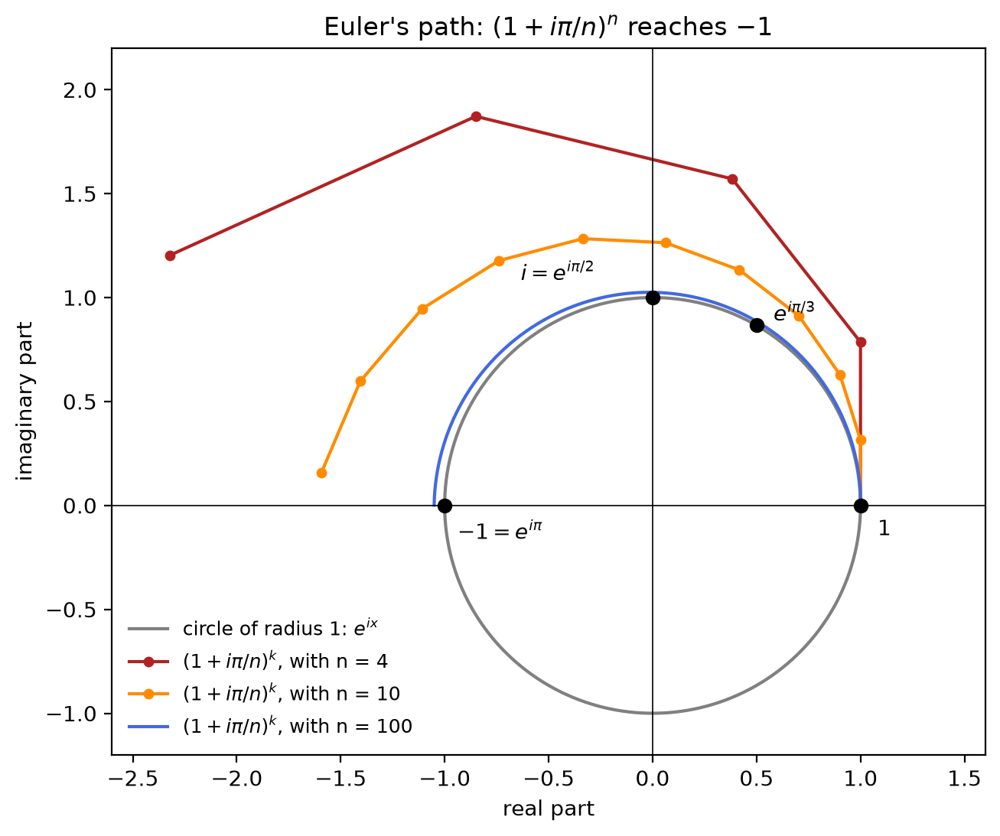

There is an equation that shows up on T-shirts, in tattoos and on lists of "the most beautiful formulas in mathematics":

$$
e^{i\pi} + 1 = 0
$$

In a single line it brings together five famous numbers: the $e$ of compound interest, the $i$ of complex numbers, the $\pi$ of the circle, 1 and 0. It sometimes goes by the nickname "God's formula". I could not find where that nickname comes from, so I will stick to what can be checked: the calculation.

And the calculation has a problem right away. What does it mean to raise a number to an *imaginary* power? $e^2$ is $e \times e$. But $e^{i\pi}$ is not "$e$ multiplied by itself $i\pi$ times", because that makes no sense.

This post explains what that power means, where the answer $-1$ comes from, and why it is not a trick: the formula behind it, $e^{ix} = \cos x + i \sin x$, describes a point moving around a circle. Along the way there is a calculation by hand, Euler's own argument, code in Julia, R and Python, and Lean proofs of everything the post claims always holds.

## Five minutes of complex numbers

The **imaginary unit** $i$ is a number whose square is $-1$:

$$
i^2 = -1
$$

No real number does that (every real number squared is greater than or equal to zero), which is why $i$ got the name "imaginary". A **complex number** is a sum $a + bi$, where $a$ and $b$ are real: $a$ is the **real part** and $b$ is the **imaginary part**. Arithmetic follows the usual rules, replacing $i^2$ with $-1$ whenever it appears.

The powers of $i$ repeat every 4 steps:

| Power | Calculation | Result |
|---|---|---|
| $i^0$ | (by definition) | $1$ |
| $i^1$ | (by definition) | $i$ |
| $i^2$ | (by definition) | $-1$ |
| $i^3$ | $i^2 \cdot i = (-1) \cdot i$ | $-i$ |
| $i^4$ | $i^3 \cdot i = (-i) \cdot i = -i^2 = -(-1)$ | $1$ |
| $i^5$ | $i^4 \cdot i = 1 \cdot i$ | $i$ |

This cycle of 4 is the key to everything.

**The complex plane.** The number $a + bi$ can be drawn as the point $(a, b)$ in a plane: the real part on the horizontal axis, the imaginary part on the vertical one. $1$ is at $(1, 0)$, $i$ at $(0, 1)$, $-1$ at $(-1, 0)$.

**Multiplying by $i$ rotates by 90°.** Take $3 + 2i$, which is the point $(3, 2)$, and multiply it by $i$ using the distributive law:

$$
\begin{aligned}
(3 + 2i) \cdot i &= 3 \cdot i + 2i \cdot i \\
&= 3i + 2i^2 \\
&= 3i + 2 \cdot (-1) \\
&= -2 + 3i
\end{aligned}
$$

The point $(3, 2)$ ended up at $(-2, 3)$: the same distance from the origin, rotated a quarter turn counterclockwise. This holds for every number: $i \cdot (a + bi) = -b + ai$ (proved in Lean). Multiplying by $i$ twice rotates by half a turn, and half a turn takes $1$ to $-1$. That is exactly what $i^2 = -1$ says.

## Radians

The formula uses angles in **radians**, not degrees. One radian is the angle that, in a circle of radius 1, spans an arc of length 1. Since half the circumference of a circle of radius 1 is $\pi$, half a turn is $\pi$ radians:

$$
180° = \pi \text{ rad}, \qquad 90° = \tfrac{\pi}{2} \text{ rad}, \qquad 60° = \tfrac{\pi}{3} \text{ rad}, \qquad 1 \text{ rad} = \tfrac{180°}{\pi} \approx 57.30°
$$

Euler himself defines $\pi$ this way at the start of the chapter where the formula appears: the semicircumference of the circle of radius 1, or the length of the arc of 180 degrees (*Introductio*, vol. 1, ch. 8, §126).

## The formula

For every real number $x$:

$$
e^{ix} = \cos x + i \sin x
$$

Reading each part:

- $x$ is an angle, in radians;
- $\cos x$ (cosine) and $\sin x$ (sine) are the coordinates of the point on the circle of radius 1 at angle $x$, measured from the point $(1, 0)$ counterclockwise;
- $e^{ix}$ is therefore the complex number sitting at that point: real part $\cos x$, imaginary part $\sin x$.

In words: **$e^{ix}$ is the point on the circle of radius 1 at angle $x$.** As $x$ grows, the point moves around the circle. This is **Euler's formula**, and it is proved in Lean for every real $x$.

An immediate consequence: the distance from $e^{ix}$ to the origin is always 1. By Pythagoras' theorem that distance is $\sqrt{\cos^2 x + \sin^2 x}$, and $\cos^2 x + \sin^2 x = 1$ for every $x$. In complex-number notation, $\lvert e^{ix} \rvert = 1$ (proved in Lean).

But this still does not answer the opening question: why would an *exponential* have anything to do with a circle?

## Where the formula comes from

The answer lies in writing the three functions as infinite sums. For every number $z$, real or complex,

$$
e^{z} = 1 + z + \frac{z^2}{2!} + \frac{z^3}{3!} + \frac{z^4}{4!} + \frac{z^5}{5!} + \cdots
$$

where $n!$ ("$n$ factorial") is the product $1 \cdot 2 \cdot 3 \cdots n$, with $0! = 1$. This infinite sum is the **Taylor series** of the exponential: it converges for every $z$, and it is what gives meaning to $e^{z}$ when $z$ is complex. For every real $x$, cosine and sine have their own:

$$
\cos x = 1 - \frac{x^2}{2!} + \frac{x^4}{4!} - \frac{x^6}{6!} + \cdots
\qquad\qquad
\sin x = x - \frac{x^3}{3!} + \frac{x^5}{5!} - \frac{x^7}{7!} + \cdots
$$

All three series are in Mathlib and are restated in this post's proof file. The sine and cosine series are the same ones Euler writes in §134 of chapter 8.

Now put $z = ix$ into the exponential series. Each term has a power $(ix)^n = i^n x^n$, and the powers of $i$ follow the cycle $1, i, -1, -i$:

| $n$ | $(ix)^n$ | term $\dfrac{(ix)^n}{n!}$ |
|---|---|---|
| 0 | $1$ | $1$ |
| 1 | $ix$ | $ix$ |
| 2 | $i^2 x^2 = -x^2$ | $-\dfrac{x^2}{2!}$ |
| 3 | $i^3 x^3 = -i x^3$ | $-i\,\dfrac{x^3}{3!}$ |
| 4 | $i^4 x^4 = x^4$ | $\dfrac{x^4}{4!}$ |
| 5 | $i^5 x^5 = i x^5$ | $i\,\dfrac{x^5}{5!}$ |

The terms with even $n$ have no $i$; the ones with odd $n$ do. Separating the two groups:

$$
e^{ix} = \underbrace{\left(1 - \frac{x^2}{2!} + \frac{x^4}{4!} - \cdots\right)}_{\cos x} + i\,\underbrace{\left(x - \frac{x^3}{3!} + \frac{x^5}{5!} - \cdots\right)}_{\sin x}
$$

The first bracket is the cosine series and the second is the sine series. Hence $e^{ix} = \cos x + i \sin x$.

A caveat: splitting an *infinite* sum into two groups is not always allowed. Here it is, because the exponential series converges absolutely (the sum of the absolute values of the terms is also finite). The Lean proof does not rely on this argument; it uses Mathlib's formula.

## Worked example: 60 degrees

Let us compute $e^{i\pi/3}$.

**Data.** The angle is $x = \pi/3$ radians (given), which corresponds to $60°$, because $\frac{\pi}{3} \cdot \frac{180°}{\pi} = 60°$.

**Formula.** $e^{ix} = \cos x + i \sin x$.

**Substitution.**

$$
e^{i\pi/3} = \cos\frac{\pi}{3} + i \sin\frac{\pi}{3}
$$

**Calculation.** The sine and cosine of $60°$ come from an equilateral triangle of side 1 cut in half: half the base is $\tfrac12$, and the height, by Pythagoras' theorem, is $\sqrt{1 - \tfrac14} = \sqrt{\tfrac34} = \tfrac{\sqrt3}{2}$. So:

$$
\begin{aligned}
\cos\frac{\pi}{3} &= \frac12 = 0.5 \\
\sin\frac{\pi}{3} &= \frac{\sqrt 3}{2} = \frac{1.7320508}{2} = 0.8660254
\end{aligned}
$$

**Result.**

$$
e^{i\pi/3} = \frac12 + \frac{\sqrt3}{2}\,i \approx 0.5000 + 0.8660\,i
$$

(exact value on the left; on the right, rounded to four decimal places).

**Interpretation.** $e^{i\pi/3}$ is the point on the circle of radius 1 that lies $60°$ from the point $1$, counterclockwise: half a step to the right and 0.866 up. Its distance to the origin is 1, as it must be: $0.5^2 + 0.8660254^2 = 0.25 + 0.75 = 1$. The exact result is proved in Lean.

## Half a turn: e to the iπ

Now the famous case, $x = \pi$, half a turn.

**Data.** $x = \pi$ radians, or $180°$.

**Substitution.** $e^{i\pi} = \cos \pi + i \sin \pi$.

**Calculation.** Half a turn from the point $(1, 0)$ leads to the point $(-1, 0)$, so $\cos \pi = -1$ and $\sin \pi = 0$:

$$
\begin{aligned}
e^{i\pi} &= -1 + i \cdot 0 \\
&= -1
\end{aligned}
$$

**Result.** $e^{i\pi} = -1$, and adding 1 to both sides, $e^{i\pi} + 1 = 0$. This is **Euler's identity**.

**Interpretation.** There is no hidden numerical mystery: $-1$ is simply the point on the other side of the circle. $e^{i\pi} = -1$ says "walking half the circle takes you from $1$ to $-1$". In the same way, $e^{i\pi/2} = i$ (a quarter turn) and $e^{2\pi i} = 1$ (a full turn). All three are proved in Lean.

You can watch the series getting there. With $x = \pi$, the terms of the series for $e^{i\pi}$ are these (values to six decimal places, computed with all the digits of $\pi$):

| $n$ | term $(i\pi)^n / n!$ | sum up to $n$ | distance to $-1$ |
|---|---|---|---|
| 0 | $1$ | $1$ | 2.000 |
| 1 | $3.141593\,i$ | $1 + 3.141593\,i$ | 3.724 |
| 2 | $-4.934802$ | $-3.934802 + 3.141593\,i$ | 4.299 |
| 3 | $-5.167713\,i$ | $-3.934802 - 2.026120\,i$ | 3.566 |
| 4 | $4.058712$ | $0.123910 - 2.026120\,i$ | 2.317 |
| 5 | $2.550164\,i$ | $0.123910 + 0.524044\,i$ | 1.240 |
| 6 | $-1.335263$ | $-1.211353 + 0.524044\,i$ | 0.565 |
| 7 | $-0.599265\,i$ | $-1.211353 - 0.075221\,i$ | 0.224 |
| 8 | $0.235331$ | $-0.976022 - 0.075221\,i$ | 0.079 |

The term for $n = 2$, for example, is $\frac{(i\pi)^2}{2!} = \frac{i^2 \pi^2}{2} = -\frac{9.869604}{2} = -4.934802$. The terms grow in size up to $n = 3$ and then shrink, because the factorial in the denominator grows faster than the power of $\pi$. The sum first moves away from $-1$; from $n = 3$ on, it only gets closer. With 21 terms ($n$ up to 20), the distance to $-1$ is $5.34 \times 10^{-10}$, as the code further down shows.

## Euler's route

Euler reached the formula another way, in §138 of chapter 8 of the *Introductio in analysin infinitorum*, published in 1748. He uses a description of $e$ he had shown in the previous chapter: $e^{z}$ is the value of $\left(1 + \frac{z}{n}\right)^{n}$ when $n$ is "infinitely large". (In his text, the letter $i$ is that infinitely large number; the square root of $-1$ he writes out in full, $\sqrt{-1}$.) Putting $z = v\sqrt{-1}$, he arrives at $e^{+v\sqrt{-1}} = \cos v + \sqrt{-1} \sin v$.

In today's language: for every complex number $z$, $\left(1 + \frac{z}{n}\right)^{n} \to e^{z}$ as $n \to \infty$. With $z = i\pi$:

$$
\left(1 + \frac{i\pi}{n}\right)^{n} \longrightarrow e^{i\pi} = -1
$$

This limit is proved in Lean. For a closer look, the calculation by hand with $n = 2$:

**Substitution.** $\left(1 + \frac{i\pi}{2}\right)^2$.

**Calculation**, using the square of a sum $(a + b)^2 = a^2 + 2ab + b^2$, with $a = 1$ and $b = \frac{i\pi}{2}$:

$$
\begin{aligned}
a^2 &= 1 \\
2ab &= 2 \cdot 1 \cdot \frac{i\pi}{2} = i\pi = 3.141593\,i \\
b^2 &= \frac{i^2\pi^2}{4} = -\frac{9.869604}{4} = -2.467401 \\
\left(1 + \frac{i\pi}{2}\right)^2 &= 1 - 2.467401 + 3.141593\,i = -1.467401 + 3.141593\,i
\end{aligned}
$$

**Interpretation.** With $n = 2$ we are still far from $-1$. Increasing $n$ (values from the code below):

| $n$ | $\left(1 + \frac{i\pi}{n}\right)^{n}$ | distance to $-1$ |
|---|---|---|
| 1 | $1.000000 + 3.141593\,i$ | 3.724192 |
| 2 | $-1.467401 + 3.141593\,i$ | 3.176172 |
| 4 | $-2.320597 + 1.203700\,i$ | 1.786861 |
| 10 | $-1.593362 + 0.156064\,i$ | 0.613543 |
| 100 | $-1.050560 + 0.001085\,i$ | 0.050571 |
| 1,000 | $-1.004947 + 0.000010\,i$ | 0.004947 |
| 1,000,000 | $-1.000005 + 0.000000\,i$ | 0.000005 |

You can understand the limit by looking at a single factor. Multiplying by $1 + \frac{i\pi}{n}$ does two things at once: it **rotates** by an angle slightly smaller than $\frac{\pi}{n}$ and it **stretches** a little, because the distance from $1 + \frac{i\pi}{n}$ to the origin is $\sqrt{1 + \pi^2/n^2}$, slightly more than 1. With $n = 100$, each factor rotates by 0.031406 radians (against $\pi/100 = 0.031416$) and stretches by 1.000493. After 100 factors, the total rotation is 3.140560 radians, almost half a turn, and the accumulated stretch is $1.000493^{100} = 1.050560$: that is why the result lands at $-1.050560$, slightly beyond $-1$. The larger $n$, the smaller the stretch and the closer the rotation gets to exactly half a turn. Figure 1 shows the intermediate points $\left(1 + \frac{i\pi}{n}\right)^k$, for $k = 0, 1, \ldots, n$: with large $n$, they practically trace the semicircle.

<figure style="text-align:center; margin: 2em auto; max-width: 760px;">
  
  <figcaption style="margin-top:0.75em; font-size:0.88rem; color:#555;">
    Figure 1. Euler's route (Python version of the code below). Each path shows the points $(1 + i\pi/n)^k$ for $k = 0, 1, \ldots, n$, starting at 1. With $n = 4$ the last point is far from $-1$; with $n = 100$ the path almost coincides with the upper semicircle and ends at $-1.05$.
  </figcaption>
</figure>

## The code

The first block computes a few points on the circle. Look at the fifth line of the output.

  

  

    
Julia

    

    <button class="copy-button" onclick="copyCode(this)">
      <i class="bi bi-clipboard"></i>Copy
    </button>
  

  

    <pre><code>using Printf

# Writes a complex number as "a + bi", with 4 decimal places
function as_text(z)
    a = round(real(z), digits = 4) + 0.0          # the "+ 0.0" turns -0.0 into 0.0
    b = round(imag(z), digits = 4) + 0.0
    sgn = b &lt; 0 ? "-" : "+"
    return @sprintf("%.4f %s %.4fi", a, sgn, abs(b))
end

# Points on the circle: e^(ix) = cos x + i sin x, with x in radians
println("e^(iπ/3) = ", as_text(exp(im * π / 3)))
println("e^(iπ/2) = ", as_text(exp(im * π / 2)))
println("e^(iπ)   = ", as_text(exp(im * π)))
println("e^(2πi)  = ", as_text(exp(2π * im)))

# With all the digits, the imaginary part of e^(iπ) does not come out as zero
z = exp(im * π)
@printf("e^(iπ) + 1: real part %.1e, imaginary part %.4e\n", real(z) + 1, imag(z))

# The degrees mistake: 180 here is read as 180 radians
println("e^(180i) = ", as_text(exp(180im)))</code></pre>
  

  
# Output

  <pre style="overflow-x: auto; font-size: 0.9em;">e^(iπ/3) = 0.5000 + 0.8660i
e^(iπ/2) = 0.0000 + 1.0000i
e^(iπ)   = -1.0000 + 0.0000i
e^(2πi)  = 1.0000 + 0.0000i
e^(iπ) + 1: real part 0.0e+00, imaginary part 1.2246e-16
e^(180i) = -0.5985 - 0.8012i</pre>

  

  

  

    
R

    

    <button class="copy-button" onclick="copyCode(this)">
      <i class="bi bi-clipboard"></i>Copy
    </button>
  

  

    <pre><code># Writes a complex number as "a + bi", with 4 decimal places
as_text &lt;- function(z) {
  a &lt;- round(Re(z), 4) + 0                   # the "+ 0" turns -0 into 0
  b &lt;- round(Im(z), 4) + 0
  sgn &lt;- if (b &lt; 0) "-" else "+"
  sprintf("%.4f %s %.4fi", a, sgn, abs(b))
}

# Points on the circle: e^(ix) = cos x + i sin x, with x in radians
cat("e^(iπ/3) = ", as_text(exp(1i * pi / 3)), "\n", sep = "")
cat("e^(iπ/2) = ", as_text(exp(1i * pi / 2)), "\n", sep = "")
cat("e^(iπ)   = ", as_text(exp(1i * pi)), "\n", sep = "")
cat("e^(2πi)  = ", as_text(exp(2i * pi)), "\n", sep = "")

# With all the digits, the imaginary part of e^(iπ) does not come out as zero
z &lt;- exp(1i * pi)
cat(sprintf("e^(iπ) + 1: real part %.1e, imaginary part %.4e\n", Re(z) + 1, Im(z)))

# The degrees mistake: 180 here is read as 180 radians
cat("e^(180i) = ", as_text(exp(180i)), "\n", sep = "")</code></pre>
  

  
# Output

  <pre style="overflow-x: auto; font-size: 0.9em;">e^(iπ/3) = 0.5000 + 0.8660i
e^(iπ/2) = 0.0000 + 1.0000i
e^(iπ)   = -1.0000 + 0.0000i
e^(2πi)  = 1.0000 + 0.0000i
e^(iπ) + 1: real part 0.0e+00, imaginary part 1.2246e-16
e^(180i) = -0.5985 - 0.8012i</pre>

  

  

  

    
Python

    

    <button class="copy-button" onclick="copyCode(this)">
      <i class="bi bi-clipboard"></i>Copy
    </button>
  

  

    <pre><code>import cmath
import math

def as_text(z):
    """Writes a complex number as "a + bi", with 4 decimal places."""
    a = round(z.real, 4) + 0.0                # the "+ 0.0" turns -0.0 into 0.0
    b = round(z.imag, 4) + 0.0
    sgn = "-" if b &lt; 0 else "+"
    return f"{a:.4f} {sgn} {abs(b):.4f}i"

# Points on the circle: e^(ix) = cos x + i sin x, with x in radians
print("e^(iπ/3) =", as_text(cmath.exp(1j * math.pi / 3)))
print("e^(iπ/2) =", as_text(cmath.exp(1j * math.pi / 2)))
print("e^(iπ)   =", as_text(cmath.exp(1j * math.pi)))
print("e^(2πi)  =", as_text(cmath.exp(2j * math.pi)))

# With all the digits, the imaginary part of e^(iπ) does not come out as zero
z = cmath.exp(1j * math.pi)
print(f"e^(iπ) + 1: real part {z.real + 1:.1e}, imaginary part {z.imag:.4e}")

# The degrees mistake: 180 here is read as 180 radians
print("e^(180i) =", as_text(cmath.exp(180j)))</code></pre>
  

  
# Output

  <pre style="overflow-x: auto; font-size: 0.9em;">e^(iπ/3) = 0.5000 + 0.8660i
e^(iπ/2) = 0.0000 + 1.0000i
e^(iπ)   = -1.0000 + 0.0000i
e^(2πi)  = 1.0000 + 0.0000i
e^(iπ) + 1: real part 0.0e+00, imaginary part 1.2246e-16
e^(180i) = -0.5985 - 0.8012i</pre>

  

All three languages give $-1$ for the real part of $e^{i\pi}$, but the imaginary part comes out as $1.2246 \times 10^{-16}$ instead of zero. The section "What goes wrong" explains why.

The second block sums the series for $e^{i\pi}$ up to 21 terms and computes $\left(1 + \frac{i\pi}{n}\right)^{n}$ for ever larger $n$. The outputs of the three languages are identical and match the two tables above.

  

  

    
Julia

    

    <button class="copy-button" onclick="copyCode(this)">
      <i class="bi bi-clipboard"></i>Copy
    </button>
  

  

    <pre><code>using Printf

# 1) The series: e^(iπ) = 1 + iπ + (iπ)²/2! + (iπ)³/3! + ...
total = 0.0 + 0.0im
for n in 0:20
    global total += (im * π)^n / factorial(n)
    if n % 4 == 0
        @printf("up to n = %2d: sum = %9.6f %s %.6fi, distance to -1 = %.2e\n",
                n, real(total), imag(total) &lt; 0 ? "-" : "+", abs(imag(total)), abs(total + 1))
    end
end

# 2) Euler's path: (1 + iπ/n)^n
for n in (1, 2, 4, 10, 100, 1000, 10^6)
    z = (1 + im * π / n)^n
    @printf("n = %7d: (1 + iπ/n)^n = %9.6f %s %.6fi, distance to -1 = %.6f\n",
            n, real(z), imag(z) &lt; 0 ? "-" : "+", abs(imag(z)), abs(z + 1))
end</code></pre>
  

  
# Output

  <pre style="overflow-x: auto; font-size: 0.9em;">up to n =  0: sum =  1.000000 + 0.000000i, distance to -1 = 2.00e+00
up to n =  4: sum =  0.123910 - 2.026120i, distance to -1 = 2.32e+00
up to n =  8: sum = -0.976022 - 0.075221i, distance to -1 = 7.89e-02
up to n = 12: sum = -0.999900 - 0.000445i, distance to -1 = 4.56e-04
up to n = 16: sum = -1.000000 - 0.000001i, distance to -1 = 7.85e-07
up to n = 20: sum = -1.000000 - 0.000000i, distance to -1 = 5.34e-10
n =       1: (1 + iπ/n)^n =  1.000000 + 3.141593i, distance to -1 = 3.724192
n =       2: (1 + iπ/n)^n = -1.467401 + 3.141593i, distance to -1 = 3.176172
n =       4: (1 + iπ/n)^n = -2.320597 + 1.203700i, distance to -1 = 1.786861
n =      10: (1 + iπ/n)^n = -1.593362 + 0.156064i, distance to -1 = 0.613543
n =     100: (1 + iπ/n)^n = -1.050560 + 0.001085i, distance to -1 = 0.050571
n =    1000: (1 + iπ/n)^n = -1.004947 + 0.000010i, distance to -1 = 0.004947
n = 1000000: (1 + iπ/n)^n = -1.000005 + 0.000000i, distance to -1 = 0.000005</pre>

  

  

  

    
R

    

    <button class="copy-button" onclick="copyCode(this)">
      <i class="bi bi-clipboard"></i>Copy
    </button>
  

  

    <pre><code># 1) The series: e^(iπ) = 1 + iπ + (iπ)²/2! + (iπ)³/3! + ...
total &lt;- 0 + 0i
for (n in 0:20) {
  total &lt;- total + (1i * pi)^n / factorial(n)
  if (n %% 4 == 0) {
    cat(sprintf("up to n = %2d: sum = %9.6f %s %.6fi, distance to -1 = %.2e\n",
                n, Re(total), if (Im(total) &lt; 0) "-" else "+", abs(Im(total)), Mod(total + 1)))
  }
}

# 2) Euler's path: (1 + iπ/n)^n
for (n in c(1, 2, 4, 10, 100, 1000, 1e6)) {
  z &lt;- (1 + 1i * pi / n)^n
  cat(sprintf("n = %7d: (1 + iπ/n)^n = %9.6f %s %.6fi, distance to -1 = %.6f\n",
              as.integer(n), Re(z), if (Im(z) &lt; 0) "-" else "+", abs(Im(z)), Mod(z + 1)))
}</code></pre>
  

  
# Output

  <pre style="overflow-x: auto; font-size: 0.9em;">up to n =  0: sum =  1.000000 + 0.000000i, distance to -1 = 2.00e+00
up to n =  4: sum =  0.123910 - 2.026120i, distance to -1 = 2.32e+00
up to n =  8: sum = -0.976022 - 0.075221i, distance to -1 = 7.89e-02
up to n = 12: sum = -0.999900 - 0.000445i, distance to -1 = 4.56e-04
up to n = 16: sum = -1.000000 - 0.000001i, distance to -1 = 7.85e-07
up to n = 20: sum = -1.000000 - 0.000000i, distance to -1 = 5.34e-10
n =       1: (1 + iπ/n)^n =  1.000000 + 3.141593i, distance to -1 = 3.724192
n =       2: (1 + iπ/n)^n = -1.467401 + 3.141593i, distance to -1 = 3.176172
n =       4: (1 + iπ/n)^n = -2.320597 + 1.203700i, distance to -1 = 1.786861
n =      10: (1 + iπ/n)^n = -1.593362 + 0.156064i, distance to -1 = 0.613543
n =     100: (1 + iπ/n)^n = -1.050560 + 0.001085i, distance to -1 = 0.050571
n =    1000: (1 + iπ/n)^n = -1.004947 + 0.000010i, distance to -1 = 0.004947
n = 1000000: (1 + iπ/n)^n = -1.000005 + 0.000000i, distance to -1 = 0.000005</pre>

  

  

  

    
Python

    

    <button class="copy-button" onclick="copyCode(this)">
      <i class="bi bi-clipboard"></i>Copy
    </button>
  

  

    <pre><code>import math

# 1) The series: e^(iπ) = 1 + iπ + (iπ)²/2! + (iπ)³/3! + ...
total = 0 + 0j
for n in range(21):
    total += (1j * math.pi) ** n / math.factorial(n)
    if n % 4 == 0:
        sgn = "-" if total.imag &lt; 0 else "+"
        print(f"up to n = {n:2d}: sum = {total.real:9.6f} {sgn} {abs(total.imag):.6f}i, "
              f"distance to -1 = {abs(total + 1):.2e}")

# 2) Euler's path: (1 + iπ/n)^n
for n in (1, 2, 4, 10, 100, 1000, 10**6):
    z = (1 + 1j * math.pi / n) ** n
    sgn = "-" if z.imag &lt; 0 else "+"
    print(f"n = {n:7d}: (1 + iπ/n)^n = {z.real:9.6f} {sgn} {abs(z.imag):.6f}i, "
          f"distance to -1 = {abs(z + 1):.6f}")</code></pre>
  

  
# Output

  <pre style="overflow-x: auto; font-size: 0.9em;">up to n =  0: sum =  1.000000 + 0.000000i, distance to -1 = 2.00e+00
up to n =  4: sum =  0.123910 - 2.026120i, distance to -1 = 2.32e+00
up to n =  8: sum = -0.976022 - 0.075221i, distance to -1 = 7.89e-02
up to n = 12: sum = -0.999900 - 0.000445i, distance to -1 = 4.56e-04
up to n = 16: sum = -1.000000 - 0.000001i, distance to -1 = 7.85e-07
up to n = 20: sum = -1.000000 - 0.000000i, distance to -1 = 5.34e-10
n =       1: (1 + iπ/n)^n =  1.000000 + 3.141593i, distance to -1 = 3.724192
n =       2: (1 + iπ/n)^n = -1.467401 + 3.141593i, distance to -1 = 3.176172
n =       4: (1 + iπ/n)^n = -2.320597 + 1.203700i, distance to -1 = 1.786861
n =      10: (1 + iπ/n)^n = -1.593362 + 0.156064i, distance to -1 = 0.613543
n =     100: (1 + iπ/n)^n = -1.050560 + 0.001085i, distance to -1 = 0.050571
n =    1000: (1 + iπ/n)^n = -1.004947 + 0.000010i, distance to -1 = 0.004947
n = 1000000: (1 + iπ/n)^n = -1.000005 + 0.000000i, distance to -1 = 0.000005</pre>

  

In the lines for $n = 16$ and $n = 20$, the minus sign in the imaginary part comes from a negative remainder smaller than 0.0000005, which disappears when rounding to six decimal places.

The third block draws Figure 1. The published figure comes from the Python version; the Julia and R versions draw the same chart.

  

  

    
Julia

    

    <button class="copy-button" onclick="copyCode(this)">
      <i class="bi bi-clipboard"></i>Copy
    </button>
  

  

    <pre><code>using CairoMakie

fig = Figure(size = (800, 640))
ax = Axis(fig[1, 1]; xlabel = "real part", ylabel = "imaginary part", aspect = DataAspect(),
          title = L"\text{Euler's path: } (1 + i\pi/n)^n \text{ reaches } -1")

# The circle of radius 1: the points e^(ix) = cos x + i sin x, for x from 0 to 2π
x = range(0, 2π, length = 400)
lines!(ax, cos.(x), sin.(x); color = :gray, linewidth = 1.5, label = L"\text{circle of radius 1: } e^{ix}")

# Euler's path: the points (1 + iπ/n)^k, for k = 0, 1, ..., n
for (n, colour) in ((4, :firebrick), (10, :darkorange), (100, :royalblue))
    path = [(1 + im * π / n)^k for k in 0:n]
    label_text = L"(1 + i\pi/n)^k, \text{ with } n = %$n"
    if n &lt; 100
        scatterlines!(ax, real.(path), imag.(path); color = colour, markersize = 7, label = label_text)
    else
        lines!(ax, real.(path), imag.(path); color = colour, linewidth = 1.5, label = label_text)
    end
end

# Special points, each with the position of its label
special = [(L"1", 1 + 0im, (8, -18)), (L"e^{i\pi/3}", exp(im * π / 3), (8, 2)),
           (L"i = e^{i\pi/2}", 1im, (-70, 8)), (L"-1 = e^{i\pi}", -1 + 0im, (6, -22))]
for (name, z, shift) in special
    scatter!(ax, [real(z)], [imag(z)]; color = :black, markersize = 10)
    text!(ax, real(z), imag(z); text = name, offset = shift)
end

hlines!(ax, 0; color = :black, linewidth = 0.6)
vlines!(ax, 0; color = :black, linewidth = 0.6)
limits!(ax, -2.6, 1.6, -1.2, 2.2)
axislegend(ax; position = :lb, framevisible = false, labelsize = 13)
save("euler_formula_path.png", fig, px_per_unit = 2)</code></pre>
  

  

  

  

    
R

    

    <button class="copy-button" onclick="copyCode(this)">
      <i class="bi bi-clipboard"></i>Copy
    </button>
  

  

    <pre><code>png("euler_formula_path.png", width = 1600, height = 1300, res = 200)
plot(NA, xlim = c(-2.6, 1.6), ylim = c(-1.2, 2.2), asp = 1, axes = FALSE,
     xlab = "real part", ylab = "imaginary part",
     main = expression("Euler's path: " * (1 + i * pi / n)^n * " reaches " * -1))
ticks_x &lt;- seq(-2.5, 1.5, by = 0.5); ticks_y &lt;- seq(-1, 2, by = 0.5)
axis(1, at = ticks_x, labels = format(ticks_x))
axis(2, at = ticks_y, labels = format(ticks_y), las = 1)
box()
abline(h = 0, v = 0, lwd = 0.6)

# The circle of radius 1: the points e^(ix) = cos x + i sin x, for x from 0 to 2π
x &lt;- seq(0, 2 * pi, length.out = 400)
lines(cos(x), sin(x), col = "gray50", lwd = 1.5)

# Euler's path: the points (1 + iπ/n)^k, for k = 0, 1, ..., n
colours &lt;- c("4" = "firebrick", "10" = "darkorange", "100" = "royalblue")
for (n in c(4, 10, 100)) {
  path &lt;- (1 + 1i * pi / n)^(0:n)
  lines(Re(path), Im(path), col = colours[as.character(n)], lwd = 1.5,
        type = if (n &lt; 100) "o" else "l", pch = 16, cex = 0.7)
}

# Special points
special &lt;- c(1, exp(1i * pi / 3), 1i, -1)
points(Re(special), Im(special), pch = 16, cex = 1.2)
text(1.05, -0.12, "1", adj = 0)
text(0.55, 0.92, expression(e^{i * pi / 3}), adj = 0)
text(-0.08, 1.12, expression(i == e^{i * pi / 2}), adj = 1)
text(-0.95, -0.15, expression(-1 == e^{i * pi}), adj = 0)

legend("bottomleft", bty = "n", cex = 0.85,
       legend = c(expression("circle of radius 1: " * e^{ix}),
                  expression((1 + i * pi / n)^k * ", with n = 4"),
                  expression((1 + i * pi / n)^k * ", with n = 10"),
                  expression((1 + i * pi / n)^k * ", with n = 100")),
       col = c("gray50", colours), lwd = 1.5, pch = c(NA, 16, 16, NA))
invisible(dev.off())</code></pre>
  

  

  

  

    
Python

    

    <button class="copy-button" onclick="copyCode(this)">
      <i class="bi bi-clipboard"></i>Copy
    </button>
  

  

    <pre><code>import numpy as np
import matplotlib.pyplot as plt

fig, ax = plt.subplots(figsize=(8, 6))

# The circle of radius 1: the points e^(ix) = cos x + i sin x, for x from 0 to 2π
x = np.linspace(0, 2 * np.pi, 400)
ax.plot(np.cos(x), np.sin(x), color="gray", lw=1.5, label=r"circle of radius 1: $e^{ix}$")

# Euler's path: the points (1 + iπ/n)^k, for k = 0, 1, ..., n
for n, colour in [(4, "firebrick"), (10, "darkorange"), (100, "royalblue")]:
    k = np.arange(n + 1)
    path = (1 + 1j * np.pi / n) ** k
    ax.plot(path.real, path.imag, "o-" if n &lt; 100 else "-", color=colour, ms=4, lw=1.5,
            label=rf"$(1 + i\pi/n)^k$, with n = {n}")

# Special points, each with the position of its label
special = [("1", 1, (8, -14)), (r"$e^{i\pi/3}$", np.exp(1j * np.pi / 3), (8, 2)),
           (r"$i = e^{i\pi/2}$", 1j, (-62, 8)), (r"$-1 = e^{i\pi}$", -1, (6, -16))]
for name, z, shift in special:
    ax.plot(z.real, z.imag, "ko", ms=6, zorder=3)
    ax.annotate(name, (z.real, z.imag), textcoords="offset points", xytext=shift)

ax.axhline(0, color="black", lw=0.6)
ax.axvline(0, color="black", lw=0.6)
ax.set(xlim=(-2.6, 1.6), ylim=(-1.2, 2.2), aspect="equal", xlabel="real part",
       ylabel="imaginary part", title=r"Euler's path: $(1 + i\pi/n)^n$ reaches $-1$")
ax.legend(loc="lower left", frameon=False, fontsize=9)
fig.savefig("euler_formula_path.png", dpi=200, bbox_inches="tight")</code></pre>
  

  

## Multiplying is rotating

The formula has a consequence that saves a lot of memorization. The rule $e^{a} \cdot e^{b} = e^{a+b}$ still holds for complex numbers, so, for angles $a$ and $b$:

$$
e^{ia} \cdot e^{ib} = e^{i(a+b)}
$$

In words: **multiplying two points on the circle adds their angles.** (That is what we saw with $i$: multiplying by $i = e^{i\pi/2}$ adds $90°$.) Now write both sides with Euler's formula. The right-hand side is $\cos(a+b) + i \sin(a+b)$. The left-hand side, by the distributive law:

$$
\begin{aligned}
(\cos a + i \sin a)(\cos b + i \sin b)
&= \cos a \cos b + i \cos a \sin b + i \sin a \cos b + i^2 \sin a \sin b \\
&= (\cos a \cos b - \sin a \sin b) + i\,(\sin a \cos b + \cos a \sin b)
\end{aligned}
$$

Two complex numbers are equal when their real parts are equal and their imaginary parts are too. Comparing:

$$
\cos(a+b) = \cos a \cos b - \sin a \sin b
\qquad
\sin(a+b) = \sin a \cos b + \cos a \sin b
$$

The two angle-addition formulas of trigonometry come out of one multiplication. Both are proved in Lean, as is $e^{ia} e^{ib} = e^{i(a+b)}$.

**Example: cosine of 75°.** Data: $a = 30°$ and $b = 45°$, with $\cos 30° = \frac{\sqrt3}{2}$, $\sin 30° = \frac12$, $\cos 45° = \sin 45° = \frac{\sqrt2}{2}$. Substituting into the cosine-of-a-sum formula:

$$
\begin{aligned}
\cos 75° &= \frac{\sqrt3}{2}\cdot\frac{\sqrt2}{2} - \frac12\cdot\frac{\sqrt2}{2} \\
&= \frac{\sqrt6}{4} - \frac{\sqrt2}{4} \\
&= 0.612372 - 0.353553 \\
&= 0.258819
\end{aligned}
$$

With all the digits, $\frac{\sqrt6 - \sqrt2}{4} = 0.2588190$, the same value a calculator gives for $\cos 75°$.

## Where the formula shows up

Anything that rotates or oscillates is simpler to write with $e^{ix}$: instead of carrying sines and cosines around separately, you multiply an exponential, and rotating becomes adding angles. That is why the formula sits behind Fourier analysis (breaking a signal into waves), the description of alternating current in electrical engineering, and quantum mechanics.

In probability it appears in the **characteristic function** of a random variable $X$:

$$
\varphi(t) = E\!\left[e^{itX}\right]
$$

the mean of $e^{itX}$, for each real number $t$. It has an advantage over similar tools: since $\lvert e^{itX} \rvert = 1$, this mean **exists for every random variable**, even those with no mean or variance. That is proved in Lean. The proof of the [Central Limit Theorem](/en/probability/central-limit-theorem) in Mathlib, for example, is done with characteristic functions. On this site, complex numbers also appear in the post on the [Riemann hypothesis](/riemann-hypothesis-zeros-primes-julia/).

## What goes wrong

- **The computer does not give exactly $-1$.** In all three languages, $e^{i\pi}$ comes out as $-1 + 1.2246 \times 10^{-16}\,i$. The culprit is not the formula, it is $\pi$: the computer stores $\pi$ with 53 binary digits, and the stored value is $1.2246 \times 10^{-16}$ below the true $\pi$. For an angle $\pi - \delta$ with small $\delta$, the sine is practically $\delta$, and that $\delta$ is what shows up in the imaginary part. When an exact result matters, round, or use functions built for it (in Julia, `cispi(1)` computes $e^{i\pi \cdot 1}$ without going through the rounded $\pi$ and gives exactly $-1$).
- **Degrees instead of radians.** $e^{i \cdot 180}$ is not $-1$: the 180 is read as 180 radians, which is 28 full turns plus 4.0708 radians (about 233.24°). The result, as the first code block shows, is $-0.5985 - 0.8012\,i$.
- **$e^{i\pi}$ is not "multiplying $e$ by itself $i\pi$ times".** A power with a complex exponent is defined by the series (or by Euler's limit). The usual rules ($e^{a}e^{b} = e^{a+b}$) still hold, but the idea of "repeating the multiplication" does not.
- **"The logarithm of $-1$ is $i\pi$" is only half true.** Since a full turn does not change the point ($e^{i(x+2\pi)} = e^{ix}$, proved in Lean), also $e^{3i\pi} = -1$, $e^{-i\pi} = -1$, and so on. Infinitely many exponents give $-1$, and picking one of them as "the" logarithm is a convention.
- **The formula does not "prove" anything about beauty or about God.** It is a consequence of the definitions of $e^{z}$, sine and cosine. The elegance is real, but it is an opinion; the calculation is what can be checked.

## The proofs in Lean

The claims this post makes "for every" case are proved in Lean, in the file [`provas/Provas/Euler.lean`](https://github.com/morrisonkuhlsen/morrisonkuhlsen/blob/master/provas/Provas/Euler.lean). (The post [Lean: the language in which the computer checks your proof](/lean-language-computer-checks-your-proof/) explains how to read these files.)

- $i^2 = -1$, $i^3 = -i$, $i^4 = 1$, and $i^{k+4} = i^k$ for every $k \ge 0$; multiplying by $i$ takes $a + bi$ to $-b + ai$.
- The series for $e^{z}$ (for every complex $z$), for $\cos x$ and for $\sin x$ (for every real $x$).
- Euler's formula, $e^{ix} = \cos x + i \sin x$, for every real $x$, with real part $\cos x$ and imaginary part $\sin x$; $\lvert e^{ix} \rvert = 1$ and $\cos^2 x + \sin^2 x = 1$.
- $e^{ia} e^{ib} = e^{i(a+b)}$ and the cosine and sine of a sum; $e^{i(x+2\pi)} = e^{ix}$.
- $e^{i\pi} + 1 = 0$, $e^{i\pi/2} = i$, $e^{2\pi i} = 1$ and $e^{i\pi/3} = \frac12 + \frac{\sqrt3}{2}i$.
- Euler's limit: $\left(1 + \frac{i\pi}{n}\right)^n \to -1$.
- The characteristic function $E[e^{itX}]$ exists for every real random variable $X$.

What Lean does not cover: the numerical values in the tables and in the cosine-of-75° example, checked by running the code in all three languages and redoing the calculations in Julia.

## Summary

- $i$ is the number with $i^2 = -1$; multiplying by $i$ rotates by 90° in the complex plane.
- Euler's formula, $e^{ix} = \cos x + i \sin x$ (with $x$ in radians), says that $e^{ix}$ is the point on the circle of radius 1 at angle $x$.
- It comes from putting $ix$ into the exponential series and separating the terms with and without $i$: the cosine and sine series appear.
- With $x = \pi$, half a turn: $e^{i\pi} = -1$, or $e^{i\pi} + 1 = 0$. On a computer it comes out as $-1 + 1.2246 \times 10^{-16}\,i$ because $\pi$ is rounded.
- Euler got there through the limit $\left(1 + \frac{z}{n}\right)^n$; with $z = i\pi$, the sequence approaches $-1$ by rotating almost half a turn.
- Multiplying points on the circle adds their angles, and the angle-addition formulas of trigonometry follow.

To go further: the [constants](/matematica-basica/constantes.html) page (in Portuguese) tells where $\pi$ and $e$ come from, and the [number e](/en/formulas/number-e-limit.html) calculator shows the limit $\left(1 + \frac1n\right)^n$ with real numbers.

## References

- Euler, L. (1748). *Introductio in analysin infinitorum*, vol. 1. Lausanne: Marcum-Michaelem Bousquet. Eneström index E101. Euler Archive record: [scholarlycommons.pacific.edu/euler-works/101](https://scholarlycommons.pacific.edu/euler-works/101/). Chapter 8: §126 (π as the semicircumference of the circle of radius 1), §134 (sine and cosine series) and §138 (the formula).
- Euler, L. *Introduction to the Analysis of the Infinite*, vol. 1, ch. 8, English translation and notes by Ian Bruce: [17centurymaths.com](https://www.17centurymaths.com/contents/euler/introductiontoanalysisvolone/ch8avol1.pdf). Accessed 28 Nov. 2026. (Source consulted for the passages cited above.)
- The Mathlib Community. *Mathlib*, the mathematics library for Lean 4: [github.com/leanprover-community/mathlib4](https://github.com/leanprover-community/mathlib4). Lemmas `Complex.exp_mul_I`, `Complex.exp_pi_mul_I`, `Complex.norm_exp_ofReal_mul_I`, `Real.hasSum_cos`, `Real.hasSum_sin` and `Complex.tendsto_one_add_div_pow_exp`, used in the proofs.
