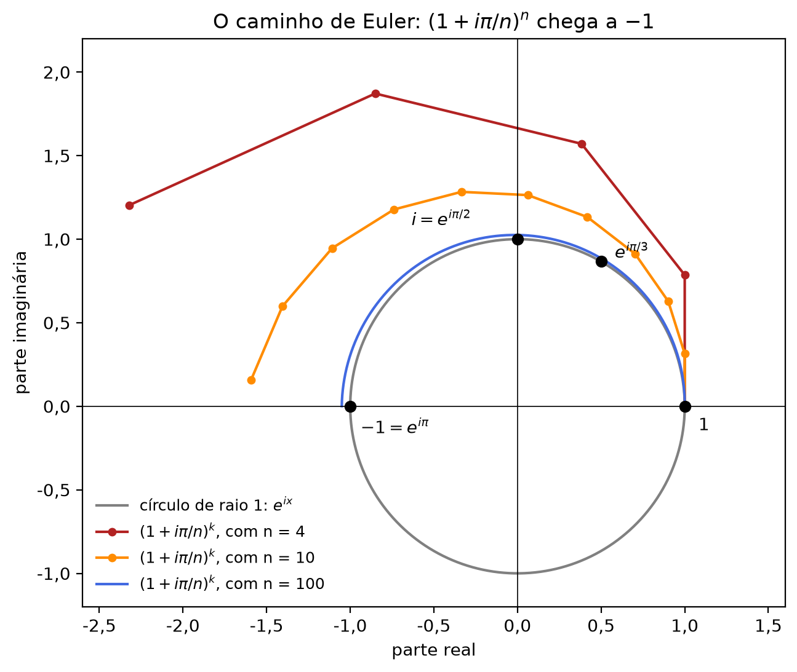

Existe uma equação que aparece em camiseta, em tatuagem e em lista de "fórmulas mais bonitas da matemática":

$$
e^{i\pi} + 1 = 0
$$

Ela junta, numa linha só, cinco números famosos: o $e$ dos juros compostos, o $i$ dos números complexos, o $\pi$ do círculo, o 1 e o 0. Na internet em português ela às vezes aparece com o apelido de "fórmula de Deus". Não encontrei de onde vem esse apelido, então fico com o que dá para conferir: a conta.

E a conta tem um problema logo de cara. O que quer dizer elevar um número a uma potência *imaginária*? $e^2$ é $e \times e$. Mas $e^{i\pi}$ não é "$e$ multiplicado por si mesmo $i\pi$ vezes", porque isso não faz sentido.

Este post explica o que essa potência significa, de onde sai a resposta $-1$ e por que ela não é truque: a fórmula por trás dela, $e^{ix} = \cos x + i \operatorname{sen} x$, descreve um ponto andando em volta de um círculo. No caminho tem conta à mão, o argumento do próprio Euler, código em Julia, R e Python, e as provas em Lean de tudo o que o post afirma valer sempre.

## Cinco minutos de números complexos

A **unidade imaginária** $i$ é um número que, ao quadrado, dá $-1$:

$$
i^2 = -1
$$

Nenhum número real faz isso (todo real ao quadrado é maior ou igual a zero), e por isso $i$ ganhou o nome de "imaginário". Um **número complexo** é uma soma $a + bi$, em que $a$ e $b$ são reais: $a$ é a **parte real** e $b$ é a **parte imaginária**. As contas seguem as regras de sempre, trocando $i^2$ por $-1$ toda vez que ele aparece.

As potências de $i$ se repetem de 4 em 4:

| Potência | Conta | Resultado |
|---|---|---|
| $i^0$ | (por definição) | $1$ |
| $i^1$ | (por definição) | $i$ |
| $i^2$ | (por definição) | $-1$ |
| $i^3$ | $i^2 \cdot i = (-1) \cdot i$ | $-i$ |
| $i^4$ | $i^3 \cdot i = (-i) \cdot i = -i^2 = -(-1)$ | $1$ |
| $i^5$ | $i^4 \cdot i = 1 \cdot i$ | $i$ |

Esse ciclo de 4 vai ser a chave de tudo.

**O plano complexo.** O número $a + bi$ pode ser desenhado como o ponto $(a; b)$ de um plano: a parte real no eixo horizontal, a parte imaginária no vertical. O $1$ fica em $(1; 0)$, o $i$ em $(0; 1)$, o $-1$ em $(-1; 0)$.

**Multiplicar por $i$ gira 90°.** Pegue $3 + 2i$, que é o ponto $(3; 2)$, e multiplique por $i$, aplicando a distributiva:

$$
\begin{aligned}
(3 + 2i) \cdot i &= 3 \cdot i + 2i \cdot i \\
&= 3i + 2i^2 \\
&= 3i + 2 \cdot (-1) \\
&= -2 + 3i
\end{aligned}
$$

O ponto $(3; 2)$ foi parar em $(-2; 3)$: a mesma distância até a origem, girado um quarto de volta no sentido anti-horário. Vale para qualquer número: $i \cdot (a + bi) = -b + ai$ (está provado em Lean). Multiplicar por $i$ duas vezes gira meia volta, e meia volta leva $1$ a $-1$. É exatamente o que $i^2 = -1$ diz.

## Radianos

A fórmula usa ângulos em **radianos**, não em graus. Um radiano é o ângulo que, num círculo de raio 1, enxerga um arco de comprimento 1. Como a meia circunferência de um círculo de raio 1 mede $\pi$, meia volta é $\pi$ radianos:

$$
180° = \pi \text{ rad}, \qquad 90° = \tfrac{\pi}{2} \text{ rad}, \qquad 60° = \tfrac{\pi}{3} \text{ rad}, \qquad 1 \text{ rad} = \tfrac{180°}{\pi} \approx 57{,}30°
$$

O próprio Euler define $\pi$ assim no começo do capítulo em que a fórmula aparece: a semicircunferência do círculo de raio 1, ou o comprimento do arco de 180 graus (*Introductio*, vol. 1, cap. 8, §126).

## A fórmula

Para todo número real $x$:

$$
e^{ix} = \cos x + i \operatorname{sen} x
$$

Lendo cada parte:

- $x$ é um ângulo, em radianos;
- $\cos x$ (cosseno) e $\operatorname{sen} x$ (seno) são as coordenadas do ponto do círculo de raio 1 que está no ângulo $x$, medido a partir do ponto $(1; 0)$ no sentido anti-horário;
- $e^{ix}$ é, portanto, o número complexo que fica nesse ponto: parte real $\cos x$, parte imaginária $\operatorname{sen} x$.

Em palavras: **$e^{ix}$ é o ponto do círculo de raio 1 no ângulo $x$.** Quando $x$ cresce, o ponto anda em volta do círculo. Esta é a **fórmula de Euler**, e ela está provada em Lean para todo $x$ real.

Uma consequência imediata: a distância de $e^{ix}$ até a origem é sempre 1. Pelo teorema de Pitágoras, essa distância é $\sqrt{\cos^2 x + \operatorname{sen}^2 x}$, e $\cos^2 x + \operatorname{sen}^2 x = 1$ para todo $x$. Em notação de complexos, $\lvert e^{ix} \rvert = 1$ (provado em Lean).

Mas isso ainda não responde à pergunta do começo: por que uma *exponencial* teria alguma coisa a ver com um círculo?

## De onde vem a fórmula

A resposta está em escrever as três funções como somas infinitas. Para todo número $z$, real ou complexo,

$$
e^{z} = 1 + z + \frac{z^2}{2!} + \frac{z^3}{3!} + \frac{z^4}{4!} + \frac{z^5}{5!} + \cdots
$$

em que $n!$ (lê-se "$n$ fatorial") é o produto $1 \cdot 2 \cdot 3 \cdots n$, com $0! = 1$. Essa soma infinita é a **série de Taylor** da exponencial: ela converge para qualquer $z$, e é ela que dá sentido a $e^{z}$ quando $z$ é complexo. Para todo $x$ real, o cosseno e o seno também têm as suas:

$$
\cos x = 1 - \frac{x^2}{2!} + \frac{x^4}{4!} - \frac{x^6}{6!} + \cdots
\qquad\qquad
\operatorname{sen} x = x - \frac{x^3}{3!} + \frac{x^5}{5!} - \frac{x^7}{7!} + \cdots
$$

As três séries estão no Mathlib e estão reenunciadas no arquivo de provas deste post. As do seno e do cosseno são as mesmas que Euler escreve no §134 do capítulo 8.

Agora ponha $z = ix$ na série da exponencial. Cada termo tem uma potência $(ix)^n = i^n x^n$, e as potências de $i$ seguem o ciclo $1, i, -1, -i$:

| $n$ | $(ix)^n$ | termo $\dfrac{(ix)^n}{n!}$ |
|---|---|---|
| 0 | $1$ | $1$ |
| 1 | $ix$ | $ix$ |
| 2 | $i^2 x^2 = -x^2$ | $-\dfrac{x^2}{2!}$ |
| 3 | $i^3 x^3 = -i x^3$ | $-i\,\dfrac{x^3}{3!}$ |
| 4 | $i^4 x^4 = x^4$ | $\dfrac{x^4}{4!}$ |
| 5 | $i^5 x^5 = i x^5$ | $i\,\dfrac{x^5}{5!}$ |

Os termos de $n$ par não têm $i$; os de $n$ ímpar têm. Separando os dois grupos:

$$
e^{ix} = \underbrace{\left(1 - \frac{x^2}{2!} + \frac{x^4}{4!} - \cdots\right)}_{\cos x} + i\,\underbrace{\left(x - \frac{x^3}{3!} + \frac{x^5}{5!} - \cdots\right)}_{\operatorname{sen} x}
$$

O primeiro parêntese é a série do cosseno e o segundo é a do seno. Daí $e^{ix} = \cos x + i \operatorname{sen} x$.

Um cuidado: separar uma soma *infinita* em dois grupos não é permitido sempre. Aqui é, porque a série da exponencial converge absolutamente (a soma dos valores absolutos dos termos também é finita). A prova em Lean não depende desse argumento; ela usa a fórmula do Mathlib.

## Exemplo resolvido: 60 graus

Vamos calcular $e^{i\pi/3}$.

**Dados.** O ângulo é $x = \pi/3$ radianos (do enunciado), que corresponde a $60°$, porque $\frac{\pi}{3} \cdot \frac{180°}{\pi} = 60°$.

**Fórmula.** $e^{ix} = \cos x + i \operatorname{sen} x$.

**Substituição.**

$$
e^{i\pi/3} = \cos\frac{\pi}{3} + i \operatorname{sen}\frac{\pi}{3}
$$

**Conta.** Os valores do seno e do cosseno de $60°$ vêm do triângulo equilátero de lado 1 cortado ao meio: a metade da base mede $\tfrac12$, e a altura, pelo teorema de Pitágoras, mede $\sqrt{1 - \tfrac14} = \sqrt{\tfrac34} = \tfrac{\sqrt3}{2}$. Então:

$$
\begin{aligned}
\cos\frac{\pi}{3} &= \frac12 = 0{,}5 \\
\operatorname{sen}\frac{\pi}{3} &= \frac{\sqrt 3}{2} = \frac{1{,}7320508}{2} = 0{,}8660254
\end{aligned}
$$

**Resultado.**

$$
e^{i\pi/3} = \frac12 + \frac{\sqrt3}{2}\,i \approx 0{,}5000 + 0{,}8660\,i
$$

(valor exato à esquerda; à direita, arredondado na quarta casa).

**Interpretação.** $e^{i\pi/3}$ é o ponto do círculo de raio 1 que está a $60°$ do ponto $1$, no sentido anti-horário: meio passo para a direita e 0,866 para cima. A distância até a origem é 1, como tem de ser: $0{,}5^2 + 0{,}8660254^2 = 0{,}25 + 0{,}75 = 1$. O resultado exato está provado em Lean.

## Meia volta: e elevado a iπ

Agora o caso famoso, $x = \pi$, meia volta.

**Dados.** $x = \pi$ radianos, ou $180°$.

**Substituição.** $e^{i\pi} = \cos \pi + i \operatorname{sen} \pi$.

**Conta.** Meia volta a partir do ponto $(1; 0)$ leva ao ponto $(-1; 0)$, então $\cos \pi = -1$ e $\operatorname{sen} \pi = 0$:

$$
\begin{aligned}
e^{i\pi} &= -1 + i \cdot 0 \\
&= -1
\end{aligned}
$$

**Resultado.** $e^{i\pi} = -1$, e somando 1 dos dois lados, $e^{i\pi} + 1 = 0$. Esta é a **identidade de Euler**.

**Interpretação.** Não há mistério numérico escondido: $-1$ é simplesmente o ponto que fica do outro lado do círculo. $e^{i\pi} = -1$ diz "andar meio círculo leva de $1$ a $-1$". Do mesmo jeito, $e^{i\pi/2} = i$ (um quarto de volta) e $e^{2\pi i} = 1$ (volta inteira). Os três estão provados em Lean.

Dá para ver a série chegando lá. Com $x = \pi$, os termos da série de $e^{i\pi}$ são estes (valores com seis casas, calculados com todos os algarismos de $\pi$):

| $n$ | termo $(i\pi)^n / n!$ | soma até $n$ | distância até $-1$ |
|---|---|---|---|
| 0 | $1$ | $1$ | 2,000 |
| 1 | $3{,}141593\,i$ | $1 + 3{,}141593\,i$ | 3,724 |
| 2 | $-4{,}934802$ | $-3{,}934802 + 3{,}141593\,i$ | 4,299 |
| 3 | $-5{,}167713\,i$ | $-3{,}934802 - 2{,}026120\,i$ | 3,566 |
| 4 | $4{,}058712$ | $0{,}123910 - 2{,}026120\,i$ | 2,317 |
| 5 | $2{,}550164\,i$ | $0{,}123910 + 0{,}524044\,i$ | 1,240 |
| 6 | $-1{,}335263$ | $-1{,}211353 + 0{,}524044\,i$ | 0,565 |
| 7 | $-0{,}599265\,i$ | $-1{,}211353 - 0{,}075221\,i$ | 0,224 |
| 8 | $0{,}235331$ | $-0{,}976022 - 0{,}075221\,i$ | 0,079 |

O termo de $n = 2$, por exemplo, é $\frac{(i\pi)^2}{2!} = \frac{i^2 \pi^2}{2} = -\frac{9{,}869604}{2} = -4{,}934802$. Os termos crescem em tamanho até $n = 3$ e depois diminuem, porque o fatorial do denominador cresce mais depressa que a potência de $\pi$. A soma primeiro se afasta de $-1$; a partir de $n = 3$, só se aproxima. Com 21 termos ($n$ até 20), a distância até $-1$ é de $5{,}34 \times 10^{-10}$, como mostra o código mais abaixo.

## O caminho de Euler

Euler chegou à fórmula por outro caminho, no §138 do capítulo 8 do *Introductio in analysin infinitorum*, publicado em 1748. Ele usa uma descrição de $e$ que já tinha mostrado no capítulo anterior: $e^{z}$ é o valor de $\left(1 + \frac{z}{n}\right)^{n}$ quando $n$ é "infinitamente grande". (No texto dele, a letra $i$ é esse número infinitamente grande; a raiz de $-1$ ele escreve por extenso, $\sqrt{-1}$.) Pondo $z = v\sqrt{-1}$, ele chega a $e^{+v\sqrt{-1}} = \cos v + \sqrt{-1} \operatorname{sen} v$.

Em linguagem de hoje: para todo número complexo $z$, $\left(1 + \frac{z}{n}\right)^{n} \to e^{z}$ quando $n \to \infty$. Com $z = i\pi$:

$$
\left(1 + \frac{i\pi}{n}\right)^{n} \longrightarrow e^{i\pi} = -1
$$

Esse limite está provado em Lean. Para ver de perto, a conta à mão com $n = 2$:

**Substituição.** $\left(1 + \frac{i\pi}{2}\right)^2$.

**Conta**, pelo quadrado da soma $(a + b)^2 = a^2 + 2ab + b^2$, com $a = 1$ e $b = \frac{i\pi}{2}$:

$$
\begin{aligned}
a^2 &= 1 \\
2ab &= 2 \cdot 1 \cdot \frac{i\pi}{2} = i\pi = 3{,}141593\,i \\
b^2 &= \frac{i^2\pi^2}{4} = -\frac{9{,}869604}{4} = -2{,}467401 \\
\left(1 + \frac{i\pi}{2}\right)^2 &= 1 - 2{,}467401 + 3{,}141593\,i = -1{,}467401 + 3{,}141593\,i
\end{aligned}
$$

**Interpretação.** Com $n = 2$ ainda estamos longe de $-1$. Aumentando $n$ (valores do código mais abaixo):

| $n$ | $\left(1 + \frac{i\pi}{n}\right)^{n}$ | distância até $-1$ |
|---|---|---|
| 1 | $1{,}000000 + 3{,}141593\,i$ | 3,724192 |
| 2 | $-1{,}467401 + 3{,}141593\,i$ | 3,176172 |
| 4 | $-2{,}320597 + 1{,}203700\,i$ | 1,786861 |
| 10 | $-1{,}593362 + 0{,}156064\,i$ | 0,613543 |
| 100 | $-1{,}050560 + 0{,}001085\,i$ | 0,050571 |
| 1.000 | $-1{,}004947 + 0{,}000010\,i$ | 0,004947 |
| 1.000.000 | $-1{,}000005 + 0{,}000000\,i$ | 0,000005 |

Dá para entender o limite olhando um fator só. Multiplicar por $1 + \frac{i\pi}{n}$ faz duas coisas ao mesmo tempo: **gira** um ângulo um pouco menor que $\frac{\pi}{n}$ e **estica** um pouco, porque a distância de $1 + \frac{i\pi}{n}$ até a origem é $\sqrt{1 + \pi^2/n^2}$, um pouco mais que 1. Com $n = 100$, cada fator gira 0,031406 radiano (contra $\pi/100 = 0{,}031416$) e estica por 1,000493. Depois de 100 fatores, o giro total é de 3,140560 radianos, quase meia volta, e o esticão acumulado é de $1{,}000493^{100} = 1{,}050560$: por isso o resultado fica em $-1{,}050560$, um pouco além do $-1$. Quanto maior $n$, menor o esticão e mais perto de meia volta exata o giro. A figura 1 mostra os pontos intermediários $\left(1 + \frac{i\pi}{n}\right)^k$, para $k = 0, 1, \ldots, n$: com $n$ grande, eles praticamente desenham o semicírculo.

<figure style="text-align:center; margin: 2em auto; max-width: 760px;">
  
  <figcaption style="margin-top:0.75em; font-size:0.88rem; color:#555;">
    Figura 1. O caminho de Euler (versão em Python do código abaixo). Cada poligonal mostra os pontos $(1 + i\pi/n)^k$ para $k = 0, 1, \ldots, n$, partindo de 1. Com $n = 4$ o último ponto fica longe de $-1$; com $n = 100$ o caminho quase coincide com o semicírculo de cima e termina em $-1{,}05$.
  </figcaption>
</figure>

## O código

O primeiro bloco calcula alguns pontos do círculo. Repare na quinta linha da saída.

  

  

    
Julia

    

    <button class="copy-button" onclick="copyCode(this)">
      <i class="bi bi-clipboard"></i>Copiar
    </button>
  

  

    <pre><code>using Printf

# Escreve um número complexo como "a + bi", com 4 casas decimais
function texto(z)
    a = round(real(z), digits = 4) + 0.0          # o "+ 0.0" troca -0.0 por 0.0
    b = round(imag(z), digits = 4) + 0.0
    sinal = b &lt; 0 ? "-" : "+"
    return @sprintf("%.4f %s %.4fi", a, sinal, abs(b))
end

# Pontos do círculo: e^(ix) = cos x + i sen x, com x em radianos
println("e^(iπ/3) = ", texto(exp(im * π / 3)))
println("e^(iπ/2) = ", texto(exp(im * π / 2)))
println("e^(iπ)   = ", texto(exp(im * π)))
println("e^(2πi)  = ", texto(exp(2π * im)))

# Com todas as casas, a parte imaginária de e^(iπ) não sai zero
z = exp(im * π)
@printf("e^(iπ) + 1: parte real %.1e, parte imaginária %.4e\n", real(z) + 1, imag(z))

# O erro de usar graus: 180 aqui é lido como 180 radianos
println("e^(180i) = ", texto(exp(180im)))</code></pre>
  

  
# Saída

  <pre style="overflow-x: auto; font-size: 0.9em;">e^(iπ/3) = 0.5000 + 0.8660i
e^(iπ/2) = 0.0000 + 1.0000i
e^(iπ)   = -1.0000 + 0.0000i
e^(2πi)  = 1.0000 + 0.0000i
e^(iπ) + 1: parte real 0.0e+00, parte imaginária 1.2246e-16
e^(180i) = -0.5985 - 0.8012i</pre>

  

  

  

    
R

    

    <button class="copy-button" onclick="copyCode(this)">
      <i class="bi bi-clipboard"></i>Copiar
    </button>
  

  

    <pre><code># Escreve um número complexo como "a + bi", com 4 casas decimais
texto &lt;- function(z) {
  a &lt;- round(Re(z), 4) + 0                   # o "+ 0" troca -0 por 0
  b &lt;- round(Im(z), 4) + 0
  sinal &lt;- if (b &lt; 0) "-" else "+"
  sprintf("%.4f %s %.4fi", a, sinal, abs(b))
}

# Pontos do círculo: e^(ix) = cos x + i sen x, com x em radianos
cat("e^(iπ/3) = ", texto(exp(1i * pi / 3)), "\n", sep = "")
cat("e^(iπ/2) = ", texto(exp(1i * pi / 2)), "\n", sep = "")
cat("e^(iπ)   = ", texto(exp(1i * pi)), "\n", sep = "")
cat("e^(2πi)  = ", texto(exp(2i * pi)), "\n", sep = "")

# Com todas as casas, a parte imaginária de e^(iπ) não sai zero
z &lt;- exp(1i * pi)
cat(sprintf("e^(iπ) + 1: parte real %.1e, parte imaginária %.4e\n", Re(z) + 1, Im(z)))

# O erro de usar graus: 180 aqui é lido como 180 radianos
cat("e^(180i) = ", texto(exp(180i)), "\n", sep = "")</code></pre>
  

  
# Saída

  <pre style="overflow-x: auto; font-size: 0.9em;">e^(iπ/3) = 0.5000 + 0.8660i
e^(iπ/2) = 0.0000 + 1.0000i
e^(iπ)   = -1.0000 + 0.0000i
e^(2πi)  = 1.0000 + 0.0000i
e^(iπ) + 1: parte real 0.0e+00, parte imaginária 1.2246e-16
e^(180i) = -0.5985 - 0.8012i</pre>

  

  

  

    
Python

    

    <button class="copy-button" onclick="copyCode(this)">
      <i class="bi bi-clipboard"></i>Copiar
    </button>
  

  

    <pre><code>import cmath
import math

def texto(z):
    """Escreve um número complexo como "a + bi", com 4 casas decimais."""
    a = round(z.real, 4) + 0.0                # o "+ 0.0" troca -0.0 por 0.0
    b = round(z.imag, 4) + 0.0
    sinal = "-" if b &lt; 0 else "+"
    return f"{a:.4f} {sinal} {abs(b):.4f}i"

# Pontos do círculo: e^(ix) = cos x + i sen x, com x em radianos
print("e^(iπ/3) =", texto(cmath.exp(1j * math.pi / 3)))
print("e^(iπ/2) =", texto(cmath.exp(1j * math.pi / 2)))
print("e^(iπ)   =", texto(cmath.exp(1j * math.pi)))
print("e^(2πi)  =", texto(cmath.exp(2j * math.pi)))

# Com todas as casas, a parte imaginária de e^(iπ) não sai zero
z = cmath.exp(1j * math.pi)
print(f"e^(iπ) + 1: parte real {z.real + 1:.1e}, parte imaginária {z.imag:.4e}")

# O erro de usar graus: 180 aqui é lido como 180 radianos
print("e^(180i) =", texto(cmath.exp(180j)))</code></pre>
  

  
# Saída

  <pre style="overflow-x: auto; font-size: 0.9em;">e^(iπ/3) = 0.5000 + 0.8660i
e^(iπ/2) = 0.0000 + 1.0000i
e^(iπ)   = -1.0000 + 0.0000i
e^(2πi)  = 1.0000 + 0.0000i
e^(iπ) + 1: parte real 0.0e+00, parte imaginária 1.2246e-16
e^(180i) = -0.5985 - 0.8012i</pre>

  

As três linguagens dão $e^{i\pi} = -1$ na parte real, mas a parte imaginária sai $1{,}2246 \times 10^{-16}$ em vez de zero. A seção "O que dá errado" explica o porquê.

O segundo bloco soma a série de $e^{i\pi}$ até 21 termos e calcula $\left(1 + \frac{i\pi}{n}\right)^{n}$ para $n$ cada vez maior. As saídas das três linguagens são idênticas, e batem com as duas tabelas acima.

  

  

    
Julia

    

    <button class="copy-button" onclick="copyCode(this)">
      <i class="bi bi-clipboard"></i>Copiar
    </button>
  

  

    <pre><code>using Printf

# 1) A série: e^(iπ) = 1 + iπ + (iπ)²/2! + (iπ)³/3! + ...
soma = 0.0 + 0.0im
for n in 0:20
    global soma += (im * π)^n / factorial(n)
    if n % 4 == 0
        @printf("até n = %2d: soma = %9.6f %s %.6fi, distância até -1 = %.2e\n",
                n, real(soma), imag(soma) &lt; 0 ? "-" : "+", abs(imag(soma)), abs(soma + 1))
    end
end

# 2) O caminho de Euler: (1 + iπ/n)^n
for n in (1, 2, 4, 10, 100, 1000, 10^6)
    z = (1 + im * π / n)^n
    @printf("n = %7d: (1 + iπ/n)^n = %9.6f %s %.6fi, distância até -1 = %.6f\n",
            n, real(z), imag(z) &lt; 0 ? "-" : "+", abs(imag(z)), abs(z + 1))
end</code></pre>
  

  
# Saída

  <pre style="overflow-x: auto; font-size: 0.9em;">até n =  0: soma =  1.000000 + 0.000000i, distância até -1 = 2.00e+00
até n =  4: soma =  0.123910 - 2.026120i, distância até -1 = 2.32e+00
até n =  8: soma = -0.976022 - 0.075221i, distância até -1 = 7.89e-02
até n = 12: soma = -0.999900 - 0.000445i, distância até -1 = 4.56e-04
até n = 16: soma = -1.000000 - 0.000001i, distância até -1 = 7.85e-07
até n = 20: soma = -1.000000 - 0.000000i, distância até -1 = 5.34e-10
n =       1: (1 + iπ/n)^n =  1.000000 + 3.141593i, distância até -1 = 3.724192
n =       2: (1 + iπ/n)^n = -1.467401 + 3.141593i, distância até -1 = 3.176172
n =       4: (1 + iπ/n)^n = -2.320597 + 1.203700i, distância até -1 = 1.786861
n =      10: (1 + iπ/n)^n = -1.593362 + 0.156064i, distância até -1 = 0.613543
n =     100: (1 + iπ/n)^n = -1.050560 + 0.001085i, distância até -1 = 0.050571
n =    1000: (1 + iπ/n)^n = -1.004947 + 0.000010i, distância até -1 = 0.004947
n = 1000000: (1 + iπ/n)^n = -1.000005 + 0.000000i, distância até -1 = 0.000005</pre>

  

  

  

    
R

    

    <button class="copy-button" onclick="copyCode(this)">
      <i class="bi bi-clipboard"></i>Copiar
    </button>
  

  

    <pre><code># 1) A série: e^(iπ) = 1 + iπ + (iπ)²/2! + (iπ)³/3! + ...
soma &lt;- 0 + 0i
for (n in 0:20) {
  soma &lt;- soma + (1i * pi)^n / factorial(n)
  if (n %% 4 == 0) {
    cat(sprintf("até n = %2d: soma = %9.6f %s %.6fi, distância até -1 = %.2e\n",
                n, Re(soma), if (Im(soma) &lt; 0) "-" else "+", abs(Im(soma)), Mod(soma + 1)))
  }
}

# 2) O caminho de Euler: (1 + iπ/n)^n
for (n in c(1, 2, 4, 10, 100, 1000, 1e6)) {
  z &lt;- (1 + 1i * pi / n)^n
  cat(sprintf("n = %7d: (1 + iπ/n)^n = %9.6f %s %.6fi, distância até -1 = %.6f\n",
              as.integer(n), Re(z), if (Im(z) &lt; 0) "-" else "+", abs(Im(z)), Mod(z + 1)))
}</code></pre>
  

  
# Saída

  <pre style="overflow-x: auto; font-size: 0.9em;">até n =  0: soma =  1.000000 + 0.000000i, distância até -1 = 2.00e+00
até n =  4: soma =  0.123910 - 2.026120i, distância até -1 = 2.32e+00
até n =  8: soma = -0.976022 - 0.075221i, distância até -1 = 7.89e-02
até n = 12: soma = -0.999900 - 0.000445i, distância até -1 = 4.56e-04
até n = 16: soma = -1.000000 - 0.000001i, distância até -1 = 7.85e-07
até n = 20: soma = -1.000000 - 0.000000i, distância até -1 = 5.34e-10
n =       1: (1 + iπ/n)^n =  1.000000 + 3.141593i, distância até -1 = 3.724192
n =       2: (1 + iπ/n)^n = -1.467401 + 3.141593i, distância até -1 = 3.176172
n =       4: (1 + iπ/n)^n = -2.320597 + 1.203700i, distância até -1 = 1.786861
n =      10: (1 + iπ/n)^n = -1.593362 + 0.156064i, distância até -1 = 0.613543
n =     100: (1 + iπ/n)^n = -1.050560 + 0.001085i, distância até -1 = 0.050571
n =    1000: (1 + iπ/n)^n = -1.004947 + 0.000010i, distância até -1 = 0.004947
n = 1000000: (1 + iπ/n)^n = -1.000005 + 0.000000i, distância até -1 = 0.000005</pre>

  

  

  

    
Python

    

    <button class="copy-button" onclick="copyCode(this)">
      <i class="bi bi-clipboard"></i>Copiar
    </button>
  

  

    <pre><code>import math

# 1) A série: e^(iπ) = 1 + iπ + (iπ)²/2! + (iπ)³/3! + ...
soma = 0 + 0j
for n in range(21):
    soma += (1j * math.pi) ** n / math.factorial(n)
    if n % 4 == 0:
        sinal = "-" if soma.imag &lt; 0 else "+"
        print(f"até n = {n:2d}: soma = {soma.real:9.6f} {sinal} {abs(soma.imag):.6f}i, "
              f"distância até -1 = {abs(soma + 1):.2e}")

# 2) O caminho de Euler: (1 + iπ/n)^n
for n in (1, 2, 4, 10, 100, 1000, 10**6):
    z = (1 + 1j * math.pi / n) ** n
    sinal = "-" if z.imag &lt; 0 else "+"
    print(f"n = {n:7d}: (1 + iπ/n)^n = {z.real:9.6f} {sinal} {abs(z.imag):.6f}i, "
          f"distância até -1 = {abs(z + 1):.6f}")</code></pre>
  

  
# Saída

  <pre style="overflow-x: auto; font-size: 0.9em;">até n =  0: soma =  1.000000 + 0.000000i, distância até -1 = 2.00e+00
até n =  4: soma =  0.123910 - 2.026120i, distância até -1 = 2.32e+00
até n =  8: soma = -0.976022 - 0.075221i, distância até -1 = 7.89e-02
até n = 12: soma = -0.999900 - 0.000445i, distância até -1 = 4.56e-04
até n = 16: soma = -1.000000 - 0.000001i, distância até -1 = 7.85e-07
até n = 20: soma = -1.000000 - 0.000000i, distância até -1 = 5.34e-10
n =       1: (1 + iπ/n)^n =  1.000000 + 3.141593i, distância até -1 = 3.724192
n =       2: (1 + iπ/n)^n = -1.467401 + 3.141593i, distância até -1 = 3.176172
n =       4: (1 + iπ/n)^n = -2.320597 + 1.203700i, distância até -1 = 1.786861
n =      10: (1 + iπ/n)^n = -1.593362 + 0.156064i, distância até -1 = 0.613543
n =     100: (1 + iπ/n)^n = -1.050560 + 0.001085i, distância até -1 = 0.050571
n =    1000: (1 + iπ/n)^n = -1.004947 + 0.000010i, distância até -1 = 0.004947
n = 1000000: (1 + iπ/n)^n = -1.000005 + 0.000000i, distância até -1 = 0.000005</pre>

  

Nas linhas de $n = 16$ e $n = 20$, o sinal de menos na parte imaginária vem de um resto negativo menor que 0,0000005, que some no arredondamento para seis casas.

O terceiro bloco desenha a figura 1. A figura publicada é a da versão em Python; as versões em Julia e em R desenham o mesmo gráfico.

  

  

    
Julia

    

    <button class="copy-button" onclick="copyCode(this)">
      <i class="bi bi-clipboard"></i>Copiar
    </button>
  

  

    <pre><code>using CairoMakie

virgula(vs) = replace.(string.(round.(vs, digits = 1)), "." =&gt; ",")   # vírgula decimal
fig = Figure(size = (800, 640))
ax = Axis(fig[1, 1]; xlabel = "parte real", ylabel = "parte imaginária", aspect = DataAspect(),
          title = L"\text{O caminho de Euler: } (1 + i\pi/n)^n \text{ chega a } -1",
          xtickformat = virgula, ytickformat = virgula)

# O círculo de raio 1: os pontos e^(ix) = cos x + i sen x, para x de 0 a 2π
x = range(0, 2π, length = 400)
lines!(ax, cos.(x), sin.(x); color = :gray, linewidth = 1.5, label = L"\text{círculo de raio 1: } e^{ix}")

# O caminho de Euler: os pontos (1 + iπ/n)^k, para k = 0, 1, ..., n
for (n, cor) in ((4, :firebrick), (10, :darkorange), (100, :royalblue))
    pontos = [(1 + im * π / n)^k for k in 0:n]
    rotulo = L"(1 + i\pi/n)^k, \text{ com } n = %$n"
    if n &lt; 100
        scatterlines!(ax, real.(pontos), imag.(pontos); color = cor, markersize = 7, label = rotulo)
    else
        lines!(ax, real.(pontos), imag.(pontos); color = cor, linewidth = 1.5, label = rotulo)
    end
end

# Pontos especiais, cada um com a posição do seu rótulo
especiais = [(L"1", 1 + 0im, (8, -18)), (L"e^{i\pi/3}", exp(im * π / 3), (8, 2)),
             (L"i = e^{i\pi/2}", 1im, (-70, 8)), (L"-1 = e^{i\pi}", -1 + 0im, (6, -22))]
for (nome, z, desloc) in especiais
    scatter!(ax, [real(z)], [imag(z)]; color = :black, markersize = 10)
    text!(ax, real(z), imag(z); text = nome, offset = desloc)
end

hlines!(ax, 0; color = :black, linewidth = 0.6)
vlines!(ax, 0; color = :black, linewidth = 0.6)
limits!(ax, -2.6, 1.6, -1.2, 2.2)
axislegend(ax; position = :lb, framevisible = false, labelsize = 13)
save("formula_euler_caminho.png", fig, px_per_unit = 2)</code></pre>
  

  

  

  

    
R

    

    <button class="copy-button" onclick="copyCode(this)">
      <i class="bi bi-clipboard"></i>Copiar
    </button>
  

  

    <pre><code>png("formula_euler_caminho.png", width = 1600, height = 1300, res = 200)
plot(NA, xlim = c(-2.6, 1.6), ylim = c(-1.2, 2.2), asp = 1, axes = FALSE,
     xlab = "parte real", ylab = "parte imaginária",
     main = expression("O caminho de Euler: " * (1 + i * pi / n)^n * " chega a " * -1))
marcas_x &lt;- seq(-2.5, 1.5, by = 0.5); marcas_y &lt;- seq(-1, 2, by = 0.5)
axis(1, at = marcas_x, labels = format(marcas_x, decimal.mark = ","))   # vírgula decimal
axis(2, at = marcas_y, labels = format(marcas_y, decimal.mark = ","), las = 1)
box()
abline(h = 0, v = 0, lwd = 0.6)

# O círculo de raio 1: os pontos e^(ix) = cos x + i sen x, para x de 0 a 2π
x &lt;- seq(0, 2 * pi, length.out = 400)
lines(cos(x), sin(x), col = "gray50", lwd = 1.5)

# O caminho de Euler: os pontos (1 + iπ/n)^k, para k = 0, 1, ..., n
cores &lt;- c("4" = "firebrick", "10" = "darkorange", "100" = "royalblue")
for (n in c(4, 10, 100)) {
  pontos &lt;- (1 + 1i * pi / n)^(0:n)
  lines(Re(pontos), Im(pontos), col = cores[as.character(n)], lwd = 1.5,
        type = if (n &lt; 100) "o" else "l", pch = 16, cex = 0.7)
}

# Pontos especiais
especiais &lt;- c(1, exp(1i * pi / 3), 1i, -1)
points(Re(especiais), Im(especiais), pch = 16, cex = 1.2)
text(1.05, -0.12, "1", adj = 0)
text(0.55, 0.92, expression(e^{i * pi / 3}), adj = 0)
text(-0.08, 1.12, expression(i == e^{i * pi / 2}), adj = 1)
text(-0.95, -0.15, expression(-1 == e^{i * pi}), adj = 0)

legend("bottomleft", bty = "n", cex = 0.85,
       legend = c(expression("círculo de raio 1: " * e^{ix}),
                  expression((1 + i * pi / n)^k * ", com n = 4"),
                  expression((1 + i * pi / n)^k * ", com n = 10"),
                  expression((1 + i * pi / n)^k * ", com n = 100")),
       col = c("gray50", cores), lwd = 1.5, pch = c(NA, 16, 16, NA))
invisible(dev.off())</code></pre>
  

  

  

  

    
Python

    

    <button class="copy-button" onclick="copyCode(this)">
      <i class="bi bi-clipboard"></i>Copiar
    </button>
  

  

    <pre><code>import numpy as np
import matplotlib.pyplot as plt
from matplotlib.ticker import FuncFormatter

fig, ax = plt.subplots(figsize=(8, 6))

# O círculo de raio 1: os pontos e^(ix) = cos x + i sen x, para x de 0 a 2π
x = np.linspace(0, 2 * np.pi, 400)
ax.plot(np.cos(x), np.sin(x), color="gray", lw=1.5, label=r"círculo de raio 1: $e^{ix}$")

# O caminho de Euler: os pontos (1 + iπ/n)^k, para k = 0, 1, ..., n
for n, cor in [(4, "firebrick"), (10, "darkorange"), (100, "royalblue")]:
    k = np.arange(n + 1)
    pontos = (1 + 1j * np.pi / n) ** k
    ax.plot(pontos.real, pontos.imag, "o-" if n &lt; 100 else "-", color=cor, ms=4, lw=1.5,
            label=rf"$(1 + i\pi/n)^k$, com n = {n}")

# Pontos especiais, cada um com a posição do seu rótulo
especiais = [("1", 1, (8, -14)), (r"$e^{i\pi/3}$", np.exp(1j * np.pi / 3), (8, 2)),
             (r"$i = e^{i\pi/2}$", 1j, (-62, 8)), (r"$-1 = e^{i\pi}$", -1, (6, -16))]
for nome, z, deslocamento in especiais:
    ax.plot(z.real, z.imag, "ko", ms=6, zorder=3)
    ax.annotate(nome, (z.real, z.imag), textcoords="offset points", xytext=deslocamento)

ax.axhline(0, color="black", lw=0.6)
ax.axvline(0, color="black", lw=0.6)
ax.set(xlim=(-2.6, 1.6), ylim=(-1.2, 2.2), aspect="equal", xlabel="parte real",
       ylabel="parte imaginária", title=r"O caminho de Euler: $(1 + i\pi/n)^n$ chega a $-1$")
virgula = FuncFormatter(lambda v, _: f"{v:.1f}".replace(".", ","))   # vírgula decimal
ax.xaxis.set_major_formatter(virgula)
ax.yaxis.set_major_formatter(virgula)
ax.legend(loc="lower left", frameon=False, fontsize=9)
fig.savefig("formula_euler_caminho.png", dpi=200, bbox_inches="tight")</code></pre>
  

  

## Multiplicar é girar

A fórmula tem uma consequência que economiza muita decoreba. A regra $e^{a} \cdot e^{b} = e^{a+b}$ continua valendo para números complexos, então, para ângulos $a$ e $b$:

$$
e^{ia} \cdot e^{ib} = e^{i(a+b)}
$$

Em palavras: **multiplicar dois pontos do círculo soma os ângulos.** (É o que vimos com $i$: multiplicar por $i = e^{i\pi/2}$ soma $90°$.) Agora escreva os dois lados com a fórmula de Euler. O lado direito é $\cos(a+b) + i \operatorname{sen}(a+b)$. O lado esquerdo, pela distributiva:

$$
\begin{aligned}
(\cos a + i \operatorname{sen} a)(\cos b + i \operatorname{sen} b)
&= \cos a \cos b + i \cos a \operatorname{sen} b + i \operatorname{sen} a \cos b + i^2 \operatorname{sen} a \operatorname{sen} b \\
&= (\cos a \cos b - \operatorname{sen} a \operatorname{sen} b) + i\,(\operatorname{sen} a \cos b + \cos a \operatorname{sen} b)
\end{aligned}
$$

Dois números complexos são iguais quando as partes reais são iguais e as partes imaginárias também. Comparando:

$$
\cos(a+b) = \cos a \cos b - \operatorname{sen} a \operatorname{sen} b
\qquad
\operatorname{sen}(a+b) = \operatorname{sen} a \cos b + \cos a \operatorname{sen} b
$$

As duas fórmulas de soma de arcos da trigonometria saem de uma multiplicação. As duas estão provadas em Lean, assim como $e^{ia} e^{ib} = e^{i(a+b)}$.

**Exemplo: cosseno de 75°.** Dados: $a = 30°$ e $b = 45°$, com $\cos 30° = \frac{\sqrt3}{2}$, $\operatorname{sen} 30° = \frac12$, $\cos 45° = \operatorname{sen} 45° = \frac{\sqrt2}{2}$. Substituindo na fórmula do cosseno da soma:

$$
\begin{aligned}
\cos 75° &= \frac{\sqrt3}{2}\cdot\frac{\sqrt2}{2} - \frac12\cdot\frac{\sqrt2}{2} \\
&= \frac{\sqrt6}{4} - \frac{\sqrt2}{4} \\
&= 0{,}612372 - 0{,}353553 \\
&= 0{,}258819
\end{aligned}
$$

Com todos os algarismos, $\frac{\sqrt6 - \sqrt2}{4} = 0{,}2588190$, o mesmo valor que uma calculadora dá para $\cos 75°$.

## Onde a fórmula aparece

Tudo o que gira ou oscila fica mais simples de escrever com $e^{ix}$: em vez de carregar senos e cossenos separados, multiplica-se uma exponencial, e girar vira somar ângulos. É por isso que a fórmula está por trás da análise de Fourier (decompor um sinal em ondas), da descrição de corrente alternada na engenharia elétrica e da mecânica quântica.

Em probabilidade ela aparece na **função característica** de uma variável aleatória $X$:

$$
\varphi(t) = E\!\left[e^{itX}\right]
$$

a média de $e^{itX}$, para cada número real $t$. Ela tem uma vantagem sobre outras ferramentas parecidas: como $\lvert e^{itX} \rvert = 1$, essa média **existe para qualquer variável aleatória**, mesmo as que não têm média nem variância. Isso está provado em Lean. A demonstração do [Teorema do Limite Central](/pt/probabilidade/teorema-limite-central) que está no Mathlib, por exemplo, é feita com funções características. Neste site, os números complexos também aparecem no post sobre a [hipótese de Riemann](/hipotese-de-riemann-zeros-primos-julia/).

## O que dá errado

- **O computador não dá exatamente $-1$.** Nas três linguagens, $e^{i\pi}$ sai como $-1 + 1{,}2246 \times 10^{-16}\,i$. O culpado não é a fórmula, é o $\pi$: o computador guarda $\pi$ com 53 algarismos binários, e o valor guardado fica $1{,}2246 \times 10^{-16}$ abaixo do $\pi$ verdadeiro. Para um ângulo $\pi - \delta$ com $\delta$ pequeno, o seno vale praticamente $\delta$, e é esse $\delta$ que aparece na parte imaginária. Quando um resultado exato importa, use o arredondamento ou funções feitas para isso (em Julia, `cispi(1)` calcula $e^{i\pi \cdot 1}$ sem passar pelo $\pi$ arredondado e dá exatamente $-1$).
- **Graus no lugar de radianos.** $e^{i \cdot 180}$ não é $-1$: o 180 é lido como 180 radianos, que são 28 voltas inteiras mais 4,0708 radianos (cerca de 233,24°). O resultado, como mostra o primeiro bloco de código, é $-0{,}5985 - 0{,}8012\,i$.
- **$e^{i\pi}$ não é "multiplicar $e$ por si mesmo $i\pi$ vezes".** Potência com expoente complexo é definida pela série (ou pelo limite de Euler). As regras de sempre ($e^{a}e^{b} = e^{a+b}$) continuam valendo, mas a ideia de "repetir a multiplicação" não.
- **"Logaritmo de $-1$ é $i\pi$" é só meia verdade.** Como dar uma volta inteira não muda o ponto ($e^{i(x+2\pi)} = e^{ix}$, provado em Lean), também $e^{3i\pi} = -1$, $e^{-i\pi} = -1$ e assim por diante. Há infinitos expoentes que dão $-1$, e escolher um deles como "o" logaritmo é uma convenção.
- **A fórmula não "prova" nada sobre beleza ou sobre Deus.** Ela é uma consequência das definições de $e^{z}$, seno e cosseno. A elegância é real, mas é opinião; a conta é o que dá para conferir.

## As provas em Lean

As afirmações que o post faz "para todo" caso estão demonstradas em Lean, no arquivo [`provas/Provas/Euler.lean`](https://github.com/morrisonkuhlsen/morrisonkuhlsen/blob/master/provas/Provas/Euler.lean). (O post [Lean: a linguagem em que o computador confere a sua prova](/lean-linguagem-computador-confere-prova/) explica como ler esses arquivos.)

- $i^2 = -1$, $i^3 = -i$, $i^4 = 1$, e $i^{k+4} = i^k$ para todo $k \ge 0$; multiplicar por $i$ leva $a + bi$ a $-b + ai$.
- As séries de $e^{z}$ (para todo $z$ complexo), de $\cos x$ e de $\operatorname{sen} x$ (para todo $x$ real).
- A fórmula de Euler, $e^{ix} = \cos x + i \operatorname{sen} x$, para todo $x$ real, com parte real $\cos x$ e parte imaginária $\operatorname{sen} x$; $\lvert e^{ix} \rvert = 1$ e $\cos^2 x + \operatorname{sen}^2 x = 1$.
- $e^{ia} e^{ib} = e^{i(a+b)}$ e as fórmulas do cosseno e do seno da soma; $e^{i(x+2\pi)} = e^{ix}$.
- $e^{i\pi} + 1 = 0$, $e^{i\pi/2} = i$, $e^{2\pi i} = 1$ e $e^{i\pi/3} = \frac12 + \frac{\sqrt3}{2}i$.
- O limite de Euler: $\left(1 + \frac{i\pi}{n}\right)^n \to -1$.
- A função característica $E[e^{itX}]$ existe para toda variável aleatória real $X$.

O que o Lean não cobre: os valores numéricos das tabelas e do exemplo do cosseno de 75°, conferidos rodando o código nas três linguagens e refazendo as contas em Julia.

## Resumo

- $i$ é o número com $i^2 = -1$; multiplicar por $i$ gira 90° no plano complexo.
- A fórmula de Euler, $e^{ix} = \cos x + i \operatorname{sen} x$ (com $x$ em radianos), diz que $e^{ix}$ é o ponto do círculo de raio 1 no ângulo $x$.
- Ela sai de pôr $ix$ na série da exponencial e separar os termos com e sem $i$: aparecem as séries do cosseno e do seno.
- Com $x = \pi$, meia volta: $e^{i\pi} = -1$, ou $e^{i\pi} + 1 = 0$. No computador sai $-1 + 1{,}2246 \times 10^{-16}\,i$ por causa do arredondamento de $\pi$.
- Euler chegou lá pelo limite $\left(1 + \frac{z}{n}\right)^n$; com $z = i\pi$, a sequência se aproxima de $-1$ girando quase meia volta.
- Multiplicar pontos do círculo soma ângulos, e daí saem as fórmulas de soma de arcos da trigonometria.

Para ir além: a página de [constantes](/matematica-basica/constantes.html) conta de onde vêm $\pi$ e $e$, e a calculadora do [número e](/formulas/numero-e.html) mostra o limite $\left(1 + \frac1n\right)^n$ com números reais.

## Referências

- Euler, L. (1748). *Introductio in analysin infinitorum*, vol. 1. Lausanne: Marcum-Michaelem Bousquet. Índice de Eneström E101. Registro no Euler Archive: [scholarlycommons.pacific.edu/euler-works/101](https://scholarlycommons.pacific.edu/euler-works/101/). Capítulo 8: §126 (π como semicircunferência do círculo de raio 1), §134 (séries do seno e do cosseno) e §138 (a fórmula).
- Euler, L. *Introduction to the Analysis of the Infinite*, vol. 1, cap. 8, tradução para o inglês e notas de Ian Bruce: [17centurymaths.com](https://www.17centurymaths.com/contents/euler/introductiontoanalysisvolone/ch8avol1.pdf). Acesso em 28 nov. 2026. (Fonte consultada para os parágrafos citados acima.)
- The Mathlib Community. *Mathlib*, biblioteca de matemática do Lean 4: [github.com/leanprover-community/mathlib4](https://github.com/leanprover-community/mathlib4). Lemas `Complex.exp_mul_I`, `Complex.exp_pi_mul_I`, `Complex.norm_exp_ofReal_mul_I`, `Real.hasSum_cos`, `Real.hasSum_sin` e `Complex.tendsto_one_add_div_pow_exp`, usados nas provas.
