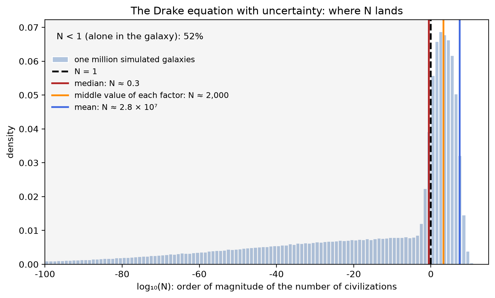

How many civilizations able to send a radio signal exist in our galaxy right now?

Nobody knows. But in 1961 the radio astronomer Frank Drake wrote down a calculation that turns this question into seven smaller ones, and it became known as the **Drake equation**. It is famous for giving answers that range from "we are alone" to "the galaxy is crowded", depending on who fills in the numbers.

This post is about what happens when you take seriously the fact that nobody knows the numbers. Instead of putting one value in each factor, you can put in a *range* of plausible values and see what comes out. The result is a statistics lesson that goes well beyond astronomy: with the same ranges, the **mean** number of civilizations is about 28 million, the **median** is 0.3, and the chance that we are alone in the galaxy is around 52%. Along the way there is a hand calculation, a Monte Carlo simulation in Julia, R and Python, and Lean proofs of what the post claims always holds.

## Where the equation comes from

According to the SETI Institute, Drake put the equation together in 1961 as the agenda for the first scientific meeting on the search for extraterrestrial intelligence (SETI). The meeting took place in November 1961 at the Green Bank observatory, in West Virginia, in the United States, where the year before Drake himself had run Project Ozma, the first modern attempt to pick up radio signals from other stars. About a dozen people attended. The idea was not to arrive at a number but to organize the discussion: each factor in the equation is a topic.

## The equation, factor by factor

$$
N = R_\ast \cdot f_p \cdot n_e \cdot f_l \cdot f_i \cdot f_c \cdot L
$$

| Symbol | What it is | Unit |
|---|---|---|
| $N$ | number of civilizations in the Milky Way whose signals we could detect | civilizations |
| $R_\ast$ | how many stars suitable for life form per year in the galaxy | stars per year |
| $f_p$ | fraction of those stars that have planets | (fraction, from 0 to 1) |
| $n_e$ | number of planets with an environment suitable for life, per planetary system | planets per system |
| $f_l$ | fraction of those planets on which life actually appears | (fraction) |
| $f_i$ | fraction of life-bearing planets on which intelligent life emerges | (fraction) |
| $f_c$ | fraction of civilizations that develop technology with detectable signals | (fraction) |
| $L$ | for how many years, on average, a civilization emits such signals | years |

(The definitions follow the SETI Institute's page on the equation.)

The first six factors form a chain of filters. It starts with the stars born each year; of those, a fraction has planets; from those systems comes a certain number of habitable planets; and so on. Each fraction "filters" what was left from the previous step, which is why they multiply. The product $R_\ast f_p n_e f_l f_i f_c$ is the number of **detectable civilizations that arise per year**.

## Why multiply by L

The last factor turns "how many arise per year" into "how many exist now". The reasoning is the same as for a queue at a bakery.

An example made up to keep the arithmetic simple: if 2 civilizations arise per year and each lasts 100 years, the ones that exist today are those that arose in the last 100 years. That is 2 per year, for 100 years:

$$
2 \ \tfrac{\text{civilizations}}{\text{year}} \times 100 \text{ years} = 200 \text{ civilizations}
$$

This holds under a condition the equation assumes without saying so: the rate of arising must have been constant for longer than $L$ (the so-called **steady state**). If civilizations started arising only recently, or if the rate changed a lot over the galaxy's history, the calculation does not hold. The sum "$r$ per year for $L$ years gives $L \cdot r$" is proved in Lean.

## Ranges, not numbers

The trouble with the Drake equation is not the formula, it is that nobody knows six of the seven factors. And the uncertainty is not "about 20% either way": it spans **orders of magnitude**. Does life arise on almost every habitable planet, or on one in a trillion? Does a technological civilization last centuries or billions of years? Nobody knows even the exponent.

In 2018, Anders Sandberg, Eric Drexler and Toby Ord, then at the Future of Humanity Institute at the University of Oxford, published an analysis that takes this uncertainty seriously. Instead of one number per factor, they used a range, with the following distribution for each factor (Table 1 of the paper):

| Factor | Range | Distribution |
|---|---|---|
| $R_\ast$ | from 1 to 100 per year | log-uniform |
| $f_p$ | from 0.1 to 1 | log-uniform |
| $n_e$ | from 0.1 to 1 | log-uniform |
| $f_l$ | see the section "The most uncertain factor" | (its own model) |
| $f_i$ | from 0.001 to 1 | log-uniform |
| $f_c$ | from 0.01 to 1 | log-uniform |
| $L$ | from 100 to 10,000,000,000 years | log-uniform |

**Log-uniform** means that the *logarithm* of the factor is drawn uniformly. In practice, every order of magnitude in the range is equally likely: for $f_i$, landing between 0.001 and 0.01 is as likely as landing between 0.01 and 0.1 or between 0.1 and 1. It is the natural choice when not even the order of magnitude is known. (With an ordinary uniform distribution between 0.001 and 1, 90% of the draws would land between 0.1 and 1, which would already be a strong bet.)

These ranges are the authors' choice, made with the literature of 2018. Different ranges give different answers, and the post comes back to that at the end.

The ranges alone already show the size of the problem. If each factor lies between a non-negative minimum and a maximum, the product lies between the product of the minimums and the product of the maximums (proved in Lean). The maximum is $100 \times 1 \times 1 \times 1 \times 1 \times 1 \times 10^{10} = 10^{12}$ civilizations, with $f_l$ at its maximum of 1. The minimum, with $f_l$ able to get close to zero, is practically zero. The range of $N$ covers more than a dozen orders of magnitude.

## The most uncertain factor

For $f_l$, the fraction of habitable planets on which life arises, Sandberg, Drexler and Ord use a simple physical model. Think of the origin of life as a rare event that happens at some rate, per unit volume of "chemical soup" and per unit time. If $x$ is the expected number of origins of life on a planet over its whole history, the chance of at least one is

$$
f_l = 1 - e^{-x}
$$

This formula comes from the Poisson model: the number of events with mean $x$ is zero with probability $e^{-x}$, and "at least one" is the complement. Two consequences, proved in Lean for every $x \ge 0$: $f_l$ lies between 0 and 1, and $f_l$ never exceeds $x$. When $x$ is very small, $f_l$ is practically equal to $x$.

The problem is $x$: nobody knows whether the origin of life is easy or extremely hard. The authors model $\log_{10} x$ as a normal with mean 0 and a standard deviation of **50 orders of magnitude**. A mean of 0 means the middle value is $x = 1$, one expected origin of life per planet; a standard deviation of 50 means that $x = 10^{-50}$ and $x = 10^{50}$ are both plausible. With this, the median of $f_l$ is $1 - e^{-1} = 0.632$ and the mean is 0.502 (computed by numerical integration in the first code block). The paper rounds these to 0.63 and 0.5.

## Hand calculation: the middle value of each factor

Before the simulation, the calculation many people would do: take a "typical" value from each range and multiply. For a log-uniform range, the middle value on the logarithmic scale is the **geometric mean** of the endpoints, $\sqrt{a \cdot b}$. For $f_l$, the median.

**Data** (computed from the ranges in the table):

| Factor | Calculation | Middle value |
|---|---|---|
| $R_\ast$ | $\sqrt{1 \times 100}$ | 10 per year |
| $f_p$ | $\sqrt{0.1 \times 1}$ | 0.316228 |
| $n_e$ | $\sqrt{0.1 \times 1}$ | 0.316228 |
| $f_l$ | $1 - e^{-1}$ | 0.632121 |
| $f_i$ | $\sqrt{0.001 \times 1}$ | 0.031623 |
| $f_c$ | $\sqrt{0.01 \times 1}$ | 0.1 |
| $L$ | $\sqrt{100 \times 10^{10}}$ | 1,000,000 years |

**Formula.** $N = R_\ast \cdot f_p \cdot n_e \cdot f_l \cdot f_i \cdot f_c \cdot L$.

**Substitution.**

$$
N = 10 \times 0.316228 \times 0.316228 \times 0.632121 \times 0.031623 \times 0.1 \times 1{,}000{,}000
$$

**Calculation**, multiplying from left to right (with all the digits of each factor, rounding only what is written down):

$$
\begin{aligned}
10 \times 0.316228 &= 3.162278 \\
3.162278 \times 0.316228 &= 1 \\
1 \times 0.632121 &= 0.632121 \\
0.632121 \times 0.031623 &= 0.019989 \\
0.019989 \times 0.1 &= 0.001999 \\
0.001999 \times 1{,}000{,}000 &= 1{,}998.94
\end{aligned}
$$

(The second step gives exactly 1 because $\sqrt{0.1} \times \sqrt{0.1} = 0.1$ and $10 \times 0.1 = 1$.)

**Result.** $N \approx 1{,}999$, that is, about **2,000 detectable civilizations** in the Milky Way.

**Interpretation.** With the middle value of each factor, the galaxy would have some 2,000 neighbours to talk to. It looks like a conclusion. It is not: this number is not the mean of $N$, nor the median, and it says nothing about the chance that we are alone. The next sections show that, with the same ranges, the chance that there is nobody besides us is above 50%.

## The mean of N

If the seven factors are **independent** (knowing the value of one does not change what is known about the others), the mean of a product is the product of the means. This is an assumption of the model, not a fact of nature; with it, the result is proved in Lean.

For a log-uniform variable between $a$ and $b$, the mean is

$$
\text{mean} = \frac{b - a}{\ln(b/a)}
$$

where $\ln$ is the natural logarithm (proved in Lean). For $R_\ast$, with $a = 1$ and $b = 100$:

$$
\begin{aligned}
b - a &= 100 - 1 = 99 \\
\ln(b/a) &= \ln 100 = 4.605170 \\
\text{mean of } R_\ast &= \frac{99}{4.605170} = 21.4976 \text{ stars per year}
\end{aligned}
$$

Note that the mean (21.5) is well above the middle value (10): the high values pull the mean up. For $L$ the effect is huge: $\frac{10^{10} - 100}{\ln 10^{8}} = \frac{9{,}999{,}999{,}900}{18.420681} = 5.42868 \times 10^{8}$ years, against a middle value of $10^6$. The seven factors and the running product:

| Factor | Mean | Product so far |
|---|---|---|
| $R_\ast$ | 21.4976 | 21.4976 |
| $f_p$ | 0.390865 | 8.40265 |
| $n_e$ | 0.390865 | 3.28430 |
| $f_l$ | 0.502000 | 1.64872 |
| $f_i$ | 0.144620 | 0.238438 |
| $f_c$ | 0.214976 | 0.0512584 |
| $L$ | $5.42868 \times 10^{8}$ | $2.78265 \times 10^{7}$ |

The mean of $N$ is $2.7827 \times 10^7$: **about 28 million civilizations**. The paper reports 27 million; the small difference comes from its rounding the mean of $f_l$ to 0.5.

28 million, 2,000 or none? The simulation shows how all three fit in the same ranges.

## The simulation

The **Monte Carlo method** swaps a hard calculation for random draws: draw a value for each factor, compute $N$, and repeat a million times. Each repetition is a "possible galaxy", compatible with what is known. Then you just count.

In the Julia version of the code below:

- the **median** of $N$ is 0.312: half of the simulated galaxies have fewer than 0.312 detectable civilizations;
- in **52.17%** of them, $N < 1$, that is, there is nobody besides us (the paper gives 52%);
- in **39.39%**, $N < 10^{-10}$, the cut-off the authors use for "alone in the observable universe" (the paper gives 38%);
- the **mean** of $N$ over the draws is $2.83 \times 10^7$, close to the exact mean of $2.78 \times 10^7$;
- only **3.40%** of the simulated galaxies have $N$ above the exact mean, and the 1% of galaxies with the most civilizations account for **89.85%** of the sum of all the $N$.

The R and Python versions draw different numbers with the same seed and give slightly different values (median of 0.317, $P(N < 1)$ of 52.15% and 52.14%); all the differences are the size of the randomness of a million draws.

<figure style="text-align:center; margin: 2em auto; max-width: 900px;">
  
  <figcaption style="margin-top:0.75em; font-size:0.88rem; color:#555;">
    Figure 1. Distribution of $\log_{10} N$ over one million simulated galaxies (Python version of the code below). The grey band is the region $N < 1$. The mean (blue) lies to the right of almost the whole histogram; the median (red) lies just below $N = 1$. Draws with $\log_{10} N < -100$ fall outside the chart.
  </figcaption>
</figure>

## Why the logarithmic scale

The logarithm of a product is the sum of the logarithms (proved in Lean):

$$
\log_{10} N = \log_{10} R_\ast + \log_{10} f_p + \log_{10} n_e + \log_{10} f_l + \log_{10} f_i + \log_{10} f_c + \log_{10} L
$$

That is why the figure is in $\log_{10} N$: on the logarithmic scale, the equation becomes a sum of seven independent terms, and sums of independent terms tend to be bell-shaped (the idea behind the [Central Limit Theorem](/en/probability/central-limit-theorem), although seven terms, one of them very different from the rest, are not enough for a normal). The peak between 0 and 8 is that sum. The long tail on the left comes from $f_l$: when $\log_{10} x$ is negative, $\log_{10} f_l$ follows $\log_{10} x$ and can go down to $-50$, $-100$ or beyond.

And it is on the logarithmic scale that you can see why the mean and the median disagree so much:

- **The median** is the middle value of the draws. It does not care how large the extremes are, only about their order. Half the galaxies have fewer than 0.312.
- **The mean** adds up all the values and divides by the count. A draw with $N = 10^{11}$ weighs as much as a hundred thousand draws with $N = 10^{6}$. That is why it is pulled up by a few extreme cases: 1% of the draws account for almost 90% of the sum, and 96.6% of the galaxies fall below the mean.
- **The middle value of each factor** (2,000) is neither. It is what comes out of the peak of the bell, but it ignores the tail of $f_l$, which is exactly what puts half of the mass below $N = 1$.

The question "are we alone?" is answered neither by the mean nor by a typical value, but by a probability: $P(N < 1)$. Since $N < 1$ is the same as $\log_{10} N < 0$ (proved in Lean, for $N > 0$), it is the area of the grey band in the figure.

## The code

The first block does the exact calculations: the middle value of each factor, the mean of each factor and the mean of $N$. The three languages give identical outputs, which match the tables above.

  

  

    
Julia

    

    <button class="copy-button" onclick="copyCode(this)">
      <i class="bi bi-clipboard"></i>Copy
    </button>
  

  

    <pre><code>using Distributions, QuadGK, Printf

# Ranges from Sandberg, Drexler and Ord (2018), in the order R*, fp, ne, fi, fc, L.
# Each factor is log-uniform: its logarithm is uniform between the two endpoints.
factor_names = ["R*", "fp", "ne", "fi", "fc", "L"]
ranges = [(1, 100), (0.1, 1), (0.1, 1), (0.001, 1), (0.01, 1), (100, 1e10)]

# fl = 1 - e^(-x), with log10(x) ~ Normal(0, 50): the origin of life is the most uncertain factor
fl(z) = -expm1(-10.0^z)                    # 1 - e^(-10^z) without losing precision when x is small
Z = Normal(0, 50)

# 1) N with the "middle" value of each range (geometric mean of the endpoints) and the median of fl
middle = [sqrt(a * b) for (a, b) in ranges]
@printf("N with the middle value of each factor: %.2f\n", prod(middle) * fl(0))

# 2) Mean of each factor: (b - a) / ln(b / a) for the log-uniform; numerical integral for fl
means = [(b - a) / log(b / a) for (a, b) in ranges]
for (name, m) in zip(factor_names, means)
    @printf("mean of %-2s = %.6g\n", name, m)
end
mean_fl = quadgk(z -&gt; fl(z) * pdf(Z, z), -60, 0, 60)[1] + ccdf(Z, 60)   # above 60, fl = 1
@printf("mean of fl = %.6f\n", mean_fl)
@printf("mean of N  = %.4e\n", prod(means) * mean_fl)</code></pre>
  

  
# Output

  <pre style="overflow-x: auto; font-size: 0.9em;">N with the middle value of each factor: 1998.94
mean of R* = 21.4976
mean of fp = 0.390865
mean of ne = 0.390865
mean of fi = 0.14462
mean of fc = 0.214976
mean of L  = 5.42868e+08
mean of fl = 0.502000
mean of N  = 2.7827e+07</pre>

  

  

  

    
R

    

    <button class="copy-button" onclick="copyCode(this)">
      <i class="bi bi-clipboard"></i>Copy
    </button>
  

  

    <pre><code># Ranges from Sandberg, Drexler and Ord (2018), in the order R*, fp, ne, fi, fc, L.
# Each factor is log-uniform: its logarithm is uniform between the two endpoints.
factor_names &lt;- c("R*", "fp", "ne", "fi", "fc", "L")
a &lt;- c(1, 0.1, 0.1, 0.001, 0.01, 100)
b &lt;- c(100, 1, 1, 1, 1, 1e10)

# fl = 1 - e^(-x), with log10(x) ~ Normal(0, 50): the origin of life is the most uncertain factor
fl &lt;- function(z) -expm1(-10^z)            # 1 - e^(-10^z) without losing precision when x is small

# 1) N with the "middle" value of each range (geometric mean of the endpoints) and the median of fl
middle &lt;- sqrt(a * b)
cat(sprintf("N with the middle value of each factor: %.2f\n", prod(middle) * fl(0)))

# 2) Mean of each factor: (b - a) / ln(b / a) for the log-uniform; numerical integral for fl
means &lt;- (b - a) / log(b / a)
for (i in seq_along(factor_names)) cat(sprintf("mean of %-2s = %.6g\n", factor_names[i], means[i]))
mean_fl &lt;- integrate(function(z) fl(z) * dnorm(z, 0, 50), -60, 60, rel.tol = 1e-10)$value +
  pnorm(60, 0, 50, lower.tail = FALSE)     # above 60, fl = 1
cat(sprintf("mean of fl = %.6f\n", mean_fl))
cat(sprintf("mean of N  = %.4e\n", prod(means) * mean_fl))</code></pre>
  

  
# Output

  <pre style="overflow-x: auto; font-size: 0.9em;">N with the middle value of each factor: 1998.94
mean of R* = 21.4976
mean of fp = 0.390865
mean of ne = 0.390865
mean of fi = 0.14462
mean of fc = 0.214976
mean of L  = 5.42868e+08
mean of fl = 0.502000
mean of N  = 2.7827e+07</pre>

  

  

  

    
Python

    

    <button class="copy-button" onclick="copyCode(this)">
      <i class="bi bi-clipboard"></i>Copy
    </button>
  

  

    <pre><code>import numpy as np
from scipy.integrate import quad
from scipy.stats import norm

# Ranges from Sandberg, Drexler and Ord (2018), in the order R*, fp, ne, fi, fc, L.
# Each factor is log-uniform: its logarithm is uniform between the two endpoints.
factor_names = ["R*", "fp", "ne", "fi", "fc", "L"]
a = np.array([1, 0.1, 0.1, 0.001, 0.01, 100])
b = np.array([100, 1, 1, 1, 1, 1e10])

def fl(z):
    """fl = 1 - e^(-x), with x = 10^z, without losing precision when x is small."""
    return -np.expm1(-10.0 ** z)

# 1) N with the "middle" value of each range (geometric mean of the endpoints) and the median of fl
middle = np.sqrt(a * b)
print(f"N with the middle value of each factor: {np.prod(middle) * fl(0):.2f}")

# 2) Mean of each factor: (b - a) / ln(b / a) for the log-uniform; numerical integral for fl
means = (b - a) / np.log(b / a)
for name, m in zip(factor_names, means):
    print(f"mean of {name:&lt;2} = {m:.6g}")
mean_fl = quad(lambda z: fl(z) * norm.pdf(z, 0, 50), -60, 60, points=[0], epsrel=1e-10)[0] \
    + norm.sf(60, 0, 50)                   # above 60, fl = 1
print(f"mean of fl = {mean_fl:.6f}")
print(f"mean of N  = {np.prod(means) * mean_fl:.4e}")</code></pre>
  

  
# Output

  <pre style="overflow-x: auto; font-size: 0.9em;">N with the middle value of each factor: 1998.94
mean of R* = 21.4976
mean of fp = 0.390865
mean of ne = 0.390865
mean of fi = 0.14462
mean of fc = 0.214976
mean of L  = 5.42868e+08
mean of fl = 0.502000
mean of N  = 2.7827e+07</pre>

  

The second block is the simulation. The numbers quoted in the section "The simulation" come from the Julia version.

  

  

    
Julia

    

    <button class="copy-button" onclick="copyCode(this)">
      <i class="bi bi-clipboard"></i>Copy
    </button>
  

  

    <pre><code>using Random, Statistics, Printf

# One million "possible galaxies": in each, draw the seven factors and compute log10(N).
Random.seed!(123)
n = 1_000_000
ranges = [(1, 100), (0.1, 1), (0.1, 1), (0.001, 1), (0.01, 1), (100, 1e10)]   # R*, fp, ne, fi, fc, L

# log-uniform on [a, b]: log10 of the factor is uniform between log10(a) and log10(b)
draw_log10(a, b) = log10(a) .+ (log10(b) - log10(a)) .* rand(n)

# fl = 1 - e^(-x), with z = log10(x) ~ Normal(0, 50).
# For z &lt; -15, 1 - e^(-x) = x with relative error below 10^-15, so log10(fl) = z.
z = 50 .* randn(n)
log10_fl = [zi &lt; -15 ? zi : log10(-expm1(-10.0^zi)) for zi in z]

log10_N = sum(draw_log10(a, b) for (a, b) in ranges) .+ log10_fl

@printf("median of N:            %.3f\n", 10^median(log10_N))
@printf("P(N &lt; 1), alone in the galaxy:       %.4f\n", mean(log10_N .&lt; 0))
@printf("P(N &lt; 10^-10), alone in the universe: %.4f\n", mean(log10_N .&lt; -10))
@printf("mean of N in the simulation: %.4e\n", mean(10.0 .^ log10_N))
@printf("5th and 95th percentiles of log10(N): %.2f and %.2f\n", quantile(log10_N, 0.05), quantile(log10_N, 0.95))

# What pulls the mean up: the fraction above the exact mean and the weight of the top 1% in the sum
N = sort(10.0 .^ log10_N)
@printf("P(N &gt; exact mean 2.7827e7): %.4f\n", mean(N .&gt; 2.7827e7))
@printf("share of the sum from the top 1%%: %.4f\n", sum(N[end-n÷100+1:end]) / sum(N))</code></pre>
  

  
# Output

  <pre style="overflow-x: auto; font-size: 0.9em;">median of N:            0.312
P(N &lt; 1), alone in the galaxy:       0.5217
P(N &lt; 10^-10), alone in the universe: 0.3939
mean of N in the simulation: 2.8315e+07
5th and 95th percentiles of log10(N): -78.99 and 7.01
P(N &gt; exact mean 2.7827e7): 0.0340
share of the sum from the top 1%: 0.8985</pre>

  

  

  

    
R

    

    <button class="copy-button" onclick="copyCode(this)">
      <i class="bi bi-clipboard"></i>Copy
    </button>
  

  

    <pre><code># One million "possible galaxies": in each, draw the seven factors and compute log10(N).
set.seed(123)
n &lt;- 1e6
a &lt;- c(1, 0.1, 0.1, 0.001, 0.01, 100)      # R*, fp, ne, fi, fc, L
b &lt;- c(100, 1, 1, 1, 1, 1e10)

# log-uniform on [a, b]: log10 of the factor is uniform between log10(a) and log10(b)
draw_log10 &lt;- function(a, b) runif(n, log10(a), log10(b))

# fl = 1 - e^(-x), with z = log10(x) ~ Normal(0, 50).
# For z &lt; -15, 1 - e^(-x) = x with relative error below 10^-15, so log10(fl) = z.
z &lt;- rnorm(n, 0, 50)
log10_fl &lt;- ifelse(z &lt; -15, z, log10(-expm1(-10^pmax(z, -15))))

log10_N &lt;- Reduce(`+`, Map(draw_log10, a, b)) + log10_fl

cat(sprintf("median of N:            %.3f\n", 10^median(log10_N)))
cat(sprintf("P(N &lt; 1), alone in the galaxy:       %.4f\n", mean(log10_N &lt; 0)))
cat(sprintf("P(N &lt; 10^-10), alone in the universe: %.4f\n", mean(log10_N &lt; -10)))
cat(sprintf("mean of N in the simulation: %.4e\n", mean(10^log10_N)))
q &lt;- quantile(log10_N, c(0.05, 0.95))
cat(sprintf("5th and 95th percentiles of log10(N): %.2f and %.2f\n", q[1], q[2]))

# What pulls the mean up: the fraction above the exact mean and the weight of the top 1% in the sum
N &lt;- sort(10^log10_N)
cat(sprintf("P(N &gt; exact mean 2.7827e7): %.4f\n", mean(N &gt; 2.7827e7)))
cat(sprintf("share of the sum from the top 1%%: %.4f\n", sum(tail(N, n / 100)) / sum(N)))</code></pre>
  

  
# Output

  <pre style="overflow-x: auto; font-size: 0.9em;">median of N:            0.317
P(N &lt; 1), alone in the galaxy:       0.5215
P(N &lt; 10^-10), alone in the universe: 0.3940
mean of N in the simulation: 2.7121e+07
5th and 95th percentiles of log10(N): -78.93 and 7.01
P(N &gt; exact mean 2.7827e7): 0.0338
share of the sum from the top 1%: 0.8948</pre>

  

  

  

    
Python

    

    <button class="copy-button" onclick="copyCode(this)">
      <i class="bi bi-clipboard"></i>Copy
    </button>
  

  

    <pre><code>import numpy as np

# One million "possible galaxies": in each, draw the seven factors and compute log10(N).
rng = np.random.default_rng(123)
n = 1_000_000
a = np.array([1, 0.1, 0.1, 0.001, 0.01, 100])     # R*, fp, ne, fi, fc, L
b = np.array([100, 1, 1, 1, 1, 1e10])

# log-uniform on [a, b]: log10 of the factor is uniform between log10(a) and log10(b)
log10_factors = rng.uniform(np.log10(a), np.log10(b), size=(n, 6))

# fl = 1 - e^(-x), with z = log10(x) ~ Normal(0, 50).
# For z &lt; -15, 1 - e^(-x) = x with relative error below 10^-15, so log10(fl) = z.
z = rng.normal(0, 50, n)
log10_fl = np.where(z &lt; -15, z, np.log10(-np.expm1(-10.0 ** np.maximum(z, -15))))

log10_N = log10_factors.sum(axis=1) + log10_fl

print(f"median of N:            {10 ** np.median(log10_N):.3f}")
print(f"P(N &lt; 1), alone in the galaxy:       {np.mean(log10_N &lt; 0):.4f}")
print(f"P(N &lt; 10^-10), alone in the universe: {np.mean(log10_N &lt; -10):.4f}")
print(f"mean of N in the simulation: {np.mean(10.0 ** log10_N):.4e}")
q5, q95 = np.quantile(log10_N, [0.05, 0.95])
print(f"5th and 95th percentiles of log10(N): {q5:.2f} and {q95:.2f}")

# What pulls the mean up: the fraction above the exact mean and the weight of the top 1% in the sum
N = np.sort(10.0 ** log10_N)
print(f"P(N &gt; exact mean 2.7827e7): {np.mean(N &gt; 2.7827e7):.4f}")
print(f"share of the sum from the top 1%: {N[-n // 100:].sum() / N.sum():.4f}")</code></pre>
  

  
# Output

  <pre style="overflow-x: auto; font-size: 0.9em;">median of N:            0.317
P(N &lt; 1), alone in the galaxy:       0.5214
P(N &lt; 10^-10), alone in the universe: 0.3935
mean of N in the simulation: 2.7654e+07
5th and 95th percentiles of log10(N): -78.74 and 7.00
P(N &gt; exact mean 2.7827e7): 0.0338
share of the sum from the top 1%: 0.8980</pre>

  

The third block draws Figure 1. The published figure comes from the Python version; the Julia and R versions draw the same chart.

  

  

    
Julia

    

    <button class="copy-button" onclick="copyCode(this)">
      <i class="bi bi-clipboard"></i>Copy
    </button>
  

  

    <pre><code>using CairoMakie, Random, Statistics, Printf

# The same simulation as in the previous block
Random.seed!(123)
n = 1_000_000
ranges = [(1, 100), (0.1, 1), (0.1, 1), (0.001, 1), (0.01, 1), (100, 1e10)]   # R*, fp, ne, fi, fc, L
draw_log10(a, b) = log10(a) .+ (log10(b) - log10(a)) .* rand(n)
z = 50 .* randn(n)
log10_fl = [zi &lt; -15 ? zi : log10(-expm1(-10.0^zi)) for zi in z]
log10_N = sum(draw_log10(a, b) for (a, b) in ranges) .+ log10_fl

decimal(vs) = [@sprintf("%.2f", v) for v in vs]
minus_sign(vs) = [replace(@sprintf("%.0f", v), "-" =&gt; "−") for v in vs]
fig = Figure(size = (900, 500))
ax = Axis(fig[1, 1]; xlabel = "log₁₀(N): order of magnitude of the number of civilizations", ylabel = "density",
          title = "The Drake equation with uncertainty: where N lands", xtickformat = minus_sign, ytickformat = decimal)
vspan!(ax, -100, 0; color = (:gray, 0.08))
hist!(ax, filter(x -&gt; x &gt;= -100, log10_N); bins = -100:1:15, normalization = :none,
      weights = fill(1 / n, count(&gt;=(-100), log10_N)), color = :lightsteelblue, strokecolor = :white,
      strokewidth = 0.5, label = "one million simulated galaxies")
marks = [(0.0, :black, :dash, "N = 1"),
          (median(log10_N), :firebrick, :solid, "median: N ≈ 0.3"),
          (log10(1998.94), :darkorange, :solid, "middle value of each factor: N ≈ 2,000"),
          (log10(2.7827e7), :royalblue, :solid, "mean: N ≈ 2.8 × 10⁷")]
for (x, colour, style, label_text) in marks
    vlines!(ax, x; color = colour, linestyle = style, linewidth = 2, label = label_text)
end
text!(ax, -97, 0.066; text = @sprintf("N &lt; 1 (alone in the galaxy): %.0f%%", 100 * mean(log10_N .&lt; 0)))
xlims!(ax, -100, 15)
ylims!(ax, 0, nothing)
axislegend(ax; position = (0, 0.85), framevisible = false, labelsize = 12)
save("drake_distribution.png", fig, px_per_unit = 2)</code></pre>
  

  

  

  

    
R

    

    <button class="copy-button" onclick="copyCode(this)">
      <i class="bi bi-clipboard"></i>Copy
    </button>
  

  

    <pre><code># The same simulation as in the previous block
set.seed(123)
n &lt;- 1e6
a &lt;- c(1, 0.1, 0.1, 0.001, 0.01, 100)      # R*, fp, ne, fi, fc, L
b &lt;- c(100, 1, 1, 1, 1, 1e10)
draw_log10 &lt;- function(a, b) runif(n, log10(a), log10(b))
z &lt;- rnorm(n, 0, 50)
log10_fl &lt;- ifelse(z &lt; -15, z, log10(-expm1(-10^pmax(z, -15))))
log10_N &lt;- Reduce(`+`, Map(draw_log10, a, b)) + log10_fl

png("drake_distribution.png", width = 1800, height = 1000, res = 200)
inside &lt;- log10_N[log10_N &gt;= -100 &amp; log10_N &lt; 15]
h &lt;- hist(inside, breaks = seq(-100, 15, by = 1), plot = FALSE)
plot(NA, xlim = c(-100, 15), ylim = c(0, max(h$counts / n) * 1.05), axes = FALSE,
     xlab = "log₁₀(N): order of magnitude of the number of civilizations", ylab = "density",
     main = "The Drake equation with uncertainty: where N lands")
rect(-100, 0, 0, 1, col = adjustcolor("gray", 0.08), border = NA)
rect(h$breaks[-length(h$breaks)], 0, h$breaks[-1], h$counts / n, col = "lightsteelblue", border = "white")
ticks_y &lt;- pretty(c(0, max(h$counts / n)))
axis(1, at = seq(-100, 0, by = 20), labels = sub("-", "−", seq(-100, 0, by = 20)))
axis(2, at = ticks_y, labels = format(ticks_y), las = 1)
box()
x_marks &lt;- c(0, median(log10_N), log10(1998.94), log10(2.7827e7))
colours &lt;- c("black", "firebrick", "darkorange", "royalblue")
abline(v = x_marks, col = colours, lty = c(2, 1, 1, 1), lwd = 2)
text(-97, max(h$counts / n) * 1.0, adj = 0,
     sprintf("N &lt; 1 (alone in the galaxy): %.0f%%", 100 * mean(log10_N &lt; 0)))
legend("topleft", inset = c(0, 0.16), bty = "n", cex = 0.85,
       legend = c("one million simulated galaxies", "N = 1", "median: N ≈ 0.3",
                  "middle value of each factor: N ≈ 2,000", "mean: N ≈ 2.8 × 10⁷"),
       fill = c("lightsteelblue", NA, NA, NA, NA), border = c("white", NA, NA, NA, NA),
       col = c(NA, colours), lty = c(NA, 2, 1, 1, 1), lwd = c(NA, 2, 2, 2, 2))
invisible(dev.off())</code></pre>
  

  

  

  

    
Python

    

    <button class="copy-button" onclick="copyCode(this)">
      <i class="bi bi-clipboard"></i>Copy
    </button>
  

  

    <pre><code>import numpy as np
import matplotlib.pyplot as plt
from matplotlib.ticker import FuncFormatter

# The same simulation as in the previous block
rng = np.random.default_rng(123)
n = 1_000_000
a = np.array([1, 0.1, 0.1, 0.001, 0.01, 100])     # R*, fp, ne, fi, fc, L
b = np.array([100, 1, 1, 1, 1, 1e10])
log10_factors = rng.uniform(np.log10(a), np.log10(b), size=(n, 6))
z = rng.normal(0, 50, n)
log10_fl = np.where(z &lt; -15, z, np.log10(-np.expm1(-10.0 ** np.maximum(z, -15))))
log10_N = log10_factors.sum(axis=1) + log10_fl

fig, ax = plt.subplots(figsize=(9, 5))
ax.hist(log10_N, bins=np.arange(-100, 15.5, 1), density=True, color="lightsteelblue",
        edgecolor="white", label="one million simulated galaxies")
ax.axvspan(-100, 0, color="gray", alpha=0.08)
marks = [(0, "black", "--", "N = 1"),
          (np.median(log10_N), "firebrick", "-", "median: N ≈ 0.3"),
          (np.log10(1998.94), "darkorange", "-", "middle value of each factor: N ≈ 2,000"),
          (np.log10(2.7827e7), "royalblue", "-", "mean: N ≈ 2.8 × 10⁷")]
for x, colour, style, label_text in marks:
    ax.axvline(x, color=colour, linestyle=style, lw=2, label=label_text)
ax.text(-97, ax.get_ylim()[1] * 0.92, f"N &lt; 1 (alone in the galaxy): {np.mean(log10_N &lt; 0):.0%}",
        fontsize=10)
ax.xaxis.set_major_formatter(FuncFormatter(lambda v, _: f"{v:.0f}"))
ax.yaxis.set_major_formatter(FuncFormatter(lambda v, _: f"{v:.2f}"))
ax.set(xlim=(-100, 15), xlabel="log₁₀(N): order of magnitude of the number of civilizations",
       ylabel="density", title="The Drake equation with uncertainty: where N lands")
ax.legend(loc="upper left", bbox_to_anchor=(0, 0.88), frameon=False, fontsize=9)
fig.savefig("drake_distribution.png", dpi=200, bbox_inches="tight")</code></pre>
  

  

## The Fermi paradox

If the galaxy had millions of civilizations, why do we see no sign of them? This tension is called the **Fermi paradox**. Sandberg, Drexler and Ord attribute the question to a conversation of Enrico Fermi's in 1950, citing an account by Jones (1985).

The paper's argument is that the paradox only appears when you use a typical number, like the 2,000 from the hand calculation, or the mean. With the full uncertainty, a silent sky is no surprise: in their calculation, there is a 52% chance that there is nobody else in the galaxy before even looking at the sky. That is why the paper's title speaks of "dissolving" the paradox rather than solving it. The authors go further and update these chances with the fact that we have not seen anyone; depending on how that observation is modelled, the chance that we are alone in the galaxy rises to somewhere between 53% and 99.6%.

## What about self-destruction?

The equation has no separate factor for civilizations that destroy themselves. That risk sits inside $L$: $L$ is how many years a civilization emits detectable signals, and that period ends if it destroys itself, but also if it falls silent or switches to a technology we cannot pick up. The equation does not distinguish between the reasons; all that matters is how long the signal lasts.

In the range used by Sandberg, Drexler and Ord, $L$ goes from 100 to 10 billion years, and the low end already covers civilizations that destroy themselves about a century after they start emitting. To see how much this factor weighs, the block below repeats the simulation changing only the upper limit of $L$. The upper limits of 10 thousand and a thousand years are illustrative scenarios, chosen for this post, of a galaxy in which every civilization destroys itself early; they do not come from the paper.

| Range of $L$ | Median of $N$ | $P(N < 1)$ |
|---|---|---|
| from 100 to 10,000,000,000 years (the paper's) | 0.3115 | 52.17% |
| from 100 to 10,000 years | 0.0113 | 67.55% |
| from 100 to 1,000 years | 0.0049 | 74.60% |

(Values from the Julia version; the R and Python versions differ in the third decimal place because of the randomness of the draws.)

  

  

    
Julia

    

    <button class="copy-button" onclick="copyCode(this)">
      <i class="bi bi-clipboard"></i>Copy
    </button>
  

  

    <pre><code>using Random, Statistics, Printf

# The same simulation, changing only the upper limit of L (how many years a civilization emits signals).
# Upper limits of 10 thousand and a thousand years: illustrative scenarios of civilizations
# that destroy themselves early.
function simulate(L_max; n = 1_000_000)
    Random.seed!(123)
    ranges = [(1, 100), (0.1, 1), (0.1, 1), (0.001, 1), (0.01, 1), (100, L_max)]   # R*, fp, ne, fi, fc, L
    draw_log10(a, b) = log10(a) .+ (log10(b) - log10(a)) .* rand(n)
    z = 50 .* randn(n)
    log10_fl = [zi &lt; -15 ? zi : log10(-expm1(-10.0^zi)) for zi in z]
    log10_N = sum(draw_log10(a, b) for (a, b) in ranges) .+ log10_fl
    return 10^median(log10_N), mean(log10_N .&lt; 0)
end

for L_max in (1e10, 1e4, 1e3)
    median_N, p_alone = simulate(L_max)
    @printf("L from 100 to %.0e years: median of N = %.4f, P(N &lt; 1) = %.4f\n", L_max, median_N, p_alone)
end</code></pre>
  

  
# Output

  <pre style="overflow-x: auto; font-size: 0.9em;">L from 100 to 1e+10 years: median of N = 0.3115, P(N &lt; 1) = 0.5217
L from 100 to 1e+04 years: median of N = 0.0113, P(N &lt; 1) = 0.6755
L from 100 to 1e+03 years: median of N = 0.0049, P(N &lt; 1) = 0.7460</pre>

  

  

  

    
R

    

    <button class="copy-button" onclick="copyCode(this)">
      <i class="bi bi-clipboard"></i>Copy
    </button>
  

  

    <pre><code># The same simulation, changing only the upper limit of L (how many years a civilization emits signals).
# Upper limits of 10 thousand and a thousand years: illustrative scenarios of civilizations
# that destroy themselves early.
simulate &lt;- function(L_max, n = 1e6) {
  set.seed(123)
  a &lt;- c(1, 0.1, 0.1, 0.001, 0.01, 100)    # R*, fp, ne, fi, fc, L
  b &lt;- c(100, 1, 1, 1, 1, L_max)
  draw_log10 &lt;- function(a, b) runif(n, log10(a), log10(b))
  z &lt;- rnorm(n, 0, 50)
  log10_fl &lt;- ifelse(z &lt; -15, z, log10(-expm1(-10^pmax(z, -15))))
  log10_N &lt;- Reduce(`+`, Map(draw_log10, a, b)) + log10_fl
  c(median = 10^median(log10_N), p_alone = mean(log10_N &lt; 0))
}

for (L_max in c(1e10, 1e4, 1e3)) {
  r &lt;- simulate(L_max)
  cat(sprintf("L from 100 to %.0e years: median of N = %.4f, P(N &lt; 1) = %.4f\n", L_max, r[["median"]], r[["p_alone"]]))
}</code></pre>
  

  
# Output

  <pre style="overflow-x: auto; font-size: 0.9em;">L from 100 to 1e+10 years: median of N = 0.3171, P(N &lt; 1) = 0.5215
L from 100 to 1e+04 years: median of N = 0.0115, P(N &lt; 1) = 0.6758
L from 100 to 1e+03 years: median of N = 0.0050, P(N &lt; 1) = 0.7464</pre>

  

  

  

    
Python

    

    <button class="copy-button" onclick="copyCode(this)">
      <i class="bi bi-clipboard"></i>Copy
    </button>
  

  

    <pre><code>import numpy as np

def simulate(L_max, n=1_000_000):
    """The same simulation, changing only the upper limit of L (how many years a civilization emits signals)."""
    rng = np.random.default_rng(123)
    a = np.array([1, 0.1, 0.1, 0.001, 0.01, 100])    # R*, fp, ne, fi, fc, L
    b = np.array([100, 1, 1, 1, 1, L_max])
    log10_factors = rng.uniform(np.log10(a), np.log10(b), size=(n, 6))
    z = rng.normal(0, 50, n)
    log10_fl = np.where(z &lt; -15, z, np.log10(-np.expm1(-10.0 ** np.maximum(z, -15))))
    log10_N = log10_factors.sum(axis=1) + log10_fl
    return 10 ** np.median(log10_N), np.mean(log10_N &lt; 0)

# Upper limits of 10 thousand and a thousand years are illustrative scenarios
# of civilizations that destroy themselves early.
for L_max in (1e10, 1e4, 1e3):
    median_N, p_alone = simulate(L_max)
    print(f"L from 100 to {L_max:.0e} years: median of N = {median_N:.4f}, P(N &lt; 1) = {p_alone:.4f}")</code></pre>
  

  
# Output

  <pre style="overflow-x: auto; font-size: 0.9em;">L from 100 to 1e+10 years: median of N = 0.3168, P(N &lt; 1) = 0.5214
L from 100 to 1e+04 years: median of N = 0.0114, P(N &lt; 1) = 0.6762
L from 100 to 1e+03 years: median of N = 0.0050, P(N &lt; 1) = 0.7462</pre>

  

**Interpretation.** If no civilization emits signals for more than a thousand years, the chance that there is nobody detectable besides us rises from 52% to 75%, and the median of $N$ falls from 0.31 to 0.0049. Even so, the chance does not reach 100%: with high values in the other factors, there could still be neighbours. And the numbers say how much self-destruction would weigh in the calculation, not whether it happens.

## What goes wrong

- **The ranges are opinions.** The whole calculation depends on the 2018 ranges. If someone thinks $L$ is no more than 10 thousand years, or that $f_i$ is almost 1, the result changes (the previous section shows by how much, for $L$). What the analysis shows is the consequence of the ranges, not the truth about the galaxy.
- **The 52% is not a frequency.** There is no population of galaxies from which ours was drawn. The 52% measures how compatible the hypothesis "we are alone" is with our uncertainty, in the language of Bayesian probability. If knowledge improves, the number changes.
- **Independence is an assumption.** The product of the means is only the mean of the product if the factors are independent. If, for example, planets with simple life were more likely to have intelligent life for some common reason, the calculation would change.
- **So is the steady state.** Multiplying by $L$ assumes a constant rate for longer than $L$. With $L$ up to 10 billion years, comparable to the age of the galaxy, this assumption becomes strained at the top of the range (the paper treats 10 billion years as a practical cut-off for that reason).
- **$N$ counts detectable civilizations, not existing ones.** The factor $f_c$ leaves out anyone who exists but emits nothing we can pick up. "We are alone" here means "there is nobody detectable".
- **The mean is not useless, it answers another question.** It is the right number if you want, for example, the expected total of civilizations summed over many galaxies. To decide whether it is worth searching *in this* galaxy, the whole distribution matters more.

## The proofs in Lean

The claims this post makes "for every" case are proved in Lean, in the file [`provas/Provas/Drake.lean`](https://github.com/morrisonkuhlsen/morrisonkuhlsen/blob/master/provas/Provas/Drake.lean). (The post [Lean: the language in which the computer checks your proof](/lean-language-computer-checks-your-proof/) explains how to read these files.)

- Steady state: $r$ per year summed over $L$ years gives $L \cdot r$.
- The logarithm of a product of positive factors is the sum of the logarithms.
- If each factor lies between a non-negative minimum and a maximum, the product lies between the product of the minimums and that of the maximums.
- The mean of a product of independent factors is the product of the means.
- The mean of $e^{U}$, with $U$ uniform between $\ln a$ and $\ln b$ ($0 < a < b$), is $\frac{b - a}{\ln(b/a)}$: the mean of the log-uniform.
- For $x \ge 0$, $f_l = 1 - e^{-x}$ lies between 0 and 1 and does not exceed $x$.
- For $N > 0$, $N < 1$ is the same as $\log_{10} N < 0$.

What Lean does not cover: the numerical values (means, simulation, probabilities), checked by running the code in all three languages and redoing the calculations in Julia, and the range of each factor, which are modelling choices, not theorems.

## Summary

- The Drake equation, $N = R_\ast f_p n_e f_l f_i f_c L$, multiplies a chain of filters (how many detectable civilizations arise per year) by the duration $L$ of each, assuming a steady state.
- Six of the seven factors are uncertain by orders of magnitude. With the ranges of Sandberg, Drexler and Ord (2018), the middle value of each factor gives $N \approx 2{,}000$.
- With the same ranges, the mean of $N$ is about 28 million, the median is about 0.3, and the probability of $N < 1$ (nobody detectable besides us) is about 52%.
- The mean is pulled up by a few huge cases: only 3.4% of the simulated galaxies exceed it. For questions like "are we alone?", what matters is the distribution, not a number.
- Self-destruction enters through $L$. In an illustrative scenario where no civilization lasts more than a thousand years, $P(N < 1)$ rises to about 75%.
- In a product of uncertain factors, work on the logarithmic scale: the product becomes a sum, and the shape of the distribution shows up.

To go further: the post [Understanding the median](/median/) shows why the median resists extreme values, and the post on [the margin of error of election polls](/polling-margin-of-error-sampling/) uses another Monte Carlo simulation.

## References

- Sandberg, A.; Drexler, E.; Ord, T. (2018). Dissolving the Fermi Paradox. *arXiv*:1806.02404 [physics.pop-ph]. DOI: [10.48550/arXiv.1806.02404](https://doi.org/10.48550/arXiv.1806.02404). Preprint; according to arXiv, submitted to the *Proceedings of the Royal Society A*. Table 1 (factor ranges), Section 3.1 (model for $f_l$), Section 3.2 and Table 2 (mean, median and probabilities).
- Shostak, S. *Drake Equation*. SETI Institute, updated July 2021: [seti.org/drake-equation-index](https://www.seti.org/drake-equation-index). Accessed 28 Nov. 2026. (Origin of the equation, the 1961 Green Bank meeting and the definition of the factors.)
- SETI Institute. *Project Ozma*: [seti.org/seti-institute/project/details/early-seti-project-ozma-arecibo-message](https://www.seti.org/seti-institute/project/details/early-seti-project-ozma-arecibo-message). Accessed 28 Nov. 2026.
