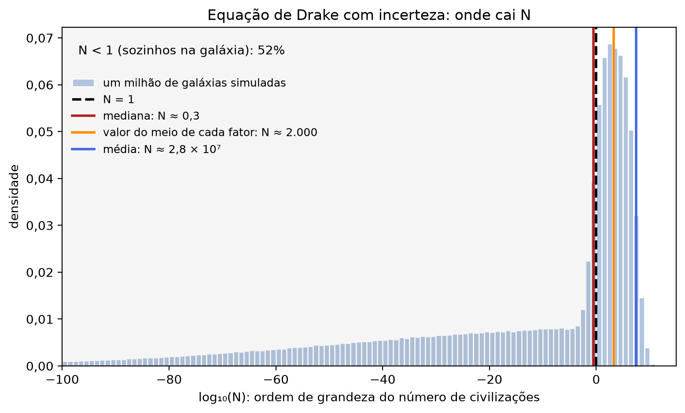

Quantas civilizações capazes de mandar um sinal de rádio existem na nossa galáxia agora?

Ninguém sabe. Mas em 1961 o radioastrônomo Frank Drake escreveu uma conta que transforma essa pergunta em sete perguntas menores, e essa conta ficou conhecida como **equação de Drake**. Ela é famosa por dar respostas que vão de "estamos sozinhos" a "a galáxia está lotada", dependendo de quem preenche os números.

Este post é sobre o que acontece quando se leva a sério o fato de que ninguém sabe os números. Em vez de pôr um valor em cada fator, dá para pôr uma *faixa* de valores plausíveis e ver o que sai. O resultado é uma lição de estatística que vale muito além da astronomia: com as mesmas faixas, a **média** do número de civilizações dá cerca de 28 milhões, a **mediana** dá 0,3, e a chance de estarmos sozinhos na galáxia fica em torno de 52%. No caminho tem conta à mão, uma simulação de Monte Carlo em Julia, R e Python e as provas em Lean do que o post afirma valer sempre.

## De onde vem a equação

Segundo o SETI Institute, Drake montou a equação em 1961 para servir de pauta da primeira reunião científica sobre a busca por inteligência extraterrestre (SETI, na sigla em inglês). A reunião aconteceu em novembro de 1961 no observatório de Green Bank, na Virgínia Ocidental, nos Estados Unidos, onde no ano anterior o próprio Drake tinha feito o Projeto Ozma, a primeira tentativa moderna de captar sinais de rádio de outras estrelas. Cerca de uma dúzia de pessoas participaram. A ideia não era chegar a um número, e sim organizar a discussão: cada fator da equação é um assunto.

## A equação, fator por fator

$$
N = R_\ast \cdot f_p \cdot n_e \cdot f_l \cdot f_i \cdot f_c \cdot L
$$

| Símbolo | O que é | Unidade |
|---|---|---|
| $N$ | número de civilizações na Via Láctea cujos sinais poderíamos detectar | civilizações |
| $R_\ast$ | quantas estrelas adequadas à vida se formam por ano na galáxia | estrelas por ano |
| $f_p$ | fração dessas estrelas que têm planetas | (fração, de 0 a 1) |
| $n_e$ | número de planetas com ambiente adequado à vida, por sistema planetário | planetas por sistema |
| $f_l$ | fração desses planetas em que a vida de fato surge | (fração) |
| $f_i$ | fração dos planetas com vida em que surge vida inteligente | (fração) |
| $f_c$ | fração das civilizações que desenvolvem tecnologia com sinais detectáveis | (fração) |
| $L$ | por quantos anos, em média, uma civilização emite esses sinais | anos |

(As definições seguem a página do SETI Institute sobre a equação.)

Os seis primeiros fatores formam uma cadeia de filtros. Começa com as estrelas que nascem por ano; dessas, uma fração tem planetas; desses sistemas, sai um certo número de planetas habitáveis; e assim por diante. Cada fração "filtra" o que sobrou do passo anterior, por isso elas se multiplicam. O produto $R_\ast f_p n_e f_l f_i f_c$ é o número de **civilizações detectáveis que surgem por ano**.

## Por que multiplicar por L

O último fator troca "quantas surgem por ano" por "quantas existem agora". O raciocínio é o mesmo de uma fila de padaria.

Um exemplo inventado para a conta ficar simples: se surgem 2 civilizações por ano e cada uma dura 100 anos, as que existem hoje são as que surgiram nos últimos 100 anos. Foram 2 por ano, durante 100 anos:

$$
2 \ \tfrac{\text{civilizações}}{\text{ano}} \times 100 \text{ anos} = 200 \text{ civilizações}
$$

Isso vale sob uma condição que a equação assume sem dizer: a taxa de surgimento tem de ser constante há mais tempo do que $L$ (o chamado **estado estacionário**). Se as civilizações começaram a surgir há pouco tempo, ou se a taxa mudou muito ao longo da história da galáxia, a conta não vale. A soma "$r$ por ano durante $L$ anos dá $L \cdot r$" está provada em Lean.

## Faixas, não números

O problema da equação de Drake não é a fórmula, é que ninguém conhece seis dos sete fatores. E a incerteza não é de "uns 20% para mais ou para menos": é de **ordens de grandeza**. A vida surge em quase todo planeta habitável ou em um a cada trilhão? Uma civilização técnica dura séculos ou bilhões de anos? Ninguém sabe nem o expoente.

Em 2018, Anders Sandberg, Eric Drexler e Toby Ord, então no Future of Humanity Institute da Universidade de Oxford, publicaram uma análise que leva essa incerteza a sério. Em vez de um número por fator, eles usaram uma faixa, com a seguinte distribuição para cada fator (tabela 1 do artigo):

| Fator | Faixa | Distribuição |
|---|---|---|
| $R_\ast$ | de 1 a 100 por ano | log-uniforme |
| $f_p$ | de 0,1 a 1 | log-uniforme |
| $n_e$ | de 0,1 a 1 | log-uniforme |
| $f_l$ | ver a seção "O fator mais incerto" | (modelo próprio) |
| $f_i$ | de 0,001 a 1 | log-uniforme |
| $f_c$ | de 0,01 a 1 | log-uniforme |
| $L$ | de 100 a 10.000.000.000 anos | log-uniforme |

**Log-uniforme** quer dizer que o *logaritmo* do fator é sorteado de modo uniforme. Na prática, cada ordem de grandeza da faixa tem a mesma chance: para $f_i$, cair entre 0,001 e 0,01 é tão provável quanto cair entre 0,01 e 0,1 ou entre 0,1 e 1. É a escolha natural quando nem a ordem de grandeza é conhecida. (Numa distribuição uniforme comum entre 0,001 e 1, 90% dos sorteios cairiam entre 0,1 e 1, o que já seria uma aposta forte.)

Essas faixas são uma escolha dos autores, feita com a literatura de 2018. Faixas diferentes dão respostas diferentes, e o post volta a isso no fim.

Só com as faixas já dá para ver o tamanho do problema. Se cada fator está entre um mínimo e um máximo não negativos, o produto está entre o produto dos mínimos e o produto dos máximos (provado em Lean). O máximo é $100 \times 1 \times 1 \times 1 \times 1 \times 1 \times 10^{10} = 10^{12}$ civilizações, com $f_l$ no máximo de 1. O mínimo, com $f_l$ podendo chegar perto de zero, é praticamente zero. A faixa de $N$ cobre mais de uma dezena de ordens de grandeza.

## O fator mais incerto

Para $f_l$, a fração de planetas habitáveis em que a vida surge, Sandberg, Drexler e Ord usam um modelo físico simples. Pense na origem da vida como um evento raro que acontece a uma certa taxa, por unidade de volume de "sopa química" e por unidade de tempo. Se $x$ é o número esperado de origens da vida num planeta durante toda a sua história, a chance de acontecer pelo menos uma é

$$
f_l = 1 - e^{-x}
$$

Essa fórmula vem do modelo de Poisson: o número de eventos com média $x$ é zero com probabilidade $e^{-x}$, e "pelo menos um" é o complemento. Duas consequências, provadas em Lean para todo $x \ge 0$: $f_l$ fica entre 0 e 1, e $f_l$ nunca passa de $x$. Quando $x$ é muito pequeno, $f_l$ é praticamente igual a $x$.

O problema é $x$: ninguém sabe se a origem da vida é fácil ou dificílima. Os autores modelam $\log_{10} x$ como uma normal com média 0 e desvio padrão de **50 ordens de grandeza**. A média 0 quer dizer que o valor do meio é $x = 1$, uma origem da vida esperada por planeta; o desvio padrão de 50 quer dizer que $x = 10^{-50}$ e $x = 10^{50}$ são ambos plausíveis. Com isso, a mediana de $f_l$ é $1 - e^{-1} = 0{,}632$ e a média fica em 0,502 (calculada por integração numérica no primeiro bloco de código). O artigo arredonda para 0,63 e 0,5.

## Conta à mão: o valor do meio de cada fator

Antes da simulação, a conta que muita gente faria: pegar um valor "típico" de cada faixa e multiplicar. Para uma faixa log-uniforme, o valor do meio na escala logarítmica é a **média geométrica** dos extremos, $\sqrt{a \cdot b}$. Para $f_l$, a mediana.

**Dados** (calculados a partir das faixas da tabela):

| Fator | Conta | Valor do meio |
|---|---|---|
| $R_\ast$ | $\sqrt{1 \times 100}$ | 10 por ano |
| $f_p$ | $\sqrt{0{,}1 \times 1}$ | 0,316228 |
| $n_e$ | $\sqrt{0{,}1 \times 1}$ | 0,316228 |
| $f_l$ | $1 - e^{-1}$ | 0,632121 |
| $f_i$ | $\sqrt{0{,}001 \times 1}$ | 0,031623 |
| $f_c$ | $\sqrt{0{,}01 \times 1}$ | 0,1 |
| $L$ | $\sqrt{100 \times 10^{10}}$ | 1.000.000 anos |

**Fórmula.** $N = R_\ast \cdot f_p \cdot n_e \cdot f_l \cdot f_i \cdot f_c \cdot L$.

**Substituição.**

$$
N = 10 \times 0{,}316228 \times 0{,}316228 \times 0{,}632121 \times 0{,}031623 \times 0{,}1 \times 1.000.000
$$

**Conta**, multiplicando da esquerda para a direita (com todos os algarismos de cada fator, arredondando só o que aparece escrito):

$$
\begin{aligned}
10 \times 0{,}316228 &= 3{,}162278 \\
3{,}162278 \times 0{,}316228 &= 1 \\
1 \times 0{,}632121 &= 0{,}632121 \\
0{,}632121 \times 0{,}031623 &= 0{,}019989 \\
0{,}019989 \times 0{,}1 &= 0{,}001999 \\
0{,}001999 \times 1.000.000 &= 1.998{,}94
\end{aligned}
$$

(O segundo passo dá exatamente 1 porque $\sqrt{0{,}1} \times \sqrt{0{,}1} = 0{,}1$ e $10 \times 0{,}1 = 1$.)

**Resultado.** $N \approx 1.999$, ou seja, cerca de **2.000 civilizações detectáveis** na Via Láctea.

**Interpretação.** Com o valor do meio de cada fator, a galáxia teria uns 2.000 vizinhos com quem conversar. Parece uma conclusão. Não é: esse número não é a média de $N$, nem a mediana, nem diz qual é a chance de estarmos sozinhos. As próximas seções mostram que, com as mesmas faixas, a chance de não haver ninguém além de nós passa de 50%.

## A média de N

Se os sete fatores são **independentes** (saber o valor de um não muda o que se sabe dos outros), a média de um produto é o produto das médias. Essa é uma hipótese do modelo, não um fato da natureza; com ela, o resultado está provado em Lean.

Para uma variável log-uniforme entre $a$ e $b$, a média é

$$
\text{média} = \frac{b - a}{\ln(b/a)}
$$

em que $\ln$ é o logaritmo natural (provado em Lean). Para $R_\ast$, com $a = 1$ e $b = 100$:

$$
\begin{aligned}
b - a &= 100 - 1 = 99 \\
\ln(b/a) &= \ln 100 = 4{,}605170 \\
\text{média de } R_\ast &= \frac{99}{4{,}605170} = 21{,}4976 \text{ estrelas por ano}
\end{aligned}
$$

Repare que a média (21,5) fica bem acima do valor do meio (10): os valores altos puxam a média. Para $L$ o efeito é enorme: $\frac{10^{10} - 100}{\ln 10^{8}} = \frac{9.999.999.900}{18{,}420681} = 5{,}42868 \times 10^{8}$ anos, contra um valor do meio de $10^6$. Os sete fatores e o produto acumulado:

| Fator | Média | Produto até aqui |
|---|---|---|
| $R_\ast$ | 21,4976 | 21,4976 |
| $f_p$ | 0,390865 | 8,40265 |
| $n_e$ | 0,390865 | 3,28430 |
| $f_l$ | 0,502000 | 1,64872 |
| $f_i$ | 0,144620 | 0,238438 |
| $f_c$ | 0,214976 | 0,0512584 |
| $L$ | $5{,}42868 \times 10^{8}$ | $2{,}78265 \times 10^{7}$ |

A média de $N$ é $2{,}7827 \times 10^7$: **cerca de 28 milhões de civilizações**. O artigo relata 27 milhões; a pequena diferença vem de ele arredondar a média de $f_l$ para 0,5.

28 milhões, 2.000 ou nenhuma? A simulação mostra como as três coisas cabem nas mesmas faixas.

## A simulação

O **método de Monte Carlo** troca a conta difícil por sorteios: sorteia-se um valor de cada fator, calcula-se $N$, e repete-se um milhão de vezes. Cada repetição é uma "galáxia possível", compatível com o que se sabe. Depois, basta contar.

Na versão em Julia do código abaixo:

- a **mediana** de $N$ é 0,312: metade das galáxias simuladas tem menos de 0,312 civilização detectável;
- em **52,17%** delas, $N < 1$, isto é, não há ninguém além de nós (o artigo dá 52%);
- em **39,39%**, $N < 10^{-10}$, o corte que os autores usam para "sozinhos no universo observável" (o artigo dá 38%);
- a **média** de $N$ nos sorteios é $2{,}83 \times 10^7$, perto da média exata de $2{,}78 \times 10^7$;
- só **3,40%** das galáxias simuladas têm $N$ acima da média exata, e o 1% de galáxias com mais civilizações responde por **89,85%** da soma de todos os $N$.

As versões em R e Python sorteiam números diferentes com a mesma semente e dão valores um pouco diferentes (mediana de 0,317, $P(N < 1)$ de 52,15% e 52,14%); todas as diferenças são do tamanho do acaso de um milhão de sorteios.

<figure style="text-align:center; margin: 2em auto; max-width: 900px;">
  
  <figcaption style="margin-top:0.75em; font-size:0.88rem; color:#555;">
    Figura 1. Distribuição de $\log_{10} N$ em um milhão de galáxias simuladas (versão em Python do código abaixo). A faixa cinza é a região $N < 1$. A média (azul) fica à direita de quase todo o histograma; a mediana (vermelha) fica logo abaixo de $N = 1$. Os sorteios com $\log_{10} N < -100$ ficam fora do gráfico.
  </figcaption>
</figure>

## Por que a escala logarítmica

O logaritmo de um produto é a soma dos logaritmos (provado em Lean):

$$
\log_{10} N = \log_{10} R_\ast + \log_{10} f_p + \log_{10} n_e + \log_{10} f_l + \log_{10} f_i + \log_{10} f_c + \log_{10} L
$$

Por isso a figura está em $\log_{10} N$: na escala logarítmica, a equação vira uma soma de sete parcelas independentes, e somas de parcelas independentes tendem a ter forma de sino (é a ideia do [Teorema do Limite Central](/pt/probabilidade/teorema-limite-central), embora sete parcelas, com uma delas muito diferente das outras, não bastem para uma normal). O pico entre 0 e 8 é essa soma. A cauda longa à esquerda vem de $f_l$: quando $\log_{10} x$ é negativo, $\log_{10} f_l$ acompanha $\log_{10} x$ e pode ir a $-50$, $-100$ ou além.

E é na escala logarítmica que se vê por que média e mediana discordam tanto:

- **A mediana** é o valor do meio dos sorteios. Ela não se importa com o tamanho dos extremos, só com a ordem. Metade das galáxias tem menos que 0,312.
- **A média** soma todos os valores e divide pelo total. Um sorteio com $N = 10^{11}$ pesa tanto quanto cem mil sorteios com $N = 10^{6}$. Por isso ela é puxada para cima por poucos casos extremos: 1% dos sorteios responde por quase 90% da soma, e 96,6% das galáxias ficam abaixo da média.
- **O valor do meio de cada fator** (2.000) não é nenhuma das duas. Ele é o que sai do pico do sino, mas ignora a cauda de $f_l$, que é justamente o que põe metade da massa abaixo de $N = 1$.

A pergunta "estamos sozinhos?" não é respondida pela média nem por um valor típico, e sim por uma probabilidade: $P(N < 1)$. Como $N < 1$ é o mesmo que $\log_{10} N < 0$ (provado em Lean, para $N > 0$), é a área da faixa cinza da figura.

## O código

O primeiro bloco faz as contas exatas: o valor do meio de cada fator, a média de cada fator e a média de $N$. As três linguagens dão saídas idênticas, que batem com as tabelas acima.

  

  

    
Julia

    

    <button class="copy-button" onclick="copyCode(this)">
      <i class="bi bi-clipboard"></i>Copiar
    </button>
  

  

    <pre><code>using Distributions, QuadGK, Printf

# Faixas de Sandberg, Drexler e Ord (2018), na ordem R*, fp, ne, fi, fc, L.
# Cada fator é log-uniforme: o seu logaritmo é uniforme entre os dois extremos.
nomes = ["R*", "fp", "ne", "fi", "fc", "L"]
faixas = [(1, 100), (0.1, 1), (0.1, 1), (0.001, 1), (0.01, 1), (100, 1e10)]

# fl = 1 - e^(-x), com log10(x) ~ Normal(0, 50): a origem da vida é o fator mais incerto
fl(z) = -expm1(-10.0^z)                    # 1 - e^(-10^z) sem perder precisão quando x é pequeno
Z = Normal(0, 50)

# 1) N com o valor "do meio" de cada faixa (média geométrica dos extremos) e a mediana de fl
meio = [sqrt(a * b) for (a, b) in faixas]
@printf("N com o valor do meio de cada fator: %.2f\n", prod(meio) * fl(0))

# 2) Média de cada fator: (b - a) / ln(b / a) para a log-uniforme; integral numérica para fl
medias = [(b - a) / log(b / a) for (a, b) in faixas]
for (nome, m) in zip(nomes, medias)
    @printf("média de %-2s = %.6g\n", nome, m)
end
media_fl = quadgk(z -&gt; fl(z) * pdf(Z, z), -60, 0, 60)[1] + ccdf(Z, 60)   # acima de 60, fl = 1
@printf("média de fl = %.6f\n", media_fl)
@printf("média de N  = %.4e\n", prod(medias) * media_fl)</code></pre>
  

  
# Saída

  <pre style="overflow-x: auto; font-size: 0.9em;">N com o valor do meio de cada fator: 1998.94
média de R* = 21.4976
média de fp = 0.390865
média de ne = 0.390865
média de fi = 0.14462
média de fc = 0.214976
média de L  = 5.42868e+08
média de fl = 0.502000
média de N  = 2.7827e+07</pre>

  

  

  

    
R

    

    <button class="copy-button" onclick="copyCode(this)">
      <i class="bi bi-clipboard"></i>Copiar
    </button>
  

  

    <pre><code># Faixas de Sandberg, Drexler e Ord (2018), na ordem R*, fp, ne, fi, fc, L.
# Cada fator é log-uniforme: o seu logaritmo é uniforme entre os dois extremos.
nomes &lt;- c("R*", "fp", "ne", "fi", "fc", "L")
a &lt;- c(1, 0.1, 0.1, 0.001, 0.01, 100)
b &lt;- c(100, 1, 1, 1, 1, 1e10)

# fl = 1 - e^(-x), com log10(x) ~ Normal(0, 50): a origem da vida é o fator mais incerto
fl &lt;- function(z) -expm1(-10^z)            # 1 - e^(-10^z) sem perder precisão quando x é pequeno

# 1) N com o valor "do meio" de cada faixa (média geométrica dos extremos) e a mediana de fl
meio &lt;- sqrt(a * b)
cat(sprintf("N com o valor do meio de cada fator: %.2f\n", prod(meio) * fl(0)))

# 2) Média de cada fator: (b - a) / ln(b / a) para a log-uniforme; integral numérica para fl
medias &lt;- (b - a) / log(b / a)
for (i in seq_along(nomes)) cat(sprintf("média de %-2s = %.6g\n", nomes[i], medias[i]))
media_fl &lt;- integrate(function(z) fl(z) * dnorm(z, 0, 50), -60, 60, rel.tol = 1e-10)$value +
  pnorm(60, 0, 50, lower.tail = FALSE)     # acima de 60, fl = 1
cat(sprintf("média de fl = %.6f\n", media_fl))
cat(sprintf("média de N  = %.4e\n", prod(medias) * media_fl))</code></pre>
  

  
# Saída

  <pre style="overflow-x: auto; font-size: 0.9em;">N com o valor do meio de cada fator: 1998.94
média de R* = 21.4976
média de fp = 0.390865
média de ne = 0.390865
média de fi = 0.14462
média de fc = 0.214976
média de L  = 5.42868e+08
média de fl = 0.502000
média de N  = 2.7827e+07</pre>

  

  

  

    
Python

    

    <button class="copy-button" onclick="copyCode(this)">
      <i class="bi bi-clipboard"></i>Copiar
    </button>
  

  

    <pre><code>import numpy as np
from scipy.integrate import quad
from scipy.stats import norm

# Faixas de Sandberg, Drexler e Ord (2018), na ordem R*, fp, ne, fi, fc, L.
# Cada fator é log-uniforme: o seu logaritmo é uniforme entre os dois extremos.
nomes = ["R*", "fp", "ne", "fi", "fc", "L"]
a = np.array([1, 0.1, 0.1, 0.001, 0.01, 100])
b = np.array([100, 1, 1, 1, 1, 1e10])

def fl(z):
    """fl = 1 - e^(-x), com x = 10^z, sem perder precisão quando x é pequeno."""
    return -np.expm1(-10.0 ** z)

# 1) N com o valor "do meio" de cada faixa (média geométrica dos extremos) e a mediana de fl
meio = np.sqrt(a * b)
print(f"N com o valor do meio de cada fator: {np.prod(meio) * fl(0):.2f}")

# 2) Média de cada fator: (b - a) / ln(b / a) para a log-uniforme; integral numérica para fl
medias = (b - a) / np.log(b / a)
for nome, m in zip(nomes, medias):
    print(f"média de {nome:&lt;2} = {m:.6g}")
media_fl = quad(lambda z: fl(z) * norm.pdf(z, 0, 50), -60, 60, points=[0], epsrel=1e-10)[0] \
    + norm.sf(60, 0, 50)                   # acima de 60, fl = 1
print(f"média de fl = {media_fl:.6f}")
print(f"média de N  = {np.prod(medias) * media_fl:.4e}")</code></pre>
  

  
# Saída

  <pre style="overflow-x: auto; font-size: 0.9em;">N com o valor do meio de cada fator: 1998.94
média de R* = 21.4976
média de fp = 0.390865
média de ne = 0.390865
média de fi = 0.14462
média de fc = 0.214976
média de L  = 5.42868e+08
média de fl = 0.502000
média de N  = 2.7827e+07</pre>

  

O segundo bloco é a simulação. Os números citados na seção "A simulação" são os da versão em Julia.

  

  

    
Julia

    

    <button class="copy-button" onclick="copyCode(this)">
      <i class="bi bi-clipboard"></i>Copiar
    </button>
  

  

    <pre><code>using Random, Statistics, Printf

# Um milhão de "galáxias possíveis": em cada uma, sorteia os sete fatores e calcula log10(N).
Random.seed!(123)
n = 1_000_000
faixas = [(1, 100), (0.1, 1), (0.1, 1), (0.001, 1), (0.01, 1), (100, 1e10)]   # R*, fp, ne, fi, fc, L

# log-uniforme em [a, b]: log10 do fator é uniforme entre log10(a) e log10(b)
sorteia_log10(a, b) = log10(a) .+ (log10(b) - log10(a)) .* rand(n)

# fl = 1 - e^(-x), com z = log10(x) ~ Normal(0, 50).
# Para z &lt; -15, 1 - e^(-x) = x com erro relativo menor que 10^-15, então log10(fl) = z.
z = 50 .* randn(n)
log10_fl = [zi &lt; -15 ? zi : log10(-expm1(-10.0^zi)) for zi in z]

log10_N = sum(sorteia_log10(a, b) for (a, b) in faixas) .+ log10_fl

@printf("mediana de N:           %.3f\n", 10^median(log10_N))
@printf("P(N &lt; 1), sozinhos na galáxia:      %.4f\n", mean(log10_N .&lt; 0))
@printf("P(N &lt; 10^-10), sozinhos no universo: %.4f\n", mean(log10_N .&lt; -10))
@printf("média de N na simulação: %.4e\n", mean(10.0 .^ log10_N))
@printf("percentis 5%% e 95%% de log10(N): %.2f e %.2f\n", quantile(log10_N, 0.05), quantile(log10_N, 0.95))

# Quem puxa a média: a fração acima da média exata e o peso do 1% maior na soma
N = sort(10.0 .^ log10_N)
@printf("P(N &gt; média exata 2,7827e7): %.4f\n", mean(N .&gt; 2.7827e7))
@printf("parte da soma vinda do 1%% maior: %.4f\n", sum(N[end-n÷100+1:end]) / sum(N))</code></pre>
  

  
# Saída

  <pre style="overflow-x: auto; font-size: 0.9em;">mediana de N:           0.312
P(N &lt; 1), sozinhos na galáxia:      0.5217
P(N &lt; 10^-10), sozinhos no universo: 0.3939
média de N na simulação: 2.8315e+07
percentis 5% e 95% de log10(N): -78.99 e 7.01
P(N &gt; média exata 2,7827e7): 0.0340
parte da soma vinda do 1% maior: 0.8985</pre>

  

  

  

    
R

    

    <button class="copy-button" onclick="copyCode(this)">
      <i class="bi bi-clipboard"></i>Copiar
    </button>
  

  

    <pre><code># Um milhão de "galáxias possíveis": em cada uma, sorteia os sete fatores e calcula log10(N).
set.seed(123)
n &lt;- 1e6
a &lt;- c(1, 0.1, 0.1, 0.001, 0.01, 100)      # R*, fp, ne, fi, fc, L
b &lt;- c(100, 1, 1, 1, 1, 1e10)

# log-uniforme em [a, b]: log10 do fator é uniforme entre log10(a) e log10(b)
sorteia_log10 &lt;- function(a, b) runif(n, log10(a), log10(b))

# fl = 1 - e^(-x), com z = log10(x) ~ Normal(0, 50).
# Para z &lt; -15, 1 - e^(-x) = x com erro relativo menor que 10^-15, então log10(fl) = z.
z &lt;- rnorm(n, 0, 50)
log10_fl &lt;- ifelse(z &lt; -15, z, log10(-expm1(-10^pmax(z, -15))))

log10_N &lt;- Reduce(`+`, Map(sorteia_log10, a, b)) + log10_fl

cat(sprintf("mediana de N:           %.3f\n", 10^median(log10_N)))
cat(sprintf("P(N &lt; 1), sozinhos na galáxia:      %.4f\n", mean(log10_N &lt; 0)))
cat(sprintf("P(N &lt; 10^-10), sozinhos no universo: %.4f\n", mean(log10_N &lt; -10)))
cat(sprintf("média de N na simulação: %.4e\n", mean(10^log10_N)))
q &lt;- quantile(log10_N, c(0.05, 0.95))
cat(sprintf("percentis 5%% e 95%% de log10(N): %.2f e %.2f\n", q[1], q[2]))

# Quem puxa a média: a fração acima da média exata e o peso do 1% maior na soma
N &lt;- sort(10^log10_N)
cat(sprintf("P(N &gt; média exata 2,7827e7): %.4f\n", mean(N &gt; 2.7827e7)))
cat(sprintf("parte da soma vinda do 1%% maior: %.4f\n", sum(tail(N, n / 100)) / sum(N)))</code></pre>
  

  
# Saída

  <pre style="overflow-x: auto; font-size: 0.9em;">mediana de N:           0.317
P(N &lt; 1), sozinhos na galáxia:      0.5215
P(N &lt; 10^-10), sozinhos no universo: 0.3940
média de N na simulação: 2.7121e+07
percentis 5% e 95% de log10(N): -78.93 e 7.01
P(N &gt; média exata 2,7827e7): 0.0338
parte da soma vinda do 1% maior: 0.8948</pre>

  

  

  

    
Python

    

    <button class="copy-button" onclick="copyCode(this)">
      <i class="bi bi-clipboard"></i>Copiar
    </button>
  

  

    <pre><code>import numpy as np

# Um milhão de "galáxias possíveis": em cada uma, sorteia os sete fatores e calcula log10(N).
rng = np.random.default_rng(123)
n = 1_000_000
a = np.array([1, 0.1, 0.1, 0.001, 0.01, 100])     # R*, fp, ne, fi, fc, L
b = np.array([100, 1, 1, 1, 1, 1e10])

# log-uniforme em [a, b]: log10 do fator é uniforme entre log10(a) e log10(b)
log10_fatores = rng.uniform(np.log10(a), np.log10(b), size=(n, 6))

# fl = 1 - e^(-x), com z = log10(x) ~ Normal(0, 50).
# Para z &lt; -15, 1 - e^(-x) = x com erro relativo menor que 10^-15, então log10(fl) = z.
z = rng.normal(0, 50, n)
log10_fl = np.where(z &lt; -15, z, np.log10(-np.expm1(-10.0 ** np.maximum(z, -15))))

log10_N = log10_fatores.sum(axis=1) + log10_fl

print(f"mediana de N:           {10 ** np.median(log10_N):.3f}")
print(f"P(N &lt; 1), sozinhos na galáxia:      {np.mean(log10_N &lt; 0):.4f}")
print(f"P(N &lt; 10^-10), sozinhos no universo: {np.mean(log10_N &lt; -10):.4f}")
print(f"média de N na simulação: {np.mean(10.0 ** log10_N):.4e}")
q5, q95 = np.quantile(log10_N, [0.05, 0.95])
print(f"percentis 5% e 95% de log10(N): {q5:.2f} e {q95:.2f}")

# Quem puxa a média: a fração acima da média exata e o peso do 1% maior na soma
N = np.sort(10.0 ** log10_N)
print(f"P(N &gt; média exata 2,7827e7): {np.mean(N &gt; 2.7827e7):.4f}")
print(f"parte da soma vinda do 1% maior: {N[-n // 100:].sum() / N.sum():.4f}")</code></pre>
  

  
# Saída

  <pre style="overflow-x: auto; font-size: 0.9em;">mediana de N:           0.317
P(N &lt; 1), sozinhos na galáxia:      0.5214
P(N &lt; 10^-10), sozinhos no universo: 0.3935
média de N na simulação: 2.7654e+07
percentis 5% e 95% de log10(N): -78.74 e 7.00
P(N &gt; média exata 2,7827e7): 0.0338
parte da soma vinda do 1% maior: 0.8980</pre>

  

O terceiro bloco desenha a figura 1. A figura publicada é a da versão em Python; as versões em Julia e em R desenham o mesmo gráfico.

  

  

    
Julia

    

    <button class="copy-button" onclick="copyCode(this)">
      <i class="bi bi-clipboard"></i>Copiar
    </button>
  

  

    <pre><code>using CairoMakie, Random, Statistics, Printf

# A mesma simulação do bloco anterior
Random.seed!(123)
n = 1_000_000
faixas = [(1, 100), (0.1, 1), (0.1, 1), (0.001, 1), (0.01, 1), (100, 1e10)]   # R*, fp, ne, fi, fc, L
sorteia_log10(a, b) = log10(a) .+ (log10(b) - log10(a)) .* rand(n)
z = 50 .* randn(n)
log10_fl = [zi &lt; -15 ? zi : log10(-expm1(-10.0^zi)) for zi in z]
log10_N = sum(sorteia_log10(a, b) for (a, b) in faixas) .+ log10_fl

virgula(vs) = [replace(@sprintf("%.2f", v), "." =&gt; ",") for v in vs]
menos(vs) = [replace(@sprintf("%.0f", v), "-" =&gt; "−") for v in vs]
fig = Figure(size = (900, 500))
ax = Axis(fig[1, 1]; xlabel = "log₁₀(N): ordem de grandeza do número de civilizações", ylabel = "densidade",
          title = "Equação de Drake com incerteza: onde cai N", xtickformat = menos, ytickformat = virgula)
vspan!(ax, -100, 0; color = (:gray, 0.08))
hist!(ax, filter(x -&gt; x &gt;= -100, log10_N); bins = -100:1:15, normalization = :none,
      weights = fill(1 / n, count(&gt;=(-100), log10_N)), color = :lightsteelblue, strokecolor = :white,
      strokewidth = 0.5, label = "um milhão de galáxias simuladas")
marcas = [(0.0, :black, :dash, "N = 1"),
          (median(log10_N), :firebrick, :solid, "mediana: N ≈ 0,3"),
          (log10(1998.94), :darkorange, :solid, "valor do meio de cada fator: N ≈ 2.000"),
          (log10(2.7827e7), :royalblue, :solid, "média: N ≈ 2,8 × 10⁷")]
for (x, cor, estilo, rotulo) in marcas
    vlines!(ax, x; color = cor, linestyle = estilo, linewidth = 2, label = rotulo)
end
text!(ax, -97, 0.066; text = replace(@sprintf("N &lt; 1 (sozinhos na galáxia): %.0f%%", 100 * mean(log10_N .&lt; 0)), "." =&gt; ","))
xlims!(ax, -100, 15)
ylims!(ax, 0, nothing)
axislegend(ax; position = (0, 0.85), framevisible = false, labelsize = 12)
save("drake_distribuicao.png", fig, px_per_unit = 2)</code></pre>
  

  

  

  

    
R

    

    <button class="copy-button" onclick="copyCode(this)">
      <i class="bi bi-clipboard"></i>Copiar
    </button>
  

  

    <pre><code># A mesma simulação do bloco anterior
set.seed(123)
n &lt;- 1e6
a &lt;- c(1, 0.1, 0.1, 0.001, 0.01, 100)      # R*, fp, ne, fi, fc, L
b &lt;- c(100, 1, 1, 1, 1, 1e10)
sorteia_log10 &lt;- function(a, b) runif(n, log10(a), log10(b))
z &lt;- rnorm(n, 0, 50)
log10_fl &lt;- ifelse(z &lt; -15, z, log10(-expm1(-10^pmax(z, -15))))
log10_N &lt;- Reduce(`+`, Map(sorteia_log10, a, b)) + log10_fl

png("drake_distribuicao.png", width = 1800, height = 1000, res = 200)
dentro &lt;- log10_N[log10_N &gt;= -100 &amp; log10_N &lt; 15]
h &lt;- hist(dentro, breaks = seq(-100, 15, by = 1), plot = FALSE)
plot(NA, xlim = c(-100, 15), ylim = c(0, max(h$counts / n) * 1.05), axes = FALSE,
     xlab = "log₁₀(N): ordem de grandeza do número de civilizações", ylab = "densidade",
     main = "Equação de Drake com incerteza: onde cai N")
rect(-100, 0, 0, 1, col = adjustcolor("gray", 0.08), border = NA)
rect(h$breaks[-length(h$breaks)], 0, h$breaks[-1], h$counts / n, col = "lightsteelblue", border = "white")
marcas_y &lt;- pretty(c(0, max(h$counts / n)))
axis(1, at = seq(-100, 0, by = 20), labels = sub("-", "−", seq(-100, 0, by = 20)))
axis(2, at = marcas_y, labels = format(marcas_y, decimal.mark = ","), las = 1)
box()
x_marcas &lt;- c(0, median(log10_N), log10(1998.94), log10(2.7827e7))
cores &lt;- c("black", "firebrick", "darkorange", "royalblue")
abline(v = x_marcas, col = cores, lty = c(2, 1, 1, 1), lwd = 2)
text(-97, max(h$counts / n) * 1.0, adj = 0,
     sprintf("N &lt; 1 (sozinhos na galáxia): %.0f%%", 100 * mean(log10_N &lt; 0)))
legend("topleft", inset = c(0, 0.16), bty = "n", cex = 0.85,
       legend = c("um milhão de galáxias simuladas", "N = 1", "mediana: N ≈ 0,3",
                  "valor do meio de cada fator: N ≈ 2.000", "média: N ≈ 2,8 × 10⁷"),
       fill = c("lightsteelblue", NA, NA, NA, NA), border = c("white", NA, NA, NA, NA),
       col = c(NA, cores), lty = c(NA, 2, 1, 1, 1), lwd = c(NA, 2, 2, 2, 2))
invisible(dev.off())</code></pre>
  

  

  

  

    
Python

    

    <button class="copy-button" onclick="copyCode(this)">
      <i class="bi bi-clipboard"></i>Copiar
    </button>
  

  

    <pre><code>import numpy as np
import matplotlib.pyplot as plt
from matplotlib.ticker import FuncFormatter

# A mesma simulação do bloco anterior
rng = np.random.default_rng(123)
n = 1_000_000
a = np.array([1, 0.1, 0.1, 0.001, 0.01, 100])     # R*, fp, ne, fi, fc, L
b = np.array([100, 1, 1, 1, 1, 1e10])
log10_fatores = rng.uniform(np.log10(a), np.log10(b), size=(n, 6))
z = rng.normal(0, 50, n)
log10_fl = np.where(z &lt; -15, z, np.log10(-np.expm1(-10.0 ** np.maximum(z, -15))))
log10_N = log10_fatores.sum(axis=1) + log10_fl

fig, ax = plt.subplots(figsize=(9, 5))
ax.hist(log10_N, bins=np.arange(-100, 15.5, 1), density=True, color="lightsteelblue",
        edgecolor="white", label="um milhão de galáxias simuladas")
ax.axvspan(-100, 0, color="gray", alpha=0.08)
marcas = [(0, "black", "--", "N = 1"),
          (np.median(log10_N), "firebrick", "-", "mediana: N ≈ 0,3"),
          (np.log10(1998.94), "darkorange", "-", "valor do meio de cada fator: N ≈ 2.000"),
          (np.log10(2.7827e7), "royalblue", "-", "média: N ≈ 2,8 × 10⁷")]
for x, cor, estilo, rotulo in marcas:
    ax.axvline(x, color=cor, linestyle=estilo, lw=2, label=rotulo)
ax.text(-97, ax.get_ylim()[1] * 0.92, f"N &lt; 1 (sozinhos na galáxia): {np.mean(log10_N &lt; 0):.0%}".replace(".", ","),
        fontsize=10)
ax.xaxis.set_major_formatter(FuncFormatter(lambda v, _: f"{v:.0f}".replace("-", "−")))
ax.yaxis.set_major_formatter(FuncFormatter(lambda v, _: f"{v:.2f}".replace(".", ",")))
ax.set(xlim=(-100, 15), xlabel="log₁₀(N): ordem de grandeza do número de civilizações",
       ylabel="densidade", title="Equação de Drake com incerteza: onde cai N")
ax.legend(loc="upper left", bbox_to_anchor=(0, 0.88), frameon=False, fontsize=9)
fig.savefig("drake_distribuicao.png", dpi=200, bbox_inches="tight")</code></pre>
  

  

## O paradoxo de Fermi

Se a galáxia tivesse milhões de civilizações, por que não vemos nenhum sinal delas? Essa tensão é chamada de **paradoxo de Fermi**. Sandberg, Drexler e Ord atribuem a pergunta a uma conversa de Enrico Fermi em 1950, citando um relato de Jones (1985).

O argumento do artigo é que o paradoxo só aparece quando se usa um número típico, como os 2.000 da conta à mão, ou a média. Com a incerteza inteira, um céu silencioso não é surpresa: na conta deles, há 52% de chance de não haver ninguém mais na galáxia antes mesmo de olhar para o céu. Por isso o título do artigo fala em "dissolver" o paradoxo, e não em resolvê-lo. Os autores vão além e atualizam essas chances com o fato de não termos visto ninguém; dependendo de como essa observação é modelada, a chance de estarmos sozinhos na galáxia sobe para algo entre 53% e 99,6%.

## E a autodestruição?

A equação não tem um fator separado para civilizações que se destroem. Esse risco está dentro de $L$: $L$ é por quantos anos uma civilização emite sinais detectáveis, e esse prazo acaba se ela se autodestruir, mas também se ela ficar em silêncio ou passar a usar uma tecnologia que não conseguimos captar. A equação não distingue os motivos; só importa quanto tempo o sinal dura.

Na faixa de Sandberg, Drexler e Ord, $L$ vai de 100 a 10 bilhões de anos, e a ponta de baixo já cobre civilizações que se destroem cerca de um século depois de começar a emitir. Para ver o peso desse fator, o bloco abaixo repete a simulação trocando só o teto de $L$. Os tetos de 10 mil e de mil anos são cenários ilustrativos, escolhidos para este post, de uma galáxia em que toda civilização se destrói cedo; eles não vêm do artigo.

| Faixa de $L$ | Mediana de $N$ | $P(N < 1)$ |
|---|---|---|
| de 100 a 10.000.000.000 anos (a do artigo) | 0,3115 | 52,17% |
| de 100 a 10.000 anos | 0,0113 | 67,55% |
| de 100 a 1.000 anos | 0,0049 | 74,60% |

(Valores da versão em Julia; as versões em R e Python diferem na terceira casa, pelo acaso dos sorteios.)

  

  

    
Julia

    

    <button class="copy-button" onclick="copyCode(this)">
      <i class="bi bi-clipboard"></i>Copiar
    </button>
  

  

    <pre><code>using Random, Statistics, Printf

# A mesma simulação, trocando só o teto de L (quantos anos uma civilização emite sinais).
# Tetos de 10 mil e mil anos são cenários ilustrativos de civilizações que se destroem cedo.
function simula(L_max; n = 1_000_000)
    Random.seed!(123)
    faixas = [(1, 100), (0.1, 1), (0.1, 1), (0.001, 1), (0.01, 1), (100, L_max)]   # R*, fp, ne, fi, fc, L
    sorteia_log10(a, b) = log10(a) .+ (log10(b) - log10(a)) .* rand(n)
    z = 50 .* randn(n)
    log10_fl = [zi &lt; -15 ? zi : log10(-expm1(-10.0^zi)) for zi in z]
    log10_N = sum(sorteia_log10(a, b) for (a, b) in faixas) .+ log10_fl
    return 10^median(log10_N), mean(log10_N .&lt; 0)
end

for L_max in (1e10, 1e4, 1e3)
    mediana, p_sozinhos = simula(L_max)
    @printf("L de 100 a %.0e anos: mediana de N = %.4f, P(N &lt; 1) = %.4f\n", L_max, mediana, p_sozinhos)
end</code></pre>
  

  
# Saída

  <pre style="overflow-x: auto; font-size: 0.9em;">L de 100 a 1e+10 anos: mediana de N = 0.3115, P(N &lt; 1) = 0.5217
L de 100 a 1e+04 anos: mediana de N = 0.0113, P(N &lt; 1) = 0.6755
L de 100 a 1e+03 anos: mediana de N = 0.0049, P(N &lt; 1) = 0.7460</pre>

  

  

  

    
R

    

    <button class="copy-button" onclick="copyCode(this)">
      <i class="bi bi-clipboard"></i>Copiar
    </button>
  

  

    <pre><code># A mesma simulação, trocando só o teto de L (quantos anos uma civilização emite sinais).
# Tetos de 10 mil e mil anos são cenários ilustrativos de civilizações que se destroem cedo.
simula &lt;- function(L_max, n = 1e6) {
  set.seed(123)
  a &lt;- c(1, 0.1, 0.1, 0.001, 0.01, 100)    # R*, fp, ne, fi, fc, L
  b &lt;- c(100, 1, 1, 1, 1, L_max)
  sorteia_log10 &lt;- function(a, b) runif(n, log10(a), log10(b))
  z &lt;- rnorm(n, 0, 50)
  log10_fl &lt;- ifelse(z &lt; -15, z, log10(-expm1(-10^pmax(z, -15))))
  log10_N &lt;- Reduce(`+`, Map(sorteia_log10, a, b)) + log10_fl
  c(mediana = 10^median(log10_N), p_sozinhos = mean(log10_N &lt; 0))
}

for (L_max in c(1e10, 1e4, 1e3)) {
  r &lt;- simula(L_max)
  cat(sprintf("L de 100 a %.0e anos: mediana de N = %.4f, P(N &lt; 1) = %.4f\n", L_max, r[["mediana"]], r[["p_sozinhos"]]))
}</code></pre>
  

  
# Saída

  <pre style="overflow-x: auto; font-size: 0.9em;">L de 100 a 1e+10 anos: mediana de N = 0.3171, P(N &lt; 1) = 0.5215
L de 100 a 1e+04 anos: mediana de N = 0.0115, P(N &lt; 1) = 0.6758
L de 100 a 1e+03 anos: mediana de N = 0.0050, P(N &lt; 1) = 0.7464</pre>

  

  

  

    
Python

    

    <button class="copy-button" onclick="copyCode(this)">
      <i class="bi bi-clipboard"></i>Copiar
    </button>
  

  

    <pre><code>import numpy as np

def simula(L_max, n=1_000_000):
    """A mesma simulação, trocando só o teto de L (quantos anos uma civilização emite sinais)."""
    rng = np.random.default_rng(123)
    a = np.array([1, 0.1, 0.1, 0.001, 0.01, 100])    # R*, fp, ne, fi, fc, L
    b = np.array([100, 1, 1, 1, 1, L_max])
    log10_fatores = rng.uniform(np.log10(a), np.log10(b), size=(n, 6))
    z = rng.normal(0, 50, n)
    log10_fl = np.where(z &lt; -15, z, np.log10(-np.expm1(-10.0 ** np.maximum(z, -15))))
    log10_N = log10_fatores.sum(axis=1) + log10_fl
    return 10 ** np.median(log10_N), np.mean(log10_N &lt; 0)

# Tetos de 10 mil e mil anos são cenários ilustrativos de civilizações que se destroem cedo.
for L_max in (1e10, 1e4, 1e3):
    mediana, p_sozinhos = simula(L_max)
    print(f"L de 100 a {L_max:.0e} anos: mediana de N = {mediana:.4f}, P(N &lt; 1) = {p_sozinhos:.4f}")</code></pre>
  

  
# Saída

  <pre style="overflow-x: auto; font-size: 0.9em;">L de 100 a 1e+10 anos: mediana de N = 0.3168, P(N &lt; 1) = 0.5214
L de 100 a 1e+04 anos: mediana de N = 0.0114, P(N &lt; 1) = 0.6762
L de 100 a 1e+03 anos: mediana de N = 0.0050, P(N &lt; 1) = 0.7462</pre>

  

**Interpretação.** Se nenhuma civilização emite sinais por mais de mil anos, a chance de não haver ninguém detectável além de nós sobe de 52% para 75%, e a mediana de $N$ cai de 0,31 para 0,0049. Mesmo assim, a chance não chega a 100%: com valores altos nos outros fatores, ainda pode haver vizinhos. E os números dizem o quanto a autodestruição pesaria na conta, não se ela acontece.

## O que dá errado

- **As faixas são opiniões.** Toda a conta depende das faixas de 2018. Se alguém acha que $L$ não passa de 10 mil anos, ou que $f_i$ é quase 1, o resultado muda (a seção anterior mostra quanto, para $L$). O que a análise mostra é a consequência das faixas, não a verdade sobre a galáxia.
- **Os 52% não são uma frequência.** Não existe uma população de galáxias da qual a nossa foi sorteada. Os 52% medem o quanto a hipótese "estamos sozinhos" é compatível com a incerteza que temos, na linguagem da probabilidade bayesiana. Se o conhecimento melhorar, o número muda.
- **Independência é uma hipótese.** O produto das médias só é a média do produto se os fatores forem independentes. Se, por exemplo, planetas com vida simples tiverem mais chance de ter vida inteligente por algum motivo comum, a conta muda.
- **Estado estacionário é outra.** Multiplicar por $L$ supõe taxa constante há mais tempo que $L$. Com $L$ de até 10 bilhões de anos, comparável à idade da galáxia, essa hipótese fica forçada no topo da faixa (o artigo trata 10 bilhões de anos como um corte prático por esse motivo).
- **$N$ conta civilizações detectáveis, não existentes.** O fator $f_c$ deixa de fora quem existe mas não emite nada que possamos captar. "Estamos sozinhos" aqui quer dizer "não há ninguém detectável".
- **A média não é inútil, só responde outra pergunta.** Ela é o número certo para quem quer, por exemplo, o total esperado de civilizações somado sobre muitas galáxias. Para decidir se vale a pena procurar *nesta* galáxia, a distribuição inteira importa mais.

## As provas em Lean

As afirmações que o post faz "para todo" caso estão demonstradas em Lean, no arquivo [`provas/Provas/Drake.lean`](https://github.com/morrisonkuhlsen/morrisonkuhlsen/blob/master/provas/Provas/Drake.lean). (O post [Lean: a linguagem em que o computador confere a sua prova](/lean-linguagem-computador-confere-prova/) explica como ler esses arquivos.)

- Estado estacionário: $r$ por ano somado durante $L$ anos dá $L \cdot r$.
- O logaritmo de um produto de fatores positivos é a soma dos logaritmos.
- Se cada fator está entre um mínimo e um máximo não negativos, o produto está entre o produto dos mínimos e o dos máximos.
- A média de um produto de fatores independentes é o produto das médias.
- A média de $e^{U}$, com $U$ uniforme entre $\ln a$ e $\ln b$ ($0 < a < b$), é $\frac{b - a}{\ln(b/a)}$: a média da log-uniforme.
- Para $x \ge 0$, $f_l = 1 - e^{-x}$ fica entre 0 e 1 e não passa de $x$.
- Para $N > 0$, $N < 1$ é o mesmo que $\log_{10} N < 0$.

O que o Lean não cobre: os valores numéricos (médias, simulação, probabilidades), conferidos rodando o código nas três linguagens e refazendo as contas em Julia, e as faixas de cada fator, que são escolhas de modelagem e não teoremas.

## Resumo

- A equação de Drake, $N = R_\ast f_p n_e f_l f_i f_c L$, multiplica uma cadeia de filtros (quantas civilizações detectáveis surgem por ano) pela duração $L$ de cada uma, supondo estado estacionário.
- Seis dos sete fatores são incertos em ordens de grandeza. Com as faixas de Sandberg, Drexler e Ord (2018), o valor do meio de cada fator dá $N \approx 2.000$.
- Com as mesmas faixas, a média de $N$ é cerca de 28 milhões, a mediana é cerca de 0,3, e a probabilidade de $N < 1$ (ninguém detectável além de nós) é de cerca de 52%.
- A média é puxada por poucos casos enormes: só 3,4% das galáxias simuladas passam dela. Para perguntas do tipo "estamos sozinhos?", o que importa é a distribuição, não um número.
- A autodestruição entra em $L$. Num cenário ilustrativo em que nenhuma civilização passa de mil anos, $P(N < 1)$ sobe para cerca de 75%.
- Num produto de fatores incertos, trabalhe na escala logarítmica: o produto vira soma, e a forma da distribuição aparece.

Para ir além: o post [Entendendo a mediana](/mediana/) mostra por que a mediana resiste a valores extremos, e a [margem de erro de pesquisa eleitoral](/margem-de-erro-pesquisa-eleitoral-amostragem/) usa outra simulação de Monte Carlo.

## Referências

- Sandberg, A.; Drexler, E.; Ord, T. (2018). Dissolving the Fermi Paradox. *arXiv*:1806.02404 [physics.pop-ph]. DOI: [10.48550/arXiv.1806.02404](https://doi.org/10.48550/arXiv.1806.02404). Pré-publicação; segundo o arXiv, submetida aos *Proceedings of the Royal Society A*. Tabela 1 (faixas dos fatores), seção 3.1 (modelo de $f_l$), seção 3.2 e tabela 2 (média, mediana e probabilidades).
- Shostak, S. *Drake Equation*. SETI Institute, atualizada em julho de 2021: [seti.org/drake-equation-index](https://www.seti.org/drake-equation-index). Acesso em 28 nov. 2026. (Origem da equação, reunião de Green Bank em 1961 e definição dos fatores.)
- SETI Institute. *Project Ozma*: [seti.org/seti-institute/project/details/early-seti-project-ozma-arecibo-message](https://www.seti.org/seti-institute/project/details/early-seti-project-ozma-arecibo-message). Acesso em 28 nov. 2026.
